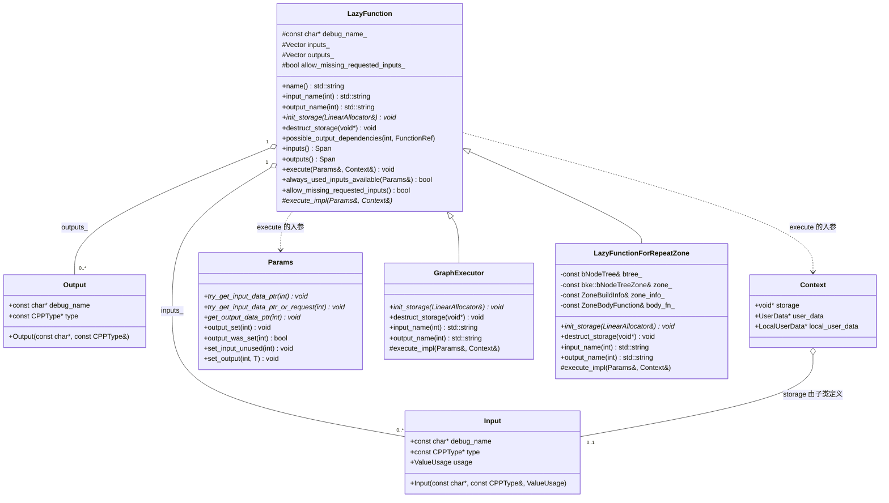
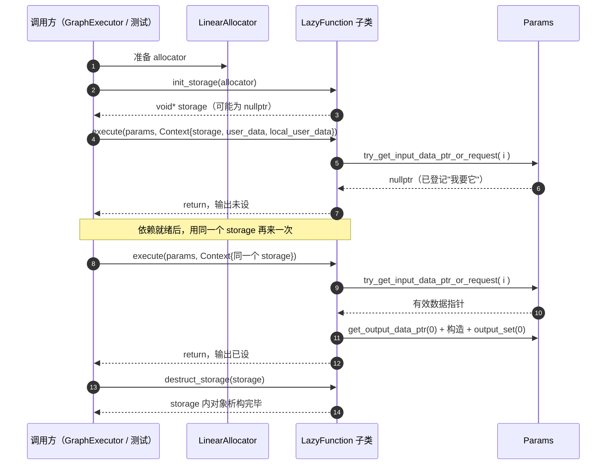
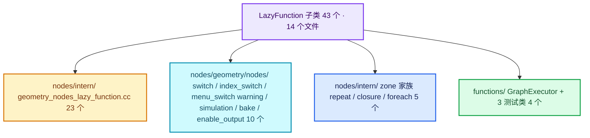
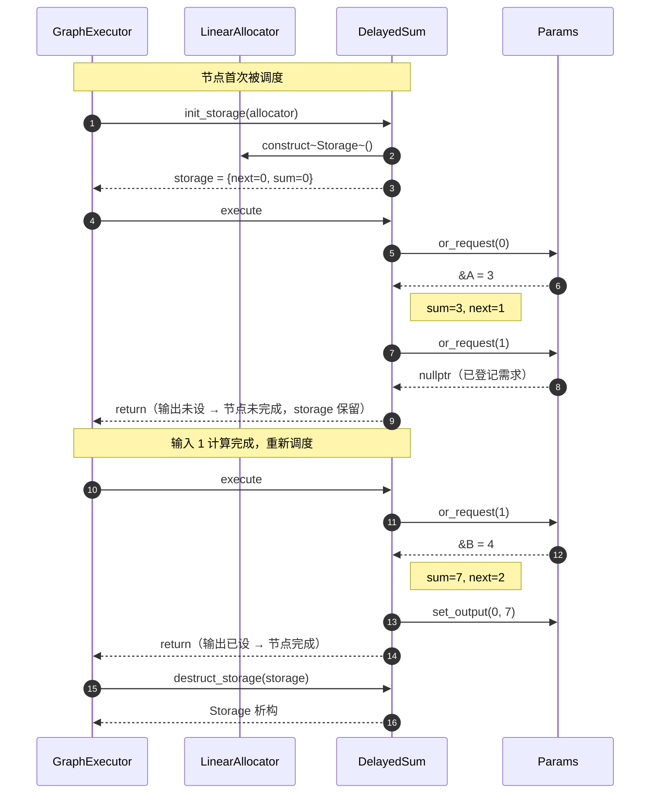
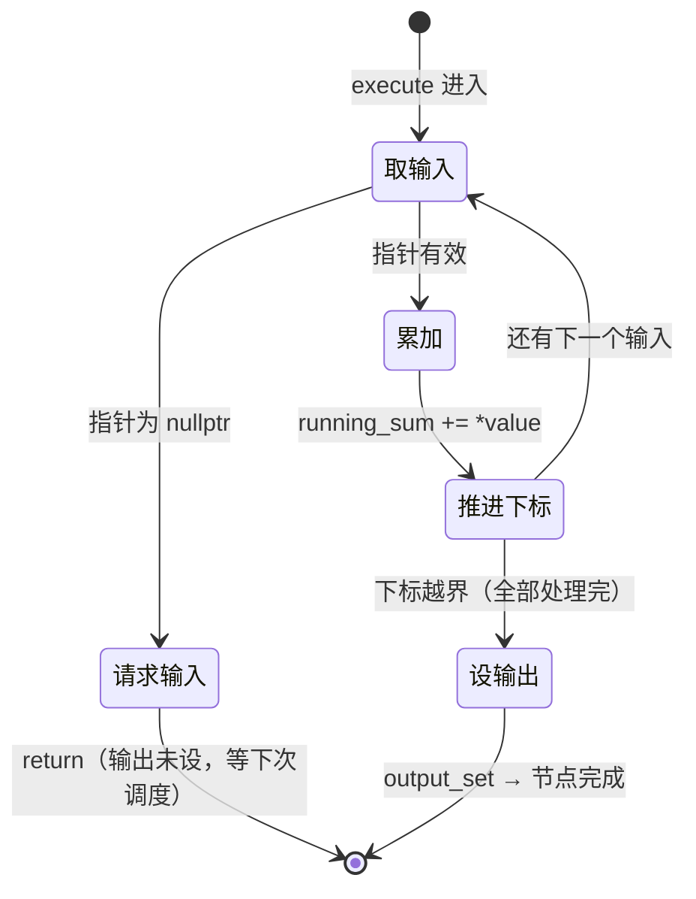
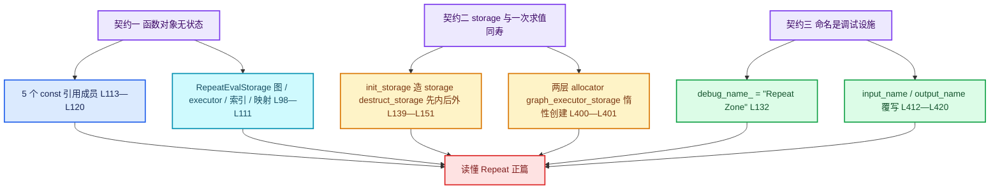

# 01 章 · 惰性执行框架（二）：LazyFunction 接口契约

<div style="font-family:'Segoe UI','Microsoft YaHei',system-ui,-apple-system,sans-serif;display:flex;flex-wrap:wrap;align-items:center;gap:8px;margin:16px 0 20px;padding:10px 14px;background:#F8FAFC;border:1px solid #E2E8F0;border-radius:12px">
<span style="font-size:11px;font-weight:700;letter-spacing:.1em;color:#64748B;margin-right:2px">导航</span>
<a href="../README.md" style="font-size:13px;color:#334155;background:#F1F5F9;border:1px solid #E2E8F0;border-radius:999px;padding:3px 12px;text-decoration:none;white-space:nowrap">总入口</a>
<a href="./README.md" style="font-size:13px;color:#2563EB;background:#EFF6FF;border:1px solid #BFDBFE;border-radius:999px;padding:3px 12px;text-decoration:none;white-space:nowrap">本章 01-惰性执行框架</a>
<a href="./01-惰性求值模型与状态机.md" style="font-size:13px;color:#2563EB;background:#EFF6FF;border:1px solid #BFDBFE;border-radius:999px;padding:3px 12px;text-decoration:none;white-space:nowrap">‹ 01-惰性求值模型与状态机</a>
<a href="./03-Params调用约定.md" style="font-size:13px;color:#7C3AED;background:#F5F3FF;border:1px solid #DDD6FE;border-radius:999px;padding:3px 12px;text-decoration:none;white-space:nowrap">03-Params调用约定 ›</a>
</div>

<div style="font-family:'Segoe UI','Microsoft YaHei',system-ui,-apple-system,sans-serif;margin:18px 0 22px;padding:14px 18px;background:#F5F3FF;border-left:4px solid #7C3AED;border-radius:10px">

系列定位：本篇是《重复区域前置知识》系列 01 章第 2 篇。它回答：写一个自定义惰性函数，最少要实现哪几个方法，各自的契约是什么。

</div>

<hr style="border:none;height:1px;background:linear-gradient(90deg,#BFDBFE,#E2E8F0 55%,transparent);margin:34px 0">

上一篇把 `LazyFunction` 当成一台"会暂停的状态机"来看。这一篇换一个视角：**它是一份合同**。

合同的两端，一边是**写函数的人**（Blender 里 40 多个子类的作者），一边是**调函数的人**（`GraphExecutor`、`execute_lazy_function_eagerly`、各个 zone 的 wrapper）。合同规定：写函数的人可以拥有私有状态，但必须把它放在指定的地方；调函数的人保证在什么时刻把 storage 递进来、在什么时刻收回去。任何一方违约，编译器不会报错，运行时会在某个随机帧崩掉。

本文只做一件事：把 [FN_lazy_function.hh · L243—L325](../../../source/blender/functions/FN_lazy_function.hh#L243) 这 83 行里**没有写全、但必须遵守**的规则，一条一条摊开。

## 先回答一个具体问题：写一个自定义惰性函数，最少要实现哪几个方法？

**一个**。只要实现纯虚的 `execute_impl`，再在构造函数里填好 `inputs_` / `outputs_`，这个类就能编译、能进图、能被求值。

Blender 自己的测试就是最小样板，看 [FN_lazy_function_test.cc · L19—L35](../../../source/blender/functions/tests/FN_lazy_function_test.cc#L19)：

```cpp
class AddLazyFunction : public LazyFunction {
 public:
  AddLazyFunction()
  {
    debug_name_ = "Add";                                  // ① 调试名
    inputs_.append({"A", CPPType::get<int>()});           // ② 声明输入
    inputs_.append({"B", CPPType::get<int>()});
    outputs_.append({"Result", CPPType::get<int>()});     // ③ 声明输出
  }

  void execute_impl(Params &params, const Context & /*context*/) const override
  {
    const int a = params.get_input<int>(0);               // ④ 取输入
    const int b = params.get_input<int>(1);
    params.set_output(0, a + b);                          // ⑤ 设输出
  }
};
```

`[讲解]` 这 17 行覆盖了接口契约的**全部必填项**，一个不多：

- `debug_name_` 有默认值 `"unknown"`，不写也能编译，只是调试时你在执行图里看到的节点全叫 unknown；
- `inputs_` / `outputs_` 可以为空（`LazyFunctionForViewerNode` 就没有输出）；
- `init_storage` 默认返回 `nullptr`，`destruct_storage` 默认断言"必须是 nullptr"——所以**无状态函数什么都不用写**；
- `possible_output_dependencies` 默认"每个输出依赖每个输入"，够用；
- `name()` / `input_name()` / `output_name()` 有默认实现，直接读 `debug_name_` 和 `Input::debug_name`。

把"最少"和"完整"的差距列成表，就是这一篇的目录：

| 方法 | 是否必须 | 不实现时的默认行为 | 什么时候才必须实现 |
| --- | --- | --- | --- |
| `execute_impl` | **必须**（唯一纯虚） | 无 | 永远 |
| 构造函数里填 `inputs_`/`outputs_` | **事实上必须** | 空接口，图里接不上任何东西 | 永远 |
| `init_storage` | 可选 | 返回 `nullptr` | 需要跨多次 `execute` 保存进度时 |
| `destruct_storage` | 可选 | 断言 `storage == nullptr` | 与 `init_storage` 成对出现时 |
| `possible_output_dependencies` | 可选 | 每个输出依赖每个输入 | 图里有环、需要精确依赖分析时 |
| `name` / `input_name` / `output_name` | 可选 | 读 `debug_name_` / `Input::debug_name` | 名字需要动态拼装时 |
| `~LazyFunction` | 可选 | 编译器生成的虚析构 | 几乎永远不用写 |

**"必须实现的只有一个纯虚函数；容易违反的却有整整三条契约。"** 编译器只守第一条，后三条只能靠你读懂注释。

</div>

所以本文不按"方法"组织，而按"契约"组织。因为新手写崩一个自定义 LazyFunction，几乎从来不是因为漏了哪个虚函数（编不过就发现了），而是因为踩了下面三条**编译期完全静默**的坑：

1. 把可变状态写成了成员变量；
2. 以为 `init_storage` 是构造函数、`destruct_storage` 是析构函数；
3. 在热路径上调 `name()`，或者把临时字符串塞进 `debug_name_`。

## 类定义全貌

### 保护成员：只有四个字段

整份合同的状态面就这么宽：

```cpp
class LazyFunction {
 protected:
  const char *debug_name_ = "unknown";
  Vector<Input> inputs_;
  Vector<Output> outputs_;
  /**
   * Allow executing the function even if previously requested values are not yet available.
   */
  bool allow_missing_requested_inputs_ = false;
```

`[讲解]` 逐个说：

- **`debug_name_` 是 `const char *`，不是 `std::string`**。这不是随手写的。它决定了你不能写 `debug_name_ = fmt::format("Repeat {}", n).c_str()`——那个临时 `std::string` 在语句结束时就没了，指针立刻悬垂。凡是需要动态名字的子类，一律改为覆写 `name()`（`LazyFunctionForGroupNode` 就是这么做的，见 [geometry_nodes_lazy_function.cc · L1247—L1251](../../../source/blender/nodes/intern/geometry_nodes_lazy_function.cc#L1247)）。反过来说，能用静态字面量的地方都用字面量：`"Repeat Zone"`、`"Logical Or"`、`"Bake"`、`"Reroute"`。

- **`inputs_` / `outputs_` 是 `Vector<Input>` 而非 `Span`**：接口在构造期一次性长齐，之后只读不写。`inputs()` / `outputs()` 对外只暴露 `Span`（只读视图），这正是"接口在构造后冻结"的类型级表达。

- **`allow_missing_requested_inputs_` 默认 `false`**。它控制一个断言：`execute()` 在调用 `execute_impl()` 之前会检查"所有标了 `ValueUsage::Used` 的输入是否真的就绪"（见下文 [契约二](#三个必须理解的契约)）。置 `true` 表示"我这个函数即使上次请求的值还没到，也允许被再执行一次，好让我推进别的部分"。全仓库只有两处把它置 `true`：`GraphExecutor`（[lazy_function_graph_executor.cc · L50](../../../source/blender/functions/intern/lazy_function_graph_executor.cc#L50)）和 `LazyFunctionForGroupNode`（[geometry_nodes_lazy_function.cc · L1155](../../../source/blender/nodes/intern/geometry_nodes_lazy_function.cc#L1155)），另外测试里有一处。

### 虚函数一览表

| 签名 | 是否必须 | 默认行为（实现位置） | 何时被调用 |
| --- | --- | --- | --- |
| `virtual ~LazyFunction() = default` | 否 | 编译器生成（L258） | 函数对象销毁时；**与 storage 无关** |
| `virtual std::string name() const` | 否 | 返回 `debug_name_`（[lazy_function.cc · L13](../../../source/blender/functions/intern/lazy_function.cc#L13)） | `Node::name()`、`to_dot()`、日志 |
| `virtual std::string input_name(int) const` | 否 | 返回 `inputs_[i].debug_name`（L18） | `Socket::name()`、构图、日志 |
| `virtual std::string output_name(int) const` | 否 | 返回 `outputs_[i].debug_name`（L23） | 同上 |
| `virtual void *init_storage(LinearAllocator &) const` | 否 | 返回 `nullptr`（L28） | **一次求值的开头**，由调用方调用 |
| `virtual void destruct_storage(void *) const` | 否 | 断言参数为 `nullptr`（L33） | **一次求值的结尾**，由调用方调用 |
| `virtual void possible_output_dependencies(int, FunctionRef<void(Span<int>)>) const` | 否 | 回调全部输入下标（L39） | 构图期、`fix_link_cycles` 里，**每求值一次可能多次** |
| `void execute(Params &, const Context &) const` | **非虚** | 加 profiling scope + 断言，再转 `execute_impl`（L341） | 每次调度到该节点 |
| `virtual void execute_impl(Params &, const Context &) const = 0` | **必须** | 无 | 由 `execute` 转发 |

`[讲解]` 这张表里藏着两个非常容易被忽略的设计：

**(1) `execute` 不是虚函数，`execute_impl` 才是。** 看 [FN_lazy_function.hh · L341—L347](../../../source/blender/functions/FN_lazy_function.hh#L341)：

```cpp
inline void LazyFunction::execute(Params &params, const Context &context) const
{
  PRF_scope_with_name("LazyFunction", ProfileCategory::Default);
  PRF_scope_set_dynamic_name("%s", debug_name_);
  BLI_assert(this->always_used_inputs_available(params));
  this->execute_impl(params, context);
}
```

这是典型的 **NVI（Non-Virtual Interface）**：外层非虚函数负责埋钩子（性能分析作用域、契约断言），内层纯虚函数负责业务。子类**永远不要**覆写 `execute`——它压根不是虚的，你也覆盖不了。这也解释了为什么 `debug_name_` 是 `const char*` 而不是 `std::string`：它要在每个节点每次执行的 profiling scope 里当格式参数用，绝不能有分配。

**(2) 名字三件套是 `virtual` 纯粹出于"按需生成"。** 头文件注释（L260—L264）写得很直白：

```cpp
  /**
   * Get a name of the function or an input or output. This is mainly used for debugging.
   * These are virtual functions because the names are often not used outside of debugging
   * workflows. This way the names are only generated when they are actually needed.
   */
```

注意这里的因果链：**因为**名字很少被用到，**所以**做成虚函数；**因为**是虚函数，**所以**可以延迟到真正要的时候才拼字符串（虚调用意味着"我不用就不付代价"，而如果名字是构造期就填好的 `std::string` 字段，那么每个节点、每个 socket 都要常驻一份堆内存）。这是 C++ 里"惰性求值"思想在元数据上的复用——和 LazyFunction 本身的思想是同一个。

### 非虚便利接口

| 方法 | 作用 | 位置 |
| --- | --- | --- |
| `Span<Input> inputs() const` | 只读接口视图 | L290、L331 |
| `Span<Output> outputs() const` | 只读接口视图 | L294、L336 |
| `bool always_used_inputs_available(const Params &) const` | 检查 `Used` 输入是否齐备 | L306、[lazy_function.cc · L50](../../../source/blender/functions/intern/lazy_function.cc#L50) |
| `bool allow_missing_requested_inputs() const` | 读上面那个 bool | L314 |

`always_used_inputs_available` 的实现值得单独抄一遍，因为它是**唯一一处把 `Input::usage` 的承诺变成运行时检查**的地方：

```cpp
bool LazyFunction::always_used_inputs_available(const Params &params) const
{
  if (allow_missing_requested_inputs_) {
    return true;
  }
  for (const int i : inputs_.index_range()) {
    const Input &fn_input = inputs_[i];
    if (fn_input.usage == ValueUsage::Used) {
      if (params.try_get_input_data_ptr(i) == nullptr) {
        return false;
      }
    }
  }
  return true;
}
```

`[讲解]` 三件事一次说清：

- 只检查 `Used`，`Maybe` / `Unused` 一律放行；
- 检查方式是**非请求式**的 `try_get_input_data_ptr`（拿不到就返回 null，不登记需求）——断言绝不允许有副作用；
- `allow_missing_requested_inputs_ == true` 时整段短路。这就是那个 bool 的全部作用。

### 类图



> 说明：`classDiagram` 在 Mermaid 中不支持 `classDef` 语法，因此这张图使用默认主题；本章其余流程图 / 状态图统一使用系列六色 `classDef` 调色板。

## 三个必须理解的契约

### 契约一：函数对象是**无状态**的

#### 事实依据

`FunctionNode` 里存的是**指针**，不是副本（[FN_lazy_function_graph.hh · L133—L139](../../../source/blender/functions/FN_lazy_function_graph.hh#L133)）：

```cpp
class Node : NonCopyable, NonMovable {
 protected:
  /**
   * The function this node corresponds to. If this is null, the node is an #InterfaceNode.
   * The function is not owned by this #Node nor by the #Graph.
   */
  const LazyFunction *fn_ = nullptr;
```

那句 *"The function is not owned by this #Node nor by the #Graph"* 是全篇最重要的一行注释。

它意味着三个后果：

1. **同一个函数对象可以被放进多个 `FunctionNode`**。测试里 `AddLazyFunction add_fn;` 一个对象被 `graph.add_function(add_fn)` 加了两次（[FN_lazy_function_test.cc · L91—L96](../../../source/blender/functions/tests/FN_lazy_function_test.cc#L91)）。如果 `AddLazyFunction` 有个 `int counter_` 成员，两个节点会互相污染。
2. **函数对象可以活得比图更久，也可以被多个图共享**。`LazyFunctionForRepeatZone` 由 `ResourceScope` 持有（[geometry_nodes_repeat_zone.cc · L423—L430](../../../source/blender/nodes/intern/geometry_nodes_repeat_zone.cc#L423)），一次几何节点求值可能生成几十张图，共用同一批函数对象。
3. **执行是并发的**。执行器一旦开启多线程（`try_enable_multi_threading`，[generic · L1254](../../../source/blender/functions/intern/lazy_function_graph_executor_generic.hh#L1254)），同一时刻可能在多个线程上跑**同一个函数对象的两个不同节点**。`execute_impl` 是 `const` 方法——这个 `const` 不是装饰，是并发正确性的类型级保证：任何"看起来能改"的成员都必须加 `mutable`，而一旦加了 `mutable` 就要自己承担数据竞争。

#### 那状态放哪？——`Context::storage`

看 [FN_lazy_function.hh · L83—L97](../../../source/blender/functions/FN_lazy_function.hh#L83)：

```cpp
struct Context {
  /**
   * If the lazy-function has some state (which only makes sense when it is executed more than once
   * to finish its job), the state is stored here. This points to memory returned from
   * #LazyFunction::init_storage.
   */
  void *storage;
  ...
};
```

`[讲解]` 这句话把"什么算状态"定义清楚了：**只有当一个函数需要被执行多次才能完成工作时，状态才有意义**。单次完成的函数（`AddLazyFunction`）不需要状态。需要多次的函数（`Logical Or` 逐个请求输入、`Repeat Zone` 反复调 body）必须把进度放在 storage。

#### 对比：违反契约的写法长什么样

```cpp
// ✗ 错误示范：状态在成员变量上
class BadSum : public LazyFunction {
  int running_sum_ = 0;   // ← 灾难
 public:
  void execute_impl(Params &params, const Context &) const override
  {
    running_sum_ += params.get_input<int>(0);   // 编译不过（const 方法）
    params.set_output(0, running_sum_);
  }
};
```

先注意：**它甚至编译不过**，因为 `execute_impl` 是 `const`。有人会顺手加 `mutable`：

```cpp
// ✗ 更糟：加了 mutable 骗过编译器
class BadSum : public LazyFunction {
  mutable int running_sum_ = 0;   // ← 编译器闭嘴了，运行期开始出错
  ...
};
```

现在它能编译了，然后会以三种方式出错：

| 场景 | 后果 |
| --- | --- |
| 同一函数对象放进两个 `FunctionNode` | 第二次求值从第一次的结果开始累加 |
| 同一张图被求值两次（改个参数重算） | 第二次求值结果直接翻倍 |
| 多线程执行两个节点 | 数据竞争，结果不确定，且 `-fsanitize=thread` 会报 |

正确写法见本文 [最小实现模板](#最小实现模板)。

---

### 契约二：storage 的生命周期是"一次求值"，不是"对象一生"

#### 事实依据一：eager 路径——首尾成对

最容易看懂的实现是那个给测试用的便利函数（[FN_lazy_function_execute.hh · L116—L127](../../../source/blender/functions/FN_lazy_function_execute.hh#L116)）：

```cpp
  output_usages.fill(ValueUsage::Used);
  set_outputs.fill(false);
  LinearAllocator<> allocator;
  Context context(fn.init_storage(allocator), user_data, local_user_data);
  BasicParams params{
      fn, input_pointers, output_pointers, input_usages, output_usages, set_outputs};
  fn.execute(params, context);
  fn.destruct_storage(context.storage);

  /* Make sure all outputs have been computed. */
  BLI_assert(!Span<bool>(set_outputs).contains(false));
```

`[讲解]` 三行，把契约画出来了：

```
init_storage(allocator)  →  execute(params, context)  →  destruct_storage(storage)
```

紧挨着的两条注释/断言各有深意：

- `LinearAllocator<> allocator;` 是**栈上的局部变量**。storage 的内存在这个 allocator 上，函数返回就随栈一起消失。所以 storage 里的对象**不能有任何需要"归还给外部"的资源**——没有 `new`，没有 `fopen`，没有 `malloc`。需要额外内存时，用传入的 allocator 继续分配（`RepeatEvalStorage` 里就藏了一个自己的 `LinearAllocator<> allocator;`）。
- `BLI_assert(!Span<bool>(set_outputs).contains(false));` —— 一次 eager 求值结束后，**所有输出都必须被设置过**。这条断言在 debug 构建里会当场打脸"忘记调 `output_set`"的写法（见 [反例 4](#反例与边界)）。

#### 事实依据二：图执行器路径——storage 与"节点的一生"同寿

真跑几何节点时走的是 `GraphExecutor`，它对 storage 的管理粒度**不是每次 `execute`，而是每个节点的整个生命周期**。三处代码拼出完整时间线：

**（a）第一次被调度时创建**（[generic · L934—L937](../../../source/blender/functions/intern/lazy_function_graph_executor_generic.hh#L934)）：

```cpp
    if (node_needs_execution) {
      if (!node_state.storage_and_defaults_initialized) {
        /* Initialize storage. */
        node_state.storage = fn.init_storage(allocator);
```

**（b）节点结束时销毁**（[generic · L1051—L1057](../../../source/blender/functions/intern/lazy_function_graph_executor_generic.hh#L1051)）：

```cpp
    if (node_state.storage != nullptr) {
      if (node.is_function()) {
        const FunctionNode &fn_node = static_cast<const FunctionNode &>(node);
        fn_node.function().destruct_storage(node_state.storage);
      }
      node_state.storage = nullptr;
    }
```

**（c）兜底：节点状态销毁时再检查一次**（[generic · L503—L510](../../../source/blender/functions/intern/lazy_function_graph_executor_generic.hh#L503)）：

```cpp
  void destruct_node_state(const Node &node, NodeState &node_state)
  {
    if (node.is_function()) {
      const LazyFunction &fn = static_cast<const FunctionNode &>(node).function();
      if (node_state.storage != nullptr) {
        fn.destruct_storage(node_state.storage);
      }
    }
```

`[讲解]` 把三种路径并排，才能得出**准确**的结论：

| 求值路径 | `init_storage` 何时调 | `destruct_storage` 何时调 | storage 覆盖的区间 |
| --- | --- | --- | --- |
| `execute_lazy_function_eagerly` | `execute` 之前 | `execute` 之后立刻 | 一次 `execute` |
| `GraphExecutor` 中的节点 | 该节点**第一次**需要执行时 | 该节点**最后一次**执行完、判定 finished 时 | 该节点的全部 `execute`（可能 1 次，也可能 N 次） |
| 直接手写调用（如 `evaluate_closure_eagerly`） | 调用方自己决定 | 调用方自己决定 | 同上 |

所以本文开头的说法要精确化：**`init_storage` / `destruct_storage` 是"一次求值"的首尾成对，而不是"每次 `execute`"的首尾成对。** 图执行器之所以敢把区间放大，是因为它知道这个节点还要不要再执行（`finish_node_if_possible`）；一旦确定不再执行，立刻 `destruct_storage`。两种路径给出的共同承诺只有一条：

> **同一个 storage 指针，在它的一生内只会被 `init_storage` 创建一次、被 `destruct_storage` 销毁一次；期间 `execute` 可以被调用任意多次。**

#### 这条契约的三个推论

**推论 1：`init_storage` 不是构造函数。** 函数对象在构造时 `this` 就绪了；而 `init_storage` 可能被调用**很多次**（同一函数对象在不同图、不同求值里各调一次），每次产出一个独立的 storage。所以：

```cpp
void *init_storage(LinearAllocator<> &allocator) const override
{
  return allocator.construct<Storage>().release();   // ✓ 每次调用造一份新的
}
```

`allocator.construct<T>()` 返回的是 `destruct_ptr<T>`（[BLI_memory_utils.hh · L108—L111](../../../source/blender/blenlib/BLI_memory_utils.hh#L108)）——"像 `unique_ptr` 但只调析构、不 free 内存"。`.release()` 取出裸指针，交给调用方保管。

**推论 2：`destruct_storage` 不是析构函数。** 它在 storage 该消失时被调，**不是**在 `LazyFunction` 对象销毁时被调。`LazyFunction` 的析构函数（L258）与 storage 毫无关系。写 `~MyFn() { delete storage_; }` 是双重错误：既存了不该存的成员，又在错误的时刻释放。

**推论 3：storage 内部可以再嵌一层 storage。** 这是 zone wrapper 的通用模式——`LazyFunctionForRepeatZone` 的 `RepeatEvalStorage` 里存着 `graph_executor_storage`，而它是**在第一次 `execute` 时才创建**的（[geometry_nodes_repeat_zone.cc · L400—L401](../../../source/blender/nodes/intern/geometry_nodes_repeat_zone.cc#L400)），比 storage 本身晚。所以 `destruct_storage` 里必须先判空：

```cpp
  void destruct_storage(void *storage) const override
  {
    RepeatEvalStorage *s = static_cast<RepeatEvalStorage *>(storage);
    if (s->graph_executor_storage) {          // ← 必须判空：可能从未 execute 过
      s->graph_executor->destruct_storage(s->graph_executor_storage);
    }
    std::destroy_at(s);                        // ← 只调析构，不 free（内存在 allocator 上）
  }
```

#### 生命周期总览图

```mermaid
flowchart LR
  A["函数对象构造 LazyFunction 子类 ctor 填 inputs_ / outputs_"]:::abstraction
  B["init_storage(allocator) 返回 void* storage"]:::compute
  C["execute #1 Context{storage,...}"]:::input
  D["execute #2…N 同一个 storage 指针"]:::input
  E["destruct_storage(storage) 销毁 storage 内对象"]:::error
  F["函数对象析构 virtual ~LazyFunction()"]:::data
  A --> B
  B --> C
  C -->|"输出未齐 / 请求了新输入"| D
  D -->|"全部输出已设 或 节点 finished"| E
  B -.->|"注意：不在同一时刻"| F
  E --> F
  classDef input fill:#DBEAFE,stroke:#2563EB,color:#172554,stroke-width:2px;
  classDef data fill:#CFFAFE,stroke:#0891B2,color:#164E63,stroke-width:2px;
  classDef abstraction fill:#EDE9FE,stroke:#7C3AED,color:#3B0764,stroke-width:2px;
  classDef compute fill:#FEF3C7,stroke:#D97706,color:#78350F,stroke-width:2px;
  classDef result fill:#DCFCE7,stroke:#16A34A,color:#14532D,stroke-width:2px;
  classDef error fill:#FEE2E2,stroke:#DC2626,color:#7F1D1D,stroke-width:2px;
```



#### 真实调用序列（时序图）



---

### 契约三：命名是调试设施，不是热路径

#### 事实依据

三件套的默认实现全部在 [intern/lazy_function.cc · L13—L26](../../../source/blender/functions/intern/lazy_function.cc#L13)：

```cpp
std::string LazyFunction::name() const
{
  return debug_name_;
}

std::string LazyFunction::input_name(int index) const
{
  return inputs_[index].debug_name;
}

std::string LazyFunction::output_name(int index) const
{
  return outputs_[index].debug_name;
}
```

注意返回类型是 `std::string`（值，不是 `StringRef`）。**每一次调用都构造一个堆分配的字符串**（小字符串可能走 SSO，但语义上仍是构造 + 析构）。

再看它们真正的调用点——只有三处（全仓库检索结果）：

| 调用点 | 文件 | 频率 |
| --- | --- | --- |
| `Socket::name()` | [lazy_function_graph.cc · L150—L162](../../../source/blender/functions/intern/lazy_function_graph.cc#L150) | 每个 socket 每次取名一次 |
| `Node::name()` | [lazy_function_graph.cc · L172—L178](../../../source/blender/functions/intern/lazy_function_graph.cc#L172) | 每个节点每次取名一次 |
| `to_dot()` / `detailed_name()` | [lazy_function_graph.cc · L164—L170, L213](../../../source/blender/functions/intern/lazy_function_graph.cc#L164) | 导出调试图时 |

`[讲解]` 结论很清楚：这套名字服务于 **`graph.to_dot()`、日志、报错信息**。几何节点可以通过 `btree_orig.runtime->logged_zone_graphs` 把 zone 的执行图导出成 dot 文件（[geometry_nodes_repeat_zone.cc · L403—L409](../../../source/blender/nodes/intern/geometry_nodes_repeat_zone.cc#L403)），那时你会看到 `"Repeat Zone"`、`"Input"`、`"Usage: Geometry"` 这些字符串——它们就是这套 API 存在的理由。

#### 为什么是 virtual

回到头文件注释（L260—L264）：*"These are virtual functions because the names are often not used outside of debugging workflows. This way the names are only generated when they are actually needed."*

拆开看是两步推理：

1. 假如名字是**构造期填好的字段**，那每个节点、每个 socket 都要常驻一个 `std::string`。一张几何节点图动辄几千个 socket，这是纯粹的浪费。
2. 所以改成**函数**。而函数要能被覆写（因为有些名字必须现算），所以是 `virtual`。

于是"按需生成"这个性能目标，恰好由"虚函数"这个语言特性实现了。这与 `LazyFunction` 本身的惰性求值哲学是同构的：**不用的东西不要算**。

#### 什么时候必须覆写

看两个真实子类的对比：

| 子类 | 是否覆写 | 为什么 |
| --- | --- | --- |
| `LazyFunctionForRepeatZone` | 覆写 `input_name`/`output_name`（L412—L420） | zone wrapper 的接口是 `initialize_zone_wrapper` 动态拼出来的，`Input::debug_name` 只能给出 `"Usage"` 这种粗糙名字，需要区分成 `"Usage: Geometry"` |
| `LazyFunctionForGroupNode` | 覆写 `name()`（L1247）**和三件套**（L1253—L1261） | 组名是运行期才知道的，且要转发给内层函数 |
| `GraphExecutor` | 覆写 `input_name`/`output_name`（L85—L95） | 转发给图接口 socket 的名字 |
| `LazyFunctionForGeometryNode` | 覆写 `input_name`（L251—L272） | usage / reference set 类的输入需要拼出 `"Use Output 'X'"` |
| `AddLazyFunction`（测试） | 不覆写 | 静态名字够用 |

`LazyFunctionForRepeatZone` 的覆写值得抄下来，因为它演示了"转发 + 拼装"的标准姿势：

```cpp
  std::string input_name(const int i) const override
  {
    return zone_wrapper_input_name(zone_info_, zone_, inputs_, i);
  }

  std::string output_name(const int i) const override
  {
    return zone_wrapper_output_name(zone_info_, zone_, outputs_, i);
  }
```

而 `zone_wrapper_input_name`（[geometry_nodes_lazy_function.cc · L1758—L1776](../../../source/blender/nodes/intern/geometry_nodes_lazy_function.cc#L1758)）内部做的事，正是"查表 → 找到对应 bNodeSocket → 拼 `"Usage: " + name`"，最后兜底 `return inputs[lf_socket_i].debug_name;`。**每次调用都遍历一遍 socket 链表**——这在调试时完全无所谓，在每帧几百次的热路径上就是事故。

#### 一个例外，也是唯一的例外

`debug_name_` 本身确实在热路径上被用到，但它**不构造字符串**：`PRF_scope_set_dynamic_name("%s", debug_name_)`（[FN_lazy_function.hh · L344](../../../source/blender/functions/FN_lazy_function.hh#L344)）只把 `const char*` 交给 profiling 后端。这就是为什么字段是 `const char *` 而不是 `std::string`——**profiling 名字必须零分配**。

<details> <summary>核对原始源码：FN_lazy_function.hh · L243—L267</summary>

```cpp
/**
 * A function that can compute outputs and request inputs lazily. For more details see the comment
 * at the top of the file.
 */
class LazyFunction {
 protected:
  const char *debug_name_ = "unknown";
  Vector<Input> inputs_;
  Vector<Output> outputs_;
  /**
   * Allow executing the function even if previously requested values are not yet available.
   */
  bool allow_missing_requested_inputs_ = false;

 public:
  virtual ~LazyFunction() = default;

  /**
   * Get a name of the function or an input or output. This is mainly used for debugging.
   * These are virtual functions because the names are often not used outside of debugging
   * workflows. This way the names are only generated when they are actually needed.
   */
  virtual std::string name() const;
  virtual std::string input_name(int index) const;
  virtual std::string output_name(int index) const;
```

</details>

## Input/Output 结构详解

### 全貌

两个结构加起来只有 43 行，却定义了整个框架的"接口描述语言"（[FN_lazy_function.hh · L199—L241](../../../source/blender/functions/FN_lazy_function.hh#L199)）：

```cpp
/**
 * Describes an input of a #LazyFunction.
 */
struct Input {
  /**
   * Name used for debugging purposes. The string has to be static or has to be owned by something
   * else.
   */
  const char *debug_name;
  /**
   * Data type of this input.
   */
  const CPPType *type;
  /**
   * Can be used to indicate a caller or this function if this input is used statically before
   * executing it the first time. This is technically not needed but can improve efficiency because
   * a round-trip through the `execute` method can be avoided.
   *
   * When this is #ValueUsage::Used, the caller has to ensure that the input is definitely
   * available when the #execute method is first called. The #execute method does not have to check
   * whether the value is actually available.
   */
  ValueUsage usage;

  Input(const char *debug_name, const CPPType &type, const ValueUsage usage = ValueUsage::Used)
      : debug_name(debug_name), type(&type), usage(usage)
  {
  }
};

struct Output {
  /**
   * Name used for debugging purposes. The string has to be static or has to be owned by something
   * else.
   */
  const char *debug_name;
  /**
   * Data type of this output.
   */
  const CPPType *type = nullptr;

  Output(const char *debug_name, const CPPType &type) : debug_name(debug_name), type(&type) {}
};
```

### 字段逐讲：`debug_name`

**类型**：`const char *` **约束**：注释里那句 *"The string has to be static or has to be owned by something else."*

`[讲解]` 三种合法来源，三种非法来源：

| 合法 | 例子 |
| --- | --- |
| 字符串字面量 | `"Repeat Zone"`、`"Input"`、`"Usage"` |
| `bNodeSocket::name`（由树持有） | `socket->name`（`initialize_zone_wrapper` 大量这么用） |
| 静态数组 / 长生命周期对象成员 | `static const char msg[] = "x";` |

| 非法 | 后果 |
| --- | --- |
| `std::string(...).c_str()` | 语句结束即悬垂 |
| 局部 `Array<char>` | 出作用域即悬垂 |
| `fmt::format(...)` 的返回值 | 同上 |

这就是为什么 `initialize_zone_wrapper` 里所有 `append_and_get_index_as(...)` 的第二个参数都是 `socket->name`——它是 `bNodeSocket` 的成员，活得比 `LazyFunction` 久。

### 字段逐讲：`type`

**类型**：`const CPPType *`，构造时由 `const CPPType &` 取地址。

`[讲解]` `CPPType` 是 Blender 的类型擦除基座（`int`、`float3`、`GeometrySet`、`SocketValueVariant` 各有一个单例）。`Input` 存**指针**而不是引用，是为了让 `Input` 可平凡拷贝进 `Vector`。

`Output::type` 有默认值 `nullptr`——这个默认值从来不会被用到（构造函数强制传参），只是为了让结构体在数组里能默认构造。真正的含义是：**类型在构造后不可变**。

### 字段逐讲：`usage` —— 全篇最需要理解的 12 行注释

`Input::usage` 的类型是三值枚举（[FN_lazy_function.hh · L61—L76](../../../source/blender/functions/FN_lazy_function.hh#L61)）：

```cpp
enum class ValueUsage : uint8_t {
  /**
   * The value is definitely used and therefore has to be computed.
   */
  Used,
  /**
   * It's unknown whether this value will be used or not. Computing it is ok but the result may be
   * discarded.
   */
  Maybe,
  /**
   * The value will definitely not be used. It can still be computed but the result will be
   * discarded in all cases.
   */
  Unused,
};
```

而在 `Input` 里，`usage` 的语义被注释进一步收紧（L213—L220）：

> *"When this is `ValueUsage::Used`, the caller has to ensure that the input is definitely available when the `execute` method is first called. The `execute` method does not have to check whether the value is actually available."*

`[讲解]` 这是一句**双边的免责条款**，两边各让一步：

- **调用方承诺**：标了 `Used`，我在第一次 `execute` 之前一定把它备好。备不好是我的 bug（`execute()` 里那句 `BLI_assert(always_used_inputs_available(params))` 就是抓这个）。
- **函数方获准**：因此你在 `execute_impl` 里可以直接写 `params.get_input<int>(0)`（内部 `BLI_assert(data != nullptr)` 后直接解引用），**不必**写 `if (ptr == nullptr) return;`。

对照 `ValueUsage::Maybe` 的输入，写法必须反过来：先 `try_get_input_data_ptr_or_request`，拿到 `nullptr` 就 `return`。看 `LazyFunctionForSwitchNode` 的字段声明与用法（[node_geo_switch.cc · L150—L152, L183—L199](../../../source/blender/nodes/geometry/nodes/node_geo_switch.cc#L150)）：

```cpp
    inputs_.append_as("Condition", CPPType::get<SocketValueVariant>());            // 默认 Used
    inputs_.append_as("False", cpp_type, lf::ValueUsage::Maybe);
    inputs_.append_as("True", cpp_type, lf::ValueUsage::Maybe);
```

```cpp
  void execute_single(const bool condition, lf::Params &params) const
  {
    const int input_to_forward = condition ? true_input_index : false_input_index;
    const int input_to_ignore = condition ? false_input_index : true_input_index;

    params.set_input_unused(input_to_ignore);
    void *value_to_forward = params.try_get_input_data_ptr_or_request(input_to_forward);
    if (value_to_forward == nullptr) {
      /* Try again when the value is available. */
      return;                                        // ← Maybe 输入的标配写法
    }
    ...
  }
```

这段是全框架最优雅的一处：`Condition` 是 `Used`（无条件需要），两个分支是 `Maybe`（只要一个）。执行一次，先 `set_input_unused` 告诉调度器"另一支永远别算了"，再请求需要的那一支；没到就 `return`，等执行器下一次调度。**一个 `if + return` 就实现了短路**。

### 构造方式：直接 append，或用 `append_as`

三种写法等价，风格由代码位置决定：

```cpp
// 写法 A：显式构造（测试、老代码）
inputs_.append({"A", CPPType::get<int>()});

// 写法 B：append_as 就地构造（新代码主流，尤其带 usage 时）
inputs_.append_as("Value", CPPType::get<SocketValueVariant>(), lf::ValueUsage::Maybe);

// 写法 C：append_and_get_index_as（需要立刻知道下标时）
r_lf_index_by_bsocket[socket->index_in_tree()] =
    inputs_.append_and_get_index_as("Enable", CPPType::get<SocketValueVariant>());
```

`[讲解]` 三者都是 `Vector` 的转发构造（[BLI_vector.hh · L504—L509](../../../source/blender/blenlib/BLI_vector.hh#L504)），区别只在"要不要返回值"和"参数怎么给"。`append_as` 是 `emplace_back` 的等价物，`append_and_get_index_as` 额外返回新元素下标——几何节点大量使用后者，因为要把 `bNodeSocket` 的下标映射到 `lf` 的下标。

### 一个完整的"接口声明"实例

`LazyFunctionForWarningNode`（[node_geo_warning.cc · L41—L46](../../../source/blender/nodes/geometry/nodes/node_geo_warning.cc#L41)）只有 3 个 socket，但 `usage` 的三种选择各有讲究：

```cpp
    debug_name_ = "Warning";
    const CPPType &type = CPPType::get<SocketValueVariant>();
    inputs_.append_as("Show", type, lf::ValueUsage::Used);   // 决定是否要报警，无条件需要
    inputs_.append_as("Message", type);                      // 默认也是 Used
    outputs_.append_as("Show", type);
```

而它的 `execute_impl` 里却对 `Message` 用了 `try_get_input_data_ptr_or_request` —— 因为 `Show == false` 时可以完全不求 `Message`：

```cpp
    if (!show) {
      params.set_output(0, show_variant);
      return;
    }
    SocketValueVariant *message_variant =
        params.try_get_input_data_ptr_or_request<SocketValueVariant>(1);
    if (!message_variant) {
      /* Wait for the message to be computed. */
      return;
    }
```

`[讲解]` 这里出现了一个容易困惑的组合：**声明为 `Used`，却用 `or_request` 取**。原因在于 `Used` 只承诺"第一次 execute 时可用"，而这个函数可能在 `Show` 为 true 时**多次** execute（第一次请求 Message，第二次取到）。第一次 execute 时 `Show` 已经可用（`Used` 保证），`Message` 是否可用没有保证——因为它是被"第一次 execute 中动态决定要用"的。

这个细节说明 `usage` 是**保守声明**而非**精确契约**：写成 `Used` 只是让调度器更早准备它；函数内部仍按需请求，行为永远正确。`Input::usage` 的注释那句 *"This is technically not needed but can improve efficiency"*（L214）正是此意。

<details> <summary>核对原始源码：FN_lazy_function.hh · L199—L241</summary>

```cpp
/**
 * Describes an input of a #LazyFunction.
 */
struct Input {
  /**
   * Name used for debugging purposes. The string has to be static or has to be owned by something
   * else.
   */
  const char *debug_name;
  /**
   * Data type of this input.
   */
  const CPPType *type;
  /**
   * Can be used to indicate a caller or this function if this input is used statically before
   * executing it the first time. This is technically not needed but can improve efficiency because
   * a round-trip through the `execute` method can be avoided.
   *
   * When this is #ValueUsage::Used, the caller has to ensure that the input is definitely
   * available when the #execute method is first called. The #execute method does not have to check
   * whether the value is actually available.
   */
  ValueUsage usage;

  Input(const char *debug_name, const CPPType &type, const ValueUsage usage = ValueUsage::Used)
      : debug_name(debug_name), type(&type), usage(usage)
  {
  }
};

struct Output {
  /**
   * Name used for debugging purposes. The string has to be static or has to be owned by something
   * else.
   */
  const char *debug_name;
  /**
   * Data type of this output.
   */
  const CPPType *type = nullptr;

  Output(const char *debug_name, const CPPType &type) : debug_name(debug_name), type(&type) {}
};
```

</details>

<details> <summary>核对原始源码：intern/lazy_function.cc · L13—L48</summary>

```cpp
std::string LazyFunction::name() const
{
  return debug_name_;
}

std::string LazyFunction::input_name(int index) const
{
  return inputs_[index].debug_name;
}

std::string LazyFunction::output_name(int index) const
{
  return outputs_[index].debug_name;
}

void *LazyFunction::init_storage(LinearAllocator<> & /*allocator*/) const
{
  return nullptr;
}

void LazyFunction::destruct_storage(void *storage) const
{
  BLI_assert(storage == nullptr);
  UNUSED_VARS_NDEBUG(storage);
}

void LazyFunction::possible_output_dependencies(const int /*output_index*/,
                                                const FunctionRef<void(Span<int>)> fn) const
{
  /* The output depends on all inputs by default. */
  Vector<int, 16> indices(inputs_.size());
  for (const int i : inputs_.index_range()) {
    indices[i] = i;
  }
  fn(indices);
}
```

</details>

## possible_output_dependencies 的用途

### 默认实现：全依赖

```cpp
void LazyFunction::possible_output_dependencies(const int /*output_index*/,
                                                const FunctionRef<void(Span<int>)> fn) const
{
  /* The output depends on all inputs by default. */
  Vector<int, 16> indices(inputs_.size());
  for (const int i : inputs_.index_range()) {
    indices[i] = i;
  }
  fn(indices);
}
```

`[讲解]` 注意两点：

1. **`output_index` 被完全忽略**。默认实现里所有输出共享同一组依赖（全部输入）。
2. 它不返回 `Vector`，而是**回调** `fn(Span<int>)`。这是为了避免每次调用都分配：调用方（`fix_link_cycles`）在回调里直接把下标转成 socket 指针塞进自己的容器。

### 唯一的调用点：`fix_link_cycles`

全仓库检索 `possible_output_dependencies`，只有 4 处：

| 位置 | 角色 |
| --- | --- |
| [FN_lazy_function.hh · L284](../../../source/blender/functions/FN_lazy_function.hh#L284) | 声明 |
| [intern/lazy_function.cc · L39](../../../source/blender/functions/intern/lazy_function.cc#L39) | 默认实现 |
| [tests/FN_lazy_function_test.cc · L150](../../../source/blender/functions/tests/FN_lazy_function_test.cc#L150) | **唯一的生产级覆写（在测试里）** |
| [geometry_nodes_lazy_function.cc · L4186](../../../source/blender/nodes/intern/geometry_nodes_lazy_function.cc#L4186) | 唯一调用点 |

调用点所在的函数叫 `fix_link_cycles`，注释写了一个非常好的例子（[L4125—L4135](../../../source/blender/nodes/intern/geometry_nodes_lazy_function.cc#L4125)）：

> *"Example for a cycle: There is a `Distribute Points on Faces` node and its `Normal` output is only used when the number of generated points is larger than 1000 because of some switch node later in the tree. In this case, to know whether the `Normal` output is needed, one first has to compute the points, but for that one has to know whether the normal information has to be added to the points. The fix is to always add the normal information in this case."*

### 这套机制到底在算什么

几何节点有一类特殊的 socket：**usage socket**，它是一个 `bool`，语义是"某个 socket 会不会被用到"。这些 bool 也要由惰性函数算出来（比如 `LazyFunctionForSwitchSocketUsage`、`LazyFunctionForIndexSwitchSocketUsage`）。于是图里会出现一条链路：

```
数据类型链：  A ──────────────────► 节点 ──► 结果
usage 链：    A_usage ──► 节点_usage ──► 结果_usage
```

**usage 图是数据图的"影子"**，而且方向相反：要知道某输出会不会被用，得先知道它的消费者会不会被用——所以 usage 链从下游往上游流。当这两张图叠在一起，就可能出现环：某个节点的 usage 依赖它自己的输出可用性。

`fix_link_cycles` 做的事就是：遍历所有 socket，用 `possible_output_dependencies` 找出"这个输出可能依赖哪些输入"，沿依赖边走；一旦走回自己，说明有环，就把环上一条 usage link 拔掉、换成常量 `true`（"保守地认为它被用到了"）。

看关键那几行（[L4183—L4193](../../../source/blender/nodes/intern/geometry_nodes_lazy_function.cc#L4183)）：

```cpp
        lf::OutputSocket &lf_output_socket = lf_inout_socket->as_output();
        if (lf_node.is_function()) {
          lf::FunctionNode &lf_function_node = static_cast<lf::FunctionNode &>(lf_node);
          const lf::LazyFunction &fn = lf_function_node.function();
          fn.possible_output_dependencies(
              lf_output_socket.index(), [&](const Span<int> input_indices) {
                for (const int input_index : input_indices) {
                  lf_origin_sockets.append(&lf_node.input(input_index));
                }
              });
        }
```

`[讲解]` 如果某个函数精确地知道"输出 0 只依赖输入 0"，那 `fn_origin_sockets` 就只会有 1 个 socket，环的检测面立刻缩小；如果走默认实现（全依赖），那每个输出都被认为连着**所有**输入，环的检测面是 O(输出数 × 输入数)。

### 过度保守的代价：三个层次

| 层次 | 默认全依赖的后果 |
| --- | --- |
| 环检测 | 更容易"误判有环"。误判不算错（环被断开后换成 `true`，只会多算不会算错），但会**多算** |
| 多算的量 | 环上被断掉的 usage 输入恒为 `true` → 对应的数据输入永远不被裁掉 → 该分支的全部上游节点都被执行 |
| 图规模 | 上面那条 "Distribute Points on Faces + Normal" 的例子就是它：明明只有 1000 点以上才要 Normal，但因为环被保守断开，**每次都要附法线** |

所以 `possible_output_dependencies` 是一个**纯优化接口**：不实现，正确性无损，性能有损。

### 用"最短路 / OR"举例

#### 例子 1：逻辑或（短路求值）

`LazyFunctionForLogicalOr`（[NOD_geometry_nodes_lazy_function.hh · L580—L589](../../../source/blender/nodes/NOD_geometry_nodes_lazy_function.hh#L580)）的文档注释就是短路的定义：

```cpp
/**
 * Computes the logical or of the inputs and supports short-circuit evaluation (i.e. if the first
 * input is true already, the other inputs are not checked).
 */
class LazyFunctionForLogicalOr : public lf::LazyFunction {
```

它的执行逻辑（[geometry_nodes_lazy_function.cc · L1273—L1300](../../../source/blender/nodes/intern/geometry_nodes_lazy_function.cc#L1273)）：

```cpp
  Vector<int, 16> unavailable_inputs;
  /* First check all inputs for available values without requesting more inputs. If any of the
   * available inputs is true already, the others don't have to be requested anymore. */
  for (const int i : inputs_.index_range()) {
    if (const bool *value = params.try_get_input_data_ptr<bool>(i)) {
      if (*value) {
        params.set_output(0, true);
        return;                                     // ← 短路：剩下的输入一个都不请求
      }
    }
    else {
      unavailable_inputs.append(i);
    }
  }
```

**从依赖分析角度看**：输出 `0` 在语义上**可能**依赖任意一个输入（如果所有输入都是 false，那就全都依赖了）。所以它的"正确"依赖集就是全体输入——默认实现恰好是对的，**这里不该覆写**。

这就是关键的一课：**`possible_output_dependencies` 问的是"可能依赖"，不是"通常依赖"。** 短路是运行期行为，不是静态依赖关系。你无法用 `possible_output_dependencies` 表达"短路"，只能表达"结构性依赖"。

#### 例子 2：Switch（结构上就只依赖一支）

`LazyFunctionForSwitchNode` 的真正依赖关系是：

```
输出 Value  ←  输入 Condition  （永远）
            ←  输入 False      （Condition 为 false 时）
            ←  输入 True       （Condition 为 true 时）
```

静态地看，"可能依赖"仍然是全部三个（因为 Condition 是运行期值）。**所以它也不该覆写。**

#### 例子 3：测试里那个真正的覆写

唯一一处覆写在 [FN_lazy_function_test.cc · L122—L157](../../../source/blender/functions/tests/FN_lazy_function_test.cc#L122)，它构造的正是"输出 i 只依赖输入 i"这种**结构性可判定**的情形：

```cpp
class PartialEvaluationTestFunction : public LazyFunction {
 public:
  PartialEvaluationTestFunction()
  {
    debug_name_ = "Partial Evaluation";
    allow_missing_requested_inputs_ = true;

    inputs_.append_as("A", CPPType::get<int>(), ValueUsage::Used);
    inputs_.append_as("B", CPPType::get<int>(), ValueUsage::Used);

    outputs_.append_as("A*2", CPPType::get<int>());
    outputs_.append_as("B*5", CPPType::get<int>());
  }

  void execute_impl(Params &params, const Context & /*context*/) const override
  {
    if (!params.output_was_set(0)) {
      if (int *a = params.try_get_input_data_ptr<int>(0)) {
        params.set_output(0, *a * 2);
      }
    }
    if (!params.output_was_set(1)) {
      if (int *b = params.try_get_input_data_ptr<int>(1)) {
        params.set_output(1, *b * 5);
      }
    }
  }

  void possible_output_dependencies(const int output_index,
                                    FunctionRef<void(Span<int>)> fn) const override
  {
    /* Each output only depends on the input with the same index. */
    const int input_index = output_index;
    fn({input_index});
  }
};
```

`[讲解]` 这个 36 行的测试类是整篇文档最好的教材，它一次演示了四条契约：

1. `possible_output_dependencies` 的正确用法：**下标对齐的结构性依赖**，`fn({input_index})` 一个元素。
2. `allow_missing_requested_inputs_ = true` 的正确用法：函数要能在"输入还没到齐"时被反复执行，每次推进一部分。
3. `output_was_set(i)` 的正确用法：**幂等保护**。第二次 execute 时，输出 0 可能已经设过了，不能重设（重设会二次构造、泄漏或崩溃），所以先问"设过没"。
4. storage 可以完全不需要：进度信息全在 `Params` 里（`output_was_set` + `try_get_input_data_ptr`）。

配套的测试 `GraphWithCycle`（L159—L183）故意在函数节点上造了一个自环：

```cpp
  /* NOTE: This creates a cycle in the graph. However, it should still be possible to evaluate it,
   * because there is no actual data dependency in the cycle. */
  graph.add_link(fn_node.output(0), fn_node.input(1));
```

没有那条 `possible_output_dependencies` 覆写，这个测试根本跑不通（环检测会把它断成 `true`，于是输入 1 不会被正确接通）。

### 什么时候写、怎么写

| 情形 | 该不该覆写 |
| --- | --- |
| 输出与输入是 1:1 对齐（每个输出只吃对应下标的输入） | **该**，这是唯一真正能精确判定的情形 |
| 条件分支节点（Switch / Index Switch / Menu Switch） | 不该，条件本身是运行期值 |
| 短路布尔运算 | 不该，依赖集天然是全体 |
| 纯转发（Reroute） | 可以（输出 0 只依赖输入 0），但收益极小 |
| zone wrapper（Repeat / Foreach / Closure / Simulation） | 未覆写，走默认 |

最后一个空行是本文最重要的观察：**Blender 的生产代码里，没有任何一个 `LazyFunction` 子类覆写它。** 这个接口存在、被调用、被测试，但在真实节点中一直保持默认。这说明它服务于一个**边缘但致命**的场景（有环的 usage 图），而不是日常优化手段。读 Repeat 代码时看到它没被覆写，不是遗漏，是设计上的保守选择。

<details> <summary>核对原始源码：FN_lazy_function.hh · L269—L325</summary>

```cpp
  /**
   * Allocates storage for this function. The storage will be passed to every call to #execute.
   * If the function does not keep track of any state, this does not have to be implemented.
   */
  virtual void *init_storage(LinearAllocator<> &allocator) const;

  /**
   * Destruct the storage created in #init_storage.
   */
  virtual void destruct_storage(void *storage) const;

  /**
   * Calls `fn` with the input indices that the given `output_index` may depend on. By default
   * every output depends on every input.
   */
  virtual void possible_output_dependencies(int output_index,
                                            FunctionRef<void(Span<int>)> fn) const;

  /**
   * Inputs of the function.
   */
  Span<Input> inputs() const;
  /**
   * Outputs of the function.
   */
  Span<Output> outputs() const;

  /**
   * During execution the function retrieves inputs and sets outputs in #params. For some
   * functions, this method is called more than once. After execution, the function either has
   * computed all required outputs or is waiting for more inputs.
   */
  void execute(Params &params, const Context &context) const;

  /**
   * Utility to check that the guarantee by #Input::usage is followed.
   */
  bool always_used_inputs_available(const Params &params) const;

  /**
   * If true, the function can be executed even when some requested inputs are not available yet.
   * This allows the function to make some progress and maybe to compute some outputs that are
   * passed into this function again (lazy-function graphs may contain cycles as long as there
   * aren't actually data dependencies).
   */
  bool allow_missing_requested_inputs() const
  {
    return allow_missing_requested_inputs_;
  }

 private:
  /**
   * Needs to be implemented by subclasses. This is separate from #execute so that additional
   * debugging logic can be implemented in #execute.
   */
  virtual void execute_impl(Params &params, const Context &context) const = 0;
};
```

</details>

## 典型子类清单

`LazyFunction` 不是为一个节点写的接口，它是一个**家族**。全仓库精确统计（`grep ': public LazyFunction'` 与 `': public lf::LazyFunction'`）：

| 指标 | 数值 |
| --- | --- |
| 直接子类声明 | **43** |
| 分布文件数 | **14** |
| 最多的单文件 | `geometry_nodes_lazy_function.cc`：**23** |
| 子类最多的目录 | `source/blender/nodes/`（40） |
| `functions/` 内的子类 | `GraphExecutor` + 3 个测试类 |

### 代表性子类（22 个）

| 类名 | 文件 | 用途 |
| --- | --- | --- |
| `GraphExecutor` | [FN_lazy_function_graph_executor.hh · L91](../../../source/blender/functions/FN_lazy_function_graph_executor.hh#L91) | 把一整张 `lf::Graph` 包装成一个函数；storage 就是 `GenericExecutor` |
| `LazyFunctionForRepeatZone` | [geometry_nodes_repeat_zone.cc · L113](../../../source/blender/nodes/intern/geometry_nodes_repeat_zone.cc#L113) | Repeat 区域的 wrapper，本文主角 |
| `LazyFunctionForGeometryNode` | [geometry_nodes_lazy_function.cc · L125](../../../source/blender/nodes/intern/geometry_nodes_lazy_function.cc#L125) | 绝大多数普通几何节点（Set Position、Subdivision Surface…） |
| `LazyFunctionForMultiFunctionNode` | [同文件 · L701](../../../source/blender/nodes/intern/geometry_nodes_lazy_function.cc#L701) | 用 multi-function 实现的节点，主要是数学节点 |
| `LazyFunctionForGroupNode` | [同文件 · L1138](../../../source/blender/nodes/intern/geometry_nodes_lazy_function.cc#L1138) | 节点组，内部执行被引用组的 lf 图 |
| `LazyFunctionForSimulationZone` | [同文件 · L1560](../../../source/blender/nodes/intern/geometry_nodes_lazy_function.cc#L1560) | 模拟区域 wrapper |
| `LazyFunctionForClosureZone` | [geometry_nodes_closure_zone.cc · L79](../../../source/blender/nodes/intern/geometry_nodes_closure_zone.cc#L79) | 闭包区域 wrapper |
| `LazyFunctionForEvaluateClosureNode` | [同文件 · L298](../../../source/blender/nodes/intern/geometry_nodes_closure_zone.cc#L298) | 执行一个传入的闭包，需要现场建图 |
| `LazyFunctionForForeachGeometryElementZone` | [geometry_nodes_foreach_geometry_element_zone.cc · L239](../../../source/blender/nodes/intern/geometry_nodes_foreach_geometry_element_zone.cc#L239) | 逐元素区域 wrapper |
| `LazyFunctionForReduceForeachGeometryElement` | [同文件 · L112](../../../source/blender/nodes/intern/geometry_nodes_foreach_geometry_element_zone.cc#L112) | 把每一轮的结果归约成最终输出 |
| `LazyFunctionForSwitchNode` | [node_geo_switch.cc · L125](../../../source/blender/nodes/geometry/nodes/node_geo_switch.cc#L125) | Switch 节点，按条件二选一 |
| `LazyFunctionForIndexSwitchNode` | [node_geo_index_switch.cc · L301](../../../source/blender/nodes/geometry/nodes/node_geo_index_switch.cc#L301) | Index Switch，按整数下标多选一 |
| `LazyFunctionForMenuSwitchNode` | [node_geo_menu_switch.cc · L312](../../../source/blender/nodes/geometry/nodes/node_geo_menu_switch.cc#L312) | Menu Switch，按枚举多选一 |
| `LazyFunctionForMenuSwitchBooleanOutputs` | [同文件 · L414](../../../source/blender/nodes/geometry/nodes/node_geo_menu_switch.cc#L414) | Menu Switch 的 usage 计算 |
| `LazyFunctionForWarningNode` | [node_geo_warning.cc · L35](../../../source/blender/nodes/geometry/nodes/node_geo_warning.cc#L35) | 警告节点：只在 Show 为真时求 Message |
| `LazyFunctionForViewerNode` | [geometry_nodes_lazy_function.cc · L848](../../../source/blender/nodes/intern/geometry_nodes_lazy_function.cc#L848) | Viewer：**没有输出**，靠副作用被执行 |
| `LazyFunctionForLogicalOr` | [NOD_geometry_nodes_lazy_function.hh · L584](../../../source/blender/nodes/NOD_geometry_nodes_lazy_function.hh#L584) | 短路逻辑或，Repeat 的 border link usage 用它聚合 |
| `LazyFunctionForRerouteNode` | [同文件 · L345](../../../source/blender/nodes/intern/geometry_nodes_lazy_function.cc#L345) | 纯转发，最小的有实际用途的子类 |
| `LazyFunctionForMutedNode` | [同文件 · L629](../../../source/blender/nodes/intern/geometry_nodes_lazy_function.cc#L629) | 静音节点：部分输入转发、部分转类型、部分值初始化 |
| `LazyFunctionForImplicitConversion` | [同文件 · L571](../../../source/blender/nodes/intern/geometry_nodes_lazy_function.cc#L571) | 隐式类型转换（如 int → float） |
| `LazyFunctionForSwitchSocketUsage` | [同文件 · L1316](../../../source/blender/nodes/intern/geometry_nodes_lazy_function.cc#L1316) | **只算 usage 不搬数据**的元函数 |
| `AddLazyFunction`（测试） | [FN_lazy_function_test.cc · L19](../../../source/blender/functions/tests/FN_lazy_function_test.cc#L19) | 最小的可运行实现，本文模板的原型 |
| `PartialEvaluationTestFunction`（测试） | [同文件 · L122](../../../source/blender/functions/tests/FN_lazy_function_test.cc#L122) | 唯一覆写 `possible_output_dependencies` 的子类 |

### 从清单读出的三个结论

**（1）"节点"与"LazyFunction"不是一一对应。** 一个节点可能对应多个惰性函数：`Switch` 节点同时有 `LazyFunctionForSwitchNode`（搬数据）和 `LazyFunctionForSwitchSocketUsage`（算 usage）。`Repeat Zone` 同时有 `LazyFunctionForRepeatZone` 和 `LazyFunctionForLogicalOr`（后者被塞进展开图里聚合 border link usage）。

**（2）大量子类是"胶水"。** `Reroute`、`Muted`、`Implicit Conversion`、`Multi Input` 这些节点在 UI 上没有计算语义，但它们必须存在于 lf 图里，否则图的连线接不上。它们的 `execute_impl` 往往只有 5 行。

**（3）无输出的函数是合法的。** `LazyFunctionForViewerNode` 的 `outputs_` 为空，它靠"有副作用"被执行器调度（`GraphExecutorSideEffectProvider` 报告它）。这解释了一个常见困惑：为什么 Viewer 节点明明不产生数据，却能让上游全部求值。

### 子类规模统计图



## 最小实现模板

下面这份骨架**故意做成"有状态、可延迟"**的，因为这才需要把三条契约全部用上。想抄最短版本的话，回看本文开头那个 `AddLazyFunction`。

### 场景

写一个惰性函数：把 N 个 `int` 加起来。但**不要求调用方一次把值备齐**——来一个加一个，全部到齐才吐出结果。

### 代码

```cpp
/* SPDX-FileCopyrightText: 2026 Blender Authors
 *
 * SPDX-License-Identifier: GPL-2.0-or-later */

#pragma once

#include "FN_lazy_function.hh"

#include "BLI_linear_allocator.hh"

namespace blender::nodes {

namespace lf = fn::lazy_function;

/**
 * [讲解] 教学用惰性函数：把 N 个 int 加起来，允许跨多次 execute 完成。
 *
 * 三条契约各自落在一处：
 *  - 契约一（无状态）：类的成员只有"不可变的接口描述"（在基类里），
 *    没有 int running_sum_ 之类的可变字段；
 *  - 契约二（storage 生命周期）：进度放在 Storage 里，由 init_storage 造、
 *    由 destruct_storage 销毁；
 *  - 契约三（命名是调试设施）：debug_name_ 用字符串字面量，不拼装。
 */
class LazyFunctionForDelayedSum : public lf::LazyFunction {
 private:
  /**
   * [讲解] 所有可变状态都收在这一个结构体里。
   * 它必须能被 allocator.construct<T>() 就地构造（所以别写需要外部资源的构造）。
   */
  struct Storage {
    /** 下一个要请求的输入下标；也是"已经累加过几个"的计数。 */
    int next_input_to_request = 0;
    /** 已经累加出来的部分和。 */
    int running_sum = 0;
  };

 public:
  explicit LazyFunctionForDelayedSum(const int inputs_num)
  {
    /* [讲解] 契约三：静态字面量，零分配。 */
    debug_name_ = "Delayed Sum";

    for ([[maybe_unused]] const int i : IndexRange(inputs_num)) {
      /* [讲解] 用 Maybe 而不是 Used：调用方完全可以在输入没备齐时就把我们调度起来，
       * 我们要自己负责"没到就先返回"。这正是"惰性"的含义。 */
      inputs_.append_as("Value", CPPType::get<int>(), lf::ValueUsage::Maybe);
    }
    outputs_.append_as("Sum", CPPType::get<int>());
  }

  /**
   * [讲解] 契约二（上半）：造 storage。注意这是 const 方法，且可能被调用很多次
   * （同一函数对象在不同求值里各一次），每次都必须产出一份独立的 Storage。
   */
  void *init_storage(LinearAllocator<> &allocator) const override
  {
    return allocator.construct<Storage>().release();
  }

  /**
   * [讲解] 契约二（下半）：销毁 storage。只调析构，不 free 内存
   * （内存属于 allocator）。这里没有内层资源，所以一行 destroy_at 就够。
   */
  void destruct_storage(void *storage) const override
  {
    std::destroy_at(static_cast<Storage *>(storage));
  }

  /**
   * [讲解] 核心：request → compute → set 三步，可被打断在任何一步之间。
   * 每次被重新调度时，storage 都还在，所以能接着上次的进度往下走。
   */
  void execute_impl(lf::Params &params, const lf::Context &context) const override
  {
    Storage &storage = *static_cast<Storage *>(context.storage);

    /* ---- 第一步：请求 / 第二步：计算（在同一循环里交替） ---- */
    while (storage.next_input_to_request < inputs_.size()) {
      const int i = storage.next_input_to_request;
      const int *value = params.try_get_input_data_ptr_or_request<int>(i);
      if (value == nullptr) {
        /* [讲解] 这个输入还没算出来。请求已经登记进去了，执行器会在它就绪后
         * 再次调度我们。此时必须原样返回，不能设输出、不能推进下标。 */
        return;
      }
      storage.running_sum += *value;
      storage.next_input_to_request++;
    }

    /* ---- 第三步：设值 ---- */
    params.set_output(0, storage.running_sum);
  }
};

}  // namespace blender::nodes
```

### 逐条对照契约

| 契约 | 在模板里的落点 | 如果写错会怎样 |
| --- | --- | --- |
| 一：无状态 | 类里只有构造函数，没有可变成员；`Storage` 里才是状态 | 见 [反例 1](#反例与边界) |
| 二：storage 生命周期 | `init_storage` 用 allocator 造、`destruct_storage` 只 `destroy_at` | 见 [反例 2](#反例与边界) |
| 三：命名 | `debug_name_ = "Delayed Sum"` 字面量；不覆写三件套 | 见 [反例 5](#反例与边界) |

### 为什么用 `Maybe` 而不是 `Used`

这是模板里唯一需要动脑的选择。对比两种写法：

```cpp
// 方案 A：Used
inputs_.append_as("Value", CPPType::get<int>(), lf::ValueUsage::Used);
// 后果：执行器必须等所有输入都到齐才第一次调度我们。
//      execute_impl 只会被调用一次，Storage 纯属多余。

// 方案 B：Maybe（本模板）
inputs_.append_as("Value", CPPType::get<int>(), lf::ValueUsage::Maybe);
// 后果：执行器可以早早调度我们，我们请求一个、返回、等下一个。
//      代价是 execute_impl 要处理 nullptr，收益是 Storage 有意义。
```

`[讲解]` 换句话说：**`Used` 让 `execute` 变成"一次性"的，`Maybe` 才让它变成"多次"的**。这与 `Context::storage` 的注释完全吻合——*"which only makes sense when it is executed more than once to finish its job"*（L85—L88）。**storage 的存在意义与 `Maybe` 的使用是同一件事的两面。**

### 还需要写别的吗？

不需要。以下都可以省：

- `name()` / `input_name()` / `output_name()`：默认实现读 `debug_name_` 和 `Input::debug_name`，够用；
- `possible_output_dependencies`：本函数只有一个输出，且语义上依赖全部输入，默认实现正确；
- `allow_missing_requested_inputs_`：保持 `false`。这个 flag 是给"输入标了 `Used` 却仍想被提前调度"的场合用的；我们用 `Maybe` 已经达到目的，不需要它，也就保住了 `execute()` 里那条有用的断言；
- 析构函数：默认的虚析构足够。

<details> <summary>核对原始源码：intern/lazy_function_graph_executor_generic.hh · L934—L959</summary>

```cpp
    if (node_needs_execution) {
      if (!node_state.storage_and_defaults_initialized) {
        /* Initialize storage. */
        node_state.storage = fn.init_storage(allocator);

        /* Load unlinked inputs. */
        for (const int input_index : node.inputs().index_range()) {
          const InputSocket &input_socket = node.input(input_index);
          if (input_socket.origin() != nullptr) {
            continue;
          }
          InputState &input_state = node_state.inputs[input_index];
          const CPPType &type = input_socket.type();
          const void *default_value = input_socket.default_value();
          BLI_assert(default_value != nullptr);
          if (logging_enabled_state_.socket_values) {
            self_.logger_->log_socket_value(input_socket, {type, default_value}, local_context);
          }
          BLI_assert(input_state.value == nullptr);
          input_state.value = allocator.allocate(type);
          type.copy_construct(default_value, input_state.value);
          input_state.was_ready_for_execution = true;
        }

        node_state.storage_and_defaults_initialized = true;
      }
```

顺便注意 `storage_and_defaults_initialized` 这个名字：**storage 的初始化与"未连线输入的默认值装载"是同一件事**，在同一个 `if` 里完成。这暗示了一条不那么显眼的规则：`init_storage` 里**不要**去读输入值——那时输入还没装好。

</details>

<details> <summary>核对原始源码：intern/lazy_function_execute.hh · L116—L127</summary>

```cpp
  output_usages.fill(ValueUsage::Used);
  set_outputs.fill(false);
  LinearAllocator<> allocator;
  Context context(fn.init_storage(allocator), user_data, local_user_data);
  BasicParams params{
      fn, input_pointers, output_pointers, input_usages, output_usages, set_outputs};
  fn.execute(params, context);
  fn.destruct_storage(context.storage);

  /* Make sure all outputs have been computed. */
  BLI_assert(!Span<bool>(set_outputs).contains(false));
```

</details>

## 用小数据走一遍

用上一节的 `LazyFunctionForDelayedSum`，2 个输入，`A = 3`、`B = 4`。假设 `A` 先就绪，`B` 稍后。

### 场景设定

```
输入：  0 → A = 3   （先可用）
        1 → B = 4   （后可用）
输出：  0 → Sum
初始 storage：{ next_input_to_request = 0, running_sum = 0 }
```

### execute #1

| 步骤 | 代码行 | 观察到的状态 |
| --- | --- | --- |
| 进入 | `Storage &storage = *static_cast<Storage *>(context.storage);` | `{next=0, sum=0}` |
| 循环 i=0 | `try_get_input_data_ptr_or_request<int>(0)` | 返回 `&A`（`3`） |
| 计算 | `storage.running_sum += *value;` | `{next=0, sum=3}` |
| 推进 | `storage.next_input_to_request++;` | `{next=1, sum=3}` |
| 循环 i=1 | `try_get_input_data_ptr_or_request<int>(1)` | 返回 `nullptr`，**并登记"我要输入 1"** |
| 返回 | `return;` | storage 保持 `{next=1, sum=3}`；**输出 0 未设** |

`[讲解]` 这一轮做了三件事、留了一件事：

- 做了：取到 A、累加、推进下标；
- 做了：向调度器登记"输入 1 我还没拿到，算好了叫我"；
- 留了：输出没有设。执行器因此判定"该节点尚未完成"，不会走 `finish_node_if_possible` 的收尾分支（[generic · L1051](../../../source/blender/functions/intern/lazy_function_graph_executor_generic.hh#L1051)），**也就不会调用 `destruct_storage`**。

最后这点是理解契约二的关键：**storage 之所以能跨 `execute` 存活，正是因为节点没完成、执行器不敢销毁它。**

### execute #2

（前提：输入 1 现在可用了，执行器重新调度本节点。）

| 步骤 | 代码行 | 观察到的状态 |
| --- | --- | --- |
| 进入 | 同一个 `context.storage` 指针 | `{next=1, sum=3}` ← **上次的进度还在** |
| 循环 i=1 | `try_get_input_data_ptr_or_request<int>(1)` | 返回 `&B`（`4`） |
| 计算 | `storage.running_sum += *value;` | `{next=1, sum=7}` |
| 推进 | `storage.next_input_to_request++;` | `{next=2, sum=7}` |
| 循环条件 | `2 < inputs_.size()` → `2 < 2` → false | 退出循环 |
| 设值 | `params.set_output(0, storage.running_sum)` | 输出 0 = `7` |
| 返回 | — | 输出已设 → 节点 finished → **`destruct_storage` 被调用** |

### 完整调用序列



### 单次 execute 的三步状态流



### 三个反直觉的点

**（1）`try_get_input_data_ptr_or_request` 有副作用。** 名字里的 `or_request` 就是"没拿到就登记需求"。它的返回值可能是 `nullptr`，但调用本身**改变了调度器状态**。所以绝不能在调试输出、断言、循环探测里随手调用它——每调一次就可能往调度器里塞一条需求。

**（2）第二次进入时，`storage` 里的 `sum=3` 是"上一次 execute 的成果"，不是"这个函数的历史累计"。** 区别在于生命周期：节点完成后 storage 就被销毁，重新求值会得到全新的 `{0, 0}`。这也是为什么把状态放成员变量是错的（[反例 1](#反例与边界)）——成员变量活过了求值，storage 没有。

**（3）如果调用方是 eager 路径，只会有一次 execute。** `execute_lazy_function_eagerly` 一次性把所有输入塞好，第一次循环就能取到全部值，直接 `set_output`。此时 storage 造了又立刻销毁，`{next, sum}` 两个字段完全没起到作用——但**代码仍然正确**，因为写法对"多次执行"是安全的，"一次执行"是它的特例。这就是好契约的样子：**严格实现兼容宽松调用方。**

<details> <summary>核对原始源码：FN_lazy_function.hh · L287—L325（含 execute / allow_missing）</summary>

见前文"possible_output_dependencies 的用途"末尾的折叠块；此处只强调 `execute` 与 `execute_impl` 的分层：

```cpp
  void execute(Params &params, const Context &context) const;

  /**
   * Utility to check that the guarantee by #Input::usage is followed.
   */
  bool always_used_inputs_available(const Params &params) const;
```

```cpp
inline void LazyFunction::execute(Params &params, const Context &context) const
{
  PRF_scope_with_name("LazyFunction", ProfileCategory::Default);
  PRF_scope_set_dynamic_name("%s", debug_name_);
  BLI_assert(this->always_used_inputs_available(params));
  this->execute_impl(params, context);
}
```

</details>

## 反例与边界

下面 9 条，前 4 条会真的崩，后 5 条不会崩但会慢慢烂掉。每条给出"错在哪 / 什么时候爆炸 / 正确写法"。

### 反例 1：把状态放在成员变量上

```cpp
// ✗
class BadSum : public LazyFunction {
  mutable int running_sum_ = 0;             // ← 越过了 storage
 public:
  void execute_impl(Params &params, const Context &) const override
  {
    running_sum_ += params.get_input<int>(0);
    params.set_output(0, running_sum_);
  }
};
```

**错在哪**：`FunctionNode` 只存 `const LazyFunction *`（[FN_lazy_function_graph.hh · L139](../../../source/blender/functions/FN_lazy_function_graph.hh#L139)），函数对象被多个节点、多张图、多个线程共享。

**什么时候爆炸**：

- 图里两个节点共用同一个函数对象 → 第二次求值从第一次的结果继续加；
- 用户改了个参数触发重算 → 结果翻倍；
- 开多线程 → 数据竞争，结果随调度顺序变化。

最恶心的是**它可能连续几个月表现正常**：因为你的节点刚好在每张图里只出现一次，刚好每次都重新建函数对象。然后某天有人把它放进节点组内两次，就出问题了。

**正确写法**：状态进 `Storage`，用 `init_storage` / `destruct_storage` 管。

### 反例 2：在析构函数里释放 storage

```cpp
// ✗
class BadFn : public LazyFunction {
  void *storage_ = nullptr;                          // ← 存了不该存的
 public:
  void *init_storage(LinearAllocator<> &a) const override
  {
    return storage_ = a.construct<Storage>().release();   // const 方法里改成员 → 还得 mutable
  }
  ~BadFn() override { delete static_cast<Storage *>(storage_); }   // ← 双重错误
};
```

**错在哪**：两个错误叠加。

1. **`delete` 是错的**。storage 的内存在 `LinearAllocator` 上（eager 路径是栈上的局部 allocator，[execute.hh · L118](../../../source/blender/functions/FN_lazy_function_execute.hh#L118)），只能调析构、不能归还。`delete` 会对一块不属于堆的内存调用 `operator delete`。
2. **时机是错的**。`~BadFn` 在函数对象销毁时触发；但 storage 可能在更早（节点完成）或更晚（另一张图还在用）就已经该销毁/还不该销毁。二者完全无关。

**什么时候爆炸**：第一次释放就是崩溃或堆损坏，通常在 debug 构建立刻被抓，在 release 构建里可能表现为几十帧后的随机崩溃。

**正确写法**：`destruct_storage` 里只 `std::destroy_at(...)`；绝不留成员指针。

### 反例 3：返回值引用 storage 内的数据

```cpp
// ✗
struct Storage { std::string buffer; };

void execute_impl(Params &params, const Context &context) const override
{
  auto &s = *static_cast<Storage *>(context.storage);
  s.buffer = "hello";
  params.set_output(0, std::move(s.buffer));    // ← 若类型不匹配，会退化成拷贝/引用
}
```

更隐蔽的版本：

```cpp
// ✗ 用 get_output_data_ptr 手工构造，却构造了一个指向 storage 的指针
void execute_impl(Params &params, const Context &context) const override
{
  auto &s = *static_cast<Storage *>(context.storage);
  s.buffer = compute();
  void *out = params.get_output_data_ptr(0);
  new (out) std::string_view(s.buffer);        // ← 输出是 view，storage 随后被销毁
  params.output_set(0);
}
```

**错在哪**：`destruct_storage` 在节点完成时立刻被调用（[generic · L1051—L1057](../../../source/blender/functions/intern/lazy_function_graph_executor_generic.hh#L1051)）。输出值却要活到它的下游消费者用完为止。**storage 一定比输出先死。**

**什么时候爆炸**：下游读到悬垂的 `string_view` / `Span` / `GeometrySet` 引用，读到的可能是下一个节点刚分配的数据，表现为"值莫名其妙变了"。

**正确写法**：输出必须**拥有**自己的数据。要么 `set_output(0, std::move(owned_value))`，要么用 `get_output_data_ptr` + placement-new 构造一个**自持**的对象（`GeometrySet`、`std::string`、`Array` 都行）。

### 反例 4：忘记调 `output_set`

```cpp
// ✗
void execute_impl(Params &params, const Context &context) const override
{
  void *out = params.get_output_data_ptr(0);
  new (out) int(42);
  /* 忘了 params.output_set(0); */
}
```

**错在哪**：`get_output_data_ptr` 只给内存地址，**不表示"我写完了"**。看 `Params` 的注释链（[FN_lazy_function.hh · L136—L147](../../../source/blender/functions/FN_lazy_function.hh#L136)）：

```cpp
  /**
   * Get a pointer to where the output value should be stored.
   * The value at the pointer is in an uninitialized state at first.
   * The #LazyFunction is responsible for initializing the value.
   * After the output has been initialized to its final value, #output_set has to be called.
   */
  void *get_output_data_ptr(int index);

  /**
   * Call this after the output value is initialized. After this is called, the value must not be
   * touched anymore. It may be moved or destructed immediately.
   */
  void output_set(int index);
```

**什么时候爆炸**：三种表现，按构建类型不同。

| 构建 | 表现 |
| --- | --- |
| debug（eager 路径） | `BLI_assert(!Span<bool>(set_outputs).contains(false));` 直接断言失败（[execute.hh · L126](../../../source/blender/functions/FN_lazy_function_execute.hh#L126)） |
| debug（图执行器） | `assert_expected_outputs_have_been_computed` 里 `BLI_assert_unreachable()`（[generic · L996—L1011](../../../source/blender/functions/intern/lazy_function_graph_executor_generic.hh#L996)） |
| release | 节点永远不 finished → 图求值卡死；或下游拿到未初始化内存 |

**正确写法**：用模板版 `set_output(index, value)`，它内部就是 `get_output_data_ptr` + placement-new + `output_set` 三合一（[FN_lazy_function.hh · L440—L447](../../../source/blender/functions/FN_lazy_function.hh#L440)），想忘都忘不掉。

### 反例 5：把临时字符串塞进 `debug_name_`

```cpp
// ✗
explicit BadFn(const int n)
{
  debug_name_ = fmt::format("Sum of {}", n).c_str();   // 临时 string 立刻析构
}
```

**错在哪**：`debug_name_` 是 `const char *`，不持有内存。语句结束，`std::string` 临时对象析构，指针悬垂。

**什么时候爆炸**：不一定立刻。可能恰好在 profiling scope 里被读到（`PRF_scope_set_dynamic_name("%s", debug_name_)`，[L344](../../../source/blender/functions/FN_lazy_function.hh#L344)）——于是崩溃点在每次 execute，而错误在构造函数里。

**正确写法**：字面量，或覆写 `name()` 现拼。`LazyFunctionForGroupNode` 就是后者（[L1247—L1251](../../../source/blender/nodes/intern/geometry_nodes_lazy_function.cc#L1247)）：

```cpp
  std::string name() const override
  {
    return fmt::format(
        fmt::runtime(TIP_("Group '{}' ({})")), group_node_.id->name + 2, group_node_.name);
  }
```

### 反例 6：在热路径调 `name()` / `input_name()`

```cpp
// ✗
void execute_impl(Params &params, const Context &context) const override
{
  for (const int i : inputs_.index_range()) {
    std::cout << this->input_name(i) << ": " << ...;    // 每个输入一个 std::string
  }
}
```

**错在哪**：三件套返回 `std::string`（值语义），每次调用构造 + 析构。更糟的是某些实现是 O(n) 的——`zone_wrapper_input_name` 会遍历整个 socket 链表（[L1758—L1776](../../../source/blender/nodes/intern/geometry_nodes_lazy_function.cc#L1758)）。

**什么时候爆炸**：不会崩。只是在一个每帧几十万次的热路径里，把几微秒变成几百微秒。

**正确写法**：热路径用下标；需要名字时用 `debug_name_`（`const char*`，零分配）。日志代码放在 `if (logger)` 里面。

### 反例 7：把 `or_request` 当 `get` 用

```cpp
// ✗
const int *a = params.try_get_input_data_ptr<int>(0);       // 只查不请求
if (a == nullptr) {
  return;                                                   // 直接返回，什么也没登记
}
```

**错在哪**：`try_get_input_data_ptr` 是**纯查询**。返回 `nullptr` 后直接 `return`，等于告诉执行器"我还不需要输入 0"——于是输入 0 永远不会被算，节点永远不被重新调度，**图卡死**。

**什么时候爆炸**：第一次求值就卡住（eager 路径除外，那里所有输入都已就绪，看不出问题）。这是最难查的一类 bug，因为没有任何报错。

**正确写法**（两个选择）：

```cpp
// 选择 A：我要它，请去算
const int *a = params.try_get_input_data_ptr_or_request<int>(0);
if (a == nullptr) { return; }        // 已登记需求，等下次调度

// 选择 B：我不要它了，明确告知
if (condition_makes_it_unneeded) {
  params.set_input_unused(0);        // 告诉调度器"永远别算它"
  params.set_output(0, fallback);
  return;
}
```

`set_input_unused` 的语义见 [L160—L164](../../../source/blender/functions/FN_lazy_function.hh#L160)：*"Tell the caller of the `LazyFunction` that a specific input will definitely not be used. Only an input that was not `ValueUsage::Used` can become unused."*——注意后半句：**`Used` 的输入不允许被标为 unused**。

### 反例 8：`Used` 输入没备齐就执行，撞断言

```cpp
// ✗
inputs_.append_as("Iterations", CPPType::get<int>(), lf::ValueUsage::Used);
// 且 allow_missing_requested_inputs_ 保持 false（默认）
// 且调用方在 Iterations 还没算好时就 execute
```

**错在哪**：`execute()` 里 `BLI_assert(this->always_used_inputs_available(params))` 会失败（[L345](../../../source/blender/functions/FN_lazy_function.hh#L345)）。这句断言把 `Input::usage` 的承诺变成了运行期检查。

**边界情形**：如果你确实需要"`Used` 但还没到也能执行"，才去设 `allow_missing_requested_inputs_ = true`。Blender 只在两处理这么做：`GraphExecutor`（[L50](../../../source/blender/functions/intern/lazy_function_graph_executor.cc#L50)）和 `LazyFunctionForGroupNode`（[L1155](../../../source/blender/nodes/intern/geometry_nodes_lazy_function.cc#L1155)），都是为了支持"图里可以含有非数据依赖的环"。

**正确写法**：要么标 `Maybe`，要么保证调用方先备好。

### 反例 9：`init_storage` 里读输入

```cpp
// ✗
void *init_storage(LinearAllocator<> &allocator) const override
{
  auto *s = allocator.construct<Storage>().release();
  s->iterations = /* 想读 Iterations 输入 */;   // ← 没有 Params 可读
  return s;
}
```

**错在哪**：`init_storage` 的签名里根本没有 `Params`——**类型系统已经禁止你读输入**。再看执行器里的顺序（[generic · L934—L958](../../../source/blender/functions/intern/lazy_function_graph_executor_generic.hh#L934)）：`init_storage` 和"给未连线输入装默认值"在同一个 `if` 里，而调用 `init_storage` 在前、装默认值在后。**哪怕能读，值也还不完整。**

**正确写法**：需要输入才能建的资源，在 `execute_impl` 里惰性建，并把"建了没"记在 storage 里。`LazyFunctionForRepeatZone` 就是这么做的——`graph_executor` 直到第一次 `execute` 才创建：

```cpp
    if (!eval_storage.graph_executor) {
      /* Create the execution graph in the first evaluation. */
      this->initialize_execution_graph(
          params, eval_storage, node_storage, user_data, local_user_data);
    }
```

（[geometry_nodes_repeat_zone.cc · L170—L174](../../../source/blender/nodes/intern/geometry_nodes_repeat_zone.cc#L170)）

### 九条反例速查

| # | 症状 | 根因 | 契约 |
| --- | --- | --- | --- |
| 1 | 结果随求值次数累加 | 状态在成员上 | 一 |
| 2 | 首次释放即崩 / 堆损坏 | `delete` allocator 内存 | 二 |
| 3 | 下游读到脏值 | 输出引用 storage 内存 | 二 |
| 4 | 断言失败 / 求值卡死 | 忘 `output_set` | 二 |
| 5 | 崩溃点在 execute、错误在 ctor | `debug_name_` 悬垂 | 三 |
| 6 | 帧率莫名下降 | 热路径拼名字 | 三 |
| 7 | 图永久卡死 | 只查不请求 | 二 |
| 8 | 断言 `always_used_inputs_available` 失败 | `Used` 未备齐 | 一 |
| 9 | 初始化时读到空值 | `init_storage` 想读输入 | 二 |

## 对理解 Repeat 的帮助

`LazyFunctionForRepeatZone` 是这三条契约的**教科书式实现**。把它和契约逐条对照，Repeat 正篇里很多"为什么要这么写"就自然通了。

### 契约一（无状态）：成员全是 `const` 引用，状态全进 storage

先看它的成员（[geometry_nodes_repeat_zone.cc · L113—L120](../../../source/blender/nodes/intern/geometry_nodes_repeat_zone.cc#L113)）：

```cpp
class LazyFunctionForRepeatZone : public LazyFunction {
 private:
  const bNodeTree &btree_;
  const bke::bNodeTreeZone &zone_;
  const bNode &repeat_output_bnode_;
  const ZoneBuildInfo &zone_info_;
  const ZoneBodyFunction &body_fn_;
```

**五个成员，五个 `const` 引用，零可变状态。** 这不是巧合，是契约一的最直接体现：这些引用指向"树、区域、构建信息"——它们在整次几何节点求值期间都不变，所以可以安全共享。

再看可变状态去了哪里（[L98—L111](../../../source/blender/nodes/intern/geometry_nodes_repeat_zone.cc#L98)）：

```cpp
struct RepeatEvalStorage {
  LinearAllocator<> allocator;
  VectorSet<lf::FunctionNode *> lf_body_nodes;
  lf::Graph graph;
  std::optional<LazyFunctionForLogicalOr> or_function;
  std::optional<RepeatZoneSideEffectProvider> side_effect_provider;
  std::optional<RepeatBodyNodeExecuteWrapper> body_execute_wrapper;
  std::optional<lf::GraphExecutor> graph_executor;
  Array<SocketValueVariant> index_values;
  void *graph_executor_storage = nullptr;
  bool multi_threading_enabled = false;
  Vector<int> input_index_map;
  Vector<int> output_index_map;
};
```

`[讲解]` 逐字段对上语义：

| 字段 | 为什么必须是"每次求值的状态" |
| --- | --- |
| `lf_body_nodes` | 本轮求值的 body 节点集合，随迭代次数变 |
| `graph` | 按 `iterations` 展开的执行图，**每轮求值都不同**（[L187—L193](../../../source/blender/nodes/intern/geometry_nodes_repeat_zone.cc#L187) 的注释：*"Since this graph depends on the number of iterations, it can't be reused in general"*） |
| `graph_executor` | 包着 `graph` 的函数对象 |
| `index_values` | 逐轮传递的迭代索引值 |
| `input_index_map` / `output_index_map` | `RemappedParams` 用的下标映射 |
| `multi_threading_enabled` | 本轮的线程许可状态 |

如果这些中任何一个变成 `LazyFunctionForRepeatZone` 的成员，两次求值（比如用户拖了一下参数杆）就会共享上一轮的图和索引 → 崩溃。

### 契约二（storage 生命周期）：两层 storage 的嵌套

```cpp
  void *init_storage(LinearAllocator<> &allocator) const override
  {
    return allocator.construct<RepeatEvalStorage>().release();
  }

  void destruct_storage(void *storage) const override
  {
    RepeatEvalStorage *s = static_cast<RepeatEvalStorage *>(storage);
    if (s->graph_executor_storage) {
      s->graph_executor->destruct_storage(s->graph_executor_storage);
    }
    std::destroy_at(s);
  }
```

`[讲解]` 这 13 行里有三个教学点，全部对应契约二的推论：

**（1）两层分配器。** `init_storage` 收到的 `allocator` 来自外层；`RepeatEvalStorage` 内部还有一个自己的 `LinearAllocator<> allocator;` 字段，专门给内层用（[L400](../../../source/blender/nodes/intern/geometry_nodes_repeat_zone.cc#L400)）：

```cpp
    eval_storage.graph_executor_storage = eval_storage.graph_executor->init_storage(
        eval_storage.allocator);
```

为什么不能共用外层 allocator？因为**生命周期不同**：外层 allocator 活到整个求值结束，内层 allocator 活到 `RepeatEvalStorage` 销毁。如果内层对象分配在外层 allocator 上，它们的内存会一直占着不放——Repeat Zone 每轮求值都建一张新图，这会无界增长。

**（2）判空不是防御性编程，是必需的。** `graph_executor_storage` 直到第一次 `execute` 才被创建（L170 那个 `if (!eval_storage.graph_executor)`）。如果 Repeat Zone 因为某种原因（比如输出全都没人要）从未执行过，`destruct_storage` 仍然会被调用，此时 `graph_executor_storage` 还是 `nullptr`。少了那个 `if`，就是空指针调用虚函数。

**（3）析构顺序不能颠倒。** 先 `graph_executor->destruct_storage(...)`，再 `std::destroy_at(s)`。因为 `graph_executor` 是 `s` 的成员（`std::optional`），`destroy_at(s)` 会连带销毁它；而销毁 `graph_executor_storage` 需要活着的 `graph_executor`。**顺序写反 = use-after-free。**

### 契约三（命名）：`debug_name_` 字面量 + 三件套覆写

```cpp
    debug_name_ = "Repeat Zone";
```

（[L132](../../../source/blender/nodes/intern/geometry_nodes_repeat_zone.cc#L132)）

静态字面量，零分配，且会出现在 profiling scope 里——你在性能分析器里看到的 `"Repeat Zone"` 就是它。

而输入输出的名字必须覆写，因为 wrapper 的接口是动态拼出来的：

```cpp
  std::string input_name(const int i) const override
  {
    return zone_wrapper_input_name(zone_info_, zone_, inputs_, i);
  }

  std::string output_name(const int i) const override
  {
    return zone_wrapper_output_name(zone_info_, zone_, outputs_, i);
  }
```

（[L412—L420](../../../source/blender/nodes/intern/geometry_nodes_repeat_zone.cc#L412)）

`[讲解]` 为什么 `Input::debug_name` 不够用？因为 `initialize_zone_wrapper` 给 usage 类输入统一起名 `"Usage"`（[geometry_nodes_lazy_function.cc · L1742—L1745](../../../source/blender/nodes/intern/geometry_nodes_lazy_function.cc#L1742)）：

```cpp
  for (const bNodeLink *link : zone.border_links) {
    zone_info.indices.outputs.border_link_usages.append(
        r_outputs.append_and_get_index_as("Border Link Usage", CPPType::get<bool>()));
  }
```

一个 Repeat Zone 有 3 个 border link，就会有 3 个叫 `"Usage"` 的输入。导出 dot 图时全是重名，没法看。所以 `zone_wrapper_input_name` 要**再查一次表**，把下标翻译回"是哪个 bNodeSocket 的 usage"，拼成 `"Usage: Geometry"`。这个"再查一次"就是它必须 `virtual` 的全部理由。

顺带注意一个细节：`input_name` 在**构图时**也被调用了一次（[L240](../../../source/blender/nodes/intern/geometry_nodes_repeat_zone.cc#L240) / [L244](../../../source/blender/nodes/intern/geometry_nodes_repeat_zone.cc#L244)）：

```cpp
    for (const int i : inputs_.index_range()) {
      const lf::Input &input = inputs_[i];
      lf_inputs.append(&lf_graph.add_input(*input.type, this->input_name(i)));
    }
```

这不是热路径（每次求值只建一次图），所以完全可以接受。但它提醒我们：**"名字只用于调试"不等于"名字只在调试构建里被调用"**——它也会被用来给执行图的接口 socket 命名，那些名字之后会出现在日志与 dot 里。

### 还有一条隐式契约：`Iterations` 的 `Used` 承诺

```cpp
    initialize_zone_wrapper(zone, zone_info, body_fn, true, inputs_, outputs_);
    /* Iterations input is always used. */
    inputs_[zone_info.indices.inputs.main[0]].usage = lf::ValueUsage::Used;
```

（[L134—L136](../../../source/blender/nodes/intern/geometry_nodes_repeat_zone.cc#L134)）

`[讲解]` 这行代码和契约一、二都不沾边，但它**只有理解了 `Input::usage` 的承诺才敢写**。标了 `Used`，就意味着：执行器在第一次 `execute` 前必定备好 `Iterations`。于是 `execute_impl` 里可以直接：

```cpp
    const int iterations = std::max<int>(
        0,
        params.get_input<SocketValueVariant>(zone_info_.indices.inputs.main[0])
            .ensure_type<int>());
```

（[L205—L208](../../../source/blender/nodes/intern/geometry_nodes_repeat_zone.cc#L205)）

没有 `if (ptr == nullptr) return;`，没有 `try_`。**这就是契约的价值：它让你少写一段永远不会执行的防御代码。**

为什么 `Iterations` 必须是 `Used`？因为它决定"展开几张图"，而展开图这件事**不能等到输出被需要时才做**——图的形状本身依赖于它。这是 Repeat 与普通节点最本质的区别之一。

### 三条契约的 Repeat 映像



### 读正篇时的三处"锚点"

带着这三条契约去读 Repeat 正篇，以下三处会立刻变得透明：

1. **第 03 章「执行图按迭代展开」**：正是把 `iterations` 从 `params.get_input` 里读出来、然后 `for (i : IndexRange(iterations)) graph.add_function(*body_fn_.function)`。为什么必须先读 `iterations`？因为契约一要求 `LazyFunctionForRepeatZone` 无状态，它不能持有图；图必须每次现建（`initialize_execution_graph`）。

2. **第 04 章「RepeatEvalStorage 与一次求值」**：`RepeatEvalStorage` 的字段就是"这一次求值的全部状态"。理解契约二之后，那个 `std::optional<lf::GraphExecutor> graph_executor` 的 `optional` 语义也就清楚了——**它代表"图建了没"**，而不是"图有没有"。

3. **第 04 章「副作用迭代与按需执行」**：`RepeatZoneSideEffectProvider` 和 `RepeatBodyNodeExecuteWrapper` 都是 `RepeatEvalStorage` 的成员（`std::optional`），因为它们是"这一次求值的产物"。它们被传给 `GraphExecutor` 的构造函数（[L394—L399](../../../source/blender/nodes/intern/geometry_nodes_repeat_zone.cc#L394)），而 `GraphExecutor` 也是 storage 的成员——三者同生共死。

<details> <summary>核对原始源码：geometry_nodes_repeat_zone.cc · L98—L151</summary>

```cpp
struct RepeatEvalStorage {
  LinearAllocator<> allocator;
  VectorSet<lf::FunctionNode *> lf_body_nodes;
  lf::Graph graph;
  std::optional<LazyFunctionForLogicalOr> or_function;
  std::optional<RepeatZoneSideEffectProvider> side_effect_provider;
  std::optional<RepeatBodyNodeExecuteWrapper> body_execute_wrapper;
  std::optional<lf::GraphExecutor> graph_executor;
  Array<SocketValueVariant> index_values;
  void *graph_executor_storage = nullptr;
  bool multi_threading_enabled = false;
  Vector<int> input_index_map;
  Vector<int> output_index_map;
};

class LazyFunctionForRepeatZone : public LazyFunction {
 private:
  const bNodeTree &btree_;
  const bke::bNodeTreeZone &zone_;
  const bNode &repeat_output_bnode_;
  const ZoneBuildInfo &zone_info_;
  const ZoneBodyFunction &body_fn_;

 public:
  LazyFunctionForRepeatZone(const bNodeTree &btree,
                            const bke::bNodeTreeZone &zone,
                            ZoneBuildInfo &zone_info,
                            const ZoneBodyFunction &body_fn)
      : btree_(btree),
        zone_(zone),
        repeat_output_bnode_(*zone.output_node()),
        zone_info_(zone_info),
        body_fn_(body_fn)
  {
    debug_name_ = "Repeat Zone";

    initialize_zone_wrapper(zone, zone_info, body_fn, true, inputs_, outputs_);
    /* Iterations input is always used. */
    inputs_[zone_info.indices.inputs.main[0]].usage = lf::ValueUsage::Used;
  }

  void *init_storage(LinearAllocator<> &allocator) const override
  {
    return allocator.construct<RepeatEvalStorage>().release();
  }

  void destruct_storage(void *storage) const override
  {
    RepeatEvalStorage *s = static_cast<RepeatEvalStorage *>(storage);
    if (s->graph_executor_storage) {
      s->graph_executor->destruct_storage(s->graph_executor_storage);
    }
    std::destroy_at(s);
  }
```

</details>

<details> <summary>核对原始源码：geometry_nodes_repeat_zone.cc · L412—L420</summary>

```cpp
  std::string input_name(const int i) const override
  {
    return zone_wrapper_input_name(zone_info_, zone_, inputs_, i);
  }

  std::string output_name(const int i) const override
  {
    return zone_wrapper_output_name(zone_info_, zone_, outputs_, i);
  }
```

</details>

## 继续阅读

### 本章下一篇

**[03-Params调用约定](03-Params调用约定.md)** —— 本文反复提到 `params.get_input`、`try_get_input_data_ptr_or_request`、`set_output`、`output_was_set`、`set_input_unused`，但一直没有系统讲 `Params` 这一侧的契约：`GraphExecutorLFParams` 如何把请求转成调度、`BasicParams` 与 `RemappedParams` 如何实现同一套接口、多线程许可（`try_enable_multi_threading`）如何逐层上报。下一篇补完这块。

### 本章其他篇目

| 篇目 | 与本文的关系 |
| --- | --- |
| [01-惰性求值模型与状态机](01-惰性求值模型与状态机.md) | 上一篇：把 LazyFunction 当状态机看，本文把同一批代码当合同看 |
| [04-ValueUsage三值与需求传播](04-ValueUsage三值与需求传播.md) | 本文只讲了 `Input::usage` 的三种取值，那一篇讲需求如何沿图反向传播 |
| [05-lf-Graph图结构](05-lf-Graph图结构.md) | `FunctionNode` 只存 `const LazyFunction *`，那张图如何组织这些节点 |
| [06-GraphExecutor调度机制](06-GraphExecutor调度机制.md) | 本文引用最多的外部文件 `lazy_function_graph_executor_generic.hh` 的主角 |
| [07-执行钩子与副作用接口](07-执行钩子与副作用接口.md) | `GraphExecutorNodeExecuteWrapper` / `SideEffectProvider`，Repeat 的两个钩子 |

### 跨章延伸

| 位置 | 为什么值得读 |
| --- | --- |
| [04-运行时机制 / 01-RepeatEvalStorage与一次求值](../../重复区域-dsh/04-运行时机制/01-RepeatEvalStorage与一次求值.md) | 把本文"契约二"在 Repeat 上的实例展开成完整一篇 |
| [03-几何节点执行架构 / 01-ZoneBodyFunction与ZoneBuildInfo](../../重复区域-dsh/03-几何节点执行架构/01-ZoneBodyFunction与ZoneBuildInfo.md) | `LazyFunctionForRepeatZone` 的构造入参从哪来 |
| [00-前置知识 / 04-生命周期与分配](../04-生命周期与分配/README.md) | `LinearAllocator` 与 `destruct_ptr` 的完整语义，本文只用到"造与毁" |

### 源码清单（按本文引用密度排序）

| 文件 | 行数 | 本文引用 |
| --- | --- | --- |
| [FN_lazy_function.hh](../../../source/blender/functions/FN_lazy_function.hh) | 479 | L61—L76、L83—L97、L136—L147、L160—L164、L199—L241、L243—L325、L341—L347、L440—L447 |
| [intern/lazy_function.cc](../../../source/blender/functions/intern/lazy_function.cc) | 71 | L13—L63（全部默认实现） |
| [FN_lazy_function_execute.hh](../../../source/blender/functions/FN_lazy_function_execute.hh) | 158 | L116—L127（eager 生命周期） |
| [intern/lazy_function_graph_executor_generic.hh](../../../source/blender/functions/intern/lazy_function_graph_executor_generic.hh) | 1503 | L503—L510、L934—L959、L996—L1011、L1051—L1057、L1254—L1283 |
| [FN_lazy_function_graph.hh](../../../source/blender/functions/FN_lazy_function_graph.hh) | 554 | L133—L139（`fn_` 非拥有指针） |
| [intern/lazy_function_graph.cc](../../../source/blender/functions/intern/lazy_function_graph.cc) | 259 | L150—L178（`Socket::name` / `Node::name`） |
| [geometry_nodes_repeat_zone.cc](../../../source/blender/nodes/intern/geometry_nodes_repeat_zone.cc) | 432 | L98—L151、L170—L174、L205—L208、L240—L244、L400—L401、L412—L420 |
| [geometry_nodes_lazy_function.cc](../../../source/blender/nodes/intern/geometry_nodes_lazy_function.cc) | 4411 | L251—L277、L1144—L1161、L1247—L1261、L1273—L1300、L1591—L1609、L1704—L1756、L1758—L1795、L4125—L4193 |
| [tests/FN_lazy_function_test.cc](../../../source/blender/functions/tests/FN_lazy_function_test.cc) | 185 | L19—L35、L122—L157、L159—L183 |
| [node_geo_switch.cc](../../../source/blender/nodes/geometry/nodes/node_geo_switch.cc) | 345 | L150—L152、L183—L199 |
| [node_geo_warning.cc](../../../source/blender/nodes/geometry/nodes/node_geo_warning.cc) | 167 | L41—L73 |

### 三个可以立刻做的练习

1. **给模板加第三个输出。** 在 `LazyFunctionForDelayedSum` 上加一个 `"Count"` 输出（返回累加了多少个输入），然后想清楚：`execute_impl` 里要不要用 `output_was_set(1)` 保护？为什么？（提示：想一想 `PartialEvaluationTestFunction` 的做法，以及"输出一旦设了就不能再碰"这条规则。）

2. **故意弄崩它。** 把 `Storage` 里的 `running_sum` 改成 `LazyFunctionForDelayedSum` 的成员变量，然后在一个图里放两个该函数的节点，接上不同输入。用 `execute_lazy_function_eagerly` 分别求值，看数字对不对。这个实验能在 5 分钟内建立"契约一"的肌肉记忆。

3. **读一个真实子类的全部代码。** 推荐 `LazyFunctionForRerouteNode`（[L345—L368](../../../source/blender/nodes/intern/geometry_nodes_lazy_function.cc#L345)，24 行）作为第一个，然后 `LazyFunctionForSwitchNode`（约 100 行）作为第二个。读完问自己：它们的 `Input::usage` 为什么这么选？它们为什么不覆写 `possible_output_dependencies`？

---

