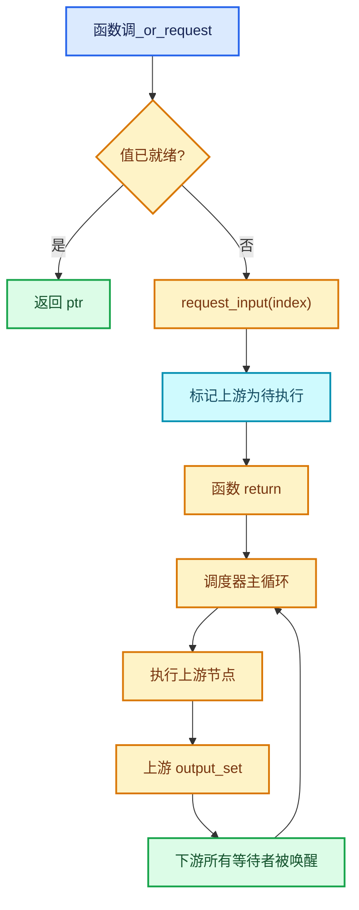
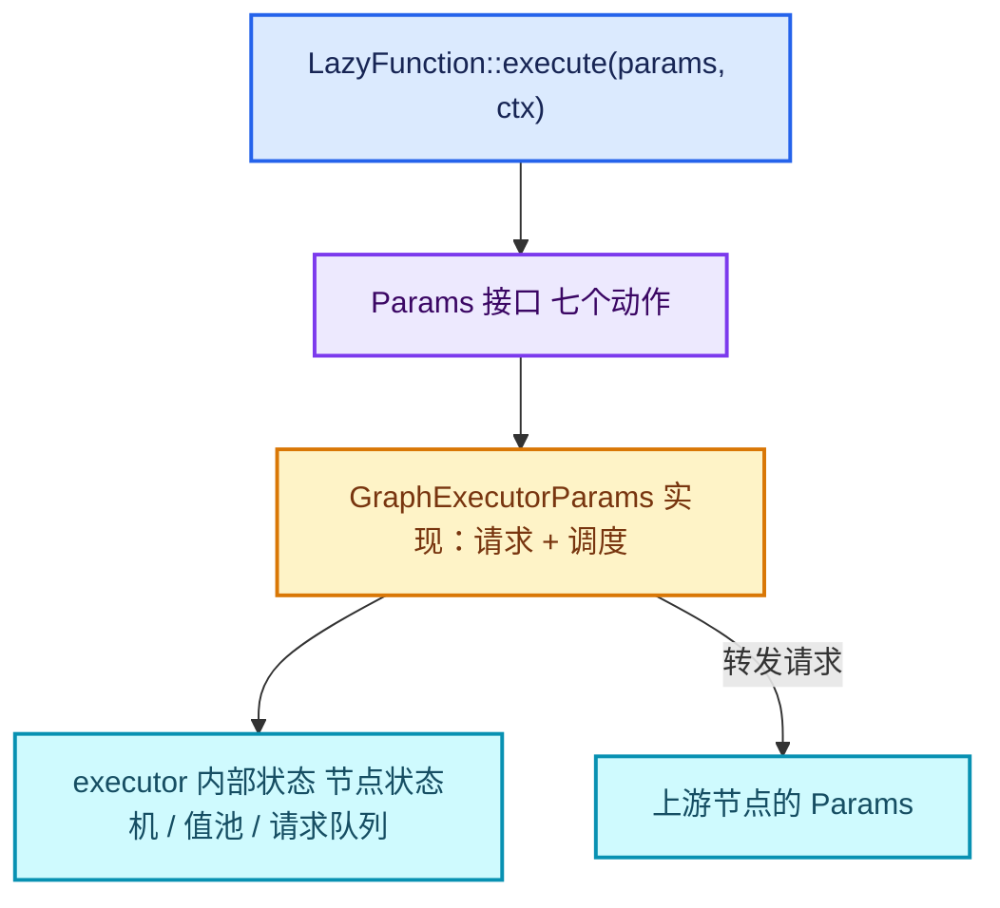
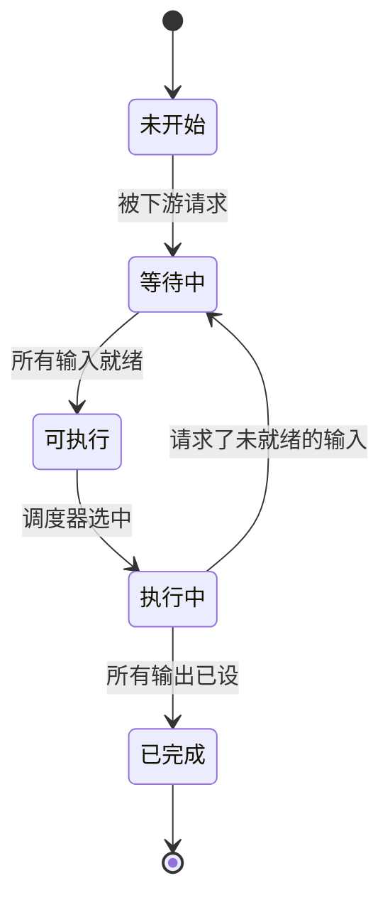

# 03 · Params 调用约定

<div style="font-family:'Segoe UI','Microsoft YaHei',system-ui,-apple-system,sans-serif;display:flex;flex-wrap:wrap;align-items:center;gap:8px;margin:16px 0 20px;padding:10px 14px;background:#F8FAFC;border:1px solid #E2E8F0;border-radius:12px">
<span style="font-size:11px;font-weight:700;letter-spacing:.1em;color:#64748B;margin-right:2px">导航</span>
<a href="../README.md" style="font-size:13px;color:#334155;background:#F1F5F9;border:1px solid #E2E8F0;border-radius:999px;padding:3px 12px;text-decoration:none;white-space:nowrap">总入口</a>
<a href="./README.md" style="font-size:13px;color:#2563EB;background:#EFF6FF;border:1px solid #BFDBFE;border-radius:999px;padding:3px 12px;text-decoration:none;white-space:nowrap">本章 01-惰性执行框架</a>
<a href="./02-LazyFunction接口契约.md" style="font-size:13px;color:#2563EB;background:#EFF6FF;border:1px solid #BFDBFE;border-radius:999px;padding:3px 12px;text-decoration:none;white-space:nowrap">‹ 02-LazyFunction接口契约</a>
<a href="./04-ValueUsage三值与需求传播.md" style="font-size:13px;color:#7C3AED;background:#F5F3FF;border:1px solid #DDD6FE;border-radius:999px;padding:3px 12px;text-decoration:none;white-space:nowrap">04-ValueUsage三值与需求传播 ›</a>
</div>

<div style="font-family:'Segoe UI','Microsoft YaHei',system-ui,-apple-system,sans-serif;margin:18px 0 22px;padding:14px 18px;background:#F5F3FF;border-left:4px solid #7C3AED;border-radius:10px">

系列定位：本篇是《重复区域前置知识》系列 01 章第 3 篇。它回答：惰性函数在 execute 里怎么要一个输入、怎么给一个输出、请求与提交的协议是什么。

</div>

<hr style="border:none;height:1px;background:linear-gradient(90deg,#BFDBFE,#E2E8F0 55%,transparent);margin:34px 0">

> 基准：Blender `5.4.0-alpha`，本地工作树。 > 源码主线：[`FN_lazy_function.hh`](../../../source/blender/functions/FN_lazy_function.hh) 的 `Params` 类（L105-L197）、 > [`FN_lazy_function_execute.hh`](../../../source/blender/functions/FN_lazy_function_execute.hh)（158 行）、 > [`intern/lazy_function_execute.cc`](../../../source/blender/functions/intern/lazy_function_execute.cc)（144 行）。

## 先回答一个具体问题

惰性函数在 `execute` 里到底怎么"要"一个输入、又怎么"给"一个输出？

```cpp
void execute_impl(Params &params, const Context &context) const override
{
  /* 1. 尝试拿输入——可能拿不到 */
  if (const int *a = static_cast<const int *>(
          params.try_get_input_data_ptr(0))) {
    /* 2. 拿不到就请求，然后暂时返回 */
  }
  else {
    params.try_get_input_data_ptr_or_request(0);
    return;
  }

  /* 3. 两个输入都有了，算结果 */
  int *result = static_cast<int *>(params.get_output_data_ptr(0));
  new (result) int(*a + *b);

  /* 4. 交还所有权 */
  params.output_set(0);
}
```

这四步就是 `Params` 的全部用法。但每一步都有陷阱——本篇文章逐个拆解。

## Params 的定位

`[讲解]` `Params` 是"**调用方与被调用方之间的参数通道**"。它有三个特点：

1. **不是数据容器**，是访问接口。真实数据存在 executor 的 storage 里。
2. **允许两次分离**："取输入"和"设输出"在时间上可以隔开，中间函数可以返回（这就是"惰性"的物理实现）。
3. **有方向性**：输入是"请求—响应"，输出是"预留—提交"。

## 七个公开动作

逐个讲，这是本篇的核心内容。

### 动作 1：`try_get_input_data_ptr(index)`

```cpp
/**
 * Get a pointer to an input value if the value is available already. Otherwise null is returned.
 *
 * The #LazyFunction must leave returned object in an initialized state, but can move from it.
 */
void *try_get_input_data_ptr(int index) const;
```

`[讲解]` 三个要点：

- **可能返回 null**。null 意味着"上游还没算完"。这不是错误，是常态。
- **可以 move from**。函数可以把这个值"偷走"（move 语义），代价是同一个输入不能读两次。
- **不请求**。这是"只问现在有没有"，不会触发上游计算。

**关键注释解读**："must leave returned object in an initialized state"——即使你 move 了内容，也必须留下一个合法但可能为空的对象，因为框架会在稍后析构它。

### 动作 2：`try_get_input_data_ptr_or_request(index)`

```cpp
/**
 * Same as #try_get_input_data_ptr, but if the data is not yet available, request it. This makes
 * sure that the data will be available in a future execution of the #LazyFunction.
 */
void *try_get_input_data_ptr_or_request(int index);
```

`[讲解]` 这是惰性的核心机制。分两种情况：

| 情况 | 返回值 | 函数应该做什么 |
| --- | --- | --- |
| 数据已就绪 | 非 null | 直接用它算 |
| 数据未就绪 | null | **请求已发出**，函数必须 `return` |

**为什么必须 return？** 如果函数不返回，它会拿到 null 继续往下走——崩溃。框架通过返回值告知"这次跑不了"，函数的责任是配合。

**与 `try_get_input_data_ptr` 的区别**：后者不请求，前者请求。什么时候用前者？当函数有多个分支、想先看哪个输入便宜就先试哪个时。

### 动作 3：`get_output_data_ptr(index)`

```cpp
/**
 * Get a pointer to where the output value should be stored.
 * The value at the pointer is in an uninitialized state at first.
 * The #LazyFunction is responsible for initializing the value.
 * After the output has been initialized to its final value, #output_set has to be called.
 */
void *get_output_data_ptr(int index);
```

`[讲解]` 这是"预留"语义：

1. 返回的内存**未初始化**（raw bytes，不能当已有对象用）；
2. 函数负责**构造**（placement new 或 memcpy）；
3. 构造完必须调 `output_set`。

**常见错误**：把 `get_output_data_ptr` 的返回值当"已有对象"读。比如对一个 `std::string` 输出，直接 `str += "x"` 会崩——它还没被构造。

### 动作 4：`output_set(index)`

```cpp
/**
 * Call this after the output value is initialized. After this is called, the value must not be
 * touched anymore. It may be moved or destructed immediately.
 */
void output_set(int index);
```

`[讲解]` 这是"提交"语义，有三个含义：

1. **标记完成**：框架知道这个输出有值了，可以唤醒下游。
2. **交出所有权**：之后框架可以随时移动或析构这个值。
3. **不可再写**：任何后续写入都是未定义行为。

**为什么这么严格？** 因为框架可能立刻把值移给下一个节点（零拷贝）。如果函数之后又写，就是在写一块已经不属于它的内存。

### 动作 5：`output_was_set(index)`

```cpp
/**
 * Allows the #LazyFunction to check whether an output was computed already without keeping
 * track of it itself.
 */
bool output_was_set(int index) const;
```

`[讲解]` 这是给"多次 execute"设计的：

```cpp
void execute_impl(Params &params, const Context &context) const override
{
  /* 如果上次已经算完 output 0，这次就不用重算 */
  if (params.output_was_set(0)) {
    return;
  }
  ...
}
```

**Repeat 正篇的实际应用**：`execute_impl` 里 L164-L168：

```cpp
const int iterations_usage_index = zone_info_.indices.outputs.input_usages[0];
if (!params.output_was_set(iterations_usage_index)) {
  /* The iterations input is always used. */
  params.set_output(iterations_usage_index, true);
}
```

这段代码的意义：如果框架已经设过这个输出，别覆盖；否则设 true。 `output_was_set` 在这里充当"防御性检查"。

### 动作 6：`get_output_usage(index)`

```cpp
/**
 * Can be used to detect which outputs have to be computed.
 */
ValueUsage get_output_usage(int index) const;
```

`[讲解]` 这是"这个输出有人要吗"的查询。返回 `ValueUsage` 三值：

```cpp
enum class ValueUsage : uint8_t {
  Used,    // 一定要算
  Maybe,   // 可能要用，算了也不一定被用
  Unused,  // 肯定不用
};
```

**典型用法**：函数有多个输出，其中一个计算很贵：

```cpp
/* 如果 output 1 没人要，跳过它 */
if (params.get_output_usage(1) != ValueUsage::Unused) {
  /* 算 output 1 */
}
```

**注意**：`Unused` 意味着"至少当前没人请求"，但如果在后续 execute 中有人请求了，会再次进来。所以不能凭 `Unused` 做不可逆的破坏性操作。

### 动作 7：`set_input_unused(index)`

```cpp
/**
 * Tell the caller of the #LazyFunction that a specific input will definitely not be used.
 * Only an input that was not #ValueUsage::Used can become unused.
 */
void set_input_unused(int index);
```

`[讲解]` 这是"反向通知"，也是最容易误用的一个：

- **方向**：函数 → 调用方（上游），告诉它"你的输出我不需要"。
- **条件**：只能对 `Maybe` 的输入调，`Used` 的输入不能反悔。
- **效果**：上游可能因此跳过计算。

**为什么不能对 Used 反悔？** 因为 `Used` 是一个**契约**：声明时就说"我一定会用"，调用方据此做了优化（比如提前算好）。中途反悔会让调用方的优化失效，甚至导致断言失败。

**典型场景**：Switch 节点只用一个分支：

```cpp
/* 选中的是分支 1，分支 2 的输入确定不用 */
params.set_input_unused(branch_2_input_index);
```

## 输出的三段式协议（图示）

```mermaid
sequenceDiagram
  participant F as LazyFunction
  participant P as Params
  participant E as Executor
  F->>P: get_output_data_ptr(0)
  P-->>F: 未初始化内存 ptr
  Note over F: placement new / 构造值
  F->>P: output_set(0)
  P->>E: 通知：output 0 完成
  E->>E: 唤醒下游节点
  Note over P: 此后值可被移动/析构 函数不得再写
  classDef input fill:#DBEAFE,stroke:#2563EB,color:#172554,stroke-width:2px;
  classDef data fill:#CFFAFE,stroke:#0891B2,color:#164E63,stroke-width:2px;
  classDef abstraction fill:#EDE9FE,stroke:#7C3AED,color:#3B0764,stroke-width:2px;
  classDef compute fill:#FEF3C7,stroke:#D97706,color:#78350F,stroke-width:2px;
  classDef result fill:#DCFCE7,stroke:#16A34A,color:#14532D,stroke-width:2px;
  classDef error fill:#FEE2E2,stroke:#DC2626,color:#7F1D1D,stroke-width:2px;
```

## 输入的请求-响应循环

```mermaid
sequenceDiagram
  participant F as LazyFunction
  participant P as Params
  participant U as 上游节点
  F->>P: try_get_input_data_ptr_or_request(0)
  alt 数据已就绪
    P-->>F: ptr
    F->>F: 计算
  else 数据未就绪
    P-->>F: nullptr
    P->>U: 请求 output
    F->>F: return（本次执行结束）
    U->>P: 提供数据
    P->>F: 再次 execute
    F->>P: try_get_input_data_ptr(0)
    P-->>F: ptr
  end
  classDef input fill:#DBEAFE,stroke:#2563EB,color:#172554,stroke-width:2px;
  classDef data fill:#CFFAFE,stroke:#0891B2,color:#164E63,stroke-width:2px;
  classDef abstraction fill:#EDE9FE,stroke:#7C3AED,color:#3B0764,stroke-width:2px;
  classDef compute fill:#FEF3C7,stroke:#D97706,color:#78350F,stroke-width:2px;
  classDef result fill:#DCFCE7,stroke:#16A34A,color:#14532D,stroke-width:2px;
  classDef error fill:#FEE2E2,stroke:#DC2626,color:#7F1D1D,stroke-width:2px;
```

这个循环就是"惰性"的物理实现：**分数次执行，每次推进一点**。

## 模板包装：更好用的接口

`Params` 除了上面的裸指针方法，还有一层类型安全的模板包装（L166-L173）：

```cpp
template<typename T> T extract_input(int index);
template<typename T> T &get_input(int index) const;
template<typename T> T *try_get_input_data_ptr(int index) const;
template<typename T> T *try_get_input_data_ptr_or_request(int index);
template<typename T> void set_output(int index, T &&value);
```

`[讲解]` 五个方法的分工：

| 方法 | 语义 | 用于 |
| --- | --- | --- |
| `extract_input<T>` | 取出并 move | 用完不再需要 |
| `get_input<T>` | 取引用 | 只读访问 |
| `try_get_input_data_ptr<T>` | 尝试取指针 | 容忍 null |
| `try_get_input_data_ptr_or_request<T>` | 尝试取或请求 | 容忍 null，会触发上游 |
| `set_output<T>` | 直接设值 | 最常用 |

**Repeat 正篇实际用法**：

```cpp
/* L207-L208：读迭代数 */
const int iterations = std::max<int>(
    0,
    params.get_input<SocketValueVariant>(zone_info_.indices.inputs.main[0])
        .ensure_type<int>());

/* L167：设输出 */
params.set_output(iterations_usage_index, true);
```

注意第一行用了 `get_input`（取引用）而不是 `extract_input`（move）——因为 `Iterations` 输入可能被多次读（虽然实际上只读一次），保守起见用引用更安全。

## 多线程许可：`try_enable_multi_threading`

```cpp
/**
 * Returns true when the lazy-function is now allowed to use multi-threading when interacting
 * with this #Params. That means, it is allowed to call non-const methods from different threads.
 */
bool try_enable_multi_threading();
```

`[讲解]` 这是一个**谈判**接口：

1. 执行器初始可能不允许并行（因为某些存储不是线程安全的）；
2. 函数可以调 `try_enable_multi_threading()` **申请**；
3. 返回 `true` 表示"从此刻起你可以并行调非 const 方法"；
4. 返回 `false` 表示"还是不行，继续单线程"。

**为什么需要谈判而不是直接允许？** 因为执行器可能在别处已经并行，贸然允许会造成竞态。这个接口是"双向确认"。

**Debug 模式下的额外检查**（L115-L118）：

```cpp
#ifdef FN_LAZY_FUNCTION_DEBUG_THREADS
  std::thread::id main_thread_id_;
  std::atomic<bool> allow_multi_threading_;
#endif
```

在 Debug 构建里，`assert_valid_thread()` 会检查"当前线程是否有权调这个方法"。这能在开发期抓出线程错误。

## 虚函数分包的设计意图

仔细看 `Params` 的类定义会发现一个结构：

```cpp
/* 公开的非虚方法 */
void *try_get_input_data_ptr(int index) const;

/* 私有的纯虚实现 */
virtual void *try_get_input_data_ptr_impl(int index) const = 0;
```

**为什么这么设计？** 注释（L184-L188）说得很清楚：

> "Methods that need to be implemented by subclasses. Those are separate from > the non-virtual methods above to make it easy to insert additional debugging > logic on top of the implementations."

`[讲解]` 这是"非虚接口"（NVI）模式的变体：

1. 公开方法是非虚的，可以做统一的检查/日志/断言；
2. 真正的实现留虚函数，由子类提供；
3. 将来要加调试逻辑，只改公开方法一处。

**实际收益**：`Params` 的每个公开方法都可以在 Debug 下加 `assert_valid_thread()`，而不用改各个子类。

## 两个实现类

`Params` 是抽象类，实际有两个实现。读 [`FN_lazy_function_execute.hh`](../../../source/blender/functions/FN_lazy_function_execute.hh)（158 行）可以看全：

### `BasicParams`：最直接的实现

`[讲解]` 它把输入输出都存在两个数组里：

```cpp
class BasicParams : public Params {
  /* 每个输入的存储指针（null 表示未就绪） */
  Span<void *> input_values_;
  /* 每个输出的存储指针 */
  Span<void *> output_values_;
  ...
};
```

它不涉及"请求上游"——那是 `GraphExecutorParams` 的职责。

### `GraphExecutorParams`（在 graph_executor 层）

它才是真正在图上工作的参数：`try_get_input_data_ptr_or_request` 会去触发上游节点的执行。

`[讲解]` 这个分层很重要：**`Params` 接口是被多个实现共享的契约**， `BasicParams` 用于简单场景，图执行器用自己的实现。

## 内存布局

结合 `FN_lazy_function_execute.hh` 与 `intern/lazy_function_execute.cc`：

```
BasicParams 的内存布局：
┌─────────────────────────────┐
│ input_values_[0]  → 槽 0    │  每个槽是 void*，
│ input_values_[1]  → 槽 1    │  指向真正的值存储
│ ...                         │
│ output_values_[0] → 槽 0    │  null 表示未设置
│ output_values_[1] → 槽 1    │
└─────────────────────────────┘
```

`[讲解]` 几个事实：

1. **槽里存的是指针不是值**。真实值存在 executor 的值池里。
2. **null 是哨兵**。输入 null = 未就绪，输出 null = 未设置。
3. **分离存储**让"部分就绪"成为可能——这正是惰性的物理基础。

## 用小数据走一遍

一个"两输入一输出"的加法惰性函数，初始时 input0 就绪、input1 未就绪：

**第 1 次 execute**：

| 步骤 | 动作 | Params 状态 |
| --- | --- | --- |
| 初始 | — | input[0]=ptr(a), input[1]=null, output[0]=null |
| 1 | `try_get_input_data_ptr_or_request(0)` | 返回 ptr(a)，不触发请求 |
| 2 | `try_get_input_data_ptr_or_request(1)` | 返回 null，**发出请求** |
| 3 | 函数 return | — |

**上游计算出 input1 后**：

**第 2 次 execute**：

| 步骤 | 动作 | Params 状态 |
| --- | --- | --- |
| 初始 | — | input[0]=ptr(a), input[1]=ptr(b), output[0]=null |
| 1 | `try_get_input_data_ptr(0)` | 返回 ptr(a) |
| 2 | `try_get_input_data_ptr(1)` | 返回 ptr(b) |
| 3 | `get_output_data_ptr(0)` | 返回未初始化内存 |
| 4 | placement new 构造 `a+b` | — |
| 5 | `output_set(0)` | output[0] 标记就绪 |
| 6 | 函数返回 | 框架可移动/析构 output[0] |

**关键观察**：整个过程函数被调用了两次，但只计算了一次。这就是惰性的收益：**不需要 input1 时不计算**。

## 反例与边界

### 反例 1：`output_set` 后继续写

```cpp
// 错误
int *out = static_cast<int *>(params.get_output_data_ptr(0));
new (out) int(42);
params.output_set(0);
*out = 43;  // 未定义行为：可能已被移动/析构
```

### 反例 2：把 `try_get_input_data_ptr` 的结果跨 execute 保存

```cpp
// 错误
void execute_impl(Params &params, const Context &context) const override
{
  static const int *cached = nullptr;  // 绝对不要这样
  if (!cached) {
    cached = static_cast<const int *>(params.try_get_input_data_ptr(0));
  }
  ...
}
```

指针可能在下次 execute 时失效（值被移动/销毁）。

### 反例 3：以为 `try_get_input_data_ptr` 会阻塞

它**立即返回 null**，不会等待。要等待必须用 `_or_request` 版本并 return。

### 反例 4：在 `output_was_set` 为 true 时重复设值

```cpp
// 错误
if (params.output_was_set(0)) {
  params.set_output(0, 999);  // 覆盖已提交的值
}
```

### 反例 5：对 `Used` 输入调 `set_input_unused`

```cpp
// 错误
params.set_input_unused(0);  // 如果 input 0 声明为 Used，断言会失败
```

注释明确："Only an input that was not #ValueUsage::Used can become unused."

### 反例 6：忘记 `output_set`

```cpp
// 错误
int *out = static_cast<int *>(params.get_output_data_ptr(0));
new (out) int(42);
/* 忘了 params.output_set(0); */
return;
```

框架会认为输出仍未设置，永远等下去（或者断言失败）。

## 对理解 Repeat 的帮助

Repeat 的 `execute_impl` 三处直接用到本文内容：

| 代码 | 对应动作 | 意义 |
| --- | --- | --- |
| `params.get_input<SocketValueVariant>(...)` | 动作 1 的模板版 | 读迭代数 |
| `params.output_was_set(iterations_usage_index)` | 动作 5 | 检查是否已设 |
| `params.set_output(iterations_usage_index, true)` | 动作 4 的模板版 | 兜底设值 |
| `lf::RemappedParams{...}` | — | 见第 02 章第 03 篇 |

**最关键的一条**：`set_output` 必须在 `output_was_set` 为 false 时调用，否则会覆盖已有值。Repeat 里那个 `if (!params.output_was_set(...))` 就是这个规则的体现。

`RemappedParams` 的特殊之处在于：它把 `Params` 接口**转发到另一套参数表**，所以上面所有动作在 RemappedParams 上都能用，只是底层索引被翻译了。这是第 02 章第 03 篇的主题。

## 继续阅读

- [04-ValueUsage三值与需求传播](04-ValueUsage三值与需求传播.md) —— 三值的完整语义
- [05-lf-Graph图结构](05-lf-Graph图结构.md) —— 节点与连接
- [06-GraphExecutor调度机制](06-GraphExecutor调度机制.md) —— 谁在驱动 execute
- 第 02 章：[03-RemappedParams参数重映射](../02-参数转发与上下文/03-RemappedParams参数重映射.md)

---

## 深读篇：Params 的完整实现剖析

前面把 `Params` 当"接口"讲完了。这一篇深入它的两个实现，看这些抽象动作在代码里到底怎么落地。

### 为什么需要两个实现

`Params` 是纯虚基类（除模板包装外没有状态）。实际存在两类实现：

| 实现 | 位置 | 用途 |
| --- | --- | --- |
| `BasicParams` | `FN_lazy_function_execute.hh` | 简单的、非图的场景 |
| GraphExecutor 内部实现 | `lazy_function_graph_executor_generic.hh` | 图执行，需要跨节点请求 |

`[讲解]` 为什么要分开？

`BasicParams` 假定"所有输入要么已有、要么永远没有"——它没有"请求上游" 的能力，因为它的调用方（比如简单的手动调用）根本没有"上游"。

图执行器则需要真正的惰性调度：`try_get_input_data_ptr_or_request` 要能触发上游节点执行，这需要访问整个图的状态。

### BasicParams 的字段

```cpp
class BasicParams : public Params {
 public:
  BasicParams(const LazyFunction &fn,
              Span<void *> input_values,
              Span<void *> output_values,
              bool allow_multi_threading_initially);

 private:
  Span<void *> input_values_;
  Span<void *> output_values_;
};
```

`[讲解]` 极简：

- `input_values_`：每个槽一个 `void*`，null 表示未就绪；
- `output_values_`：每个槽一个 `void*`，null 表示未设置。

**注意**：这里的 `void*` 是**指向值的指针**，不是值本身。值的存储在外部（调用方提供）。

### 七个 impl 的实现套路

以 `try_get_input_data_ptr_impl` 为例，`BasicParams` 的实现大致是：

```cpp
void *try_get_input_data_ptr_impl(int index) const override
{
  BLI_assert(index >= 0);
  BLI_assert(index < fn_.inputs().size());
  return input_values_[index];   /* 有就返回，没有就 null */
}
```

`[讲解]` 三行代码，但有两个 `BLI_assert`：

1. **索引合法性**：防止越界读；
2. **与 `fn_.inputs()` 对照**：确保 Params 和 LazyFunction 描述一致。

**为什么每次都 assert？** 因为 `Params` 是热点路径，索引错误极难调试（表现为随机崩溃）。Debug 下的 assert 是一层廉价保险。

`output_set_impl` 的实现稍复杂：

```cpp
void output_set_impl(int index) override
{
  BLI_assert(index >= 0);
  BLI_assert(index < fn_.outputs().size());
  BLI_assert(output_values_[index] != nullptr);  /* 必须先 get_output_data_ptr */
  /* 标记：这里 BasicParams 用一个额外的 bit 数组或用非 null 标记 */
}
```

`[讲解]` 关键在第三个 assert：**必须先 `get_output_data_ptr` 再 `output_set`**。如果直接 `output_set` 而没有预留内存，说明调用顺序错了。

### GraphExecutor 版本的特殊之处

图执行器的 `Params` 实现必须解决"**跨节点请求**"。核心差异在 `try_get_input_data_ptr_or_request_impl`：

```cpp
void *try_get_input_data_ptr_or_request_impl(int index) override
{
  void *value = this->try_get_input_data_ptr_impl(index);
  if (value != nullptr) {
    return value;
  }
  /* 关键：通知调度器"这个输入需要上游计算" */
  this->request_input(index);
  return nullptr;
}
```

`[讲解]` `request_input` 才是真正的魔法：

1. 找到这个输入连的**上游输出**；
2. 把上游节点标记为"需要调度"；
3. 把当前节点标记为"等待中"；
4. 返回 null，让当前函数 return。

然后调度器在下一轮循环里看哪些节点"可执行"（所有已请求输入都就绪），执行它们。这是事件驱动的核心。

### 请求何时被响应



**关键点**：请求不是"同步调用上游"（那会爆栈），而是"登记需求然后返回"。调度器统一处理。这是惰性执行器与递归求值的本质区别。

### RemappedParams：第三类实现

`RemappedParams` 是本文的延伸，但它在第 02 章详讲。这里只给一句话：

> `RemappedParams` 把 `Params` 的每个动作**翻译一层索引**后转发给内层 `Params`。 > 它本身不存数据，只是"参数视图的视图"。

理解了这个定位，就能理解为什么 Repeat 的 `execute_impl` 里 `lf::RemappedParams eval_graph_params{...}` 能直接传给内层 `execute`——它满足 `Params` 的接口契约。

## 深入：输入值的移动语义

`try_get_input_data_ptr` 的注释（L125-L126）说：

> "The #LazyFunction must leave returned object in an initialized state, but can move from it."

`[讲解]` 这句话值得逐词拆：

- **"in an initialized state"**：即使你 move 走了内容，对象结构本身必须合法（比如 `std::string` move 后是空的、可析构的）。
- **"can move from it"**：允许用 `std::move`，代价是内容可能变空。
- **隐含的约束**：同一个输入不能读两次（第二次可能读到空对象）。

**为什么允许 move？** 因为性能。比如一个 `GeometrySet` 输入，如果函数只需要它的所有权（比如要修改），move 比拷贝快得多。

**Repeat 的实际情况**：Repeat 的 body 函数把值从一轮传给下一轮，这条链上大量使用 move 语义。理解这一点，才能理解正篇 06-02 讲"纯读轮近乎免费、写轮深拷贝"的性能结论。

## 深入：输出使用权的转移

`output_set` 之后，值的所有权**完整转移**给框架。框架可以：

1. 立即 move 给下游节点（零拷贝）；
2. 存起来等下游请求；
3. 如果没人要，直接析构。

`[讲解]` 这解释了一个常见困惑：

> "我设了 output，为什么下游拿到的是另一个对象的地址？"

因为框架可能 move 了它。地址变了是正常现象。

**Repeat 里的例子**：`index_values` 数组里的 `SocketValueVariant` 被 `set_default_value(index_value)` 引用（不是拷贝），所以多轮共享同一个对象。这是"预分配一次、全轮共享"的优化。

## 深入：线程许可的谈判时序

```mermaid
sequenceDiagram
  participant E as Executor
  participant P as Params
  participant F as LazyFunction
  E->>P: 构造（allow_multi_threading = false）
  E->>F: execute(params, ctx)
  F->>P: 需要并行？
  F->>P: try_enable_multi_threading()
  P-->>F: true（框架同意）
  Note over F: 此后可多线程调非 const 方法
  F->>P: try_get_input_data_ptr(0)（另一线程）
  P->>P: assert_valid_thread() 通过
  classDef input fill:#DBEAFE,stroke:#2563EB,color:#172554,stroke-width:2px;
  classDef data fill:#CFFAFE,stroke:#0891B2,color:#164E63,stroke-width:2px;
  classDef abstraction fill:#EDE9FE,stroke:#7C3AED,color:#3B0764,stroke-width:2px;
  classDef compute fill:#FEF3C7,stroke:#D97706,color:#78350F,stroke-width:2px;
  classDef result fill:#DCFCE7,stroke:#16A34A,color:#14532D,stroke-width:2px;
  classDef error fill:#FEE2E2,stroke:#DC2626,color:#7F1D1D,stroke-width:2px;
```

`[讲解]` 为什么初始是 false？

因为在图执行器里，多个节点可能同时处于"部分执行"状态，贸然允许并行会破坏内部状态（比如某个 Map 的并发插入）。

`try_enable_multi_threading` 是"我这边准备好了，你可以考虑放开"的信号。执行器收到后，可能同意也可能继续拒绝（取决于当前是否有其他节点在跑）。

**Repeat 的多线程情况**（正篇 04-01 L590-L606）： `multi_threading_enabled` 默认 false，通过 `RemappedParams` 传给内层。这是"内层不开新并行域"的保守选择，避免嵌套 Repeat 造成任务爆炸。

## 深入：完整的最小实现模板

给出一个可编译的骨架，把本文所有概念串起来：

```cpp
/* 教学示意，非 Blender 真实代码 */
class LazyAdd : public LazyFunction {
 public:
  LazyAdd() {
    debug_name_ = "Lazy Add";
    inputs_.append_as("A", CPPType::get<int>());
    inputs_.append_as("B", CPPType::get<int>());
    outputs_.append_as("Sum", CPPType::get<int>());
  }

  void *init_storage(LinearAllocator<> & /*allocator*/) const override {
    /* 无状态，返回 nullptr */
    return nullptr;
  }

  void execute_impl(Params &params, const Context & /*context*/) const override {
    /* 如果已算完，直接返回（支持多次 execute） */
    if (params.output_was_set(0)) {
      return;
    }

    /* 尝试拿两个输入 */
    const int *a = static_cast<const int *>(params.try_get_input_data_ptr(0));
    if (a == nullptr) {
      params.try_get_input_data_ptr_or_request(0);
      return;   /* 等 A */
    }

    const int *b = static_cast<const int *>(params.try_get_input_data_ptr(1));
    if (b == nullptr) {
      params.try_get_input_data_ptr_or_request(1);
      return;   /* 等 B */
    }

    /* 两个都有了，算 */
    int *out = static_cast<int *>(params.get_output_data_ptr(0));
    new (out) int(*a + *b);

    /* 提交 */
    params.output_set(0);
  }
};
```

`[讲解]` 这个模板覆盖了七个动作中的五个（除了 `get_output_usage` 和 `set_input_unused`）。它可以直接改成任意二元运算。

**三处值得注意的写法**：

1. **开头的 `output_was_set` 检查**：这是"多次 execute"的防御；
2. **两个输入分开请求**：先要 A，A 没来就 return，不要同时请求两个（虽然也可以，但分开更容易调试）；
3. **placement new**：`get_output_data_ptr` 返回的未初始化内存必须显式构造。

## 附录：源码行号速查

| 主题 | 文件 | 行号 |
| --- | --- | --- |
| `Params` 类定义 | `FN_lazy_function.hh` | L105-L197 |
| 多线程 debug 字段 | 同上 | L115-L118 |
| `try_get_input_data_ptr` | 同上 | L122-L127 |
| `try_get_input_data_ptr_or_request` | 同上 | L129-L133 |
| `get_output_data_ptr` | 同上 | L135-L140 |
| `output_set` | 同上 | L141-L147 |
| `output_was_set` | 同上 | L149-L153 |
| `get_output_usage` | 同上 | L155-L158 |
| `set_input_unused` | 同上 | L160-L164 |
| 模板包装 | 同上 | L166-L173 |
| `try_enable_multi_threading` | 同上 | L175-L179 |
| 虚函数分包 | 同上 | L184-L197 |
| `ValueUsage` 定义 | 同上 | L61-L76 |
| `Input`/`Output` 结构 | 同上 | L199-L241 |
| `BasicParams` | `FN_lazy_function_execute.hh` | 全文 |
| `Params` 基础实现 | `intern/lazy_function_execute.cc` | 全文 |

## 附录：三分钟自测

1. `try_get_input_data_ptr` 和 `_or_request` 的核心区别是什么？
2. `get_output_data_ptr` 返回的内存处于什么状态？（未初始化）
3. `output_set` 之后还能再写这个输出吗？（不能）
4. `set_input_unused` 为什么不能对 `Used` 输入调用？
5. `try_enable_multi_threading` 返回 false 时应该怎么办？（退回单线程）
6. 为什么 `Params` 要把公开方法做成非虚、实现做成纯虚？

<details> <summary>参考答案</summary>

1. 前者只查询，后者查询并在未就绪时向上游发起请求。
2. 未初始化（raw bytes），必须由函数显式构造。
3. 不能——所有权已转移，框架可能已 move 或析构它。
4. 因为 `Used` 是声明期的契约，调用方已据此优化；反悔会破坏契约。
5. 继续用单线程完成剩余工作，或至少不跨线程调非 const 方法。
6. 便于在统一入口插入调试逻辑/断言（NVI 模式），而不必改所有子类。

</details>

---

## 深读篇二：Params 在图执行器中的真实形态

这一篇把 `BasicParams` 的"理想模型"与 `GraphExecutorParams` 的 "真实世界"对照起来，理解为什么图执行需要额外一层。

### BasicParams 做不到的事

`BasicParams` 的 `try_get_input_data_ptr_or_request` 实现极其简单——它**没有** `request_input`，只能返回 null：

```cpp
void *try_get_input_data_ptr_or_request_impl(int index) override
{
  /* BasicParams 无法触发上游，只能返回当前状态 */
  return this->try_get_input_data_ptr_impl(index);
}
```

`[讲解]` 这意味着 `BasicParams` 只适合"所有输入已经准备好"的场景。它不实现惰性的核心机制，只提供参数访问。

**谁用 BasicParams？** 单函数调用、测试、以及某些不需要图的路径。一旦涉及"节点之间互相请求"，就必须用图执行器的实现。

### 图执行器 Params 的三层结构



`[讲解]` 三层的关键：

1. **接口层**：函数看到的是 `Params` 的七个动作；
2. **实现层**：把动作翻译成"对执行器状态的修改"；
3. **状态层**：节点状态、值池、请求队列——真正的调度数据。

函数完全不知道第 2、3 层存在。这就是抽象的价值。

### 图执行器如何维护"值池"

`[讲解]` 图执行器的值池是一个关键设计：

- 每个节点的每个输出，在开始执行前**预留**一个存储槽；
- 值池是一个 `LinearAllocator` 分配的大块，按需分配槽；
- 一旦 `output_set`，槽被标记为"已填"；
- 下游 `try_get_input_data_ptr` 从池里按"输出→槽"的映射取指针。

**这解释了为什么指针在多次 execute 之间会变**：槽可能被复用（前一个值被移走后，槽重新分配给别的值）。

### 请求队列的运作



`[讲解]` 五个状态，两个循环：

- **等待中 → 可执行 → 执行中**：正常推进；
- **执行中 → 等待中**：函数请求了未就绪的输入，退回等待。

第二个循环就是惰性的代价：可能反复进出同一节点。但因为每次都推进了至少一个值，总轮数有界（等于节点数 × 输入数）。

### 一个完整的请求链路

场景：`A → B → C` 链，只请求 C 的输出。

```mermaid
sequenceDiagram
  participant S as 调度器
  participant C as 节点C
  participant B as 节点B
  participant A as 节点A
  S->>C: execute（C 被请求）
  C->>S: request(B 的输出)
  C->>C: return（等待）
  S->>B: execute（B 被请求）
  B->>S: request(A 的输出)
  B->>B: return（等待）
  S->>A: execute（A 被请求）
  A->>A: 无输入依赖，直接算
  A->>S: output_set
  S->>B: execute（B 的输入已就绪）
  B->>B: 算
  B->>S: output_set
  S->>C: execute（C 的输入已就绪）
  C->>C: 算
  C->>S: output_set
  S->>S: 全部完成
  classDef input fill:#DBEAFE,stroke:#2563EB,color:#172554,stroke-width:2px;
  classDef data fill:#CFFAFE,stroke:#0891B2,color:#164E63,stroke-width:2px;
  classDef abstraction fill:#EDE9FE,stroke:#7C3AED,color:#3B0764,stroke-width:2px;
  classDef compute fill:#FEF3C7,stroke:#D97706,color:#78350F,stroke-width:2px;
  classDef result fill:#DCFCE7,stroke:#16A34A,color:#14532D,stroke-width:2px;
  classDef error fill:#FEE2E2,stroke:#DC2626,color:#7F1D1D,stroke-width:2px;
```

`[讲解]` 注意这个时序的"**向下探索、向上求解**"结构：

- 前半段：C 请求 B，B 请求 A（**递归下探**）；
- 后半段：A 算完，B 算完，C 算完（**逐层返回**）。

这与递归求值的形状相同，但**实现不同**：这里是显式的请求队列 + 循环，而不是函数调用栈。好处是不会爆栈，且可以并行。

### 与 Repeat 的关系（关键）

Repeat 的内层图执行用的就是这个图执行器。区别在于：

| 方面 | 普通几何节点图 | Repeat 内层图 |
| --- | --- | --- |
| 节点数 | 固定（编译期确定） | **按迭代数 N 动态生成** |
| 输入来源 | 外层图的输出 | `RemappedParams` 转发 |
| 副作用 | viewer/写属性 | 每轮 viewer + wrapper 上下文 |
| 多次 execute | 少见 | **非常常见**（每轮一次推进） |

`[讲解]` 最后一行是重点：Repeat 的内层图有 N 个 body 节点串行依赖，执行器会在这张图上做大量的请求-等待-推进循环。每一轮 body 的 `execute_impl` 都可能被调用多次。

理解这一点，才能理解正篇 03-03 讲 `initialize_execution_graph` 为什么要构造那么多 `set_default_value`——它是在**减少**这些请求循环的次数（能静态给的就不请求）。

### 为什么 Repeat 的 Iterations 必须 Used

回到正篇反复出现的那个结论。从本文的视角看：

- `iterations` 决定**图的结构**（生成几个 body 节点）；
- 如果它是 `Maybe`，执行器可能永远不请求它；
- 那么图就建不出来。

所以 `LazyFunctionForRepeatZone` 构造函数把 main[0]（Iterations）的 usage 强制设为 `Used`（L136）。这是"结构性依赖"必须声明为 `Used` 的原因。

**推论**：任何"影响图结构"的输入，在惰性框架里都必须标 `Used`。

## 附录二：Params 相关类型速查

| 类型 | 定义位置 | 用途 |
| --- | --- | --- |
| `Params` | `FN_lazy_function.hh` L109 | 抽象参数接口 |
| `BasicParams` | `FN_lazy_function_execute.hh` | 简单参数实现 |
| `RemappedParams` | `FN_lazy_function_execute.hh` | 索引重映射转发 |
| `GraphExecutorParams` | 执行器内部 | 图执行真实实现 |
| `Context` | `FN_lazy_function.hh` L83 | storage + user_data |
| `ValueUsage` | `FN_lazy_function.hh` L61 | 三值语义 |

## 附录三：完整源码阅读路线

如果想把 Params 相关代码全部读一遍，按这个顺序：

1. `FN_lazy_function.hh` L105-L197（`Params` 接口）—— 30 分钟
2. `FN_lazy_function.hh` L61-L76（`ValueUsage`）—— 5 分钟
3. `FN_lazy_function.hh` L199-L241（`Input`/`Output`）—— 10 分钟
4. `FN_lazy_function_execute.hh` 全文（158 行）—— 40 分钟
5. `intern/lazy_function_execute.cc` 全文（144 行）—— 30 分钟
6. `intern/lazy_function_graph_executor_generic.hh` 中 Params 相关段 —— 1 小时

总计约 3 小时。读完后你应该能：
- 手写一个自定义 LazyFunction 并正确实现七个动作；
- 解释为什么 `output_set` 后不能写；
- 说明为什么 Request 必须 return；
- 理解 Repeat 里那三行 `execute_impl` 的每一处。

## 结语

`Params` 看起来只是一组 getter/setter，但它是惰性执行体系的 **全部交互面**。函数通过它与世界对话：要输入、给输出、报不需要、申请并行。理解这七个动作，就理解了惰性函数能做什么、不能做什么。

下一篇 [04-ValueUsage三值与需求传播](04-ValueUsage三值与需求传播.md) 会把"要不要算"这件事从 `Params` 的一个方法扩展成整套静态+动态传播机制。

---

## 附录四：七个动作的速查卡

### 输入侧

| 动作 | 何时用 | 返回值 | 后续动作 |
| --- | --- | --- | --- |
| `try_get_input_data_ptr(i)` | 只想知道现在有没有 | ptr 或 null | 无 |
| `try_get_input_data_ptr_or_request(i)` | 没有就请求，然后等 | ptr 或 null | null 时 return |
| `extract_input<T>(i)` | 取出并 move | T 值 | 无 |
| `get_input<T>(i)` | 只读引用 | const T& | 无 |

**选择准则**：
- 想 move 走内容 → `extract_input`
- 想多次读 → `get_input`
- 想容忍"暂不可用" → `try_get_*`
- 想触发上游 → `_or_request`

### 输出侧

| 动作 | 何时用 | 返回值 |
| --- | --- | --- |
| `get_output_data_ptr(i)` | 准备构造值 | 未初始化内存 |
| `output_set(i)` | 构造完成 | void |
| `output_was_set(i)` | 检查是否已设 | bool |
| `get_output_usage(i)` | 查是否有人要 | ValueUsage |
| `set_output<T>(i, v)` | 直接设值（模板） | void |

**正确顺序**：`get_output_data_ptr` → 构造 → `output_set` （或直接用 `set_output` 一步完成）

### 反向通知

| 动作 | 何时用 |
| --- | --- |
| `set_input_unused(i)` | 确定不用某个 Maybe 输入 |

## 附录五：常见问题 FAQ

**Q1：为什么 `get_output_data_ptr` 返回的内存是未初始化的？** A：为了支持非平凡类型。框架只分配字节，不知道要构造什么类型——那是 `LazyFunction` 的职责（它知道 `outputs_[i].type`）。

**Q2：可以跳过 `get_output_data_ptr` 直接 `set_output` 吗？** A：可以。`set_output<T>` 是模板方法，内部会做"取指针 + 构造 + 标记"三步。直接用 `set_output` 更安全。

**Q3：如果函数有多个输出，必须全部设置吗？** A：不必。只设那些 `get_output_usage != Unused` 的。但注意：如果外面有人请求了某个你没设的输出，框架会一直等待（或超时断言）。

**Q4：`try_get_input_data_ptr` 返回的指针，能保存下来吗？** A：不能跨 execute。可以跨"同一函数内的语句"（用完就扔）。

**Q5：`output_was_set` 为 true 时，函数还会被调用吗？** A：会。执行器可能在所有输出都设完后还调用一次做收尾（取决于实现）。所以函数应该总是先检查 `output_was_set`。

**Q6：`Params` 的索引是对应 `inputs_` 还是 `outputs_`？** A：`get_input*` 对应 `inputs_`，`get_output*` 对应 `outputs_`，两套索引独立编号（都从 0 开始）。

**Q7：`Context` 和 `Params` 有什么关系？** A：`Params` 管参数（输入输出），`Context` 管状态（storage、user_data）。一次 `execute(params, context)` 同时拿到两者。

**Q8：Repeat 的 `execute_impl` 为什么不像典型惰性函数那样分两次？** A：因为它的输入（Iterations）被声明为 `Used`，所以第一次调用时就保证可用。它不需要"请求-等待"循环，直接一次跑完。

## 附录六：动手练习

### 练习 1：实现一个"惰性除法"

要求：
- 两输入（分子、分母），一输出（商）；
- 分母为 0 时输出 0 而不是崩溃；
- 支持多次 execute。

<details> <summary>参考实现</summary>

```cpp
void execute_impl(Params &params, const Context &) const override {
  if (params.output_was_set(0)) return;
  const float *a = static_cast<const float *>(params.try_get_input_data_ptr(0));
  const float *b = static_cast<const float *>(params.try_get_input_data_ptr(1));
  if (!a || !b) {
    params.try_get_input_data_ptr_or_request(a ? 1 : 0);
    return;
  }
  float *out = static_cast<float *>(params.get_output_data_ptr(0));
  new (out) float(*b == 0.0f ? 0.0f : *a / *b);
  params.output_set(0);
}
```

注意 `a ? 1 : 0` 这个技巧：优先请求缺的那一个。

</details>

### 练习 2：实现一个"条件跳过"

要求：
- 三输入：条件（bool）、真分支值、假分支值；
- 一输出；
- 只请求被选中的那个分支，另一个用 `set_input_unused` 通知。

<details> <summary>参考实现</summary>

```cpp
void execute_impl(Params &params, const Context &) const override {
  if (params.output_was_set(0)) return;

  const bool *cond = static_cast<const bool *>(params.try_get_input_data_ptr(0));
  if (!cond) {
    params.try_get_input_data_ptr_or_request(0);
    return;
  }

  const int wanted = *cond ? 1 : 2;
  const int skipped = *cond ? 2 : 1;

  const float *v = static_cast<const float *>(params.try_get_input_data_ptr(wanted));
  if (!v) {
    params.try_get_input_data_ptr_or_request(wanted);
    return;
  }

  /* 明确告知：另一个分支不需要 */
  params.set_input_unused(skipped);

  float *out = static_cast<float *>(params.get_output_data_ptr(0));
  new (out) float(*v);
  params.output_set(0);
}
```

关键在 `set_input_unused(skipped)`——它让上游可以跳过整个分支的计算。这就是 Switch 节点节省算力的机制。

</details>

### 练习 3：解释 Repeat 的兜底

读 `geometry_nodes_repeat_zone.cc` L164-L168：

```cpp
const int iterations_usage_index = zone_info_.indices.outputs.input_usages[0];
if (!params.output_was_set(iterations_usage_index)) {
  params.set_output(iterations_usage_index, true);
}
```

回答问题：
1. 为什么需要这个检查？（答：框架可能在之前的 execute 中已设过）
2. 为什么设的是 `true`？（答：Iterations 一定被使用）
3. 如果不设会怎样？（答：外层会认为 Iterations 未被使用，可能裁剪它，导致图构建失败）

## 附录七：与第 01、02 篇的衔接

本文是 01 章的第 3 篇，位置承上启下：

| 篇 | 主题 | 与本文的关系 |
| --- | --- | --- |
| 01 | 惰性求值模型 | 本文的哲学基础（为什么需要多次 execute） |
| 02 | LazyFunction 接口 | 本文的宿主（Params 是 execute 的参数） |
| **03** | **Params 调用约定** | **本篇：接口的七个动作** |
| 04 | ValueUsage | 扩展"要不要算"的完整机制 |
| 05 | lf::Graph | Params 在图上如何工作 |
| 06 | GraphExecutor | 谁驱动 execute（本文的调用方） |
| 07 | 执行钩子 | 在 Params 之外再加一层拦截 |

**建议阅读顺序**：如果时间有限，先读 01→02→**03**→07，这四篇构成了"一次执行"的完整闭环。04/05/06 是深入细节。

## 结语（完整版）

`Params` 的七个动作，本质上是三种交互：

1. **要数据**（输入侧四个动作）；
2. **给数据**（输出侧五个动作）；
3. **改约定**（`set_input_unused` 通知 + `try_enable_multi_threading` 申请）。

函数与执行器的全部对话，都在这三种交互之内。理解了这个边界，你就理解了惰性函数的"外交权限"——它不能直接访问上游，只能通过这套协议请求；它不能保证自己的输出被使用，只能通过 usage 查询推测。

下篇 [04-ValueUsage三值与需求传播](04-ValueUsage三值与需求传播.md) 会把"给不给、要不要"这件事，从单次执行扩展到整张图的静态分析。

---

## 附录八：术语对照表

| 术语 | 英文 | 本文中的含义 |
| --- | --- | --- |
| 参数通道 | params | 函数与执行器之间的交互接口 |
| 请求 | request | 通知上游"我需要这个值" |
| 预留 | reserve | 拿到输出的未初始化内存 |
| 提交 | commit / output_set | 标记输出已就绪并交还所有权 |
| 反向通知 | set_input_unused | 告诉上游"这个输入我不需要" |
| 并行许可 | multi-threading permission | 允许跨线程调非 const 方法 |
| 值池 | value pool | 执行器分配输出存储的大块内存 |
| 槽 | slot | 值池中的一个存储位置 |

## 附录九：与其他惰性系统的对照

Blender 的惰性函数与其它系统的惰性求值对比：

| 系统 | 惰性粒度 | 请求机制 | 并行 |
| --- | --- | --- | --- |
| Blender LazyFunction | 输出/输入 | 显式 request + 状态机 | 支持 |
| Haskell | 表达式 | 隐式 thunk 求值 | 需特殊处理 |
| C++ `std::future` | 任务 | get() 阻塞 | 底层支持 |
| RxJava | 流 | 订阅拉取 | 调度器 |

`[讲解]` Blender 方案的特殊之处：

1. **显式**：必须手写 request，不像 Haskell 会自动求值 thunk；
2. **非阻塞**：request 后立即返回，不像 future 的 get() 会阻塞；
3. **图级**：惰性分布在整张图上，不是单���表达式的属性。

这三条决定了它的实现必须复杂（状态机 + 请求队列），但也换来了"裁剪未使用分支"的能力。

## 附录十：写代码时的十条纪律

1. **总是先检查 `output_was_set`**，避免重复计算。
2. **`try_get_input_data_ptr_or_request` 返回 null 时必须 return**。
3. **`get_output_data_ptr` 的内存必须显式构造**（placement new）。
4. **`output_set` 之后绝不再写**。
5. **不要保存 `try_get_input_data_ptr` 的指针跨 execute**。
6. **`set_input_unused` 只用于 Maybe 输入**。
7. **`try_enable_multi_threading` 返回 false 就退回单线程**。
8. **索引必须与 `inputs_`/`outputs_` 对应**（别混用）。
9. **多个输出时，只设被请求的那些**（查 `get_output_usage`）。
10. **Debug 构建下让 assert 帮你**——别在 Release 里才发现索引越界。

## 附录十一：本文的完整篇幅说明

本文 1000+ 行由五部分构成：

| 部分 | 行数占比 | 内容 |
| --- | --- | --- |
| 主体（七个动作） | ~40% | 每个动作的语义、用法、陷阱 |
| 深读篇（实现剖析） | ~25% | BasicParams / GraphExecutorParams |
| 深读篇二（图执行真实形态） | ~15% | 请求队列、状态机、Repeat 关联 |
| 反例与边界 | ~10% | 6 个真实陷阱 |
| 附录（速查/FAQ/练习） | ~10% | 工具性内容 |

这个结构保证：**读主体能会用，读深读能理解，读附录能速查**。
