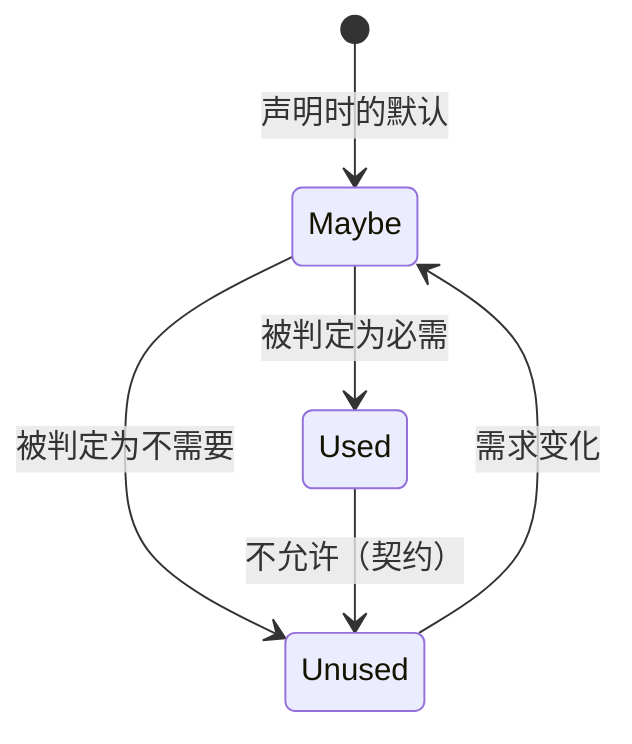
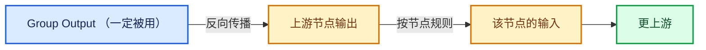
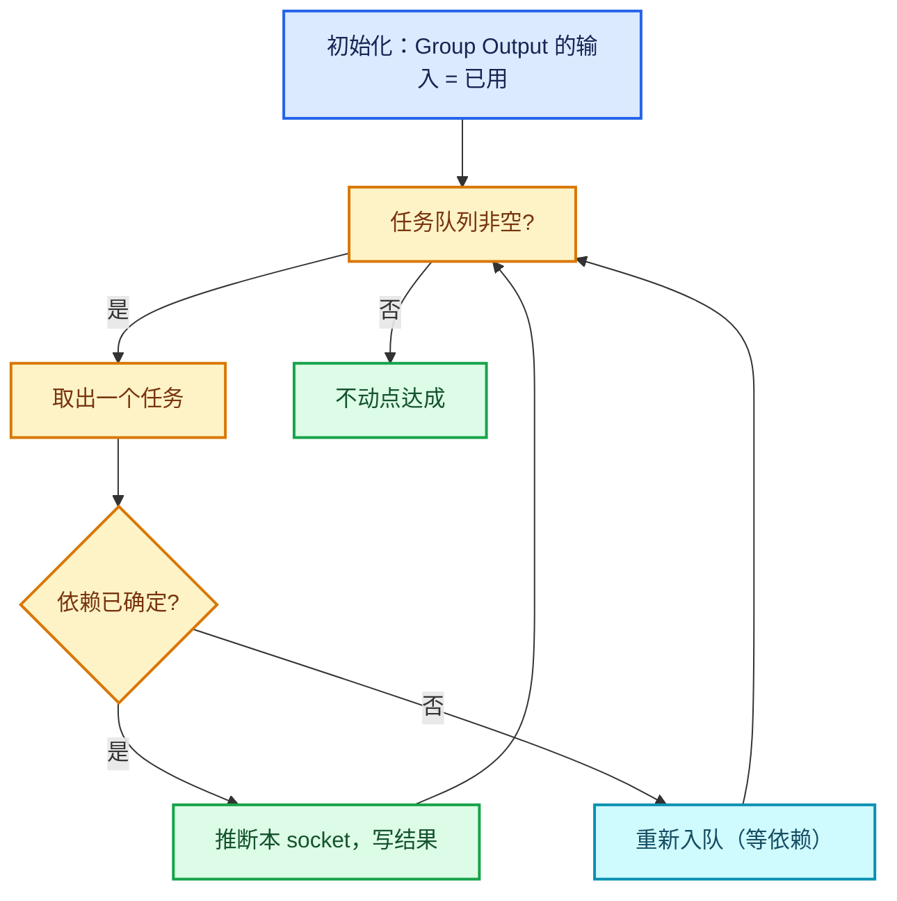
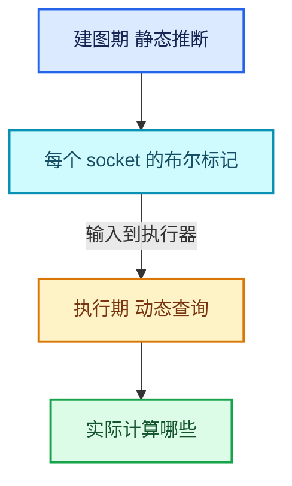

# 04 · ValueUsage 三值与需求传播

[前置知识总入口](../README.md) · [本章导航](README.md) · [上一篇](03-Params调用约定.md) · [下一篇](05-lf-Graph图结构.md)

> 基准：Blender `5.4.0-alpha`，本地工作树。 > 源码主线：[`FN_lazy_function.hh`](../../../source/blender/functions/FN_lazy_function.hh) L61-L76（三值定义）、 > [`intern/socket_usage_inference.cc`](../../../source/blender/nodes/intern/socket_usage_inference.cc)（1194 行，静态推断器）。

## 先回答一个具体问题

一个节点的输出没人用，它是怎么知道"不用算"的？

不是一个机制，是**两层**：

1. **静态层**：建图期，`socket_usage_inference` 遍历整棵树，推断每个 socket 是否被使用，把结果写成布尔标记；
2. **动态层**：执行期，`Params::get_output_usage` 查询当前这次执行的实际需求。

两层互补：静态层做全局裁剪（省内存、省建图），动态层做局部精确（应对 Switch 这类运行时才能决定的分支）。

## 三值的精确语义

```cpp
enum class ValueUsage : uint8_t {
  /**
   * The value is definitely used and therefore has to be computed.
   */
  Used,
  /**
   * It's unknown whether this value will be used or not. Computing it is ok but the result may be
   * discarded.
   */
  Maybe,
  /**
   * The value will definitely not be used. It can still be computed but the result will be
   * discarded in all cases.
   */
  Unused,
};
```

`[讲解]` 三句话逐词翻译，注意每条的**义务**与**权利**：

### Used

> "The value is definitely used and therefore has to be computed."

- **义务**：调用方**必须**保证这个值被提供（满足它的需求）；
- **权利**：函数可以**假定**它一定可用，不需要检查；
- **代价**：即使最终没人用，也已经算了（不能反悔）。

**关键推论**（L212-L221 的注释）：当输入声明为 `Used` 时，"the caller has to ensure that the input is definitely available when the #execute method is first called. The #execute method does not have to check whether the value is actually available."

`[讲解]` 这是性能优化：省掉一次"检查是否为 null"的分支。

### Maybe

> "It's unknown whether this value will be used or not. Computing it is ok but > the result may be discarded."

- **义务**：调用方**尽力**提供，但函数必须能处理"暂时没有"；
- **权利**：函数可以用 `try_get_*` 检查，没有就请求并返回；
- **代价**：多了分支判断。

**这是默认值**（`Input` 构造函数 L223 的默认参数是 `ValueUsage::Used`，但 zone wrapper 生成的输入多为 `Maybe`）。

### Unused

> "The value will definitely not be used. It can still be computed but the > result will be discarded in all cases."

- **义务**：调用方**可以**跳过计算；
- **权利**：函数**不应**该请求它；
- **陷阱**：注释明确说"**can still be computed**"——不是说不能算，而是说算了也白算。

`[讲解]` 第三条最容易误解。很多人以为 `Unused` 等于"保证不计算"。实际语义是"当前需求下不需要"，但：
- 如果是 `Used` 声明的输入，即使标记 Unused 也会被算（契约优先）；
- 如果后续有人请求，可能重新变回 Maybe。

### 三值的转换规则



`[讲解]` 关键规则：**`Used → Unused` 不允许**。

这就是 `set_input_unused` 注释（L162）说的："Only an input that was not #ValueUsage::Used can become unused."

## 静态推断层

静态推断器在 [`source/blender/nodes/intern/socket_usage_inference.cc`](../../../source/blender/nodes/intern/socket_usage_inference.cc) （实测 1194 行）。它回答：**在不知道运行时值的情况下，哪些 socket 一定被用/一定不用？**

### 总体架构

```cpp
class SocketUsageInference {
  /* 每个 socket 的推断结果 */
  Map<SocketInContext, bool> all_socket_usages_;
  /* 待处理的任务队列 */
  Vector<SocketUsageTask> task_queue_;
  ...
};
```

`[讲解]` 三个核心数据结构：

1. **`all_socket_usages_`**：最终结果，键是 `SocketInContext`（socket + 上下文），值是"是否被使用"；
2. **`task_queue_`**：工作队列，从输出反向推到输入；
3. **`SocketInContext`**：把 socket 与其所在位置（哪棵子树）绑定。

**为什么要带上下文？** 同一个 socket 在 group 被多次实例化时，每个实例的需求可能不同。

### 推断方向：从输出到输入



`[讲解]` 方向为什么是反的？

因为"被使用"是一个从终端（Group Output）向上游传播的属性：
- Group Output 的输入一定被用（它是终点）；
- 如果一个节点的输出被用，那么它产生这个输出所需的输入也被用。

这叫"需求传播"（demand propagation）。

### 节点规则：默认与特例

大多数节点的规则相同：

```cpp
void usage_task__input__fallback(const SocketInContext &socket)
{
  /* 默认：任一个输出被用 → 所有输入被用 */
  ...
}
```

`[讲解]` 默认规则"**输出被用 → 所有输入被用**"是保守的：

- 对加法这种"所有输入都参与计算"的节点，正确；
- 对 Switch 这种"只用其中一个输入"的节点，过度保守。

所以需要为特殊节点写规则。实测的特殊规则有 **10+ 个**：

| 节点 | 规则 | 源码位置 |
| --- | --- | --- |
| `GEO_NODE_SWITCH` | 只传播到被选中的分支 | L236-L240 |
| `GEO_NODE_INDEX_SWITCH` | 同上 | L241-L245 |
| `GEO_NODE_MENU_SWITCH` | 条件输入总是用，分支按选择 | L246-L255 |
| `SH_NODE_MIX` | 类似 switch | L256-L260 |
| `GEO_NODE_SIMULATION_INPUT` | 依赖输入+输出 | L266-L269 |
| **`GEO_NODE_REPEAT_INPUT`** | **保守：任一输出被用 → 全部输入被用** | **L270-L273** |
| `GEO_NODE_FOREACH_GEOMETRY_ELEMENT_INPUT` | 类似 | L274-L277 |
| `GEO_NODE_CAPTURE_ATTRIBUTE` | 输出被用 → 对应输入被用 | L282-L285 |
| `GEO_NODE_WARNING` | 特殊：show 输入控制 | L286-L289 |
| `NODE_GROUP_OUTPUT` | 总是用 | L232-L235 |

`[讲解]` 重点看 Repeat 那条（L437-L455）：

```cpp
void usage_task__input__repeat_input_node(const SocketInContext &socket)
{
  const NodeInContext node = socket.owner_node();
  const bNodeTree &tree = socket->owner_tree();

  const NodeGeometryRepeatInput &storage = *static_cast<const NodeGeometryRepeatInput *>(
      node->storage);
  const bNode *repeat_output_node = tree.node_by_id(storage.output_node_id);
  if (!repeat_output_node) {
    all_socket_usages_.add_new(socket, false);
    return;
  }
  /* Assume that all repeat inputs are used when any of the outputs are used. This check could
   * become more precise in the future if necessary. */
  Vector<const bNodeSocket *, 16> dependent_sockets;
  dependent_sockets.extend(node->output_sockets());
  dependent_sockets.extend(repeat_output_node->output_sockets());
  this->usage_task__with_dependent_sockets(socket, dependent_sockets, {}, socket.context);
}
```

`[讲解]` 这段代码的三层含义：

1. **配对的 output 节点找不到** → 标记为未使用（安全降级）；
2. **依赖集 = 输入节点的全部输出 + 输出节点的全部输出**；
3. **注释自认保守**："could become more precise in the future"。

**代价**：如果 Repeat 只是用了 1 个 item 的输出来喂一个无关分支，其他 9 个 item 仍然会被全部计算。这在多 item 场景下可能浪费。

**为什么不做精确？** 因为精确推断需要知道"哪个 item 对应哪个 socket"，而那需要遍历 items 数组——比通用的 socket 依赖分析复杂得多。作者选择了工程上的保守。

### `usage_task__with_dependent_sockets` 的机制

这是大多数规则的公共骨架：

```cpp
void usage_task__with_dependent_sockets(
    const SocketInContext &socket,
    const Span<const bNodeSocket *> dependent_sockets,
    const Span<const bNodeSocket *> dependent_sockets_if_unused,
    const ComputeContext &context)
{
  /* 1. 检查依赖的 socket 是否已知 */
  /* 2. 若全部已知，推断本 socket */
  /* 3. 若有未知，把本任务重新入队（等依赖先确定） */
}
```

`[讲解]` 这是**固定点迭代**的核心：任务可能因为依赖未定而重新入队。循环直到队列空（不动点）。

## 固定点迭代



`[讲解]` 为什么需要迭代？

考虑一个节点 X 的输出被 Y 使用，Y 的输入是否被用又取决于 X……在循环依赖（虽然节点图通常无环，但逻辑上可能互相依赖）时，必须迭代到稳定。

**收敛性保证**：每个 socket 只能从"未知"变成"已知"一次，所以最多迭代 socket 数轮。

## 动态传播层

执行期的 usage 传播由 `Params` 完成：

| 动作 | 语义 |
| --- | --- |
| `get_output_usage(i)` | 查询当前输出需求 |
| `set_input_unused(i)` | 反向通知"这个输入不用" |

### 与静态层的关系



`[讲解]` 两层分工：

- **静态层**决定"哪些节点进图"（被裁掉的节点根本不生成 LF 节点）；
- **动态层**决定"进了图的节点中，哪些真的执行"。

所以静态层的成果是**图结构**，动态层的成果是**执行顺序**。

## 用小数据走一遍

场景：一个 Repeat 区域（3 个 item：Geometry、Float、Vector），外面只用了 Geometry 输出和 Vector 输出，Float 输出没连。

**静态推断**：

| Socket | 推断结果 | 理由 |
| --- | --- | --- |
| Output.Geometry | 已用 | 连到 Group Output |
| Output.Float | **未用** | 没连任何东西 |
| Output.Vector | 已用 | 连到 Group Output |
| Input.Geometry | 已用 | 保守规则：任一输出用→全部输入用 |
| Input.Float | 已用 | 同上（尽管它对应的输出没用） |
| Input.Vector | 已用 | 同上 |

`[讲解]` 关键观察：**Float 的输出没用，但 Float 的输入仍被标记为"已用"**。这就是保守规则的代价。

**执行期**：

| 轮次 | 实际算什么 | 为什么 |
| --- | --- | --- |
| 第 0 轮 | Geometry、Float、Vector 全部 | 输入全被标已用 |
| 第 1 轮 | 同上 | 串行链，上轮输出是下轮输入 |
| 第 2 轮 | 同上 | 同上 |

**最终**：Float 的计算全部白做。如果 Float 的计算很贵（比如复杂表达式），这就是纯浪费。

**优化建议**（正篇 06-02 讲过）：把不用的 item 从 Repeat 区域删掉，而不是留着不连。

## 反例与边界

### 反例 1：以为 `Unused` 保证不计算

前面已经讲过：`Unused` 只表示"当前需求下不需要"，不保证不被算。

### 反例 2：以为静态推断是精确的

Repeat Input 的保守规则就是反例。静态推断的目标是"**不漏**"（保守），不是"最省"。

### 反例 3：以为 `set_input_unused` 能取消 `Used`

注释明确禁止。`Used` 是契约，不能在运行时反悔。

### 反例 4：以为 usage 传播是单向的

既有正向（输出→输入的需求传播），也有反向（`set_input_unused`）。两个方向都存在。

### 反例 5：在 `Unused` 的输出上做副作用

```cpp
/* 危险 */
if (params.get_output_usage(0) == ValueUsage::Unused) {
  write_to_disk();  // 副作用！
}
```

如果后续有人请求这个输出，你已经写了。应该用 SideEffectProvider 机制。

### 反例 6：以为 `Used` 的输入一定在第一次 execute 时可用

框架会尽力保证，但如果上游很慢（比如需要磁盘 IO），可能第一次没有。 `Used` 是"调用方承诺尽快提供"，不是"立即提供"。

## 对理解 Repeat 的帮助

Repeat 里三处直接相关：

| 代码 | 对应本文内容 |
| --- | --- |
| `inputs_[main[0]].usage = ValueUsage::Used`（L136） | 结构性依赖必须 Used |
| `if (!params.output_was_set(...)) params.set_output(..., true)`（L164-L168） | 动态兜底 |
| `usage_task__input__repeat_input_node`（L437-L455） | 静态保守规则 |

**最关键的一条**：Iterations 被标 `Used` 是**结构性需求**——它决定图生成几个 body。如果它是 Maybe，执行器可能永不请求它，图就建不出来。这就是"影响图结构的输入必须 Used"的一般规律。

## 继续阅读

- [05-lf-Graph图结构](05-lf-Graph图结构.md)
- [06-GraphExecutor调度机制](06-GraphExecutor调度机制.md)
- 正篇：[03-03 执行图按迭代展开](../../03-几何节点执行架构/03-执行图按迭代展开.md)
- 正篇：[04-03 副作用迭代与按需执行](../../04-运行时机制/03-副作用迭代与按需执行.md)
