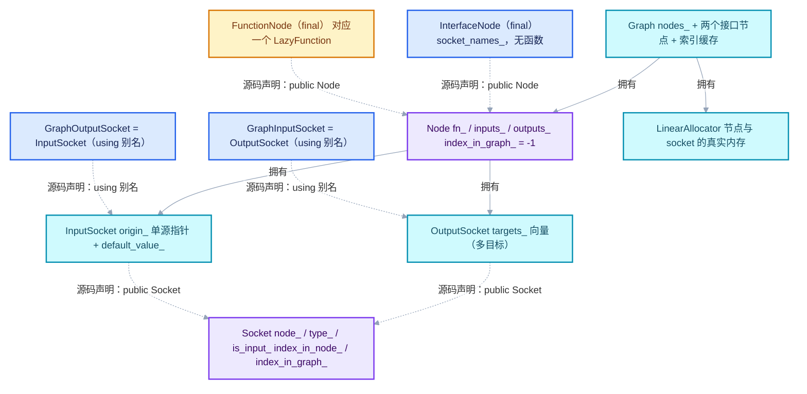
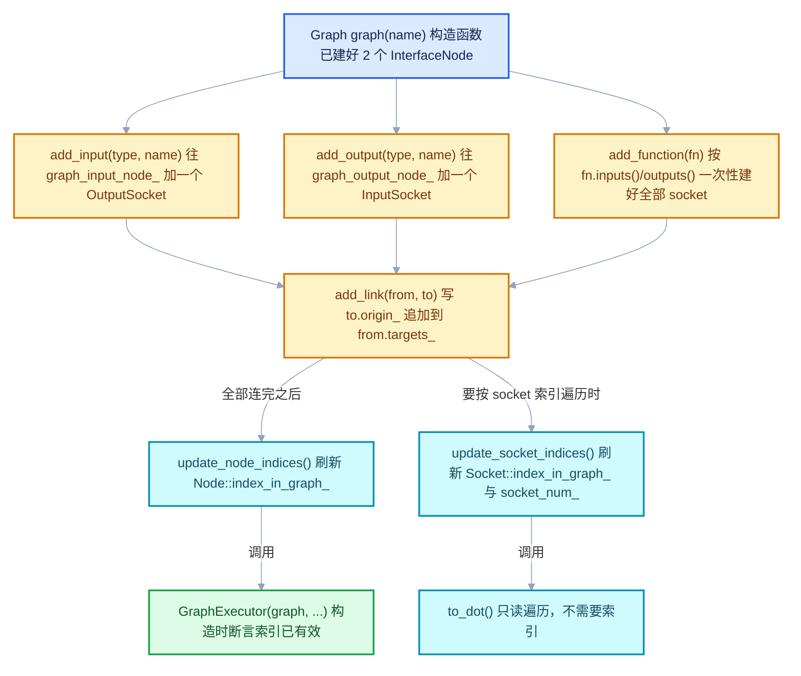
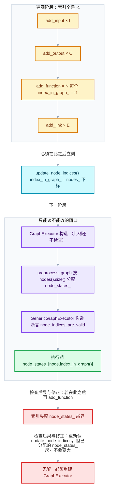
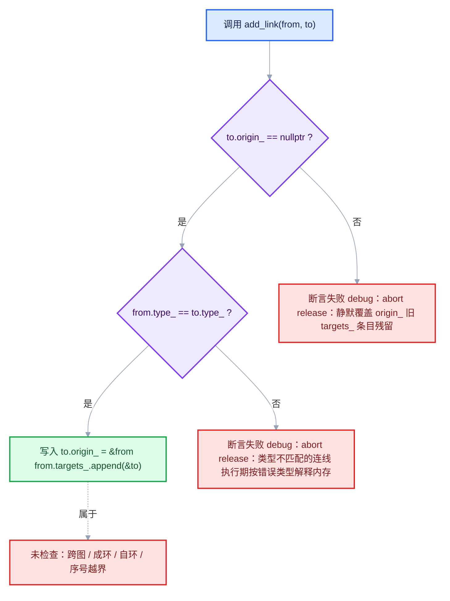
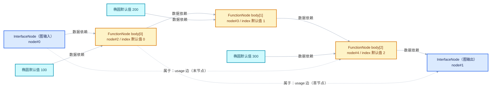

# 05 · lf::Graph 图结构：节点、socket、连接与索引

<div style="font-family:'Segoe UI','Microsoft YaHei',system-ui,-apple-system,sans-serif;display:flex;flex-wrap:wrap;align-items:center;gap:8px;margin:16px 0 20px;padding:10px 14px;background:#F8FAFC;border:1px solid #E2E8F0;border-radius:12px">
<span style="font-size:11px;font-weight:700;letter-spacing:.1em;color:#64748B;margin-right:2px">导航</span>
<a href="../README.md" style="font-size:13px;color:#334155;background:#F1F5F9;border:1px solid #E2E8F0;border-radius:999px;padding:3px 12px;text-decoration:none;white-space:nowrap">总入口</a>
<a href="./README.md" style="font-size:13px;color:#2563EB;background:#EFF6FF;border:1px solid #BFDBFE;border-radius:999px;padding:3px 12px;text-decoration:none;white-space:nowrap">本章 01-惰性执行框架</a>
<a href="./04-ValueUsage三值与需求传播.md" style="font-size:13px;color:#2563EB;background:#EFF6FF;border:1px solid #BFDBFE;border-radius:999px;padding:3px 12px;text-decoration:none;white-space:nowrap">‹ 04-ValueUsage三值与需求传播</a>
<a href="./06-GraphExecutor调度机制.md" style="font-size:13px;color:#7C3AED;background:#F5F3FF;border:1px solid #DDD6FE;border-radius:999px;padding:3px 12px;text-decoration:none;white-space:nowrap">06-GraphExecutor调度机制 ›</a>
</div>

<div style="font-family:'Segoe UI','Microsoft YaHei',system-ui,-apple-system,sans-serif;margin:18px 0 22px;padding:14px 18px;background:#F5F3FF;border-left:4px solid #7C3AED;border-radius:10px">

系列定位：本篇是《重复区域前置知识》系列 01 章第 5 篇。它讲 lf::Graph：节点、socket、连接规则、索引维护与图导出。

</div>

<hr style="border:none;height:1px;background:linear-gradient(90deg,#BFDBFE,#E2E8F0 55%,transparent);margin:34px 0">

> 基准：Blender `5.4.0-alpha`，本地工作树。本篇讲 `lf::Graph`（图结构）——它是 Repeat Zone > 展开图、几何节点整图、zone body 图三者共用的底层数据结构。 > 主要源码：[`FN_lazy_function_graph.hh`](../../../source/blender/functions/FN_lazy_function_graph.hh)（554 行） > 与 [`intern/lazy_function_graph.cc`](../../../source/blender/functions/intern/lazy_function_graph.cc)（259 行）。
## 先回答一个具体问题

**问：一张 `lf::Graph` 和节点编辑器里那棵 `bNodeTree`，到底差在哪里？看起来都是"节点 + 连线"。**

**答：`bNodeTree` 是**用户编写的声明**，`lf::Graph` 是**编译器生成的产物**。二者只在"有节点、有连线"这一点上形似，其余每一层都不同。**

在几何节点里，一次求值的路径是：

```text
bNodeTree（用户编辑的节点树，带 UI/属性/动态 socket）
   │  编译：ensure_geometry_nodes_lazy_function_graph
   ▼
lf::Graph（只含"函数节点 + 两个接口节点"，socket 数量在建图时定死）
   │  包装
   ▼
lf::GraphExecutor（本身也是一个 LazyFunction，可以被塞进更大的 lf::Graph）
```

把两者并排比一比，差异一目了然：

| 维度 | `bNodeTree`（节点编辑器里的树） | `lf::Graph`（本篇主角） |
| --- | --- | --- |
| 谁产生 | 用户手写 / Python 生成 | 代码（编译器、zone 展开器）构造 |
| 节点种类 | 数百种 `bNode`，带 `bNodeType`、面板、绘制回调 | 只有两种：`FunctionNode` 与 `InterfaceNode`（graph.hh L13–L17） |
| 节点数量 | 与用户摆的节点数一致 | 可随迭代次数变化（Repeat N 轮就是 N 个 body 节点） |
| socket | 动态、可增删（`SocketItems` 框架）、可隐藏 | 建节点时按 `LazyFunction::inputs()/outputs()` 一次性定死，之后不可增删 |
| 属性/UI | 有 `bNodeSocket` 值、面板、颜色、坐标 | **没有**。节点连名字都没有，`Node::name()` 返回函数的 `debug_name_` |
| 多输入 socket | 支持（一个输入 socket 可接多条线） | **不支持**。一个 `InputSocket` 至多一个 `origin_`（graph.hh L90–L95） |
| 连线类型 | 由 `bNodeSocketType` 决定，可隐式转换 | 必须 `CPPType` 指针完全相同（graph.cc L106 的断言） |
| 环 | `has_available_link_cycle()` 会拒绝 | 结构上允许环，只要没有真实数据依赖（`FN_lazy_function.hh` L308–L313） |
| 生命周期 | 跟随 `.blend` 文件与 ID | 是**求值期临时对象**，求值结束即销毁 |
| 序列化 | 存进 DNA | 不存。每次求值重建（Repeat 的图每次 zone 求值都重建） |
| 调试导出 | `node_tree_to_dot` | `Graph::to_dot()`（graph.cc L196–L257） |

一句话记住：

**`bNodeTree` 是"源码"，`lf::Graph` 是"目标代码"。节点的 UI、属性、动态 socket 全在编译期被抹平，只剩"函数 + 数据依赖"。**

</div>

这个区别解释了一个新手常见困惑：为什么在 `geometry_nodes_repeat_zone.cc` 里翻来覆去找不到"节点坐标""节点名""socket 面板"这类东西？因为那一层在 `bNodeTree` 里，`lf::Graph` 看不见也不需要看见。

本文要回答的八个问题：

| 问题 | 对应章节 |
| --- | --- |
| 六个类谁继承谁、各自职责是什么？ | 节点类型全景 |
| 建图只有四个动作，各自的副作用是什么？ | Graph 的四个建图动作 |
| `index_in_graph_` 为什么要事后刷新？忘了会怎样？ | 索引与 update_node_indices |
| 一个输入能接几条线？能自环吗？能成环吗？ | 连接规则与约束 |
| 节点和 socket 的内存归谁？`ResourceScope` 干什么？ | 所有权与析构 |
| 怎么把图导成 dot 看？ | to_dot 与调试 |
| Repeat N 轮到底生成多少节点多少边？ | 图的规模 |
| 这些东西和 Repeat Zone 有什么关系？ | 对理解 Repeat 的帮助 |

## 节点类型全景

graph.hh 一共只定义了 **6 个类** + **2 个别名**（外加一个 `ToDotOptions` 配置类）：

```text
Socket              （抽象基类：node_ / type_ / is_input_ / index_in_node_ / index_in_graph_）
├── InputSocket     （+ origin_ 单指针、default_value_）
└── OutputSocket    （+ targets_ 向量）

Node                （抽象基类：fn_ / inputs_ / outputs_ / index_in_graph_）
├── FunctionNode    final，fn_ != nullptr
└── InterfaceNode   final，fn_ == nullptr，+ socket_names_

using GraphInputSocket  = OutputSocket;   // 注意：方向是反的
using GraphOutputSocket = InputSocket;    // 注意：方向是反的

Graph               （容器：allocator_ / nodes_ / 两个 InterfaceNode / 索引缓存）
```

### 六个类的继承关系（源码声明）

先把继承关系画清楚。**本系列约定：连线不表示继承**；凡是继承，必须在节点文字里写明源码声明、并且用虚线。下面这张图严格遵守该约定：虚线 = 源码里写明的 `class X : public Y` 或 `using` 别名；实线 = 所有权。



这张图有两个反直觉之处，值得单独强调：

1. **`GraphInputSocket` 不是 `InputSocket` 的别名，而是 `OutputSocket` 的别名。** 因为"整张图的输入"在接口节点上表现为**输出** socket——值从接口节点流出，进入图内部。
2. **`Graph` 不在 `Node` 的继承树里。** 它是容器，不是节点。

### 六个类的逐项职责

| 类 | 定义位置 | 可否拷贝/移动 | 谁创建 | 一句话职责 |
| --- | --- | --- | --- | --- |
| `Socket` | graph.hh L42–L86 | `NonCopyable, NonMovable` | 由 `Graph` 在 `add_function` / `add_input` / `add_output` 里构造 | 节点接口：记录所属节点、`CPPType`、方向、节点内序号、图内序号 |
| `InputSocket` | graph.hh L88–L114 | 继承基类限制 | 同上 | 有 `origin_`（唯一来源）与 `default_value_`（未连线的兜底值） |
| `OutputSocket` | graph.hh L116–L128 | 继承基类限制 | 同上 | 有 `targets_`，可被任意多个输入订阅 |
| `Node` | graph.hh L133–L174 | `NonCopyable, NonMovable` | 由 `Graph` 构造 | 有 `fn_`（可能为 null）、两个 socket 指针数组、`index_in_graph_` |
| `FunctionNode` | graph.hh L179–L182 | 同上 | `Graph::add_function` | 一个 `final` 空壳，只补一个 `function()` 访问器 |
| `InterfaceNode` | graph.hh L188–L195 | 同上 | `Graph::Graph()` 构造时**必建两个** | 图对外的出入口，额外持有 `socket_names_` |
| `Graph` | graph.hh L207–L314 | `NonCopyable, NonMovable` | 调用方 | 容器 + 分配器 + 四个建图动作 + 索引刷新 + dot 导出 |

注意 `FunctionNode` 与 `InterfaceNode` 都是 `final`，而且 `FunctionNode` 只多了一个 `function()` 访问器：

```cpp
inline const LazyFunction &FunctionNode::function() const
{
  BLI_assert(fn_ != nullptr);
  return *fn_;
}
```

`[讲解]` 这是刻意的极简设计。`FunctionNode` 不持有任何"自己的"信息，它只是 `Node::fn_` 的一个类型化视图。真正区分两类节点的只有一个字段：`Node::fn_` 是否为 `nullptr`（graph.hh L427–L435 的两个 inline 函数）。

### 接口节点：一个节点，两种身份

`Graph::Graph` 的构造函数里固定创建两个 `InterfaceNode`（graph.cc L17–L24）：

```cpp
Graph::Graph(const StringRef name)
{
  name_ = allocator_.copy_string(name);
  graph_input_node_ = allocator_.construct<InterfaceNode>().release();
  graph_output_node_ = allocator_.construct<InterfaceNode>().release();
  nodes_.append(graph_input_node_);
  nodes_.append(graph_output_node_);
}
```

`[讲解]` 三件事在这一刻定下来，后面整篇都要用到：

1. **图名被复制进分配器**（`copy_string`）。`Graph(StringRef name = "unknown")` 的默认参数是 `"unknown"`——所以 Repeat Zone 那张图的名字就是 `"unknown"`（`RepeatEvalStorage::graph` 是用默认构造的，见 `geometry_nodes_repeat_zone.cc` L101）。
2. **两个接口节点永远占据 `nodes_` 的第 0、1 位**。graph.hh L218–L221 的注释写得很明确："The first two nodes are the interface input and output nodes."
3. 这两个节点**没有名字参数、没有 socket**，此刻是空壳；socket 要等 `add_input`/`add_output` 才能长出来。

因为位置固定，`Graph::function_nodes()` 可以直接用 `drop_front(2)` 把接口节点切掉（graph.hh L515–L523）：

```cpp
inline Span<const FunctionNode *> Graph::function_nodes() const
{
  return nodes_.as_span().drop_front(2).cast<const FunctionNode *>();
}
```

`[讲解]` `cast<const FunctionNode *>()` 是一次**无检查的批量向上/向下转换**：它把 `Span<const Node *>` 直接按指针重新解释成 `Span<const FunctionNode *>`。这个转换之所以安全，唯一依据就是"第 0、1 位是接口节点，其后一定是函数节点"这条不变量。它同时说明：**`function_nodes()` 的返回顺序 = `nodes_` 的顺序 = 建图顺序**，除了那两个接口节点。

### 内部连接点：`InputSocket` 与 `OutputSocket` 的字段

这两个类几乎就是"两个字段的包装"，但字段语义决定了整张图的连接能力：

```cpp
class InputSocket : public Socket {
 private:
  /**
   * An input can have at most one link connected to it. The linked socket is the "origin" because
   * it's where the data is coming from. The type of the origin must be the same as the type of
   * this socket.
   */
  OutputSocket *origin_;
  /**
   * Can be null or a non-owning pointer to a value of the type of the socket. This value will be
   * used when the input is used but not linked.
   *
   * This is technically not needed, because one could just create a separate node that just
   * outputs the value, but that would have more overhead. Especially because it's commonly the
   * case that most inputs are unlinked.
   */
  const void *default_value_ = nullptr;

  friend Graph;

 public:
  OutputSocket *origin();
  const OutputSocket *origin() const;

  const void *default_value() const;
  void set_default_value(const void *value);
};

class OutputSocket : public Socket {
 private:
  /**
   * An output can be linked to an arbitrary number of inputs of the same type.
   */
  Vector<InputSocket *> targets_;

  friend Graph;
```

<details><summary>核对原始源码：graph.hh · L88—L128</summary>

```cpp
class InputSocket : public Socket {
 private:
  /**
   * An input can have at most one link connected to it. The linked socket is the "origin" because
   * it's where the data is coming from. The type of the origin must be the same as the type of
   * this socket.
   */
  OutputSocket *origin_;
  /**
   * Can be null or a non-owning pointer to a value of the type of the socket. This value will be
   * used when the input is used but not linked.
   *
   * This is technically not needed, because one could just create a separate node that just
   * outputs the value, but that would have more overhead. Especially because it's commonly the
   * case that most inputs are unlinked.
   */
  const void *default_value_ = nullptr;

  friend Graph;

 public:
  OutputSocket *origin();
  const OutputSocket *origin() const;

  const void *default_value() const;
  void set_default_value(const void *value);
};

class OutputSocket : public Socket {
 private:
  /**
   * An output can be linked to an arbitrary number of inputs of the same type.
   */
  Vector<InputSocket *> targets_;

  friend Graph;

 public:
  Span<InputSocket *> targets();
  Span<const InputSocket *> targets() const;
};
```

</details>

`[讲解]` 三个要点：

1. **`origin_` 是裸指针，没有默认初始化器**。它靠 `InputSocket` 的默认构造——而 `InputSocket` 没有写构造函数，所以 `origin_` 是**未初始化的**。谁负责清零？看 graph.cc L55：`allocator_.construct_elements_and_pointer_array<InputSocket>(n)` 用的是 `new (ptr) T()`（**值初始化**，带括号），所以 `origin_` 会被置为 `nullptr`。这是一处依赖"值初始化"而非"成员初始值"的写法，改动构造方式就会破。
2. **`default_value_` 有 `= nullptr` 成员初始值**，所以更稳。它是 `const void *`，**不拥有**所指的值——Repeat Zone 为此专门用了函数内 `static` 变量（见后文"所有权"一节）。
3. **`targets_` 是 `Vector`**，说明输出端的扇出（fan-out）是常态；而输入端的 `origin_` 是单指针，说明输入端**不允许**多源。

### `Socket` 基类与它的两个序号

```cpp
class Socket : NonCopyable, NonMovable {
 protected:
  /**
   * The node the socket belongs to.
   */
  Node *node_;
  /**
   * Data type of the socket. Only sockets with the same type can be linked.
   */
  const CPPType *type_;
  /**
   * Indicates whether this is an #InputSocket or #OutputSocket.
   */
  bool is_input_;
  /**
   * Index of the socket. E.g. 0 for the first input and the first output socket.
   */
  int index_in_node_;
  /**
   * Index of the socket in the entire graph. Every socket has a different index.
   */
  int index_in_graph_;

  friend Graph;
```

<details><summary>核对原始源码：graph.hh · L42—L65</summary>

```cpp
class Socket : NonCopyable, NonMovable {
 protected:
  /**
   * The node the socket belongs to.
   */
  Node *node_;
  /**
   * Data type of the socket. Only sockets with the same type can be linked.
   */
  const CPPType *type_;
  /**
   * Indicates whether this is an #InputSocket or #OutputSocket.
   */
  bool is_input_;
  /**
   * Index of the socket. E.g. 0 for the first input and the first output socket.
   */
  int index_in_node_;
  /**
   * Index of the socket in the entire graph. Every socket has a different index.
   */
  int index_in_graph_;

  friend Graph;
```

</details>

`[讲解]` **两个序号千万别混**：

| 字段 | 含义 | 何时写入 | 谁读 |
| --- | --- | --- | --- |
| `index_in_node_` | 该 socket 在**所属节点**内的序号，输入与输出各自从 0 数 | `add_function` / `add_input` / `add_output` 立刻写入 | `Node::input(i)`、`Socket::name()`、`function_nodes()` 之外的几乎所有代码 |
| `index_in_graph_` | 该 socket 在**整张图**里的全局序号，全图唯一 | **只有** `Graph::update_socket_indices()` 写入 | `fix_link_cycles` 用它做数组下标（`geometry_nodes_lazy_function.cc` L4138、L4167） |

而且注意：`index_in_graph_` **没有** `= -1` 初始值（对比 `Node::index_in_graph_` 有）。这意味着在调用 `update_socket_indices()` 之前读它，读到的是**不确定值**。这不是笔误——它是一份"必须显式刷新才能用"的合同，只是对 socket 而言这份合同没有断言兜底（对 node 有，见下节）。

### `Node` 与它的 `index_in_graph_`

```cpp
class Node : NonCopyable, NonMovable {
 protected:
  /**
   * The function this node corresponds to. If this is null, the node is an #InterfaceNode.
   * The function is not owned by this #Node nor by the #Graph.
   */
  const LazyFunction *fn_ = nullptr;
  /**
   * Input sockets of the node.
   */
  Span<InputSocket *> inputs_;
  /**
   * Output sockets of the node.
   */
  Span<OutputSocket *> outputs_;
  /**
   * An index that is set when calling #Graph::update_node_indices. This can be used to create
   * efficient mappings from nodes to other data using just an array instead of a hash map.
   *
   * This is technically not necessary but has better performance than always using hash maps.
   */
  int index_in_graph_ = -1;

  friend Graph;
```

<details><summary>核对原始源码：graph.hh · L133—L156</summary>

```cpp
class Node : NonCopyable, NonMovable {
 protected:
  /**
   * The function this node corresponds to. If this is null, the node is an #InterfaceNode.
   * The function is not owned by this #Node nor by the #Graph.
   */
  const LazyFunction *fn_ = nullptr;
  /**
   * Input sockets of the node.
   */
  Span<InputSocket *> inputs_;
  /**
   * Output sockets of the node.
   */
  Span<OutputSocket *> outputs_;
  /**
   * An index that is set when calling #Graph::update_node_indices. This can be used to create
   * efficient mappings from nodes to other data using just an array instead of a hash map.
   *
   * This is technically not necessary but has better performance than always using hash maps.
   */
  int index_in_graph_ = -1;

  friend Graph;
```

</details>

`[讲解]` 三处都值得停下来：

1. **`fn_` 是 `const LazyFunction *` 且注释明说"not owned by this Node nor by the Graph"**。这是全篇最重要的一条所有权规则，后文"When 谁析构"一节会展开。
2. **`inputs_` / `outputs_` 是 `Span`，不是 `Vector`**。给 `FunctionNode` 建 socket 时，`Graph` 用 `construct_elements_and_pointer_array` 一次性分配"元素数组 + 指针数组"，然后把指针数组的 `Span` 存进 `inputs_`。所以**指针数组本身永不重分配**，节点建好后 socket 数就锁死了。
3. **`index_in_graph_ = -1` 是"尚未分配"的哨兵值**。它同时是断言 `node_indices_are_valid()` 的判断依据，也是 release 构建下越界访问的源头（见"索引"一节的反例）。

唯一的例外是**接口节点**：`graph_input_node_->outputs_ = graph_inputs_;`（graph.cc L84）每 `add_input` 一次就整体重新赋值一次 `Span`。所以接口节点的 `outputs_` 是"可增长的"，函数节点的 `inputs_/outputs_` 是"定死的"。这个不对称后文还会用到。

## Graph 的四个建图动作

`Graph` 的公开方法有 11 个，但**真正改变图结构的只有四个**：`add_input`、`add_output`、`add_function`、`add_link`。其余七个（`nodes`、`function_nodes`、`graph_inputs`、`graph_outputs`、`update_node_indices`、`update_socket_indices`、`to_dot`）都是只读或缓存刷新。



### 动作一：`add_input` / `add_output` —— 长在图边界上的 socket

```cpp
  /**
   * Add inputs and outputs to the graph.
   */
  GraphInputSocket &add_input(const CPPType &type, std::string name = "");
  GraphOutputSocket &add_output(const CPPType &type, std::string name = "");
```

<details><summary>核对原始源码：graph.hh · L261—L265</summary>

```cpp
  /**
   * Add inputs and outputs to the graph.
   */
  GraphInputSocket &add_input(const CPPType &type, std::string name = "");
  GraphOutputSocket &add_output(const CPPType &type, std::string name = "");
```

</details>

实现只有十来行，但每一行都有后果（graph.cc L77–L101）：

```cpp
GraphInputSocket &Graph::add_input(const CPPType &type, std::string name)
{
  GraphInputSocket &socket = *allocator_.construct<GraphInputSocket>().release();
  socket.is_input_ = false;
  socket.node_ = graph_input_node_;
  socket.type_ = &type;
  socket.index_in_node_ = graph_inputs_.append_and_get_index(&socket);
  graph_input_node_->outputs_ = graph_inputs_;

  graph_input_node_->socket_names_.append(std::move(name));
  return socket;
}

GraphOutputSocket &Graph::add_output(const CPPType &type, std::string name)
{
  GraphOutputSocket &socket = *allocator_.construct<GraphOutputSocket>().release();
  socket.is_input_ = true;
  socket.node_ = graph_output_node_;
  socket.type_ = &type;
  socket.index_in_node_ = graph_outputs_.append_and_get_index(&socket);
  graph_output_node_->inputs_ = graph_outputs_;
  graph_output_node_->socket_names_.append(std::move(name));
  return socket;
}
```

<details><summary>核对原始源码：graph.cc · L77—L101</summary>

```cpp
GraphInputSocket &Graph::add_input(const CPPType &type, std::string name)
{
  GraphInputSocket &socket = *allocator_.construct<GraphInputSocket>().release();
  socket.is_input_ = false;
  socket.node_ = graph_input_node_;
  socket.type_ = &type;
  socket.index_in_node_ = graph_inputs_.append_and_get_index(&socket);
  graph_input_node_->outputs_ = graph_inputs_;

  graph_input_node_->socket_names_.append(std::move(name));
  return socket;
}

GraphOutputSocket &Graph::add_output(const CPPType &type, std::string name)
{
  GraphOutputSocket &socket = *allocator_.construct<GraphOutputSocket>().release();
  socket.is_input_ = true;
  socket.node_ = graph_output_node_;
  socket.type_ = &type;
  socket.index_in_node_ = graph_outputs_.append_and_get_index(&socket);
  graph_output_node_->inputs_ = graph_outputs_;

  graph_output_node_->socket_names_.append(std::move(name));
  return socket;
}
```

</details>

`[讲解]` 逐行读，有五处必须记住的细节：

1. **`is_input_ = false`（`add_input`）与 `is_input_ = true`（`add_output`）是反的**。这正是 graph.hh L197–L202 那段注释的落地：

   ```cpp
   /**
    * Interface input sockets are actually output sockets on the input node. This renaming makes the
    * code less confusing.
    */
   using GraphInputSocket = OutputSocket;
   using GraphOutputSocket = InputSocket;
   ```

为什么？想清楚数据流方向就明白了：图的输入值**从接口节点流出**，所以它必须是 `OutputSocket`（有 `targets_` 可供图内节点订阅）；图的输出值**流入接口节点**，所以它必须是 `InputSocket`（有 `origin_` 指向图内某个产出者）。取名时按"对图外部而言的方向"命名，按"节点内部实现方向"存储——这层反转就在 `is_input_` 这一行完成。

2. **`type_ = &type` 存的是指针，不是拷贝**。`CPPType` 是全局静态对象（形如 `CPPType::get<int>()` 返回同一实例的引用），所以借指针是安全的。但这条约定对调用方有约束：**不要传临时 `CPPType`**。实践中所有调用点都写 `CPPType::get<X>()`。

3. **`index_in_node_ = graph_inputs_.append_and_get_index(&socket)` 一句两用**：既把 socket 指针存进 `graph_inputs_` 向量，又拿回它的下标作为节点内序号。这行同时保证了 `graph_inputs_[i]->index_in_node_ == i` 这条等式——它是 `Graph::graph_inputs()` 与节点序号的桥梁。

4. **`graph_input_node_->outputs_ = graph_inputs_;` 是整体重赋值**，因为 `Vector` 扩容后 `Span` 会悬空。 `graph_inputs_` 是 `Vector<GraphInputSocket *>`，`outputs_` 是 `Span<OutputSocket *>`；`Vector` 隐式转 `Span` 时取 `.data() + .size()`。每加一个 socket 就重设一次，保证 `Span` 始终指向**当前**的存储。这就是"接口节点 socket 可增长"的实现方式。

5. **`socket_names_` 与 socket 是两条并行数组**，靠同一套下标对齐。`Socket::name()` 里直接 `interface_node.socket_names_[index_in_node_]`（graph.cc L161）——没有边界检查。所以**名字数组与 socket 数组必须同长**，`add_input` 里两行紧邻的 `append` 就是在维持这条不变量。

返回值是**引用**（`GraphInputSocket &`），不是指针也不是 `destruct_ptr`。生命周期由 `Graph` 的 `allocator_` 保证：只要 `Graph` 活着，指针就一直有效。

### 动作二：`add_function` —— 一次把 socket 全建好

```cpp
  /**
   * Add a new function node with sockets that match the passed in #LazyFunction.
   */
  FunctionNode &add_function(const LazyFunction &fn);
```

<details><summary>核对原始源码：graph.hh · L256—L259</summary>

```cpp
  /**
   * Add a new function node with sockets that match the passed in #LazyFunction.
   */
  FunctionNode &add_function(const LazyFunction &fn);
```

</details>

```cpp
FunctionNode &Graph::add_function(const LazyFunction &fn)
{
  const Span<Input> inputs = fn.inputs();
  const Span<Output> outputs = fn.outputs();

  FunctionNode &node = *allocator_.construct<FunctionNode>().release();
  node.fn_ = &fn;
  node.inputs_ = allocator_.construct_elements_and_pointer_array<InputSocket>(inputs.size());
  node.outputs_ = allocator_.construct_elements_and_pointer_array<OutputSocket>(outputs.size());

  for (const int i : inputs.index_range()) {
    InputSocket &socket = *node.inputs_[i];
    socket.index_in_node_ = i;
    socket.is_input_ = true;
    socket.node_ = &node;
    socket.type_ = inputs[i].type;
  }
  for (const int i : outputs.index_range()) {
    OutputSocket &socket = *node.outputs_[i];
    socket.index_in_node_ = i;
    socket.is_input_ = false;
    socket.node_ = &node;
    socket.type_ = outputs[i].type;
  }

  nodes_.append(&node);
  return node;
}
```

<details><summary>核对原始源码：graph.cc · L48—L75</summary>

```cpp
FunctionNode &Graph::add_function(const LazyFunction &fn)
{
  const Span<Input> inputs = fn.inputs();
  const Span<Output> outputs = fn.outputs();

  FunctionNode &node = *allocator_.construct<FunctionNode>().release();
  node.fn_ = &fn;
  node.inputs_ = allocator_.construct_elements_and_pointer_array<InputSocket>(inputs.size());
  node.outputs_ = allocator_.construct_elements_and_pointer_array<OutputSocket>(outputs.size());

  for (const int i : inputs.index_range()) {
    InputSocket &socket = *node.inputs_[i];
    socket.index_in_node_ = i;
    socket.is_input_ = true;
    socket.node_ = &node;
    socket.type_ = inputs[i].type;
  }
  for (const int i : outputs.index_range()) {
    OutputSocket &socket = *node.outputs_[i];
    socket.index_in_node_ = i;
    socket.is_input_ = false;
    socket.node_ = &node;
    socket.type_ = outputs[i].type;
  }

  nodes_.append(&node);
  return node;
}
```

</details>

`[讲解]` 这是四个动作里信息量最大的一个，五条要点：

1. **`fn_ = &fn`：只借不拷。** 同一个 `LazyFunction` 可以被 `add_function` 任意多次，每次都是一个**独立节点**（各有独立的 socket 与独立的执行状态）。Repeat Zone 正是靠这一点：`body_fn_.function` 是**同一个** `LazyFunction*`，被 `add_function` 了 `iterations` 次（`geometry_nodes_repeat_zone.cc` L249–L252）：

   ```cpp
   for ([[maybe_unused]] const int i : IndexRange(iterations)) {
     lf::FunctionNode &lf_node = lf_graph.add_function(*body_fn_.function);
     lf_body_nodes.add_new(&lf_node);
   }
   ```

   `[讲解]` 所以"N 轮循环"在内存上**不会**复制 N 份函数体代码，只复制 N 份 **socket 结构 + 执行状态**。这是"建图远快于执行"的物质基础（见 03-03 对该函数头注释的解读）。

2. **`construct_elements_and_pointer_array<T>(n)` 一次性分配两块内存**：一块 `n` 个 `T` 的连续元素，一块 `n` 个 `T*` 的指针数组，指针指向元素。结果是一个 `Span<T *>`。好处是：socket 对象彼此相邻（缓存友好），而 `Node::input(i)` 又只需一次指针间接。看 [`BLI_linear_allocator.hh` L199](../../../source/blender/blenlib/BLI_linear_allocator.hh#L199) 的实现：

   ```cpp
   template<typename T, typename... Args>
   Span<T *> construct_elements_and_pointer_array(int64_t n, Args &&...args)
   {
     MutableSpan<void *> void_pointers = this->allocate_elements_and_pointer_array(
         n, sizeof(T), alignof(T));
     MutableSpan<T *> pointers = void_pointers.cast<T *>();

     for (int64_t i : IndexRange(n)) {
       new (static_cast<void *>(pointers[i])) T(std::forward<Args>(args)...);
     }

     return pointers;
   }
   ```

   `[讲解]` 注意 `T(...)` 带括号 = **值初始化**。这就是前文说的"`InputSocket::origin_` 靠值初始化被清零"的出处。若哪天改成 `T{}` 以外的写法（如去掉括号），`origin_` 就会是不确定值。

3. **两个 `for` 循环的 `is_input_` 又是反的**：输入 socket 数组里 `is_input_ = true`，输出里 `false`。这里没有别名反转，方向直白。

4. **`socket.node_ = &node` 建立反向指针**。整个库大量依赖"从 socket 找到 node"（`Socket::node()`、`to_dot()` 里 `socket->node()`、执行器里 `target_socket->node()`）。这个反向指针在 `add_function` 里一次写好，之后再不改。

5. **`nodes_.append(&node)` 在最后一行**。所以新节点的 `index_in_graph_` 仍然是 `-1`（构造时的初始值），直到有人调用 `update_node_indices()`。 **节点在 `nodes_` 里的位置**（= 未来的 `index_in_graph_`）此刻已经确定，但**字段还没写**。这个"位置已定、字段未写"的分离，就是索引机制的全部要害。

### 动作三：`add_link` —— 十二行，四条断言

```cpp
  /**
   * Add a link between the two given sockets.
   * This has undefined behavior when the input is linked to something else already.
   */
  void add_link(OutputSocket &from, InputSocket &to);
```

<details><summary>核对原始源码：graph.hh · L267—L271</summary>

```cpp
  /**
   * Add a link between the two given sockets.
   * This has undefined behavior when the input is linked to something else already.
   */
  void add_link(OutputSocket &from, InputSocket &to);
```

</details>

```cpp
void Graph::add_link(OutputSocket &from, InputSocket &to)
{
  BLI_assert(to.origin_ == nullptr);
  BLI_assert(from.type_ == to.type_);
  to.origin_ = &from;
  from.targets_.append(&to);
}
```

<details><summary>核对原始源码：graph.cc · L103—L109</summary>

```cpp
void Graph::add_link(OutputSocket &from, InputSocket &to)
{
  BLI_assert(to.origin_ == nullptr);
  BLI_assert(from.type_ == to.type_);
  to.origin_ = &from;
  from.targets_.append(&to);
}
```

</details>

`[讲解]` 十二行，两断言、两写操作，但每条都有明确的语义后果：

| 行 | 内容 | 语义 |
| --- | --- | --- |
| `BLI_assert(to.origin_ == nullptr)` | 目标输入**必须尚未被连接** | 一个输入**至多一个来源**。第二次连同一个输入 = 断言失败（release 构建下静默覆盖，见反例节） |
| `BLI_assert(from.type_ == to.type_)` | 两端 `CPPType` **指针完全相同** | 不做任何类型转换。`int` 与 `float` 不能直连，必须中间插一个转换函数节点（`geometry_nodes_lazy_function.cc` L3930 就是这么做的） |
| `to.origin_ = &from` | 建立反向指针 | 输入侧现在知道"我从哪来" |
| `from.targets_.append(&to)` | 追加到目标列表 | 输出侧现在知道"我被谁订阅"。这是**扇出**的唯一登记处 |

**注意断言的位置**：两个 `BLI_assert` 在**写操作之前**。所以断言失败时图**没有被改动**（在 debug 构建里直接 abort，图不会被破坏；在 release 里断言被编掉，`to.origin_` 被**覆盖**，而旧的 `targets_` 条目**留在原地**——这是真正危险的情形）。

**注意没有断言的三件事**（都是潜在的边界，后文反例会用到）：

1. **没有断言 `from` 与 `to` 属于同一个 `Graph`**。`add_link` 拿不到 `this` 以外的东西——`from`/`to` 的 `node_` 只指向 `Node`，而 `Node` 不反向指向 `Graph`。所以跨图连线**在类型系统上完全合法**，`Graph` 根本察觉不到。这会在执行器里炸（节点索引对不上），但不在建图时炸。
2. **没有断言不成环**。`add_link(n.output(0), n.input(1))`（自己连自己）完全合法，且**测试里就这么用**（见"连接规则"一节）。
3. **没有返回值**。`add_link` 返回 `void`，因为它不创建新对象，只改两个已有对象的字段。

### 动作四：`clear_origin` —— 唯一的"断线"动作

```cpp
  /**
   * If the socket is linked, remove the link.
   */
  void clear_origin(InputSocket &socket);
```

```cpp
void Graph::clear_origin(InputSocket &socket)
{
  if (socket.origin_ != nullptr) {
    socket.origin_->targets_.remove_first_occurrence_and_reorder(&socket);
    socket.origin_ = nullptr;
  }
}
```

<details><summary>核对原始源码：graph.cc · L111—L117</summary>

```cpp
void Graph::clear_origin(InputSocket &socket)
{
  if (socket.origin_ != nullptr) {
    socket.origin_->targets_.remove_first_occurrence_and_reorder(&socket);
    socket.origin_ = nullptr;
  }
}
```

</details>

`[讲解]` 严格说这是第五个动作（它修改结构），但它只在**打破环**的场景被用一次。全仓库仅一个调用点：[`geometry_nodes_lazy_function.cc` L4221](../../../source/blender/nodes/intern/geometry_nodes_lazy_function.cc#L4221)，在 `fix_link_cycles` 里：

```cpp
lf_graph.clear_origin(lf_cycle_input_socket);
static const bool static_true = true;
lf_cycle_input_socket.set_default_value(&static_true);
```

`[讲解]` 两步配合才完整：**先断线，再给默认值**。若只断线不给默认值，那个输入就变成"既没连线也没默认值"的空洞——执行时会一直请求不到值。 `remove_first_occurrence_and_reorder` 的选择也说明了 `targets_` 的定位：它**允许重排**，因为它只是"订阅者集合"，顺序不重要（`append` 之后取哪个先执行由执行器决定，不由 `targets_` 顺序决定）。

### 四个动作的返回值与生命周期速查

| 动作 | 返回 | 谁拥有返回对象 | 引用何时失效 |
| --- | --- | --- | --- |
| `add_input` | `GraphInputSocket &` | `Graph`（`allocator_`） | `Graph` 析构时 |
| `add_output` | `GraphOutputSocket &` | `Graph` | `Graph` 析构时 |
| `add_function` | `FunctionNode &` | `Graph` | `Graph` 析构时 |
| `add_link` | `void` | — | — |
| `clear_origin` | `void` | — | — |

`[讲解]` 四个建图动作**全部返回引用**，没有一个返回 `destruct_ptr`。这是精心选择的接口风格：调用方（编译器、zone 展开器）只需要"往图上挂东西"，**不需要也不应该**参与生命周期管理。代价是：**引用永不过期直到 `Graph` 死**——这既是安全保证（节点不会中途消失），也是陷阱（`Graph` 死后再用引用 = 悬空，见反例节）。

## 索引与 update_node_indices

### 为什么索引不是"即时分配"的

直觉上，`add_function` 完全可以在 `nodes_.append(&node)` 的同一时刻写 `node.index_in_graph_ = nodes_.size() - 1`。为什么不在那儿写？

三个原因，从强到弱：

1. **删除会让索引整体失效，而 `Graph` 没有删除接口**。图是**只增不减**的（这是刻意的：`allocator_` 从不回收，见 graph.cc 的析构）。既然位置一旦确定就永不变，那"什么时候写字段"就纯粹是性能/接口选择，而不是正确性问题——**位置**和**字段**分离是安全的。
2. **`add_function` 被调用成千上万次，`update_node_indices` 只调一次**。在热点路径里少写一个 `int` 看着微不足道，但更重要的是——把"写索引"变成一个**可断言的显式步骤**，就能在错误发生时立刻定位。
3. **索引的有效性是一个"图级"性质，不是"节点级"性质**。单个节点无法知道自己是不是最新，只有遍历整张图才能确认。`node_indices_are_valid()` 正是这个图级检查。

源码注释把这层意思写得很清楚（graph.hh L148–L153）：

```cpp
  /**
   * An index that is set when calling #Graph::update_node_indices. This can be used to create
   * efficient mappings from nodes to other data using just an array instead of a hash map.
   *
   * This is technically not necessary but has better performance than always using hash maps.
   */
  int index_in_graph_ = -1;
```

### 两个刷新函数的实现

```cpp
void Graph::update_node_indices()
{
  for (const int i : nodes_.index_range()) {
    nodes_[i]->index_in_graph_ = i;
  }
}

void Graph::update_socket_indices()
{
  int socket_counter = 0;
  for (const int i : nodes_.index_range()) {
    for (InputSocket *socket : nodes_[i]->inputs()) {
      socket->index_in_graph_ = socket_counter++;
    }
    for (OutputSocket *socket : nodes_[i]->outputs()) {
      socket->index_in_graph_ = socket_counter++;
    }
  }
  socket_num_ = socket_counter;
}

bool Graph::node_indices_are_valid() const
{
  for (const int i : nodes_.index_range()) {
    if (nodes_[i]->index_in_graph_ != i) {
      return false;
    }
  }
  return true;
}
```

<details><summary>核对原始源码：graph.cc · L119—L148</summary>

```cpp
void Graph::update_node_indices()
{
  for (const int i : nodes_.index_range()) {
    nodes_[i]->index_in_graph_ = i;
  }
}

void Graph::update_socket_indices()
{
  int socket_counter = 0;
  for (const int i : nodes_.index_range()) {
    for (InputSocket *socket : nodes_[i]->inputs()) {
      socket->index_in_graph_ = socket_counter++;
    }
    for (OutputSocket *socket : nodes_[i]->outputs()) {
      socket->index_in_graph_ = socket_counter++;
    }
  }
  socket_num_ = socket_counter;
}

bool Graph::node_indices_are_valid() const
{
  for (const int i : nodes_.index_range()) {
    if (nodes_[i]->index_in_graph_ != i) {
      return false;
    }
  }
  return true;
}
```

</details>

`[讲解]` 三个函数都极短，但读法不同：

1. **`update_node_indices` 是 O(n) 且幂等**。重复调用无害，结果相同。它**不做**任何校验，无脑覆盖。
2. **`update_socket_indices` 的编号顺序是"按节点、先输入后输出，各自按节点内序号"**。这个顺序本身不重要，重要的是"全图唯一"且"可从索引反查数组位置"。它同时维护 `socket_num_`——这是 `fix_link_cycles` 用来分配 `Array<SocketState>` 的大小。所以**没调 `update_socket_indices` 就用 `socket_num()`，会拿到 0**（默认值），进而分出一个长度 0 的数组。
3. **`node_indices_are_valid` 对"未刷新"和"刷错了"都能查出来**，只要有任何一次结构变动、且新增节点数不为 0，`nodes_[i]->index_in_graph_` 就必然与 `i` 不符（新节点是 -1）。但它有个盲区：**如果图在 `update_node_indices()` 之后又加了恰好 0 个节点，它无法区分**——当然那时也确实无需刷新。真正的盲区是另一类：**索引全对，但图已经被析构**（见反例 3）。

### 什么时候必须刷新

`update_node_indices` 是所有调用点里最统一的模式：**建完图的最后一行**。全仓库 12 个调用点，全部符合这个模式：

| 调用点 | 文件行 | 场景 |
| --- | --- | --- |
| `FN_lazy_function_test.cc` | L110 | 测试：连完线后、构造 `GraphExecutor` 前 |
| `FN_lazy_function_test.cc` | L175 | 测试：带环的图 |
| `geometry_nodes_repeat_zone.cc` | L363 | Repeat Zone 展开图（**本篇重点**） |
| `geometry_nodes_foreach_geometry_element_zone.cc` | L404 | Foreach Zone 展开图 |
| `geometry_nodes_closure_zone.cc` | L251 / L682 / L752 | Closure Zone 三处 |
| `geometry_nodes_lazy_function.cc` | L2221 | Simulation Zone 图 |
| `geometry_nodes_lazy_function.cc` | L2377 | zone body 图 |
| `geometry_nodes_lazy_function.cc` | L2516 | 整棵树的主图 |

Repeat Zone 那处的注释把"为什么"直接写在代码里（`geometry_nodes_repeat_zone.cc` L362–L363）：

```cpp
    /* The graph is ready, update the node indices which are required by the executor. */
    lf_graph.update_node_indices();
```

`[讲解]` 关键词是 **"required by the executor"**。不是因为 `to_dot()` 需要（它不需要），不是因为 `nodes()` 需要（它返回 `Span`，顺序独立于索引），而是因为**执行器要用索引做数组下标**。

看执行器的实际用法（`lazy_function_graph_executor_generic.hh`）：

```cpp
  MutableSpan<NodeState *> node_states_;
```

注释紧跟其上（L302–L305）：

```cpp
  /**
   * State of every node, indexed by #Node::index_in_graph.
   */
```

`[讲解]` 于是整条链路是：

```text
node_states_[node.index_in_graph()]   ← 执行期每个节点状态的取法
        ↑
node_states_ 的长度 = graph_.nodes().size()   ← preprocess_graph 里分配
        ↑
前提：node.index_in_graph() == 它在 graph_.nodes() 里的位置
        ↑
只有 update_node_indices() 能保证
```

执行器甚至在**构造时**就断言了这件事（L350–L355）：

```cpp
  GenericGraphExecutor(const GraphExecutor &self) : self_(self)
  {
    /* The indices are necessary, because they are used as keys in #node_states_. */
    BLI_assert(self_.graph_.node_indices_are_valid());
  }
```

<details><summary>核对原始源码：lazy_function_graph_executor_generic.hh · L350—L355</summary>

```cpp
  GenericGraphExecutor(const GraphExecutor &self) : self_(self)
  {
    /* The indices are necessary, because they are used as keys in #node_states_. */
    BLI_assert(self_.graph_.node_indices_are_valid());
  }
```

</details>

`[讲解]` 这是**唯一一处**对索引有效性的自动检查。它把"忘记刷新"从一个静默的内存错乱，变成了 debug 构建里的一条明确断言。但注意：`GenericGraphExecutor` 是在 `GraphExecutor::init_storage` 里构造的（`lazy_function_graph_executor.cc` L74–L78），也就是**第一次执行前**，而不是 `GraphExecutor` 构造时。所以 `GraphExecutor` 构造成功 ≠ 索引有效；要到真正跑起来才会炸。

### 索引更新时机图



这张图的红框部分是全篇最实用的一条警告：**索引刷新不是"随时可补"的**。它必须发生在 `GraphExecutor` 构造之前，因为执行器的内部数组是按当时的 `nodes().size()` 分配的。 `preprocess_graph` 的这段代码是证据（L446–L454）：

```cpp
    const Span<const Node *> nodes = self.graph_.nodes();
    r_data.node_states_array_offset = offset;
    offset += sizeof(NodeState *) * nodes.size();
    ...
    r_data.node_states_offsets.reinitialize(self.graph_.nodes().size());
```

<details><summary>核对原始源码：lazy_function_graph_executor_generic.hh · L440—L468</summary>

```cpp
  static void preprocess_graph(GraphExecutor &self)
  {
    PreprocessData &r_data = self.preprocess_data_;

    /* Preprocess buffer offsets. */
    int offset = 0;
    const Span<const Node *> nodes = self.graph_.nodes();
    r_data.node_states_array_offset = offset;
    offset += sizeof(NodeState *) * nodes.size();
    r_data.loaded_inputs_array_offset = offset;
    offset += sizeof(std::atomic<uint8_t>) * self.graph_inputs_.size();
    /* Align offset. */
    offset = (offset + sizeof(void *) - 1) & ~(sizeof(void *) - 1);

    r_data.node_states_offsets.reinitialize(self.graph_.nodes().size());
    for (const int i : nodes.index_range()) {
      const Node &node = *nodes[i];
      r_data.node_states_offsets[i] = offset;
      offset += sizeof(NodeState);
      offset += sizeof(InputState) * node.inputs().size();
      offset += sizeof(OutputState) * node.outputs().size();
      /* Make sure we don't have to worry about alignment. */
      static_assert(sizeof(NodeState) % sizeof(void *) == 0);
      static_assert(sizeof(InputState) % sizeof(void *) == 0);
      static_assert(sizeof(OutputState) % sizeof(void *) == 0);
    }

    r_data.total_size = offset;
  }
```

</details>

`[讲解]` 这段代码说明：**执行器在构造时就把整张图的"形状"烧进了 `preprocess_data_`**——每个节点状态在缓冲区里的字节偏移都算好了。之后图再长出新节点，`total_size` 不会变大、`node_states_offsets` 不会变长，新节点拿不到状态槽位。这就是"索引刷新窗口"的真正边界。

### 忘了刷新会怎样：三种表现

| 构建 | 表现 | 根因 |
| --- | --- | --- |
| Debug（`!NDEBUG`） | `GenericGraphExecutor` 构造时 `BLI_assert(node_indices_are_valid())` 失败，打印断言表达式与调用栈 | 新节点的 `index_in_graph_` 还是 -1（graph.hh L154 的初始值） |
| Release（`NDEBUG`） | `node_states_[-1]` 越界读指针，随后 `NodeState &node_state = *node_states_[node_index];` 解引用，段错误或随机数据 | `BLI_assert` 在 `NDEBUG` 下展开成 `((void)0)`（[`BLI_assert.hh` L62–L64](../../../source/blender/blenlib/BLI_assert.hh#L62)），断言被完全编掉 |
| 索引"碰巧对" | 静默跑通，但某些节点状态被写到错误槽位 | 若新节点的 `index_in_graph_` 恰好在 `[0, nodes().size())` 内（例如 `-1` 被后来的 `update_node_indices` 补上但执行器已构造），仍会错位 |

`[讲解]` 第三种最阴险：它需要"索引值落在合法范围内但指向错误节点"这个巧合。实践中最常见的触发方式是——**先建 `GraphExecutor`，再加节点，再刷新索引**。刷新让索引"看起来对"了，但执行器的数组早就按旧尺寸分配好了。这时候连断言都查不出来，因为 `node_indices_are_valid()` 确实返回 `true`。

## 连接规则与约束

这一节全部结论都来自源码断言与注释，逐条附证据。

### 规则一：一个输入至多一个来源，一个输出可扇出到任意多个输入

证据链有三处：

**(1) 头文件注释**（graph.hh L90–L95，`InputSocket::origin_`）：

```cpp
  /**
   * An input can have at most one link connected to it. The linked socket is the "origin" because
   * it's where the data is coming from. The type of the origin must be the same as the type of
   * this socket.
   */
  OutputSocket *origin_;
```

**(2) 头文件注释**（graph.hh L118–L121，`OutputSocket::targets_`）：

```cpp
  /**
   * An output can be linked to an arbitrary number of inputs of the same type.
   */
  Vector<InputSocket *> targets_;
```

**(3) `add_link` 的断言**（graph.cc L105）：

```cpp
  BLI_assert(to.origin_ == nullptr);
```

`[讲解]` 三处一致，可以下结论：

- **输入端是单值（single-assignment）**：`origin_` 一个指针，装不下第二个来源。
- **输出端是多重（multi-target）**：`targets_` 是 `Vector`，`append` 无上限。
- **这条不对称不是实现限制，而是数据流语义的需要**：一个值可以有多个消费者（扇出），但一个输入位置只能有一个生产者（否则"这个输入是什么"就有歧义）。

扇出的实际用法在测试里最清楚（`FN_lazy_function_test.cc` L100–L103）：

```cpp
  graph.add_link(graph_input, add_node_1.input(0));
  graph.add_link(graph_input, add_node_2.input(0));
  graph.add_link(add_node_1.output(0), store_node.input(0));
  graph.add_link(add_node_2.output(0), store_node.input(1));
```

`[讲解]` 第 1、2 行就是扇出：**同一个 `graph_input` 被连到两个不同的输入**。于是 `graph_input.targets()` 变成 `[&add_node_1.input(0), &add_node_2.input(0)]`，长度 2。第 3、4 行是汇聚：两个不同的输出分别连到同一个节点的两个不同输入（这是允许的——**同一个节点**的两个输入可以来自两个来源；被禁止的是**同一个输入**有两个来源）。

### 规则二：类型必须完全相同，不做隐式转换

```cpp
  BLI_assert(from.type_ == to.type_);
```

`[讲解]` 比较的是**指针**（`const CPPType *`），所以要求两端指向同一个 `CPPType` 实例。 `CPPType::get<int>()` 永远返回同一个实例，因此 `int → int` 通过；`int → float` 是**两个不同实例**，指针不等，断言失败。

这与 `bNodeTree` 的行为形成鲜明对比：节点编辑器里 `Float` 输出可以直接连 `Vector` 输入（隐式提升）。**`lf::Graph` 不允许**。需要转换就必须显式插一个转换函数节点，[`geometry_nodes_lazy_function.cc` L3930](../../../source/blender/nodes/intern/geometry_nodes_lazy_function.cc#L3930) 就是干这个的：

```cpp
      lf::Node &conversion_node = lf_graph.add_function(*conversion_fn);
      lf_graph.add_link(from_socket, conversion_node.input(0));
```

`[讲解]` 所以"隐式转换"在 lf 层是不存在的概念，它被降级成了"一个真实的节点"。

### 规则三：可以自环，也可以成环

这是最反直觉的一条。`add_link` **没有任何环检测**。测试里直接构造了自环（`FN_lazy_function_test.cc` L169–L175）：

```cpp
  graph.add_link(input_socket, fn_node.input(0));
  /* NOTE: This creates a cycle in the graph. However, it should still be possible to evaluate it,
   * because there is no actual data dependency in the cycle. */
  graph.add_link(fn_node.output(0), fn_node.input(1));
  graph.add_link(fn_node.output(1), output_socket);

  graph.update_node_indices();
```

<details><summary>核对原始源码：FN_lazy_function_test.cc · L159—L183</summary>

```cpp
TEST_F(LazyFunctionTest, GraphWithCycle)
{
  const PartialEvaluationTestFunction fn;

  Graph graph;
  FunctionNode &fn_node = graph.add_function(fn);

  GraphInputSocket &input_socket = graph.add_input(CPPType::get<int>());
  GraphOutputSocket &output_socket = graph.add_output(CPPType::get<int>());

  graph.add_link(input_socket, fn_node.input(0));
  /* NOTE: This creates a cycle in the graph. However, it should still be possible to evaluate it,
   * because there is no actual data dependency in the cycle. */
  graph.add_link(fn_node.output(0), fn_node.input(1));
  graph.add_link(fn_node.output(1), output_socket);

  graph.update_node_indices();

  GraphExecutor executor_fn{graph, {&input_socket}, {&output_socket}, nullptr, nullptr, nullptr};
  int result = 0;
  execute_lazy_function_eagerly(
      executor_fn, nullptr, nullptr, std::make_tuple(10), std::make_tuple(&result));

  EXPECT_EQ(result, 10 * 2 * 5);
}
```

</details>

`[讲解]` 第 172 行 `fn_node.output(0) → fn_node.input(1)` 是**同一个节点的输出连自己的输入**。注释说得很清楚：

> "This creates a cycle in the graph. However, it should still be possible to evaluate it, because there is no actual data dependency in the cycle."

关键在于**"结构环"≠"数据依赖环"**。这个测试函数（`PartialEvaluationTestFunction`）的 `possible_output_dependencies` 声明"每个输出只依赖同下标的输入"：

```cpp
  void possible_output_dependencies(const int output_index,
                                    FunctionRef<void(Span<int>)> fn) const override
  {
    /* Each output only depends on the input with the same index. */
    const int input_index = output_index;
    fn({input_index});
  }
```

`[讲解]` 于是：
- `output(0)` 只依赖 `input(0)` → `input(0)` 来自 `input_socket`（图输入）；
- `output(1)` 只依赖 `input(1)` → `input(1)` 来自 `output(0)`；
- **依赖链是 `input_socket → input(0) → output(0) → input(1) → output(1) → output_socket`，单向无环。**

也就是说：**图上有一条回到自己的边，但数据依赖图上是 DAG**。这正是允许环的全部条件。

`FN_lazy_function.hh` L308–L313 的注释把这条规则上升到了框架级别：

```cpp
  /**
   * If true, the function can be executed even when some requested inputs are not available yet.
   * This allows the function to make some progress and maybe to compute some outputs that are
   * passed into this function again (lazy-function graphs may contain cycles as long as there
   * aren't actually data dependencies).
   */
  bool allow_missing_requested_inputs() const
```

<details><summary>核对原始源码：FN_lazy_function.hh · L303—L317</summary>

```cpp
  /**
   * Utility to check that the guarantee by #Input::usage is followed.
   */
  bool always_used_inputs_available(const Params &params) const;

  /**
   * If true, the function can be executed even when some requested inputs are not available yet.
   * This allows the function to make some progress and maybe to compute some outputs that are
   * passed into this function again (lazy-function graphs may contain cycles as long as there
   * aren't actually data dependencies).
   */
  bool allow_missing_requested_inputs() const
  {
    return allow_missing_requested_inputs_;
  }
```

</details>

`[讲解]` 两个条件缺一不可：

1. **结构环是允许的**（`add_link` 不拦）；
2. **但函数的依赖声明必须让数据依赖图保持无环**，且相关函数要设 `allow_missing_requested_inputs_ = true`。

违反第 2 条会怎样？执行器会在依赖图上做可达性搜索（`lazy_function_graph_executor_generic.hh` L590–L628），在真正的数据环里永远等不到输入——**死等而非崩溃**。这就是 Repeat Zone 里那段被注释掉的代码的原因（`geometry_nodes_repeat_zone.cc` L306–L309）：

```cpp
        /* TODO: Add back-link after being able to check for cyclic dependencies. */
        // lf_graph.add_link(lf_next_node.output(body_fn_.indices.outputs.input_usages[i]),
        //                   lf_node.input(body_fn_.indices.inputs.output_usages[i]));
        lf_node.input(body_fn_.indices.inputs.output_usages[i]).set_default_value(&static_true);
```

<details><summary>核对原始源码：geometry_nodes_repeat_zone.cc · L298—L311</summary>

```cpp
    /* Handle body nodes pair-wise. */
    for (const int iter_i : lf_body_nodes.index_range().drop_back(1)) {
      lf::FunctionNode &lf_node = *lf_body_nodes[iter_i];
      lf::FunctionNode &lf_next_node = *lf_body_nodes[iter_i + 1];
      for (const int i : IndexRange(num_repeat_items)) {
        lf_graph.add_link(
            lf_node.output(body_fn_.indices.outputs.main[i]),
            lf_next_node.input(body_fn_.indices.inputs.main[i + body_inputs_offset]));
        /* TODO: Add back-link after being able to check for cyclic dependencies. */
        // lf_graph.add_link(lf_next_node.output(body_fn_.indices.outputs.input_usages[i]),
        //                   lf_node.input(body_fn_.indices.inputs.output_usages[i]));
        lf_node.input(body_fn_.indices.inputs.output_usages[i]).set_default_value(&static_true);
      }
    }
```

</details>

`[讲解]` 这是全篇最有说服力的一处"规则与实战的互动"：

- **本来想做的事**：第 N 轮的 `input_usages`（"我这一轮用了哪些输入"）回流给第 N-1 轮的 `output_usages`（"我该不该算输出"）。这在语义上是合理的——它是"未来决定过去"的 usage 反向传播。
- **为什么没做**：`add_link` 允许环，但**执行器无法区分"结构环"与"数据环"**，于是遇到这种环会死等。
- **代替方案**：直接 `set_default_value(&static_true)`——**常量 true**，语义上退化成"全都当成被使用"。代价是可能多算（少优化），收益是绝不死锁。
- **注释里的 TODO** 明确写了前提条件："after being able to check for cyclic dependencies"——正是 `fix_link_cycles` 后来做到的事，但那是在**编译器侧**（`geometry_nodes_lazy_function.cc` L4136），没下沉到 `add_link` 本身。

### 规则四：不能跨图连线（但编译器不拦）

`add_link` 的两个参数都不携带 `Graph*`，`Node` 也没有指向 `Graph` 的成员。所以：

```cpp
Graph graph_a("A");
Graph graph_b("B");
FunctionNode &na = graph_a.add_function(fn);
FunctionNode &nb = graph_b.add_function(fn);
/* 编译通过，链接成功，两个图都察觉不到 */
graph_a.add_link(na.output(0), nb.input(0));
```

`[讲解]` 这段代码**能编译、能跑、两个图各自的内部结构都自洽**（`na.output(0).targets_` 多了一项，`nb.input(0).origin_` 有了值）。后果延迟到执行才出现：
- `graph_b` 的 `GraphExecutor` 会给 `nb.input(0)` 分配状态槽（在 `graph_b` 的缓冲区里）；
- 但 `na.output(0)` 的值由 `graph_a` 的执行器产生（在另一个缓冲区、另一套索引）；
- 结果：值永远不会到达，或者更糟——`node_states_[target_node.index_in_graph()]` 用 `graph_a` 的索引去查 `graph_b` 的数组，**错位读写**。

所以规则四的准确表述是：**跨图连线在接口层无检查，在语义层非法**。这是一条"靠调用方自律"的规则，与 `origin_` 的单值约束形成对比（后者有断言兜底）。

### 规则五：不能连到"不存在的 socket 序号"

`Node::input(i)` 没有边界检查（graph.hh L462–L480）：

```cpp
inline InputSocket &Node::input(const int index)
{
  return *inputs_[index];
}
```

`[讲解]` `Span::operator[]` 在 debug 构建里 `BLI_assert` 越界，在 release 里是裸 `data()[index]`。Repeat Zone 的代码里大量出现 `body_fn_.indices.inputs.main[i + body_inputs_offset]` 这类表达式——**每一个下标都由 `ZoneFunctionIndices` 事先算好**，这层"索引元数据"的存在本身，就是在替代"节点编辑器里的 socket 名称查找"。

### 连接规则总结图



### 五条规则对照表

| # | 规则 | 有没有断言 | 违反了会怎样 |
| --- | --- | --- | --- |
| 1 | 一个输入至多一个来源 | ✅ `to.origin_ == nullptr` | debug abort；release 覆盖 `origin_`，旧 `targets_` 残留 |
| 2 | 两端 `CPPType` 指针相同 | ✅ `from.type_ == to.type_` | debug abort；release 按错误类型解释内存 |
| 3 | 允许结构环，禁止数据依赖环 | ❌（只有 `allow_missing_requested_inputs` 的间接约束） | 执行期死等，不崩溃 |
| 4 | 不得跨图连线 | ❌ | 执行期索引错位 / 值永不到达 |
| 5 | socket 序号必须有效 | 部分（`Span::operator[]` 的 assert） | release 越界读写 |

## 所有权与析构

### 节点和 socket 存在哪

`Graph` 只有一个分配器（graph.hh L209–L212）：

```cpp
  /**
   * Used to allocate nodes and sockets in the graph.
   */
  LinearAllocator<> allocator_;
```

以及一个**不拥有**的指针数组（graph.hh L217–L221）：

```cpp
  /**
   * Contains all nodes in the graph so that it is efficient to iterate over them.
   * The first two nodes are the interface input and output nodes.
   */
  Vector<Node *> nodes_;
```

`[讲解]` **注意 `Vector<Node *>`，不是 `Vector<destruct_ptr<Node>>`**。

这一点必须纠正一个常见误记：任务描述里猜测"节点存在 `Vector<destruct_ptr<Node>>` 里"——**源码不是这样**。真实结构是：

```text
Graph
 ├── LinearAllocator<> allocator_      ← 真正的内存所有者（按块持有，从不单独释放）
 ├── Vector<Node *> nodes_             ← 裸指针数组，只管遍历，不管生死
 ├── Vector<GraphInputSocket *> graph_inputs_     ← 裸指针
 ├── Vector<GraphOutputSocket *> graph_outputs_   ← 裸指针
 └── InterfaceNode *graph_input_node_ / *graph_output_node_   ← 裸指针
```

`[讲解]` 这个设计的后果是：**`Graph` 必须自己写析构函数**，逐个调用 `destroy_at`。它确实是这么做的（graph.cc L26–L46）：

```cpp
Graph::~Graph()
{
  for (FunctionNode *node : this->function_nodes()) {
    for (InputSocket *socket : node->inputs_) {
      std::destroy_at(socket);
    }
    for (OutputSocket *socket : node->outputs_) {
      std::destroy_at(socket);
    }
    std::destroy_at(node);
  }
  for (const InterfaceNode *node : {graph_input_node_, graph_output_node_}) {
    for (InputSocket *socket : node->inputs_) {
      std::destroy_at(socket);
    }
    for (OutputSocket *socket : node->outputs_) {
      std::destroy_at(socket);
    }
    std::destroy_at(node);
  }
}
```

<details><summary>核对原始源码：graph.cc · L26—L46</summary>

```cpp
Graph::~Graph()
{
  for (FunctionNode *node : this->function_nodes()) {
    for (InputSocket *socket : node->inputs_) {
      std::destroy_at(socket);
    }
    for (OutputSocket *socket : node->outputs_) {
      std::destroy_at(socket);
    }
    std::destroy_at(node);
  }
  for (const InterfaceNode *node : {graph_input_node_, graph_output_node_}) {
    for (InputSocket *socket : node->inputs_) {
      std::destroy_at(socket);
    }
    for (OutputSocket *socket : node->outputs_) {
      std::destroy_at(socket);
    }
    std::destroy_at(node);
  }
}
```

</details>

`[讲解]` 逐层拆：

1. **只对函数节点调 `std::destroy_at(node)`，不对 socket 单独 `delete`**——因为 socket 的元素内存归 `allocator_`，`destroy_at` 只跑析构函数（对 `InputSocket`/`OutputSocket` 而言，这会析构 `targets_` 这个 `Vector`，其缓冲区由 `GuardedAllocator` 分配，需要释放）。
2. **`~OutputSocket` 会析构 `targets_`**，这是唯一需要"跑析构"的实质原因。`InputSocket` 的两个字段都是裸的（`origin_` 指针 + `const void*`），本身无析构需求，但 C++ 语义上仍要销毁。
3. **接口节点被单独处理**，因为 `function_nodes()` 用 `drop_front(2)` 把它们排除了。
4. **`nodes_`、`graph_inputs_`、`graph_outputs_` 三个 `Vector` 由成员析构自动处理**——但它们的元素是裸指针，所以析构只是释放指针数组本身。
5. **`allocator_` 的析构在所有成员之后**（C++ 逆序析构），它只做一件事：把整块内存 `deallocate`（`BLI_linear_allocator.hh` L53–L58）。

顺带一个重要细节：**`~Graph()` 里的顺序是先函数节点、再接口节点**。而 `~LinearAllocator` 在其后。所以析构期间的任何 `destroy_at` 都还是安全的（内存尚未释放）。

### `destruct_ptr::release()` —— 所有权转手的瞬间

`add_function` 里有一处容易被忽略的 `.release()`（graph.cc L53）：

```cpp
  FunctionNode &node = *allocator_.construct<FunctionNode>().release();
```

`[讲解]` `LinearAllocator::construct<T>()` 返回 `destruct_ptr<T>`（一个"会自动 `destroy_at` 的指针"）。[`BLI_linear_allocator.hh` L127–L140](../../../source/blender/blenlib/BLI_linear_allocator.hh#L127) 的注释说明：

```cpp
  /**
   * Construct an instance of T in memory provided by this allocator.
   *
   * Arguments passed to this method will be forwarded to the constructor of T.
   *
   * You must not call `delete` on the returned value.
   * Instead, only the destructor has to be called.
   */
  template<typename T, typename... Args> destruct_ptr<T> construct(Args &&...args)
  {
    void *buffer = this->allocate(sizeof(T), alignof(T));
    T *value = new (buffer) T(std::forward<Args>(args)...);
    return destruct_ptr<T>(value);
  }
```

`[讲解]` 如果 `destruct_ptr` 在这里离开作用域，它会**立刻 `destroy_at(&node)`**——节点刚建好就被销毁。所以 `.release()` 不是可有可无的：它**把所有权从"局部 `destruct_ptr`"转交给"`Graph` 的手动析构"，也就是那个 `~Graph()` 里的循环**。每一次 `add_*` 都有这个 `.release()`，一共四处（graph.cc L20、L21、L53、L79、L92 附近的 `construct<...>().release()`）。

### `LazyFunction` 不归 `Graph` 管

graph.hh L136–L139 的注释是全篇最该背下来的一条：

```cpp
  /**
   * The function this node corresponds to. If this is null, the node is an #InterfaceNode.
   * The function is not owned by this #Node nor by the #Graph.
   */
  const LazyFunction *fn_ = nullptr;
```

`[讲解]` "not owned by this Node nor by the Graph" 意味着：`Graph` 析构时**绝不** `delete fn_`。那么谁拥有 `LazyFunction`？两层答案：

**层一：整个几何节点树的 `LazyFunction` 归 `ResourceScope`。** 看顶层构建代码（`geometry_nodes_lazy_function.cc` L2226–L2234）：

```cpp
    const auto &lf_graph_fn = scope_.construct<lf::GraphExecutor>(lf_graph,
                                                                  lf_zone_inputs.as_span(),
                                                                  lf_zone_outputs.as_span(),
                                                                  &logger,
                                                                  &side_effect_provider,
                                                                  nullptr);
    const auto &zone_function = scope_.construct<LazyFunctionForSimulationZone>(
        *zone.output_node(), lf_graph_fn);
    zone_info.lazy_function = &zone_function;
```

`[讲解]` `GraphExecutor` 本身也是 `LazyFunction` 的子类（`FN_lazy_function_graph_executor.hh` L91：`class GraphExecutor : public LazyFunction`）。所以"图"与"函数"在这里互为容器：**一个 `GraphExecutor` 包住一张 `Graph`，而它自己又能被 `add_function` 塞进另一张 `Graph`**。这正是 03-03 讲的"嵌套执行"的物质基础。

**层二：Repeat Zone 的 `LazyFunction` 归工厂函数的 `ResourceScope &scope` 参数。** 这正是任务里要引的那段（`geometry_nodes_repeat_zone.cc` L423–L430）：

```cpp
LazyFunction &build_repeat_zone_lazy_function(ResourceScope &scope,
                                              const bNodeTree &btree,
                                              const bke::bNodeTreeZone &zone,
                                              ZoneBuildInfo &zone_info,
                                              const ZoneBodyFunction &body_fn)
{
  return scope.construct<LazyFunctionForRepeatZone>(btree, zone, zone_info, body_fn);
}
```

<details><summary>核对原始源码：geometry_nodes_repeat_zone.cc · L423—L430</summary>

```cpp
LazyFunction &build_repeat_zone_lazy_function(ResourceScope &scope,
                                              const bNodeTree &btree,
                                              const bke::bNodeTreeZone &zone,
                                              ZoneBuildInfo &zone_info,
                                              const ZoneBodyFunction &body_fn)
{
  return scope.construct<LazyFunctionForRepeatZone>(btree, zone, zone_info, body_fn);
}
```

</details>

`[讲解]` 四行代码，三个信息：

1. **返回类型是 `LazyFunction &`，不是 `LazyFunctionForRepeatZone &`**——工厂函数把具体类型擦掉了。调用方（`geometry_nodes_lazy_function.cc` L2250）只知道"我拿到一个函数"，可以 `add_function` 它。
2. **`scope.construct<T>` 把对象交给 `ResourceScope`**，由 scope 在析构时按**逆序**销毁。[`BLI_resource_scope.hh` L19](../../../source/blender/blenlib/BLI_resource_scope.hh#L19) 的注释："destructed and/or freed when the `ResourceScope` is destructed. Destruction happens in reverse order of construction."
3. **`LazyFunctionForRepeatZone` 内部持有 `lf::Graph`**（通过 `RepeatEvalStorage`，`geometry_nodes_repeat_zone.cc` L101 `lf::Graph graph;`）。于是所有权链变成：

```text
GeometryNodesLazyFunctionGraphBuilder
  └── scope_ : ResourceScope
        ├── LazyFunctionForRepeatZone        ← 由 build_repeat_zone_lazy_function 装入
        │     └── （每次求值时）RepeatEvalStorage
        │           ├── lf::Graph graph       ← 展开图
        │           │     └── allocator_      ← 所有 body 节点与 socket 的真实内存
        │           └── optional<lf::GraphExecutor>  ← 引用那张 graph
        └── ... 其他 zone 函数、logger、side effect provider
```

`[讲解]` **三层所有权，方向一致、销毁逆序**：`RepeatEvalStorage` 先死（含 `~Graph` 与 `~GraphExecutor`），然后 `LazyFunctionForRepeatZone` 死，最后 `ResourceScope` 的分配器释放。

### 为什么 Repeat 的图"每次求值重建"

`RepeatEvalStorage` 的 `lf::Graph graph` 是**成员**，它的生命周期跟着 `RepeatEvalStorage`，而 `RepeatEvalStorage` 由 `LazyFunctionForRepeatZone::init_storage` 创建（L139–L142）：

```cpp
  void *init_storage(LinearAllocator<> &allocator) const override
  {
    return allocator.construct<RepeatEvalStorage>().release();
  }
```

`[讲解]` `init_storage` 在**每次执行上下文建立时**调用一次（由 `GraphExecutor` 的 `GenericExecutor` 在首次执行时调，见 `lazy_function_graph_executor_generic.hh` L403 附近）。对应地 `destruct_storage`（L144–L151）显式销毁：

```cpp
  void destruct_storage(void *storage) const override
  {
    RepeatEvalStorage *s = static_cast<RepeatEvalStorage *>(storage);
    if (s->graph_executor_storage) {
      s->graph_executor->destruct_storage(s->graph_executor_storage);
    }
    std::destroy_at(s);
  }
```

`[讲解]` 注意顺序：**先 `destruct_storage` 执行器，再 `destroy_at` 存储**。因为执行器内部持有指向 `graph` 的引用（`GraphExecutor::graph_` 是 `const Graph &`），必须让它先死。这也是"引用成员必须在被引用者之前销毁"这条通用规则的实例。

### 所有权总结

| 对象 | 拥有者 | 销毁方式 | 备注 |
| --- | --- | --- | --- |
| `FunctionNode` / `InterfaceNode` | `Graph::allocator_` | `~Graph` 里 `std::destroy_at` | `destruct_ptr::release()` 转手 |
| `InputSocket` / `OutputSocket` | 同上（元素内存） | `~Graph` 里逐节点 `destroy_at` | `targets_` 的缓冲区另行释放 |
| `nodes_` / `graph_inputs_` / `graph_outputs_` | `Graph`（`Vector` 成员） | 成员自动析构 | 只释放指针数组，不动对象 |
| `socket_names_` | `InterfaceNode`（`Vector<std::string>`） | 随接口节点销毁 | 与 socket 下标并行对齐 |
| `LazyFunction` | **不归 `Graph`**。归 `ResourceScope` | scope 逆序销毁 | graph.hh L137 明写 |
| `CPPType` | 全局静态 | 进程级 | `type_` 只是借指针 |
| `InputSocket::default_value_` 所指的值 | **不归任何人** | 由调用方保证存活 | 见下 |

### `default_value_` 的悬空陷阱

`set_default_value` 只是存指针（graph.hh L400–L403）：

```cpp
inline void InputSocket::set_default_value(const void *value)
{
  default_value_ = value;
}
```

`[讲解]` 没有任何拷贝、没有任何生命周期管理。所以 Repeat Zone 的代码里出现了两次**函数内 `static`**（`geometry_nodes_repeat_zone.cc` L296、L354）：

```cpp
    static bool static_true = true;
```

```cpp
        static bool static_false = false;
```

`[讲解]` 用 `static` 是为了让地址在整个进程生命周期内稳定——**如果写成局部 `bool`，函数返回后指针就悬空了，而图会在之后的求值里读到它。** 这是 `default_value_` 设计带来的直接编码约束。源码里还有一处 `static const` 版本（`geometry_nodes_repeat_zone.cc` L275）：

```cpp
    static const SocketValueVariant static_unused_index{-1};
```

以及 `fix_link_cycles` 里的 `static const bool static_true = true;`（`geometry_nodes_lazy_function.cc` L4222）。 `geometry_nodes_lazy_function.cc` L409 附近还有一个 `static const bool static_false`。**四个 `static` 常量，全部是为 `set_default_value` 服务的。**

## to_dot 与调试

### `to_dot` 的签名与配置钩子

```cpp
  /**
   * Optional configuration options for the dot graph generation. This allows creating
   * visualizations for specific purposes.
   */
  class ToDotOptions {
   public:
    virtual std::string socket_name(const Socket &socket) const;
    virtual std::optional<std::string> socket_font_color(const Socket &socket) const;
    virtual void add_edge_attributes(const OutputSocket &from,
                                     const InputSocket &to,
                                     dot_export::DirectedEdge &dot_edge) const;
  };

  /**
   * Utility to generate a dot graph string for the graph. This can be used for debugging.
   */
  std::string to_dot(const ToDotOptions &options = {}) const;
```

<details><summary>核对原始源码：graph.hh · L297—L313</summary>

```cpp
  /**
   * Optional configuration options for the dot graph generation. This allows creating
   * visualizations for specific purposes.
   */
  class ToDotOptions {
   public:
    virtual std::string socket_name(const Socket &socket) const;
    virtual std::optional<std::string> socket_font_color(const Socket &socket) const;
    virtual void add_edge_attributes(const OutputSocket &from,
                                     const InputSocket &to,
                                     dot_export::DirectedEdge &dot_edge) const;
  };

  /**
   * Utility to generate a dot graph string for the graph. This can be used for debugging.
   */
  std::string to_dot(const ToDotOptions &options = {}) const;
```

</details>

`[讲解]` 三个虚函数都有**默认实现**（graph.cc L180–L194）：

```cpp
std::string Graph::ToDotOptions::socket_name(const Socket &socket) const
{
  return socket.name();
}

std::optional<std::string> Graph::ToDotOptions::socket_font_color(const Socket & /*socket*/) const
{
  return std::nullopt;
}

void Graph::ToDotOptions::add_edge_attributes(const OutputSocket & /*from*/,
                                              const InputSocket & /*to*/,
                                              dot_export::DirectedEdge & /*dot_edge*/) const
{
}
```

`[讲解]` 所以 `to_dot()` 可以**零参数调用**（默认参数 `= {}` 构造一个空的 `ToDotOptions`）。要定制（例如给"使用了某个 socket"的边染红）就派生一个子类覆盖这三个函数。 `geometry_nodes_lazy_function.cc` 里就有这样的定制类（见 `bNodeTreeToDotOptions` 的用法），但 Repeat Zone 用的是**裸调用**。

### `to_dot` 的输出格式

```cpp
std::string Graph::to_dot(const ToDotOptions &options) const
{
  dot_export::DirectedGraph digraph;
  digraph.set_rankdir(dot_export::Attr_rankdir::LeftToRight);

  Map<const Node *, dot_export::NodeWithSocketsRef> dot_nodes;

  for (const Node *node : nodes_) {
    dot_export::Node &dot_node = digraph.new_node("");
    if (node->is_interface()) {
      dot_node.set_background_color("lightblue");
    }
    else {
      dot_node.set_background_color("white");
    }

    dot_export::NodeWithSockets dot_node_with_sockets;
    dot_node_with_sockets.node_name = node->name();
    for (const InputSocket *socket : node->inputs()) {
      dot_export::NodeWithSockets::Input &dot_input = dot_node_with_sockets.add_input(
          options.socket_name(*socket));
      dot_input.fontcolor = options.socket_font_color(*socket);
    }
    for (const OutputSocket *socket : node->outputs()) {
      dot_export::NodeWithSockets::Output &dot_output = dot_node_with_sockets.add_output(
          options.socket_name(*socket));
      dot_output.fontcolor = options.socket_font_color(*socket);
    }

    dot_nodes.add_new(node, dot_export::NodeWithSocketsRef(dot_node, dot_node_with_sockets));
  }

  for (const Node *node : nodes_) {
    for (const InputSocket *socket : node->inputs()) {
      const dot_export::NodeWithSocketsRef &to_dot_node = dot_nodes.lookup(&socket->node());
      const dot_export::NodePort to_dot_port = to_dot_node.input(socket->index());

      if (const OutputSocket *origin = socket->origin()) {
        dot_export::NodeWithSocketsRef &from_dot_node = dot_nodes.lookup(&origin->node());
        dot_export::DirectedEdge &dot_edge = digraph.new_edge(
            from_dot_node.output(origin->index()), to_dot_port);
        options.add_edge_attributes(*origin, *socket, dot_edge);
      }
      else if (const void *default_value = socket->default_value()) {
        const CPPType &type = socket->type();
        std::string value_string;
        if (type.is_printable()) {
          value_string = type.to_string(default_value);
        }
        else {
          value_string = type.name();
        }
        dot_export::Node &default_value_dot_node = digraph.new_node(value_string);
        default_value_dot_node.set_shape(dot_export::Attr_shape::Ellipse);
        default_value_dot_node.attributes.set("color", "#00000055");
        digraph.new_edge(default_value_dot_node, to_dot_port);
      }
    }
  }

  return digraph.to_dot_string();
}
```

<details><summary>核对原始源码：graph.cc · L196—L257</summary>

```cpp
std::string Graph::to_dot(const ToDotOptions &options) const
{
  dot_export::DirectedGraph digraph;
  digraph.set_rankdir(dot_export::Attr_rankdir::LeftToRight);

  Map<const Node *, dot_export::NodeWithSocketsRef> dot_nodes;

  for (const Node *node : nodes_) {
    dot_export::Node &dot_node = digraph.new_node("");
    if (node->is_interface()) {
      dot_node.set_background_color("lightblue");
    }
    else {
      dot_node.set_background_color("white");
    }

    dot_export::NodeWithSockets dot_node_with_sockets;
    dot_node_with_sockets.node_name = node->name();
    for (const InputSocket *socket : node->inputs()) {
      dot_export::NodeWithSockets::Input &dot_input = dot_node_with_sockets.add_input(
          options.socket_name(*socket));
      dot_input.fontcolor = options.socket_font_color(*socket);
    }
    for (const OutputSocket *socket : node->outputs()) {
      dot_export::NodeWithSockets::Output &dot_output = dot_node_with_sockets.add_output(
          options.socket_name(*socket));
      dot_output.fontcolor = options.socket_font_color(*socket);
    }

    dot_nodes.add_new(node, dot_export::NodeWithSocketsRef(dot_node, dot_node_with_sockets));
  }

  for (const Node *node : nodes_) {
    for (const InputSocket *socket : node->inputs()) {
      const dot_export::NodeWithSocketsRef &to_dot_node = dot_nodes.lookup(&socket->node());
      const dot_export::NodePort to_dot_port = to_dot_node.input(socket->index());

      if (const OutputSocket *origin = socket->origin()) {
        dot_export::NodeWithSocketsRef &from_dot_node = dot_nodes.lookup(&origin->node());
        dot_export::DirectedEdge &dot_edge = digraph.new_edge(
            from_dot_node.output(origin->index()), to_dot_port);
        options.add_edge_attributes(*origin, *socket, dot_edge);
      }
      else if (const void *default_value = socket->default_value()) {
        const CPPType &type = socket->type();
        std::string value_string;
        if (type.is_printable()) {
          value_string = type.to_string(default_value);
        }
        else {
          value_string = type.name();
        }
        dot_export::Node &default_value_dot_node = digraph.new_node(value_string);
        default_value_dot_node.set_shape(dot_export::Attr_shape::Ellipse);
        default_value_dot_node.attributes.set("color", "#00000055");
        digraph.new_edge(default_value_dot_node, to_dot_port);
      }
    }
  }

  return digraph.to_dot_string();
}
```

</details>

`[讲解]` 输出格式的六个特征，看出图就能对上：

1. **`rankdir=LeftToRight`**：从左到右布局。这与节点编辑器的上下布局不同——因为 lf 图表达的是"数据流方向"。
2. **接口节点底色 `lightblue`，函数节点底色 `white`**。所以看一眼颜色就知道哪两个是边界。
3. **节点标签是 `node->name()`**，而 `Node::name()` 对函数节点返回 `fn_->name()`（graph.cc L172–L178）：

   ```cpp
   std::string Node::name() const
   {
     if (this->is_function()) {
       return fn_->name();
     }
     return "Interface";
   }
   ```

   `[讲解]` 所以**所有 body 节点在 dot 里都叫同一个名字**（例如 `"Repeat Body"` 或 `"Geometry Nodes Group"`）。这是读 Repeat 图的第一个陷阱：**名字无法区分第几轮**。要靠边的串接关系来数。
4. **socket 名字来自 `options.socket_name(socket)`，默认是 `Socket::name()`**（graph.cc L150–L162）。函数节点的 socket 名来自 `LazyFunction::input_name(i)/output_name(i)`；接口节点的来自 `socket_names_[index_in_node_]`。
5. **未连线的输入若设了默认值，会额外生成一个椭圆节点**，标签是值的字符串（可打印类型）或类型名（不可打印）。样式是黑色半透明边（`#00000055`）+ 椭圆。**这是 Repeat 图里节点数多于预期的原因之一**：每个 `set_default_value` 都会在 dot 里"长"出一个节点。
6. **注意 `socket->index()`，不是 `index_in_graph()`**（graph.cc L231、L236）。`to_dot` 用的是**节点内序号**，与全局索引无关。

### 三种调试通道

| 通道 | 触发方式 | 覆盖范围 | 代码位置 |
| --- | --- | --- | --- |
| 注释掉的 `std::cout` | 手动取消注释 | 单张图 | `geometry_nodes_repeat_zone.cc` L365；`geometry_nodes_lazy_function.cc` L2237 / L2390 / L2514 |
| `logged_zone_graphs` | 调用 RNA 函数 | 按 zone id 收集展开图 | `geometry_nodes_repeat_zone.cc` L403–L409 |
| RNA 直接导出 | `tree.debug_lazy_function_graph()` 等 | 主图 / body 图 / zone 图 | `rna_nodetree.cc` L1704–L1777 |

第一条就是那一行（`geometry_nodes_repeat_zone.cc` L365）：

```cpp
    // std::cout << "\n\n" << lf_graph.to_dot() << "\n\n";
```

`[讲解]` 它就在 `update_node_indices()` 之后一行。作者的意图是"图建好了，打出来看看"。

第二条是任务指定的重点（`geometry_nodes_repeat_zone.cc` L403–L409）：

```cpp
    /* Log graph for debugging purposes. */
    const bNodeTree &btree_orig = *DEG_get_original(&btree_);
    if (btree_orig.runtime->logged_zone_graphs) {
      std::lock_guard lock{btree_orig.runtime->logged_zone_graphs->mutex};
      btree_orig.runtime->logged_zone_graphs->graph_by_zone_id.lookup_or_add_cb(
          repeat_output_bnode_.identifier, [&]() { return lf_graph.to_dot(); });
    }
```

<details><summary>核对原始源码：geometry_nodes_repeat_zone.cc · L403—L409</summary>

```cpp
    /* Log graph for debugging purposes. */
    const bNodeTree &btree_orig = *DEG_get_original(&btree_);
    if (btree_orig.runtime->logged_zone_graphs) {
      std::lock_guard lock{btree_orig.runtime->logged_zone_graphs->mutex};
      btree_orig.runtime->logged_zone_graphs->graph_by_zone_id.lookup_or_add_cb(
          repeat_output_bnode_.identifier, [&]() { return lf_graph.to_dot(); });
    }
```

</details>

`[讲解]` 五行代码，四个设计点：

1. **`logged_zone_graphs` 是"开关"而不是"配置"**：它默认是 `nullptr`（`BKE_node_runtime.hh` L157），只有当有人**主动创建**它时，图才会被记录。创建它的是 RNA 函数（`rna_nodetree.cc` L1760–L1762）：

   ```cpp
     /* By creating this data we tell the evaluation that we want to log it. */
     tree->runtime->logged_zone_graphs = std::make_unique<bke::LoggedZoneGraphs>();
     BLI_SCOPED_DEFER([&]() { tree->runtime->logged_zone_graphs.reset(); })
   ```

   `[讲解]` `BLI_SCOPED_DEFER` 保证函数返回时自动关掉——**零成本开关**：不开就只多一次空指针判断。
2. **`DEG_get_original` 是关键**：图是在求值副本上建的（`btree_` 可能是 evaluated copy），但日志要写回**原始**数据块，因为 RNA 调用方读的是原树。
3. **`std::lock_guard`**：求值可能多线程，而 `graph_by_zone_id` 是共享 `Map`。`LoggedZoneGraphs` 里就带一个 `Mutex`（`BKE_node_runtime.hh` L112）。
4. **`lookup_or_add_cb` 是懒求值**：lambda 只在 key 不存在时才执行。所以**同一 zone 只跑一次 `to_dot()`**，即使这个 zone 被求值多次。注释也解释了为什么只留一张（`BKE_node_runtime.hh` L113–L117）：

   ```cpp
     /**
      * Technically there can be more than one graph per zone because the zone can be invoked in
      * different contexts. However, for the purpose of logging here, we only need one at a time
      * anyway.
      */
     Map<int, std::string> graph_by_zone_id;
   ```

`[讲解]` 而 `Map<int, std::string>` 的 key 是 `bNode::identifier`（一个 int），value 是整张 dot 文本字符串。

### 怎么把图看到手

RNA 挂出来的三个入口（`rna_nodetree.cc`）：

| Python 方法 | 返回 | 代码行 |
| --- | --- | --- |
| `tree.debug_lazy_function_graph()` | 整棵树的主图 dot | L10648 |
| `tree.debug_zone_body_lazy_function_graph(node)` | 指定 zone 的 **body 图** dot | L10232 |
| `tree.debug_zone_lazy_function_graph(node)` | 指定 zone 的**展开图** dot | L10243 |

第三个正是本篇的主角——它内部走的就是 `logged_zone_graphs` 那条路（L1748–L1777），并且会**先强制求值一次**：

```cpp
  /* Make sure that dependencies of this tree will be evaluated. */
  DEG_id_tag_update_for_side_effect_request(depsgraph, &tree->id, ID_RECALC_NTREE_OUTPUT);
  /* Actually do evaluation. */
  BKE_scene_graph_evaluated_ensure(depsgraph, bmain);
```

`[讲解]` 这是因为**展开图是在求值过程中才被构造的**（`initialize_execution_graph` 只在首次 `execute_impl` 时跑）。不先求值，就没有图可导。

一个最小的使用脚本：

```python
import bpy

tree = bpy.data.node_groups["Geometry Nodes"]
node = next(n for n in tree.nodes if n.bl_idname == "GeometryNodeRepeatOutput")

dot = tree.debug_zone_lazy_function_graph(node)
if dot:
    with open(r"D:\tmp\repeat_zone.dot", "w", encoding="utf-8") as f:
        f.write(dot)
    print("wrote", len(dot), "bytes")
else:
    print("no graph logged: zone may not have been evaluated, or iterations == 0")
```

`[讲解]` 三个注意点：
1. **必须先让依赖图求值**——函数内部会做，但要求场景里有对象真的在用这个节点树。
2. **`iterations == 0` 时图仍然会被建**（走 L344–L358 的直通分支），所以能导出，但内容与 N>0 完全不同。
3. **每次求值重建图**，所以 dot 反映的是**最后一次求值**的迭代数。改了 Iterations 值要重新求值再导。

## 图的规模

### 先把 `initialize_execution_graph` 的"加法"列清

Repeat Zone 的展开图由**四类节点**组成、**五组连线**组成。全部来自 `geometry_nodes_repeat_zone.cc` L233–L363。

**节点来源：**

| 来源 | 数量 | 代码行 |
| --- | --- | --- |
| 两个接口节点（`Graph` 构造函数建） | 恒为 2 | graph.cc L20–L23 |
| 图输入 socket | `inputs_.size()` 个 | L238–L241 |
| 图输出 socket | `outputs_.size()` 个 | L242–L245 |
| body 函数节点 | `iterations` 个 | L249–L252 |
| `LogicalOr` 函数节点 | `num_border_links` 个 | L256–L261 |

所以：

```text
节点总数 = 2 + iterations + num_border_links
函数节点数 = iterations + num_border_links
```

**连线来源（五组）：**

| 组 | 位置 | 每单位条数 | 组总数 |
| --- | --- | --- | --- |
| A. 每个 body 的 border link 输入 + usage 输出 | L282–L287 | `2 × num_border_links` | `iterations × 2B` |
| B. 每个 body 的 reference set 输入 | L290–L293 | `R`（`R` = reference set 个数） | `iterations × R` |
| C. 相邻 body 的主数据串联 | L299–L311 | `num_repeat_items` | `(iterations − 1) × M` |
| D. `LogicalOr` 输出 → 图输出 | L314–L317 | `num_border_links` | `B` |
| E. 首/末 body 与图边界对接 | L319–L343 | `4 × num_repeat_items` | `4M`（`iterations > 0`） |

其中记 `M = num_repeat_items`、`B = num_border_links`、`R = num_reference_sets`。

```text
连线总数 = iterations × (2B + R) + (iterations − 1) × M + B + 4M     （iterations > 0）
```

`[讲解]` 注意 **C 组是 `(iterations − 1)` 而不是 `iterations`**：链式串联只发生在相邻之间，N 个节点只有 N−1 条"链节"。而 **E 组是 `4M`**：首节点要 `M` 条输入 + `M` 条 usage 输出（L323–L331），末节点也要 `M` 条输出 + `M` 条 usage 输入（L336–L341），各 `2M`。

### 零迭代是个特例

`iterations == 0` 时走 L344–L358 的直通分支：

```cpp
    else {
      /* There are no iterations, just link the input directly to the output. */
      for (const int i : IndexRange(num_repeat_items)) {
        lf_graph.add_link(*lf_inputs[zone_info_.indices.inputs.main[i + main_inputs_offset]],
                          *lf_outputs[zone_info_.indices.outputs.main[i]]);
        lf_graph.add_link(
            *lf_inputs[zone_info_.indices.inputs.output_usages[i]],
            *lf_outputs[zone_info_.indices.outputs.input_usages[i + main_inputs_offset]]);
      }
      for (const int i : IndexRange(num_border_links)) {
        static bool static_false = false;
        lf_outputs[zone_info_.indices.outputs.border_link_usages[i]]->set_default_value(
            &static_false);
      }
    }
```

<details><summary>核对原始源码：geometry_nodes_repeat_zone.cc · L319—L360</summary>

```cpp
    if (iterations > 0) {
      {
        /* Link first body node to input/output nodes. */
        lf::FunctionNode &lf_first_body_node = *lf_body_nodes[0];
        for (const int i : IndexRange(num_repeat_items)) {
          lf_graph.add_link(
              *lf_inputs[zone_info_.indices.inputs.main[i + main_inputs_offset]],
              lf_first_body_node.input(body_fn_.indices.inputs.main[i + body_inputs_offset]));
          lf_graph.add_link(
              lf_first_body_node.output(
                  body_fn_.indices.outputs.input_usages[i + body_inputs_offset]),
              *lf_outputs[zone_info_.indices.outputs.input_usages[i + main_inputs_offset]]);
        }
      }
      {
        /* Link last body node to input/output nodes. */
        lf::FunctionNode &lf_last_body_node = *lf_body_nodes.as_span().last();
        for (const int i : IndexRange(num_repeat_items)) {
          lf_graph.add_link(lf_last_body_node.output(body_fn_.indices.outputs.main[i]),
                            *lf_outputs[zone_info_.indices.outputs.main[i]]);
          lf_graph.add_link(*lf_inputs[zone_info_.indices.inputs.output_usages[i]],
                            lf_last_body_node.input(body_fn_.indices.inputs.output_usages[i]));
        }
      }
    }
    else {
      /* There are no iterations, just link the input directly to the output. */
      for (const int i : IndexRange(num_repeat_items)) {
        lf_graph.add_link(*lf_inputs[zone_info_.indices.inputs.main[i + main_inputs_offset]],
                          *lf_outputs[zone_info_.indices.outputs.main[i]]);
        lf_graph.add_link(
            *lf_inputs[zone_info_.indices.inputs.output_usages[i]],
            *lf_outputs[zone_info_.indices.outputs.input_usages[i + main_inputs_offset]]);
      }
      for (const int i : IndexRange(num_border_links)) {
        static bool static_false = false;
        lf_outputs[zone_info_.indices.outputs.border_link_usages[i]]->set_default_value(
            &static_false);
      }
    }

    lf_outputs[zone_info_.indices.outputs.input_usages[0]]->set_default_value(&static_true);
```

</details>

`[讲解]` 零迭代时：
- **节点数 = 2 + 0 + B**（body 节点 0 个，但 `LogicalOr` 节点**仍然建了**——看 L256–L261，它在 `if (iterations > 0)` 之外）；
- **连线数 = 2M**（`M` 条主数据直通 + `M` 条 usage 直通）；
- `LogicalOr` 节点成了**孤岛**：没有任何输入连线，输出也没接到图输出（D 组在 L313–L317，虽然在 else 分支之后，但那三行是**无条件执行**的——所以严格说 `LogicalOr` 输出**是**接到图输出了的，只是它的输入全空）。

这一点值得单独标注：**`iterations == 0` 并不产生一张"空图"，而是一张"有孤立节点、有直通边"的小图**。这是"零迭代不应该出问题"这条设计目标的实现方式——不用特判"图不存在"，而是建一张退化但合法的图。

### 数值表：M=1, B=0, R=0 的 Repeat 图

这是最简单的可能情形（一个 item、无 border link、无 reference set），也是 03-03 那篇用来讲解的模型。

| iterations | 节点总数 | 函数节点 | 连线数（公式 `(N−1)·1 + 4·1`） | `LogicalOr` 节点 |
| --- | --- | --- | --- | --- |
| 0 | 2 | 0 | 2（`2M` 直通） | 0 |
| 1 | 3 | 1 | 4 | 0 |
| 2 | 4 | 2 | 5 | 0 |
| 3 | 5 | 3 | 6 | 0 |
| 5 | 7 | 5 | 8 | 0 |
| 10 | 12 | 10 | 11 | 0 |
| 100 | 102 | 100 | 103 | 0 |

`[讲解]` 观察三点：

1. **`iterations = 1` 时连线数 4 而非 2**——因为 E 组里"首节点"与"末节点"是**同一个节点**，两组都执行，于是它的输入接了 1 条（首）、usage 输出接了 1 条（首）、输出接了 1 条（末）、usage 输入接了 1 条（末），共 4 条。
2. **N ≥ 1 时连线数 = N+3**（`M=1`）。斜率是 1：每多一轮，多一条链节。**节点数与连线数都是 O(N) 线性**。
3. **`iterations = 0` 的连线是 2，反而少于 `iterations = 1` 的 4**。这不是笔误——零迭代图里没有任何 body 节点，自然没有"首/末"两组。

### 数值表：更接近真实的一个 zone

设 `M = 2`（两个 item：Geometry + 一个 float）、`B = 1`（一条 border link）、`R = 0`：

| iterations | 节点总数 `2+N+B` | 连线数 `N·(2B) + (N−1)·M + B + 4M` |
| --- | --- | --- |
| 0 | 3 | 4（`2M`） |
| 1 | 4 | 2 + 0 + 1 + 8 = 11 |
| 2 | 5 | 4 + 2 + 1 + 8 = 15 |
| 5 | 8 | 10 + 8 + 1 + 8 = 27 |
| 50 | 53 | 100 + 98 + 1 + 8 = 207 |

`[讲解]` 真实场景下每条 body 的"接线成本"高得多：`2B` 条 border link 是**每轮都接**的（因为 border link 的输入每轮都从图输入直接取，见 L282–L284——**注意它不是链式传递，而是所有 body 都直接吃同一个图输入**）。这一点在 03-03 里被反复强调：**border link 不随迭代累积，它是"常数输入重复 N 份"**。

### 为什么这套结构必须用图而不用循环

把上面两张表反过来读：如果 Blender 采用"运行时 for 循环 + 迭代计数器"，那么无论 N 多大，都只需要**一个** body 执行单元。代价是：**每轮结束都得回到调度器**，而且"第 N 轮的输出依赖第 N−1 轮"这条约束必须由**可变状态**（一个累加器变量）表达。

`lf::Graph` 的选择是把这条约束变成**一条边**：

```text
body[0].output(main[i]) --边--> body[1].input(main[i+1])
```

好处：
- **依赖关系显式**，执行器可以直接沿边做需求传播，不需要"迭代状态"这种隐式变量；
- **每轮的 usage 可以独立**，第 3 轮可以只用某输出而第 5 轮不用（虽然当前实现退化成了统一 `static_true`，但结构上允许）；
- **可以复用通用执行器**——Repeat 不需要自己的调度逻辑。

代价（源码注释里已承认）：**图大小随 N 线性增长，且无法跨 N 复用**。

**图的大小编码了"这一轮循环有多少次"，边编码了"第 N 轮依赖第 N−1 轮"。没有计数器，只有链。**

</div>

## 用小数据走一遍

这一节手工用 `add_*` 构造图，每一步都记下"节点数 / 连线数 / 各 socket 状态"。全部用源码里真实存在的 API。

### 第一幕：1 输入 → 加法函数 → 1 输出

沿用测试里的 `AddLazyFunction`（`FN_lazy_function_test.cc` L19–L35）：两个 `int` 输入、一个 `int` 输出，名叫 `"Add"`。

**第 1 步：造图**

```cpp
lf::Graph graph("demo");
```

| 状态项 | 值 |
| --- | --- |
| `nodes()` 长度 | **2** |
| 内容 | `[InterfaceNode(输入), InterfaceNode(输出)]` |
| `graph_inputs()` | 空 |
| `graph_outputs()` | 空 |
| 两个接口节点的 `index_in_graph_` | 都是 `-1`（还没刷新） |

`[讲解]` 这一步就建了两个节点，虽然你"什么都没加"。`nodes().size() == 2` 是个容易踩的坑——写循环 `for (int i = 0; i < graph.nodes().size(); i++)` 遍历"函数节点"会多算两个。

**第 2 步：加一个图输入**

```cpp
lf::GraphInputSocket &in = graph.add_input(CPPType::get<int>(), "Value");
```

| 状态项 | 值 |
| --- | --- |
| `nodes()` 长度 | 2（**不变**，socket 不是节点） |
| `graph_inputs()` 长度 | 1 |
| `in.index_in_node()` | 0 |
| `in.is_input()` | **false**（它是 `OutputSocket`！） |
| `in.targets()` 长度 | 0 |
| 输入接口节点的 `outputs()` | `[&in]` |

`[讲解]` 注意 `in.is_input() == false` 这个反直觉事实。如果代码里写 `if (in.is_input()) { ... }` 会走进错误分支。正确判断方式是看**变量类型**：`GraphInputSocket` 就是 `OutputSocket`，永远 `is_input() == false`。

**第 3 步：加一个图输出**

```cpp
lf::GraphOutputSocket &out = graph.add_output(CPPType::get<int>(), "Result");
```

| 状态项 | 值 |
| --- | --- |
| `nodes()` 长度 | 2 |
| `graph_outputs()` 长度 | 1 |
| `out.index_in_node()` | 0 |
| `out.is_input()` | **true**（它是 `InputSocket`） |
| `out.origin()` | `nullptr` |
| 输出接口节点的 `inputs()` | `[&out]` |

**第 4 步：加一个函数节点**

```cpp
lf::FunctionNode &add = graph.add_function(add_fn);
```

| 状态项 | 值 |
| --- | --- |
| `nodes()` 长度 | **3** |
| `function_nodes()` 长度 | **1** |
| `add.inputs()` 长度 | 2 |
| `add.outputs()` 长度 | 1 |
| `add.input(0).index_in_node()` | 0 |
| `add.input(1).index_in_node()` | 1 |
| `add.output(0).index_in_node()` | 0 |
| `add.function().name()` | `"Add"` |
| `add.index_in_graph()` | **-1**（尚未刷新） |
| 全部 `origin_` | `nullptr` |
| 全部 `targets_` | 空 |

**第 5 步：接第一根线**

```cpp
graph.add_link(in, add.input(0));
```

| 状态项 | 值 |
| --- | --- |
| `nodes()` 长度 | 3 |
| **连线数** | **1** |
| `add.input(0).origin()` | `&in` |
| `in.targets()` | `[&add.input(0)]`，长度 1 |
| `add.input(1).origin()` | `nullptr` |

**第 6 步：接第二根线**

```cpp
graph.add_link(add.output(0), out);
```

| 状态项 | 值 |
| --- | --- |
| `nodes()` 长度 | 3 |
| **连线数** | **2** |
| `add.output(0).targets()` | `[&out]`，长度 1 |
| `out.origin()` | `&add.output(0)` |
| 全图"已连线的输入" | `add.input(0)`、`out`（2 个） |
| 全图"未连线的输入" | `add.input(1)`（1 个） |

**第 7 步：给未连线的输入补默认值**

```cpp
static const int value_10 = 10;
add.input(1).set_default_value(&value_10);
```

| 状态项 | 值 |
| --- | --- |
| `nodes()` 长度 | 3 |
| 连线数 | 2（默认值**不是**连线） |
| `add.input(1).origin()` | `nullptr` |
| `add.input(1).default_value()` | `&value_10` |

`[讲解]` **这是 lf 图与节点编辑器差别最大的地方之一**：在节点编辑器里，给未连线的 socket 填值就是填一个 `bNodeSocketValueInt`；在 lf 图里，它是 `InputSocket` 上一个 `const void*`，**不拥有**所指内存。所以必须 `static const`（或至少比图活得久）。

**第 8 步：刷新节点索引**

```cpp
graph.update_node_indices();
```

| 节点 | `index_in_graph()` |
| --- | --- |
| 输入接口节点 | **0** |
| 输出接口节点 | **1** |
| `add` | **2** |

`[讲解]` 三个节点各就各位。注意**接口节点占了 0 和 1**，函数节点从 2 开始——这不是"约定"，而是 `nodes_` 的插入顺序决定的**事实**。

**第 9 步（可选）：刷新 socket 索引**

```cpp
graph.update_socket_indices();
```

| socket | `index_in_graph()` |
| --- | --- |
| `in` | 0 |
| `out` | 1 |
| `add.input(0)` | 2 |
| `add.input(1)` | 3 |
| `add.output(0)` | 4 |
| `graph.socket_num()` | **5** |

`[讲解]` 顺序是"按节点、节点内先输入后输出"：接口输入节点有 0 个输入、1 个输出（`in`=0）；接口输出节点有 1 个输入（`out`=1）、0 个输出；`add` 有 2 输入（2、3）+ 1 输出（4）。

**最终状态汇总（"1 输入 → Add → 1 输出"）**

| 指标 | 值 |
| --- | --- |
| 节点总数 | 3 |
| 其中函数节点 | 1 |
| 图输入 | 1 |
| 图输出 | 1 |
| 连线 | 2 |
| 默认值 | 1 |
| 可执行？ | 是（`node_indices_are_valid() == true`） |

`[讲解]` 这张图的完整 dot 会长这样（`rankdir=LR`、接口节点浅蓝）：

```text
Interface  --[out:Value]-->  Add:in0
                             Add:in1  <-- (椭圆) 10
                             Add:out0 --[-->]-->  Interface
```

注意那个椭圆 `10`——它是 `to_dot` 为默认值额外生成的节点，**不在 `nodes_` 里**，也不参与执行。

### 第二幕：扩展成 3 轮 Repeat 的链式图

现在把第一幕的 `Add` 当成"循环体"，用它模拟 Repeat Zone 的展开。设 `iterations = 3`、`M = 1`、`B = 0`、`R = 0`。

**第 1 步：造图 + 接口**

```cpp
lf::Graph graph("repeat_demo");
lf::GraphInputSocket &item_in = graph.add_input(CPPType::get<int>(), "Item");
lf::GraphOutputSocket &item_out = graph.add_output(CPPType::get<int>(), "Item");
```

| 状态 | 值 |
| --- | --- |
| 节点数 | 2 |
| 连线数 | 0 |

`[讲解]` 这里刻意**没有**加 `Iterations` 输入——真实代码里 iterations 也被排除在图外（`main_inputs_offset = 1` 的语义）。

**第 2 步：加 3 个 body 节点**

```cpp
Vector<lf::FunctionNode *> bodies;
for ([[maybe_unused]] const int i : IndexRange(3)) {
  bodies.append(&graph.add_function(add_fn));
}
```

| 状态 | 值 |
| --- | --- |
| 节点数 | **5**（2 + 3） |
| 连线数 | 0 |
| `function_nodes()` | 3 个，顺序 = 创建顺序 |
| 三者的 `index_in_graph()` | 全是 `-1` |

`[讲解]` 三个节点是**同一个 `add_fn` 的三个实例**。它们共享 `fn_` 指针，但 socket 与执行状态完全独立。

**第 3 步：首节点接图输入（E 组前半）**

```cpp
graph.add_link(item_in, bodies[0]->input(0));
```

| 状态 | 值 |
| --- | --- |
| 节点数 | 5 |
| 连线数 | **1** |

**第 4 步：链式串联（C 组，`iterations − 1 = 2` 条）**

```cpp
for (const int i : IndexRange(2)) {
  graph.add_link(bodies[i]->output(0), bodies[i + 1]->input(0));
}
```

| 状态 | 值 |
| --- | --- |
| 节点数 | 5 |
| 连线数 | **3** |
| 链形状 | `item_in → b0 → b1 → b2` |
| `b2.output(0).targets()` | 空（末端还没接） |

`[讲解]` 这正是 `geometry_nodes_repeat_zone.cc` L303–L305 的三行（那里写的是 `lf_node.output(main[i]) → lf_next_node.input(main[i + body_inputs_offset])`）。 **`drop_back(1)`** 保证循环跑 `iterations − 1` 次——这就是"N 个节点 N−1 条链节"的来源。

**第 5 步：末节点接图输出（E 组后半）**

```cpp
graph.add_link(bodies[2]->output(0), item_out);
```

| 状态 | 值 |
| --- | --- |
| 节点数 | 5 |
| 连线数 | **4** |

**第 6 步：补齐每个 body 的第二个输入**

真实代码里 `add` 是二元函数，但我们只有一个 item 输入。这里用默认值填（对应真实代码里 `main[0]` 被 `set_default_value(index_value)`，L281）：

```cpp
static const int seeds[3] = {100, 200, 300};
for (const int i : IndexRange(3)) {
  bodies[i]->input(1).set_default_value(&seeds[i]);
}
```

| 状态 | 值 |
| --- | --- |
| 节点数 | 5 |
| 连线数 | **4**（默认值不算连线） |
| 默认值数 | **3** |

`[讲解]` 真实代码每个 body 的 `main[0]`（迭代索引）都用 `static_unused_index` 或 `index_values[i]` 填默认值（L278–L281）。 **这与 Repeat 语义直接相关**：第 i 轮拿到的"Index"值是 i，靠的就是这个默认值。

**第 7 步：刷新索引**

```cpp
graph.update_node_indices();
```

| 节点 | `index_in_graph()` |
| --- | --- |
| 输入接口 | 0 |
| 输出接口 | 1 |
| `bodies[0]` | 2 |
| `bodies[1]` | 3 |
| `bodies[2]` | 4 |

**最终状态汇总（3 轮 Repeat 链）**

| 指标 | 值 | 与公式对照 |
| --- | --- | --- |
| 节点总数 | 5 | `2 + N + B = 2 + 3 + 0 = 5` ✅ |
| 函数节点 | 3 | `N + B = 3` ✅ |
| 连线 | 4 | `(N−1)·M + 4M = 2·1 + 4·1 = 6` ❌ **不等** |
| 默认值 | 3 | — |

`[讲解]` **连线数对不上，这个差异必须解释清楚**，否则会误以为公式错了。

公式里的 `4M` 是"首节点 `2M` + 末节点 `2M`"。而这里只接了 2 条（`item_in → b0.input(0)` 和 `b2.output(0) → item_out`）。差的 2 条是 **usage 边**：真实代码里首节点还要接 `input_usages` 输出（L327–L330），末节点还要接 `output_usages` 输入（L339–L340）。第二幕为了聚焦"主数据链"，把这 2 条省略了。**补上它们才是完整的 `4M`**：

```cpp
/* 首节点的 usage 输出 → 图输出（真实代码 L327-L330） */
lf::GraphOutputSocket &usage_out = graph.add_output(CPPType::get<bool>(), "Usage");
graph.add_link(bodies[0]->output(1), usage_out);

/* 末节点的 usage 输入 ← 图输入（真实代码 L339-L340） */
lf::GraphInputSocket &usage_in = graph.add_input(CPPType::get<bool>(), "Usage");
graph.add_link(usage_in, bodies[2]->input(2));
```

`[讲解]` 补完后连线数 = 6，与公式一致。**这个"对不上"本身就是最好的教学点**：公式不是空的代数，每一项都对应源码里一个具体循环。

### 第三幕：3 轮 Repeat 的完整节点拓扑

把上面补完的版本画出来（`M=1, B=0, R=0`）：



三条读图要点：

1. **主链是单向的、无环的**：`IN → b0 → b1 → b2 → OUT`。这就是"第 N 轮依赖第 N−1 轮"的全部内容。
2. **`index` 默认值不是链式传递的**，而是**每个 body 各有一份、编译期就定死**。所以"第 2 轮的 Index 是 2"这件事不依赖运行时状态——它是图的结构属性。
3. **usage 边跨越了整条链**：首节点的 usage 直达图输出，末节点的 usage 直接从图输入取。中间节点**没有** usage 边——因为中间轮的 usage 在当前实现里被 `static_true` 常量替代了（`geometry_nodes_repeat_zone.cc` L309）。

### 第四幕：带 border link 时的变化

加上 `B = 1`（一条 border link）。变化只有两处，但很关键：

```cpp
/* 每个 body 都直接从图输入取 border link（L282-L284）——不是链式传递 */
for (const int i : IndexRange(3)) {
  graph.add_link(border_in, bodies[i]->input(3));
  graph.add_link(bodies[i]->output(3), or_node->input(i));
}
/* LogicalOr 输出接图输出（L314-L317） */
graph.add_link(or_node->output(0), border_usage_out);
```

| 指标 | `B=0` | `B=1` | 差值 |
| --- | --- | --- | --- |
| 节点总数 | 5 | 6 | +1（`LogicalOr`） |
| 连线 | 6 | 6 + 2·3 + 1 = 13 | +7 |

`[讲解]` **border link 的输入不累积**：三个 body 的 border link 输入全部指向**同一个** `border_in`（扇出 3）。而 **usage 侧要汇聚**：三个 body 各产出一个 `bool`，必须用 `LogicalOr` 归约成一个。这就是 `LogicalOr` 节点存在的唯一理由——`num_border_links` 个这类节点，每个接 `iterations` 个输入。[`LazyFunctionForLogicalOr`](../../../source/blender/nodes/NOD_geometry_nodes_lazy_function.hh#L584) 的注释也说明了它支持短路（第一个为 true 就不再请求其余），所以这条归约链**不需要所有 body 都算完**。


## 反例与边界

前文多处预告的"反例节"在这里兑现。每条都对应"连接规则与约束"里**没有断言**的那三件事，或"索引与 update_node_indices"里的失效场景。

**一、重复连接同一个输入（release 下静默覆盖 + 悬挂登记）。** `add_link` 断言 `to.origin_ == nullptr`，但 `NDEBUG` 构建里断言被编掉。第二次连接会**覆盖** `to.origin_`，而第一次那个 `from` 的 `targets_` 里**仍然留着这个 `to`**。后果：执行器按 `targets_` 推送值时，会把值推给一个已经改嫁的输入——上游多算、下游拿到旧值或错值，且**没有任何报错**。这是本篇开头说的"真正危险的情形"。对策：建图代码里对"可能已被连接"的输入用 `input_link_idx` 先查再连（`FN_lazy_function_graph.hh` 提供的查询接口），正篇 03-03 的 body 装配就全部走"先查索引再连线"。

**二、跨图连线（类型合法，执行必炸）。** 第 755 行论证过：`add_link` 看不见图，所以把 A 图的输出连到 B 图的输入在**编译期与运行期断言都拦不住**。执行器按各自的 `node_indices` 调度，跨图的边会让 `origin` 指向另一张图的节点索引空间——轻则索引越界断言，重则读到别的节点的数据。对策：`lf::Graph` 没有跨图 API，正篇里所有 zone（Repeat/Foreach/Simulation）都是"每图独立装配 + `RemappedParams` 桥接"，从不直接连线。

**三、自环（合法但会死锁执行）。** `add_link(n.output(0), n.input(1))` 完全合法——测试里用它验证连线机制本身。但 `GraphExecutor` 的依赖计数会把自环算成"永远等自己"，这个节点永远不会就绪。`update_node_indices` 也不做环检测（它是拓扑排序，遇到环会在断言里暴露——但那是 debug）。Repeat 的"串行链"之所以安全，是因为每轮的 body 是**不同的节点实例**，第 N 轮的输出连的是第 N+1 轮的输入，不存在自环。

**四、拿 `Socket` 引用跨 `update_node_indices` 使用。** `Socket` 里存的是 `Node &`/`InputSocket &` 引用，节点在 `Vector<Node>` 里——再 `add_function` 触发 realloc 时引用不失效吗？`add_function` 用 `allocator_` 逐个构造（见"所有权与析构"节），地址是稳的；**但 `node_indices_` 会重排**。如果你缓存了 `graph.node_indices()` 返回的 `Span<int>`，中间又加了节点，旧 Span 读到的是过期布局。对策：要么先连完线再查索引（正篇就是这个顺序），要么每次连线后重新取。

**五、误以为 `link_count()` 是 O(1)。** 它要遍历全部输出 socket 的 `targets_` 累加，是 O(V+E)。放在每帧热循环里会白付钱（第 77 行"节点类型全景"的复杂度表里标过）。

**六、在 `NonCopyable, NonMoveable` 之后试图把 Graph 塞进容器。** `lf::Graph` 不可拷贝不可移动（它是 `LinearAllocator` 的所有者，搬一次全部节点地址作废）。想延迟构造用 `std::optional<Graph>` 也不行（同理，optional 的移动会搬走 Graph）。正篇 03-03 的处理：**建图期一次性就地构造**，之后 Graph 只被 `const Graph &` 引用，从不被拥有者搬运。

## 对理解 Repeat 的帮助

本篇的每个机制在 `initialize_execution_graph` 里都有对应的落点：

| 本篇概念 | 正篇 03-03 的落点 |
| --- | --- |
| 四个建图动作 | `add_function` 复制 body 节点 ×N；`add_link` 接主链与 usage 链 |
| 输入至多一来源（反例一） | 装配顺序"先连必需边、可选边先查索引"的动机 |
| 跨图连线禁止（反例二） | Repeat 用 `RemappedParams` 桥接外层图与内层图，从不直连 |
| 索引重排陷阱（反例四） | `initialize_execution_graph` 把 `update_node_indices` 放在**最后**（L410），之后只读 |
| border link 扇出 | 第四幕：每个 body 各拉一条边，不是链式传递 |
| `LogicalOr` 归约 | `num_border_links` 个 OR 节点，`iterations` 路输入 |
| Graph 不可移动（反例六） | `RepeatEvalStorage::graph` 内嵌在 storage 里，一次性构造后就地终身不动 |

**最关键的一条**：正篇 03-03 的代码顺序——"先把所有节点加完 → 再把所有边连完 → 最后 `update_node_indices()` → 之后只查询不修改"——不是风格洁癖，而是本篇反例二、四、六的共同解法。理解了 Graph 的失效模式，才能理解这个顺序为什么是**唯一正确的顺序**。

## 继续阅读

- [01-惰性求值模型与状态机](01-惰性求值模型与状态机.md) —— 图上的节点怎么执行
- [06-GraphExecutor调度机制](06-GraphExecutor调度机制.md) —— `node_indices` 与依赖计数的消费端
- [07-执行钩子与副作用接口](07-执行钩子与副作用接口.md) —— 图上挂钩子的机制
- 正篇：[03-03 执行图按迭代展开](../../重复区域-dsh/03-几何节点执行架构/03-执行图按迭代展开.md) —— 本篇机制的集中应用