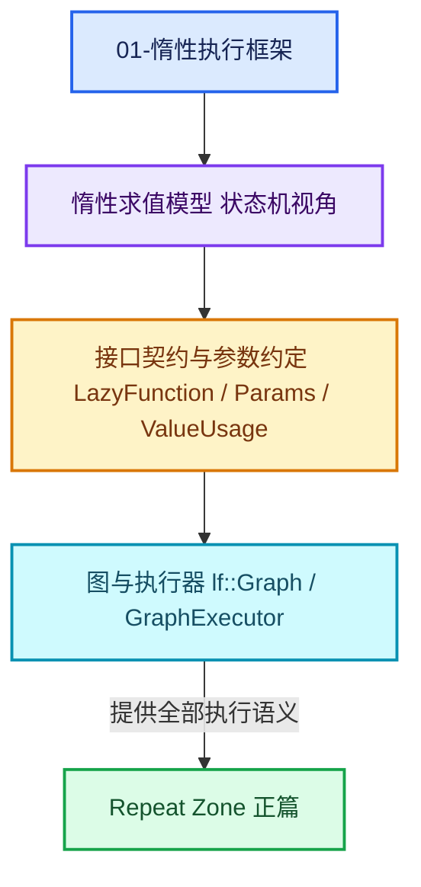

# 01-惰性执行框架

[前置知识总入口](../README.md) · [正篇：03-几何节点执行架构](../../重复区域-dsh/03-几何节点执行架构/README.md)

本章回答：Blender 的 LazyFunction（惰性函数）到底是什么、图怎么组起来、执行器怎么调度、需求又是怎么传播的。这是全专题最重要的一章——主系列正文中对它的引用高达 **407 次**，是最大的单项知识缺口。

## 阅读顺序

| # | 篇目 | 源码主线 |
| --- | --- | --- |
| 1 | [01-惰性求值模型与状态机](01-惰性求值模型与状态机.md) | `FN_lazy_function.hh` 文件头注释（L7-L41） |
| 2 | [02-LazyFunction接口契约](02-LazyFunction接口契约.md) | `FN_lazy_function.hh` L247-L479 |
| 3 | [03-Params调用约定](03-Params调用约定.md) | `FN_lazy_function.hh` L109-L197 |
| 4 | [04-ValueUsage三值与需求传播](04-ValueUsage三值与需求传播.md) | `FN_lazy_function.hh` L61-L76 + `lazy_function_execute.cc` |
| 5 | [05-lf-Graph图结构](05-lf-Graph图结构.md) | `FN_lazy_function_graph.hh`（554 行） |
| 6 | [06-GraphExecutor调度机制](06-GraphExecutor调度机制.md) | `FN_lazy_function_graph_executor.hh` + `lazy_function_graph_executor_generic.hh`（1503 行） |
| 7 | [07-执行钩子与副作用接口](07-执行钩子与副作用接口.md) | `GraphExecutorNodeExecuteWrapper` 与 `GraphExecutorSideEffectProvider` |

## 源码规模

> **行数口径**：本表所有行数为**文件总行数**（含空行与注释），可用 `[System.IO.File]::ReadAllLines(path).Count` 复核。若用 `Get-Content | Measure-Object -Line` 会得到**非空行数**，两者不同，请勿混用。

| 文件 | 行数 |
| --- | --- |
| `source/blender/functions/FN_lazy_function.hh` | 479 |
| `source/blender/functions/FN_lazy_function_execute.hh` | 158 |
| `source/blender/functions/FN_lazy_function_graph.hh` | 554 |
| `source/blender/functions/FN_lazy_function_graph_executor.hh` | 155 |
| `source/blender/functions/intern/lazy_function_graph_executor_generic.hh` | 1503 |
| `source/blender/functions/intern/lazy_function.cc` + 3 个 .cc | 693 |
| 合计 | ≈ 3,542 |

## 本章与 Repeat 的关系

Repeat Zone 的全部执行语义都建在这套框架上：

- `LazyFunctionForRepeatZone` 是 `LazyFunction` 的子类；
- 展开图是一张 `lf::Graph`；
- 循环体被包装成 `GraphExecutor` 作为"函数"塞进图里；
- `RepeatBodyNodeExecuteWrapper` 实现 `GraphExecutorNodeExecuteWrapper` 钩子；
- `RepeatZoneSideEffectProvider` 实现 `GraphExecutorSideEffectProvider` 钩子；
- `RemappedParams` 派生自 `Params`（第 02 章展开）；
- `ValueUsage::Used` 决定 Iterations 永不被裁剪。

