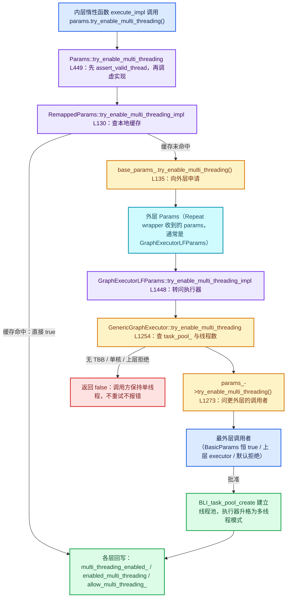

# 04 · 多线程许可与线程约束

[前置知识总入口](../README.md) · [本章导航](README.md) · [上一篇](03-RemappedParams参数重映射.md) · [下一章](../03-BLI容器与视图/README.md)

> 基准：Blender `5.4.0-alpha`，本地工作树。本篇讲惰性函数的线程许可谈判机制——`Params::try_enable_multi_threading` 与 debug 模式下的线程断言。主要源码：[`FN_lazy_function.hh`](../../../source/blender/functions/FN_lazy_function.hh) L110-L118 与 L175-L197、[`intern/lazy_function_execute.cc`](../../../source/blender/functions/intern/lazy_function_execute.cc)。

## 先回答一个具体问题

一个惰性函数跑着跑着发现："我这次要处理的元素有点多，能不能开几个线程一起算？"——它为什么不直接 `std::thread` 或者直接 `parallel_for`，而要调用 `params.try_enable_multi_threading()` 去"申请"？

因为**并行不是函数自己的事，是整条调用链的事**。惰性函数拿到的那个 `Params` 对象不是它私有的，而是一层层转发下来的句柄：Repeat 的 wrapper 把参数表交给内层展开图的执行器，内层执行器再把参数表交给它正在跑的某个节点。一个函数在这个句柄上跨线程调 `set_output`，等于同时去动外层 wrapper 的节点状态、执行器的节点状态表、以及各层共享的 user data。这些结构有没有上锁、能不能同时被两个线程碰，只有**拿着最外层那个 `Params` 的人**知道。

所以 `try_enable_multi_threading()` 的真实语义是：**"请向上问一圈，看这条链上有没有人还没准备好并行；如果都准备好了，从这一刻起我可以在多个线程上调用这个 `Params` 的非 const 方法。"** 它的返回值不是"我打算并行"，而是"我被批准并行了"。

正篇 Repeat 的 `execute_impl` 里那个 `RemappedParams` 的第五个构造参数 `eval_storage.multi_threading_enabled`（[`geometry_nodes_repeat_zone.cc`](../../../source/blender/nodes/intern/geometry_nodes_repeat_zone.cc) L177-L184），就是这条谈判链在嵌套调用里留下的接口。第 03 篇讲了它作为"参数视图的视图"如何转发索引，本篇讲它作为"许可管道"如何转发权限。

## 三个字段与一个方法

`Params` 的线程相关设施可以拆成 2 个 debug 字段 + 1 个断言 + 1 个公开方法和它的 1 个虚实现。先看字段（[`FN_lazy_function.hh`](../../../source/blender/functions/FN_lazy_function.hh) L110-L118）：

```cpp
class Params {
 public:
  /**
   * The lazy-function this #Params has been prepared for.
   */
  const LazyFunction &fn_;
#ifdef FN_LAZY_FUNCTION_DEBUG_THREADS
  std::thread::id main_thread_id_;
  std::atomic<bool> allow_multi_threading_;
#endif
```

注意 `#ifdef` 把两个字段整个包住了：在 release 构建里，`Params` 根本没有这两个成员，多线程许可在二进制里**不存在**。这不是疏漏，而是刻意的——许可机制在运行时是"零成本"的，因为真正的并行许可由执行器的 `task_pool_` 状态给出（见本篇后半的传播链），而这里的两个字段纯粹是**给 debug 构建抓 bug 用的**。

### `main_thread_id_`：谁算"主线程"

`main_thread_id_` 在构造函数里被写成 `std::this_thread::get_id()`（[L355-L364](../../../source/blender/functions/FN_lazy_function.hh#L355)）：

```cpp
inline Params::Params(const LazyFunction &fn,
                      [[maybe_unused]] bool allow_multi_threading_initially)
    : fn_(fn)
#ifdef FN_LAZY_FUNCTION_DEBUG_THREADS
      ,
      main_thread_id_(std::this_thread::get_id()),
      allow_multi_threading_(allow_multi_threading_initially)
#endif
{
}
```

这里"主线程"不是操作系统的主线程，而是**创建这个 `Params` 对象的那条线程**。对 `BasicParams` 来说，就是调用 `lazy_function.execute()` 的线程；对 `GraphExecutorLFParams` 来说，就是执行器当前正在跑节点的那条线程。这一点很关键：到了多线程阶段，每个 `GraphExecutorLFParams` 都是在不同工作线程上就地构造的（[`lazy_function_graph_executor_generic.hh`](../../../source/blender/functions/intern/lazy_function_graph_executor_generic.hh) L1469），所以每个节点对象有它自己的"主线程"，断言检查的是"这个节点有没有被别的线程碰"。

### `allow_multi_threading_`：为什么是 `std::atomic<bool>`

同一个 `Params` 一旦被批准并行，就会有多个线程同时读这个标志（每次调非 const 方法前都要过一遍 `assert_valid_thread`），同时可能有一条线程正在把它从 `false` 写成 `true`。普通 `bool` 的读写在这里是数据竞争，即便在 debug 构建里也不该制造 UB，所以用了 `std::atomic<bool>`。

默认内存序是 `memory_order_seq_cst`。这里其实不需要这么强的序：真正的同步（节点互斥锁、`task_pool_` 的原子量）在别处提供，`allow_multi_threading_` 只是给断言用的标志。用 `relaxed` 也能消除 UB。选默认序的原因是简单——这个写入只在申请成功时发生一次，不是热路径，没有理由为它做内存序推理。写代码时不要把这个选择当成"原子量都要 seq_cst"的论据。

它的初值来自构造函数第二参数 `allow_multi_threading_initially`，三个子类的传法各不相同：

| 子类 | 传给基类的初值 | 含义 |
| --- | --- | --- |
| `BasicParams` | `true`（[L23](../../../source/blender/functions/intern/lazy_function_execute.cc#L23)） | 本地急切执行，没人共享，随便并行 |
| `RemappedParams` | `multi_threading_enabled`（[L87](../../../source/blender/functions/intern/lazy_function_execute.cc#L87)） | 跟着被引用的那个布尔走 |
| `GraphExecutorLFParams` | `node_state.enabled_multi_threading`（[L1365](../../../source/blender/functions/intern/lazy_function_graph_executor_generic.hh#L1365)） | 跟着节点状态走，重入执行时保持已批准的结论 |

### `assert_valid_thread()`：私有断言（L181-L182）

声明只有一行，实现在 L461-L471：

```cpp
 private:
  void assert_valid_thread() const;
```

```cpp
inline void Params::assert_valid_thread() const
{
#ifdef FN_LAZY_FUNCTION_DEBUG_THREADS
  if (allow_multi_threading_) {
    return;
  }
  if (main_thread_id_ != std::this_thread::get_id()) {
    BLI_assert_unreachable();
  }
#endif
}
```

逻辑就三步，顺序不能换：**已获许可就直接放行 → 未获许可但还在创建线程上就放行 → 其余一律断言失败**。`BLI_assert_unreachable()` 在 debug 构建里会中止并打出调用栈，在 release 里是空操作——但注意整个函数体都在 `#ifdef` 里，所以 release 构建连这个函数调用都不会产生。

它被调用的位置很能说明问题。L375-L455 里，`assert_valid_thread()` 出现在 `try_get_input_data_ptr_or_request`（L375）、`get_output_data_ptr`（L382）、`output_set`（L389）、`set_input_unused`（L408）、`extract_input`（L414）、模板版 `try_get_input_data_ptr`（L430）、模板版 `try_get_input_data_ptr_or_request`（L436）、`set_output`（L443）和 `try_enable_multi_threading`（L451）里；而只读的 `try_get_input_data_ptr`（非模板，L366-L370）、`output_was_set`、`get_output_usage` 都没有。换句话说：**"会改状态"的入口都设卡，"只读快照"的入口不设卡**。这是刻意的取舍——`try_get_input_data_ptr` 读的是已经算好的输入槽位，即使跨线程读也不会破坏结构；而 `set_input_unused` 会去改外层的 usage 记录，跨线程调就是竞态。

### `try_enable_multi_threading()`：非虚包装（L175-L179, L449-L459）

声明处的注释是整篇的核心原文：

```cpp
  /**
   * Returns true when the lazy-function is now allowed to use multi-threading when interacting
   * with this #Params. That means, it is allowed to call non-const methods from different threads.
   */
  bool try_enable_multi_threading();
```

逐句拆：`is now allowed` 强调这是**状态变更后的结果**，不是请求；`when interacting with this #Params` 强调许可的对象是这个句柄，不是这个函数、也不是这张图——同一个函数下次拿到别的 `Params` 可能又不许；`non-const methods` 划出边界，读方法从来不需要许可。

实现在 L449-L459：

```cpp
inline bool Params::try_enable_multi_threading()
{
  this->assert_valid_thread();
  const bool success = this->try_enable_multi_threading_impl();
#ifdef FN_LAZY_FUNCTION_DEBUG_THREADS
  if (success) {
    allow_multi_threading_ = true;
  }
#endif
  return success;
}
```

这个分段是"非虚包装 + 虚实现"模式的又一次应用（第 03 篇讲过同一套路）：公开方法负责**先自检线程、再调虚函数、最后回写本地标志**，子类只实现"能不能给"的判断。注意 `allow_multi_threading_ = true` 只在 debug 构建里存在，所以子类实现**不能依赖**这一步去设置自己的状态——`RemappedParams` 和 `GraphExecutorLFParams` 都自己另外写了一份状态（`multi_threading_enabled_` / `node_state_.enabled_multi_threading`），这不是重复劳动，而是因为 release 构建里基类那份根本不存在。

## 为什么需要"谈判"而不是"开关"

如果只是"我想并行/我不想并行"这样一个布尔开关，事情会简单得多：函数自己置位，然后 `parallel_for`。但真实调用树里有三种情况让这个开关失效，每一种都对应一段具体源码。

### 理由一：执行器可能已经在并行了，你的申请是多余的（甚至是错的）

`GenericGraphExecutor::try_enable_multi_threading`（[L1254-L1283](../../../source/blender/functions/intern/lazy_function_graph_executor_generic.hh#L1254)）第一件事就是查自己：

```cpp
bool try_enable_multi_threading()
{
#ifndef WITH_TBB
  /* The non-TBB task pool has the property that it immediately executes tasks under some
   * circumstances. This is not supported here because tasks might be scheduled while another
   * node is in the middle of being executed on the same thread. */
  return false;
#endif
  if (this->use_multi_threading()) {
    return true;
  }
```

`use_multi_threading()` 只是 `task_pool_.load() != nullptr`。也就是说：**如果执行器已经开池子，申请立刻成功，且不需要做任何事**。反过来，如果这个 Blender 构建不带 TBB，申请**无条件失败**——因为非 TBB 的 task pool 在某些情况下会就地执行任务，而执行器设计假定"同一线程不会在节点执行中途被塞进别的节点"。

加上 `if (BLI_system_thread_count() <= 1) return false;`（L1277）：单核机器上申请永远失败。这三个提前返回说明许可不是"我要不要"的问题，而是"这套运行环境给不给"的问题——函数自己无权回答。

### 理由二：跨节点竞态——你并行了，别的节点可能正在同一张状态表上写

执行器的 `NodeState` 数组是全局共享的，每个节点自带一把互斥锁 `mutable Mutex mutex;`（[L156](../../../source/blender/functions/intern/lazy_function_graph_executor_generic.hh#L156)），加锁入口是 `with_locked_node`（[L807-L828](../../../source/blender/functions/intern/lazy_function_graph_executor_generic.hh#L807)）。节点 A 在把自己批准成并行之后，它的 `Params` 方法会去碰 `node_state_.inputs[...]`、`executor_.forward_value_to_linked_inputs(...)`——后者会把值**转发到下游节点的输入槽**。下游节点可能此刻正被另一个线程执行并持有自己的锁。这套锁协议在单线程模式下是有条件跳过的（"单线程模式下不使用 task pool 和锁"，见文件头 L14-L16），所以"能不能并行"必须由**知道全局锁状态**的执行器回答。

一个具体场景：Repeat 的某轮 body 里有一个 Switch 节点，它请求了两个分支的输入（`try_get_input_data_ptr_or_request`），其中一条分支的输出下游还连着别的节点。若这个 body 函数在 `execute_impl` 里擅自 `parallel_for` 去 `output_set` 多个输出，`output_set_impl` 就会调 `forward_value_to_linked_inputs`（[L1416-L1428](../../../source/blender/functions/intern/lazy_function_graph_executor_generic.hh#L1416)）往下游节点的 `InputState::value` 里写，而下游节点可能正被执行器在另一条线程上锁着处理。`try_enable_multi_threading` 之所以要先向上问，就是在问"锁协议现在生效了吗"。

### 理由三：storage 共享——`Context::storage` 是单份的，不是每线程一份

`Context` 只有三个字段（[L83-L103](../../../source/blender/functions/FN_lazy_function.hh#L83)）：`void *storage`、`UserData *user_data`、`LocalUserData *local_user_data`。其中 `storage` 是 `init_storage` 返回的那一份，**全局唯一**；真正按线程分开的只有 `local_user_data`，并且它是在执行器 `get_local_data()` 里按需为每个线程取的（[L1336-L1346](../../../source/blender/functions/intern/lazy_function_graph_executor_generic.hh#L1336)）。

```cpp
LocalData get_local_data()
{
  if (!this->use_multi_threading()) {
    return {&main_allocator_, context_->local_user_data};
  }
  ThreadLocalStorage &local_storage = thread_locals_->local();
  ...
}
```

注意这个分支：**单线程模式下 `local_user_data` 直接透传调用者的那一份**；只有开了并行才走 thread-local。这意味着一个函数如果未获许可就跨线程跑，它拿到的每一个 `LocalUserData *` 都指向同一块内存——所有本该"每线程独立"的临时缓冲区（例如几何节点里 per-thread 的 `LinearAllocator`）被多个线程共享。这类 bug 在单线程测试里完全看不出来。

`RepeatEvalStorage` 是这条规则的极端例子：它持有 `lf::Graph`、`lf::GraphExecutor`、`VectorSet<FunctionNode*>`、`Array<SocketValueVariant>`（[L98-L111](../../../source/blender/nodes/intern/geometry_nodes_repeat_zone.cc#L98)）。这些都是"一次调用一份"的结构，两个线程同时往里塞 body 节点，`VectorSet` 的内部指针会直接飞掉。

三条理由合起来就是答案：**许可是一个需要知道全局状态的问题，而函数只看得见自己的 `Params`**。所以它必须问，而问的方向只能向上。

## debug 模式下的线程断言

`FN_LAZY_FUNCTION_DEBUG_THREADS` 的定义在文件头（[L52-L56](../../../source/blender/functions/FN_lazy_function.hh#L52)）：

```cpp
#ifndef NDEBUG
#  include <atomic>
#  include <thread>
#  define FN_LAZY_FUNCTION_DEBUG_THREADS
#endif
```

也就是**只要不是 `NDEBUG`（release）构建，这个宏就一定存在**。没有单独的开关去关掉它——你想测线程断言，就必须用 debug 构建；你想在 release 构建上验证并发正确性，断言不会帮你。

断言的触发条件是三个条件的合取：

| 条件 | 代码 | 说明 |
| --- | --- | --- |
| 未获许可 | `if (allow_multi_threading_) return;` 没命中 | 本 `Params` 从未成功申请过 |
| 不在创建线程 | `main_thread_id_ != std::this_thread::get_id()` | 当前线程不是构造这个 `Params` 的线程 |
| 调了非 const 方法 | 调用点自身 | L375/382/389/408/414/430/436/443/451 |

一个容易忽略的细节：**断言是"每 `Params` 实例"的，不是"每函数"的**。`GraphExecutorLFParams` 每次 `execute_node` 都新建一个（L1469），初值取 `node_state.enabled_multi_threading`。所以节点第一次被单线程执行时如果申请成功，`node_state_.enabled_multi_threading` 被置 true（L1452），下次这个节点被任意线程执行时新建的 `Params` 一出生就是已许可状态，断言直接放行。这解释了为什么 `NodeState` 里要单独存一个 `enabled_multi_threading` 字段（[L177-L181](../../../source/blender/functions/intern/lazy_function_graph_executor_generic.hh#L177)）：

```cpp
  /**
   * Whether this node has enabled multi-threading. If this is true, the node is allowed to call
   * methods on #Params from multiple threads.
   */
  bool enabled_multi_threading = false;
```

执行器自己也有同类断言，而且更严格：`try_enable_multi_threading` 里有一句"只有当前主线程才被允许开启多线程"（L1265-L1271）：

```cpp
#ifdef FN_LAZY_FUNCTION_DEBUG_THREADS
    /* Only the current main thread is allowed to enabled multi-threading, because the executor is
     * still in single-threaded mode. */
    if (current_main_thread_ != std::this_thread::get_id()) {
      BLI_assert_unreachable();
    }
#endif
```

`current_main_thread_` 在 `execute()` 入口写入（L378-L380），退出时清空（L386-L388）。这句断言的逻辑是：**还没开池子的时候，只有最初那条线程有资格开池子**；如果某个工作线程跑着跑着想让执行器升格成多线程，那说明它已经在多线程里了，状态机自相矛盾。`ensure_thread_locals()`（L1285-L1295）里也有一份同样检查，因为它要建 thread-local 容器，必须在单线程阶段完成。

## 三个实现对比

翻回类定义的私有段（[L181-L197](../../../source/blender/functions/FN_lazy_function.hh#L181)），八个 `*_impl` 里只有 `try_enable_multi_threading_impl` **不是纯虚**——其余七个都带 `= 0`：

```cpp
  virtual void *try_get_input_data_ptr_impl(int index) const = 0;
  virtual void *try_get_input_data_ptr_or_request_impl(int index) = 0;
  virtual void *get_output_data_ptr_impl(int index) = 0;
  virtual void output_set_impl(int index) = 0;
  virtual bool output_was_set_impl(int index) const = 0;
  virtual ValueUsage get_output_usage_impl(int index) const = 0;
  virtual void set_input_unused_impl(int index) = 0;
  virtual bool try_enable_multi_threading_impl();
```

前七行都是 `= 0`，只有最后一行有实现。这个"唯一一个有默认值的虚函数"的位置本身就是设计声明：**线程许可是可选能力，其余七项是 `Params` 的必备契约**。一个只读的、纯粹做计算的 `Params` 子类可以完全不实现并行相关的东西，编译照过、运行照对，只是永远单线程。

默认实现在 [`intern/lazy_function.cc`](../../../source/blender/functions/intern/lazy_function.cc) L66-L69：

```cpp
bool Params::try_enable_multi_threading_impl()
{
  return false;
}
```

**默认拒绝**。这是整套设计里最重要的一条安全默认值：任何新写的 `Params` 子类，只要不显式覆写，就永远拿不到并行许可，跨线程调非 const 方法会在 debug 构建里立刻断言。你不会有"忘记实现导致静默竞态"的机会。

三个实现并排看：

| 实现 | 位置 | 行为 | 失败原因 | 成功后的副作用 |
| --- | --- | --- | --- | --- |
| 基类默认 | `lazy_function.cc` L66-L69 | 恒返回 `false` | 无——就是不给 | 无 |
| `BasicParams` | `lazy_function_execute.cc` L71-L74 | 恒返回 `true` | 从不失败 | 无（基类构造时已 `true`） |
| `RemappedParams` | `lazy_function_execute.cc` L130-L140 | 先查本地缓存，再向外层申请 | 外层拒绝 | 写 `multi_threading_enabled_ = true` |

源码并列（已省略 `/** \} */` 等分隔行）：

```cpp
/* 基类默认：拒绝 */
bool Params::try_enable_multi_threading_impl()
{
  return false;
}

/* BasicParams：无条件允许 */
bool BasicParams::try_enable_multi_threading_impl()
{
  return true;
}

/* RemappedParams：向外层申请，并把成功同步到共享布尔 */
bool RemappedParams::try_enable_multi_threading_impl()
{
  if (multi_threading_enabled_) {
    return true;
  }
  if (base_params_.try_enable_multi_threading()) {
    multi_threading_enabled_ = true;
    return true;
  }
  return false;
}
```

三者的差异不是风格差异，而是**它们各自掌握的信息量不同**。基类什么都看不到，只能拒绝；`BasicParams` 知道自己独占一份参数表（急切执行，没有别的线程会碰），可以放行；`RemappedParams` 知道自己只是转发器，真正的权限在外层，所以必须问。还有第四个实现——`GraphExecutorLFParams`（[L1448-L1455](../../../source/blender/functions/intern/lazy_function_graph_executor_generic.hh#L1448)）：

```cpp
  bool try_enable_multi_threading_impl() override
  {
    const bool success = executor_.try_enable_multi_threading();
    if (success) {
      node_state_.enabled_multi_threading = true;
    }
    return success;
  }
```

它和 `RemappedParams` 是同一个套路（问上级、成功则记本地），只是上级换成了执行器、本地缓存换成了 `NodeState` 字段。

## RemappedParams 的特殊处理

第 03 篇已经点出 `multi_threading_enabled_` 是 `bool &`（[`FN_lazy_function_execute.hh`](../../../source/blender/functions/FN_lazy_function_execute.hh) L58），这里展开讲为什么必须是引用：

```cpp
class RemappedParams : public Params {
 private:
  Params &base_params_;
  Span<int> input_map_;
  Span<int> output_map_;
  bool &multi_threading_enabled_;
```

如果是值成员 `bool multi_threading_enabled_;`，会丢掉两件事：**申请结果传不出去**，以及**缓存跨调用不保留**。逐一看三方共享：

**第一方：外层 `Params` 的真实状态。** `RemappedParams` 构造时把 `multi_threading_enabled` 同时传给基类当 `allow_multi_threading_initially`（L87）和存成自己的引用成员（L91）。所以 `Params::allow_multi_threading_`（debug 字段）与 `multi_threading_enabled_`（逻辑字段）在**出生时一致**，之后由 `try_enable_multi_threading_impl` 里的 `multi_threading_enabled_ = true;` 保持同步。如果改成值成员，基类那份会被更新（L455），引用那份不会，两者开始漂移——debug 构建里断言放行、逻辑层却仍认为未许可。

**第二方：`RemappedParams` 自己的本地缓存。** 开头的 `if (multi_threading_enabled_) return true;` 是缓存命中路径。Repeat 的内层图一次执行可能有一百个节点、每个节点执行多次，`try_enable_multi_threading` 会被反复调用；每次都往上走一层虚函数是浪费，本地布尔让它 O(1) 返回。但这个缓存必须与"上次是否成功"对齐，所以它不能是临时变量——`RemappedParams` 本身是栈上临时对象（正篇 L177-L184 就在 `execute_impl` 里就地构造），对象一销毁，值成员就没了，下次执行又要从头问。

**第三方：Repeat 的 storage 字段。** `RepeatEvalStorage::multi_threading_enabled`（[L108](../../../source/blender/nodes/intern/geometry_nodes_repeat_zone.cc#L108)）是唯一一处**活得比 `RemappedParams` 长**的存储：

```cpp
struct RepeatEvalStorage {
  ...
  void *graph_executor_storage = nullptr;
  bool multi_threading_enabled = false;
  Vector<int> input_index_map;
  Vector<int> output_index_map;
};
```

它默认 `false`，构造 `RemappedParams` 时按引用传入（L177-L184）。于是一次内层执行中若某个节点申请成功，`multi_threading_enabled_ = true` 直接写进了这个 storage 字段；**同一 storage 上后续的每次 `execute_impl`**（Repeat 会被反复执行——上游值一变就重跑）都会带着 `true` 出生，不必重新谈判。这就是"申请成功要同步本地开关"那条代码的实际收益：跨调用的许可缓存。

反过来如果它是值成员，storage 里的 `multi_threading_enabled` 永远是 `false`（只有 `RemappedParams` 内部的副本会变），每次 execute 都重新问一遍。功能上不算错，但会白白丢掉缓存。

这三方共享还带来一个推论：**往 `multi_threading_enabled_` 写 `true` 是单向的**。没有任何代码把它写回 `false`——执行器的 `task_pool_` 只在 `GenericGraphExecutor` 析构时释放（[L357-L361](../../../source/blender/functions/intern/lazy_function_graph_executor_generic.hh#L357)），执行期内不会关闭，这正是文件头那句 "It is not possible to switch back from multi-threaded to single-threaded mode."（L15-L16）。许可也就没有撤销的理由。改这段代码时不要试图"用完就关"，那个语义在框架里不存在。

## 许可的传播链

把上面的碎片拼成一条链。起点是内层惰性函数手里的 `Params`，终点是执行器建立 `task_pool_` 并回写各层本地开关：



三个要点读这张图：

1. **链是递归的**。`E → F → G → H` 这一段在嵌套 Repeat 里会重复出现（内层 Repeat 的外层 `Params` 又是某个 `GraphExecutorLFParams`），层数等于 zone 嵌套深度。
2. **回写是分散的**。没有统一的"许可对象"，每一层在自己的字段里记一份（`allow_multi_threading_` / `multi_threading_enabled_` / `node_state_.enabled_multi_threading`），因为各层的生命周期长短不同。
3. **失败路径没有副作用**。任何一处 `return false` 都不会清掉已经批准的许可（那些是单向的），只是这一层的调用者拿到 `false`，继续单线程。

## 与 lazy_threading 的区别

新手最常把这两件事混为一谈，因为都跟"多线程"有关、都在 `functions/` 目录里被引用。但它们的用途几乎相反：

| 维度 | `Params::try_enable_multi_threading` | `lazy_threading::send_hint` |
| --- | --- | --- |
| 归属 | `blender::fn::lazy_function`（本目录） | `blender::lazy_threading`（[`BLI_lazy_threading.hh`](../../../source/blender/blenlib/BLI_lazy_threading.hh)） |
| 语义 | "我申请在多个线程上操作这个 `Params` 的许可" | "我这条线程要忙一阵，别处排队的活可以先给别人" |
| 方向 | 向上问，等对方回答 | 向上喊，不等回答 |
| 返回值 | `bool`，必须检查 | `void`，无法失败 |
| 谁受益 | 调用者自己（它获得并行能力） | **其他**任务（它们被搬去别的线程） |
| 前提 | 需要执行器尚未开池、且上层批准 | 需要有 `HintReceiver` 在栈上（执行器在 `execute_node` 里放了一个） |
| 典型调用点 | `GenericGraphExecutor::run_task` 在待调度节点 > 128 时（L856-L864） | Repeat 在 iterations >= 10 时（[`geometry_nodes_repeat_zone.cc`](../../../source/blender/nodes/intern/geometry_nodes_repeat_zone.cc) L210-L214） |
| 失败后果 | 退回单线程，功能完全正确、只是慢 | 什么也不发生（提示被丢弃） |
| 与 debug 断言的关系 | 直接决定断言放不放行 | 无 |

`send_hint` 的接收端在 [`lazy_function_graph_executor_generic.hh`](../../../source/blender/functions/intern/lazy_function_graph_executor_generic.hh) L1477-L1490：

```cpp
  /* This is run when the execution of the node calls `lazy_threading::send_hint` to indicate that
   * the execution will take a while. In this case, other tasks waiting on this thread should be
   * allowed to be picked up by another thread. */
  auto blocking_hint_fn = [&]() {
    if (!current_task.has_scheduled_nodes.load()) {
      return;
    }
    if (!this->try_enable_multi_threading()) {
      return;
    }
    this->push_all_scheduled_nodes_to_task_pool(current_task);
  };

  lazy_threading::HintReceiver blocking_hint_receiver{blocking_hint_fn};
```

注意 `blocking_hint_fn` 里也调了 `try_enable_multi_threading()`——**但那是执行器自己的方法，不是 `Params` 的方法**。也就是说 hint 机制在需要升格时会借用同一套许可逻辑，可这两个 API 本身仍然不同：一个改变"我能不能跨线程"，一个改变"别的任务在哪条线程上跑"。

用一句日常类比收束：`try_enable_multi_threading` 是**向物业申请装修许可**（拿到才能动墙），`send_hint` 是**跟同事说"我这儿要开长会，你们先去别的会议室"**（不改变你能动什么，只改变别人去哪儿）。Repeat 同时用这两招——storage 里 `multi_threading_enabled` 保持 `false` 表示"不申请装修"，iterations 大时 `send_hint()` 表示"我要占着这间屋子，你们先走"。

## 用小数据走一遍

设定：内层展开图里某个惰性函数要处理 200 个点，它想按 4 段并行。构造是 `lf::RemappedParams eval_graph_params{...}`，`RepeatEvalStorage::multi_threading_enabled` 初值 `false`。

### 失败路径：单线程环境申请被拒

```text
1. 函数代码：if (count > 100) { if (params.try_enable_multi_threading()) { parallel_for(...) } }
2. Params::try_enable_multi_threading()（L449）
   → assert_valid_thread()：allow_multi_threading_ 为 false，但当前线程 == main_thread_id_，放行
3. try_enable_multi_threading_impl() 动态派发到 RemappedParams（L130）
4. 第一关 if (multi_threading_enabled_)：storage 里是 false，未命中
5. 第二关 base_params_.try_enable_multi_threading()：外层是 GraphExecutorLFParams
6. GraphExecutorLFParams::try_enable_multi_threading_impl（L1448）
   → executor_.try_enable_multi_threading()
7. GenericGraphExecutor::try_enable_multi_threading（L1254）
   a. 构建带 TBB，跳过 #ifndef WITH_TBB 分支
   b. use_multi_threading() == false（task_pool_ 还是 nullptr），不提前返回 true
   c. debug 检查：current_main_thread_ == 当前线程，通过
   d. params_->try_enable_multi_threading()（L1273）：问更外层的调用者
      → 最外层是几何节点求值入口造的 lf::BasicParams（geometry_nodes_execute.cc L639），
        恒 true（L71-L74）
   e. BLI_system_thread_count() == 1（假设用户在单核 CI 上跑）→ return false
8. 逐层 return false：执行器 → GraphExecutorLFParams（不改 enabled_multi_threading）→ RemappedParams（不改 multi_threading_enabled_）→ Params 包装（不改 allow_multi_threading_）
9. 函数拿到 false，走 else 分支：单线程 for 循环跑完 200 个点
10. 结果完全正确；debug 构建里没有断言；storage 里 multi_threading_enabled 仍是 false
```

这条路径里值得记住的两点：**第 7e 步失败发生在离申请者两层之外**，函数根本不知道是"单核"还是"上层不许"；**第 8 步是纯 return**，没有任何清理动作需要做，因为什么都没改。

### 成功路径：外层已允许

同样的调用，但这次执行器早就开了池子（例如图里另一个节点在 `run_task` 里因待调度节点 > 128 而先申请成功过）：

```text
1. 函数调 params.try_enable_multi_threading()
2. Params 包装：assert_valid_thread 放行，派发到 RemappedParams
3. if (multi_threading_enabled_)：假设仍为 false（本 storage 第一次跑），继续
4. base_params_.try_enable_multi_threading() → GraphExecutorLFParams
5. executor_.try_enable_multi_threading()（L1254）
   a. 构建带 TBB
   b. use_multi_threading() == true（task_pool_ 已建立）→ 立刻 return true
      注意：这一支根本不会走到 L1273 的 params_-> 申请，也不查线程数
6. GraphExecutorLFParams 把 node_state_.enabled_multi_threading 置 true（L1452），return true
7. RemappedParams 命中第二关，把 multi_threading_enabled_ 置 true（L136），return true
   → 由于是 bool&，RepeatEvalStorage::multi_threading_enabled 同步变成 true
8. Params 包装在 debug 构建里把 allow_multi_threading_ 置 true（L455）
9. 函数拿到 true，调 parallel_for 四段跑完 200 个点
10. 后续这个节点每次 execute_node 新建 GraphExecutorLFParams 时，
    Params(fn, node_state.enabled_multi_threading) 初值即为 true，断言一路放行
11. 后续 Repeat 在同一 storage 上重跑 execute_impl，
    RemappedParams 出生即 true，第 3 步缓存直接命中，不再向上问
```

第 5b 步是个容易被忽略的分支：**池子已开时，申请是"廉价短路"**——不查线程数、不问上层、不建 thread-local，直接 `true`。所以重复调用 `try_enable_multi_threading` 在并行阶段几乎零成本，这也是为什么调用点（L859、`blocking_hint_fn`）可以放心地在热路径上反复问。

## 反例与边界

### 反例 1：以为返回 `false` 是错误

`try_enable_multi_threading()` 的 `false` 是**正常结果**，不是失败信号。无 TBB 构建、单核机器、上层未批准、基类默认实现，四条路径都会给 `false`，而每一次都是完全合法的运行路径。把它当错误 `throw` 或 `BLI_assert` 会让 Blender 在单核机器和不带 TBB 的构建上直接崩。

正确写法是**两分支都要能跑完**：拿到 `true` 走并行，拿到 `false` 走串行，结果必须逐位相同。

### 反例 2：以为拿到许可就能任意并行

许可是**对 `Params` 的非 const 方法的**，不是对该函数所有状态。`Context::storage` 里面的东西（比如 `RepeatEvalStorage::graph_executor`）如果需要跨线程写，还得自己加锁。看 `GraphExecutorLFParams::get_output_data_ptr_impl`（L1404-L1414）——它往 `node_state_.outputs[index].value` 里分配内存，但它的调用方是持有节点锁的（`with_locked_node` 里一路下来）。许可只是让断言闭嘴，不提供互斥。

判断标准很简单：**许可给你的是"可以跨线程调这个 `Params`"，不是你自己的数据结构的线程安全证明。**

### 反例 3：在 debug 构建之外测试多线程

`assert_valid_thread()` 全体在 `#ifdef FN_LAZY_FUNCTION_DEBUG_THREADS` 里，而这个宏只在 `!NDEBUG` 时定义。这意味着：

| 构建 | 断言 | 后果 |
| --- | --- | --- |
| debug | 有 | 违规当场中止，栈里能看到调用链 |
| release | 无 | 违规**静默**执行，表现为偶发数据损坏 |

所以"release 构建跑了一百遍都没崩"不能证明并发正确。要验证这条路径，必须用 debug 构建，并且用能暴露竞态的数据量（一个 4 线程跑 3 个元素的测试基本不会撞车）。

### 反例 4：忘记原子性

`allow_multi_threading_` 是 `std::atomic<bool>`，但 `multi_threading_enabled_`（[`FN_lazy_function_execute.hh`](../../../source/blender/functions/FN_lazy_function_execute.hh) L58）和 `node_state_.enabled_multi_threading`（[`lazy_function_graph_executor_generic.hh`](../../../source/blender/functions/intern/lazy_function_graph_executor_generic.hh) L181）是**普通 `bool`**。这不是疏漏：后两者只在**单线程阶段**被写（申请只可能发生在 `task_pool_` 尚未建立、或已建立但写者唯一的情况下），读多写一。如果你在并行阶段给它们加写操作，就制造了一个真正的数据竞争——`RemappedParams` 的 `if (multi_threading_enabled_) return true;` 会读到撕裂的值（实践中可能读到"半真"），而且没有任何同步保证别的线程能看到你写的 `true`。

改这段代码时，任何"往 `multi_threading_enabled_` 里写"的新增代码都必须先问：**这条线程凭什么保证没有别的线程在读它？**

### 反例 5：在 `try_enable_multi_threading_impl` 里做重活

这个虚函数在缓存未命中时会被反复调用（每个节点、每次执行）。如果实现里加了日志、分配内存、遍历节点——它就变成了热路径上的隐蔽开销。三个现有实现都是几行判断，`BasicParams` 甚至直接 `return true;`（L71-L74）。正确做法是把重活放在**第一次**（缓存写入之前），或者干脆别放。

### 反例 6：以为嵌套调用会自动继承许可

`RemappedParams` 每次执行时都重新构造，初值取 `multi_threading_enabled`。如果某个内层 `Params` 不是通过 `RemappedParams` 而是别的路径拿到的（例如自己 new 一个 `BasicParams`），它初值是 `true`——**比外层还宽松**。这不是漏洞而是有意为之：`BasicParams` 是"我独占这份参数表"的声明，谁造它谁负责。

反过来说，**不要为了"省事"在嵌套调用里用 `BasicParams` 绕过谈判**。它恒返回 `true`，会把断言全关掉，而外层可能根本没准备好并行。

### 反例 7：以为许可可以撤销

没有任何 API 能把许可撤回。执行器的 `task_pool_` 在执行期内存活到 `GenericGraphExecutor` 析构（L357-L361），`RemappedParams` 只在 `false → true` 方向写，基类的 `allow_multi_threading_` 也只在成功时置 `true`。所以"这批数据算完了，关掉并行"这种想法在框架里无处安放。要控制并行度，用 `parallel_for` 的 grain size，不要用许可。

## 对理解 Repeat 的帮助

正篇 04-01 里 `RepeatEvalStorage::multi_threading_enabled` 的初值是 `false`（[L108](../../../source/blender/nodes/intern/geometry_nodes_repeat_zone.cc#L108)，对应正篇 04-01 L590-L606 的讨论），并通过 `RemappedParams` 的第五个构造参数传给内层展开图。现在可以完整解释这个取值的含义了。

**它不是"禁止并行"，而是"不主动申请并行"。** 内层函数如果真调 `try_enable_multi_threading()`，这条链会一路往上问，问到最后是外层 Repeat 所在的执行器——只要那个执行器开了池子，内层**会拿到 `true`**。区别在于：Repeat 自己不预先断言"我要并行"，把决定权留在了运行时。

为什么默认 `false` 是合理的？三条理由都来自内层图的形状：

**理由一：N 个 body 是串行依赖的。** 展开图把 N 轮循环体复制成 N 个节点，然后逐个首尾连线（[L298-L311](../../../source/blender/nodes/intern/geometry_nodes_repeat_zone.cc#L298)）：

```cpp
for (const int iter_i : lf_body_nodes.index_range().drop_back(1)) {
  lf::FunctionNode &lf_node = *lf_body_nodes[iter_i];
  lf::FunctionNode &lf_next_node = *lf_body_nodes[iter_i + 1];
  for (const int i : IndexRange(num_repeat_items)) {
    lf_graph.add_link(
        lf_node.output(body_fn_.indices.outputs.main[i]),
        lf_next_node.input(body_fn_.indices.inputs.main[i + body_inputs_offset]));
```

第 i 个 body 的输出是第 i+1 个 body 的输入（迭代状态递推）。这条链上没有任何可并行的宽度——`initialize_execution_graph` 建的是一串首尾相连的节点，不是扇形。即使许可拿到 `true`，执行器也找不到能同时跑的两个 body。既然没收益，就不必开这个头。

顺带说明这份代码里那行被注释掉的 back-link（L306-L309）：

```cpp
    /* TODO: Add back-link after being able to check for cyclic dependencies. */
    // lf_graph.add_link(lf_next_node.output(body_fn_.indices.outputs.input_usages[i]),
    //                   lf_node.input(body_fn_.indices.inputs.output_usages[i]));
```

如果把 usage 反向传回去（第 i+1 轮告诉第 i 轮"你的输出没人用"），图里就会出现环，而 `lf::Graph` 目前不做循环依赖检查。这是"串行链"之外另一个让内层图不敢放开的因素：**usage 传播只能沿正向流动，反向的信息缺口靠默认值 `static_true` 补齐**（L309）。

**理由二：嵌套任务爆炸。** Repeat 可以套 Repeat。如果每一层都主动申请并行，外层 N 个 body 里每轮又起一个内层执行域，每个内层域再起线程池，线程数就是乘积。而 `GenericGraphExecutor` 的设计是"一个执行器一个池子"（`task_pool_` 是 `std::atomic<TaskPool *>` 单值，L315），内层执行器如果也建立自己的池子，就变成池中池——TBB 的任务窃取在这种结构下会退化成大量空转。默认 `false` 让内层域老老实实待在调用者的线程上，把并行机会全部让给外层的节点调度。

**理由三：真正的并行点在别处。** Repeat 想做的是"让外层调度器把 N 个 body 分配到不同线程"——但那不成立（理由一）。它实际做的是"我构建图要花 O(N) 时间，期间别让别人干等"，这靠 `lazy_threading::send_hint()`（iterations >= 10 时，[L210-L214](../../../source/blender/nodes/intern/geometry_nodes_repeat_zone.cc#L210)）解决，与许可无关。

于是 Repeat 的并行策略可以一句话概括：**内层不申请新并行域（`multi_threading_enabled = false`），把并行机会留给外层调度（`send_hint`）**。许可机制在这里的作用是"提供接口但不主动使用"——凡是内层确实有可并行宽度的地方（例如某个 body 里的 `Distribute Points` 节点自己调 `try_enable_multi_threading`），那条链仍然通着，能拿到外层执行器的批准。

| 本篇概念 | Repeat 中的落点 |
| --- | --- |
| `try_enable_multi_threading` | 内层函数可调，但 Repeat 自己不预先调 |
| `multi_threading_enabled` 引用 | `RepeatEvalStorage` 字段，跨 `execute_impl` 缓存批准结果 |
| `assert_valid_thread()` | 内层函数跨线程碰 wrapper 参数表时当场抓包 |
| 默认 `false` | 不主动申请；有真实并行需求时由内层函数提出 |
| `send_hint` | iterations >= 10 时通知调度器"我在建图" |

一个容易验证的推论：把 `multi_threading_enabled` 初值改成 `true` 试试——行为**完全不变**（内层图没有可并行宽度），但 `RemappedParams` 出生即带许可，debug 断言对内层全关。等于白丢一层保护。这是"默认 `false` 是安全默认值"的最直接例证。

## 继续阅读

- [03-RemappedParams参数重映射](03-RemappedParams参数重映射.md)：`multi_threading_enabled_` 所属的那个类的完整转发逻辑
- [01-Context存储与UserData](01-Context存储与UserData.md)：`storage` 为什么是单份、`local_user_data` 为什么按线程分
- [06-GraphExecutor调度机制](../01-惰性执行框架/06-GraphExecutor调度机制.md)：`task_pool_` 与 `send_hint` 在调度循环里的落点
- 源码：[`FN_lazy_function.hh`](../../../source/blender/functions/FN_lazy_function.hh) L110-L118、L175-L197、L449-L471
- 源码：[`intern/lazy_function_graph_executor_generic.hh`](../../../source/blender/functions/intern/lazy_function_graph_executor_generic.hh) L1254-L1295、L1349-L1455
- 源码：[`BLI_lazy_threading.hh`](../../../source/blender/blenlib/BLI_lazy_threading.hh) 全文 96 行，文件头注释解释协作式提示的设计动机
- 正篇：[04-01 RepeatEvalStorage与一次求值](../../重复区域-dsh/04-运行时机制/01-RepeatEvalStorage与一次求值.md)
