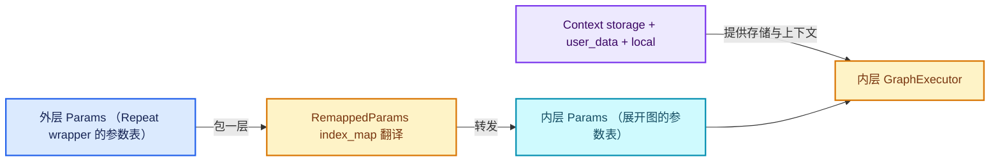

# 02-参数转发与上下文

[前置知识总入口](../README.md) · [上一章：01-惰性执行框架](../01-惰性执行框架/README.md)

本章回答：惰性函数的参数在内存里怎么排、怎么在两层函数之间转发、 `RemappedParams` 到底重映射了什么、线程许可又怎么在嵌套调用中协商。

## 阅读顺序

| # | 篇目 | 源码主线 |
| --- | --- | --- |
| 1 | [01-Context存储与UserData](01-Context存储与UserData.md) | `FN_lazy_function.hh` L83-L103 + `FN_user_data.hh` |
| 2 | [02-BasicParams与参数内存布局](02-BasicParams与参数内存布局.md) | `FN_lazy_function_execute.hh`（158 行） |
| 3 | [03-RemappedParams参数重映射](03-RemappedParams参数重映射.md) | `FN_lazy_function_execute.hh` 中 RemappedParams |
| 4 | [04-多线程许可与线程约束](04-多线程许可与线程约束.md) | `Params::try_enable_multi_threading` + debug 线程检查 |

## 本章与 Repeat 的关系

Repeat Zone 的 `execute_impl`（geometry_nodes_repeat_zone.cc L153-L185）里有三行代码直接对应本章全部内容：

```cpp
lf::RemappedParams eval_graph_params{*eval_storage.graph_executor,
                                     params,
                                     eval_storage.input_index_map,
                                     eval_storage.output_index_map,
                                     eval_storage.multi_threading_enabled};
lf::Context eval_graph_context{
    eval_storage.graph_executor_storage, context.user_data, context.local_user_data};
eval_storage.graph_executor->execute(eval_graph_params, eval_graph_context);
```

- 第 1 行 = 第 03 篇（RemappedParams）；
- 第 2 行 = 第 01 篇（Context 三字段）；
- 第 3 行的多线程参数 = 第 04 篇。

不读懂本章，这三行就是黑箱。

## 源码规模

| 文件 | 行数 |
| --- | --- |
| `FN_lazy_function.hh` 中 Params/Context 段 | ≈ 115 |
| `FN_lazy_function_execute.hh` | 158 |
| `intern/lazy_function_execute.cc` | 144 |
| `FN_user_data.hh` | 短 |
| 合计 | ≈ 450 |


