# 01 · 容器全景与选型

[前置知识总入口](../README.md) · [本章导航](README.md) · [下一篇](02-Span只读视图.md)

> 基准：Blender `5.4.0-alpha`，本地工作树。本篇是全章的选型指南——BLI 有 250 个 `BLI_*.hh` 头文件，这里只讲与几何节点/Repeat Zone 相关的那些，并给出"我该用哪个"的决策表。主要源码：`source/blender/blenlib/BLI_*.hh`（250 个文件）。

## 先回答一个具体问题

**Blender 为什么不用 `std::vector` / `std::map`，自己造了 250 个 BLI 头文件？**

先拆掉这个问题里最容易被误读的数字。实测 `source/blender/blenlib/` 下 `BLI_*.hh` 恰好 **250** 个，`.h` 一个都没有，合计 1,989,623 字节（约 1.9 MB）。但 250 不是"250 个容器"，按命名后缀拆开看，真正属于容器与视图的不到二十个，其余是数学库、文件系统、KD 树、序列化、线程池、噪声、路径处理。

| 后缀 | 个数 | 契约 | 例子 |
| --- | --- | --- | --- |
| `_c.hh` | 12 | 给 C 代码调用的接口层，与 C++ 模板层配对 | `BLI_math_vector_c.hh`、`BLI_stack_c.hh` |
| `_types.hh` | 15 | 只放类型定义，不含算法 | `BLI_math_vector_types.hh`、`BLI_color_types.hh` |
| `_fwd.hh` | 6 | 只有前置声明，用来压编译依赖 | `BLI_index_mask_fwd.hh`、`BLI_virtual_array_fwd.hh` |
| `_slots.hh` | 3 | 哈希表槽位策略，可替换 | `BLI_map_slots.hh`、`BLI_set_slots.hh`、`BLI_vector_set_slots.hh` |
| `_inline.hh` | 2 | 强制内联的小函数 | `BLI_math_inline.hh`、`BLI_endian_switch_inline.hh` |
| `_mixins.hh` | 1 | 空基类混入，零成本标记 | `BLI_utility_mixins.hh` |
| `_utils.hh` | 8 | 辅助算法，不定义新容器 | `BLI_array_utils.hh`、`BLI_sort_utils.hh` |
| 其余主题头 | 203 | 容器、数学、文件、线程、序列化…… | `BLI_vector.hh`、`BLI_map.hh` |

真正的原因可以压成一句话：**Blender 需要的不是一个容器，而是"同一份数据在不同所有权、不同可变性、不同类型已知时点下的多种视图"**。`std::vector` 只回答"怎么存"，Blender 还要回答另外四个问题：谁拥有它、我能不能改、类型是编译期已知还是运行期才知道、这块内存在哪个分配器名下。

读者在正篇第 03-03 篇很快就会撞上这段代码，四行用了四种容器，没有一种是随手写的：

```cpp
struct RepeatEvalStorage {
  LinearAllocator<> allocator;                  // 谁在什么时候还
  VectorSet<lf::FunctionNode *> lf_body_nodes;  // 按序 + 去重 + 反查
  Array<SocketValueVariant> index_values;       // 长度一确定就永不变
  Vector<int> input_index_map;                  // 构建过程中还在长
};
```

换成 `std::vector` 全部能编译，但四层语义会被压平成一层：没人再能从类型上读出"这块内存在整次求值结束后一次释放""第 i 个节点就是第 i 轮""这个数组装完 N 个就不再变"。答案就在这四行的类型选择里，下面逐条展开。

## 为什么自建容器库

### 理由一：分配器要能挂到 `MEM_*` 的内存统计上

`BLI_allocator.hh` 开篇把契约写得极简：每个分配器只需 `void *allocate(size_t size, size_t alignment, const char *name)` 和 `void deallocate(void *ptr)` 两个方法，并明确说明不用 `std::allocator` 接口，理由是后者"做的比分配器该做的多，还把分配和构造两个概念混在一起"。关键在那第三个参数 `name`：默认的 `GuardedAllocator` 把它原样转给 `MEM_new_uninitialized_aligned(size, alignment, name)`，于是每块容器内存都带着名字进入内存统计器，泄漏报告才能按源码位置分类。

真实场景：`RepeatEvalStorage` 第一行 `LinearAllocator<> allocator`（[`geometry_nodes_repeat_zone.cc` · L99](../../../source/blender/nodes/intern/geometry_nodes_repeat_zone.cc#L99)）。lazy function 图、`GraphExecutor` 存储、各类临时数组全从它分配，求值结束整块丢弃。要在 `std::vector` 的分配器模型下做到同样的事，得写一堆 `allocator_traits` 样板，还得保证每个容器都正确传播它。

### 理由二：Span 优先的 API 约定，参数不绑架调用方

`BLI_span.hh` 的意图写在 L10："An `Span<T>` references an array that is owned by someone else. It is just a pointer and a size." 这条定位决定了函数签名该长什么样：参数收 `Span<T>`，就同时接受 `Array`、`Vector`、`VectorSet`、`std::vector`、`std::array`、`std::string`、`initializer_list` 和 C 数组（L18-20 逐个列了出来）；参数收 `const std::vector<T> &`，就只接受 vector。

三个拥有型容器都提供了零成本通道：`Array::as_span()`（[`BLI_array.hh` · L254](../../../source/blender/blenlib/BLI_array.hh#L254)）、`Vector` 的转换运算符（[`BLI_vector.hh` · L366](../../../source/blender/blenlib/BLI_vector.hh#L366)）、`VectorSet::as_span()`（[`BLI_vector_set.hh` · L326](../../../source/blender/blenlib/BLI_vector_set.hh#L326)，函数体就是 `return *this;`，因为键本来就存在连续数组里）。

真实场景：`RepeatZoneSideEffectProvider` 只持有一个 `Span<lf::FunctionNode *>`（[`geometry_nodes_repeat_zone.cc` · L73](../../../source/blender/nodes/intern/geometry_nodes_repeat_zone.cc#L73)），不拥有、不拷贝节点列表；真正的所有者是 `RepeatEvalStorage::lf_body_nodes`。生命周期由 storage 保证，provider 只负责读。

### 理由三：小对象优化是默认行为，不是可选优化

`BLI_memory_utils.hh` L274 的函数只有一行：

```cpp
constexpr int64_t default_inline_buffer_capacity(size_t element_size)
{
  return (int64_t(element_size) < 100) ? 4 : 0;
}
```

元素小于 100 字节时，`Vector`、`Array`、`Map`、`Set`、`VectorSet`、`Stack` 全部自带 4 个元素的内联缓冲。代价写在 `BLI_vector.hh` L19-22：移动构造会让指针失效，因为内联缓冲里的元素被搬到了新对象的内联缓冲里（`std::vector` 的迭代器在 move 后仍然有效，这里不成立）。

真实场景：Repeat 构图时的 `Array<lf::FunctionNode *> lf_border_link_usage_or_nodes(num_border_links)`（[L256](../../../source/blender/nodes/intern/geometry_nodes_repeat_zone.cc#L256)）。一个 zone 的边界连接通常只有几条，4 个内联位直接吃下，这一步零堆分配。

### 理由四：确定性行为与可替换的性能旋钮

哈希容器把五个维度全部暴露成模板参数：`Hash`、`IsEqual`、`ProbingStrategy`、`Slot`、`Allocator`（[`BLI_vector_set.hh` · L75-92](../../../source/blender/blenlib/BLI_vector_set.hh#L75-L92)）。装载因子固定在 1/2（`BLI_map.hh` L162 的 `#define LOAD_FACTOR 1, 2`），槽数永远是 2 的幂，于是 `slot_mask_` 用位与就能把任意整数折成合法槽号。探测策略单独成文件 `BLI_probing_strategies.hh`。

真实场景：`BLI_map.hh` L38 要求"能加 `_new` 就别用 `add`"——`add_new` 断言键不存在，`add` 允许已存在。这不是性能提示，而是**把"我确信这是新键"的意图写进代码**。另一条更硬：L41 明确写"不能对 map 直接 range-for"，必须走 `keys()` / `values()` / `items()`，且这些方法只有 `const &` 与 `&` 重载（L875、L884、L902），在临时对象上取迭代器的悬垂 bug 直接编译不过。

### 理由五：AoS 与 SoA 的选择权要握在使用者手里

几何数据天然是分组的：一个 mesh 有 N 个面，每个面 M 个角。存成"每面一个 `(start, size)`"是 2N 个整数，存成"递增边界数组"是 N+1 个整数。`BLI_offset_indices.hh` L31-35 把账算得很清楚：`OffsetIndices` 要求各段首尾相接，换来内存减半；代价是底层数组必须比段数多一个元素，多出来那项专门用来编码最后一段的长度，从而每次访问都不需要分支。

真实场景：`Mesh` 的 `faces()` 返回 `OffsetIndices<int>`，`corner_verts()` 返回 `Span<int>`。想按面遍历角就写 `for (const IndexRange corners : faces) { corner_verts[corners] ... }`。索引与数据彻底分离，这就是手写版 SoA。

### 理由六：跨平台与跨编译器的一致行为

同一份 `Map` 代码在 MSVC、GCC、Clang 上行为一致：同样的哈希、同样的探测序列、同样的增长时机、同样的断言。`StringRef` 不受 `std::string_view` 的 ABI 约束，`BLI_string_ref.hh` L24-27 给出的理由是"allows us to add convenience methods at any time"；同一段还提到它用有符号整数，避开了 `string_view` 在 `size()` 上的常见坑。

调试侧则是整个 `BLI_assert` 体系：容器里每个下标访问都带断言，越界立刻打印文件、行号、函数名并 abort；release 构建下全部消失。`Vector` 甚至在 `#ifndef NDEBUG` 下额外存一个 `debug_size_`（[`BLI_vector.hh` · L111](../../../source/blender/blenlib/BLI_vector.hh#L111)），注释说否则调试时总得自己算 `end - begin`，很烦。

### 理由七：运行期类型与类型擦除

几何节点的 socket 值在编译期不知道类型：可能是 `float`、可能是 `GeometrySet`、可能是 `Field`。`BLI_cpp_type.hh` L10-25 用 `CPPType` 提供"一个类型一份元数据"的运行期多态——大小、对齐、构造、析构、拷贝、打印全是函数指针。`GSpan` / `GVArray` 在它之上做类型擦除的数组。`std::any` 只能装单值，既拿不到这套操作表，也表达不了"一整段未知类型的连续内存"。

真实场景：`Array<SocketValueVariant> index_values`（[L106](../../../source/blender/nodes/intern/geometry_nodes_repeat_zone.cc#L106)）。迭代号 `0..N-1` 必须先变成 `SocketValueVariant` 才能喂进 socket，而 `SocketValueVariant` 内部就是 `CPPType` 驱动的类型擦除。详见第 08 章。

## 全家族地图

分四层，判据不是"数据结构长什么样"，而是**谁拥有内存、以及数据什么时候被还给谁**。

```mermaid
flowchart TB
  subgraph G1["视图层：不拥有内存"]
    S1["Span 只读视图"]
    S2["MutableSpan 可变视图"]
    S3["IndexRange 连续整数区间"]
    S4["OffsetIndices 分组边界"]
    S5["StringRef 字符串视图"]
    S6["FunctionRef 回调视图"]
    S7["GSpan 类型擦除视图"]
  end
  subgraph G2["序列容器：拥有且连续"]
    Q1["Array 定长"]
    Q2["Vector 可增长"]
    Q3["VectorSet 按序去重"]
    Q4["Stack 分块后进先出"]
  end
  subgraph G3["关联容器：拥有且散列"]
    A1["Map 一对一"]
    A2["Set 无序去重"]
    A3["MultiValueMap 一键多值"]
  end
  subgraph G4["分配与所有权"]
    M1["LinearAllocator 只进不出"]
    M2["ResourceScope 逆序释放"]
    M3["ImplicitSharingInfo 写时复制"]
    M4["ImplicitSharingPtr 智能指针"]
    M5["CPPType 运行期类型"]
    M6["Any 小缓冲装箱"]
  end
  subgraph G5["Repeat Zone 落点"]
    R1["lf_body_nodes"]
    R2["index_values"]
    R3["reference_sets"]
    R4["副作用表"]
    R5["provider 入参"]
    R6["allocator"]
  end
  subgraph G6["陷阱：生命周期违约"]
    E1["悬垂 Span"]
    E2["扩容后旧指针"]
  end
  Q1 -->|as_span| S1
  Q2 -->|as_span| S1
  Q3 -->|as_span| S1
  Q3 -->|"兼作反查索引"| A1
  S4 -->|"operator[] 返回"| S3
  M5 --> S7
  M3 --> M4
  Q3 --> R1
  Q1 --> R2
  A1 --> R3
  A3 --> R4
  S1 --> R5
  M1 --> R6
  S1 -.->|"所有者先死则"| E1
  Q2 -.->|"忘记失效则"| E2
  classDef input fill:#DBEAFE,stroke:#2563EB,color:#172554,stroke-width:2px;
  classDef data fill:#CFFAFE,stroke:#0891B2,color:#164E63,stroke-width:2px;
  classDef abstraction fill:#EDE9FE,stroke:#7C3AED,color:#3B0764,stroke-width:2px;
  classDef compute fill:#FEF3C7,stroke:#D97706,color:#78350F,stroke-width:2px;
  classDef result fill:#DCFCE7,stroke:#16A34A,color:#14532D,stroke-width:2px;
  classDef error fill:#FEE2E2,stroke:#DC2626,color:#7F1D1D,stroke-width:2px;
  class S1,S2,S3,S4,S5,S6,S7 input;
  class Q1,Q2,Q3,Q4 data;
  class A1,A2,A3 abstraction;
  class M1,M2,M3,M4,M5,M6 compute;
  class R1,R2,R3,R4,R5,R6 result;
  class E1,E2 error;
```



四层各自的判据，以及"错用会怎样"：

| 层 | 代表类型 | 拥有内存 | 拷贝是否安全 | 主要风险 |
| --- | --- | --- | --- | --- |
| 视图层 | `Span` `MutableSpan` `IndexRange` `OffsetIndices` `StringRef` | 否 | 拷贝本身安全，但引用对象可能先死 | 悬垂 |
| 序列容器 | `Array` `Vector` `VectorSet` `Stack` | 是 | 深拷贝 | 迭代器与元素指针失效 |
| 关联容器 | `Map` `Set` `MultiValueMap` | 是 | 深拷贝 | 缺键时 `lookup` 断言失败 |
| 分配与所有权 | `LinearAllocator` `ResourceScope` `ImplicitSharing*` | 是（代持） | 视类型而定 | 释放顺序、双重释放 |

一句话记住分层：**视图层是"看"，序列层是"按序存"，关联层是"按键找"，分配层是"什么时候还"**。`VectorSet` 是唯一横跨序列层与关联层的类型——它既是按插入序的数组，又是指针到位置的哈希索引，Repeat 的身份机制正是踩在这个交叉点上。

## 选型决策表

先找"我想要……"，再看推荐与理由。选型时**语义优先于性能**：选错语义带来的 bug 远多于选错容器带来的开销。

| 我想要…… | 推荐 | 理由 |
| --- | --- | --- |
| 只读遍历别人拥有的连续数组 | `Span<T>` | 零拷贝，能接任何连续容器；`BLI_span.hh` L74 |
| 在函数里原地改写调用方的数组 | `MutableSpan<T>` | `Span` 默认 const，想写必须显式声明；L447 |
| 元素个数构造时确定、之后不变 | `Array<T>` | 精确一次分配，语义上就没有 append |
| 元素个数运行时才知道、会增长 | `Vector<T>` | 摊还 O(1) 追加，容量翻倍 |
| 元素个数编译期已知 | `std::array<T, N>` 或 C 数组 | `Array` 是给"运行期定长"的，编译期定长反而多一层间接 |
| 按插入顺序存且要自动去重 | `VectorSet<T>` | 键连续存储、保插入序，`as_span()` 直接给出全部键 |
| 要"值 → 第几个"的反查 | `VectorSet<T>::index_of_try` | 槽位只存索引，反查期望 O(1) |
| 只去重、不在乎顺序、想省内存 | `Set<T>` | 槽位里直接放 key，省掉整个 keys 数组 |
| 一对一的映射 | `Map<K, V>` | 默认哈希表，开放寻址 + 1/2 装载因子 |
| 一个键挂多个值且值要保序 | `MultiValueMap<K, V>` | 值列表保序可重复，`lookup` 返回 `Span<Value>` |
| 键是字符串、查表频繁 | `Map<std::string, V>` + `lookup_as(StringRef)` | 异构查找，不必为查表临时构造 `std::string` |
| 一个非负连续整数区间 | `IndexRange` | 两个 int64，零分配；`from_begin_end` 等构造器省掉手算 |
| 一组首尾相接的子区间 | `OffsetIndices<int>` | N+1 个边界，内存是"(start,size)"方案的一半 |
| 按位压缩的布尔标记 | `BitSpan` / `MutableBitSpan` | 1 bit 每元素，向量化友好 |
| 从大数组里挑出一小撮索引 | `IndexMask` | 分段 + 段内 int16，段长上限 16384 |
| 数据可能不物化、按需计算 | `VArray<T>` / `GVArray` | 虚函数取值，调用方不必先落成内存 |
| 运行期才知道元素类型 | `GSpan` + `CPPType` | 类型擦除，标准库无对应物 |
| 一次求值内大量小块分配、统一释放 | `LinearAllocator<>` | 从不复用内存，所以不需要逐个释放 |
| 函数要"可选地"交出所有权 | `ResourceScope` | 逆序析构，避免 `optional<unique_ptr<T>>` 样板 |
| 共享大数据、写时复制 | `ImplicitSharingPtr` / `ImplicitSharingInfo` | 引用计数内嵌在数据里，count 为 1 时才可写 |
| 后进先出的临时栈 | `Stack<T>` | 分块链表，扩容时不搬已压入的元素 |
| 少量元素的类型擦除单值 | `Any<InlineCapacity>` | 内联容量可调，还能挂用户自定义类型信息 |

两条口径提醒。**其一**，`Array` 与 `Vector` 之间不存在性能优劣，只有意图差异，`BLI_array.hh` L20 的原话是"主要好处是更清楚地表达开发者的意图"，L22 补了半句"你能更确定它没有 over-allocate"。**其二**，`MultiValueMap` 官方承认自己只是便利封装——`BLI_multi_value_map.hh` L18 原话："Currently, this class exists mainly for convenience. There are no performance benefits over using Map<Key, Vector<Value>>." 选它是为了可读性，不是为了速度。

## 五对易混类型辨析

### 一 · `Span` / `MutableSpan`

同一份数据的两种读法，而且**在同一个文件里**：`Span` 在 [`BLI_span.hh` · L74](../../../source/blender/blenlib/BLI_span.hh#L74)，`MutableSpan` 在 L447。全仓库没有 `BLI_mutable_span.hh`。

| 维度 | `Span<T>` | `MutableSpan<T>` |
| --- | --- | --- |
| 私有字段 | `const T *data_` + `int64_t size_` | `T *data_` + `int64_t size_` |
| 元素能否修改 | 否 | 能 |
| 等价的 `std::span` | `std::span<const T>` | `std::span<T>` |
| 转换方向 | 不变或更严格 | `MutableSpan` 可隐式转成 `Span`，反之不行 |
| 典型出现位置 | provider 成员、只读入参 | 输出缓冲区、`items_span()` 的可变重载 |

设计动机在 L22-24："`Span` is const by default. This is to avoid making things mutable when they don't have to be." 误用后果分两个方向：把 `MutableSpan` 当返回类型暴露出去，等于把内部缓冲区的写权限发给所有调用方；反过来在需要写的参数上收 `Span`，编译期就顶回来，这是好事。真正危险的是用 `const_cast` 把 `Span` 强行变回可变指针绕过这个约束——`BLI_span.hh` 不提供这种转换，就是为了让绕过变得显眼。

### 二 · `Array` / `Vector`

| 维度 | `Array<T>` | `Vector<T>` |
| --- | --- | --- |
| 私有字段 | `data_` + `size_` + 分配器 + 内联缓冲 | `begin_` + `end_` + `capacity_end_` + 分配器 + 内联缓冲 |
| 追加元素 | 没有此操作，只能整体 `reinitialize` | `append`，摊还 O(1) |
| 容量 | 恰好等于元素数 | 至少是元素数的两倍 |
| 内存上界 | 不会 over-allocate | 可能预留到 2 倍 |
| 语义信号 | "这里的元素数不会变" | "这里还会继续往里塞" |

`Array` 的字段见 [`BLI_array.hh` · L50-72](../../../source/blender/blenlib/BLI_array.hh#L50-L72)，`Vector` 的三指针见 [`BLI_vector.hh` · L91-96](../../../source/blender/blenlib/BLI_vector.hh#L91-L96)（注释解释用三个指针而非 size 是为了减少 `append` 的指令数）。

误用后果：用 `Vector` 表示"元素数就是 iterations"的数组，代价是跟着容量预留多占一倍内存，而且读代码的人不知道 `size()` 会不会变；用 `Array` 表示会增长的数据，就只能反复 `reinitialize(size + 1)`，每次都是析构全部再重新构造，复杂度从摊还 O(1) 退化成 O(n²)。`BLI_array.hh` L15-18 还提醒一句：用尺寸构造会**默认构造所有元素**，对非平凡类型这本身就是开销。

### 三 · `Vector` / `VectorSet`

| 维度 | `Vector<T>` | `VectorSet<T>` |
| --- | --- | --- |
| 是否去重 | 否 | 是，`add` 返回"是否新增" |
| 按值查存在 | O(n) | 期望 O(1) |
| 按下标取元素 | O(1) | O(1)，但返回 `const Key &` |
| 取"值 → 下标" | 只能线性扫 | `index_of` / `index_of_try` |
| 额外内存 | 无 | 一套槽位数组 |
| 删除后顺序 | 保持 | 只保证"被删元素之前加入的"仍保序 |

`VectorSet` 的槽位**不存 key，只存 key 数组的下标**：`SimpleVectorSetSlot` 只有一个 `int64_t state_`，`-1` 表示空、`-2` 表示已删、非负值即 keys 下标（`BLI_vector_set_slots.hh` L40-46）。`index_of_try` 在 [`BLI_vector_set.hh` · L492](../../../source/blender/blenlib/BLI_vector_set.hh#L492)。

误用后果：Repeat 里如果按"节点 → 迭代号"建 `Map<FunctionNode *, int>`，顺序信息就丢了，而构图时正是 `for (i : IndexRange(iterations))` 依次 `add_new` 才有"第 i 个即第 i 轮"；如果按"迭代号 → 节点"建 `Vector<FunctionNode *>`，顺序有了，但 `RepeatBodyNodeExecuteWrapper` 那句 `index_of_try`（[L45](../../../source/blender/nodes/intern/geometry_nodes_repeat_zone.cc#L45)）就退化成 O(n) 扫描，而它跑在**每个节点每一次执行**的热路径上。`VectorSet` 是同时满足这两件事的唯一选择。

### 四 · `Map` / `MultiValueMap`

| 维度 | `Map<K, V>` | `MultiValueMap<K, V>` |
| --- | --- | --- |
| 同键多值 | 不允许，后写覆盖先写 | 允许，值按插入顺序追加 |
| 查不存在的键 | `lookup` 断言失败；`lookup_ptr` 返回 `nullptr` | `lookup` 返回空 `Span` |
| 查找返回类型 | 值的引用 | `Span<Value>` / `MutableSpan<Value>` |
| 底层实现 | 开放寻址哈希表 | 就是 `Map<Key, Vector<Value>>` |
| 删除单个值 | 直接删 | 取出 `MutableSpan` 后自行处理 |

`MultiValueMap` 的底牌写在 [`BLI_multi_value_map.hh` · L33](../../../source/blender/blenlib/BLI_multi_value_map.hh#L33)：`using MapType = Map<Key, Vector<Value>>;`。它还特意澄清自己与 `std::multimap` 不同——`multimap` 允许同一个键出现多次，`MultiValueMap` 不允许。

误用后果：副作用表如果是 `Map<ComputeContextHash, const lf::FunctionNode *>`，一个上下文里有两个 Viewer 时就只剩一个，后写的覆盖先写的，于是少跑一轮。所以 `GeoNodesSideEffectNodes::nodes_by_context` 用的是 `MultiValueMap`（[`NOD_geometry_nodes_lazy_function.hh` · L150](../../../source/blender/nodes/NOD_geometry_nodes_lazy_function.hh#L150)）。反过来，用 `Map<K, Vector<V>>` 手写一键多值时，很容易在每次 `lookup` 后忘记判空——`MultiValueMap` 用"空 Span"这个约定，把"没有值"和"有一个空列表"合并成同一种安全状态。

### 五 · `IndexRange` / `OffsetIndices`

名字都带"索引"，但一个描述**一段**连续整数，一个描述**一组首尾相接的段**。

| 维度 | `IndexRange` | `OffsetIndices<int>` |
| --- | --- | --- |
| 内部表示 | `int64_t start_` + `int64_t size_`（L56-57） | `Span<T> offsets_`（L41），长度 = 段数 + 1 |
| `size()` 的含义 | 元素个数 | **段数**，不是元素数 |
| 元素总数 | 就是 `size()` | `total_size()` |
| 取其中一段 | 不存在此概念 | `operator[](i)` 返回 `IndexRange` |
| 内存 | 16 字节 | `4 × (段数 + 1)` 字节 |
| 前提条件 | 无 | 必须非递减，且多一个尾部哨兵 |

误用后果最典型的一条：把 `OffsetIndices::size()` 当元素总数用。它返回段数；总元素数是 `total_size()`（也就是最后那个哨兵的值）。另一条更隐蔽：手写 `for (i in 0..size) data[offsets[i]]` 会漏掉每段的最后一个元素，因为 `offsets[i]` 是段起点、`offsets[i+1]` 才是终点。反过来给 `OffsetIndices` 传长度为 N 的数组（正确是 N+1），debug 构建下断言能抓住，release 构建下越界读不会报错，只会给出一个荒谬的 `total_size()`。

## 实测行数总表

口径说明：`Get-Content | Measure-Object -Line` **会跳过空行**，所以它给出的是非空行；`Get-Content | .Count` 才是文件总行数。两者在本仓库里普遍相差 8%~15%。下面两个数字都列出来，正文里的 `#L` 锚点一律用**总行数**口径。

| 文件 | 总行数 | 非空行 | 配套 `.cc` | 定位 |
| --- | --- | --- | --- | --- |
| `BLI_map.hh` | 1383 | 1258 | 无 | 默认哈希表，开放寻址 + 1/2 装载因子 |
| `BLI_index_mask.hh` | 1315 | 1191 | `index_mask.cc` 1169 | 分段索引掩码，段长上限 16384 |
| `BLI_virtual_array.hh` | 1242 | 1095 | `virtual_array.cc` 14 | 虚函数访问的惰性数组 |
| `BLI_vector_set.hh` | 1168 | 1049 | 无 | 按插入序去重，兼作"值→位置"索引 |
| `BLI_vector.hh` | 1167 | 1057 | `vector.cc` 27 | 默认动态数组，4 元素内联缓冲 |
| `BLI_set.hh` | 996 | 895 | 无 | 无序去重，槽位里直接放 key |
| `BLI_generic_virtual_array.hh` | 988 | 806 | `generic_virtual_array.cc` 612 | 类型擦除的虚拟数组 `GVArray` |
| `BLI_cpp_type.hh` | 823 | 699 | `cpp_type.cc` 27 | 运行期类型元数据 |
| `BLI_span.hh` | 763 | 681 | 无 | `Span` / `MutableSpan`，两字视图 |
| `BLI_string_ref.hh` | 727 | 623 | `string_ref.cc` 50 | 非零结尾字符串视图 |
| `BLI_bit_span.hh` | 488 | 400 | `bit_span.cc` 92 | 位视图，1 bit 每元素 |
| `BLI_array.hh` | 487 | 430 | 无 | 运行期定长数组，一次分配 |
| `BLI_stack.hh` | 417 | 370 | `stack.cc` 212（C API） | 分块链表栈，扩容不搬旧元素 |
| `BLI_any.hh` | 408 | 366 | 无 | 类型擦除单值，内联容量可调 |
| `BLI_index_range.hh` | 373 | 325 | `index_range.cc` 42 | 非负整数区间，两个 int64 |
| `BLI_memory_utils.hh` | 372 | 315 | 无 | 内联容量策略、构造/析构/搬移工具 |
| `BLI_implicit_sharing.hh` | 337 | 297 | `implicit_sharing.cc` 93 | 写时复制，原子引用计数 |
| `BLI_linear_allocator.hh` | 316 | 279 | 无 | 只进不出的线性分配器 |
| `BLI_hash.hh` | 295 | 267 | 无 | `DefaultHash` 特化与异构查找契约 |
| `BLI_offset_indices.hh` | 284 | 241 | `offset_indices.cc` 411 | 一组连续区间的边界表 |
| `BLI_generic_span.hh` | 281 | 231 | 无 | `GSpan` / `GMutableSpan` |
| `BLI_implicit_sharing_ptr.hh` | 262 | 216 | 无 | 携带共享信息的智能指针 |
| `BLI_resource_scope.hh` | 243 | 206 | `resource_scope.cc` 77 | 逆序释放的资源作用域 |
| `BLI_multi_value_map.hh` | 189 | 167 | 无 | 一键多值，`Map<K, Vector<V>>` 的糖 |
| `BLI_compute_context.hh` | 174 | 150 | `compute_context.cc` 48 | 求值上下文与 XXH3-128 哈希 |
| `BLI_function_ref.hh` | 165 | 150 | 无 | 不分配的回调视图 |
| `BLI_disjoint_set.hh` | 110 | 92 | 无 | 并查集，路径压缩 + 按秩合并 |
| `BLI_lazy_threading.hh` | 96 | 88 | `lazy_threading.cc` 46 | "先别开线程"的延迟线程化协议 |
| **28 文件合计** | **15869** | **13944** | **14 个，2920 行** | 约占 250 个头文件的 11% |

配套实现这一列的分布很说明问题：28 个头文件里只有 14 个有同名 `.cc`，合计 2,920 行，其中一半以上来自 `index_mask.cc` 与 `generic_virtual_array.cc`；剩下 14 个是纯头文件。也就是说这批容器**绝大多数是全头文件的模板**，你几乎不会因为改它们而遇到链接问题——每次实例化都在使用方的编译单元里。

## 命名与组织约定

第一，**只有 `.hh`，没有 `.h`**。`blenlib/` 下 `.h` 数量为 0，历史的 `BLI_*.h` 要么迁进 `*_c.hh` 的 C 兼容层，要么升成 C++ 模板头。看到 `_c` 后缀就知道这个头文件提供的是 `BLI_stack_new` 这类 C 函数，与 `blender::Stack<T>` 不是同一套东西。

第二，**后缀即契约**。`_fwd.hh` 只给前置声明（`BLI_virtual_array_fwd.hh` 全文就是两个 `template<typename T> class VArray;` 声明），为的是压编译依赖；`_types.hh` 只放类型不放算法；`_slots.hh` 是哈希槽位的可替换实现；`_inline.hh` 是强制内联；`_utils.hh` 是辅助算法。读文件名就能预判它该不该出现在 `#include` 列表的前排。

第三，**"同名 `.hh` + `intern/*.cc`"表示非模板部分下沉**。实测 250 个头里有 **100** 个在 `intern/` 下有同名 `.cc`，**150** 个纯头文件。但"同名"绝不等于"实现同一个东西"，必须逐个看：`intern/stack.cc`（212 行）实现的是 C API `BLI_stack_c.hh` 的 `BLI_stack_new` 等函数，文件第一行就是 `#include "BLI_stack_c.hh"`，和 C++ 模板 `blender::Stack<T>` 毫无关系。

| 头文件 | 同名 `.cc` | `.cc` 里实际装的东西 |
| --- | --- | --- |
| `BLI_vector.hh` | `vector.cc` 27 行 | 只有 `vector_print_stats` 这个调试打印 |
| `BLI_cpp_type.hh` | `cpp_type.cc` 27 行 | `to_string` / `print_or_default` 等非模板辅助 |
| `BLI_index_range.hh` | `index_range.cc` 42 行 | 对齐切分函数与 `ostream` 输出 |
| `BLI_string_ref.hh` | `string_ref.cc` 50 行 | `operator<<` 与 UTF-8 截断拷贝 |
| `BLI_resource_scope.hh` | `resource_scope.cc` 77 行 | 构造函数与内嵌分配器的创建 |
| `BLI_implicit_sharing.hh` | `implicit_sharing.cc` 93 行 | 引用计数与 `MEM_freeN` 释放适配 |
| `BLI_compute_context.hh` | `compute_context.cc` 48 行 | `XXH3_128bits` 哈希与 `print_stack` |
| `BLI_offset_indices.hh` | `offset_indices.cc` 411 行 | `accumulate_counts_to_offsets` 等批量构建 |

第四，**反例一侧**：`BLI_array.hh`、`BLI_vector_set.hh`、`BLI_map.hh`、`BLI_set.hh`、`BLI_multi_value_map.hh`、`BLI_span.hh`、`BLI_any.hh`、`BLI_hash.hh`、`BLI_memory_utils.hh`、`BLI_linear_allocator.hh`、`BLI_disjoint_set.hh`、`BLI_function_ref.hh`、`BLI_generic_span.hh`、`BLI_implicit_sharing_ptr.hh` 全部**没有**同名 `.cc`——纯模板或纯内联。

第五，**测试与实现同目录**：`intern/` 下 147 个 `.cc`，`tests/` 下 97 个测试文件，命名与头文件一一对应。`BLI_map.hh` 的头注释甚至直接引用 `BLI_map_test.cc` 里的基准结果，说"在这个特定场景下 `Map` 稳定优于 `std::unordered_map`"。

第六，**注释即文档**。每个头文件的 `/** \file \ingroup bli */` 之后都有一段设计说明，讲"为什么"而不只是"是什么"，并且往往连代价一起写清楚（"you can be more certain that an array does not over-allocate"、"iterators are invalidated when a Vector is moved"）。本篇引用的原文全部来自这些段落——它们是一手资料，比任何二手转述都可靠。

## 用小数据走一遍

同一份 5 个整数 `3, 1, 4, 1, 5`，四种表示。假设 64 位、`int` 为 4 字节、`sizeof(void*) == 8`、release 构建（无 `debug_size_`）。

```cpp
Array<int> arr{3, 1, 4, 1, 5};        // 定长，构造即 5
Vector<int> vec{3, 1, 4, 1, 5};       // 可增长，容量可能到 8
VectorSet<int> vset{3, 1, 4, 1, 5};   // 去重 + 保序：最终只有 4 个元素
Span<int> span = vec;                 // 只是看一眼
```

### 内存布局

| 表示 | 栈上字节 | 堆上字节 | 元素数 | 查 `4` 的代价 |
| --- | --- | --- | --- | --- |
| `Span<int>` | 16（指针 8 + 长度 8） | 0 | 5（不拥有） | O(n) |
| `Array<int>` | 32（`data_` 8 + `size_` 8 + 内联 16） | 20（5 × 4，恰好） | 5 | O(n) |
| `Vector<int>` | 40（三指针 24 + 内联 16） | 32（容量 8 × 4） | 5 | O(n) |
| `VectorSet<int>` | 136 | 160（keys 8 × 4 + 槽位 16 × 8） | 4 | 期望 O(1) |

### 这些数字从哪来

`Span` 最简单：只有 `const int *data_` 与 `int64_t size_` 两个字段，16 字节，不碰分配器。构造之后 `size()` 为 5，`data_[i]` 直接读原数组。

`Array` 的字段是 `data_`、`size_`、分配器（空类，被 `BLI_NO_UNIQUE_ADDRESS` 消掉）、`inline_buffer_`。内联容量为 4（元素 4 字节小于 100），而 5 > 4，所以走堆，**且分配量恰好 5 个元素而不是 8**——这就是"`Array` 不会 over-allocate"的实证。

`Vector` 用三个指针表达 begin / end / capacity_end，前 4 次 `append` 全写在内联缓冲里，第 5 次触发增长，容量取 `max(min_capacity, capacity * 2)`，从 4 翻到 8，于是堆上 32 字节，其中 3 个槽位是浪费的。这就是"用 `Vector` 表达定长数据会浪费内存"的具体形态。

`VectorSet` 是两套内存叠在一起，数字可以逐项推出来。先看默认参数：`InlineBufferCapacity = default_inline_buffer_capacity(sizeof(int)) = 4`；槽位类型是 `SimpleVectorSetSlot<int>`，只存一个 `int64_t state_`，所以 `sizeof(Slot) = 8`；槽位数组的内联容量是 `compute_total_slots(4, 1, 2)` = `power_of_2_max(ceil(4 × 2 / 1))` = **8 个槽位**。对象本身于是由四个计数器、槽位数组（指针 + 长度 + 8 个内联槽）、以及 keys 的内联缓冲组成。

插入 5 个值的推演如下。注意构造函数把 `usable_slots_` 初始化为 0，所以**第一次插入必然触发一次重排**，按"能用 4 个"规划出 8 个槽位。

| 第几次 `add_new` | 判据 | 结果 | 内存动作 |
| --- | --- | --- | --- |
| 第 1 次（值 3） | `0 >= 0` 成立 | 8 槽 / 4 可用 | 槽位 8 个仍在内联容量内，零堆分配 |
| 第 2 次（值 1） | `1 < 4` | 不变 | 仍全部内联 |
| 第 3 次（值 4） | `2 < 4` | 不变 | 仍全部内联 |
| 第 4 次（值 1） | 键已存在 | 不插入，元素数停在 3 | 无变化 |
| 第 5 次（值 5） | `4 >= 4` 成立 | 16 槽 / 8 可用 | 槽位 16 > 内联 8 → 堆上 128 字节；keys 容量 8 > 内联 4 → 堆上 32 字节 |

两个可验证的结论。**第一**，`VectorSet` 存 4 个 `int` 完全零堆分配（槽位 8 个内联 + keys 4 个内联，恰好装下）。**第二**，存第 5 个不重复的值会一次性花掉 160 字节堆，比 `Vector` 存同样 5 个值的 32 字节多 5 倍。这正是"用 `VectorSet` 换 O(1) 反查"的账单：元素少且需要反查时划算，否则 `Vector` 更省。

### 复杂度对照

| 操作 | `Array` | `Vector` | `VectorSet` | `Span` |
| --- | --- | --- | --- | --- |
| 按下标取 | O(1) | O(1) | O(1) | O(1) |
| 末尾追加 | 不支持 | 摊还 O(1) | 期望 O(1)，含去重 | 不支持 |
| 中间插入 | 不支持 | O(n) | O(n) | 不支持 |
| 按值删除 | 不支持 | O(n)，或 `remove_and_reorder` 后 O(1) | 期望 O(1) | 不支持 |
| 按值查存在 | O(n) | O(n) | 期望 O(1) | O(n) |
| 按下标反查值 | 无 | `first_index_of` O(n) | `index_of` O(1) | 无 |
| 保留插入顺序 | 是 | 是 | 未删除时是 | 取决于来源 |
| 元素可否就地修改 | 可以 | 可以 | **不可以** | `Span` 不行，`MutableSpan` 行 |

最后一行常被忽略：`VectorSet` 的 `operator[]` 返回 `const Key &`，键在值语义上是不可变的，想改只能删了重加，而重加会换位置。Repeat 里 `lf_body_nodes` 建好之后只读，所以没有这个顾虑；但这条约束是"只增不删"契约的一部分，不能随手破坏。

## 反例与边界

### 反例一 · 用 `Span` 给数据保活

```cpp
Span<int> bad()
{
  Vector<int> local{1, 2, 3};
  return local;   // local 析构，返回的 Span 悬垂
}
```

`BLI_span.hh` L10-12 的原文就是"内存不被拥有，所以 `Span` 不该用来传递所有权"。任何"返回一个指向刚建容器的 `Span`"的写法都是错的。正确做法是返回 `Vector<int>`，或者让调用方持有容器、函数只接收 `Span`。Repeat 里 provider 持有 `Span` 之所以安全，是因为真正的 `VectorSet` 活在 `RepeatEvalStorage` 里、寿命覆盖整个求值过程——这个不变量靠约定维持，编译器不管。

### 反例二 · 用 `initializer_list` 初始化 `Span` 变量

`BLI_span.hh` L107-117 专门为这条写了注释，给出正反两例：

```cpp
call_function_with_array({1, 2, 3, 4});   // 可以：临时数组活到整个表达式结束
Span<int> span = {1, 2, 3, 4};            // 不行：语句结束后底层数组已销毁
call_function_with_array(span);           // 这里已经是悬垂读取
```

原因是 `initializer_list` 的底层数组生命期只到"包含它的完整表达式"结束。这条注释写得这么细，正因为这个 bug 编译不报错、运行时常常看起来还正常。

### 反例三 · 拿到 `VectorSet::as_span()` 之后继续插入

```cpp
VectorSet<lf::FunctionNode *> nodes;
Span<lf::FunctionNode *> view = nodes.as_span();   // 指向 keys_ 内联缓冲
// ... 继续 add_new，超过内联容量后 keys_ 迁到堆
use(view);   // 读的是已经废弃的内联缓冲
```

`BLI_vector_set.hh` L30 附近明确写"指向 key 的指针可能因集合被修改或移动而失效"。Repeat 里之所以敢在 [L389](../../../source/blender/nodes/intern/geometry_nodes_repeat_zone.cc#L389) 存 `&lf_body_nodes`、在 [L392](../../../source/blender/nodes/intern/geometry_nodes_repeat_zone.cc#L392) 存 `lf_body_nodes`（隐式转成 `Span`），是因为这两步都发生在**所有 `add_new` 完成之后**——顺序即契约。

### 反例四 · 对可能不存在的键调用 `Map::lookup`

`Map::lookup`（[`BLI_map.hh` · L545](../../../source/blender/blenlib/BLI_map.hh#L545)）的注释写的是"key 不在时是未定义行为"，实现里是 `lookup_ptr` 之后 `BLI_assert(ptr != nullptr)`。要"可能没有"的语义必须用 `lookup_ptr`（L508）或 `lookup_try`。真实对照：`geometry_nodes_repeat_zone.cc` L84 的 `iterations_by_iteration_zone.lookup({context_hash, ...})` 能放心用 `lookup`，是因为 `MultiValueMap::lookup` 的约定不同——没找到就返回空 `Span`。**同名方法在两个容器上语义并不相同**，这是本章最值得记住的一条细节。

### 反例五 · 跨 `append` 保存 `Vector` 的指针或迭代器

`BLI_vector.hh` L19-22 写得很直接：因为支持小缓冲优化，`Vector` 被 move 时迭代器会失效（`std::vector` 的迭代器在 move 后仍有效）。同理，任何 `append` 触发扩容，所有 `T*` 与迭代器全部失效。需要"地址稳定"的场景只有两个选择：先 `reserve` 到最终大小，或者改用 `Array` 一次分配。

### 反例六 · 以为 `VectorSet` 删除后仍保持插入顺序

`BLI_vector_set.hh` L12-14 的原话是"一旦有元素被删除，顺序只对**删除点之前**加入的元素保持"。实现上删除是把最后一个 key 搬到空洞里再更新槽位索引，所以删中间元素会把末尾元素挪过来。Repeat 不受影响，是因为 `lf_body_nodes` 在整个求值期间从不删元素——这条"只增不删"的隐含约束，是把 `VectorSet` 用作"迭代号 ↔ 节点"映射的前提。

### 反例七 · 把 `OffsetIndices::size()` 当元素总数

它的 `size()` 返回段数，元素总数是 `total_size()`（即最后那个哨兵的值）。另一条同源错误是给 `OffsetIndices` 传长度 N 的数组而不是 N+1：debug 构建下 `BLI_assert` 能抓，release 构建下越界读不报错，只会给出荒谬的 `total_size()`。构造时还可以传 `offset_indices::NoSortCheck{}` 跳过有序性检查——那是"我已经知道它有序"的显式承诺，不是性能开关。

### 反例八 · 把 `Any` 或容器的内联容量开太大

`BLI_memory_utils.hh` L271 的警告："Inline buffers for small-object-optimization should be disabled by default for large objects. Otherwise we might get large unexpected allocations on the stack." 把 `Vector<BigStruct, 32>` 放进递归函数里，每层栈帧都要 32 个 `BigStruct`，栈溢出会比堆溢出更难定位。

## 对理解 Repeat 的帮助

把正篇里每一处容器用法对回本篇的类型，读正篇时就不会在类型名上卡住。

| Repeat 中的位置 | 容器 | 为什么是它 | 正篇出处 |
| --- | --- | --- | --- |
| `RepeatZoneSideEffectProvider::lf_body_nodes_` | `Span<lf::FunctionNode *>` | 只读、不拥有，寿命由 storage 保证 | [04-03](../../重复区域-dsh/04-运行时机制/03-副作用迭代与按需执行.md) |
| `lf_body_nodes` | `VectorSet<lf::FunctionNode *>` | 位置即迭代号，`index_of_try` 期望 O(1) 反查 | [03-03](../../重复区域-dsh/03-几何节点执行架构/03-执行图按迭代展开.md)、[04-02](../../重复区域-dsh/04-运行时机制/02-ComputeContext与迭代身份.md) |
| `index_values` | `Array<SocketValueVariant>` | 迭代数一确定，长度不再变，一次分配 | [03-03](../../重复区域-dsh/03-几何节点执行架构/03-执行图按迭代展开.md) |
| `reference_sets` | `Map<ReferenceSetIndex, int>` | 一个引用集只对应一个输入槽位 | [03-02](../../重复区域-dsh/03-几何节点执行架构/02-Repeat循环体函数构建详解.md) |
| `iterations_by_iteration_zone`、`nodes_by_context` | `MultiValueMap` | 一个 zone 多轮带副作用、一个上下文多个副作用节点 | [04-03](../../重复区域-dsh/04-运行时机制/03-副作用迭代与按需执行.md) |
| 全部 `for (i : IndexRange(n))` 与 `parallel_for` | `IndexRange` | 迭代号在 Repeat 代码里出现极密集 | 全篇 |
| `RepeatEvalStorage::allocator` | `LinearAllocator<>` | 整次求值期间存活，结束一次性释放 | [04-01](../../重复区域-dsh/04-运行时机制/01-RepeatEvalStorage与一次求值.md) |

三条最关键的因果，单独拎出来。

**其一**，`VectorSet` 的"位置即迭代号"不是巧合，而是唯一同时满足两件事的选择。构图时必须按 `for (i : IndexRange(iterations))` 依次 `add_new`（[L248-252](../../../source/blender/nodes/intern/geometry_nodes_repeat_zone.cc#L248-L252)），顺序本身就是迭代号的来源；执行期 `RepeatBodyNodeExecuteWrapper::execute_node` 又要对每个节点问"我是第几轮"（[L45](../../../source/blender/nodes/intern/geometry_nodes_repeat_zone.cc#L45)）。前者要顺序、后者要反查，只有 `VectorSet` 同时给。

**其二**，`Span` 与 `VectorSet *` 在构图结束时分别下发（L389 与 L392），这不是风格差异，而是执行期的角色划分：wrapper 需要调 `index_of_try`，所以拿到指针；provider 只需按下标取值，所以拿到 `Span`，顺带被编译器禁止了写入。

**其三**，`MultiValueMap` 在副作用机制里承担的是"稀疏集合"的职责——不是每轮都有副作用，所以是"IterationZone → 若干 int"的一对多。用 `Map<Key, Vector<int>>` 也能写，但 `lookup` 返回空 `Span` 这一条，让取值处省掉一个判空分支。

## 继续阅读

- [02-Span只读视图](02-Span只读视图.md)：视图层的第一课，`Span` 的完整 API、切片与内存模型。
- [03-Span与MutableSpan](03-Span与MutableSpan.md)：与第 02 篇共用 `BLI_span.hh`，关注 const 传播与可变视图的边界。
- [04-Vector与Array](04-Vector与Array.md)：两个拥有型序列容器的取舍实战，内联缓冲与增长策略。
- [05-VectorSet稳定索引](05-VectorSet稳定索引.md)：Repeat 身份机制的完整推导。
- [06-Map与MultiValueMap](06-Map与MultiValueMap.md)：哈希表家族，异构查找与一键多值。
- [07-IndexRange与OffsetIndices](07-IndexRange与OffsetIndices.md)：区间与分组边界，几何数据的 SoA 表达。

回到本章：[03-BLI容器与视图](README.md) · 回到总入口：[前置知识](../README.md)
