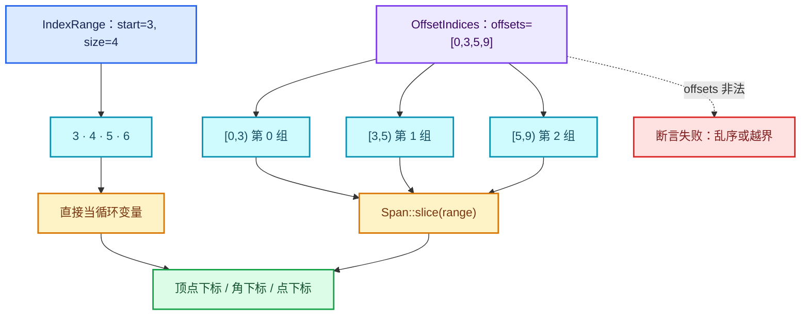

# 07 · IndexRange 与 OffsetIndices

[前置知识总入口](../README.md) · [本章导航](README.md) · [上一篇](06-Map与MultiValueMap.md) · [下一章](../04-生命周期与分配/README.md)

> 基准：Blender `5.4.0-alpha`，本地工作树。本篇讲两个"整数区间"抽象：`IndexRange`（连续整数）与 `OffsetIndices`（CSR 分组）。前者在 Repeat 里出现几十次，后者是几何拓扑的核心。主要源码：[`BLI_index_range.hh`](../../../source/blender/blenlib/BLI_index_range.hh)（373 行）、[`BLI_offset_indices.hh`](../../../source/blender/blenlib/BLI_offset_indices.hh)（241 行）。

## 先回答一个具体问题

`for (const int i : IndexRange(n))` 比 `for (int i = 0; i < n; i++)` 好在哪？

**好在三件事：`n` 只写一次、循环变量类型由被遍历物定义、负的 `n` 会在 debug 构建里当场炸掉而不是静默空转。** 这三件事单独看都不惊天动地，但乘以 `IndexRange` 在 `source/blender` 里出现的 **5,534 次**（实测：5,972 个 `.c/.cc/.h/.hh` 文件中有 **873 个**含它），就变成了框架代码的默认语汇。头注释（[`BLI_index_range.hh`](../../../source/blender/blenlib/BLI_index_range.hh) L10—L25）拿三重嵌套做的对比最直白：

```cpp
for (int64_t i = 0; i < 10; i++) {
  for (int64_t j = 0; j < 20; j++) {
    for (int64_t k = 0; k < 30; k++) {

for (int64_t i : IndexRange(10)) {
  for (int64_t j : IndexRange(20)) {
    for (int64_t k : IndexRange(30)) {
```

第一版里类型、上界、比较运算各写一遍；第二版只剩上界，类型由 `IndexRange::Iterator::value_type`（`int64_t`）决定。同一个对比还能再缩一档：`for (int64_t i : my_vector.index_range())` 连 `size()` 都省了。`index_range()` 是几乎所有 BLI 容器与视图的公共方法——[`BLI_span.hh`](../../../source/blender/blenlib/BLI_span.hh) L405、[`BLI_vector.hh`](../../../source/blender/blenlib/BLI_vector.hh) L1026、[`BLI_vector_set.hh`](../../../source/blender/blenlib/BLI_vector_set.hh) L589、[`BLI_array.hh`](../../../source/blender/blenlib/BLI_array.hh) L371 各有一份，实现全是同一行 `return IndexRange(this->size());`。它是"我能用哪些下标访问你"的统一答案。

所以完整答案是：**它把"我要遍历 0 到 n-1"从命令式语句降级为一个值，这个值可以传参、可以切片、可以存起来、可以和 Span 的切片动作对称使用。** 正篇 `initialize_execution_graph` 一上来就是这个味道（`geometry_nodes_repeat_zone.cc` L238—L245）：

```cpp
for (const int i : inputs_.index_range()) {
  lf_inputs.append(&lf_graph.add_input(*inputs_[i].type, this->input_name(i)));
}
for (const int i : outputs_.index_range()) {
  lf_outputs.append(&lf_graph.add_output(*outputs_[i].type, this->output_name(i)));
}
```

`inputs_` / `outputs_` 是 `Vector`，长度不用写出来，也不需要第二个变量记"现在处理到第几个"。

## IndexRange 的语义

`IndexRange` 表示半开区间 `[start, start + size)`。源码里只有两个字段（L54—L57）：

```cpp
class IndexRange {
 private:
  int64_t start_ = 0;
  int64_t size_ = 0;
```

**两个字段就是全部。** 没有数据指针、容量、所有权、引用计数，不指向任何内存。它是一个 16 字节的纯值类型（`sizeof(IndexRange) == 2 * sizeof(int64_t)`），可按值传参、可 `constexpr`、可塞进 `Array<IndexRange>`。

这个性质最容易误解：**`IndexRange` 不是视图**，它不描述"哪块内存"，只描述"哪些整数"。至于这些整数用来索引什么数组，它自己完全不知道。正篇 L374 的 `lf_inputs.as_span().drop_front(1)` 是 Span 的 `drop_front`，返回 Span；L299 的 `lf_body_nodes.index_range().drop_back(1)` 是 IndexRange 的 `drop_back`，返回 IndexRange。两者行为刻意对齐，但一个带数据一个不带。

半开区间的三个推论。其一，`start()` 在范围内、`one_after_last()` 不在范围内；空区间 `[5, 5)` 的 `start()` 是 5，却一个元素都不含。其二，长度是 `size()` 而不是 `last() - start()`——`last()` 是**最后一个元素**（闭），`one_after_last()` 才是**边界**（开），而 `last(n = 0)` 的参数是"倒数第 n 个"。其三，相等性按"包含的整数集合"定义，不按字段逐位比（L144—L147），注释写着 *"Two ranges compare equal when they contain the same numbers."*：

```cpp
constexpr friend bool operator==(IndexRange a, IndexRange b)
{
  return (a.size_ == b.size_) && (a.start_ == b.start_ || a.size_ == 0);
}
```

于是所有空区间相等。这让"空"成为归一状态，但也意味着**不能用 `==` 判断两个区间的"位置"**（空区间会骗你）。构造只接受非负参数（L62—L71）：

```cpp
constexpr explicit IndexRange(int64_t size) : size_(size) { BLI_assert(size >= 0); }

constexpr IndexRange(const int64_t start, const int64_t size) : start_(start), size_(size)
{
  BLI_assert(start >= 0);
  BLI_assert(size >= 0);
}
```

单参数构造函数带 **`explicit`**。这是后面"为什么到处用它"里最关键的技术原因：`int n = ...; IndexRange r = n;` 编译不过，必须写 `IndexRange(n)`，它挡住了"一个整数悄悄变成一个区间"。

## IndexRange 的核心接口

按角色分四组：读信息、判断、派生新区间、迭代与访问。

| 方法 | 语义 | 空区间行为 | 负数参数 |
| --- | --- | --- | --- |
| `size()` / `is_empty()` | 元素个数 / 判空 | 0 / true | —— |
| `start()` | 首元素（= 边界左端） | 有返回值但无意义 | —— |
| `first()` | 首元素，断言非空 | **断言失败** | —— |
| `last(n = 0)` | 倒数第 n 个，断言非空且 `n < size` | **断言失败** | 断言 `n >= 0` |
| `one_after_last()` | 边界右端 `start + size` | 等于 `start` | —— |
| `one_before_start()` | `start - 1`，断言 `start > 0` | 可用（若 start>0） | —— |
| `contains(value)` | `start <= v < start+size` | 恒 false | —— |
| `contains(range)` | 完全包含；空 range 恒 true | true | —— |
| `slice(start, size)` / `slice(IndexRange)` | 子区间，断言不越界 | 允许（size=0） | 断言非负 |
| `intersect(other)` | 交集，无重叠则空 | 返回空区间 | —— |
| `drop_front(n)` / `drop_back(n)` | 去掉前 / 后 n 个 | 夹取到空 | 断言非负 |
| `take_front(n)` / `take_back(n)` | 只保留前 / 后 n 个 | 夹取到空 | 断言非负 |
| `shift(n)` | 整体平移，可为负 | 允许 | 结果起点为负则断言 |
| `with_new_end(end)` | 同起点、换终点 | 允许 | —— |
| `after(n)` / `before(n)` | 紧邻其后 / 其前的 n 元区间 | 允许 | 断言非负 |
| `operator[](i)` | 第 i 个元素（= `start + i`） | **断言失败** | 断言 `i >= 0` |
| `begin()` / `end()` | 范围 for 与 STL 算法 | 空迭代 | —— |
| `index_range()` | `IndexRange(size())`，可再次迭代 | 空 | —— |

`explicit IndexRange(size)` 与 `IndexRange(start, size)` 之外还有五个命名工厂（L73—L96），存在的唯一理由是**让调用点自解释**——两个整数参数太容易搞反：

| 工厂 | 等价于 | 用途 |
| --- | --- | --- |
| `from_begin_size(begin, size)` | `IndexRange(begin, size)` | 显式说明第二参是长度 |
| `from_begin_end(begin, end)` | `IndexRange(begin, end - begin)` | 半开区间习惯 |
| `from_begin_end_inclusive(begin, last)` | `IndexRange(begin, last - begin + 1)` | 闭区间习惯，`+1` 藏在函数名里 |
| `from_end_size(end, size)` | `IndexRange(end - size, size)` | 只知尾不知头 |
| `from_single(index)` | `IndexRange(index, 1)` | 单元素 |

它们在测试里被逐个验证过（[`BLI_index_range_test.cc`](../../../source/blender/blenlib/tests/BLI_index_range_test.cc) L26—L104）：`from_begin_end(4, 10)` 的 `size()` 是 **6**，`from_begin_end_inclusive(100, 200)` 的 `size()` 是 **101**。这一处 `+1` 是新手最容易写错的地方，所以框架把它封进了函数名。

接下来是最重要的一组语义：`drop_*` / `take_*` 的"永不失败"（L306—L344）：

```cpp
constexpr IndexRange drop_front(int64_t n) const
{
  BLI_assert(n >= 0);
  const int64_t new_size = std::max<int64_t>(0, size_ - n);
  return IndexRange(start_ + n, new_size);
}

constexpr IndexRange drop_back(int64_t n) const   // 与 drop_front 对称：start_ 不动，只夹 size
{
  BLI_assert(n >= 0);
  const int64_t new_size = std::max<int64_t>(0, size_ - n);
  return IndexRange(start_, new_size);
}

constexpr IndexRange take_back(int64_t n) const
{
  BLI_assert(n >= 0);
  const int64_t new_size = std::min<int64_t>(size_, n);
  return IndexRange(start_ + size_ - new_size, new_size);
}                                                 // take_front 与 drop_back 对称：start_ 不动
```

- `IndexRange(4, 4).drop_back(2)` → `start=4, size=2` 即 `[4, 6)` = `{4, 5}`；`.drop_back(4)` → `start=4, size=0` 即 `[4, 4)` 空；`.drop_back(99)` → 同样 `[4, 4)` 空，**不崩**（三者都把 `start` 保住了，只夹 `size`）；
- `IndexRange(1, 5).drop_front(100)` → `start=101, size=0` 即 `[101, 101)` 空，**不崩**（起点被推出原区间，见反例三）；
- `IndexRange(3, 4).take_back(100)` → `start=3, size=4`，整个原区间 `[3, 7)`，不崩。

对应测试直接叫 `DropFrontLargeN` / `DropBackAll` / `TakeFrontLargeN` / `TakeBackLargeN`（测试 L233—L304），可见"永不失败"是被当作契约固定的，不是实现巧合。同样的夹取语义在 `Span` 上是逐字复制的（[`BLI_span.hh`](../../../source/blender/blenlib/BLI_span.hh) L175—L213，`max(0, size_ - n)` 与 `min(size_, n)` 一模一样）——不是巧合，是刻意对齐，在 `IndexRange` 上学到的规则可以原样迁移到 `Span`。

还要注意 `slice()` 与 `drop_*` 的分界。`slice()` **会断言**越界（L276—L283 的 `BLI_assert(new_start + size <= start_ + size_ || size == 0)`），因为它表达"我确信这块在范围内"。**"算出来的、可能超出预期"的量用 `drop_*` / `take_*`（夹取）；"已经验证过的"量用 `slice`（断言）。** 这条约定贯穿整个 blenlib。

最后是迭代器。`begin()` / `end()` 返回 `Iterator`，继承 `iterator::RandomAccessIteratorMixin<Iterator>`（L98—L129），`value_type = int64_t`、`reference = int64_t`（**按值**，不是引用——区间里的"元素"是算出来的，没有实体可引用）。因为是随机访问迭代器，标准算法可直接用（测试 L314—L320 就用了 `std::any_of` 与 `std::count_if`）。类外还有一个工具 `split_index_range_by_alignment(range, alignment)`（L358—L371，实现见 [`index_range.cc`](../../../source/blender/blenlib/intern/index_range.cc) L16—L44），把区间切成 `prefix` / `aligned` / `suffix` 三段，中间那段边界对齐到 2 的幂，供 SIMD 代码把"慢速头尾"与"快速主体"分开。

## 为什么框架代码到处用它

按重要性排七条。

**一、表达意图：把循环条件变成值。** `for (const int i : IndexRange(n))` 读起来是"遍历 n 个"，`for (int i = 0; i < n; i++)` 读起来是"从 0 开始，每次加一，直到不小于 n"。前者是陈述，后者是过程。五层嵌套时这个差别会放大到"能读懂"与"读不懂"的差距——这正是头注释开头就讲三重循环的原因。

**二、挡住隐式转换。** 单参数构造函数是 `explicit` 的。没有它，`void f(IndexRange); f(10);` 会默默通过，`IndexRange` 就退化成"一个长得像 int 的东西"，到处被当长度或下标误用。`explicit` 让每次"整数变区间"都必须显式写出，调用点因此保留类型信息。

**三、与 Span 的切片动作对称。** `Span` 有 `slice` / `drop_front` / `drop_back` / `take_front` / `take_back` / `index_range`（[`BLI_span.hh`](../../../source/blender/blenlib/BLI_span.hh) L141—L213、L405、L579—L646），`IndexRange` 有**完全同名**的一套（L161、L276—L344）。于是"先对下标切片、再对数组做同样切片"既能分两步写（`const IndexRange sub = all.index_range().drop_back(1); for (const int i : sub) use(positions[i]);`），也能一步合成 `positions.slice(sub)`（L149）。名字对齐，读者不必为"数据切片"和"下标切片"学两套脑子。

**四、边界安全，且安全方式可选。** `drop_*` / `take_*` 夹取，`slice` / `first` / `last` / `operator[]` 断言。作者可以按"我确不确定"来选工具，而不必被迫写防御性 `if`。这在 Repeat 里的收益最大（见后文）。

**五、64 位下标，不会溢出 32 位。** `start_` / `size_` 都是 `int64_t`。网格、点云、IndexMask 的下标空间可能超过 `INT_MAX`，`int` 循环变量是隐患。一次钉死，顺带让"用 `int` 还是 `size_t`"这类争论从调用点消失。

**六、`constexpr`，可用于编译期。** 整个类是 `constexpr` 的，测试 L306—L312 用 `constexpr IndexRange range = IndexRange(1, 1);` 去初始化 `std::array<int, range[0]>`——区间可以在编译期算出来当下标上界。

**七、零成本。** 全部方法 `constexpr` 且内联，`begin` / `end` 只是构造两个 `int64_t` 包装，`operator*` 直接返回它。开启优化后与手写循环生成的机器码没有区别，**没有迭代器抽象税**。

## OffsetIndices：一组区间

`IndexRange` 是"一个区间"。很多时候你需要"**一串**区间"：每个面由几个顶点组成、每条曲线由几个点组成、每个分组里有哪些元素。最朴素的存法是每个区间存一对 `(start, size)`——8 字节一组。`OffsetIndices` 换一种存法：**只存边界**。

```
offsets = [0, 3, 5, 9]
           │  │  │  └─ 哨兵（最后一组的结束边界，也是总元素数）
           │  │  └──── 第 1 组的开始 / 第 1 组的结束
           │  └─────── 第 0 组的开始 / 第 0 组的结束
           └────────── 永远是第一个组的起点（通常 0）

第 i 组 = [offsets[i], offsets[i+1])
```

于是有 `n` 个区间时 `offsets` 长度是 `n + 1`。头注释（[`BLI_offset_indices.hh`](../../../source/blender/blenlib/BLI_offset_indices.hh) L26—L36）把取舍写得很直白：

> "Using `OffsetIndices` instead requires that chunks are ordered consecutively but halves the memory consumption. Another downside is that the underlying array has to be one element longer than the total number of ranges. The extra element necessary to encode the size of the last range without requiring a branch for each range access."

三点：**（1）省一半内存**；**（2）要求各组在位序上连续**（不能乱序、不能重叠）；**（3）多存一个哨兵**，换来 `operator[]` 里不需要 `if (i == last)` 这类分支。第三点是性能关键：`operator[](i)` 只有两次数组读取和一次减法，没有分支；在按面遍历几百万面的循环里，这个分支的消失是可测量的。

**为什么叫 CSR。** `OffsetIndices` 在数据结构上的正式名字是 **CSR（compressed sparse row，压缩稀疏行）**。CSR 存稀疏矩阵时用两个数组：`row_ptr`（每行第一个非零元在 `values` 里的位置）与 `col_idx`（每个非零元的列号）。这里的 `offsets` 就是 `row_ptr`；区别在于**我们不需要 `col_idx`，因为"列"就是连续整数本身**——第 i 组的元素恰好是连续的一段下标，不再需要显式列出。所以 `OffsetIndices` 可以看成"CSR 去掉列索引数组之后剩下的那一半"，也就是把稀疏结构退化成"分组"这一特例。理解这点之后，`accumulate_counts_to_offsets`（把每组计数原地前缀和成边界）、`build_reverse_map`（从分组反查每个元素属于哪组）就都是 CSR 的标准操作了。

构造函数只做一件事：检查单调性（L45—L48）：

```cpp
OffsetIndices(const Span<T> offsets) : offsets_(offsets)
{
  BLI_assert(offsets_.size() < 2 || std::is_sorted(offsets_.begin(), offsets_.end()));
}
```

`is_sorted` 在几百万面的 debug 构建里可能慢到不可接受，所以还有一个跳过检查的版本（L55），形如 `OffsetIndices(offsets, NoSortCheck{})`。`NoSortCheck` 只是个空结构体（L23—L24），纯粹用于重载消歧与"我在调用点声明我保证有序"。曲线那边就是这么用的（[`BKE_curves.hh`](../../../source/blender/blenkernel/BKE_curves.hh) L1058—L1062）：

```cpp
inline OffsetIndices<int> CurvesGeometry::points_by_curve() const
{
  return OffsetIndices<int>({this->curve_offsets, this->curve_num + 1},
                            offset_indices::NoSortCheck{});
}
```

`offsets_` 的类型是 `Span<T>`（L41），所以 **`OffsetIndices` 也不拥有数据**。它是"指针 + 长度 + 一个模板参数"的视图，和 `Span` 一样轻。`static_assert(std::is_integral_v<T>)`（L39）限定 `T` 必须是整数类型——浮点数的"偏移"没有意义。

## OffsetIndices 的核心接口

类本身只有八个方法（含两个 `operator[]`），全部 O(1)。

| 方法 | 语义 | 备注 |
| --- | --- | --- |
| `size()` | 区间个数 = `max(offsets.size() - 1, 0)` | 空 offsets 或只有哨兵都返回 0 |
| `total_size()` | 元素总数 = `offsets.last() - offsets.first()` | 仅当 `offsets.size() > 1` 才有意义，否则 0 |
| `is_empty()` | `size() == 0` | —— |
| `index_range()` | `IndexRange(size())`，用于遍历"组" | 与容器同名方法一致 |
| `operator[](int64_t i)` | 第 i 组 → `IndexRange` | 断言 `0 <= i < offsets.size()-1` |
| `operator[](IndexRange)` | 连续的若干组合并成一个大区间 | 只取首尾两个边界 |
| `slice(IndexRange)` | 切出若干组**作为新的 OffsetIndices** | 内部 `offsets_.slice(start, size + 1)`，那个 `+1` 是哨兵 |
| `data()` | 底层 `Span<T>` | 少数场合需要原始边界数组 |

`operator[]` 的实现只有三行（L82—L89），值得背下来：

```cpp
IndexRange operator[](const int64_t index) const
{
  BLI_assert(index >= 0);
  BLI_assert(index < offsets_.size() - 1);
  const int64_t begin = offsets_[index];
  const int64_t end = offsets_[index + 1];
  return IndexRange::from_begin_end(begin, end);
}
```

**返回类型是 `IndexRange`，不是元素。** 这是 `OffsetIndices` 与所有容器最本质的区别：`v[i]` 给你第 i 个元素，`offsets[i]` 给你"第 i 组的坐标范围"。拿到 `IndexRange` 之后，还要拿它去切真正的数据数组。第二个 `operator[]` 接受 `IndexRange`（L91—L96），语义是"把连续的 k 个组合并成一个连续区间"；因为各组在位序上连续，合并只需 `offsets_[start]` 与 `offsets_[one_after_last]` 两个数——CSR 的副产品。

`slice(IndexRange)`（L103—L107）容易和上面那个搞混：

```cpp
OffsetIndices slice(const IndexRange range) const
{
  BLI_assert(range.is_empty() || offsets_.index_range().drop_back(1).contains(range.last()));
  return OffsetIndices(offsets_.slice(range.start(), range.size() + 1));
}
```

`operator[](IndexRange)` 返回**一个 `IndexRange`**（若干组合并后的坐标）；`slice(IndexRange)` 返回**一个 `OffsetIndices`**（若干组本身，仍可继续 `[i]`）。断言里那个 `drop_back(1).contains(range.last())` 是"不能切到哨兵上"的精确表述——可切的最大组下标是 `offsets.size() - 2`。这也是本文件里 `drop_back` 的第二次出场，理由同一个：**末尾那个槽位不是数据，是哨兵。** 头文件剩下的大半（L154—L277）是 `blender::offset_indices` 命名空间里的自由函数，都是围绕它的标准操作。

| 函数 | 作用 |
| --- | --- |
| `accumulate_counts_to_offsets(counts, start)` | **原地**把每组计数前缀和成边界；最常见的建 `OffsetIndices` 方式 |
| `accumulate_counts_to_offsets_with_overflow_check` | 同上，溢出时返回 `std::nullopt`（约慢 8%，见 `.cc` L50—L52 注释） |
| `fill_constant_group_size(size, start, offsets)` | 每组等长时直接填等差边界，可并行 |
| `copy_group_sizes` / `gather_group_sizes` / `sum_group_sizes` | 取出各组长度、求若干组长度之和 |
| `gather_selected_offsets` | 按选择重建一套偏移（用于复制部分几何） |
| `build_reverse_map` / `build_reverse_offsets` | 元素 → 所属组；反向建偏移 |
| `reverse_indices_in_groups` / `sort_groups` | 按组重排索引（三种重载）、并行填充后的确定性收尾 |
| `build_groups_from_indices` | 一步建出 `GroupedSpan` |

`accumulate_counts_to_offsets` 的实现本身就是"用 `IndexRange` 处理 `OffsetIndices`"的漂亮例子（[`offset_indices.cc`](../../../source/blender/blenlib/intern/offset_indices.cc) L24—L45）：

```cpp
for (const int i : counts_to_offsets.index_range().drop_back(1)) {
  const int count = counts_to_offsets[i];
  counts_to_offsets[i] = offset;
  offset += count;
}
counts_to_offsets.last() = offset;
```

**`drop_back(1)` 再一次出现**，理由和 Repeat 里完全一样：最后一个槽位是哨兵，不参与前缀和，循环结束后单独写。用它而不是 `i < n - 1`，既不用处理 `n == 0` 时 `n - 1` 为负，也不用担心 `n` 是无符号类型。

同文件 L123—L152 还有个 `GroupedSpan`，把 `OffsetIndices` 与数据 `Span` 捆在一起，`operator[]` 直接返回 `data.slice(offsets[index])`。构造函数断言 `offsets.total_size() == data.size()`（L130）——"分组视图与实际数据必须严丝合缝"的唯一检查点。注释还提醒：若多个 `GroupedSpan` 共享同一套 offsets，**应先把 `IndexRange` 取出来复用**，而不是每次 `[i]` 都重算（L120—L122）。

## 二者对比

| 维度 | `IndexRange` | `OffsetIndices<T>` |
| --- | --- | --- |
| 描述对象 | 一个连续整数区间 | 一串连续、首尾相接的区间 |
| 内部字段 | `int64_t start_`, `int64_t size_` | `Span<T> offsets_`（视图，不拥有） |
| 内存占用 | 16 字节，值语义 | 指针 + 长度（16 字节）+ 外部 `n+1` 个整数 |
| 元素个数 | `size()` | 组数 `size()`，元素总数 `total_size()` |
| 能否直接迭代 | 能，`begin()/end()`，`value_type = int64_t` | 能，迭代出**组下标**，每组再 `[i]` 换成 `IndexRange` |
| 取出元素 | 不能（只产生下标） | 不能（只产生区间） |
| `operator[]` 返回 | `int64_t`（某个下标） | `IndexRange`（某组的坐标范围） |
| 越界检查 | `slice`/`first`/`last`/`[]` 断言；`drop_*`/`take_*` 夹取 | 构造时断言 `is_sorted`；`[]` 断言下标范围 |
| 依赖关系 | 不依赖任何容器 | 依赖 `Span<T>`，`T` 必须整型 |
| 典型来源 | `container.index_range()`、`IndexRange(n)` | `Mesh::faces()`、`CurvesGeometry::points_by_curve()` |
| 典型用途 | 循环、切片、传参 | 变长分组（面 → 角、曲线 → 点） |
| 在 `source/blender` 的规模 | 873 个文件，5,534 处 | 361 个文件，1,518 处 |

一句话：**`IndexRange` 回答"第几个到第几个"，`OffsetIndices` 回答"第 i 组是第几个到第几个"。**



图上最关键的一条虚线：**`OffsetIndices` 的合法性完全由"行为"保证**——它没能力在写入时阻止你把 `offsets` 写成 `[0, 5, 3]`，只能在构造时扫一遍断言。相比之下 `IndexRange` 的不变量（`start >= 0`、`size >= 0`）在构造时就一字不差地检查完了。这就是"一个值"与"一个数组的解读"在可靠性上的天然差距。

## 在几何拓扑里的用途

Blender 的网格拓扑在 3.x 之后被重构成了 `OffsetIndices` 的形状。DNA 里的注释（[`DNA_mesh_types.h`](../../../source/blender/makesdna/DNA_mesh_types.h) L364—L369）：

> "Face topology information (using the same internal data as #face_offsets()). Each face is a contiguous chunk of face corners represented as an #IndexRange. Each face can be used to slice the #corner_verts or #corner_edges arrays to find the vertices or edges that each face uses."

实现只有一行（[`mesh.cc`](../../../source/blender/blenkernel/intern/mesh.cc) L1220—L1223）：`return Span(this->face_offset_indices, this->faces_num + 1);`。注意那个 `+1`。DNA 字段是 `int *face_offset_indices`，其布局由注释（L370—L375）规定：*"the first value is always zero ... The total number of corners is the final value"*。于是"每个面由哪些顶点构成"变成两步：

```cpp
const OffsetIndices<int> faces = mesh->faces();          // n+1 个边界的视图
const Span<int> corner_verts = mesh->corner_verts();     // 每个面角用哪个顶点
for (const int face_i : faces.index_range()) {
  const Span<int> face_verts = corner_verts.slice(faces[face_i]);
  // face_verts.size() == 这个面的边数（3、4 或任意 n）
}
```

**这就是 CSR 的教科书用法**：`faces` 是行指针，`corner_verts` 是值数组，"列"被省略了因为每个面的角恰好连续。一个立方体（6 个四边形）的 `face_offset_indices` 就是 `[0, 4, 8, 12, 16, 20, 24]`，生成它的代码一行（[`mesh_primitive_cuboid.cc`](../../../source/blender/geometry/intern/mesh_primitive_cuboid.cc) L386）：`offset_indices::fill_constant_group_size(4, 0, mesh->face_offsets_for_write());`。同样的等长填法出现在网格基元（`mesh_primitive_grid.cc` L259）与细分网格（`subdiv_mesh.cc` L834），而 STL 导入器用的是 3（`stl_import_mesh.cc` L71），因为每个 STL 面都是三角形。

一个关键细节：`IndexRange face` 里的下标是**全局角下标**，不是"面内第几个角"。所以想在一个面内部绕着走，必须用 [`BKE_mesh.hh`](../../../source/blender/blenkernel/BKE_mesh.hh) L306—L321 的两个辅助函数：

```cpp
inline int face_corner_prev(const IndexRange face, const int corner)
{
  return corner - 1 + (corner == face.start()) * face.size();
}
```

`face_corner_next` 的逻辑对称：`if (corner == face.last()) { return face.start(); } return corner + 1;`。前者那行里 `(corner == face.start()) * face.size()` 是个无分支技巧——在首角处加一个 `size` 就绕回末尾。这种"区间 + 全局下标"的混合语义，是第一次读 Blender 网格代码最容易卡住的地方。

同文件 L359—L365 的 `face_triangles_range` 展示了另一个用法——把"面 → 三角形"这个**不等长映射**也表达成 `IndexRange`：

```cpp
inline IndexRange face_triangles_range(OffsetIndices<int> faces, int face_i)
{
  const IndexRange face = faces[face_i];
  const int start_triangle = face.start() - face_i * 2;
  return IndexRange(start_triangle, face_triangles_num(face.size()));
}
```

三角化后每个面的三角形数是 `size - 2`，映射不再连续，所以 `start_triangle` 要做个 `face_i * 2` 的补偿。但返回值仍是 `IndexRange`，调用方仍可 `triangles.slice(range)`。

曲线那边是同一个模式（[`BKE_curves.hh`](../../../source/blender/blenkernel/BKE_curves.hh) L199—L202 的 `points_by_curve()`，注释是 *"The offsets of every curve into arrays on the points domain."*）：`points_by_curve()[curve_i]` 得到这条曲线的点在 `positions` 与各属性数组里的 `IndexRange`，然后 `positions.slice(range)`。还有一处"同构陷阱"（L591—L600）的 `per_curve_point_offsets_range(points, curve_index)`，返回 `{curve_index + points.start(), points.size() + 1}`——这是"在每组的点数据里再存一套偏移"的场景（Bezier 每条曲线、每个控制点都有偏移）。多出来的 `+1` 是标配哨兵，`curve_index + points.start()` 把"组内偏移"映射回"全局数组下标"；注释明确说这是 *"using the same rules as `#OffsetIndices`"*——即使不构造 `OffsetIndices` 对象，布局约定也照搬。

最后是"反向映射"，在编辑模式与法线计算里非常常见（`mesh.cc` L824—L828）：`for (const int face_index : group.faces) { verts.add_multiple(corner_verts.slice(faces[face_index])); corners_count += faces[face_index].size(); }`。`Span::add_multiple(span)` 把一整个面的顶点塞进集合——`Span` 的取值动作与 `IndexRange` 的切片动作在这里完成了一次无声的分工。

## 用小数据走一遍

取 `offsets = [0, 3, 5, 9]`。**组数**：`size() = max(4 - 1, 0) = 3`，所以 `offsets.index_range()` 是 `[0, 3)`，可用组下标是 0、1、2（**不是** 0..3，最后那个 9 只是哨兵）。**总元素数**：`total_size() = offsets.last() - offsets.first() = 9 - 0 = 9`，这是"被分组的那个大数组"应有的长度。**各组的区间**：

| 组下标 | `offsets[i]` | `offsets[i+1]` | 返回的 `IndexRange` | 展开的整数 |
| --- | --- | --- | --- | --- |
| 0 | 0 | 3 | `[0, 3)`，`size() == 3` | 0, 1, 2 |
| 1 | 3 | 5 | `[3, 5)`，`size() == 2` | 3, 4 |
| 2 | 5 | 9 | `[5, 9)`，`size() == 4` | 5, 6, 7, 8 |

三组大小分别是 3、2、4，`3 + 2 + 4 = 9 = total_size()`。这个等式是 `OffsetIndices` 唯一需要你手工保证的不变量（`gather_selected_offsets` 之类的工具就是为了在改动后重建它）。用代码复述一遍：

```cpp
const std::array<int, 4> offsets_data = {0, 3, 5, 9};
const OffsetIndices<int> offsets(offsets_data);   // 构造时断言 is_sorted
offsets.size();        // 3      —— 组的个数
offsets.total_size();  // 9      —— 元素总个数
const IndexRange g2 = offsets[2];   // [5, 9)
g2.start(); g2.last(); g2.one_after_last();   // 5 / 8 / 9（最后这个正是 offsets[3]）

/* 合并第 1、2 组：只读首尾两个边界 */
const IndexRange merged = offsets[IndexRange(1, 2)];   // [3, 9)，size() == 6

/* 切出第 1、2 组本身，仍然可以继续 [i] */
const OffsetIndices<int> tail = offsets.slice(IndexRange(1, 2));
tail.size();           // 2
tail[0];               // [3, 5)  —— 注意下标从 0 重新开始
```

再算第二个问题：`IndexRange(5).drop_front(2)` 的结果是什么？`IndexRange(5)` 是 `[0, 5)`；`drop_front(2)` 令 `new_size = max(0, 5 - 2) = 3`、`new_start = 0 + 2 = 2`，返回 `IndexRange(2, 3)` 即 `[2, 5)`，展开为 `{2, 3, 4}`。

| 表达式（起点均为 `IndexRange(5)`） | `start()` | `size()` | 展开 | 是否为空 |
| --- | --- | --- | --- | --- |
| 原样 | 0 | 5 | 0,1,2,3,4 | 否 |
| `.drop_front(2)` | 2 | 3 | 2,3,4 | 否 |
| `.drop_front(5)` | 5 | 0 | —— | 是 |
| `.drop_front(9)` | 9 | 0 | —— | 是（起点被推到 9，见反例三） |
| `.drop_back(2)` | 0 | 3 | 0,1,2 | 否 |
| `.take_back(2)` | 3 | 2 | 3,4 | 否 |
| `.take_front(9)` | 0 | 5 | 0,1,2,3,4 | 否（夹取回原区间） |

这张表就是"夹取 vs 断言"的完整对照：`drop_front(9)` 不崩溃，但它给出的 `start()` 是 9——已经越过原区间末尾。**空是安全的，`start()` 不是。**

## 反例与边界

**一、`IndexRange(-1)`（或任何负 size）。** 构造函数有 `BLI_assert(size >= 0)`（L62—L65）。启用断言时当场失败；但在 `NDEBUG` 构建里 `BLI_assert` 展开为空，于是得到 `size_ = -1`——`end()` 返回 `start - 1`，范围 for 一次都不执行，`is_empty()` 返回 **false**（因为 `-1 != 0`），`size()` 返回 -1。**负 size 不会"变成空"，它会变成一个撒谎的区间。** 所以凡是"可能为负"的量必须先夹再构造——正篇 L205—L208 就是这么干的：`const int iterations = std::max<int>(0, params.get_input<SocketValueVariant>(...) .ensure_type<int>());`。

**二、以为 `drop_front` / `drop_back` 会崩溃。** 不会。它们对 `n` 的大小毫无断言（只对 `n >= 0`）。`IndexRange(1, 5).drop_front(100)` 返回空区间，测试 `DropFrontLargeN` 就是专门锁这个行为的（L259—L264）。**如果某段代码依赖"越界会报警"，那它依赖错了东西。**

**三、`drop_front(超大 n)` 的 `start()` 会被推出原区间。** 这是上一条的阴暗面：`max(0, size_ - n)` 只夹 `size`，不夹 `start_`。`IndexRange(1, 5).drop_front(100)` 得到 `IndexRange(101, 0)`——`start()` 是 101，而原区间的 `one_after_last()` 只有 6。`is_empty()` 为真、`contains()` 恒假，但如果你先 `drop_front` 再拿 `start()` 去索引数组，就会越界。**空区间的 `start()` 没有意义，别读它。**

**四、`OffsetIndices` 的 `offsets` 必须单调不减，且最后一个必须是总数。** 构造函数只断言 `is_sorted`（L47），**不检查首元素是否 0、也不检查哨兵是否等于数据长度**。`[0, 5, 3, 9]` 断言失败；`[2, 5, 8, 12]` 静默通过，然后 `total_size()` 返回 `12 - 2 = 10`，所有组起点都偏了 2——除非你的数据数组也相应偏移，否则全盘错位。唯一的一致性检查在 `GroupedSpan` 的构造函数里（L130）：`offsets.total_size() == data.size()`。

**五、把 `IndexRange` 当 `Span` 用。** 它只能产生下标，不能取元素。`for (const int i : range)` 拿到的是 `int64_t`，不是 `T`。想要元素必须自己索引：`for (const int i : span.index_range()) { use(span[i]); }`，或者干脆 `for (const T &v : span)`。

**六、把 `OffsetIndices` 当容器用。** `offsets[i]` 的类型是 `IndexRange` 而不是 `T`。`offsets[2]` 不会给你"第 2 个元素"，它给你"第 2 组的坐标范围"。要元素得再切一次数据数组。

**七、`first()` / `last()` / `operator[]` 在空区间上断言失败。** 表格里"空区间行为"那列的"断言失败"不是摆设：`IndexRange(0).last()` 在 debug 构建里直接崩，`IndexRange(0)[0]` 也一样。凡是在空区间上求"首个/末个元素"的代码，都必须先 `if (range.is_empty())`，或改写成 `take_back(1)`（后者对空区间安全，返回空）。

**八、`operator==` 对空区间一律相等。** `IndexRange(5, 0) == IndexRange(100, 0)` 为真（L146 的 `|| a.size_ == 0`）。这意味着**不能用 `==` 比较两个区间的"位置"**，要判位置得比 `start()` 与 `size()`，或用 `contains()`。顺带一个同族陷阱：`shift(n)` 的实现是 `IndexRange(start_ + n, size_)`（L350—L353），把和传给双参数构造函数，而后者断言 `start >= 0`。所以 `IndexRange(3, 4).shift(-5)` 在 debug 构建里崩，在 release 里生产一个 `start_ = -2` 的非法区间——注释（L346—L349）只说"绝对值不能大于现有 start"，没写"否则会怎样"，那是断言，不是夹取。

**九、`OffsetIndices::slice` 的 `+1` 忘掉就少一组。** `offsets_.slice(range.start(), range.size() + 1)`（L106）里的 `+1` 是为了把哨兵一起带上。若自己手写 `offsets_.slice(range.start(), range.size())`，得到的 `OffsetIndices` 会少最后一组的结束边界——`operator[](size()-1)` 会读到数组外。

**十、`total_size()` 在 `offsets.size() <= 1` 时返回 0。** 实现是 `offsets_.size() > 1 ? offsets_.last() - offsets_.first() : 0`（L58—L61）。只有哨兵的 `[0]` 表示"0 组、0 个元素"，这是正确的；但若有人传了空数组 `[]`，`size()` 也是 0，此时**任何 `[i]` 都断言失败**。`Mesh::face_offsets()` 对空网格返回 `{}`（`mesh.cc` L1224—L1228），而 `Mesh::faces()` 仍然构造 `faces_num + 1` 长的 `Span`——两条路径对"空"的处理不同，值得留意。

## 对理解 Repeat 的帮助

正篇 `geometry_nodes_repeat_zone.cc` 一共 432 行，`IndexRange` 出现 **11 次**，另有 `index_range()` **4 次**、`drop_back` **1 次**。逐处对照：

| 位置 | 代码 | 属于哪一类 | 为什么这么写 |
| --- | --- | --- | --- |
| L238 / L242 | `inputs_.index_range()` / `outputs_.index_range()` | 建 Input / Output 端口 | 长度即 `size()`，不用另写；两处对称 |
| L249 | `IndexRange(iterations)` | 建 body 节点 | 迭代数来自参数，可能为 0，可负（已被 `max(0,...)` 夹过） |
| L258 | `IndexRange(num_border_links)` | 建 OR 节点 | 每条边界链接一个 OR |
| L267 | `parallel_for(IndexRange(iterations), 1024, ...)` | 并行填 index 值 | **`threading::parallel_for` 的签名就要 `IndexRange`** |
| L276 | `lf_body_nodes.index_range()` | 逐节点接线 | `VectorSet` 的 `index_range()`，顺带保证第 i 个节点 = 第 i 次迭代 |
| L282 / L314 / L353 | `IndexRange(num_border_links)` | 逐节点接边界链接 / 接 OR 输出 / 零迭代置 false | 同一常量四次出现 |
| L299 | `lf_body_nodes.index_range().drop_back(1)` | **两两配对** | 本篇核心例子，见下 |
| L302 / L323 / L336 / L346 | `IndexRange(num_repeat_items)` | 配对时接 item / 首节点 / 末节点 / 零迭代三条分支 | **同一区间在三条互斥分支里复用** |

分类来看：**建图元素** 5 处（L238、L242、L249、L258，以及 L267 的并行循环），**连边** 6 处（L276、L282、L302、L314、L323/L336、L353），**索引映射** 是 L267 的 `parallel_for` 加上 L372—L381 的 `array_utils::fill_index_range`（与 `IndexRange` 同族但不同函数，作用是把 `1, 2, 3, ...` 填进 `input_index_map`）。

**为什么"永不失败的 `drop_back(1)`"在这里是必需的。**

```cpp
for (const int iter_i : lf_body_nodes.index_range().drop_back(1)) {
  lf::FunctionNode &lf_node = *lf_body_nodes[iter_i];
  lf::FunctionNode &lf_next_node = *lf_body_nodes[iter_i + 1];
```

它要建立 `body[i] → body[i+1]` 的链，合法 `iter_i` 是 `0 .. n-2`，因为循环体里要读 `iter_i + 1`。考虑 `iterations == 0`：这时 `lf_body_nodes` 是空的，`index_range()` 是 `[0, 0)`。三条路径——若 `drop_back` **会崩溃**，代码必须写成 `if (iterations >= 2) { ... }`，否则每次 0 迭代都炸；若它**不夹取、返回 `[0, -1)`**，范围 for 的 `end()` 是 `-1`、`begin` 是 `0`，循环体不执行，碰巧也能活，但依赖了一个非法中间值，`is_empty()` 会说 false；**实际实现**是 `max(0, 0 - 1) = 0`，返回 `[0, 0)`，空区间，循环 0 次，干净。

`iterations == 1` 时：`index_range()` 是 `[0, 1)`，`drop_back(1)` 得 `[0, 0)`，不连边——正确，一个节点没有"下一个"。`iterations == 3` 时得 `[0, 2)`，连 `0→1`、`1→2`，正确。**一个 `drop_back(1)` 同时处理了 0、1、N 三种边界情况，且不产生非法中间值。** 这就是为什么作者没写 `if`，而是写了一个看起来像"随便切片"的表达式。

另外注意 L319 的 `if (iterations > 0)` **不是**为了 `drop_back(1)`，它管的是"首节点接 Input、末节点接 Output"。这个 `if` 里用了 `lf_body_nodes[0]`（L322）和 `lf_body_nodes.as_span().last()`（L335）——这两处**必须**有保护，因为 `VectorSet::operator[]` 与 `Span::last()` 在空容器上都是断言失败。**对比一下就看出作者的分工：会崩的地方（`[0]`、`last()`）加了 `if`；不会崩的地方（`drop_back(1)`）没加。** 读 Repeat 时把这个分工看清楚，整段代码的意图就顺了。

最后，L267 的并行填充值得单独看一眼：

```cpp
threading::parallel_for(IndexRange(iterations), 1024, [&](const IndexRange range) {
  for (const int i : range) {
    eval_storage.index_values[i].emplace<int>(i);
  }
});
```

第二个参数是块大小 1024，第三个参数是一个**以 `IndexRange` 为参数**的 lambda——线程池把 `[0, iterations)` 切成若干块，每块作为一个 `IndexRange` 递给你。**这里 `IndexRange` 从"循环的上界"升级成了"任务的单位"。** 这是它在框架代码里出现频率如此之高的深层原因：它不只是一个循环写法，而是并行调度的公共货币。

## 继续阅读

- 本章上一篇：[06-Map与MultiValueMap](06-Map与MultiValueMap.md)——`Map::lookup` 返回指针而非值，与本篇"`operator[]` 返回什么"是同一类问题。
- 本章兄弟篇：[02-Span只读视图](02-Span只读视图.md) 与 [03-Span与MutableSpan](03-Span与MutableSpan.md)——`Span::slice(IndexRange)` 是两道桥梁的接口点，`drop_*` / `take_*` 的夹取语义逐字相同。
- 本章导航与全章收束：[03-BLI容器与视图](README.md)；前置知识总入口见 [README](../README.md)。
- 正篇主线：`LazyFunctionForRepeatZone`，源码 [`geometry_nodes_repeat_zone.cc`](../../../source/blender/nodes/intern/geometry_nodes_repeat_zone.cc) L195—L400。
- 直接读源码：[`BLI_index_range.hh`](../../../source/blender/blenlib/BLI_index_range.hh) L54—L356（类本体）、L358—L371（对齐切分）；[`BLI_offset_indices.hh`](../../../source/blender/blenlib/BLI_offset_indices.hh) L37—L113（类本体）、L115—L152（`GroupedSpan`）、L154—L277（自由函数）。
- 测试即文档：[`BLI_index_range_test.cc`](../../../source/blender/blenlib/tests/BLI_index_range_test.cc) 386 行、**32 个 `TEST(index_range, ...)` 用例**把本篇每个接口的行为固定了一遍；[`BLI_offset_indices_test.cc`](../../../source/blender/blenlib/tests/BLI_offset_indices_test.cc) 240 行，覆盖反向映射与分组重建。
- 实现细节：[`offset_indices.cc`](../../../source/blender/blenlib/intern/offset_indices.cc) L24—L45 是"用 `IndexRange` 处理 `OffsetIndices`"的范本；[`index_range.cc`](../../../source/blender/blenlib/intern/index_range.cc) L16—L44 展示了对齐切分的位运算写法。
- 几何侧对照：[`DNA_mesh_types.h`](../../../source/blender/makesdna/DNA_mesh_types.h) L364—L399（`faces()` 与 `corner_verts()` 的契约）、[`BKE_mesh.hh`](../../../source/blender/blenkernel/BKE_mesh.hh) L306—L365（面内绕行与三角化区间）、[`BKE_curves.hh`](../../../source/blender/blenkernel/BKE_curves.hh) L194—L202 与 L591—L600（`points_by_curve()` 与偏移布局约定）。
