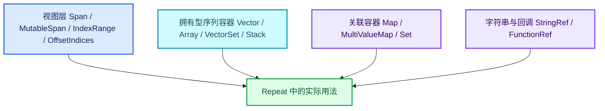

# 03-BLI容器与视图

[前置知识总入口](../README.md) · [正篇：01-01 NodeTreeZone](../../01-Zone系统基础/01-NodeTreeZone区域表示与配对.md)

本章回答：Blender 基础库（BLI）里那些容器与视图到底是什么、为什么需要这么多变体、它们的语义差异在哪里。这是读者**最早撞上**的知识族（正篇 01-01 第 416 行就用 `Span<bNodeZoneType*>`，02-03 整篇论证 `SocketItemsRef` 与 `MutableSpan` 的区别）。

## 阅读顺序

| # | 篇目 | 源码主线 | 实测行数 |
| --- | --- | --- | --- |
| 1 | [01-容器全景与选型](01-容器全景与选型.md) | 各头文件概览与决策表 | 见下表 |
| 2 | [02-Span只读视图](02-Span只读视图.md) | `BLI_span.hh`（Span 部分） | 681 |
| 3 | [03-Span与MutableSpan](03-Span与MutableSpan.md) | `BLI_span.hh` L447 起（**同文件**） | 681 |
| 4 | [04-Vector与Array](04-Vector与Array.md) | `BLI_vector.hh` + `BLI_array.hh` | 1057 + 430 |
| 5 | [05-VectorSet稳定索引](05-VectorSet稳定索引.md) | `BLI_vector_set.hh` | 1168 |
| 6 | [06-Map与MultiValueMap](06-Map与MultiValueMap.md) | `BLI_map.hh` + `BLI_multi_value_map.hh` | 1383 + 167 |
| 7 | [07-IndexRange与OffsetIndices](07-IndexRange与OffsetIndices.md) | `BLI_index_range.hh` + `BLI_offset_indices.hh` | 373 + 241 |

> **重要事实**：`MutableSpan` **没有**独立的 `BLI_mutable_span.hh`， > 它就在 `BLI_span.hh` 里（L447: `template<typename T> class MutableSpan`）。 > 因此第 02、03 篇共用同一份源码，只是关注点不同。

## 本章与 Repeat 的关系

| 容器/视图 | 在 Repeat 中的关键用途 | 正篇位置 |
| --- | --- | --- |
| `Span` | provider 持有 body 节点列表（只读） | 04-03 |
| `MutableSpan` | `items_span()` 的可变版本；与 `SocketItemsRef` 对比 | 02-02、02-03 |
| `Vector` | base 类里的 `input_index_map`/`output_index_map` | 04-01 |
| `Array` | `index_values`（精确大小、一次分配） | 03-03、04-01 |
| `VectorSet` | `lf_body_nodes`——**兼任"节点→迭代号"的索引** | 03-03、04-02 |
| `Map` | `body_fn_.indices.inputs.reference_sets` | 03-02 |
| `MultiValueMap` | `iterations_by_iteration_zone`（一键多值） | 04-03 |
| `IndexRange` | 所有 `for (i : IndexRange(n))` 循环 | 全篇 |

其中 **`VectorSet` 的双重身份**（向量 + 集合）是 Repeat 身份机制的基石：第 i 个 `add_new` 的 body 节点天然就是第 i 次迭代，`index_of_try` 反查 O(1)。不理解这个，就读不懂 `RepeatBodyNodeExecuteWrapper`。

## 实测行数总表

| 文件 | 行数 |
| --- | --- |
| `BLI_map.hh` | 1383 |
| `BLI_index_mask.hh`（选读） | 1191 |
| `BLI_vector_set.hh` | 1168 |
| `BLI_virtual_array.hh`（选读） | 1095 |
| `BLI_vector.hh` | 1057 |
| `BLI_set.hh` | 895 |
| `BLI_cpp_type.hh`（第 08 章详讲） | 823 |
| `BLI_generic_virtual_array.hh`（选读） | 806 |
| `BLI_span.hh` | 681 |
| `BLI_string_ref.hh` | 623 |
| `BLI_array.hh` | 430 |
| `BLI_bit_span.hh` | 400 |
| `BLI_index_range.hh` | 373 |
| `BLI_stack.hh` | 370 |
| `BLI_any.hh` | 366 |
| `BLI_hash.hh` | 267 |
| `BLI_offset_indices.hh` | 241 |
| `BLI_generic_span.hh` | 231 |
| `BLI_multi_value_map.hh` | 167 |
| `BLI_function_ref.hh` | 150 |
| `BLI_disjoint_set.hh` | 92 |
| **本章核心 11 文件合计** | **6,876** |

blenlib 下共有 **250 个** `BLI_*.hh` 头文件——本章只挑与 Repeat 直接相关的。

## 与既有资料的对照

`.vscode/杂/markdown/全面学习-codex/01-基础容器与现代CPP/` 有 20 篇容器专题（`04-IndexRange连续整数区间`、`05-Span只读连续视图`、`13-Stack与栈接口`、 `14-VectorSet稳定索引与去重` 等），面向通用 C++ 库读者。本章与之互为参照，但补足"为什么 Repeat Zone 需要它"的语境。不复制其内容。

仅作速查的短篇在 `.markdown/学习节点/几何节点类/`（如 `08_SocketValueVariant.md`），本章不重叠。

