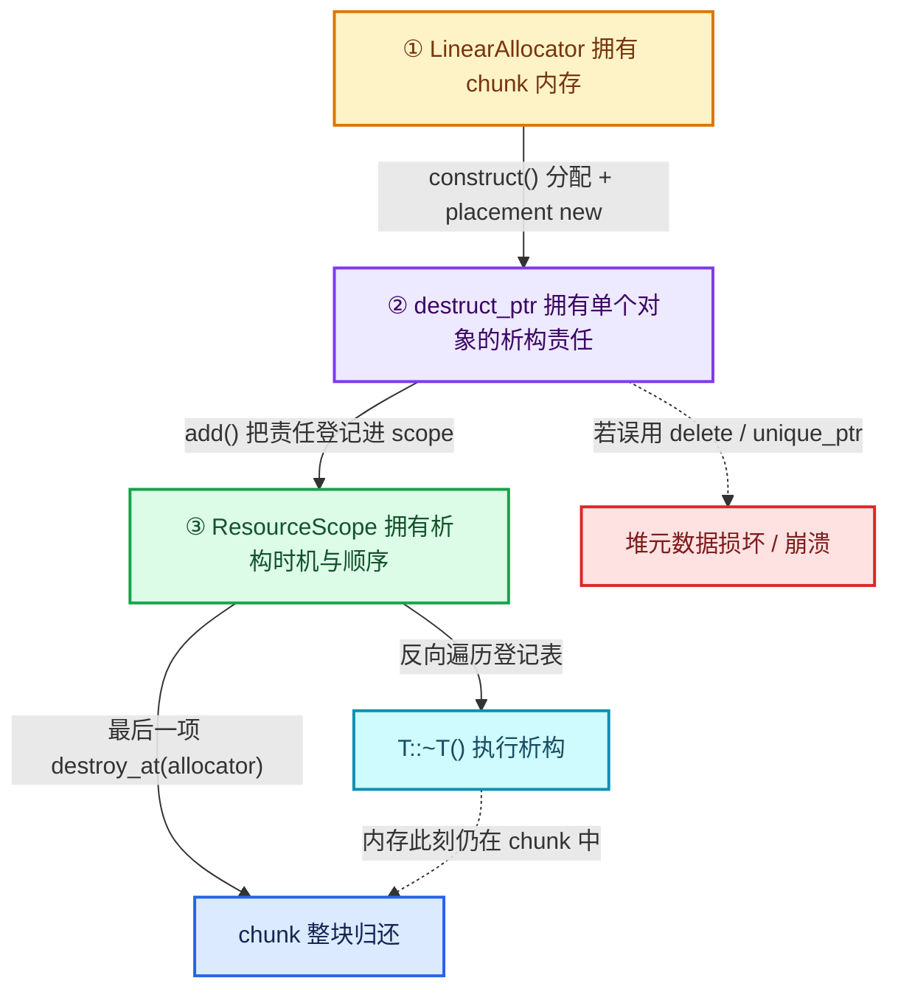

# 03 · destruct_ptr 与所有权

[前置知识总入口](../README.md) · [本章导航](README.md) · [上一篇](02-ResourceScope资源作用域.md) · [下一篇](04-storage生命周期对照.md)

> 基准：Blender `5.4.0-alpha`，本地工作树。本篇讲 `destruct_ptr<T>`——`LinearAllocator` 与 `ResourceScope` 之间的粘合剂，它定义在 `BLI_memory_utils.hh`（**没有**独立的 `BLI_destruct_ptr.hh`，这是常见误认）。主要源码：[`BLI_memory_utils.hh`](../../../source/blender/blenlib/BLI_memory_utils.hh)（315 行）L108 起、[`BLI_linear_allocator.hh`](../../../source/blender/blenlib/BLI_linear_allocator.hh)（279 行）、[`BLI_resource_scope.hh`](../../../source/blender/blenlib/BLI_resource_scope.hh)（243 行）。

## 先回答一个具体问题

内存不是 `new` 出来的，就不能用 `unique_ptr`——那用什么？

先把问题钉死。`LinearAllocator` 的内存不是一块块 `new` 出来的，而是从自己的 chunk 里切出来的：`allocate_new_buffer`（[`BLI_linear_allocator.hh`](../../../source/blender/blenlib/BLI_linear_allocator.hh) L282—L298）把新块交给 `allocated_owned`（L305—L313），后者 `allocator_.allocate(...)` 拿一整块、塞进 `owned_buffers_`，最后由 `LinearAllocator` 在析构时**一次性全还**。

所以对象的构造是合法的（placement new 在合法内存上），但那块内存的"归属"属于 `LinearAllocator`，不属于这个对象。此时如果拿 `std::unique_ptr<T>` 去管它，默认删除器 `std::default_delete<T>` 做的是 `delete ptr`——先调析构（这部分是对的），再调 `operator delete`（这部分是灾难）。`operator delete` 会把一个**从未经过 `operator new` 的地址**交还给堆管理器，结果是 glibc 的 `free(): invalid pointer`、ASAN 的 `attempting free on address which was not malloc()-ed`，或者更糟：静默写坏堆元数据，崩在几百行之外。

那答案是什么？**换一个删除器**。`destruct_ptr<T>` 就是"把删除器换成只调析构"的 `unique_ptr`：一行 `using`，没有任何新类，保留 `unique_ptr` 的全部 RAII 语义（不可拷贝、可移动、离开作用域自动触发、异常安全），只把末端的 `delete p` 换成 `p->~T()`。

## destruct_ptr 与 unique_ptr 的差别

| 维度 | `std::unique_ptr<T>` | `destruct_ptr<T>` |
| --- | --- | --- |
| 内存释放 | 由删除器执行 `operator delete`，把内存还给堆管理器 | **完全不释放**。内存仍留在 allocator 的 chunk 里 |
| 析构调用 | `delete ptr` → `ptr->~T()` | 只调 `ptr->~T()`，不多做一件事 |
| 内存来源 | 必须是 `new` / `new[]` / 与 `operator new` 语义匹配的分配 | placement new 到任意合法缓冲区：allocator chunk、栈上 `AlignedBuffer`、`ResourceScope` 的初始缓冲 |
| 可移动 | 是。移动构造窃取指针，源变 `nullptr`（`noexcept`） | 是。语义完全相同，因为底层就是 `unique_ptr` |
| 可拷贝 | 否。拷贝构造与拷贝赋值 `= delete` | 否。同一套 `unique_ptr` 删除规则 |
| 适用分配器 | 只适合堆分配器；配 `LinearAllocator` 必崩 | 专为 `LinearAllocator` / `ResourceScope` 这类"整块回收"分配器设计 |
| 默认删除器行为 | `std::default_delete<T>`：析构 + 释放 | `DestructValueAtAddress<T>`：仅析构，**无状态空类** |
| `release()` | 交出裸指针，放弃所有权，不调析构 | 同左。区别在于"谁该接手"——只能接给另一个会调析构的持有者 |

一句话总结这张表：**八行里的每一处差异都能追到同一个选择上——删除器换成了"只调析构"的那个，于是内存来源、能否配自定义分配器、崩不崩堆，全跟着变。**

## 为什么需要它

因为 `delete` 这个表达式捆绑了两件在自定义分配器下必须拆开的事。

`delete ptr` 的语义固定为两步：调用 `ptr->~T()`，然后调用 `operator delete(ptr)`。C++ 不提供"只做第一步"的语法。而 `LinearAllocator` 恰恰只允许第一步——它的注释把这一点说得非常明白（[`BLI_linear_allocator.hh`](../../../source/blender/blenlib/BLI_linear_allocator.hh) L127—L134）：

> `Construct an instance of T in memory provided by this allocator.`
> `You must not call delete on the returned value. Instead, only the destructor has to be called.`

注意这段注释写在 `construct()` 上，而 `construct()` 的返回类型就是 `destruct_ptr<T>`。也就是说：**函数用类型系统把"不许 delete"这条纪律编码进了返回值**。拿到 `destruct_ptr` 的人根本写不出 `delete`（因为接口不给他裸指针的所有权语义），也不需要用 `delete`——`destruct_ptr` 自己会在正确的时机调析构。

反过来看，如果 `construct()` 返回裸 `T *`，调用方就得手动 `ptr->~T()`。这在没有异常、没有提前 `return`、没有容器搬运的代码里勉强可行；一旦中间任何一步抛出，析构就被跳过。`destruct_ptr` 把"必须调析构"变成编译器保证的事。

> 顺手记一个辨析：`delete` 在错配的内存上崩，**不是因为"析构"错了，而是因为"归还"错了**。所以修法只能是"删掉归还那一步"，不能是"删掉析构那一步"——那会泄漏对象持有的资源（比如 `std::string` 的内部缓冲）。`destruct_ptr` 删的正是对的那一步。

## 类定义逐段

`destruct_ptr` 的定义总共 6 行有效代码，但前后两段都值得逐字看。

### 删除器：`DestructValueAtAddress`（L96—L105）

```cpp
template<typename T> struct DestructValueAtAddress {
  DestructValueAtAddress() = default;

  template<typename U> DestructValueAtAddress(const U &) {}

  void operator()(T *ptr)
  {
    ptr->~T();
  }
};
```

`[讲解]` 三个要点：

1. **它是空类**。没有数据成员，所以 `unique_ptr` 存它不占空间（EBO）。所有 `destruct_ptr<T>` 之间的"删除器"因此完全相同，没有任何需要传递的状态。
2. **调用的是 `ptr->~T()`，不是 `std::destroy_at(ptr)`**。对非数组类型两者等价（`std::destroy_at` 内部就是 `location->~T()`），但显式析构少一层模板推导、也不必依赖 `<memory>`。Blender 在别处更倾向 `std::destroy_at`（见 [`resource_scope.cc`](../../../source/blender/blenlib/intern/resource_scope.cc) L54、L59），这里保留显式析构是历史写法。`operator()` 非 `const`，因为 `unique_ptr` 的析构在非 `const` 上下文调删除器。
3. **那个"看起来没用"的模板构造函数是关键**。它让 `DestructValueAtAddress<Base>` 能从 `DestructValueAtAddress<Derived>` 构造出来，从而让 `unique_ptr` 的**转换构造**成立：`destruct_ptr<Derived>` 可隐式转成 `destruct_ptr<Base>`。这不是随手写的——`fn::UserData::get_local` 就靠它工作（见后文）。

第 3 点有个前提必须点明：转换之后删除器实例化的是 `T = Base`，调的是 `ptr->~Base()`。只有当 `Base` 的析构函数是 `virtual` 时才会正确析构到派生类。`fn::LocalUserData` 恰好写了 `virtual ~LocalUserData() = default;`（[`FN_user_data.hh`](../../../source/blender/functions/FN_user_data.hh) L22），所以安全。**换成没有虚析构的基类，这条转换路径会静默漏掉派生类析构。**

### 别名本体：一个 `using`（L107—L111）

```cpp
/**
 * A destruct_ptr is like unique_ptr, but it will only call the destructor and will not free the
 * memory. This is useful when using custom allocators.
 */
template<typename T> using destruct_ptr = std::unique_ptr<T, DestructValueAtAddress<T>>;
```

`[讲解]` 注释只有两句，第二句"useful when using custom allocators"就是全部动机。第一句是精确的类比：**像** `unique_ptr`（同样的独占、同样的移动、同样的自动析构），差别只有"不释放内存"。这里也顺手证伪一个常见误认：仓库里没有 `BLI_destruct_ptr.hh`（全文搜索无此文件），`destruct_ptr` 就住在这个文件里，前后邻居是 `destruct_n`、`AlignedBuffer`、`NoInitialization` 这些零散工具——它和它们同属"内存小工具"，没有独立模块地位。

<details><summary>核对原始源码：BLI_memory_utils.hh · L107—L111</summary>

```cpp
/**
 * A destruct_ptr is like unique_ptr, but it will only call the destructor and will not free the
 * memory. This is useful when using custom allocators.
 */
template<typename T> using destruct_ptr = std::unique_ptr<T, DestructValueAtAddress<T>>;
```

</details>

### 没有成员字段

`[讲解]` 这是个容易讲错的地方：`destruct_ptr` **不是一个新类**，所以"它的成员字段"只能问 `std::unique_ptr<T, D>`——它存一个 `T *` 加一个 `D`。因为 `DestructValueAtAddress<T>` 是空类，EBO 把 `D` 压成 0 字节，所以 64 位平台上 `sizeof(destruct_ptr<Foo>) == 8`，和 `Foo *` 一样。实际后果：`Vector<destruct_ptr<T>>` 的开销就是一个指针数组，换成 `destruct_ptr` 不增加任何存储。

### 构造与转换：可用的形态

`[讲解]` 底层是 `unique_ptr`，可用构造就那几种，没有为 `destruct_ptr` 特制的额外构造：

| 写法 | 结果 | 出处 |
| --- | --- | --- |
| `destruct_ptr<T> p;` 或 `destruct_ptr<T> p(nullptr);` | 空指针，不拥有任何东西 | 默认构造 |
| `destruct_ptr<T> p(raw);` | 接管裸指针，**`explicit`**，必须显式写类型名 | `LinearAllocator::construct` L139 正是这么写的 |
| `destruct_ptr<T> q = std::move(p);` | 移动，`p` 变空 | 移动构造 |
| `std::optional<destruct_ptr<T>> o;` | 合法的"可能没有"，`std::optional` 里存空指针等于不拥有 | 执行器实际用法 |
| `destruct_ptr<Base> b = destruct_ptr<Derived>{...};` | 派生转基类（删除器可转换 + 指针可转换） | `get_local` 实际用法 |

`[讲解]` 注意第二条的 `explicit` 很重要：它让"从裸指针接管所有权"这件事必须**写出来**，不能靠隐式转换悄悄发生。这也是为什么 `construct()` 里写的是 `return destruct_ptr<T>(value);` 而不是 `return value;`。

`[讲解]` 还有两条**不可用**：拷贝构造和拷贝赋值是 `= delete` 的。所以 `Vector<destruct_ptr<T>>` 只能 `append(std::move(p))`，不能 `append(p)`（详见"反例与边界"第 1 条）。

### 移动语义：能移不能拷

`[讲解]` 移动构造做的事就一件：把内部指针搬到新对象，把源置空。因为是搬指针不是搬对象，**被管理的 `T` 从头到尾没动过**——它的地址不变，析构仍然只会发生在那一块 allocator 内存上。这一点对 `ResourceScope` 的登记表至关重要：登记的是 `T *`，只要指针稳定，登记就永远有效。

`[讲解]` 移动赋值多一步：`p = std::move(q)` 会先对自己当前持有的对象调用删除器（也就是**调一次析构**），再接住 `q` 的指针。这意味着"移动赋值"在 `destruct_ptr` 语义下是一次"提前析构 + 换绑"，不是"丢掉旧指针"。这是好事（旧对象的资源被正确释放），但要知道它发生了。

`[讲解]` 为什么必须禁止拷贝？因为所有权是独占的。若允许拷贝，两个 `destruct_ptr` 指向同一个对象，作用域结束时两人都调 `ptr->~T()`：**析构两次**。这不会像 double-free 那样立刻崩堆（内存不归它管），但会跑两次析构副作用（`std::string` 的缓冲被第二次释放、引用计数被减两次、锁被解两次），是标准的未定义行为。而且这种 bug 往往在开发期不炸，在特定路径上炸——比 double-free 更难查。

### 析构函数：交给删除器

`[讲解]` `destruct_ptr` 没有自己的析构函数，用的是 `unique_ptr` 的：若内部指针非空，调用删除器；删除器调 `ptr->~T()`；**到此结束**。没有 `operator delete`，没有 `free`。

`[讲解]` 这里有个必须记住的对称性：`DestructValueAtAddress<T>::operator()` 里只有一行 `ptr->~T()`，`nullptr` 检查在 `unique_ptr` 那一层（指针为空时根本不调删除器）。所以删除器自己不需要判空。

`[讲解]` 还有一个编译期约束：`~T()` 必须可见。也就是说**析构点处 `T` 必须是完整类型**。在头文件里持有 `destruct_ptr<Incomplete>` 是可以的（声明阶段不需要完整类型），但一旦在那个翻译单元里触发析构，就编不过。这也是 `unique_ptr` 判定式的老规矩，`destruct_ptr` 完整继承。

### 访问器一览

| 成员 | 语义 | 在 allocator 语境下的注意点 |
| --- | --- | --- |
| `get()` | 返回裸指针，不转移所有权 | 拿到的指针**不能** `delete`，要提前析构只能 `reset()` |
| `operator*` / `operator->` | 解引用 | 同裸指针，空指针时 UB |
| `operator bool`（`explicit`） | 是否持有对象 | `if (p)` 可以，`bool b = p;` 不行 |
| `release()` | 交出裸指针并把内部置空，**不调析构** | 对象还活着，内存还占着。接手者必须是自己会调析构的东西 |
| `reset()` / `reset(p)` | 对旧对象**调用删除器（= 析构）**，再接住新指针 | 这是 `destruct_ptr` 唯一优于 `unique_ptr` 的"手动操作"：提前析构是合法的，因为不还内存 |
| `swap()` / `get_deleter()` | 标准 `unique_ptr` 接口 | `get_deleter()` 在 `destruct_ptr` 里没什么用（删除器无状态） |

`[讲解]` 值得单独强调 `reset()`：对 `unique_ptr<T>` 来说 `reset()` 等于"析构 + 还内存"；对 `destruct_ptr<T>` 来说 `reset()` 等于"**只析构**"。所以在 allocator 场景下，提前 `reset()` 是**完全合法且有用**的操作：它立刻释放对象持有的内部资源（比如 `std::string` 缓冲），而那块 allocator 内存继续保持"已分配、永不复用"的状态（`LinearAllocator` 从不复用内存，见其文件头注释 L24—L28）。

## 析构的语义

`[讲解]` 把两条路径并排画出来，差别一眼可见：

```text
  std::unique_ptr<T>                                 blender::destruct_ptr<T>
  ──────────────────                                 ──────────────────────
  内部: T *p_                                        内部: T *p_
  删除器: std::default_delete<T>                     删除器: DestructValueAtAddress<T>

  ~unique_ptr()                                      ~unique_ptr()
    └─ if (p_) delete p_                               └─ if (p_)
         ├─ p_->~T()        ← 析构：对象逻辑死亡           └─ p_->~T()   ← 析构：对象逻辑死亡
         └─ operator delete(p_)                                      （到此为止）
              ├─ 归还堆块    ← 内存物理归还
              └─ 堆管理器更新空闲链表
```

`[讲解]` 关键差别在**"逻辑死亡"与"物理归还"被拆开了**。`unique_ptr` 一次操作完成两件事，之后那块字节可以被复用；`destruct_ptr` 只完成第一件，对象已死（不能再 `*p`、不能 `p->`），但字节仍被 `LinearAllocator` 占着，**而且永远不会被再次分配出去**——线性分配器只把 `current_begin_` 往前推，从不回退（唯一例外是 `free_end_of_previous_allocation`，L241—L260，只允许回收"最后一次分配"的尾部，用于算法内部的临时超配）。

`[讲解]` 所以真正的物理归还都发生在更外层：`LinearAllocator::transfer_ownership_from`（L269—L279）把 `owned_buffers_` 移交给另一个 allocator、延后归还；`LinearAllocator::~LinearAllocator`（L53—L58）遍历 `owned_buffers_` 逐个 `allocator_.deallocate(ptr)`，这时所有 chunk 一起还。这就是"整块回收"的本来面目：**N 次析构，1 次归还**，`destruct_ptr` 负责那 N 次里的每一次。

## 与 LinearAllocator 的配合

`[讲解]` 配合点就是三个函数里最顺的一个：`construct()`。

```cpp
void *buffer = this->allocate(sizeof(T), alignof(T));
T *value = new (buffer) T(std::forward<Args>(args)...);
return destruct_ptr<T>(value);
```

`[讲解]` 三行对应三件事，顺序不能换：

1. `this->allocate(sizeof(T), alignof(T))`：从 chunk 里切出**对齐正确**的一段。`allocate` 里做了 `(current_begin_ + alignment_mask) & ~alignment_mask` 的上取整，所以返回的地址满足 `alignof(T)`（前提是 `alignof(T)` 是 2 的幂，函数内有 `BLI_assert(is_power_of_2(alignment))`）。
2. `new (buffer) T(std::forward<Args>(args)...)`：placement new，在裸内存上启动对象生命周期，参数完美转发给 `T` 的构造函数。
3. `return destruct_ptr<T>(value)`：把裸指针包成"只调析构"的独占持有者，**按值返回**。按值返回不是随意选择：从包装完成那一刻起，所有 return 路径（含异常路径）都由 RAII 兜底。

`[讲解]` 有个细节不那么直觉：第 1 步和第 2 步之间**没有异常处理**。如果 `T` 的构造函数抛异常，placement new 会把对象生命周期视为未启动，那块内存被浪费但没泄漏（allocator 不做回收，也不需要回收）。这不是疏忽——线性分配器本来就不支持单独归还，所以 `try/catch` 在这里没有任何可做的事。

`[讲解]` 还有 `construct_array()`（L147—L155）作为对照：它返回 `MutableSpan<T>`，而不是 `Span<destruct_ptr<T>>`。原因很实在——一个 `destruct_ptr` 只表达"单个对象"，N 个对象的批量析构用一个 span + `destruct_n` 更省（N 个 `destruct_ptr` 会是 N 个 8 字节的所有权槽，而且没法整体交给 `ResourceScope` 的一次登记）。**`destruct_ptr` 的粒度永远是单个对象**，这是设计边界，不是遗漏。

<details><summary>核对原始源码：BLI_linear_allocator.hh · L127—L140</summary>

```cpp
  /**
   * Construct an instance of T in memory provided by this allocator.
   *
   * Arguments passed to this method will be forwarded to the constructor of T.
   *
   * You must not call `delete` on the returned value.
   * Instead, only the destructor has to be called.
   */
  template<typename T, typename... Args> destruct_ptr<T> construct(Args &&...args)
  {
    void *buffer = this->allocate(sizeof(T), alignof(T));
    T *value = new (buffer) T(std::forward<Args>(args)...);
    return destruct_ptr<T>(value);
  }
```

</details>

## 与 ResourceScope 的配合

`[讲解]` 如果只有 `LinearAllocator`，`destruct_ptr` 的归宿是"某个局部作用域的末尾"。但 Blender 的构建期对象往往要活到**求值结束之后**，于是需要一个地方把它们收集起来——`ResourceScope`。两者的接口就是 `add(destruct_ptr<T>)`，它的四个动作各有理由（完整源码见下方核对块）：

1. **参数按值收 `destruct_ptr<T>`**。按值收是刻意的：调用方必须 `std::move(ptr)` 或传临时对象，无法"顺手"传个左值让责任不清。
2. **第一件事就是 `release()`**。为什么？因为 `resource` 是局部对象，函数返回时它会析构。如果不 `release()`，对象在 `add()` 返回的那一刻就被析构了，而登记的回调稍后还会再析构一次 → **析构两次**。这一行是整段代码的生死线。
3. **`nullptr` 早返回**。空指针不登记，直接返回 `nullptr`。
4. **trivial 特判直接返回裸指针**（见下一节）。剩下的情况才走 `this->add(ptr, [](void *data){ reinterpret_cast<T*>(data)->~T(); })`。

`[讲解]` 第 4 步那个 lambda 是**无捕获**的，所以能隐式转换成 `void (*)(void *)`——这正是 `ResourceData`（`void *data; void (*free)(void *)`）需要的形态。有捕获的 lambda 不行（那是"函数对象"，需要另存状态），这也是 `add_destruct_call`（L212—L217）要把 `Func` 单独 placement new 到 allocator 里的原因。类型信息全部来自模板实例化出来的那个函数指针——这就是 `ResourceScope` 的**类型擦除**机制：`ResourceData` 只有 `void *` + 函数指针，但每个 `T` 的 `add` 会生成一份专属析构函数。

`[讲解]` 于是责任链变成三段，且交接明确：

| 阶段 | 持有者 | 负责什么 | 源码 |
| --- | --- | --- | --- |
| 构造完 | `destruct_ptr<T>` 局部变量 | 若此处离开作用域，自己析构 | `LinearAllocator::construct` L135—L140 |
| `add` 调用中 | `destruct_ptr<T> resource` 形参 | 只在提前返回路径上兜底 | `ResourceScope::add` L181 |
| `add` 之后 | `ResourceScope` 的 `resources_` 登记表 | 在 scope 析构时反向调用 `~T()` | `ResourceScope::add` L192—L195 |

`[讲解]` `ResourceScope::construct` 把这两步串起来，是最常用的入口：

```cpp
template<typename T, typename... Args> inline T &ResourceScope::construct(Args &&...args)
{
  destruct_ptr<T> value_ptr = allocator_.construct<T>(std::forward<Args>(args)...);
  T &value_ref = *value_ptr;
  this->add(std::move(value_ptr));
  return value_ref;
}
```

`[讲解]` 注意 `T &value_ref = *value_ptr;` 取引用**在 `add` 之前**。这必须成立，理由是 `add` 之后 `value_ptr` 已经空了。也正因为 `destruct_ptr` 的移动不动被管理对象，这个引用在 `add` 之后依然有效——指针稳定性的直接好处。

`[讲解]` 为什么返回引用而不是 `destruct_ptr`？因为所有权已经交给 scope 了，调用方只该拿到"能用的对象"，不该再拿一个"能析构它的句柄"。**返回引用 = 明确宣告"你不管生命周期"**。

`[讲解]` 还有一处必须讲的顺序保证。`ResourceScope` 自己拥有 allocator 时，allocator 是**第一个**被登记进 `resources_` 的：

```cpp
r_resources.append(*allocator, ResourceData{allocator, free_fn});
```

（[`resource_scope.cc`](../../../source/blender/blenlib/intern/resource_scope.cc) L61）而析构是**反向**遍历：

```cpp
LinearAllocator<> *used_allocator = &allocator_;
for (ResourceData &resource : resources_) {
  void *data = resource.data;
  resource.free(data);
  if (data == used_allocator) {
    break;
  }
}
```

（同文件 L78—L90）"第一个登记 → 最后一个执行"，所以**所有对象的析构都在 allocator 析构之前完成**，内存归还一定晚于全部析构。那个 `break` 是关键：`ResourceScope(LinearAllocator &)` 构造时 `resources_` 里没有 allocator 的登记项，`break` 永远不触发，遍历自然走完——一份循环同时覆盖了"自有 allocator"和"借用 allocator"两种情形。

<details><summary>核对原始源码：BLI_resource_scope.hh · L181—L197</summary>

```cpp
template<typename T> inline T *ResourceScope::add(destruct_ptr<T> resource)
{
  T *ptr = resource.release();
  if (ptr == nullptr) {
    return nullptr;
  }
  /* There is no need to keep track of such types. */
  if constexpr (std::is_trivially_destructible_v<T>) {
    return ptr;
  }

  this->add(ptr, [](void *data) {
    T *typed_data = reinterpret_cast<T *>(data);
    typed_data->~T();
  });
  return ptr;
}
```

</details>

## 所有权流转图



图里那条虚线是整篇的重点：从 `T::~T()` 到 `chunk 整块归还` 之间**没有任何实线连接**。析构和归还之间隔着"登记表遍历完毕 + allocator 析构"两步，而这两步不归 `destruct_ptr` 管。

## 三步所有权模型

把三套机制叠起来看，所有权被切成三层，每层只回答一个问题：

1. **`LinearAllocator` 管内存池**：回答"字节从哪来、什么时候还"。粒度是 chunk，永不复用，析构时一次性归还。它**不知道**上面住了什么对象、有没有构造过。
2. **`destruct_ptr` 管单个对象的析构**：回答"这个对象死了没有、谁负责调 `~T()`"。粒度是单个对象，只调析构，强迫自己在别人（allocator）的地盘上不越界。
3. **`ResourceScope` 管析构时机与顺序**：回答"什么时候死、按什么顺序死"。粒度是一批对象，反向序，类型无关。

`[讲解]` 三层的边界非常干净，看"谁不能做什么"比看"谁做什么"更清楚：

| 机制 | 能独立完成 | 绝对不能做 |
| --- | --- | --- |
| `LinearAllocator` | 分配、整块归还、转移所有权 | 单独释放某个对象；调析构（它不知道类型） |
| `destruct_ptr` | 调析构、转移析构责任、提前 `reset()` | 释放内存；拷贝；脱离分配器使用 |
| `ResourceScope` | 登记、反向析构、延后时机 | 归还 chunk（那是 allocator 的事）；拷贝/移动（`NonMovable`） |

`[讲解]` 一个能检验理解的问题：**为什么 `destruct_ptr` 不能自己管内存归还？** 因为"归还"的单位是 chunk，而 `destruct_ptr` 的单位是对象。一个 chunk 里可能住着 200 个对象，也可能只住了你要的这一个的头部——任何单个对象都无权说"这块内存可以还了"。这在设计上不可修复，所以 `destruct_ptr` 干脆不提供归还能力。

## trivially destructible 的特判

`[讲解]` `ResourceScope::add(destruct_ptr<T>)` 里那三行值得单独一节：

```cpp
/* There is no need to keep track of such types. */
if constexpr (std::is_trivially_destructible_v<T>) {
  return ptr;
}
```

`[讲解]` 它做的事是：如果 `T` 的析构函数是平凡的，就**不登记回调，直接返回裸指针**。`release()` 已经执行过了，所以那个 `destruct_ptr` 形参析构时什么也不会做——对象从此无人管，但也不需要人管。

**为什么这是正确的？** 因为"trivially destructible"的定义就是"析构函数什么也不做"。C++ 标准保证 `is_trivially_destructible_v<T>` 为真时，析构调用可以被完全省略而不改变程序行为。所以跳过它不产生任何遗漏。

这个优化省下的是两笔真实开销：

1. **登记**：少一次 `ResourceData` 追加（16 字节 + `ChunkedList` 的可能扩容）。
2. **销毁**：少一次反向遍历时的间接函数调用（通过函数指针，无法内联）。

`[讲解]` 什么时候这个优化最有效？是那些"只是数据"的构建期对象：纯 POD 结构体、只含 POD 的 `struct`、以及像 `ResourceData` 自己这样刻意设计成 trivial 的辅助类型（`resource_scope.cc` L47 甚至写了 `static_assert(std::is_trivially_destructible_v<ResourceDataList>)` 来保证 `ChunkedList` 可以被这样"扔着不管"）。

`[讲解]` 边界同样重要，这个特判的正确性**完全依赖"trivial 意味着没有需要执行的析构逻辑"**：

- 给有资源要放的类型写空析构 `~T() {}` **骗不过编译器**：空函数体不是 trivial，类型变成"用户提供析构"，`is_trivially_destructible_v` 为 false，特判不再生效（这是好事）。
- 反过来，若某类型析构确实平凡却**持有外部资源的裸指针**（如 `Foo { FILE *f; }` 且无析构函数），特判会生效，`f` 永远不会被 `fclose`。这不是特判的错，是类型设计错误：持有资源就必须写析构函数。
- 用 `if constexpr` 而非 `if`，是为了保证 trivial 分支里 `add(ptr, lambda)` 那一段被**完全丢弃**，否则某些类型仍会尝试实例化回调。

`[讲解]` 顺带对照 `ResourceScope::allocate_owned`（L227—L234）：它用的是**运行期**判断 `if (!type.is_trivially_destructible)`，因为那里只有 `CPPType` 而没有具体 `T`。同一个优化，两种形态——编译期版本零开销，运行期版本多一次分支，这是"类型擦除路径必然的代价"。

## 用小数据走一遍

`[讲解]` 用一个最小例子把每一步的"谁拥有什么"摊开：

```cpp
struct Foo {
  std::string name;              // 析构时要释放内部缓冲，所以 Foo 不是 trivial
  ~Foo() { /* 观察点：这里被调用一次且仅一次 */ }
};

void demo()
{
  ResourceScope scope;                        // 自建 allocator（第一个登记者）
  Foo &foo = scope.construct<Foo>("blender"); // ① 分配 ② 构造 ③ 登记
  // ... 使用 foo ...
}                                             // ④ scope 析构，反向遍历
```

`[讲解]` 逐步摊开：

| 步 | 发生什么 | 谁拥有内存 | 谁负责析构 | `sizeof` 级状态 |
| --- | --- | --- | --- | --- |
| 0 | `ResourceScope scope;` 构造 → `create_own_allocator` → allocator placement new 进一大块，登记为 `resources_[0]` | scope 自有的 allocator | 该 allocator 自己（登记表第 0 项） | 一块 chunk，`current_begin_` 在头部 |
| 1 | `allocator_.allocate(sizeof(Foo), alignof(Foo))` → 从 chunk 切一段 | 同上 | 还没人管 | chunk 上涨 `sizeof(Foo)` |
| 2 | `new (buffer) Foo("blender")` → `std::string` 内部**又向系统 malloc** 了一块放 "blender" | chunk 管 `Foo` 本体；系统堆管字符串缓冲 | 还没人管 | 两块内存，两种归属 |
| 3 | `return destruct_ptr<Foo>(value)` → 一个 8 字节临时值被创建 | 同上 | **`destruct_ptr` 临时对象** | 所有权槽 +8 字节（栈上） |
| 4 | `add(std::move(value_ptr))` → `release()` → 临时对象被清空 | 同上 | 交接中：`destruct_ptr` 形参已放弃，回调已生成但未登记 | 形参析构时什么都不做 |
| 5 | `is_trivially_destructible_v<Foo>` 为 false → 登记 `{ptr, &destroy_fn}` | 同上 | **scope 的 `resources_`** | 登记表 +16 字节 |
| 6 | `return value_ref` → 调用方拿到 `Foo&`，**没有**所有权 | 同上 | 同上 | 无变化 |
| 7 | `demo()` 走到 `}` → `~ResourceScope` → 反向遍历：先 `resources_[1]`（Foo），再 `resources_[0]`（allocator） | 同上 | 同上 | — |
| 8 | 回调 `static_cast<Foo*>(data)->~Foo()` → `~Foo()` 跑一次 → `std::string` 析构 → **系统堆那块的缓冲被 free** | chunk 仍持有 `Foo` 本体；系统堆那块已归还 | 无人（对象已死） | chunk **完全没变**（线性分配器不回退） |
| 9 | 继续遍历到 allocator 项 → `std::destroy_at(allocator)` → `LinearAllocator::~LinearAllocator` → 遍历 `owned_buffers_` 逐个 `deallocate` → **chunk 归还** | 无 | 无 | 全部归还 |

`[讲解]` 第 8 步和第 9 步之间的落差是理解 `destruct_ptr` 的钥匙：第 8 步之后，`Foo` 的**内部资源**（`std::string` 缓冲）已经被正确释放了，但 `Foo` 的**住所**（chunk 里那 `sizeof(Foo)` 字节）还原封不动。这正是 `destruct_ptr` 该做的事，不多不少。

`[讲解]` 如果 `Foo` 的成员全是 trivial（比如 `struct Foo { int a; float b; };`），那么第 5 步会被 `if constexpr` 直接跳过，第 8 步不存在，只有第 9 步——登记表里只有 allocator 一项。这就是那个优化的实际效果。

## 反例与边界

1. **拷贝 `destruct_ptr`**。`destruct_ptr<T> a = ...; destruct_ptr<T> b = a;` 编译期直接失败（`unique_ptr` 拷贝构造 `= delete`）。若有人用 `*a` 去造第二个 `destruct_ptr`（`destruct_ptr<T> b(a.get())`）绕过检查，两个持有者都会调 `~T()` → 析构两次。**`get()` 之后永远不要交给任何会析构的东西。**

2. **用它去 `delete` 内存**。`delete ptr.get();` 或 `std::unique_ptr<T> up{ptr.release()};`——后者在 `up` 析构时会 `delete`，崩在堆管理器里。`destruct_ptr` 的存在意义就是拦这一类，但它拦不住有人主动绕路。

3. **allocator 先于 `destruct_ptr` 销毁**。如果 allocator 已经析构（chunk 已归还），此时 `destruct_ptr` 析构 → `ptr->~T()` 写一块已释放的内存 → use-after-free。正常代码里这不会发生，靠的是两条**声明顺序纪律**：`ThreadLocalStorage` 里 `LinearAllocator<> allocator;` 写在 `std::optional<destruct_ptr<LocalUserData>> local_user_data;` **之前**（[`lazy_function_graph_executor_generic.hh`](../../../source/blender/functions/intern/lazy_function_graph_executor_generic.hh) L322—L329），成员析构逆序 → `local_user_data` 先析构、allocator 后析构；`Procedure` 里 `allocator_`（L241）也在 `owned_functions_`（L249）之前。**这条纪律没有编译期检查，靠的是人写对顺序。**

4. **以为 `release()` 会调析构**。`ptr.release()` 之后对象**仍然活着**，`release()` 只是放弃责任。如果没人接手调 `~T()`，对象就永远不析构——内存不泄漏（allocator 会回收 chunk），但它持有的内部资源（`std::string` 缓冲、内部 `Vector` 缓冲、锁）全部泄漏。这是"内存泄漏"和"资源泄漏"分离的典型场景，也是 allocator 体系最容易误判的失败模式。

5. **move 之后继续用源**。`destruct_ptr<T> q = std::move(p);` 之后 `p` 是空。`p->foo()` 立即 UB（`operator->` 在空指针上）。这个坑 `unique_ptr` 也有，但 `destruct_ptr` 的"空"更隐蔽——因为那份内存明明还在，`get()` 返回 `nullptr` 却看着 chunk 里对象还躺着（其实是副本的，源那份地址已被"转手"）。

6. **把 `destruct_ptr` 存进会搬元素且要求 trivially relocatable 的容器**。`Vector<destruct_ptr<T>>` 是合法的（`Procedure::owned_functions_` 就这么用，L249），因为 `Vector` 扩容走 relocate → move，而 move 语义正确。但如果某处用 `memcpy` 级别的搬运（Blender 的 `Vector` 在 `is_trivially_relocatable` 时会走快路径），`destruct_ptr` 因为不是 trivially copyable，会走慢路径——**语义正确，但别指望它被 memcpy**。

7. **用 `destruct_ptr` 管栈对象**。`destruct_ptr<T> p{new (&stack_buf) T()};` 合法但危险：函数返回时 `p` 析构（调一次 `~T()`），而 `stack_buf` 离开作用域时栈上那个 `T` 的析构**不会被自动调用**（placement new 不登记到栈帧）——所以这里其实只是"手动析构一次"，没有 double，但如果那个缓冲区本身是个带析构的容器（如 `AlignedBuffer` 装的对象），就可能出现"容器析构 + `destruct_ptr` 析构"两条路径。

8. **基类没有虚析构却做派生→基类转换**。`destruct_ptr<Base> b = allocator.construct<Derived>(...)` 能编译（删除器可转换 + 指针可转换），但删除器实例化的是 `DestructValueAtAddress<Base>`，调的是 `~Base()`。若 `~Base()` 非虚，`Derived` 的析构**不会执行** → 派生部分资源泄漏。`fn::LocalUserData` 有 `virtual ~LocalUserData() = default;`，所以 `get_local` 这条路径安全；这个前提必须一直维持。

9. **析构点处类型不完整**。头文件里写 `destruct_ptr<Foo> foo_;` 而 `Foo` 只前向声明：声明、移动、`release()` 都可以，但一旦在某个 `.cc` 里让它析构（哪怕隐式地作为成员析构），编译失败。修法是把析构点放到 `Foo` 定义可见的翻译单元里（`~Owner();` 声明在头、定义在 `.cc`）。

## 对理解 Repeat 的帮助

`[讲解]` Repeat Zone 同时踩了 `destruct_ptr` 的两条路径，而且它们的差异**不是偶然的**，是接口契约决定的。

### 路径 A：`init_storage` 返回裸 `void *`

契约在 [`FN_lazy_function.hh`](../../../source/blender/functions/FN_lazy_function.hh) L269—L278：

```cpp
virtual void *init_storage(LinearAllocator<> &allocator) const;
virtual void destruct_storage(void *storage) const;
```

Repeat 的实现（[`geometry_nodes_repeat_zone.cc`](../../../source/blender/nodes/intern/geometry_nodes_repeat_zone.cc) L139—L151）：

```cpp
void *init_storage(LinearAllocator &allocator) const override
{
  return allocator.construct<RepeatEvalStorage>().release();
}

void destruct_storage(void *storage) const override
{
  RepeatEvalStorage *s = static_cast<RepeatEvalStorage *>(storage);
  if (s->graph_executor_storage) {
    s->graph_executor->destruct_storage(s->graph_executor_storage);
  }
  std::destroy_at(s);
}
```

`[讲解]` 注意那个 `.release()`：`construct` 返回 `destruct_ptr<RepeatEvalStorage>`，被**立刻**换成裸指针返回给框架，析构责任从"`destruct_ptr` 自动"变成"`destruct_storage` 手动"。

**为什么不直接返回 `destruct_ptr`？** 答案就藏在 `destruct_storage` 的前两行。`RepeatEvalStorage` 内部嵌套了**另一层需要析构的 storage**（`graph_executor_storage`，由内层 `GraphExecutor::init_storage` 创建，L400—L401）。这个内层 storage 必须在 `~RepeatEvalStorage()` **之前**被析构——因为它是通过 `s->graph_executor` 这个成员去调的，而 `graph_executor` 是 `RepeatEvalStorage` 的成员（`std::optional<lf::GraphExecutor>`，L105）。如果 `std::destroy_at(s)` 先跑，`graph_executor` 就没了，那行调用就是 UAF。

而 `destruct_ptr`（= `unique_ptr`）**只有一个析构动作点**：末尾调一次 `~T()`。你无法在它中间插一个"先析构成员 X 的子资源，再析构 T"的步骤。唯一能做的是继续往里塞 RAII 包装——让 `RepeatEvalStorage` 自己持有一个能自动析构内层 storage 的成员。但框架的接口（`init_storage` / `destruct_storage`）本来就是为"允许这种显式顺序"设计的，所以按契约走更直接。

**这个选择的代价也是真实的**：`.release()` 之后若 `destruct_storage` 没被调用（比如 `execute` 从未触发、或者框架某条路径漏了），析构就被跳过。框架用两处调用兜住这个风险——`~GenericGraphExecutor` 里（[`lazy_function_graph_executor_generic.hh`](../../../source/blender/functions/intern/lazy_function_graph_executor_generic.hh) L503—L509）和 `destruct_node_state` 里（同文件 L1052—L1056，析完把 `storage` 置 `nullptr` 防重入）。**注意失败模式是"资源泄漏"而不是"内存泄漏"**：chunk 会随 allocator 归还，`RepeatEvalStorage` 里的 `Vector`、`std::optional` 内部缓冲才是有可能漏的那部分。

### 路径 B：`ResourceScope::construct` 内部走 `destruct_ptr`

```cpp
LazyFunction &build_repeat_zone_lazy_function(ResourceScope &scope, ...)
{
  return scope.construct<LazyFunctionForRepeatZone>(btree, zone, zone_info, body_fn);
}
```

（[`geometry_nodes_repeat_zone.cc`](../../../source/blender/nodes/intern/geometry_nodes_repeat_zone.cc) L423—L430）这里**看不见** `destruct_ptr`——它在 `scope.construct` 内部被创建、被 `add`、责任交给 scope。寿命由 `scope_` 决定（`GeometryNodesLazyFunctionGraphBuilder` 的成员，活在节点树运行时数据里，跨多次求值）。调用方只拿到 `LazyFunction &`。

### 两条路径的差异对照

| 维度 | 路径 A：`init_storage` | 路径 B：`ResourceScope::construct` |
| --- | --- | --- |
| 对外返回类型 | `void *`（裸指针） | `T &`（引用，无所有权语义） |
| `destruct_ptr` 出现在哪 | 只在 `construct(...).release()` 这一瞬间 | `construct` 内部，随后 `add` 接管 |
| 谁调析构 | `destruct_storage`（虚函数，手动） | `ResourceScope::~ResourceScope`（自动，反向序） |
| 析构时机 | 每次求值结束 / node state 被 destruct 时 | `scope` 析构时（节点树运行时数据生命周期末尾） |
| 能插入额外清理步骤吗 | 能（`destruct_storage` 里先析内层再 `destroy_at`） | 不能（只能靠成员 RAII 表达顺序） |
| 漏调的后果 | 资源泄漏（chunk 仍会被回收），需框架兜底 | 不会漏（scope 必然遍历登记表） |
| 为什么这么选 | 需要"先子资源、后本体"的显式顺序 | 构建期对象数量/类型都不定，交给登记表最省心 |

`[讲解]` 一句话概括：**`destruct_ptr` 适合"析构是原子的、一个动作就完事"的对象；一旦析构需要多步有序（先内层 storage，再本体），就得退回"裸指针 + 显式 destruct 函数"的模式。** Repeat 恰好两层都要，所以两条路径都出现了。

### 顺带：第三条路径，`get_local` 返回 `destruct_ptr`

[`FN_user_data.hh`](../../../source/blender/functions/FN_user_data.hh) L36—L40 里有个不同寻常的签名 `virtual destruct_ptr<LocalUserData> get_local(LinearAllocator<> &allocator);`。基类返回 `{}`（[`user_data.cc`](../../../source/blender/functions/intern/user_data.cc) L13—L16，空 `destruct_ptr`，表示"没有线程本地数据"）；`GeoNodesUserData` 覆写成 `return allocator.construct<GeoNodesLocalUserData>(*this);`（[`geometry_nodes_lazy_function.cc`](../../../source/blender/nodes/intern/geometry_nodes_lazy_function.cc) L4344—L4347）。派生类 `destruct_ptr<GeoNodesLocalUserData>` 隐式转成 `destruct_ptr<LocalUserData>`，靠的就是 `DestructValueAtAddress` 那个模板转换构造函数。

存的地方是 `std::optional<destruct_ptr<LocalUserData>> local_user_data;`（[`lazy_function_graph_executor_generic.hh`](../../../source/blender/functions/intern/lazy_function_graph_executor_generic.hh) L328），allocator 是每线程一个（L327），**并且声明在它前面**。这套设计正是"路径 B 的简化版"：`destruct_ptr` 自己持有析构责任，无需 scope，因为对象只有一到两个、且寿命等于线程本地存储的寿命。`optional` 表达"这套 user data 可能根本没有线程本地数据"——`std::optional` + 空 `destruct_ptr` 两个层次都可能是空。

## 继续阅读

- 上一篇：[02-ResourceScope资源作用域](02-ResourceScope资源作用域.md)——登记表、反向序、类型擦除三元组。
- 下一篇：[04-storage生命周期对照](04-storage生命周期对照.md)——把 `LinearAllocator`、`ResourceScope`、`destruct_ptr` 三套机制放进 Repeat 的一次求值里对照。
- 同章：[01-LinearAllocator线性分配](01-LinearAllocator线性分配.md)——chunk 策略、`provide_buffer`、`transfer_ownership_from`。
- 相关：[03-BLI容器与视图](../03-BLI容器与视图/README.md)——`Span`/`Vector` 如何与这些所有权机制配合。
- 相关：[02-参数转发与上下文](../02-参数转发与上下文/README.md)——`Context::storage`（裸 `void *`）与 `LocalUserData`（`destruct_ptr`）在同一份 `Context` 里的分工。
