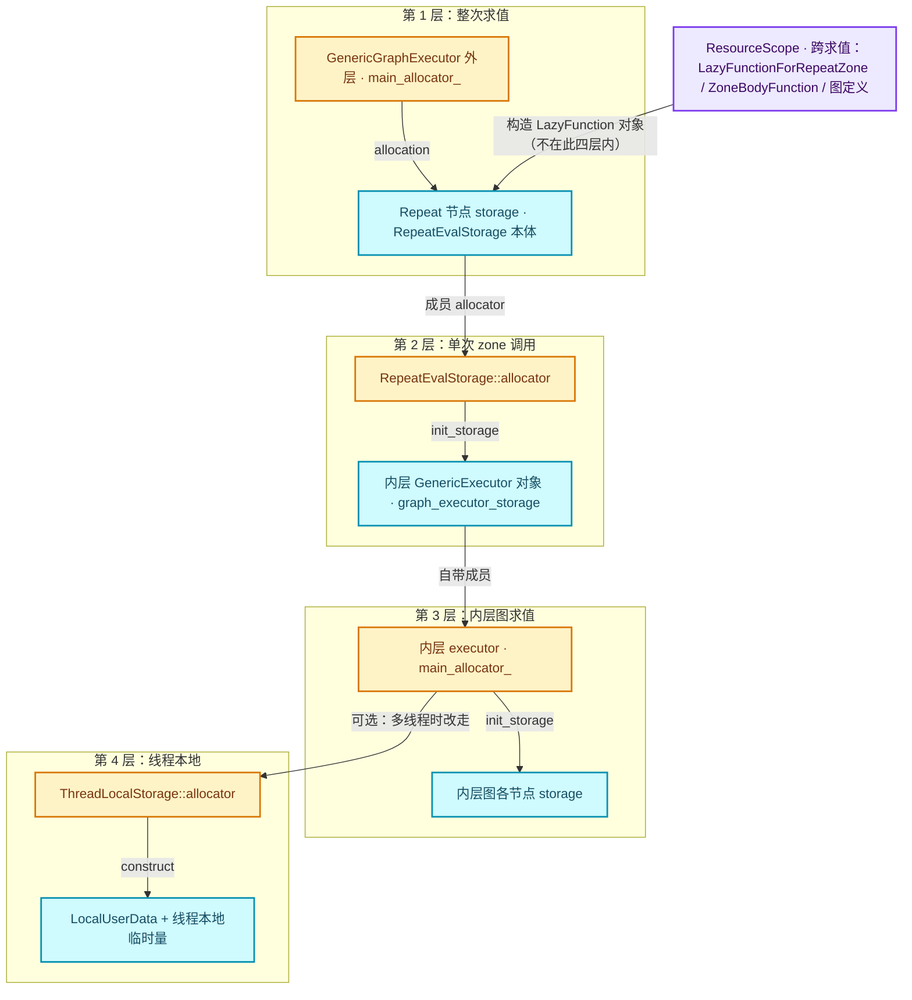
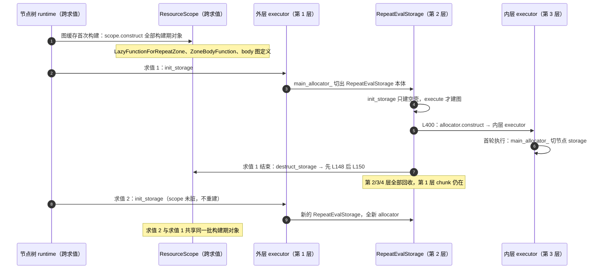

# 04 · storage 生命周期对照

[前置知识总入口](../README.md) · [本章导航](README.md) · [上一篇](03-destruct_ptr与所有权.md) · [下一章](../05-DNA与序列化/README.md)

> 基准：Blender `5.4.0-alpha`，本地工作树。本篇是 04 章的收束：把 `LinearAllocator`、`ResourceScope`、`destruct_ptr`、lf 的 storage 四个概念放进同一张生命周期表里对照，并给出"实际是四层分配器嵌套"的实证。主要源码：[`geometry_nodes_repeat_zone.cc`](../../../source/blender/nodes/intern/geometry_nodes_repeat_zone.cc)（432 行）、[`FN_lazy_function.hh`](../../../source/blender/functions/FN_lazy_function.hh)、[`lazy_function_graph_executor_generic.hh`](../../../source/blender/functions/intern/lazy_function_graph_executor_generic.hh)、[`BLI_linear_allocator.hh`](../../../source/blender/blenlib/BLI_linear_allocator.hh)、[`BLI_resource_scope.hh`](../../../source/blender/blenlib/BLI_resource_scope.hh)。

## 先回答一个具体问题

一个 Repeat Zone 里到底有几个分配器？为什么不是一个？

先数一遍。跑一次"3 轮 Repeat"的几何节点求值，内存会经过四个彼此独立、互不共享 chunk 的线性分配器：

```text
第 1 层  GenericGraphExecutor::main_allocator_        外层图执行器  →  整次求值
第 2 层  RepeatEvalStorage::allocator                  单次 zone 调用 →  内层执行器对象
第 3 层  GenericGraphExecutor::main_allocator_        内层图执行器  →  内层图求值
第 4 层  ThreadLocalStorage::allocator                每线程一份    →  线程本地临时数据
```

它们不是设计者故意叠出来的花样，而是同一个类被用在两个不同的生命周期层级上、并且"每次执行的局部状态"都要求自己的回收时机，自然长出来的形状。关键在于：`GenericGraphExecutor` 是一个**可以被多次执行、只能被析构一次**的对象，它的 `main_allocator_` 必须与"它自己活多久"同寿；而 Repeat Zone 的内层执行图**大小由迭代数决定**，跨求值复用不划算，只能活在单次调用的 storage 里。于是 storage 里又长出一个分配器，而这个分配器造出来的执行器又自带一个分配器——四层就这么来了。

这也直接回答了"谁比谁活得久"：`ResourceScope`（跨求值） ＞ 第 1 层 ＞ 第 2 层 ＞ 第 3 层 ＞ 第 4 层。第 4 层之所以必然最短，是因为 `thread_locals_` 本身就是第 3 层那个 executor 对象的成员（[L330](../../../source/blender/functions/intern/lazy_function_graph_executor_generic.hh#L330)）。层级越深，寿命越短，这是四层嵌套唯一的硬约束。

## 四个概念的分工

四个概念常被混为一谈，但它们解决的完全不是同一个问题。先看总表：

| 机制 | 管什么 | 生命周期 | 谁创建 | 谁销毁 | 源码 |
| --- | --- | --- | --- | --- | --- |
| `LinearAllocator`（默认 `GuardedAllocator`） | 只发内存，不管对象。chunk 线性切分，从不复用 | 分配器对象存活期。析构时一次性归还所有 chunk | 使用方自己持有（成员变量或栈上） | 它自己的析构函数，遍历 `owned_buffers_` 逐个 `deallocate` | [`BLI_linear_allocator.hh` · L53-L58](../../../source/blender/blenlib/BLI_linear_allocator.hh#L53) |
| `ResourceScope` | 登记"谁要析构"，按**反向登记序**逐个调用 free 回调 | 持有它的容器活多久，它就活多久；Repeat 里是缓存的节点树图信息，**跨多次求值** | 图构建方（`GeometryNodesLazyFunctionBuilder` 持引用） | `~ResourceScope`，反向遍历 `resources_` | [`resource_scope.cc` · L78-L90](../../../source/blender/blenlib/intern/resource_scope.cc#L78) |
| `destruct_ptr<T>` | 只表达"我负责调析构"，**不负责还内存** | 由持有它的容器决定（`unique_ptr` 语义） | `LinearAllocator::construct<T>()` 返回 | 离开作用域或 `std::move` 给 `ResourceScope::add` | [`BLI_memory_utils.hh` · L107-L111](../../../source/blender/blenlib/BLI_memory_utils.hh#L107) |
| lf 的 storage | `LazyFunction` **每次求值**的可变状态槽，`Context::storage` 指向它 | 从 `init_storage` 到 `destruct_storage`，中间可能跨越任意多次 `execute` | 执行器在节点第一次执行前调 `fn.init_storage(allocator)` | 执行器析构时调 `fn.destruct_storage(storage)` | [`FN_lazy_function.hh` · L269-L278](../../../source/blender/functions/FN_lazy_function.hh#L269) |

这张表里最容易被忽略的一列是"谁销毁"。`LinearAllocator` 只销毁**内存**，`destruct_ptr` 只销毁**对象**，`ResourceScope` 只销毁**它登记过的回调**，lf storage 只销毁**函数自己构造的那一份状态**。四者各自只能覆盖一段，重叠起来才完整。

看框架对 storage 的契约原文（[`FN_lazy_function.hh` · L269-L278](../../../source/blender/functions/FN_lazy_function.hh#L269)）：

```cpp
  /**
   * Allocates storage for this function. The storage will be passed to every call to #execute.
   * If the function does not keep track of any state, this does not have to be implemented.
   */
  virtual void *init_storage(LinearAllocator<> &allocator) const;

  /**
   * Destruct the storage created in #init_storage.
   */
  virtual void destruct_storage(void *storage) const;
```

注释里有两句话是全部设计的支点：**"passed to every call to #execute"**（一份 storage 服务多次 execute，所以不能在里面放"这一次调用"的临时量）与 **"does not have to be implemented"**（默认实现返回 `nullptr`，见 [`lazy_function.cc` · L28-L37](../../../source/blender/functions/intern/lazy_function.cc#L28)）。无状态函数不付任何代价，有状态函数自己接管。

## 四层分配器嵌套（实证）

这是本篇的核心。四层不是比喻，每一层都能在源码里指到具体字段。

### 第 1 层：外层图执行器的 `main_allocator_`

```cpp
  struct ThreadLocalStorage {
    LinearAllocator<> allocator;
    std::optional<destruct_ptr<LocalUserData>> local_user_data;
  };
  std::unique_ptr<threading::EnumerableThreadSpecific<ThreadLocalStorage>> thread_locals_;
  LinearAllocator<> main_allocator_;
```

位置：[`lazy_function_graph_executor_generic.hh` · L322-L331](../../../source/blender/functions/intern/lazy_function_graph_executor_generic.hh#L322)。它是 `GenericGraphExecutor` 的**成员变量**，不是从外面传进来的。寿命与执行器对象完全一致：执行器由 `GraphExecutor::init_storage` 在**上一级**分配器里构造（[`lazy_function_graph_executor.cc` · L74-L78](../../../source/blender/functions/intern/lazy_function_graph_executor.cc#L74)），`main_allocator_` 随它一起出生。

它装什么：全部节点 storage（`node_state.storage = fn.init_storage(allocator);`，[L937](../../../source/blender/functions/intern/lazy_function_graph_executor_generic.hh#L937)）、未连接输入的默认值副本（[L953](../../../source/blender/functions/intern/lazy_function_graph_executor_generic.hh#L953) 的 `allocator.allocate(type)`），以及那个一次性大缓冲 `node_states`。最大那块在 [`lazy_function_graph_executor_generic.hh` · L400-L403](../../../source/blender/functions/intern/lazy_function_graph_executor_generic.hh#L400) 分配，先按 `preprocess_data_.total_size` 切一大块，再在里面用 `placement new` 摆出每个节点的 `NodeState`：

```cpp
      /* Allocate a single large buffer instead of making many smaller allocations below. */
      char *buffer = static_cast<char *>(
          local_data.allocator->allocate(self_.preprocess_data_.total_size, alignof(void *)));
      this->initialize_node_states(buffer);
```

注意 `local_data.allocator` 的来历（[L1336-L1346](../../../source/blender/functions/intern/lazy_function_graph_executor_generic.hh#L1336)）：

```cpp
  LocalData get_local_data()
  {
    if (!this->use_multi_threading()) {
      return {&main_allocator_, context_->local_user_data};
    }
    ThreadLocalStorage &local_storage = thread_locals_->local();
    if (!local_storage.local_user_data.has_value()) {
      local_storage.local_user_data = context_->user_data->get_local(local_storage.allocator);
    }
    return {&local_storage.allocator, local_storage.local_user_data->get()};
  }
```

这一行 `return {&main_allocator_, ...}` 就是第 1 层与第 4 层的**开关**：单线程走 `main_allocator_`，多线程走线程本地。第一次执行时 `task_pool_` 还是空的（`use_multi_threading()` 见 [L1249-L1252](../../../source/blender/functions/intern/lazy_function_graph_executor_generic.hh#L1249)），所以 `node_states` 大缓冲几乎总落在 `main_allocator_` 上。

### 第 2 层：Repeat 的 `RepeatEvalStorage::allocator`

```cpp
struct RepeatEvalStorage {
  LinearAllocator<> allocator;
  VectorSet<lf::FunctionNode *> lf_body_nodes;
  lf::Graph graph;
  std::optional<LazyFunctionForLogicalOr> or_function;
  std::optional<RepeatZoneSideEffectProvider> side_effect_provider;
  std::optional<RepeatBodyNodeExecuteWrapper> body_execute_wrapper;
  std::optional<lf::GraphExecutor> graph_executor;
  Array<SocketValueVariant> index_values;
  void *graph_executor_storage = nullptr;
  bool multi_threading_enabled = false;
  Vector<int> input_index_map;
  Vector<int> output_index_map;
};
```

位置：[`geometry_nodes_repeat_zone.cc` · L98-L111](../../../source/blender/nodes/intern/geometry_nodes_repeat_zone.cc#L98)。它是 storage 的**第一个字段**，默认构造，没有任何 `provide_buffer`——意味着它的 chunk 是从零开始向系统要的，与第 1 层的 chunk 毫无关系。

它装什么，实测只有一处：

```cpp
    eval_storage.graph_executor_storage = eval_storage.graph_executor->init_storage(
        eval_storage.allocator);
```

位置：[L400-L401](../../../source/blender/nodes/intern/geometry_nodes_repeat_zone.cc#L400)。`init_storage` 在内部做的就是 `allocator.construct<GenericExecutor>(*this)`（[`lazy_function_graph_executor.cc` · L74-L78](../../../source/blender/functions/intern/lazy_function_graph_executor.cc#L74)）。所以**第 2 层只装"内层执行器对象"这一个东西**——但这个对象本身携带了第 3 层和第 4 层（它的成员）。这是嵌套的真正机制：不是"分配器套分配器"，而是"分配器造出的对象自带分配器"。

为什么非要给 Repeat 单独一个分配器，不能直接复用第 1 层？因为第 2 层的寿命必须**短于**第 1 层。`RepeatEvalStorage` 的 `graph` 大小依赖迭代数（[L187-L194](../../../source/blender/nodes/intern/geometry_nodes_repeat_zone.cc#L187) 的注释写得很直白："since this graph depends on the number of iterations, it can't be reused in general"），它只能活一次调用。如果内层执行器对象也切在第 1 层，那么它不会被释放，只能是"析构了但内存还占着"，下一次求值又来一份，累积成稳定的泄漏斜率。单独给第 2 层，`destruct_storage` 结束时 `std::destroy_at(s)` 会顺手销毁 `allocator` 成员，chunk 立刻还给系统。

### 第 3 层：内层 executor 的 `main_allocator_`

内层 `GraphExecutor` 一旦被构造出来，它自己就是一个完整的 `GenericGraphExecutor`，于是它又有自己的 `main_allocator_`（同一个类，同一个字段，[L331](../../../source/blender/functions/intern/lazy_function_graph_executor_generic.hh#L331)）。这一层装的是**内层图每一个节点的 storage**：

```cpp
    if (node_needs_execution) {
      if (!node_state.storage_and_defaults_initialized) {
        /* Initialize storage. */
        node_state.storage = fn.init_storage(allocator);
```

位置：[L934-L937](../../../source/blender/functions/intern/lazy_function_graph_executor_generic.hh#L934)，其中 `allocator` 来自 `run_node_task` 开头的 `LinearAllocator<> &allocator = *local_data.allocator;`（[L868-L874](../../../source/blender/functions/intern/lazy_function_graph_executor_generic.hh#L868)）。单线程时它正是第 3 层。

这一层最容易看漏的地方：`node_state.storage` 是**懒初始化**的，只有节点真的要执行时才分配。所以"3 轮 Repeat"只跑了一轮就早退时，第 3 层里只会有 1 份 body 节点的 storage，而不是 3 份。这是惰性求值在内存上的直接体现。

### 第 4 层：每线程的 `ThreadLocalStorage::allocator`

```cpp
  struct ThreadLocalStorage {
    /**
     * A separate linear allocator for every thread. We could potentially reuse some memory, but
     * that doesn't seem worth it yet.
     */
    LinearAllocator<> allocator;
    std::optional<destruct_ptr<LocalUserData>> local_user_data;
  };
```

位置：[L322-L330](../../../source/blender/functions/intern/lazy_function_graph_executor_generic.hh#L322)。注释"每个线程一个独立分配器"已经说明了它的定位。它延迟到第一次需要时才创建（`ensure_thread_locals`，[L1285-L1295](../../../source/blender/functions/intern/lazy_function_graph_executor_generic.hh#L1285)），而触发点是任务被丢进任务池：

```cpp
  void push_to_task_pool(...)
  ...
        [](TaskPool *pool, void *data) {
          ...
          const LocalData local_data = executor.get_local_data();
          executor.run_task(new_current_task, local_data);
        },
```

位置：[L1318-L1333](../../../source/blender/functions/intern/lazy_function_graph_executor_generic.hh#L1318)。工作线程第一次调 `get_local_data()` 时走到 `thread_locals_->local()`，为一个新线程创建一份 `ThreadLocalStorage`——**它有自己的 allocator，自己的 `LocalUserData`**。`local_user_data` 的获取方式恰好就是本章反复出现的模式：

```cpp
destruct_ptr<fn::LocalUserData> GeoNodesUserData::get_local(LinearAllocator<> &allocator)
{
  return allocator.construct<GeoNodesLocalUserData>(*this);
}
```

位置：[`geometry_nodes_lazy_function.cc` · L4344-L4347](../../../source/blender/nodes/intern/geometry_nodes_lazy_function.cc#L4344)。`destruct_ptr` 装进 `std::optional`，落在 `thread_locals_` 里，随执行器一起析构。

### 嵌套关系图



读这张图有两个方向：**从外往里是构造，从里往外是析构**。`A1 → A2 → B1 → B2 → C1 → C2` 是分配方向，析构方向完全反过来，而且中间还夹着一层不属于这四层的 `ResourceScope`（它比四层都活得久）。

### 四层对照表

| 层 | 源码位置 | 分配器属于谁 | 生命周期跨度 | 装什么 | 析构点 |
| --- | --- | --- | --- | --- | --- |
| 1 | generic L331 | 外层 `GenericGraphExecutor` 成员 | 整次求值；随执行器对象 | `RepeatEvalStorage` 本体、`node_states` 大缓冲、各节点 storage、默认值副本 | `~GenericGraphExecutor`（L357-L369）→ 成员 `main_allocator_` 自动析构 |
| 2 | repeat_zone L98-L99 | `RepeatEvalStorage` 成员 | 单次 zone 调用；从 `init_storage` 到 `destruct_storage` | 内层执行器对象（一个 `GenericExecutor`） | `destruct_storage` 里 `std::destroy_at(s)`（L150）连带销毁该成员 |
| 3 | generic L331（内层实例） | 内层 `GenericGraphExecutor` 成员 | 内层图求值；从 L400 到 L148 | 内层图各节点 storage、内层 `node_states` | `destruct_storage` 里 `graph_executor->destruct_storage(...)`（L148） |
| 4 | generic L322-L330 | `ThreadLocalStorage` 成员 | 内层执行器对象存活期；每线程一份 | `LocalUserData`、线程本地临时值 | `~GenericGraphExecutor` 里 `thread_locals_` 被销毁 |

## 跨求值 vs 单次求值

这是两条**正交**的生命周期轴，混起来就会得出错误结论（比如"Repeat 的执行图缓存在 ResourceScope 里"——它不在）。

第一轴是**跨求值**：`ResourceScope`。它的宿主链条是：

```text
bNodeTree.runtime->geometry_nodes_lazy_function_graph_info   （shared_ptr）
  └─ GeometryNodesLazyFunctionGraphInfo
       └─ ResourceScope scope;                               （值成员）
```

两处证据：[`NOD_geometry_nodes_lazy_function.hh` · L427-L431](../../../source/blender/nodes/NOD_geometry_nodes_lazy_function.hh#L427) 声明 `ResourceScope scope;` 并注明"Contains resources that need to be freed when the graph is not needed anymore"；[`BKE_node_runtime.hh` · L195-L202](../../../source/blender/blenkernel/BKE_node_runtime.hh#L195) 用 `shared_ptr` 持有它，注释解释"allows the node tree to be evaluated even if the owner tree is freed already"。缓存由 `CacheMutex` 管脏（[`geometry_nodes_lazy_function.cc` · L4337-L4339](../../../source/blender/nodes/intern/geometry_nodes_lazy_function.cc#L4337)），脏了才重建，重建才析构旧 scope。

第二轴是**单次求值**：storage。`RepeatEvalStorage` 从 `init_storage` 出生（[L139-L142](../../../source/blender/nodes/intern/geometry_nodes_repeat_zone.cc#L139)），到 `destruct_storage` 死亡（[L144-L151](../../../source/blender/nodes/intern/geometry_nodes_repeat_zone.cc#L144)）。中间无论 `execute_impl` 被调度多少次，都是同一份 storage。

两条轴的分工在源码里体现为一个非常干净的对照——同一个 `LazyFunctionForRepeatZone` 对象，它的"静态接口"进 scope，"动态图"进 storage：

```cpp
    /* Build a function for the loop body. */
    ZoneBodyFunction &body_fn = this->build_zone_body_function(
        zone, "Repeat Body", &scope_.construct<GeometryNodesLazyFunctionSideEffectProvider>());
    /* Wrap the loop body by another function that implements the repeat behavior. */
    auto &zone_fn = build_repeat_zone_lazy_function(scope_, btree_, zone, zone_info, body_fn);
```

位置：[`geometry_nodes_lazy_function.cc` · L2243-L2252](../../../source/blender/nodes/intern/geometry_nodes_lazy_function.cc#L2243)。`body_fn` 是 `scope_.construct<ZoneBodyFunction>()`（[L2291](../../../source/blender/nodes/intern/geometry_nodes_lazy_function.cc#L2291)），`lf_body_graph` 是 `scope_.construct<lf::Graph>(name)`（[L2285](../../../source/blender/nodes/intern/geometry_nodes_lazy_function.cc#L2285)），两者都跨求值。而按迭代数展开的**执行**图 `eval_storage.graph` 在 storage 里，单次。



这张图里最值得盯住的是最后两行：**求值 2 会重新构造一切 storage 层的对象，但一个 `ResourceScope` 里的对象都不会重建**。前者是"每次调用的局部状态"，后者是"节点树的静态结构"。

## 构造与析构的完整时序

一次 Repeat 从被调度到完全消失，逐步骤如下（括号内为源码位置）。前 6 步是**构造**，后 6 步是**析构**。

1. **外层执行器调度到 Repeat 节点**。`run_node_task` 取出本线程的分配器：`LinearAllocator<> &allocator = *local_data.allocator;`（[generic L868-L874](../../../source/blender/functions/intern/lazy_function_graph_executor_generic.hh#L868)）。
2. **首次执行才初始化 storage**。`if (!node_state.storage_and_defaults_initialized)` 成立 → `node_state.storage = fn.init_storage(allocator);`（[L934-L937](../../../source/blender/functions/intern/lazy_function_graph_executor_generic.hh#L934)）。**分配者：第 1 层。**
3. **`init_storage` 只构造空壳**。`return allocator.construct<RepeatEvalStorage>().release();`（[repeat_zone L139-L142](../../../source/blender/nodes/intern/geometry_nodes_repeat_zone.cc#L139)）。注意 `.release()`：`destruct_ptr` 的所有权被主动放弃，交还给框架的裸指针——从这一刻起，销毁责任转移给 `destruct_storage`。此时内层什么都没建。
4. **第一次 `execute_impl` 里懒建图**。`if (!eval_storage.graph_executor)` → `initialize_execution_graph(...)`（[L170-L174](../../../source/blender/nodes/intern/geometry_nodes_repeat_zone.cc#L170)）。这一步建的对象（`lf::Graph`、N 份 `FunctionNode`、每轮 `index_values`、`LazyFunctionForLogicalOr`）都是 storage 的**值成员或 `std::optional` 成员**，**不**走第 2 层。这里有个容易漏掉的第五个分配器：`lf::Graph` 自己内含一个 `LinearAllocator<> allocator_`（[`FN_lazy_function_graph.hh` · L207-L212](../../../source/blender/functions/FN_lazy_function_graph.hh#L207)），所有 `FunctionNode` 与 `InputSocket`/`OutputSocket` 都是 `allocator_.construct<...>()` 切出来的（[`lazy_function_graph.cc` · L53-L56](../../../source/blender/functions/intern/lazy_function_graph.cc#L53)），由 `Graph::~Graph` 逐个 `destroy_at`（[L26-L46](../../../source/blender/functions/intern/lazy_function_graph.cc#L26)）后再由成员 `allocator_` 整块归还。它不在这四层里，而是第 2 层壳内部的一个独立子分配器——这也再次印证"嵌套是所有权嵌套，不是地址嵌套"。
5. **装配内层执行器并初始化。** `eval_storage.graph_executor.emplace(...)`（[L394-L399](../../../source/blender/nodes/intern/geometry_nodes_repeat_zone.cc#L394)），紧跟 `eval_storage.graph_executor_storage = eval_storage.graph_executor->init_storage(eval_storage.allocator);`（[L400-L401](../../../source/blender/nodes/intern/geometry_nodes_repeat_zone.cc#L400)）。**分配者：第 2 层。** 由此诞生第 3 层。
6. **执行内层图。** `lf::Context eval_graph_context{eval_storage.graph_executor_storage, ...}; eval_storage.graph_executor->execute(eval_graph_params, eval_graph_context);`（[L182-L184](../../../source/blender/nodes/intern/geometry_nodes_repeat_zone.cc#L182)）。执行期间内层节点逐个 `fn.init_storage(allocator)`（[generic L937](../../../source/blender/functions/intern/lazy_function_graph_executor_generic.hh#L937)），**分配者：第 3 层或第 4 层**。这是 `Context::storage` 第一次指向内层对象——注意 `eval_graph_context` 的第一个参数是 `graph_executor_storage`，**不是**外层的 `context.storage`，两套 storage 绝不能混用。
7. **节点完成、外层执行器准备析构**。`~GenericGraphExecutor` 先并行遍历所有 `node_state` 调 `destruct_node_state`（[L357-L369](../../../source/blender/functions/intern/lazy_function_graph_executor_generic.hh#L357)）。
8. **对 Repeat 节点调用 `destruct_storage`**。`fn.destruct_storage(node_state.storage)`（[L503-L508](../../../source/blender/functions/intern/lazy_function_graph_executor_generic.hh#L503)）。
9. **先销毁内层存储**。`s->graph_executor->destruct_storage(s->graph_executor_storage);`（repeat_zone L148）→ `std::destroy_at(static_cast<GenericExecutor *>(storage))`（[`lazy_function_graph_executor.cc` · L80-L83](../../../source/blender/functions/intern/lazy_function_graph_executor.cc#L80)）。这一步先跑 `~GenericGraphExecutor` 的函数体（销毁内层全部节点 storage，即第 3 层的内容 + 第 4 层的 `thread_locals_`），再销毁它的成员。
10. **再销毁本结构**。`std::destroy_at(s);`（repeat_zone L150）。`RepeatEvalStorage` 的成员按**声明逆序**销毁：`output_index_map`、`input_index_map`、`index_values`、`graph_executor`、`body_execute_wrapper`、`side_effect_provider`、`or_function`、`graph`、`lf_body_nodes`，最后是 `allocator`——**第 2 层的 chunk 在这一刻才真正还给系统**。
11. **第 1 层 chunk 仍活着**。`main_allocator_` 是外层执行器的成员，外层执行器还在为图里其余节点服务。
12. **外层执行器整个析构**。`~GenericGraphExecutor` 函数体跑完后，成员自动析构，`main_allocator_` 归还全部 chunk。至此四层全清。

Repeat 的 `destruct_storage` 全貌（[L144-L151](../../../source/blender/nodes/intern/geometry_nodes_repeat_zone.cc#L144)）：

```cpp
  void destruct_storage(void *storage) const override
  {
    RepeatEvalStorage *s = static_cast<RepeatEvalStorage *>(storage);
    if (s->graph_executor_storage) {
      s->graph_executor->destruct_storage(s->graph_executor_storage);
    }
    std::destroy_at(s);
  }
```

这 8 行是全篇最值钱的一段代码。`if (s->graph_executor_storage)` 的判空不是防御性编程，而是**必需的**：如果这次求值里 Repeat 一次都没执行到（惰性求值下完全可能），`graph_executor_storage` 保持 `nullptr`，`graph_executor` 也没 `emplace`，此时只能直接 `destroy_at`。

对比一下 `LazyFunctionForGroupNode` 的同一位置（[`geometry_nodes_lazy_function.cc` · L1233-L1245](../../../source/blender/nodes/intern/geometry_nodes_lazy_function.cc#L1233)）：它的 `destruct_storage` 同样没有判空，因为 `group_storage` 在 `init_storage` 里就**无条件**创建了（L1236 直接写 `s->group_storage = group_lazy_function_.function->init_storage(allocator);`）。**能不能判空，取决于内层 storage 是"立即建"还是"懒建"**——这是辨认这一族函数最有效的一招。

## 为什么析构顺序不能反

假如把 L148 与 L150 互换，写成"先 `destroy_at(s)`，再销毁内层 storage"，会有两个独立的错误叠在一起。

**第一层错误：读已析构对象。** `std::destroy_at(s)` 之后 `s` 指向的内存里已经没有 `RepeatEvalStorage` 了。此时再写 `s->graph_executor_storage` 是访问一个生命周期已结束的对象；`s->graph_executor` 更是访问一个已经被 `~optional` 析构掉的 `std::optional<lf::GraphExecutor>`。C++ 的规则很干脆：对象死亡后任何成员访问都是 UB，优化器完全有权把这段代码"优化"成任意行为。

**第二层错误：用悬空指针调函数。** 就算假设编译器放行，`s->graph_executor_storage` 指向的内层 `GenericExecutor` 对象本身就在 `s->allocator` 切出的 chunk 里。而 `std::destroy_at(s)` 会连带销毁 `s->allocator` 这个**成员**，它的析构函数遍历 `owned_buffers_` 逐个 `deallocate`（[`BLI_linear_allocator.hh` · L53-L58](../../../source/blender/blenlib/BLI_linear_allocator.hh#L53)）。所以顺序一反，具体后果是：

```text
1. destroy_at(s)      → ~RepeatEvalStorage → ~LinearAllocator → chunk 已还给 GuardedAllocator
2. s->graph_executor_storage 指向的内存被别的分配拿去复用
3. destruct_storage(那个指针) → std::destroy_at 在一块已被复用的内存上跑 ~GenericGraphExecutor
4. ~GenericGraphExecutor 函数体 → 遍历 node_states_ → 对每个节点调 fn.destruct_storage
5. 每个节点的 storage 指针现在指向垃圾 → 对垃圾调析构函数
```

第 5 步是最恶毒的：它不会立刻崩，而是在完全无关的代码里、在下一次分配之后炸掉，堆栈指向一个根本不含 Repeat 的调用点。这种 bug 的调试成本是"正确顺序"版本的几百倍。

**所以真正的规则不是"保持某个固定顺序"，而是：内层对象的析构必须发生在"装它的那个分配器"还活着的时候。** 换句话说，`destruct_storage` 里所有"释放子对象"的动作都必须在 `std::destroy_at(s)` **之前**完成，因为 `destroy_at` 结束的那一刻，第 2 层的所有内存同时失效。

同样的问题在 `ResourceScope` 里由框架兜住了：`~ResourceScope` 反向遍历 `resources_`（[`resource_scope.cc` · L78-L90](../../../source/blender/blenlib/intern/resource_scope.cc#L78)），注释 [L18-L20](../../../source/blender/blenlib/BLI_resource_scope.hh#L18) 说"Destruction happens in reverse order. That allows resources do depend on other resources that have been added before."——意思正是：后登记的依赖先登记的，反序析构天然安全。`ResourceScope` 把这条规则做成了默认行为，而 `destruct_storage` 需要手写，所以 `destruct_storage` 才是容易出事的地方。

还有一个更隐蔽的顺序约束在 `RepeatEvalStorage` 内部：成员声明顺序是 `graph`（L101）在 `graph_executor`（L105）之前，所以逆序析构时 `graph_executor` 先于 `graph` 消失——这正好是需要的，因为执行器引用了图。如果哪天有人把 `graph` 挪到 `graph_executor` 后面，`~RepeatEvalStorage` 就会先析构图、再析构引用图的执行器。声明顺序在这里不是排版偏好，是契约。

## 内存泄漏的三种典型形态

### 形态一：chunk 归还了，对象没析构

这是 04-01 已经讲过的那条，也是最高频的一种。`LinearAllocator` 析构时只处理 `void *`（[L53-L58](../../../source/blender/blenlib/BLI_linear_allocator.hh#L53)），它从来不知道 chunk 里放过什么。所以下面这种写法：

```cpp
void *init_storage(LinearAllocator<> &allocator) const override {
  /* 少了 .release() 之外的兜底，或者调用方忘了 destruct_storage */
  return allocator.construct<RepeatEvalStorage>().release();
}
```

只要上层漏掉 `destruct_storage`，chunk 在分配器析构时会被干净地还掉，而 `RepeatEvalStorage` 里那些 `Vector`、`VectorSet`、`Array`、`std::optional` 的内部堆缓冲**一个字节都不会回收**；`graph_executor` 里第 3 层的 chunk 也永远不会被 `deallocate`（因为 `allocator` 成员自己的析构函数没跑）。

**症状**：调试器的内存面板显示 Blender 的 guarded 分配总量平稳，`MEM_*` 计数不报警；但进程 RSS 每次按 Ctrl+Z / 改参数就涨几 MB，最终 OOM 或触发系统的内存压缩。用 `BLI_DEBUG_LINEAR_ALLOCATOR_SIZE`（[L42-L45](../../../source/blender/blenlib/BLI_linear_allocator.hh#L42)）打开统计也看不出来——它统计的是"我向系统要了多少"，而这里恰恰是"要到手的还没还"。

**判别方法**：在 `destruct_storage` 里加一行 `printf`，与 `init_storage` 的调用次数对比。数字不匹配就是这一类。

### 形态二：ResourceScope 里未 add

`scope.construct<T>()` 会自己 `add`（[L219-L225](../../../source/blender/blenlib/BLI_resource_scope.hh#L219)），但**直接调用 `scope.allocator()` 然后手工 `construct` 就不会**：

```cpp
T *p = scope.allocator().construct<T>(...).release();  // 没有 add
```

内存照样在 chunk 里（chunk 归 scope 所有，最终会释放），但 `~T()` **永远不会被调用**。`ResourceScope` 的核心价值是"析构登记"而不是"内存管理"，绕过 `add` 就只剩内存管理了。

同类错误还有 `add(destruct_ptr)` 的特殊分支（[L181-L197](../../../source/blender/blenlib/BLI_resource_scope.hh#L181)）：

```cpp
template<typename T> inline T *ResourceScope::add(destruct_ptr<T> resource)
{
  T *ptr = resource.release();
  if (ptr == nullptr) {
    return nullptr;
  }
  /* There is no need to keep track of such types. */
  if constexpr (std::is_trivially_destructible_v<T>) {
    return ptr;
  }
  ...
}
```

对 trivially destructible 的类型，它**直接 return，不登记**。这是正确的优化（没有析构函数可调），但如果某个类型本来是 trivially destructible、后来加了一个持有堆内存的成员，它会自动变成非平凡并重新登记——所以这个优化是安全的。真正危险的是相反的假设：有人看到 `add` 对某类型"没做事"，就以为 `add` 是可选步骤。

**症状**：与形态一几乎一样（RSS 涨、无断言），区别在于**只有跨求值的对象**在漏。因为 scope 只在图缓存重建时才析构一次，所以漏的量级是"每个节点树"而不是"每次求值"。改参数（不触发重编译）时 RSS 不涨，改节点拓扑（触发重建）时涨一截——这个区别是定位这两类泄漏的关键指纹。

### 形态三：`destruct_ptr` release 后忘记处理

`destruct_ptr` 的语义是"我只管调析构"，`release()` 之后就什么都不管了（[`BLI_memory_utils.hh` · L107-L111](../../../source/blender/blenlib/BLI_memory_utils.hh#L107)）。Repeat 的 `init_storage` 正是这么用的：

```cpp
    return allocator.construct<RepeatEvalStorage>().release();
```

这里 `release()` 是**正当的**——框架约定 storage 以裸指针在 `Context` 里传递，销毁责任由 `destruct_storage` 承担（[`FN_lazy_function.hh` · L275-L278](../../../source/blender/functions/FN_lazy_function.hh#L275)）。但同样的写法出现在没有对应 `destruct_storage` 的地方就是纯漏：

```cpp
  auto &body_fn = scope.construct<ZoneBodyFunction>();      // 正确：scope 兜住
  auto *graph = scope.allocator().construct<lf::Graph>()    // 错误：release 了但没 add
                     .release();
```

**症状**：与前两种都不同——这是**逻辑状态错误**而非纯内存问题。`lf::Graph` 的 `Vector` 内部缓冲没被析构，但内存还在 chunk 里，所以图本身还能正常读；直到 `~ResourceScope` 把 chunk 还掉，`ZoneBodyFunction` 里指向那个图的指针变成悬空。下一次求值用到图时，读到的是被别人复用的内存。

**症状表现**：use-after-free，而且极难复现。它依赖"chunk 被归还后多久被复用、复用人是谁"。典型现象是同一个 .blend 打开两次，一次正常一次崩溃；或者崩溃堆栈落在 `lf::Graph::nodes()` 相关代码里，而报错的节点树根本没有 Repeat。ASAN 能抓到，release 构建只能靠"构造/析构计数不平衡"来发现。

三种形态的对照：

| 形态 | 内存是否归还 | 析构函数是否调用 | 生命周期轴 | 症状 |
| --- | --- | --- | --- | --- |
| chunk 归还、对象未析构 | 是 | 否 | 单次求值 | RSS 单调涨，guarded 计数正常 |
| ResourceScope 未 add | 是（chunk 归 scope） | 否 | 跨求值 | 改拓扑时涨一截（重建才发生） |
| release 后忘处理 | 否（或错层归还） | 否 | 两者皆有 | use-after-free，依赖时序，堆栈误导 |

## 用小数据走一遍

设定：一个 Repeat Zone，`Iterations = 3`，循环体内有**一个有状态节点**（它的 `init_storage` 真的分配存储，比如需要缓存字段求值结果的节点）。外层在单线程模式下求值。

### 时刻表

| 时刻 | 动作 | 第 1 层 | 第 2 层 | 第 3 层 | 第 4 层 |
| --- | --- | --- | --- | --- | --- |
| t0 | 外层 `execute`，`node_states` 大缓冲分配 | **创建 chunk #0**（一次性切出全部 `NodeState`） | — | — | — |
| t1 | Repeat 节点首次执行 → `init_storage` | 切出 `RepeatEvalStorage` 的空间 | — | — | — |
| t2 | 同一行里 placement-new 默认构造 `RepeatEvalStorage` | — | **构造完成，chunk 尚为空（0 次分配）** | — | — |
| t3 | `initialize_execution_graph`：建 3 个 `FunctionNode`、`Graph` 输入输出、3 份 `index_values` | — | 空（这些是值成员，走各自容器） | — | — |
| t4 | `graph_executor_storage = ...->init_storage(eval_storage.allocator)` | — | **分配 chunk #0**，尺寸 = `max(sizeof(GenericExecutor), 64)`，切出内层执行器 | — | — |
| t5 | 内层 `execute` 首次：`node_states` 大缓冲 | — | — | **创建 chunk #0** | — |
| t6 | 执行第 1 轮 body 节点（有状态版本） | — | — | 切出 node storage #0 | — |
| t7 | 执行第 2 轮（独立节点实例） | — | — | 切出 node storage #1 | — |
| t8 | 执行第 3 轮 | — | — | 切出 node storage #2 | — |
| t9 | 若节点数 > 128 触发多线程 | — | — | 内层节点改从第 4 层取 | **按线程创建 `ThreadLocalStorage`** |
| t10 | `destruct_storage` → L148 内层析构 | — | — | **全部析构：3 份 node storage + `node_states`**，chunk 未还 | 每线程 `LocalUserData` 析构 |
| t11 | `destruct_storage` → L150 `std::destroy_at(s)` | — | **`allocator` 析构，chunk #0 归还** | — | `thread_locals_` 已随 t10 消失 |
| t12 | 外层求值收尾，`~GenericGraphExecutor` | **chunk #0/#1... 全部归还** | — | — | — |

### 关键观察

**观察 1：t4 到 t11 之间，第 2 层只干了一件事。** `GenericExecutor` 本体通常只有几百字节，一块 chunk 就装下了——而 `preprocess_data_.total_size` 那个"装全部 `NodeState` 的大缓冲"要到 t5 才在第 3 层分配。这就是"第 2 层装对象、第 3 层装数据"的具体含义：同样都叫"执行器相关的内存"，但一个属于对象本身，一个属于这一次执行。

**观察 2：t6-t8 是三次分配，但第 3 层的 chunk 只增了少数几块。** chunk 尺寸按 `1 << min(owned_buffers_.size() + 6, 20)` 渐进增长（[L282-L298](../../../source/blender/blenlib/BLI_linear_allocator.hh#L282)），且最终被 `min(large_buffer_threshold, ...)` 截到不超过 4096：第一块可能在 64 字节左右、随后翻倍到 128、256……所以 3 份 storage 大概率全落在前两块 chunk 里。这正是 04-01 讲的"批量释放把 N 次分配摊成 M 次系统调用"。

**观察 3：t10 与 t11 之间有一个"已析构但内存未还"的窗口。** 这个窗口里所有对象的析构函数都跑完了，但 chunk 还在。它存在的理由很简单：`GenericExecutor` 的析构只负责"跑析构函数"，还内存是它的宿主（第 2 层 `allocator`）的事。这个分离不是疏漏，而是必须的——`GenericExecutor` 不知道自己住在谁的 chunk 里（它是通过 `allocator.construct<>` 被放进去的，`GraphExecutor::destruct_storage` 只有 `std::destroy_at`，见 [L80-L83](../../../source/blender/functions/intern/lazy_function_graph_executor.cc#L80)）。

**观察 4：3 轮里如果第 2 轮就早退（输出未被使用），第 3 轮的 storage 根本不存在。** 因为 `node_state.storage_and_defaults_initialized` 是懒的（[L934-L937](../../../source/blender/functions/intern/lazy_function_graph_executor_generic.hh#L934)）。所以"3 轮 Repeat 的 storage 数量"不是 3，而是"实际执行到的节点数"。这一条在正篇 04-03（副作用迭代与按需执行）里是主线。

## 反例与边界

**反例 1：以为内层执行图和构建期的 body 图定义在同一个分配器里。** `eval_storage.graph` 是 storage 的值成员，按迭代数每次重建；`lf_body_graph` 是 `scope_.construct<lf::Graph>(name)`（[`geometry_nodes_lazy_function.cc` · L2285](../../../source/blender/nodes/intern/geometry_nodes_lazy_function.cc#L2285)），跨求值。两者名字里都有 "graph"，寿命完全不同。

**反例 2：把 `RepeatEvalStorage*` 缓存到 storage 之外。** 有人为了"避免重复建图"，把 `context.storage` 强转后的指针存进 user_data。`destruct_storage` 一跑就悬空。要跨调用复用，正确做法是缓存**图**（如 `btree_orig.runtime->logged_zone_graphs`，见 [L403-L409](../../../source/blender/nodes/intern/geometry_nodes_repeat_zone.cc#L403) 那种调试用途），而不是缓存 storage。

**反例 3：认为 `destruct_storage` 会还内存。** 它只调 `std::destroy_at`。`RepeatEvalStorage` 的堆缓冲回收靠成员析构，chunk 回收靠第 2 层 `allocator` 析构——后者是**成员**析构，发生在 `destroy_at(s)` 内部的最后一步。

**反例 4：在内层 `Context` 里传外层 storage。** `eval_graph_context` 的第一个参数必须是 `eval_storage.graph_executor_storage`（[L182-L183](../../../source/blender/nodes/intern/geometry_nodes_repeat_zone.cc#L182)）。传 `context.storage` 进去，内层所有节点会拿到外层的 `RepeatEvalStorage` 当自己的 storage，`fn.destruct_storage` 时按错误的类型解释内存。

**反例 5：给 `RepeatEvalStorage::allocator` 提前 `provide_buffer`。** 看似能省一次系统分配，实际会引入一个隐蔽耦合：那块 buffer 必须活得比 storage 久。`provide_buffer` 不接管所有权（[L217-L222](../../../source/blender/blenlib/BLI_linear_allocator.hh#L217) 断言 `owned_buffers_.is_empty()`），谁提供谁负责它的寿命。栈上 buffer 会在 storage 之前消失。

**反例 6：假设多线程一定用第 4 层。** `get_local_data()` 的分支看 `use_multi_threading()`，即 `task_pool_ != nullptr`（[L1249-L1252](../../../source/blender/functions/intern/lazy_function_graph_executor_generic.hh#L1249)）。小图永远不会触发多线程（阈值是"同时调度节点数 > 128"，[L856-L864](../../../source/blender/functions/intern/lazy_function_graph_executor_generic.hh#L856)），所以第 4 层可能一次都没被创建。写测试时按"有 4 层"来断言会失败。

**反例 7：以为 `ResourceScope` 的析构顺序可以任意。** 它靠反向登记序（[`resource_scope.cc` · L78-L90](../../../source/blender/blenlib/intern/resource_scope.cc#L78)）。如果某个资源在被登记之后又追加了新的依赖对象、而那个依赖不经过 `add`，反序就保护不了它。规则是"依赖必须比被依赖者**后**登记"。

**反例 8：忽略 `RepeatEvalStorage` 内部成员的声明顺序。** `graph`（L101）必须在 `graph_executor`（L105）之前声明，因为逆序析构要求执行器先死。调整字段顺序时如果只考虑可读性，会引入一个只在特定编译器/优化级别下才崩的 bug。

**反例 9：把 `destruct_storage` 写成幂等。** 框架保证只调一次（[generic L503-L508](../../../source/blender/functions/intern/lazy_function_graph_executor_generic.hh#L503) 由 `~GenericGraphExecutor` 触发，而执行器只析构一次）。为"防止二次调用"在里面加标志位，会把一份本来就不需要的外部状态塞进 storage，反而制造第 2 层里"未析构的成员"。

## 对理解 Repeat 的帮助

本篇是 04 章的收束，也是整章与正篇之间的转轴。把线索接回去：

| 本篇结论 | 连接到 |
| --- | --- |
| `RepeatEvalStorage` 是单次求值的全部可变状态 | 正篇 [04-01 RepeatEvalStorage与一次求值](../../重复区域-dsh/04-运行时机制/01-RepeatEvalStorage与一次求值.md) 的 storage 时序，本篇把它的"上下文"补成四层 |
| 按迭代数展开的图每次重建，所以只能放 storage | 正篇 [03-03 执行图按迭代展开](../../重复区域-dsh/03-几何节点执行架构/03-执行图按迭代展开.md)，repeat_zone L187-L194 的注释是同一句话 |
| `ResourceScope` 管跨求值的构建期对象 | 本章 [02-ResourceScope资源作用域](02-ResourceScope资源作用域.md)，以及正篇 00-03 的符号索引对 `build_repeat_zone_lazy_function` 的说明 |
| `destruct_ptr` 是四层之间的粘合剂 | 本章 [03-destruct_ptr与所有权](03-destruct_ptr与所有权.md)：`construct` 返回它，`add` 接管它，`release` 放弃它 |
| chunk 归还 ≠ 对象析构 | 本章 [01-LinearAllocator线性分配](01-LinearAllocator线性分配.md) 第"析构时的责任"节，本篇把它升级为泄漏三形态 |

最实用的一条结论是：**读 Repeat 的任何内存问题，先问"这是哪一层，该活多久"**。四层的寿命分别是"整次求值 / 单次 zone 调用 / 内层图求值 / 线程本地"，任何一层被误当成另一层，症状就落在上表"泄漏三形态"的某一格里。`destroy_at` 与 `destruct_storage` 的那 8 行代码之所以值得反复看，是因为它是唯一一处"顺序错了就必然出事"的地方——其他所有地方，`ResourceScope` 和 `destruct_ptr` 都替你兜住了。

## 继续阅读

- 本章回顾：[01-LinearAllocator线性分配](01-LinearAllocator线性分配.md) · [02-ResourceScope资源作用域](02-ResourceScope资源作用域.md) · [03-destruct_ptr与所有权](03-destruct_ptr与所有权.md)
- 下一章：[05-DNA与序列化](../05-DNA与序列化/README.md)
- 正篇落点：[04-01 RepeatEvalStorage与一次求值](../../重复区域-dsh/04-运行时机制/01-RepeatEvalStorage与一次求值.md)、[04-02 ComputeContext与迭代身份](../../重复区域-dsh/04-运行时机制/02-ComputeContext与迭代身份.md)、[04-03 副作用迭代与按需执行](../../重复区域-dsh/04-运行时机制/03-副作用迭代与按需执行.md)
- 框架侧：[06-GraphExecutor调度机制](../01-惰性执行框架/06-GraphExecutor调度机制.md)、[07-执行钩子与副作用接口](../01-惰性执行框架/07-执行钩子与副作用接口.md)
- 源码复核：[`geometry_nodes_repeat_zone.cc` · L139-L151](../../../source/blender/nodes/intern/geometry_nodes_repeat_zone.cc#L139)（构造与析构）、[`lazy_function_graph_executor_generic.hh` · L322-L348](../../../source/blender/functions/intern/lazy_function_graph_executor_generic.hh#L322)（四层字段）、[`BLI_resource_scope.hh` · L181-L225](../../../source/blender/blenlib/BLI_resource_scope.hh#L181)（`add` 与 `construct`）
