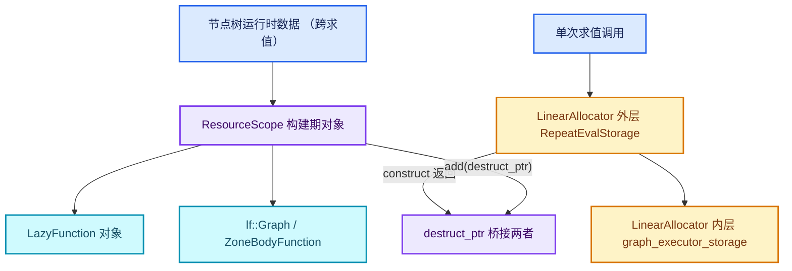

# 04-生命周期与分配

[前置知识总入口](../README.md) · [上一章：03-BLI容器与视图](../03-BLI容器与视图/README.md)

本章回答：Blender 里"谁拥有谁"怎么表达？为什么同时存在 `LinearAllocator` 和 `ResourceScope` 两套机制？`destruct_ptr` 与 `unique_ptr` 的差别是什么？

## 阅读顺序

| # | 篇目 | 源码主线 | 实测行数 |
| --- | --- | --- | --- |
| 1 | [01-LinearAllocator线性分配](01-LinearAllocator线性分配.md) | `BLI_linear_allocator.hh` | 279 |
| 2 | [02-ResourceScope资源作用域](02-ResourceScope资源作用域.md) | `BLI_resource_scope.hh` | 206 |
| 3 | [03-destruct_ptr与所有权](03-destruct_ptr与所有权.md) | `BLI_memory_utils.hh` L108 起（**同文件**） | 315 |
| 4 | [04-storage生命周期对照](04-storage生命周期对照.md) | 综合：三套机制的取舍 | — |

> **重要事实**：`destruct_ptr` **没有**独立的 `BLI_destruct_ptr.hh`。 > 它定义在 `BLI_memory_utils.hh`（L108 附近的注释： > "A destruct_ptr is like unique_ptr, but it will only call the destructor > and will not free the memory"）。这是一个很容易踩的坑—— > 面试/查资料时常被误认为有独立头文件。

## 本章与 Repeat 的关系

Repeat Zone 是**双套生命周期**的教科书案例：

| 机制 | 谁用 | 生命期 | 源码位置 |
| --- | --- | --- | --- |
| `ResourceScope` | `LazyFunctionForRepeatZone` 等构建期对象 | 随节点树运行时数据（跨多次求值） | geometry_nodes_repeat_zone.cc L423-L430 |
| `LinearAllocator`（外层） | `RepeatEvalStorage` 本体 | 一次求值调用 | L139-L142 |
| `LinearAllocator`（内层） | 内层 `graph_executor_storage` | 同上，嵌套一层 | L400-L401 |

正篇 04-01 的第 2 节"init_storage 与 destruct_storage"整段都在讲这套嵌套。本章把底层机制讲透，那三行代码就不再是魔法。

## 三套机制的分工

| 机制 | 释放方式 | 适用场景 | 代价 |
| --- | --- | --- | --- |
| `LinearAllocator` | 整块回收（析构时一次性） | 大量小对象、同生共死 | 不能单独释放某个对象 |
| `ResourceScope` | 反向序析构 + 可选释放 | 构建期产物、多类型混合 | 按类型分组，遍历有开销 |
| `destruct_ptr` | 只调析构、不释放内存 | 配合分配器使用 | 不能脱离分配器生存 |

## 实测行数总表

| 文件 | 行数 |
| --- | --- |
| `BLI_memory_utils.hh` | 315 |
| `BLI_linear_allocator.hh` | 279 |
| `BLI_resource_scope.hh` | 206 |
| **合计** | **800** |

篇幅不大但概念密度极高——理解错了就是 use-after-free 或内存泄漏。

## 一条主线

三个机制回答的是同一个问题的三个层次：

1. **`LinearAllocator`**：我怎么"批量"分配？（一次性大块切分）
2. **`ResourceScope`**：我怎么"批量"析构且类型无关？（登记 + 反向析构）
3. **`destruct_ptr`**：我怎么把"分配器的内存"和"构造的对象"绑在一起？（只调析构、不 free）

Repeat 的外层 storage 用 1，内层用 1，构建期对象用 2，而 3 是 1 和 2 之间的粘合剂（`LinearAllocator::construct<T>()` 返回 `destruct_ptr<T>`， `ResourceScope::add(destruct_ptr<T>)` 接管它）。
