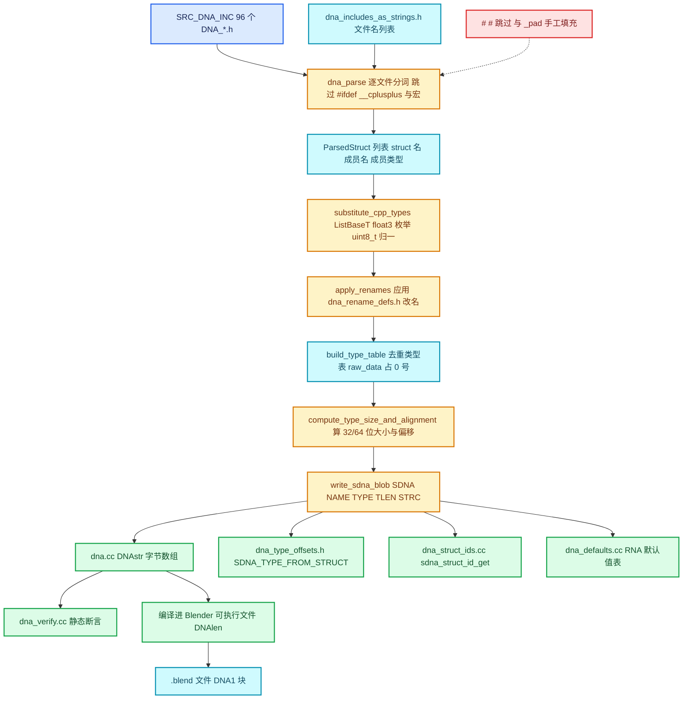

# 01 · DNA 是什么与 makesdna

[前置知识总入口](../README.md) · [本章导航](README.md) · [下一篇](02-SDNA表与类型编码.md)

> 基准：Blender `5.4.0-alpha`，本地工作树。本篇回答一个主系列从未定义的问题：**DNA 到底是什么**。主要源码：[`DNA_documentation.h`](../../../source/blender/makesdna/DNA_documentation.h)（67 行全文，这是官方唯一的一手说明）、[`DNA_sdna_types.h`](../../../source/blender/makesdna/DNA_sdna_types.h)（143 行）、[`DNA_defs.h`](../../../source/blender/makesdna/DNA_defs.h)（170 行）。

## 先回答一个具体问题

**问：`.blend` 文件里存的是什么？为什么 Blender 换个版本还能打开老文件？**

"存的是场景数据"只说对了一半。`.blend` 里其实同时存了两种东西：**数据本体**（网格顶点、相机矩阵、节点树……基本就是内存 dump）和**数据的说明书**（每个内存块属于哪个结构体、结构体由哪些字段组成、字段叫什么、什么类型、占几个字节）。

第二种东西就是 **DNA**，生成它的程序叫 **makesdna**。巧妙之处在于：说明书是**跟着每个文件一起存**的，而不是跟着 Blender 版本走。读老文件时手里有两份说明书——一份来自文件（"当时长这样"），一份来自当前可执行文件（"现在长这样"），一对比就知道哪些字段增删了、挪位了、结构体没了，然后逐字段搬运。一句话概括：**Blender 把"数据结构定义"当成数据本身来存。**

## DNA 是什么

> **DNA 是 Blender 里所有"会被写进 `.blend` 文件的 C 结构体"的定义集合，以及由 `makesdna` 从这些定义生成的 SDNA 描述表。**

三个必须记住的特征：

| 特征 | 含义 | 落点 |
| --- | --- | --- |
| 可序列化的 C 结构 | 只允许 C 基本类型与聚合，C++ 语义类型进不了 SDNA | `source/blender/makesdna/DNA_*.h` |
| 跨版本兼容 | 字段按**名字**匹配而非按偏移匹配，缺失填零、多余丢弃 | `intern/dna_genfile.cc` |
| 由 makesdna 扫描生成 | 不是手写，是构建期扫头文件自动生成 `dna.cc` | `intern/makesdna.cc` |

第三条尤其重要：DNA **不是一个运行库**，它是**一个构建期代码生成器的输入格式**。你写在 `DNA_*.h` 里的东西，一半给 C++ 编译器看（真结构体定义），一半给 makesdna 看（要被抽成 SDNA 的声明）。两者必须是同一份文本，否则必然不一致——这就是 DNA 结构有那么多编写规则的根本原因。

## DNA_documentation.h 全文讲解

这个文件只有 67 行，且**没有一行可执行代码**。最后一行说得很直白：

```c
/* This file has intentionally no definitions or implementation. */
```

它是用 Doxygen 语法写在头文件里的文档，被 `source/blender/CMakeLists.txt` 的 `SRC_DNA_INC` 收录（第 30 行），所以 Blender 文档站看得到。全文分七节，下面逐段讲。

### 第 1 段：DNA 模块的职责（L11-L15）

> The DNA module holds all type definitions that are serialized in a blender file. There is an executable that scans all files, looking for struct-s to serialize (hence sdna: Struct \ref DNA). From this information, it builds a file with numbers that encode the format, the names of variables, and the place to look for them.

拆解：

- **"holds all type definitions that are serialized"** — 注意 "all"：不是"主要的"，是**全部**。任何要落盘的结构体，定义必须在这里，没有例外。
- **"There is an executable that scans all files"** — 那个可执行程序就是 `makesdna`。
- **"hence sdna: Struct \ref DNA"** — SDNA 的名字由来：**S**truct **DNA**。"SDNA 表"和"DNA 表"是同一个东西，本篇后面统一说 SDNA。
- **"it builds a file with numbers that encode the format, the names of variables, and the place to look for them."** — 它生成一个"装满数字的文件"，编码三件事：**格式**（类型与大小）、**变量名**、**去哪找它们**（偏移）。

最后半句是理解 SDNA 格式的钥匙。生成的 `dna.cc` 里没有结构体，只有一个巨大的字节数组：

```c
extern const unsigned char DNAstr[];
const unsigned char DNAstr[] = {
1, 0, 0, 0, 78, 65, 77, 69, 1, 0, 0, 0, 110, 97, 109, 101, 0, 0, 0, 0,
...
};
extern const int DNAlen;
const int DNAlen = sizeof(DNAstr);
```

这串数字就是"说明书"的二进制形态，语法在 `intern/dna_genfile.cc` 文件头注释里有完整定义，下一篇逐块拆。

### 第 2 段：makesdna 做什么

`DNA_documentation.h` 只说了"有个可执行程序"，具体行为在 [`intern/makesdna.cc`](../../../source/blender/makesdna/intern/makesdna.cc) 文件头（L11-L25，实测全文 1101 行）：

> `makesdna` creates a `.c` file with a long string of numbers that encode the Blender file format. It is fast, because it is basically a binary dump. ... This little program scans all structs that need to be serialized, and determined the names and types of all members. It calculates how much memory (on disk or in ram) is needed to store that struct, and the offsets for reaching a particular one.

两个要点：

- **"it is fast, because it is basically a binary dump"** — 读写之所以快，是因为绝大多数数据块就是一次 `memcpy`。只有文件侧 SDNA 与当前 SDNA 不一致时才退化成逐字段转换。
- **"It calculates how much memory ... and the offsets"** — makesdna **自己算**大小和偏移，不用编译器的 `sizeof`/`offsetof`。这是刻意的：它要同时算 32 位和 64 位两套布局（`compute_type_size_and_alignment`，L265），以便正确处理老文件里的 32 位指针。

它还顺手生成"自检文件" `dna_verify.cc`，里面全是针对真实 C++ 结构体的静态断言（`BLI_STATIC_ASSERT(offsetof(struct NodeRepeatItem, identifier) == 12, ...)` 之类）：makesdna 算出的布局必须和编译器实际排布**逐字节一致**，否则编译失败。这一招把"DNA 编写规则"从口头约定变成了编译期强制。

### 第 3 段：Known issues 之一——函数指针（L19-L26）

> Because of historical reasons, some function pointers were untyped. The parser/DNA generator has been modified to explicitly handle these special cases. Most pointers have been given proper proto's by now. DNA_space_types.h::Spacefile::returnfunc may still be badly defined. The reason for this is that it is called with different types of arguments. It takes a char* at this moment...

解读：

- **"some function pointers were untyped"** — 早期 DNA 里有 `void (*func)()` 这种不知道参数列表的写法。
- **"The parser has been modified to explicitly handle these special cases"** — SDNA 只记录成员名和类型，函数指针的参数列表根本无处安放，所以解析器特判：把 `(*name)(args)` 的参数列表整个丢掉，只留 `(*name)()`。

这不是历史八卦，是**当下仍生效的行为**。看 [`intern/dna_parse.cc`](../../../source/blender/makesdna/intern/dna_parse.cc) 的 `parse_paren_declaration`（L455-L486），注释写得明白：`(*name)(args)` 是函数指针、`(*name)[N][M]` 是数组指针，**两者都存进 SDNA 成 `(*name)()`**。

所以写 `void (*returnfunc)(char *)` 时，SDNA 里存的是 `(*returnfunc)()`——**参数信息彻底丢失**。这正是文档说 `Spacefile::returnfunc` "may still be badly defined" 的技术根因：它在不同调用点被传不同类型的参数，而 DNA 表达不了，只能弱化成 `char *`。

顺带一个实测：当前工作树里 `returnfunc` 只命中 `DNA_documentation.h` 这一处注释，`SpaceFile`（`DNA_space_types.h` L497）已经没有这个成员了。**这条 Known Issue 属于"文档比代码活得久"**——读官方文档要意识到它可能滞后，这是本章反复强调的方法论。

### 第 4 段：Known issues 之二——忽略结构体（L28-L44）

三条 Known Issues 里**唯一有日常实操价值**的一条：

> Sometimes we need to define structs in DNA which aren't written to disk, and can be excluded from blend file DNA string. in this case, add two '#' chars directly before the struct.
>
> ```c
> #
> #
> struct MyStruct {
>     int value;
> };
> ```
>
> Ignored structs can only be referred to from non-ignored structs when referred to as a pointer (where they're usually allocated and cleared in `readfile.cc`).

翻译：

- 有些结构体必须定义在 DNA 头里（别的结构体要引用、代码要用），但**不该写进磁盘**、也不该出现在 blend 的 DNA 字符串里。这时在 `struct` 正上方加两行，每行一个 `#`。
- 被忽略的结构体**只能被非忽略结构体以指针方式引用**，不能按值内嵌——按值内嵌意味着它的字节要跟着父结构体一起落盘，那就没法真忽略了。

为什么"只能是指针"？因为指针在磁盘上只占一个地址编号（`BHead.old` 那套重定位），指向的内容由另一条独立 BHead 决定写不写。父结构体留一个"悬空但合法"的指针，被指向的结构体可以完全不落盘，读文件时由 `readfile.cc` 分配并清零。

真实用法（[`DNA_curve_types.h`](../../../source/blender/makesdna/DNA_curve_types.h) L37-L50，原文自带这句注释）：

```c
/* These two Lines with # tell `makesdna` this struct can be excluded. */
#
#
struct BevPoint {
  float vec[3], tilt, radius, weight, offset;
  short dupe_tag;
};
```

再如 [`DNA_workspace_types.h`](../../../source/blender/makesdna/DNA_workspace_types.h) L36-L37 忽略的 `bToolRef_Runtime`（名字带 `_Runtime`，一眼是纯运行期状态，重开文件重新推导即可）。

机制在解析器里只有几行（`dna_parse.cc` L651-L658）：

```cpp
/* `# #` markers in the source flag the next struct definition to be skipped. */
if (stream.kind() == '#' && stream.kind(1) == '#') {
  stream.advance(); stream.advance();
  skip_next_struct = true; continue;
}
```

两个细节：这两个 `#` **必须紧挨着**（中间隔个空行都不算）；它让**下一个** struct 被跳过，一次性、不会一直生效。

实测规模：97 个 DNA 头文件里一共只有 **42 行**纯 `#`，即 **21 对被忽略的结构体**。

| 文件 | `#` 行号 | 被忽略的结构体 |
| --- | --- | --- |
| `DNA_sdna_types.h` | 28/29、39/40、52/53 | `SDNA_StructMember`、`SDNA_Struct`、`SDNA` |
| `DNA_meshdata_types.h` | 265/266、271/272 | `OrigSpaceFace`、`OrigSpaceLoop` |
| `DNA_curve_types.h` | 38/39、50/51、192/193 | `BevPoint`、`BevList` 等 |
| `DNA_screen_types.h` / `DNA_space_types.h` / `DNA_windowmanager_types.h` | 各 2 对 | 运行期 UI / 编辑器 / 窗口状态 |
| `DNA_workspace_types.h` | 36/37 | `bToolRef_Runtime` |
| `DNA_action_types.h` 等 7 个文件 | 各 1 对 | 各 1 个运行期结构体 |

最值得注意的是第一行：**`SDNA` 结构体自己也被忽略**。SDNA 是"说明书的运行时形态"，显然不该出现在它自己描述的说明书里——这是个自指陷阱，用 `#` `#` 干净绕过了。

### 第 5 段：Known issues 之三——头文件路径前缀（L46-L52）

> Also because of historical reasons, there is a path prefix to the headers that need to be scanned. This is the BASE_HEADER define. If you change the file-layout for DNA, you will probably have to change this (Not very flexible, but it is hardly ever changed. Sorry.).

makesdna 收到的是**纯文件名列表**（如 `"DNA_node_types.h"`），需要一个基准目录前缀拼成可读路径。前缀来自编译期宏 `BASE_HEADER`。官方自己承认这不灵活（"Not very flexible"），但几乎没人改（"hardly ever changed. Sorry."）。

代码实证（`makesdna.cc` L919-L921、L1001-L1008）：没定义 `BASE_HEADER` 时默认 `"../"`；`main` 里若给了第 6 个位置参数就优先用命令行给的值。

而真正传进去的值在构建脚本里（[`intern/CMakeLists.txt`](../../../source/blender/makesdna/intern/CMakeLists.txt) L115）是 `${CMAKE_SOURCE_DIR}/source/blender/makesdna/`。也就是说这个"历史遗留"在现代构建里**已被命令行参数覆盖**，改目录结构不需要动它——文档与代码又一处滞后。

真正要跟着改的是 `source/blender/CMakeLists.txt` L5-L100 的 `SRC_DNA_INC`，**共 96 个 `.h`**（`DNA_genfile.h` 不在其中，它不参与扫描）。这个列表也不是手写字符串，而是 CMake 从 `SRC_DNA_INC` 生成一个文件名数组头（`intern/CMakeLists.txt` L31-L43 的 `file(GENERATE ... dna_includes_as_strings.h)`），再由 `dna_parse.cc` 的 `default_dna_header_filenames()`（L49-L55）包成 `Span<const char *>`。**结论：新增一个 DNA 头文件，唯一要改的地方是 `SRC_DNA_INC`**，改完就自动进入扫描列表和 `dna_verify.cc` 的校验范围。

### 第 6 段：依赖（L54-L57）

> DNA has no external dependencies (except for a few system includes).

这不只是洁癖，是硬性设计：DNA 头会被 makesdna 这个独立小程序解析、被 Blender 主程序包含、还可能被 RNA/Python 层间接使用，任何重量级依赖都会污染整条链路。唯一破例是 `DNA_defs.h` L58 —— 为了 `int64_t` 拉了 `BLI_sys_types.hh`，作者自己都在注释里吐槽 `/* hrmf, we need a better include then this */`。

### 第 7 段：结尾的强烈提示（L59-L64）

> PLEASE READ INSTRUCTIONS ABOUT ADDING VARIABLES IN 'DNA' STRUCTS IN
> intern/dna_genfile.cc
> (ton)

**全大写的 PLEASE READ**，是官方文档里语气最重的一句，署名 `(ton)` 是 Ton Roosendaal 本人。它指向 [`intern/dna_genfile.cc`](../../../source/blender/makesdna/intern/dna_genfile.cc) 文件头 L88-L114 的两张清单，也就是"加字段前必读"的权威文档。

**允许且已被测试的改动**（ALLOWED AND TESTED CHANGES IN STRUCTS）：改类型（char→float 会做 `/255` 缩放）、改位置（字段可任意乱序，读文件按名匹配）、结构体嵌结构体（递归）、加新字段（自动初始化为零）、删字段、改数组长度、改指针类型（名字不变时内容照搬）。**尚未支持**（NOT YET）：数组 `vec[3]` 改成结构体 `vec3f`。**已完成**（DONE）：32 位 ↔ 64 位指针转换。

**IMPORTANT 段硬规则**（"编写规则"的原始出处，别处会汇总）：不用 `#define` 当数组长度（dna 函数读不到）、不用 `uint` 而用 `unsigned int`、`long` 只当指针大小用、`char` 永远是无符号、对齐必须做到"任何系统都不产生 padding 空隙"。最后一条附带完整对齐表：`short` 2 字节、`int`/`float` 4 字节、`double`/`long`/`int64`/`struct` 8 字节。对照后面第 8 节的规则会发现：**官方每条规则背后都有一个"不加就出错"的编译器行为**——这就是为什么 DNA 的规则读起来像严禁事项清单而非建议。

## makesdna 的工作流程

一次构建里，`makesdna` 被 CMake 作为 `add_custom_command` 调用（`intern/CMakeLists.txt` L100-L117），接受 **5 个输出路径 + 1 个基准目录**；`main`（`makesdna.cc` L934）要求 `argc >= 6`，少于就打印用法并返回 1。



五个产物分工很容易混淆，值得单独记住：

| 产物 | 作用 | 谁在用 |
| --- | --- | --- |
| `dna.cc` | `DNAstr[]` + `DNAlen`，编译期嵌进可执行文件 | `DNA_sdna_current_get()`，写文件时输出 DNA1 块 |
| `dna_verify.cc` | `offsetof`/`sizeof` 静态断言，验证 makesdna 的账与编译器一致 | 编译期，不一致就编译失败 |
| `dna_type_offsets.h` | `SDNA_TYPE_FROM_STRUCT(id)` 枚举，给结构体稳定编号 | 写文件时填 `BHead.SDNAnr` |
| `dna_struct_ids.cc` | `sdna_struct_id_get<T>()` 模板特化，从 C++ 类型拿编号 | C++ 代码按类型读写数据块 |
| `dna_defaults.cc` | 每个结构体一个零值实例 + 成员偏移表 | RNA，给属性算默认值 |

注意 `dna.cc` 是数万行的超大源文件（`dna_write` 的 `MAX_DNA_LINE_LENGTH = 20`，一行 20 个数字），所以**改任何一个 DNA 头都会触发大规模重编译**——这是本系列反复提醒"DNA 改动代价高"的实际原因。另一条容易忽略的路径：写文件时不必把整个 `DNAstr` 都写出去，`DNA_sdna_encode_subset`（`DNA_genfile.h` L122）可以只编码**该文件实际用到的结构体**，这就是小 `.blend` 的 DNA1 块会比 `DNAlen` 小很多的原因。

## 为什么 Blender 能跨版本读文件

核心只有一句话：**SDNA 记的是"字段名 + 类型名"而不是"偏移量"，所以读文件时可以按名字重新对位。**

读取顺序（[`blenloader/intern/readfile.cc`](../../../source/blender/blenloader/intern/readfile.cc) L928-L939）：

```cpp
else if (bhead->code == BLO_CODE_DNA1) {
  fd->filesdna = DNA_sdna_from_data(&bhead[1], bhead->len, true, do_alias, r_error_message);
  if (fd->filesdna) {
    blo_do_versions_dna(fd->filesdna.get(), fd->fileversion, subversion);
    DNA_sdna_alias_data_ensure_structs_map(fd->filesdna.get());
    fd->compflags = DNA_struct_get_compareflags(fd->filesdna.get(), fd->memsdna);
    fd->reconstruct_info = DNA_reconstruct_info_create(
        fd->filesdna.get(), fd->memsdna, fd->compflags);
```

逐句读：

1. **`DNA_sdna_from_data`** — 把文件里的 DNA1 块解码成运行时 `SDNA`，叫 `filesdna`（"文件那时的定义"）。
2. **`blo_do_versions_dna`** — 老文件里有些结构体名/成员名是历史名字，先在**文件侧 SDNA 上**改名，让它和当前代码对得上。
3. **`DNA_struct_get_compareflags`** — 逐结构体比较两份 SDNA，给出四种标记之一。
4. **`DNA_reconstruct_info_create`** — 把"怎么转换"预先编译成一张步骤表（`RECONSTRUCT_STEP_MEMCPY` 等），后面每个数据块只是执行这张表。

| 标记 | 值 | 含义 |
| --- | --- | --- |
| `SDNA_CMP_REMOVED` | 0 | 结构体已消失，该类型数据不会被加载 |
| `SDNA_CMP_EQUAL` | 1 | 完全一致，可以整块 `memcpy` |
| `SDNA_CMP_NOT_EQUAL` | 2 | 有差异，需逐字段转换 |
| `SDNA_CMP_UNKNOWN` | 3 | 仅内部临时使用 |

（标记定义在 `DNA_genfile.h` L95-L106。）于是读每个数据块只有两条路：

- **`EQUAL`**：一次 `memcpy`，零开销。绝大多数情况走这条，也是 blend 文件快的原因。
- **`NOT_EQUAL`**：遍历新结构体每个成员，用**成员名**去老结构体里找同名字段，找到就按类型转换搬运，找不到就把这段内存**留成零**（新加字段因此自然得到"默认值"）。

"按名匹配 + 缺失填零"直接解释了官方 ALLOWED 清单为何那么宽松：**字段顺序随意、增删字段、改类型、改数组长度都能救**，因为对位靠名字不靠偏移。它也解释了一条最容易违反的规则：**不要给已有 DNA 字段改名**。改名会让按名匹配失效，老数据被当成"字段被删除"而清零，用户资产悄悄丢了。真要改名必须走 `dna_rename_defs.h` 的 `DNA_STRUCT_RENAME_MEMBER`，让老名字映射到新名字。

## 97 个 DNA_*.h 的分布

实测 `source/blender/makesdna/` 下共 **97 个 `DNA_*.h`**（另有 4 个 `.hh` 辅助头：`DNA_array_utils.hh`、`DNA_print.hh`、`DNA_sdna_pointers.hh`、`DNA_sdna_type_ids.hh`）。97 个文件合计 **45837 行**，含约 **1001 个 `struct xxx {` 定义**、**1334 个带显式底层类型的 `enum`**、**275 处 `DNA_DEFINE_CXX_METHODS(`**、**350 处 `char _pad[`**。分布极度长尾，最大一个文件占全部 DNA 代码的九分之一。

| 文件 | 实测行数 | 结构体数 | 管什么 |
| --- | --- | --- | --- |
| `DNA_node_types.h` | 4047 | 226 | 所有节点、节点树、socket、接口、仿真/重复 item |
| `DNA_modifier_types.h` | 3519 | 102 | 所有修改器的参数面板状态 |
| `DNA_scene_types.h` | 3081 | 44 | 场景、渲染设置、图层、工具栏 |
| `DNA_ID.h` | 1436 | 17 | 所有 ID 的公共头（`ID`、`Library`、`IDProperty`） |
| `DNA_action_types.h` | 1401 | 21 | 动画 action、F-Curve、NLA 通道 |
| `DNA_userdef_types.h` | 1349 | 20 | 用户偏好、主题、键位映射 |
| `DNA_space_types.h` | 1327 | 43 | 每种编辑器的空间状态（3D 视图、UV、节点…） |
| `DNA_constraint_types.h` | 1204 | 32 | 约束（IK、Copy Location…） |
| `DNA_sequence_types.h` | 1063 | 34 | 序列编辑器 strip 与效果 |
| `DNA_screen_types.h` | 957 | 24 | 屏幕布局、区域、面板 |
| `DNA_view3d_types.h` | 843 | 6 | 3D 视图状态与叠加层 |
| `DNA_anim_types.h` | 803 | 21 | 动画容器（`AnimData`、驱动、NLA） |
| `DNA_object_types.h` | 790 | 8 | 物体本体与各类物体特有数据 |
| `DNA_mesh_types.h` | 608 | 2 | `Mesh` 与 `TFace`（两个巨型结构体） |
| `DNA_armature_types.h` | 605 | 7 | 骨骼、姿态、B-Bone |
| `DNA_windowmanager_types.h` | 519 | 11 | 窗口、事件、操作 |
| 其余约 80 个 | 数十 ~ 811 | 0~26 | 单一功能的小结构体与运行期结构体（含全部 12 个 `DNA_*_enums.h`） |

`DNA_mesh_types.h` 只有 2 个结构体却有 608 行，是个好样本：**结构体数量与代码量无关**。另有 **12 个 `DNA_*_enums.h`**（`DNA_ID_enums.h`、`DNA_anim_enums.h`、`DNA_brush_enums.h`、`DNA_curve_enums.h`、`DNA_image_enums.h`、`DNA_modifier_enums.h`、`DNA_object_enums.h`、`DNA_scene_enums.h`、`DNA_space_enums.h`、`DNA_userdef_enums.h`、`DNA_view3d_enums.h`、`DNA_windowmanager_enums.h`），原因是**枚举本身也要被扫描**：makesdna 需要知道每个枚举的底层类型，才能把 `eNodeSocketDatatype socket_type` 换算成 `short socket_type`；单独抽出来则让 C 代码/生成代码能只包含枚举而不拉进整个巨型类型头。

## DNA 结构的编写规则

下面 10 条从 `DNA_documentation.h`、`dna_genfile.cc` 的 IMPORTANT 段、以及解析器里的硬性检查汇总而来。**每一条都对应一个会在编译或运行时出错的机制**，不是风格建议。

**规则 1：只用 C 基本类型和 `struct`。** 允许 `char`/`uchar`/`short`/`ushort`/`int`/`float`/`double`/`int64_t`/`uint64_t`/`int8_t`/`void *`、数组、其他 DNA 结构体；禁止 `std::string`、`blender::Vector`、`StringRef`、`Span`——它们有指针加堆内存，既不能逐字节存，也不能跨版本重定位。所有容器都要退化成"指针 + 计数"。

**规则 2：不能用 `long`/`ulong` 当成员类型。** `dna_parse.cc` 的 `is_valid_type_name`（L314-L331）直接报错：`contains use of "long" in DNA struct which is not allowed`。原因很清楚：`long` 在某些平台 4 字节、某些 8 字节，SDNA 存不下这种"看心情"的类型。（`DNA_genfile.h` L82-L83 里 `long`/`ulong` 只是占位，为保持 `eSDNA_Type` 索引对齐。）

**规则 3：不能用 `uint`，用 `unsigned int`；不能用 `#define` 当数组长度。** `DNA_genfile.h` L72 原文 "`uint` is not allowed!"；`dna_genfile.cc` 原文 "Do not use `#defines` in structs for array lengths, this cannot be read by the dna functions."——makesdna 是**文本解析器不是预处理器**，看不到宏展开后的值。

**规则 4：手工填充 `_pad`，禁止让编译器自己插空隙。** 最常被新手违反的一条。`makesdna` 会检查每个成员对齐（`check_member_alignment`，L214-L262），一旦发现会导致编译器插 padding 就报错：`Align 4 error ... (add 2 padding bytes)`。命名也被强制约束（`dna_parse.cc` L339-L369）：**只有 `_pad` 开头的变量能以下划线开头**，且必须写成 `_pad`/`_pad2`/`_pad[2]`，写成 `pad2` 或 `pad_2` 都会报错。正确写法（`DNA_node_types.h` L3543-L3552 就是这个模式）：

```c
struct NodeRepeatItem {
  char *name = nullptr;                 /* 8 字节，偏移 0 */
  eNodeSocketDatatype socket_type = {}; /* short 2 字节，偏移 8 */
  char _pad[2] = {};                    /* 手工补 2 字节，偏移 10 */
  int identifier = 0;                   /* 4 字节，偏移 12 */
};
```

去掉 `_pad[2]`，`identifier` 会落到偏移 10，编译器为对齐插 2 字节空隙——这段空隙在 32 位和 64 位平台上位置可能不同，也就无法跨平台读写。所以 `_pad` 是**必须显式写出的字节**，不是装饰。

**规则 5：结构体必须"平凡"（trivial）。** 不能有虚函数、不能有用户定义的拷贝/移动构造、不能有非平凡析构、不能有 `std::` 成员。`dna_verify.cc` 的静态断言会在编译期挡下。需要 C++ 便捷方法时走 `DNA_DEFINE_CXX_METHODS`（下一篇 04 详讲）。

**规则 6：指针只能是裸指针。** 函数指针的参数列表被丢掉（只留 `(*name)()`）；数组指针 `float (*var)[3]` 被规整成 `(*var)()`；`ListBaseT<T>` 被归一成 `ListBase`（`substitute_listbase_t`，L725-L730）；`float3` 被拆成 `float var[3]`（`substitute_vector_or_matrix`，L762-L790）。写的时候要清楚"实际进 SDNA 的形态"。

**规则 7：不需要序列化的结构体用 `#` `#` 标记。** 见前面第 4 段。判断标准：名字带 `_Runtime`，或者存的是缓存/指针/临时状态。

**规则 8：枚举必须写显式底层类型。** `substitute_enum`（L793-L812）遇到没底层类型的枚举直接失败：`uses enum 'Z' without an explicit underlying type`。正确写法 `enum eNodeSocketDatatype : short { ... }`（`DNA_node_types.h` L88）。SDNA 里存的不是枚举名而是底层类型名（`short`），因为枚举值只是整数。

**规则 9：枚举值只能末尾追加，不能重排或删除。** 枚举值本身是落盘的整数，重排会让老文件里的数字含义错位；删掉中间一个值后**不能复用**那个数字。

**规则 10：不要改已有字段的名字和含义。** 改位置可以、改类型可以、加字段可以、删字段可以——唯独改名不行（除非走 `dna_rename_defs.h`）。这是本篇最重要的一条实操规则。

## 与 RNA 的关系

> **DNA 管"怎么存"，RNA 管"怎么访问"，SDNA 是两者之间的桥。**

| 维度 | DNA | RNA |
| --- | --- | --- |
| 是什么 | C 结构体定义（`DNA_*.h`） | 运行时反射元数据（`StructRNA`/`PropertyRNA`） |
| 谁生成 | `makesdna`，构建期扫头文件 | `makesrna`，构建期扫 `rna_*.cc` |
| 关注点 | 内存布局、字节偏移、跨版本存储 | 名字、类型、取值范围、UI 文本、回调 |
| 使用场景 | 读写 `.blend` 文件 | Python API、属性面板、动画、复制粘贴 |
| 出问题时 | 老文件读不出来 | 属性面板显示错、Python 报错 |

RNA 怎么找到 DNA 结构体？靠 `RNA_def_struct_sdna` 显式声明。以 Repeat 为例（[`makesrna/intern/rna_nodetree.cc`](../../../source/blender/makesrna/intern/rna_nodetree.cc) L8033-L8039）：

```cpp
static void rna_def_geo_repeat_item(BlenderRNA *brna)
{
  StructRNA *srna = RNA_def_struct(brna, "RepeatItem", nullptr);
  RNA_def_struct_ui_text(srna, "Repeat Item", "");
  RNA_def_struct_sdna(srna, "NodeRepeatItem");
```

这一行是全部魔法的所在：**Python 里看到的 `RepeatItem` 类型，背后就是 C 里的 `NodeRepeatItem`**。Python 读写 `item.identifier` 时，RNA 按 `PropertyRNA` 里记录的偏移直接读写那块内存——而那个偏移必须和 SDNA 记录的偏移一致，否则 Python 会读到错乱数据。所以三者关系是：DNA 保证磁盘字节能被正确解释成结构体；SDNA 是 DNA 的机器可读形态，读文件时做字段对位；RNA 在结构体之上加一层反射。**RNA 的偏移量和 SDNA 的偏移量必须一致**，这就是 `dna_verify.cc` 那些静态断言存在的终极理由。第 07 章详讲 RNA。

## 用小数据走一遍

用 Repeat 的核心小结构体 `NodeRepeatItem` 走完整流程，看它怎么变成一段 SDNA 编码。

**第 1 步·源码**（`DNA_node_types.h` L3543-L3552）：

```c
struct NodeRepeatItem {
  char *name = nullptr;
  eNodeSocketDatatype socket_type = {};
  char _pad[2] = {};
  int identifier = 0;
};
```

**第 2 步·解析器看到什么**。`dna_parse.cc` 逐 token 扫过去，产出 4 条 `ParsedMember`，看到的是**文本**不是展开后的 C++：

| 成员完整名 | 类型名（解析后） | 备注 |
| --- | --- | --- |
| `*name` | `char` | 前导 `*` 表示指针 |
| `socket_type` | `eNodeSocketDatatype` | 待替换 |
| `_pad[2]` | `char` | 数组后缀进名字 |
| `identifier` | `int` | |

`= nullptr`、`= {}`、`= 0` 这些初始化式被 `skip_initializer`（L397-L413）跳过，**不进 SDNA**。

**第 3 步·类型归一**（`substitute_cpp_types`）。`eNodeSocketDatatype` 是 `enum ... : short`，替换成 `short`；`uint8_t` 会变 `uchar`、`int32_t` 会变 `int`（`substitute_sdna_integer_type`，L815-L831）。所以进 SDNA 的类型名是 `char`（指针）、`short`、`char`、`int`。

**第 4 步·算大小与偏移**（`compute_type_size_and_alignment`）。64 位平台按 `member_size_native` 累加：

| 成员 | 类型 | 大小 | 偏移 | 对齐 |
| --- | --- | --- | --- | --- |
| `*name` | 指针 | 8 | 0 | 8 |
| `socket_type` | `short` | 2 | 8 | 2 |
| `_pad[2]` | `char[2]` | 2 | 10 | 1 |
| `identifier` | `int` | 4 | 12 | 4 |
| 合计 | | **16** | | 8 |

`_pad[2]` 的作用在这里一目了然。

**第 5 步·进 SDNA 编码**（`write_sdna_blob`，L529）：

```
SDNA
NAME   <n>
  ... name (3) socket_type (4) _pad (5) identifier (6) ...          <- 成员名池
TYPE   <m>
  ... char (0) short (2) int (4) ... raw_data ... NodeRepeatItem ...  <- 类型池
TLEN   <每类型 2 字节的大小>
  char=1 short=2 int=4 ... NodeRepeatItem=16 ...
STRC   <结构体数>
  <NodeRepeatItem 类型索引> <4>                                     <- 4 个成员
     <char 索引>   <*name 名字索引>
     <short 索引>  <socket_type 名字索引>
     <char 索引>   <_pad 名字索引>
     <int 索引>    <identifier 名字索引>
```

（索引数字取决于全仓扫描顺序，这里只示意编码形态。）三个关键观察：

1. **成员名里带着修饰符**。`*name` 与 `name` 是**两个不同的成员名**，`_pad[2]` 与 `_pad` 也是——因为 SDNA 只有"名字"这一个维度来表达"是不是指针、是不是数组"。下一篇会讲 `DNA_member_array_num` 怎么从名字里解析数组长度。
2. **结构体只记自己的类型索引和成员数**，成员偏移是**读取时累加**出来的（`DNA_struct_member_offset_by_name`），不是存起来的。又一次印证"SDNA 不存偏移，只存名字和大小"。
3. **`*name` 那个 8 是当前平台的值**。指针大小由文件头的 `-`/`_` 标记记录（12 字节头），32/64 位两套大小都会被校验。

**第 6 步·编译期验证**（`write_sdna_verify`）会生成：

```c
BLI_STATIC_ASSERT(offsetof(struct NodeRepeatItem, socket_type) == 8, "DNA member offset verify");
BLI_STATIC_ASSERT(offsetof(struct NodeRepeatItem, _pad) == 10, "DNA member offset verify");
BLI_STATIC_ASSERT(sizeof(struct NodeRepeatItem) == 16, "DNA struct size verify");
```

哪天有人手滑改了 `_pad[2]` 长度而没同步，**编译当场失败**，而不是等用户丢数据。

**第 7 步·落盘与读取**。写文件时每个 `NodeRepeatItem` 数组作为一个 BHead 块，`SDNAnr` 填 `SDNA_TYPE_NodeRepeatItem`。读文件时若 `SDNA_CMP_EQUAL` 就一次 `memcpy` 进 `MEM_new_array<NodeRepeatItem>` 分配的内存（[`node_geo_repeat.cc`](../../../source/blender/nodes/geometry/nodes/node_geo_repeat.cc) L216）；若 `NOT_EQUAL`（比如老文件里没有 `_pad`）就逐字段按名搬运、缺失补零。

## 反例与边界

**反例 1·"以为 DNA 就是 `.blend` 文件"。** 不是。`.blend` 是个容器，里面有很多 BHead 块（`DATA`、`GLOB`、`DNA1`、`USER`、`ENDB`…，见 [`BLO_core_bhead.hh`](../../../source/blender/blenloader_core/BLO_core_bhead.hh) L74-L108）。DNA 是**其中 DNA1 那一块的内容**加上生成它的源码头文件；文件里还有实际数据和指针重定位表（`BHead.old`）。

**反例 2·"以为可以用 C++ 类型"。** `std::string`/`blender::Vector` 是合法 C++ 成员，编译能过，但 `dna_verify.cc` 的 `sizeof` 断言会失败；更糟的情况是 `sizeof` 恰好对上但内部是指针，落盘后每次读都是野指针。

**反例 3·"以为改字段顺序无所谓 → 改字段名也无所谓"。** 这两个常被混为一谈。**顺序**确实无所谓（读文件按名匹配，随便挪）；**名字**是致命的（等同"删老字段 + 加新字段"，老数据清零）。改名必须走 `dna_rename_defs.h`。

**反例 4·"以为 `#` `#` 是注释"。** 它不是注释，是 makesdna 指令。必须**紧挨在 struct 上一行**（中间不能有空行或其他内容）、必须是**两个**（一个无效）、且只对**紧随其后的一个** struct 生效。写成 `//` 或放在 struct 之后都毫无效果，结构体照样被序列化。

**反例 5·"以为 `_pad` 可有可无，编译器会自己对齐"。** 编译器确实会对齐，但它填的空隙**内容未定义**，且在 32/64 位平台上位置不同。`check_member_alignment` 正是为此主动报错让你补 `_pad`。不补的结果不是"多余字节"，是"跨平台读取错位"。

**反例 6·"以为改了 DNA 头只影响新代码"。** 改 DNA 头会让 `dna.cc` 重新生成，进而重编译几乎整个 Blender。而且**向前兼容**立刻受影响：新版本写出的文件，老版本读到新字段会忽略（还算安全），但删字段或改名就会丢数据。这就是为什么 DNA 改动必须配 `dna_rename_defs.h` 和版本迁移代码（第 06 章主题）。

**反例 7·"以为枚举值可以随便重排"。** 枚举值是落盘整数。删掉中间一个值再复用那个数字，会让老文件里的意义完全错位，且这类 bug 极难发现——数字合法、语义错误。只能末尾追加。

**反例 8·"以为函数指针能完整序列化"。** 不能。SDNA 里只剩 `(*name)()`，参数列表丢了（`parse_paren_declaration` 注释说得清楚）。所以 DNA 里的函数指针只能是"运行期重新赋值的占位"，重开文件后必须由代码重新填。

**反例 9·"以为 `DNA_defs.h` 里的宏是给 makesdna 用的"。** 不是。`DNA_DEFINE_CXX_METHODS` 会被解析器整段跳过（`strip_ignored_tokens`，`dna_parse.cc` L293-L301），`DNA_DEPRECATED` 同样（L290-L292）。makesdna 眼里根本没有这些宏，它们纯粹是给 C++ 编译器的语法糖。

**反例 10·"以为官方文档一定和代码同步"。** 本篇已撞到两次：`Spacefile::returnfunc` 在当前 `DNA_space_types.h` 里已不存在；`BASE_HEADER` 这个"历史遗留路径前缀"已被 CMake 命令行参数覆盖。**读 DNA 文档的正确姿势：先读文档建立框架，再用 `grep` 逐条验证具体声明。**

## 对理解 Repeat 的帮助

把本篇知识贴回 Repeat 区域，能直接解释正篇 02-01 / 02-02 里的若干"为什么"。

| 现象（正篇位置） | DNA 层解释 |
| --- | --- |
| `NodeRepeatItem` 有 4 个字段 | 它就是 DNA 结构，4 个成员全部进 SDNA |
| 为什么必须写 `char _pad[2]` | `socket_type` 是 `short`（2 字节），后面接 `int` 需 4 字节对齐，必须显式补 2 字节，否则跨平台错位 |
| 为什么 `identifier` 只增不减 | 它是落盘的 DNA 字段，删除/复用会让老文件里的 socket 连接指向错误 item |
| 为什么改名（不是改序号）不断连接 | `identifier` 是**独立于名字和顺序**的持久化标记，正是 DNA 字段的设计目的 |
| 为什么有 `next_identifier` | 它是 DNA 字段，跟文件走，重开文件后不从 0 重来，避免 ID 冲突 |
| 为什么 storage 要手写 `node_free_storage` | `items` 是裸指针，SDNA 只存指针值不存内容，释放必须手动 |
| 为什么 `NodeGeometryRepeatInput` 只有 1 个 `int32_t` | 输入侧只需记录"对应哪个输出节点"，其余靠 `bNode.identifier` 索引 |

三个 Repeat 相关结构体的实测数据（`DNA_node_types.h`）：

| 结构体 | 行号 | 字段 | 大小 |
| --- | --- | --- | --- |
| `NodeRepeatItem` | 3543-3552 | `*name` / `socket_type` / `_pad[2]` / `identifier` | 16 |
| `NodeGeometryRepeatInput` | 3554-3559 | `output_node_id` | 4 |
| `NodeGeometryRepeatOutput` | 3561-3575 | `*items` / `items_num` / `active_index` / `next_identifier` / `inspection_index` | 24 |

最关键的结论可以直接推出来：**`NodeRepeatItem` 在 `DNA_node_types.h` 里没有 `#` `#` 标记**（实测该文件 `^#$` 匹配数为 0），所以它是**真真正正被序列化**的，它的 `identifier` 因此**随 `.blend` 持久化**。这就解释了正篇 02-02 的核心结论——改名、排序、增删 item 后 socket 连接为什么不断：连接（link）记的是 socket 的 `identifier`，`identifier` 存在文件里，而改名不影响它、排序不影响它、增删其他 item 也不影响它。

反过来，如果哪天有人给 `NodeRepeatItem` 加上 `#` `#`，或者把 `identifier` 改成运行期推导字段，这个保证会立刻失效。**这是一个"看起来只是数据布局、实际上是产品行为保证"的典型例子。**

顺带一个对比练习：`NodeGeometryRepeatOutput` 的 5 个字段是 `items(8) + items_num(4) + active_index(4) + next_identifier(4) + inspection_index(4) = 24` 字节，24 正好是 8 的整数倍，**天然对齐、不需要 `_pad`**；而 `NodeForeachGeometryElementInputItems`（L3610-L3618）同样 5 个字段，第 5 个位置写的却是 `char _pad[4]` 而不是一个真实的 `int`——字节数一样是 24，但最后一个字段不承载语义。这两个结构体大小相同、对齐账相同，区别只在"第 5 个位置有没有真实字段"。`_pad` 的有无不是随意的，可以照着这个思路去反推每个结构体的对齐账。

## 继续阅读

- 下一篇 [02-SDNA表与类型编码](02-SDNA表与类型编码.md)：拆 SDNA 的二进制格式（`SDNA`/`NAME`/`TYPE`/`TLEN`/`STRC` 五块）、`SDNA_Struct`/`SDNA_StructMember` 的索引关系、`DNA_member_array_num` 怎么从成员名解析数组长度。
- [03-DNA结构体编写规则](03-DNA结构体编写规则.md)：以 `DNA_node_types.h` 真实结构体为样本，把本篇编写规则逐条落到代码。
- [04-DNA_DEFINE_CXX_METHODS与浅拷贝](04-DNA_DEFINE_CXX_METHODS与浅拷贝.md)：`DNA_defs.h` 那 170 行在解决什么，`dna::shallow_copy` 与 `node_copy_storage` 的两段式拷贝。
- [05-blend读写与指针重定位](05-blend读写与指针重定位.md)：`BHead` 结构、`old` 指针重映射、`DNA_struct_reconstruct` 的逐字段搬运。
- 上游一手材料：[`intern/dna_genfile.cc`](../../../source/blender/makesdna/intern/dna_genfile.cc) 文件头 L88-L114（加字段前必读）、[`intern/makesdna.cc`](../../../source/blender/makesdna/intern/makesdna.cc) 文件头 L11-L25、[`intern/dna_parse.cc`](../../../source/blender/makesdna/intern/dna_parse.cc) 全文 859 行（解析器全部行为都在这）。
- 本章导航：[05-DNA与序列化](README.md)；总入口：[前置知识总入口](../README.md)；正篇落点：[02-02 DNA存储与NodeRepeatItem](../../重复区域-dsh/02-Repeat区域数据模型/02-DNA存储与NodeRepeatItem.md)。
