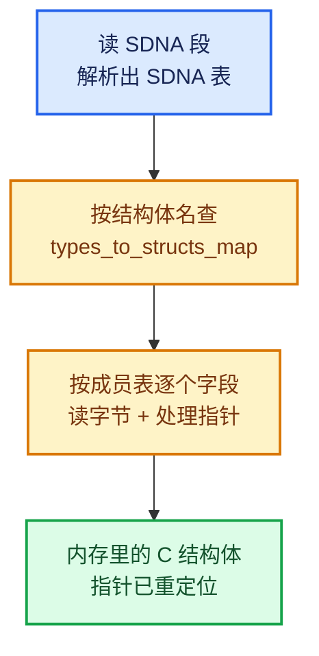

# 02 · SDNA 表与类型编码

[前置知识总入口](../README.md) · [本章导航](README.md) · [上一篇](01-DNA是什么与makesdna.md) · [下一篇](03-DNA结构体编写规则.md)

> 基准：Blender `5.4.0-alpha`，本地工作树。本篇讲 SDNA 表的结构——它是 `.blend` 文件的"自描述元数据"，让 Blender 能读懂自己写出的字节流。主要源码：[`DNA_sdna_types.h`](../../../source/blender/makesdna/DNA_sdna_types.h)（143 行）。

## 先回答一个具体问题

`.blend` 里存的是一堆字节。Blender 怎么知道自己写的是什么？为什么会知道"第 1024 字节开始是一个 `float3`"？

答案：**文件里带了一张自描述表**。读取时先读表，再按表解释字节。这张表就是 SDNA（Struct DNA）。

## SDNA 是什么

`[讲解]` 一个比喻：`.blend` 文件像一杯混合鸡尾酒，SDNA 是**配方卡**。没有配方卡，你只知道"这是 500 毫升液体"；有了它，你知道"第 100 毫升开始是伏特加，第 200 毫升开始是橙汁"。

`[讲解]` 三个关键事实：

1. **SDNA 嵌入在 `.blend` 文件里**（不是外部文件）。所以单个 `.blend` 可以自解释。
2. **它描述的是"类型系统"**——有哪些类型、每个类型有哪些成员、成员的偏移。
3. **它不是代码**——是一张数据表，读取期被解析。

## 三个核心结构

`DNA_sdna_types.h` 定义了三个结构。注意它们前面都有 `#` `#`（L28-L29、L39-L40、L52-L53）——这表示**它们自己不参与序列化**（见 01 篇的 "Ignoring structs" 语法）。

### SDNA_StructMember：一个成员

```cpp
struct SDNA_StructMember {
  /** This struct must not change, it's only a convenience view for raw data stored in SDNA. */

  /** An index into SDNA->types. */
  short type_index;
  /** An index into SDNA->members. */
  short member_index;
};
```

`[讲解]` 两个字段，都是索引不是值：

- `type_index`：这个成员的**类型**是 `SDNA->types` 里的第几项；
- `member_index`：这个成员的**名字**是 `SDNA->members` 里的第几项。

**为什么用索引？** 因为字符串重复度极高（比如 `int` 会出现几百次）。用索引把字符串池化，SDNA 表能小一个数量级。

**注释里的关键句**："This struct must not change, it's only a convenience view for raw data stored in SDNA."

`[讲解]` 意思是：真正的数据是按字节编码的（紧凑的二进制流），这个 C++ 结构只是**读取时的视图**。所以改它的字段会破坏二进制格式。

### SDNA_Struct：一个结构体

```cpp
struct SDNA_Struct {
  /** An index into SDNA->types. */
  short type_index;
  /** The amount of members in this struct. */
  short members_num;
  /** "Flexible array member" that contains information about all members of this struct. */
  SDNA_StructMember members[];
};
```

`[讲解]` 三个字段的语义：

| 字段 | 语义 |
| --- | --- |
| `type_index` | 这个结构体的类型名在 `types` 里的下标 |
| `members_num` | 有几个成员 |
| `members[]` | **柔性数组**（flexible array member），紧跟其后依次排列成员 |

`[讲解]` "柔性数组"是 C99 特性：结构体最后一个成员可声明为 `T arr[]`（长度未知），实际内存紧跟在结构体头部后面。好处是**一次分配**：头 + 成员数组在连续内存里。

**Repeat 的例子**：`NodeRepeatItem` 会被编码成：

```
SDNA_Struct:
  type_index     = <"NodeRepeatItem" 在 types 里的下标>
  members_num    = 3
  members[0] = { type_index: <"char *">,  member_index: <"name">     }
  members[1] = { type_index: <"eNodeSocketDatatype">, member_index: <"socket_type"> }
  members[2] = { type_index: <"int">,    member_index: <"identifier"> }
```

注意 `_pad[2]` **不会**被列为成员——它不是有语义的字段（见 03 篇）。

### SDNA：整张表

```cpp
struct SDNA {
  const char *data = nullptr;
  int data_size = 0;
  bool data_alloc = false;
  int pointer_size = 0;

  /* types */
  int types_num = 0;
  Array<StringRef> types;
  short *types_size = nullptr;
  Array<int> types_alignment;

  /* structs */
  Array<SDNA_Struct *, 0> structs;

  /* members */
  int members_num = 0;
  Vector<StringRef> members;
  Vector<short> members_array_num;

  Map<StringRef, int> types_to_structs_map;
  ...
};
```

`[讲解]` 六组字段，分组读：

#### 第一组：原始数据

| 字段 | 用途 |
| --- | --- |
| `data` / `data_size` | 编码后的原始字节（"encoded data"） |
| `data_alloc` | 这块内存是复制来的还是借来的 |
| `pointer_size` | **写出文件的机器**的指针大小 |

`[讲解]` `pointer_size` 是最重要的跨平台字段。32 位机器写出的文件，指针是 4 字节；64 位机器读时会用它做转换。这是 `.blend` 能跨 32/64 位的原因。

#### 第二组：类型表

| 字段 | 用途 |
| --- | --- |
| `types` | 所有类型名（`int`、`float`、`NodeRepeatItem` 等） |
| `types_size` | 每个类型的大小（字节） |
| `types_alignment` | 每个类型的对齐要求 |

`[讲解]` 注意 L66-L78 的注释，它揭示了一个反直觉的事实：

> "Basic types (int, float, etc.) have _no_ matching struct definitions currently."
> "Types can be discovered and added before their struct definition"

意思是：**类型表和结构体表不是同步的**。

- 基础类型（`int`、`float`）只有类型项，没有结构体定义；
- 一个类型可能因为"被先解析的某个结构体用到"而先出现在类型表里，它的结构体定义稍后才补上。

`[讲解]` 这解释了为什么 `types_to_structs_map` 是 `Map`（可能有的类型没有对应结构体）而不是数组。

#### 第三组：结构体表

```cpp
Array<SDNA_Struct *, 0> structs;
```

`[讲解]` 注意模板参数 `0`——这是 `Array` 的"至少 0 个元素的堆分配"形式。存的是**指针**而不是内联结构体，因为 `SDNA_Struct` 是变长的（柔性数组）。

#### 第四组：成员名字池

| 字段 | 用途 |
| --- | --- |
| `members` | 所有成员名的池子（去重） |
| `members_array_num` | 与 `members` 对齐：该成员若是数组，元素个数是多少 |

`[讲解]` `members_array_num` 的设计很细：结构体成员可能是数组（比如 `char _pad[2]`），但名字池里只存 `_pad`。元素个数单独存一个 `short`。

注释（L117-L122）说它"Aligned with #members"，即下标一一对应。

#### 第五组：名字到结构体的映射

```cpp
Map<StringRef, int> types_to_structs_map;
```

`[讲解]` 用途：给定类型名（`"NodeRepeatItem"`），查它的结构体定义在 `structs` 里的下标。

**为什么不直接线性搜 `structs`？** 因为读文件时这个查询是热路径——每读一个结构体都要查一次。用 Map 把 O(N) 变 O(1)。

#### 第六组：别名（版本重命名）

```cpp
struct {
  Array<StringRef> types;
  Vector<StringRef> members;
  Map<StringRef, int> types_to_structs_map;
} alias;
```

`[讲解]` 这个嵌套结构是干什么的？

注释（L132-L141）说：DNA 在历史上**改过名字**。改名的目的是让 C 代码更清晰，但老文件里存的是旧名。所以需要一张"旧名 → 新名"的映射。

`alias` 就是这张表的缓存（"lazy initialized, only different when renaming is done"）。读取老文件时，先把旧名换成新名，再查 `types_to_structs_map`。

**这是持久化系统的经典问题**：结构体名字是数据的一部分，改名等于破坏兼容。Blender 的解法是"保留别名表"而不是"禁止改名"。

## 编码格式

`[讲解]` `data` 字段里存的是**紧凑编码**，不是 C++ 结构体的内存镜像。编码顺序大致是：

```text
[头部] SDNA 魔数、版本、指针大小
[类型段] 类型名（长度 + 字符串）× N
[大小段] 每个类型的大小（short）× N
[结构体段] 每个结构体的类型索引 + 成员数 + 成员
[成员名段] 成员名字符串池
```

`[讲解]` 为什么不用"直接 dump 结构体"？

1. **指针大小不同**：32/64 位下 `SDNA` 结构体本身大小不同；
2. **字节序**：大端小端机器；
3. **编译器差异**：padding、对齐。

所以必须用**显式编码**（每个整数按固定宽度写），才能跨平台。这就是注释说的 "encoded data"。

## 读文件时的三步

`[讲解]` 从 `.blend` 到内存结构体，三步：



**第一步**：从文件里解出 SDNA 表本身（这是自举——先用硬编码的格式读 SDNA）。

**第二步**：需要读某个结构体时，用它的名字查 `types_to_structs_map`。

**第三步**：按成员表逐字段读。**关键**：遇到指针字段，不是读 8 字节就完事，而是要：

1. 读旧文件的指针值（是个"地址编号"）；
2. 在新内存里分配目标结构体；
3. 记录"旧地址 → 新地址"的映射；
4. 全部读完后，把映射表里的旧地址替换成新地址（**指针重定位**）。

`[讲解]` 第四步是最容易出错的：如果漏了某个指针字段的重定位，读出的结构体会指向垃圾地址。

## 跨版本兼容的机制

`[讲解]` 这是 SDNA 最大的价值。考虑两个版本：

**v1**：`NodeRepeatItem { char *name; eNodeSocketDatatype socket_type; int identifier; }`

**v2**（新增 `inspection_index`）：`NodeRepeatItem { char *name; eNodeSocketDatatype socket_type; int identifier; int inspection_index; }`

`[讲解]` 读 v1 文件用 v2 代码时：

1. SDNA 表来自**文件**（v1 的字段表）；
2. 读的时候按 v1 的字段表逐个读；
3. 新结构体在内存里先按 v2 的大小分配、清零；
4. 按名字匹配：`name` → 找到位置写，`identifier` → 找到位置写；
5. `inspection_index` 在文件里没有 → **保持默认值 0**。

`[讲解]` 注意第 5 步：新增字段自动获得默认值。这是 C++ 的默认成员初始化器：

```cpp
struct NodeGeometryRepeatOutput {
  NodeRepeatItem *items = nullptr;
  int items_num = 0;
  int active_index = 0;
  int next_identifier = 0;
  int inspection_index = 0;   // ← v1 文件里没有，读出来是 0
};
```

**这就是为什么 DNA 结构体的字段必须有默认初始化器**——否则新增字段会是垃圾值。

## 反向：字段被删除

`[讲解]` 如果 v2 删了一个字段（比如删了 `socket_type`），读 v1 文件时：

- 文件里有 `socket_type`，但内存结构体里没有；
- 按名字匹配找不到目标 → **跳过这个字段的字节**（丢弃）；
- 继续读下一个。

`[讲解]` 所以"删字段"是安全的（数据被丢弃），但**顺序不能乱**——因为 SDNA 是按名字匹配，理论上顺序无关，但实际上有约束：

> 如果两个字段类型相同、名字被改过，可能匹配错。

这就是为什么 Blender 的 DNA 规则里有一条："**不要改字段名，除非加别名**"（见 alias 那一节）。

## 指针大小的处理

`[讲解]` 32 位机器写、64 位机器读：

- 文件里指针是 4 字节；
- 内存里指针是 8 字节；
- SDNA 的 `pointer_size` 字段告诉读取器"源文件是 4"；
- 读取器按 4 字节读值，然后映射到 8 字节的新地址。

`[讲解]` 反向（64 位写、32 位读）会失败——因为 32 位地址空间可能不够。Blender 因此不支持在 32 位机器上读 64 位写的文件（现在 32 位支持已基本移除）。

## 用小数据走一遍

`[讲解]` 假设写一个极简文件，只有一个 `NodeRepeatItem`，`name = "Geometry"`、`socket_type = SOCK_GEOMETRY`、`identifier = 0`。

**SDNA 表**（简化）：

```text
types:   ["char *", "eNodeSocketDatatype", "int", "NodeRepeatItem"]
sizes:   [8,        4,                      4,     24]
structs: [{ NodeRepeatItem: [(0, "name"), (1, "socket_type"), (2, "identifier")] }]
members: ["name", "socket_type", "identifier"]
```

**数据段**：

```text
偏移 0:  [name 指针值 = 0x1000]     ← 旧地址
偏移 8:  [socket_type = 3]
偏移 12: [identifier = 0]
偏移 16-23: padding（对齐到 24）
```

**字符串区**（单独一块）：

```text
0x1000: "Geometry\0"
```

**读取过程**：

| 步 | 动作 |
| --- | --- |
| 1 | 解 SDNA，得到 4 个类型、1 个结构体 |
| 2 | 分配 24 字节内存（`sizeof(NodeRepeatItem)`） |
| 3 | 读 `name`：偏移 0，值 0x1000 → 记入待重定位列表 |
| 4 | 读 `socket_type`：偏移 8，值 3 |
| 5 | 读 `identifier`：偏移 12，值 0 |
| 6 | 读字符串区：0x1000 处是 "Geometry" → 分配新内存、拷贝 |
| 7 | 重定位：`struct.name = 新内存地址` |

`[讲解]` 第 6、7 步是"指针字段"的正确处理。如果跳过第 7 步，`name` 就是 0x1000——一个早已不存在的地址。

## 反例与边界

### 反例 1：以为 SDNA 是编译期嵌进可执行文件的

它**在文件里**（每次保存都写一份）。所以不同版本的 `.blend` 有不同的 SDNA。

### 反例 2：以为改结构体顺序会影响读旧文件

按名字匹配，顺序理论上无关。但**改名字**会断匹配——这是真正的禁忌。

### 反例 3：以为新增字段不用给默认值

必须有。否则旧文件读出来是垃圾。

### 反例 4：以为指针可以直接 memcpy

指针必须重定位。直接 memcpy 得到的是旧地址。

### 反例 5：忽略 `pointer_size`

跨 32/64 位时，不处理 `pointer_size` 会读错全部指针字段。

### 反例 6：以为 `alias` 是可选优化

对改过名的字段，`alias` 是**必需**的兼容层。没它就是读不出老文件。

## 对理解 Repeat 的帮助

`[讲解]` Repeat 的三个 DNA 结构都在这个体系里：

| 结构 | 关键字段 | SDNA 相关的坑 |
| --- | --- | --- |
| `NodeRepeatItem` | `char *name` | 指针，必须重定位 |
| `NodeRepeatItem` | `_pad[2]` | 不是语义字段，不进成员表 |
| `NodeGeometryRepeatInput` | `output_node_id`（int32） | 无指针，直接读 |
| `NodeGeometryRepeatOutput` | `items`（指针）+ `items_num` | **手动管理的动态数组**，SDNA 不能自动处理 |

`[讲解]` 最后一行是关键：`items` 是"指针 + 数量"，SDNA 只能读指针和数量两个字段，**不知道数组有多少元素**。所以 Repeat 必须提供 `node_blend_write`/`node_blend_read` 回调，手动处理数组（正篇 02-01 L299-L307）。

这就是"DNA 只处理定长部分，动态部分要靠回调"的一般规律。

## 继续阅读

- [03-DNA结构体编写规则](03-DNA结构体编写规则.md) —— 怎么写出合法的 DNA 结构
- [04-DNA_DEFINE_CXX_METHODS与浅拷贝](04-DNA_DEFINE_CXX_METHODS与浅拷贝.md)
- [05-blend读写与指针重定位](05-blend读写与指针重定位.md)
