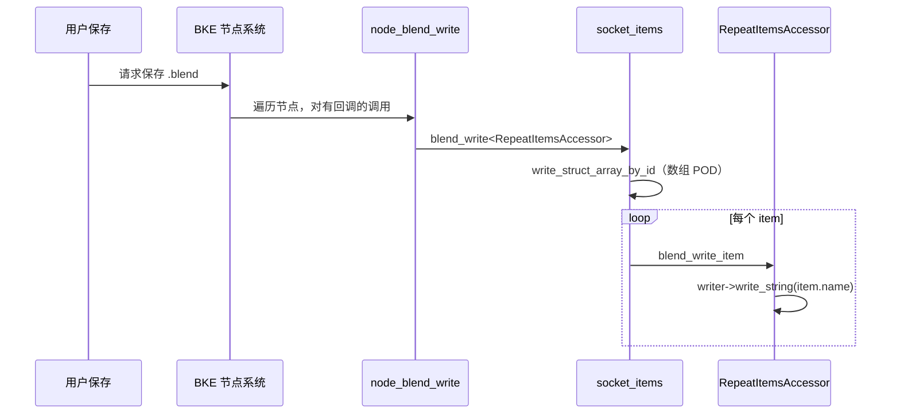
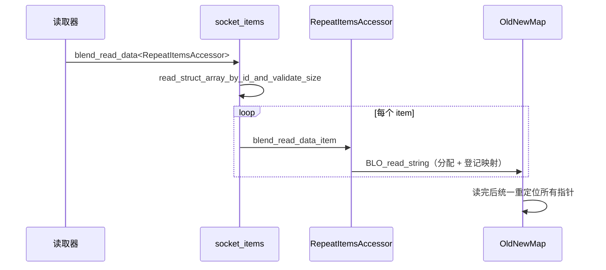

# 05 · blend 读写与指针重定位

[前置知识总入口](../README.md) · [本章导航](README.md) · [上一篇](04-DNA_DEFINE_CXX_METHODS与浅拷贝.md) · [下一章](../06-版本迁移与兼容/README.md)

> 基准：Blender `5.4.0-alpha`，本地工作树。本篇讲 `.blend` 文件的读写全流程，重点是指针重定位——把文件里的"地址编号"变成内存里的真实地址。主要源码：[`node.cc`](../../../source/blender/blenkernel/intern/node.cc)（`node_blend_write`/`node_blend_read` 的调用点）、[`NOD_socket_items_blend.hh`](../../../source/blender/nodes/NOD_socket_items_blend.hh)（38 行，Repeat 的读写骨架）、[`node_geo_repeat.cc`](../../../source/blender/nodes/geometry/nodes/node_geo_repeat.cc) L299-L307 与 L350-L358。

## 先回答一个具体问题

文件里存的指针是"地址编号"，读回来时那个地址根本不存在。Blender 怎么把它变成有效指针？

答案是**指针重定位**：读文件时维护一张"旧地址 → 新地址"的映射表，全部读完后统一替换。本篇讲这条链路的每一环。

## 写入：三步

`[讲解]` 保存一个节点的 storage 时：

```cpp
static void node_blend_write(const bNodeTree & /*tree*/, const bNode &node, BlendWriter &writer)
{
  socket_items::blend_write<RepeatItemsAccessor>(&writer, node);
}
```

`[讲解]` 这是 Repeat Output 的写钩子。表面只有一行，实际分三层：

### 第一层：BKE 层调用

节点系统在保存时遍历所有节点，对有 `blend_write_storage_content` 回调的类型调用它：

```cpp
/* node.cc 附近 */
if (ntype.blend_write_storage_content) {
  ntype.blend_write_storage_content(*tree, *node, writer);
}
```

`[讲解]` 这是个注册时挂上的函数指针。没挂的节点就只保存 DNA 定长部分（比如 Repeat Input 就属于此类）。

### 第二层：socket_items 骨架

```cpp
template<typename Accessor> void blend_write(BlendWriter *writer, const bNode &node)
{
  SocketItemsRef items = Accessor::get_items_from_node(const_cast<bNode &>(node));
  writer->write_struct_array_by_id(
      Accessor::sdna_struct_id, *items.items, *items.items_num);
  for (const int i : IndexRange(*items.items_num)) {
    Accessor::blend_write_item(writer, (*items.items)[i]);
  }
}
```

`[讲解]` 做两件事：

1. **写数组本体**：`write_struct_array_by_id` 把整个 items 数组按 SDNA 结构 ID 一次性写出；
2. **逐项回调**：`blend_write_item` 处理每项里"SDNA 管不了"的部分。

`[讲解]` 为什么分两步？因为 SDNA 只能写定长部分。`NodeRepeatItem` 的 `name` 是 `char *`——SDNA 会写一个"地址编号"，但**字符串内容不在结构体里**，必须单独写。

### 第三层：访问器钩子

```cpp
void RepeatItemsAccessor::blend_write_item(BlendWriter *writer, const ItemT &item)
{
  writer->write_string(item.name);
}
```

`[讲解]` 就一行：写字符串内容。

`[讲解]` 完整链路：

```text
保存节点
  → ntype.blend_write_storage_content（注册的回调）
    → node_blend_write（Repeat 的）
      → socket_items::blend_write<RepeatItemsAccessor>
        → write_struct_array_by_id（数组 POD 部分）
        → 逐项 blend_write_item（name 字符串）
```

**关键理解**：每一层只做自己那部分。SDNA 管定长、访问器管指针内容。

## 读取：三步 + 一个延迟阶段

`[讲解]` 读取比写入复杂，因为要处理指针。分四步：

```text
第 1 步：读 SDNA 表
第 2 步：分配结构体、读 POD 部分
第 3 步：记录待重定位的指针（不立即解决）
第 4 步：全部读完后，统一重定位
```

`[讲解]` 为什么第 3 步要延迟？因为指针可能指向**还没读到的对象**（前向引用）。所以只能先记录，等全部读完再统一处理。

### PredictableMemoryUsage 与 OldNewMap

`[讲解]` 延迟重定位靠两个设施：

| 设施 | 作用 |
| --- | --- |
| `OldNewMap` | 旧地址 → 新地址的映射表 |
| 待重定位列表 | 记录"哪个字段需要被替换" |

`[讲解]` 流程：

1. 每次分配一个新对象，把它在文件里的旧地址与新地址登记进 `OldNewMap`；
2. 指针字段先填入"旧地址"（作为占位）；
3. 全部读完后，遍历所有指针字段，查 `OldNewMap` 换成新地址；
4. 查不到（指向已删除对象）→ 置 `nullptr`。

**第 4 条很重要**：如果老文件里某个指针指向的对象在新版本里被删了，重定位会失败。此时**优雅降级为 nullptr** 而不是崩溃。这是跨版本兼容的关键。

### Repeat 的读钩子

```cpp
static void node_blend_read(bNodeTree & /*tree*/, bNode &node, BlendDataReader &reader)
{
  socket_items::blend_read_data<RepeatItemsAccessor>(&reader, node);
}
```

`[讲解]` 对应骨架：

```cpp
template<typename Accessor> void blend_read_data(BlendDataReader *reader, bNode &node)
{
  BLO_read_struct_array_by_id_and_validate_size(
      reader, Accessor::sdna_struct_id, &items.items, &items.items_num);
  for (const int i : IndexRange(*items.items_num)) {
    Accessor::blend_read_data_item(reader, (*items.items)[i]);
  }
}
```

`[讲解]` 注意函数名里的 `and_validate_size`：读数组时会校验大小。如果文件声称有 1 亿个元素但实际不够，会被拒绝（防恶意文件）。

### 访问器的读钩子

```cpp
void RepeatItemsAccessor::blend_read_data_item(BlendDataReader *reader, ItemT &item)
{
  BLO_read_string(reader, &item.name);
}
```

`[讲解]` `BLO_read_string` 做两件事：

1. 从文件里读出字符串长度与内容；
2. 在新内存里分配并拷贝；
3. 更新 `item.name` 指向新地址。

**这就是"重定位"在字符串上的体现**——文件里是旧地址，读出来是新地址。

## 为什么 Repeat Input 不需要钩子

`[讲解]` 对比两个结构：

| 结构 | 有 blend 回调？ | 原因 |
| --- | --- | --- |
| `NodeGeometryRepeatInput` | ❌ | 只有一个 `int32_t output_node_id`，纯 POD |
| `NodeGeometryRepeatOutput` | ✅ | 有 `items` 动态数组 |

`[讲解]` Input 的注册代码用的是标准存储：

```cpp
bke::node_type_storage(
    ntype, "NodeGeometryRepeatInput", node_free_standard_storage, node_copy_standard_storage);
```

而 Output 用的是自定义：

```cpp
bke::node_type_storage(
    ntype, "NodeGeometryRepeatOutput", node_free_storage, node_copy_storage);
```

`[讲解]` 命名规律：带 **`_standard_`** 的是纯 memcpy 版，不带的是自定义版。

**判据**：不含指针、不含动态数组 → 用 standard；否则自定义。

## output_node_id 的特殊性

`[讲解]` `NodeGeometryRepeatInput::output_node_id` 存的是 `bNode.identifier`——一个**整数**，不是指针。

```c
struct NodeGeometryRepeatInput {
  /** bNode.identifier of the corresponding output node. */
  int32_t output_node_id = 0;
};
```

`[讲解]` 为什么用 identifier 而不是指针？

**这正是跨版本兼容的核心技巧**。如果用指针：

- 文件里存地址编号；
- 读回来要重定位；
- 如果目标节点被删除 → 变成 nullptr → 配对丢失。

用 `identifier` 则是：

- 文件里存一个稳定整数；
- 读回来数值不变；
- 查询时用 `tree.node_by_id(id)` 间接找 → 找不到就返回 nullptr，优雅降级。

`[讲解]` 正篇 01-01 讲"配对机制"时强调过这一点：

> "`bNode.identifier`（一个 DNA 持久化的整数），经由 storage 中转，而不是名字、不是位置、不是指针。"

**这是一条通用设计原则**：跨对象引用优先用稳定 ID，不用指针。指针只在同一次运行内有效。

## 完整时序图

`[讲解]` 以 Repeat Output 为例，保存与加载的完整链路：



`[讲解]` 加载侧对称：



`[讲解]` 第二次的 `M` 是重点：所有 `BLO_read_*` 内部都会登记到映射表。

## 反例与边界

### 反例 1：以为 SDNA 能处理动态数组

它只读"指针 + 数量"两个字段，不知道数组有多少元素。必须有回调。

### 反例 2：在 DNA 结构里存裸指针指向外部对象

读回来时可能重定位失败（目标已删）。应该用 `identifier`。

### 反例 3：忘记在 `node_copy_storage` 里深拷贝

浅拷贝让两个节点共享数组（见 04 篇）。

### 反例 4：以为读文件是"按顺序逐个解"

实际是两阶段：先读完所有 POD 与指针占位，再统一重定位。

### 反例 5：在 `blend_read` 里立即使用指针

此时重定位可能还没完成。应该推迟到 `blend_read_lib` 或更晚的相位。

## 对理解 Repeat 的帮助

`[讲解]` 三处关键落点：

| 概念 | Repeat 中的体现 | 正篇位置 |
| --- | --- | --- |
| 写回调分层 | `node_blend_write` → `blend_write` → `blend_write_item` | 02-01 L299-L307 |
| 读回调分层 | `node_blend_read` → `blend_read_data` → `blend_read_data_item` | 02-01 L304-L306 |
| 稳定 ID 而非指针 | `output_node_id` 存 `bNode.identifier` | 01-01、02-02 |

`[讲解]` 最后一条最值得记住：**Repeat 的配对机制之所以跨版本可靠，是因为它用整数 ID 而不是指针**。这个设计的代价是每次查询要 `node_by_id()`（一次哈希查找），收益是文件永远读得开。

## 继续阅读

- [04-DNA_DEFINE_CXX_METHODS与浅拷贝](04-DNA_DEFINE_CXX_METHODS与浅拷贝.md) —— 另一条指针处理路径
- [下一章：06-版本迁移与兼容](../06-版本迁移与兼容/README.md) —— 老文件怎么升级
- [03-DNA结构体编写规则](03-DNA结构体编写规则.md)
