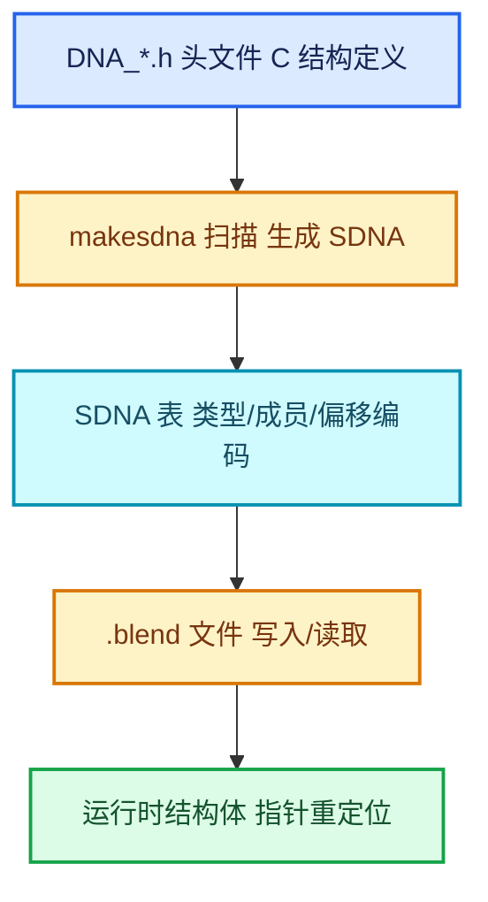

# 05-DNA与序列化

[前置知识总入口](../README.md) · [正篇：02-02 DNA存储与NodeRepeatItem](../../重复区域-dsh/02-Repeat区域数据模型/02-DNA存储与NodeRepeatItem.md)

本章回答：**DNA 到底是什么**。这是读者第二个撞上的知识族（正篇 01-01 第 78 行就出现"DNA 存储层"），而主系列从未定义过它。

## 一句话

DNA 是 Blender 的**可序列化 C 结构定义层**：所有要存进 `.blend` 文件的数据结构，都以特定格式写在 `source/blender/makesdna/DNA_*.h` 里，由 `makesdna` 程序扫描生成 SDNA 表（Struct DNA），供读写文件时按名/按布局解析。

## 阅读顺序

| # | 篇目 | 源码主线 | 实测行数 |
| --- | --- | --- | --- |
| 1 | [01-DNA是什么与makesdna](01-DNA是什么与makesdna.md) | `DNA_documentation.h` | 67 |
| 2 | [02-SDNA表与类型编码](02-SDNA表与类型编码.md) | `DNA_sdna_types.h` + `DNA_genfile.h` | 143 + 286 |
| 3 | [03-DNA结构体编写规则](03-DNA结构体编写规则.md) | `DNA_node_types.h` 实例 | 4047 |
| 4 | [04-DNA_DEFINE_CXX_METHODS与浅拷贝](04-DNA_DEFINE_CXX_METHODS与浅拷贝.md) | `DNA_defs.h` | — |
| 5 | [05-blend读写与指针重定位](05-blend读写与指针重定位.md) | `BLO_read_write.hh` + `node.cc` | — |

## 本章与 Repeat 的关系

正篇 02-02 全篇依赖本章。具体对应：

| DNA 概念 | 在 Repeat 中的落点 | 正篇位置 |
| --- | --- | --- |
| `NodeRepeatItem` 结构 | 动态 socket 的持久化描述 | 02-02 全文 |
| `_pad[2]` 手工填充 | 跨编译器布局一致 | 02-02 第 209-211 行讲解 |
| `DNA_DEFINE_CXX_METHODS` | 让 DNA 结构可构造/可析构 | 02-02 |
| `dna::shallow_copy` | `node_copy_storage` 的两段式 | 02-01 L232-L239 |
| blend 读写回调 | `node_blend_write`/`node_blend_read` | 02-01 L299-L307 |
| `next_identifier` 落盘 | 重开文件后链接不乱 | 02-02 第 351 行 |

最关键的一条：**`identifier` 是 DNA 字段，随 `.blend` 持久化**——这正是"改名、排序、增删 item 后连接不断"的根本保障。

## 源码规模

> **行数口径**：本表所有行数为**文件总行数**（含空行与注释），可用 `[System.IO.File]::ReadAllLines(path).Count` 复核。若用 `Get-Content | Measure-Object -Line` 会得到**非空行数**，两者不同，请勿混用。

| 文件 | 行数 |
| --- | --- |
| `DNA_node_types.h` | 4047（本章只取节点相关段） |
| `DNA_genfile.h` | 286 |
| `DNA_sdna_types.h` | 143 |
| `DNA_documentation.h` | 67 |
| `DNA_defs.h` / `DNA_array_utils.hh` | 中 |
| 合计（本章覆盖） | ≈ 1,500 行以上 |

