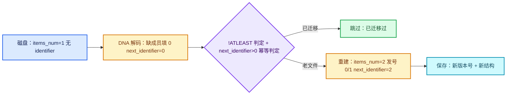

# 01 · versioning 机制

[前置知识总入口](../README.md) · [本章导航](README.md) · [下一篇](02-标识符回填与重发号.md)

> 基准：Blender `5.4.0-alpha`，本地工作树。本篇讲 `.blend` 文件的版本迁移机制——老文件读进来后，怎么把旧数据结构升级成新结构。主要源码：`source/blender/blenloader/intern/versioning_*.cc`（如 `versioning_400.cc`、`versioning_402.cc`、`versioning_500.cc`）。

## 先回答一个具体问题

**我改了一个 DNA 结构的语义（不只是加字段，而是要重建数据），老文件怎么办？**

答案分三截，缺一不可：

1. **在 `BKE_blender_version.h` 里把 `BLENDER_FILE_SUBVERSION` 加一**（实测当前是 [`BLENDER_FILE_SUBVERSION 3`](../../../source/blender/blenkernel/BKE_blender_version.h#L33)）。这个数字是"这次改动属于第几个文件格式版本"的编号，加完才能被迁移代码引用。
2. **在对应版本的 `versioning_XXX.cc` 里写 `if (!MAIN_VERSION_FILE_ATLEAST(bmain, 5XX, 新号)) { ... }`**。迁移代码永远写在这个"取反"分支里——含义是"这份文件还不够新，需要迁移"。
3. **迁移代码必须幂等**。这是最容易忽略的一条。[`readfile.cc` L6281-L6283](../../../source/blender/blenloader/intern/readfile.cc#L6281) 的原话是"split out already existing IDs to avoid them going through `do_versions` multiple times, which would have bad consequences"——**多次跑迁移会有很坏的后果**。

## 三层兼容策略

不要把所有结构变动都当成"要写 versioning"。大部分情况 DNA 层已经免费处理了。

| 情况 | DNA 层自动做什么 | 要写 versioning 吗 | 真实例子 |
| --- | --- | --- | --- |
| 纯追加字段 | 按成员名匹配，老文件缺的成员**填 0**（[`dna_genfile.cc` L1547-L1554](../../../source/blender/makesdna/intern/dna_genfile.cc#L1547) 用 `MEM_new_array_zeroed` 分配新块） | **只在 0 不是正确默认值时才要** | 油性铅笔层 `scale` 必须补 1.0（操作一）；而 `NodeGeometryViewer::data_type_legacy` 缺省 0 恰好是 `CD_PROP_FLOAT`，不用管 |
| 字段改名（不改布局） | 靠 [`dna_rename_defs.h`](../../../source/blender/makesdna/intern/dna_rename_defs.h) 别名表在 SDNA 层改名 | **不用写迁移**，只加一行宏 | `DNA_STRUCT_RENAME_MEMBER(NodeGeometryViewer, data_type, data_type_legacy)`（[L186](../../../source/blender/makesdna/intern/dna_rename_defs.h#L186)） |
| 字段语义变更 | **照原样读进来**，值是对的，含义变了 | **必须写**，把旧值重新映射一遍 | 运动模糊位置枚举搬到 `RenderData`，旧值按顺序表换算（[`versioning_402.cc` L771-L789](../../../source/blender/blenloader/intern/versioning_402.cc#L771)） |
| 结构重建（字段变数组、socket 变多个） | 老数据能读进来，但**形状不对** | **必须写，且必须重新发号** | Capture Attribute 单属性 → items 数组；Viewer 单 socket → items 数组 |

一句话：**DNA 层负责"字段在不在"，versioning 负责"字段对不对"和"形状够不够"**。布局归 `makesdna` + `dna_rename_defs.h`，数据语义与形状归 `versioning_*.cc`。

## 源码清单（实测）

`source/blender/blenloader/intern/` 下共 **23 个** `versioning_*.cc`，合计 **44,677 行**，其中 `MAIN_VERSION_FILE_ATLEAST` 出现 **887 次**。下表"总行"与本篇多处引用的"非空行"都给：

| 文件 | 总行 | 非空行 | 门数 | 文件 | 总行 | 非空行 | 门数 |
| --- | --- | --- | --- | --- | --- | --- | --- |
| `versioning_250.cc` | 2143 | 1871 | 30 | `versioning_402.cc` | 1385 | **1237** | 51 |
| `versioning_260.cc` | 3066 | 2777 | 61 | `versioning_403.cc` | 521 | 460 | 23 |
| `versioning_270.cc` | 1672 | 1499 | 40 | `versioning_404.cc` | 1007 | 900 | 28 |
| `versioning_280.cc` | 6324 | 5638 | 118 | `versioning_405.cc` | 5899 | 5246 | 127 |
| `versioning_290.cc` | 1947 | 1758 | 46 | `versioning_500.cc` | 4523 | **4021** | 93 |
| `versioning_300.cc` | 4287 | 3887 | 97 | `versioning_501.cc` | 937 | 850 | 26 |
| `versioning_400.cc` | 1784 | 1583 | 31 | `versioning_502.cc` | 906 | 815 | 42 |
| `versioning_401.cc` | 1179 | 1037 | 21 | `versioning_503.cc` | 717 | 647 | 28 |
| `versioning_common.cc` | 921 | 803 | 2 | `versioning_504.cc` | 109 | 94 | 5 |
| `versioning_defaults.cc` | 934 | 832 | 0 | `versioning_dna.cc` | 67 | 58 | 0 |
| `versioning_legacy.cc` | 2420 | 2102 | 14 | `versioning_userdef.cc` | 1868 | 1615 | 2 |
| `versioning_xxx_template.cc` | 61 | 47 | 2 | | | | |

四个要点：

- **文件名数字是 `short` 形式的文件版本**（`402` 即 4.2）。新建流程写在 [`versioning_xxx_template.cc` L14-L20](../../../source/blender/blenloader/intern/versioning_xxx_template.cc#L14)：复制模板 → 改函数名 → 加 CMakeLists → 在 `readfile.cc`/`readfile.hh` 加调用与声明。这批文件曾叫 `versioning_420.cc`，后统一改名（commit `0c2ca963600`）。
- **`versioning_defaults.cc` 门数为 0**：它只处理 `startup.blend`（[L8-L12](../../../source/blender/blenloader/intern/versioning_defaults.cc#L8) 明说"Unlike regular versioning this makes changes that ensure the startup file has brushes and other presets"），不按文件版本判定。`versioning_userdef.cc` 同理，管偏好设置。
- **`versioning_dna.cc` 不在数据迁移链路里**：它只在 DNA 解析阶段跑（[`readfile.cc` L933](../../../source/blender/blenloader/intern/readfile.cc#L933)），干的是"改 SDNA 里的结构名，让老文件读起来像新名字"，属于布局层。
- **`versioning_xxx_template.cc` 不加入 CMakeLists**（模板文件自己写的）。

## versioning 的触发时机

### 没有 `BLO_main_versions`

先否掉一个常见猜测：仓库里 **grep `BLO_main_versions` 无匹配**。真正的分派是三个函数，都在 [`readfile.cc`](../../../source/blender/blenloader/intern/readfile.cc) 与 [`versioning_common.cc`](../../../source/blender/blenloader/intern/versioning_common.cc)：

| 阶段 | 函数 | 位置 | 何时跑 |
| --- | --- | --- | --- |
| 第一段 | `do_versions(FileData*, Library*, Main*)` | [L3876](../../../source/blender/blenloader/intern/readfile.cc#L3876) | ID 读完、**读入库文件之前**（[L4609](../../../source/blender/blenloader/intern/readfile.cc#L4609)"Do versioning before `read_libraries`"） |
| 第二段 | `do_versions_after_linking(FileData*, Main*)` | [L3985](../../../source/blender/blenloader/intern/readfile.cc#L3985) | `lib_link_all` 之后，每个 split Main 各跑一次（[L4701](../../../source/blender/blenloader/intern/readfile.cc#L4701)） |
| 第三段 | `do_versions_after_setup(Main*, ...)` | [`versioning_common.cc` L806](../../../source/blender/blenloader/intern/versioning_common.cc#L806) | 链接/追加收尾，经 `BLO_read_do_version_after_setup`（[`readblenentry.cc` L487](../../../source/blender/blenloader/intern/readblenentry.cc#L487)） |

第一段是主力，结构是"前置迁移 + 18 个守卫调用 + 解锁"（实测 `blo_do_versions_XXX(` 在 L3876-L3990 内出现 18 次：`pre250` 与 `250`~`504`）：

```cpp
static void do_versions(FileData *fd, Library *lib, Main *main)
{
  main->is_locked_for_linking = true;                  /* 禁止迁移期间新建数据块 */

  /* 与 IDProperties 存储格式强相关的迁移，必须先跑。 */
  if (!MAIN_VERSION_FILE_ATLEAST(main, 500, 27))  { version_system_idprops_generate(main); }
  if (!MAIN_VERSION_FILE_ATLEAST(main, 500, 70))  { version_system_idprops_nodes_generate(main); }
  if (!MAIN_VERSION_FILE_ATLEAST(main, 500, 110)) { version_system_idprops_children_bones_generate(main); }

  if (!main->is_read_invalid) { blo_do_versions_pre250(fd, lib, main); }
  if (!main->is_read_invalid) { blo_do_versions_250(fd, lib, main); }
  /* ... 260 / 270 / 280 / 290 / 300 / 400 / 401 / 402 / 403 / 404 / 405 / 500 / 501 / 502 / 503 ... */
  if (!main->is_read_invalid) { blo_do_versions_504(fd, lib, main); }

  main->is_locked_for_linking = false;
}
```

上面的骨架是节选（每处 `blo_do_versions_XXX` 之间还有 `is_read_invalid` 守卫，中间那些版本调用被省略成一行注释）。三个信息藏在里面：

1. **`is_locked_for_linking = true`**（[L3881](../../../source/blender/blenloader/intern/readfile.cc#L3881)）：迁移期间**禁止新建数据块**。此刻库还没链接、ID 名还没唯一化，凭空造的 ID 会成孤儿。要造节点只能走 `version_node_add_empty`（[`versioning_common.hh` L97-L115](../../../source/blender/blenloader/versioning_common.hh#L97)，它明确说 "The created node does not have storage or sockets"）。
2. **每个 `blo_do_versions_XXX` 都套 `is_read_invalid` 守卫**：一旦某阶段判定文件损坏，后续全部跳过，不在半坏内存上继续写。
3. **结尾注释 "don't forget to set version number in BKE_blender_version.h!"**（[L3980](../../../source/blender/blenloader/intern/readfile.cc#L3980)）：同一句在每个 `versioning_XXX.cc` 函数底部也有一份（如 [`versioning_504.cc` L101-L106](../../../source/blender/blenloader/intern/versioning_504.cc#L101)）。

### 版本号从哪来

两处冗余存放，都要读：

| 来源 | 位置 | 内容 |
| --- | --- | --- |
| 文件头 | `fd->fileversion = header.file_version`（[L897](../../../source/blender/blenloader/intern/readfile.cc#L897)） | 主版本如 `504`；写出格式见 [`writefile.cc` L1671-L1704](../../../source/blender/blenloader/intern/writefile.cc#L1671) |
| `FileGlobal` 块 | `subvstr[4]`（**结构体第一个成员**）+ `subversion` short（[`DNA_fileglobal_types.h` L19-L24](../../../source/blender/makesdna/DNA_fileglobal_types.h#L19)） | 四位 ASCII subversion；≤2.42 的老文件没有此字段，按 0 处理 |

`subvstr` 摆第一位是为了 DNA 未解码时也能直接读——[`readfile.cc` L918](../../../source/blender/blenloader/intern/readfile.cc#L918) 用 `BLI_STATIC_ASSERT(offsetof(FileGlobal, subvstr) == 0, "Must be first: subvstr")` 钉死这个契约。三个数最终落到 `Main`（[`BKE_main.hh` L269-L273](../../../source/blender/blenkernel/BKE_main.hh#L269)）的 `versionfile` / `subversionfile` / `minversionfile` / `minsubversionfile`，填充点是 [`read_file_version_and_colorspace` L504-L541](../../../source/blender/blenloader/intern/readfile.cc#L504)。`MAIN_VERSION_FILE_ATLEAST` 只读前两个。

`minversion` 是另一套语义：记录"**这份文件至少要用哪个版本的 Blender 才能打开**"，反过来拒绝未来的文件（[L1213-L1215](../../../source/blender/blenloader/intern/readfile.cc#L1213) 报 "The file was saved by a newer version"）。所以 versioning 只有"往新迁移"一个方向，**没有降级**。

## 版本判断宏

定义只有几行，在 [`BKE_main.hh` L949-L959](../../../source/blender/blenkernel/BKE_main.hh#L949)：

```cpp
#define MAIN_VERSION_FILE_ATLEAST(main, ver, subver) \
  ((main)->versionfile > (ver) || \
   ((main)->versionfile == (ver) && (main)->subversionfile >= (subver)))

#define MAIN_VERSION_FILE_OLDER(main, ver, subver) \
  ((main)->versionfile < (ver) || \
   ((main)->versionfile == (ver) && (main)->subversionfile < (subver)))
```

**语义**：`ATLEAST(main, 402, 50)` = "这份文件是用 4.2.50 或更新的版本写的"。注意是**字典序**比较：主版本严格大于就算，相等才比 subversion。所以 `500.0` 比 `405.127` 新，尽管第二项差很多。因为迁移是对**旧**数据做的，用法总是取反。

三个真实用法（跨文件、跨年代）：

1. **[`versioning_402.cc` L1243](../../../source/blender/blenloader/intern/versioning_402.cc#L1243)** —— Capture Attribute 的 identifier 回填，`!ATLEAST(bmain, 402, 50)`。同一个 `402, 50` 在该文件出现**两次**（[L521](../../../source/blender/blenloader/intern/versioning_402.cc#L521) 是 EEVEE 阴影设置，L1243 是本篇主角）。同一个 subversion 守两段无关迁移很正常——它只表示"这两处改动在同一次格式版本里落地"。
2. **[`versioning_500.cc` L4191](../../../source/blender/blenloader/intern/versioning_500.cc#L4191)** —— Viewer 节点 item 重建，`!ATLEAST(bmain, 500, 86)`。
3. **[`versioning_500.cc` L4445](../../../source/blender/blenloader/intern/versioning_500.cc#L4445)** —— 清 `no_muting` 节点的静音标志，门槛却是 **`501, 4`**。**门限值跟代码写在哪个文件里无关**，只跟"这次改动的格式版本号"有关；把它放进 `versioning_500.cc` 是因为紧邻相关的迁移，逻辑成组。

另外两种形态要认得：**区间**（[`versioning_290.cc` L820](../../../source/blender/blenloader/intern/versioning_290.cc#L820) `ATLEAST(290,2) && OLDER(291,1)`，只修该区间产生的坏数据）；**双条件补丁**（[`versioning_300.cc` L3054-L3056](../../../source/blender/blenloader/intern/versioning_300.cc#L3054) `!ATLEAST(300,42) || (versionfile==301 && !ATLEAST(301,3))`，一次改动在两条发布线上落地）。

还有给库用的 `LIBRARY_VERSION_FILE_ATLEAST`（[L966-L968](../../../source/blender/blenkernel/BKE_main.hh#L966)），语义多一条"版本为 0 时恒假"——缺失的库只剩占位 ID，不需要迁移。`blendfile_or_libraries_versions_atleast`（[`versioning_common.cc` L789-L804](../../../source/blender/blenloader/intern/versioning_common.cc#L789)）把本文件与所有库一起判：**库老于门槛就算整份文件老**。

## versioning 的四种典型操作

这四种覆盖了 `versioning_*.cc` 里绝大部分代码。每种给一段真实源码，原文折叠在折叠块里。

### 操作一：补默认值

**什么时候**：新增字段或新增 socket，语义默认值不是 0。最典型是"比例类"——0 会把东西压成虚无（[`versioning_402.cc` L761-L769](../../../source/blender/blenloader/intern/versioning_402.cc#L761)）：

```cpp
if (!MAIN_VERSION_FILE_ATLEAST(bmain, 402, 1)) {
  /* Initialize newly added scale layer transform to one. */
  for (GreasePencil &grease_pencil : bmain->grease_pencils) {
    for (Layer *layer : grease_pencil.layers_for_write()) {
      copy_v3_fl(layer->scale, 1.0f);
    }
  }
}
```

DNA reconstruct 已填 0，但 0 会让所有旧图层缩放到零——必须补 1.0。同模式在 [`versioning_405.cc` L4689-L4692](../../../source/blender/blenloader/intern/versioning_405.cc#L4689) 再现（新 "Scale" socket 默认 1.0，注释 "Use a default scale value of 1."）。**要点**：不改形状、只改一个数，所以天然幂等——重复执行只是把 1.0 再写成 1.0。

<details><summary>核对原始源码：versioning_402.cc · L761-L769</summary>

```cpp
  if (!MAIN_VERSION_FILE_ATLEAST(bmain, 402, 1)) {
    using namespace blender::bke::greasepencil;
    /* Initialize newly added scale layer transform to one. */
    for (GreasePencil &grease_pencil : bmain->grease_pencils) {
      for (Layer *layer : grease_pencil.layers_for_write()) {
        copy_v3_fl(layer->scale, 1.0f);
      }
    }
  }
```

</details>

### 操作二：重建数据

**什么时候**：一个字段变成数组（1 → N），旧内存布局装不下新语义。Viewer 节点是标准案例——旧结构只有一个 `data_type_legacy` 决定"看什么类型"，新结构是 `items` 数组。下面折叠的是 `version_dynamic_viewer_node_items` 全文（注意它是 `static` 辅助函数，由 [L4191](../../../source/blender/blenloader/intern/versioning_500.cc#L4191) 的 `!ATLEAST(bmain, 500, 86)` 门限调用）：

<details><summary>核对原始源码：versioning_500.cc · L2399-L2428</summary>

```cpp
static void version_dynamic_viewer_node_items(bNodeTree &ntree)
{
  for (bNode &node : ntree.nodes) {
    if (node.type_legacy != GEO_NODE_VIEWER) {
      continue;
    }
    if (!version_node_ensure_storage_or_invalidate(node)) {
      return;
    }
    NodeGeometryViewer *storage = static_cast<NodeGeometryViewer *>(node.storage);
    const int input_sockets_num = node.inputs.count();
    if (input_sockets_num == storage->items_num + 1) {
      /* Make versioning idempotent. */
      continue;
    }
    storage->items_num = 2;
    storage->items = MEM_new_array<NodeGeometryViewerItem>(2, __func__);
    NodeGeometryViewerItem &geometry_item = storage->items[0];
    geometry_item.name = BLI_strdup("Geometry");
    geometry_item.socket_type = SOCK_GEOMETRY;
    geometry_item.identifier = 0;
    NodeGeometryViewerItem &value_item = storage->items[1];
    value_item.name = BLI_strdup("Value");
    value_item.socket_type = bke::custom_data_type_to_socket_type(
                                 eCustomDataType(storage->data_type_legacy))
                                 .value_or(SOCK_FLOAT);
    value_item.identifier = 1;
    storage->next_identifier = 2;
  }
}
```

</details>

三个设计点：

- **旧的 `data_type_legacy` 被"消化"进新结构**：`value_item.socket_type = bke::custom_data_type_to_socket_type(eCustomDataType(storage->data_type_legacy))`。老数据不是丢掉，而是变成新结构的第一个元素——这是重建类迁移的常见形状。
- **幂等锚点是"socket 数与 items 数的一致性"**，不是 `next_identifier > 0`。因为 `items_num` 重建后本来就是 2，用"非零"判新旧失效；而 socket 是延迟重建的：迁移跑时声明还是旧的（1 项 + extend），重建后刷新声明变成 3 项（2 item + extend），于是 `input_sockets_num == items_num + 1` 正好等于"已刷新 = 已迁移"。
- **`storage->next_identifier = 2`** 是手写重建最容易漏的一行：发号器状态必须等于"已发最大号 + 1"，否则下一个新 item 拿到已存在的 `Item_1`，`refresh_node_socket` 按 identifier 匹配就会把新 item 套到旧 socket 上，连线错接。

同一文件 [L1618-L1666](../../../source/blender/blenloader/intern/versioning_500.cc#L1618) 还有个更大的例子（合成器 File Output 节点）：把老 socket 的 storage 逐个搬进 `items` 数组再置空 `input.storage`。它是**逐 socket 搬运**而非硬编码数量，天然跟节点实际 socket 数对齐。

### 操作三：重新发号

**什么时候**：结构重建后要给新元素分配 `identifier`，且必须保证"号不复用、计数器一致"。Capture Attribute 是范本（与本篇主题 Repeat 同源），下面折叠原文：

<details><summary>核对原始源码：versioning_402.cc · L1243-L1268</summary>

```cpp
  if (!MAIN_VERSION_FILE_ATLEAST(bmain, 402, 50)) {
    for (bNodeTree &ntree : bmain->nodetrees) {
      if (ntree.type != NTREE_GEOMETRY) {
        continue;
      }
      for (bNode &node : ntree.nodes) {
        if (node.type_legacy != GEO_NODE_CAPTURE_ATTRIBUTE) {
          continue;
        }
        if (!version_node_ensure_storage_or_invalidate(node)) {
          continue;
        }
        NodeGeometryAttributeCapture *storage = static_cast<NodeGeometryAttributeCapture *>(
            node.storage);
        if (storage->next_identifier > 0) {
          continue;
        }
        storage->capture_items_num = 1;
        storage->capture_items = MEM_new_array<NodeGeometryAttributeCaptureItem>(
            storage->capture_items_num, __func__);
        NodeGeometryAttributeCaptureItem &item = storage->capture_items[0];
        item.data_type = storage->data_type_legacy;
        item.identifier = storage->next_identifier++;
        item.name = BLI_strdup("Value");
      }
    }
  }
```

</details>

为什么这里的幂等判据和 Viewer 不同？因为 `next_identifier` 在**这个**结构里可用：老文件里该字段压根不存在（DNA reconstruct 填 0），任何迁移过的文件必然 > 0。判据的选择永远取决于"哪个字段只在迁移前取某个值"——这是写迁移时第一个要问的问题。`item.identifier = storage->next_identifier++` 是**后置自增**：先把当前值赋给 item（首个是 0），再推进计数器，所以 `Item_0` 是默认项，与节点新建时的规则一致（[`node_geo_repeat.cc` L213-L220](../../../source/blender/nodes/geometry/nodes/node_geo_repeat.cc#L213) 的 `node_init`）。

### 操作四：清除无效标记

**什么时候**：某状态在旧数据里合法、在新代码里非法，且**不需要**重建成别的东西，只需清零。[`versioning_500.cc` L4445-L4473](../../../source/blender/blenloader/intern/versioning_500.cc#L4445) 把 19 种节点列入"不许静音"名单，再清掉老文件里残留的 `NODE_MUTED`：

```cpp
if (!MAIN_VERSION_FILE_ATLEAST(bmain, 501, 4)) {
  /* Clear mute flag on node types that set ntype->no_muting = true. */
  static const Set<std::string> no_muting_nodes = {
      "CompositorNodeViewer", "NodeClosureInput", "NodeClosureOutput",
      "GeometryNodeForeachGeometryElementInput", "GeometryNodeForeachGeometryElementOutput",
      "GeometryNodeRepeatInput", "GeometryNodeRepeatOutput",   /* ← Repeat 在名单里 */
      "GeometryNodeSimulationInput", "GeometryNodeSimulationOutput", "GeometryNodeViewer",
      "NodeGroupInput", "NodeGroupOutput",
      "ShaderNodeOutputAOV", "ShaderNodeOutputLight", "ShaderNodeOutputLineStyle",
      "ShaderNodeOutputMaterial", "ShaderNodeOutputWorld",
      "TextureNodeOutput", "TextureNodeViewer",
  };
  for (bNodeTree &ntree : bmain->nodetrees) {
    for (bNode &node : ntree.nodes) {
      if (no_muting_nodes.contains(node.idname)) { node.flag &= ~NODE_MUTED; }
    }
  }
}
```

三个值得注意的点：

- **按 `idname` 字符串匹配，不按 `type_legacy` 枚举**。这批节点在 5.0 期间正从"legacy 枚举 + 结构体"往"通用节点"过渡，枚举值不一定全在；`idname` 是 DNA 持久化的字符串，最稳。
- **名单写死在迁移文件里，不去问 `typeinfo->no_muting`**：迁移跑时节点类型未必注册齐全（有些是老文件里的废弃类型）。
- **只清标志，不改数据**——最轻也最安全：`&= ~X` 重复执行结果一样，天然幂等，不需要任何检查。

名单来历：commit `a6aca608bd4`（2025-10-22，"Disable node muting through the API if node type disallows muting"）把它加到 `500, 113`，后被并进 `501, 4`——所以 `versioning_500.cc` 里留着一行"5.1 的门槛"。

<details><summary>核对原始源码：versioning_500.cc · L4445-L4473</summary>

```cpp
  if (!MAIN_VERSION_FILE_ATLEAST(bmain, 501, 4)) {
    /* Clear mute flag on node types that set ntype->no_muting = true. */
    static const Set<std::string> no_muting_nodes = {"CompositorNodeViewer",
                                                     "NodeClosureInput",
                                                     "NodeClosureOutput",
                                                     "GeometryNodeForeachGeometryElementInput",
                                                     "GeometryNodeForeachGeometryElementOutput",
                                                     "GeometryNodeRepeatInput",
                                                     "GeometryNodeRepeatOutput",
                                                     "GeometryNodeSimulationInput",
                                                     "GeometryNodeSimulationOutput",
                                                     "GeometryNodeViewer",
                                                     "NodeGroupInput",
                                                     "NodeGroupOutput",
                                                     "ShaderNodeOutputAOV",
                                                     "ShaderNodeOutputLight",
                                                     "ShaderNodeOutputLineStyle",
                                                     "ShaderNodeOutputMaterial",
                                                     "ShaderNodeOutputWorld",
                                                     "TextureNodeOutput",
                                                     "TextureNodeViewer"};
    for (bNodeTree &ntree : bmain->nodetrees) {
      for (bNode &node : ntree.nodes) {
        if (no_muting_nodes.contains(node.idname)) {
          node.flag &= ~NODE_MUTED;
        }
      }
    }
  }
```

</details>

顺带记下这一对的另一端：注册层写 `ntype.no_muting = true`（[`node_geo_repeat.cc` L161](../../../source/blender/nodes/geometry/nodes/node_geo_repeat.cc#L161)、[L331](../../../source/blender/nodes/geometry/nodes/node_geo_repeat.cc#L331)），编辑器按 M 时检查（[`node_edit.cc` L1644-L1645](../../../source/blender/editors/space_node/node_edit.cc#L1644)），RNA 层也拦一道（[`rna_nodetree.cc` L2809-L2810](../../../source/blender/makesrna/intern/rna_nodetree.cc#L2809)）。**注册层负责"新数据不再产生静音"，versioning 负责"老数据里的残留清掉"**，缺一个就有漏洞。

## 幂等性为什么重要

`if (!MAIN_VERSION_FILE_ATLEAST(...))` 看似已保证"只跑一次"——文件一旦被存成新版本，下次打开就不进这个分支。那为什么还要写幂等检查？因为门限保证的是"**这份文件这一次阅读**最多进一次"，不是"这份数据一生只跑一次"。实测四种多次执行场景：

1. **同一份数据被拆成新 Main 再迁移一遍**：[`readfile.cc` L6278-L6296](../../../source/blender/blenloader/intern/readfile.cc#L6278) 对 `main_newid` 再调一次 `do_versions`，注释直说 "avoid them going through `do_versions` multiple times, which would have bad consequences"。
2. **迁移因 bug 在更晚 subversion 重跑**：[`versioning_common.cc` L864-L869](../../../source/blender/blenloader/intern/versioning_common.cc#L864) 说自动平滑迁移本从 `401, 2` 开始，但一个 bug 让 legacy 标志没被清掉，于是在 `402, 22` 重跑，"when the bug is fixed and the versioning has been made idempotent"——**先改成幂等，才敢重跑**。
3. **同一语义迁移分几批补齐**：`500, 27` / `500, 70` / `500, 110` 都叫"生成 system IDProperties"，第三段注释是 "children bones were missed by initial versioning code"，补漏必然撞上已处理过的数据。
4. **库被多个父文件反复读入**：库文件的版本号一直停在旧值，每次加载都重跑同一批门限。

于是"幂等"在仓库里有五种具体写法，可当模板：

| 范式 | 判据 | 源码 |
| --- | --- | --- |
| "计数器非零"即已迁移 | `storage->next_identifier > 0` | [`versioning_402.cc` L1257](../../../source/blender/blenloader/intern/versioning_402.cc#L1257) |
| "待迁移字段已为空" | `if (!old_props) return;` | [`versioning_502.cc` L70-L74](../../../source/blender/blenloader/intern/versioning_502.cc#L70)（注释即 "this check makes the function idempotent"） |
| "socket 数与 items 数一致" | `input_sockets_num == storage->items_num + 1` | [`versioning_500.cc` L2410-L2413](../../../source/blender/blenloader/intern/versioning_500.cc#L2410) |
| "目标 socket 已存在" | `if (node_find_socket(node, SOCK_IN, "Scale")) continue;` | [`versioning_405.cc` L4685-L4688](../../../source/blender/blenloader/intern/versioning_405.cc#L4685) |
| "目标节点已存在" | `if (STREQ(link.fromnode->idname, "FunctionNodeEulerToRotation")) continue;` | [`versioning_401.cc` L700-L703](../../../source/blender/blenloader/intern/versioning_401.cc#L700) |

**不幂等会怎样？** 以 Viewer 那段为例，若删掉 `input_sockets_num == items_num + 1`：第二次跑又执行 `MEM_new_array<NodeGeometryViewerItem>(2, ...)`，**旧数组的 `char*` 无主泄漏**（`MEM_delete` 不跟），新数组 identifier 又是 0 和 1——若这中间用户加过 item（`Item_2`）会被静默丢掉；若用户改过顺序会被恢复成硬编码顺序。最坏情况是"改名被悄悄回滚 + 一个用户 item 消失"。

再看 Capture Attribute 若删掉 `next_identifier > 0`：第二次跑把 `capture_items_num` 覆盖成 1，用户加的第二个属性消失；`capture_items` 指针被重新赋值 → 旧数组泄漏；`next_identifier` 从 1 变 2 —**号是连续的，但对应的 item 已不是原来那个**，任何按 `Item_1` 存的连线都指向错误属性。

## Repeat 相关的三处 versioning

Repeat 在 `blenloader` 里只以三个面貌出现（实测 grep：`versioning_500.cc` 的 `"GeometryNodeRepeatInput"` / `"GeometryNodeRepeatOutput"` 两个字符串，以及**没有**任何 `NodeRepeatItem` 相关代码）。逐个讲。

### 第一处：versioning_402.cc L1243-L1268（Capture Attribute，同源范式）

这不是 Repeat 的迁移，而是**同一个 `socket_items` 家族的兄弟节点**的迁移。之所以要读，是它把"老结构单个字段 → 新结构 items 数组 + 发号"写得最干净：

- `NodeGeometryAttributeCapture` 的 DNA 有 `data_type_legacy`（老的单类型字段，靠 `dna_rename_defs.h` 改名而来）、`next_identifier`、`capture_items`、`capture_items_num`（[`DNA_node_types.h` L3399-L3411](../../../source/blender/makesdna/DNA_node_types.h#L3399)）。
- 迁移做的事：把 `data_type_legacy` 搬进 `items[0].data_type`，然后 `items[0].identifier = next_identifier++`、`name = "Value"`。
- 幂等锚点选 `next_identifier > 0`，因为它是**唯一**"迁移前必为 0、迁移后必为正"的字段。

它与 Repeat 结构同源：`NodeRepeatItem` 也有 `identifier`，`NodeGeometryRepeatOutput` 也有 `next_identifier`，`RepeatItemsAccessor::init_with_socket_type_and_name` 也是 `item.identifier = storage->next_identifier++`（[`NOD_geo_repeat.hh` L72-L81](../../../source/blender/nodes/geometry/include/NOD_geo_repeat.hh#L72)）。**同一套"发号器在 storage 里、号随 item 走"的设计，配同一套迁移范式。**

### 第二处：versioning_500.cc L2399-L2428（Viewer item 重建）

见"操作二"。对 Repeat 的启示是**"手写重建时，最后一行必须是 `next_identifier = 已发最大号 + 1`"**。这里硬编码两个 item（identifier 0、1），所以写 `next_identifier = 2`。若哪天要给 Repeat 写类似迁移（比如"默认 Geometry item 从 1 个变 2 个"），同一行代码的位置和值必须一起对齐，否则用户下次加 item 就撞号。这也解释了为什么 DNA 把 `next_identifier` 和 `items` 放在同一个结构体里——**发号器必须和它的号池一起被迁移修改**，分开放就不可能保证一致。

一个细节偏差：这段用 `return` 而非 `continue`（[L2405-L2407](../../../source/blender/blenloader/intern/versioning_500.cc#L2405)）。同文件其它地方、以及 `versioning_402.cc` L1252 都用 `continue`。用 `return` 意味着遇到一个 storage 缺失的坏节点，**整棵树剩下的节点都不再迁移**。功能上不算致命（`version_node_ensure_storage_or_invalidate` 已把该节点类型标成 Undefined 防后续误用），但确实与仓库惯例不一致，别把它当模板抄。

### 第三处：versioning_500.cc L4445-L4473（Repeat 节点清静音标志）

见"操作四"。这是 **Repeat 自己**在 versioning 里的唯一在场证据。它处理的不是数据而是**合法性**：Repeat Input/Output 注册时 `no_muting = true`，但老版本 Blender 允许用户按 M 静音、甚至通过 Python 设 `node.mute`。这些老文件里的 `NODE_MUTED` 属于"当前规则下的非法状态"，必须清掉。

为什么 Repeat 边界节点绝对不能静音？因为 zone 是**一对节点的拓扑契约**：Input 的 `storage->output_node_id` 指向 Output 的 `bNode.identifier`，运行时由 `find_zone_nodes()` 反查配对（详见 [01-01 NodeTreeZone 区域表示与配对](../../重复区域-dsh/01-Zone系统基础/01-NodeTreeZone区域表示与配对.md)）。静音任意一端，执行器就找不到完整边界——不是"这一半不执行"，而是"这个 zone 根本无法构造"。

## 用小数据走一遍

先纠一个容易以讹传讹的前提：

> **Repeat 从 4.0 引入的那一刻（commit `3d73b71a97a`，2023-07-11）起，`NodeRepeatItem` 就带着 `identifier`，`NodeGeometryRepeatOutput` 就带着 `next_identifier`。** 实测 `git show 3d73b71a97a:source/blender/makesdna/DNA_node_types.h` 可见这两个字段。所以仓库里**不存在**"Repeat 的 identifier 回填"代码，`versioning_*.cc` 里也搜不到 `NodeRepeatItem`。
>
> 下面是**范式演练**：把 Capture Attribute（L1243）与 Viewer（L2399）两段真实迁移的规则，套到一个假想的"Repeat Output 只有 1 个无号 item"的老文件上。

设定：一个 Repeat Output 节点，老文件里 `items_num = 1`（唯一 Geometry item），该时代结构里**没有** `identifier` 字段。目标迁移到"2 个 item，`Item_0` = Geometry、`Item_1` = Value、`next_identifier = 2`"。

| 步 | 阶段 | `items_num` | items 内容 | `next_identifier` | 谁改的 |
| --- | --- | --- | --- | --- | --- |
| 0 | 老文件在磁盘上 | 1 | `[{name:"Geometry", socket_type:SOCK_GEOMETRY}]`，无 identifier | 不存在 | 旧版 Blender |
| 1 | DNA 解码 | 1 | `[{..., identifier:0}]` | **0** | `DNA_struct_reconstruct`：缺成员走 `RECONSTRUCT_STEP_INIT_ZERO`（[`dna_genfile.cc` L1596-L1600](../../../source/blender/makesdna/intern/dna_genfile.cc#L1596)）+ 新块清零分配 |
| 2 | 门限判定 | 1 | 同上 | 0 | `!ATLEAST(bmain, 500, N)` 成立 → 进入迁移 |
| 3 | 幂等判定 | 1 | 同上 | 0 | `next_identifier > 0` **不成立** → 继续（成立就一直 `continue`，这是幂等闸门） |
| 4 | 重建数组 | **2** | 新分配 `MEM_new_array<NodeRepeatItem>(2)`，旧数组释放 | 0 | `items = ...; items_num = 2;` |
| 5 | 逐个发号 | 2 | `[0] {name:"Geometry", identifier:0}`、`[1] {name:"Value", identifier:1}` | **2** | `item.identifier = storage->next_identifier++` 两次（0→1、1→2） |
| 6 | 迁移结束 | 2 | 同上 | 2 | `storage->next_identifier = 2;` 显式写死或由上一步自然得到 |
| 7 | 保存 | 2 | 全部落盘（`identifier` 与 `next_identifier` 都进 DNA） | 2 | 文件版本被写成新值，下次打开不再进这个分支 |
| 8 | 用户加第三个 item | 3 | `[..., {name:"Scale", identifier:2}]` | 3 | 走运行时 `next_identifier++`（[`NOD_geo_repeat.hh` L79](../../../source/blender/nodes/geometry/include/NOD_geo_repeat.hh#L79)），`Item_2` 与历史号永不冲突 |

两处最容易踩的坑就在表里：**第 1 步**说明"缺字段 = 0"是自动的，所以 `next_identifier == 0` 天然就是"这是老文件"的信号（操作三选它当判据的原因）；**第 6 步**说明 `next_identifier` 必须与"已发最大号 + 1"一致——只发号不设计数器、或反过来，第 8 步就会撞号或跳号。




## 反例与边界

### 反例 1：以为 versioning 只跑一次

`!ATLEAST` 只保证"这份文件这一次阅读最多进一次"。同一份**数据**可以因拆 Main 再迁移（[`readfile.cc` L6292](../../../source/blender/blenloader/intern/readfile.cc#L6292)）、因 bug 修复在更晚 subversion 重跑（[`versioning_common.cc` L864-L869](../../../source/blender/blenloader/intern/versioning_common.cc#L864)）、因补漏分几批（`500, 27`/`70`/`110`）、因库被多父文件反复读入而多次经过同一段代码。仓库自己的注释就在警告（[`readfile.cc` L6281](../../../source/blender/blenloader/intern/readfile.cc#L6281)）。

### 反例 2：忘记幂等检查导致 id 重复分配

这是最贵的错。没有幂等闸门时重跑会：重新 `MEM_new_array` 让旧数组泄漏；覆盖用户新加的 item；把 `next_identifier` 拨回**已经发出去过的号**，于是下次新建拿到重复 identifier——而 `refresh_node_socket` 是按 identifier 匹配旧 socket 的（[`node_socket.cc` L492-L512](../../../source/blender/nodes/intern/node_socket.cc#L492)），一旦撞号，两条连线会**静默炸到一个 socket 上**，用户看不到任何报错，只是"线接错了"。

### 反例 3：在 versioning 里改 DNA 布局

加成员、调顺序、改类型、改结构体名是 `makesdna` + [`dna_rename_defs.h`](../../../source/blender/makesdna/intern/dna_rename_defs.h) 的职责：改名有正规别名机制（`data_type` → `data_type_legacy` 就是一行宏，[L186](../../../source/blender/makesdna/intern/dna_rename_defs.h#L186)），读文件时按**成员名**匹配（[`dna_genfile.cc` L1592-L1594](../../../source/blender/makesdna/intern/dna_genfile.cc#L1592)），缺的填 0。迁移代码跑在"数据已被正确重建成新布局之后"，它只能改**值**、不能改**形状**。在迁移里硬调 `sizeof`、强转指针去访问"老布局"字段，会让"文件到底是哪种布局"彻底无法判定——版本号反映不出布局，只反映"第几次格式改动"。

### 反例 4：以为新字段默认值 0 总是对的

0 对布尔、枚举首位、计数起点合适；对比例、尺寸、缩放、乘数就完全错。仓库里补 1.0 的至少三处：油性铅笔层 scale（[`versioning_402.cc` L761](../../../source/blender/blenloader/intern/versioning_402.cc#L761)）、Curve to Mesh 的 Scale socket（[`versioning_405.cc` L4689-L4692](../../../source/blender/blenloader/intern/versioning_405.cc#L4689)）、5.4 的 brush 圆头度（[`versioning_504.cc` L72-L98](../../../source/blender/blenloader/intern/versioning_504.cc#L72)）。判据很简单：**这个字段的"无操作值"是不是 0？不是就必须补。**

### 反例 5：忘了 bump subversion

每个迁移函数底部都有那句注释（[`versioning_504.cc` L101-L106](../../../source/blender/blenloader/intern/versioning_504.cc#L101)）。不 bump 的后果二选一都坏：若 `N` <= 已发布 subversion，**刚存的文件下次打开也算"不够新"**，迁移跑在已迁移数据上（直接触发反例 2）；若你把 `N` 写成"当前值 + 1"却忘了改 `BKE_blender_version.h`，写出的文件版本仍是旧值，判定永远成立，**每次打开都重跑**。

### 反例 6：用 `return` 代替 `continue`

`versioning_500.cc` L2405-L2407 是现成例子（见第二处）。遍历节点树时 `return` 会放弃整棵树剩下的节点，等于"一个坏节点毁掉整次迁移"。仓库里绝大多数写法是 `continue`，抄范式时挑规范的那份。

### 反例 7：以为 versioning 里可以自由新建数据块

[`readfile.cc` L3878-L3881](../../../source/blender/blenloader/intern/readfile.cc#L3878) 明写 "Don't allow versioning to create new data-blocks" 并锁上 `is_locked_for_linking`。此时库未链接、ID 名未唯一化，凭空造的 ID 会成孤儿或被后续 namemap 校验干掉。要造节点只能走 `version_node_add_empty` / `version_node_add_unknown`（[`versioning_common.hh` L97-L138](../../../source/blender/blenloader/versioning_common.hh#L97)），那是刻意留的窄口子——连 socket 和 storage 都不给，逼你手动补。

### 反例 8：把 `ATLEAST` 的方向读反

宏名读作"文件至少这么新"。迁移对**旧**数据做，所以永远写在 `if (!ATLEAST(...))` 里。看到没取反的 `if (ATLEAST(...))` 要想一下：那通常是"新文件才需要的收尾"，例如 [`versioning_503.cc` L229-L238](../../../source/blender/blenloader/intern/versioning_503.cc#L229) 的 `else` 分支——新文件要把为向前兼容写出的 `compositing_node_group` 指针清成 nullptr。

### 边界 9：versioning 不负责降级，向前兼容是另一套

`minversion`/`minsubversion` 让新版本直接拒绝打开"未来的文件"（[`readfile.cc` L1199-L1247](../../../source/blender/blenloader/intern/readfile.cc#L1199)），当前基线是 `BLENDER_FILE_MIN_VERSION 405` / `MIN_SUBVERSION 85`（[`BKE_blender_version.h` L42-L43](../../../source/blender/blenkernel/BKE_blender_version.h#L42)）。真正的向前兼容（新版本写出的文件能被老版本读）只能靠权宜：写时多写一份老字段，读时再清掉（[`versioning_503.cc` L230-L237](../../../source/blender/blenloader/intern/versioning_503.cc#L230) 的 Todo 明说这套在 6.0 会删）。**versioning 的方向永远单向。**

### 边界 10：`versionfile == 0` 的库不参与迁移

缺失的库只剩占位 ID，`LIBRARY_VERSION_FILE_ATLEAST` 对版本 0 恒假（[`BKE_main.hh` L962-L968](../../../source/blender/blenkernel/BKE_main.hh#L962)），[`readfile.cc` L4698](../../../source/blender/blenloader/intern/readfile.cc#L4698) 也直接 `continue`。所以"我在迁移里把字段补好了，但这份文件的库丢了"这种情况下，占位数据**不会**被补——写迁移时不要指望它。

## 对理解 Repeat 的帮助

**一、正篇 02-02 的"版本兼容"一节，就是本篇三段源码的复述。** [02-DNA存储与NodeRepeatItem](../../重复区域-dsh/02-Repeat区域数据模型/02-DNA存储与NodeRepeatItem.md) 的 5.5 节列了三个范例（`versioning_402.cc` L1243、`versioning_500.cc` L2399、`versioning_500.cc` L4445），行号与本篇完全一致。读完本篇再回看那节，你会知道它没说透的部分是：**为什么 402 那段选 `next_identifier > 0` 当判据，而 500 那段选 socket 数当判据**——前者有一个"迁移前必为 0"的字段，后者没有（`items_num` 迁移后是 2，非零，不能当判据）。判据的选择永远是"哪个字段只在迁移前取某个值"。

**二、`identifier` 为什么必须稳定，要从两个方向理解。**

- 数据结构方向：[01-02 Zone 输入输出与 bundle 迁移语义](../../重复区域-dsh/01-Zone系统基础/02-Zone输入输出与bundle迁移语义.md) 说明 socket 的 identifier 是 `"Item_" + std::to_string(item.identifier)`（[`NOD_geo_repeat.hh` L83-L86](../../../source/blender/nodes/geometry/include/NOD_geo_repeat.hh#L83)），而 `refresh_node_socket` 按 identifier 匹配旧 socket，所以改名不断线、移序不断线，**只有 identifier 变了才断线**。
- 持久化方向：[02-02](../../重复区域-dsh/02-Repeat区域数据模型/02-DNA存储与NodeRepeatItem.md) 说明 identifier 与 `next_identifier` 都进 DNA，保存再打开必须保持原样。于是"迁移里发号"的失败模式非常具体：**号发错 = 用户下次打开文件时连线接到别的 item 上**，而不是"程序崩溃"这种看得见的错。

再叠上本篇一个观察：`bNode.identifier` 本身也是 DNA 持久化的整数，Repeat Input 用 `output_node_id` 指向它来配对 zone（[01-01](../../重复区域-dsh/01-Zone系统基础/01-NodeTreeZone区域表示与配对.md)）。**两套 identifier 都不能被 versioning 随意重排**——一套管 socket 身份，一套管 zone 配对。

**三、`no_muting` 为什么对 Repeat 必须。** 三个层面合起来才成立：

- **设计层**：zone 是 Input/Output 的拓扑配对，静音一端就配不上（本篇第三处）；
- **注册层**：`ntype.no_muting = true` 让新数据无法产生静音，M 键与 RNA 两条路都拦住（[`node_edit.cc` L1644](../../../source/blender/editors/space_node/node_edit.cc#L1644)、[`rna_nodetree.cc` L2809](../../../source/blender/makesrna/intern/rna_nodetree.cc#L2809)）；
- **迁移层**：`versioning_500.cc` L4445 把两个 Repeat 节点名列进 `no_muting_nodes`，清掉老文件的残留（本篇操作四）。

任何一层缺失都会出现"某些文件里 Repeat 边界节点是静音的"这种无法构造 zone 的坏状态。

## 继续阅读

- [下一篇：02 标识符回填与重发号](02-标识符回填与重发号.md) —— 把本篇"操作三"展开成完整规则：号池、判据、`next_identifier` 的三种写法。
- [本章导航](README.md) —— 本章三篇的定位与核心不变量表。
- [05-05 blend 读写与指针重定位](../05-DNA与序列化/05-blend读写与指针重定位.md) —— 本篇反复说"DNA 层已经读进来了"，那篇讲这个"读进来"具体怎么完成（指针重定位、`items` 数组与 `name` 字符串的分层读写）。
- [05-01 DNA 是什么与 makesdna](../05-DNA与序列化/01-DNA是什么与makesdna.md) —— 反例 3 说"布局归 makesdna"，那篇是布局规则的正篇。
- [02-02 DNA 存储与 NodeRepeatItem](../../重复区域-dsh/02-Repeat区域数据模型/02-DNA存储与NodeRepeatItem.md) —— 正篇里与本篇重叠最多的一节，5.5 节的三处行号即本篇的三处。
- [01-02 Zone 输入输出与 bundle 迁移语义](../../重复区域-dsh/01-Zone系统基础/02-Zone输入输出与bundle迁移语义.md) —— `identifier` 与 socket 刷新机制，是"为什么号发错会断线"的答案。
- 源码入口：[`readfile.cc` L3876](../../../source/blender/blenloader/intern/readfile.cc#L3876)（主分派）、[`BKE_main.hh` L949](../../../source/blender/blenkernel/BKE_main.hh#L949)（版本宏）、[`versioning_common.hh`](../../../source/blender/blenloader/versioning_common.hh)（迁移工具集）。
