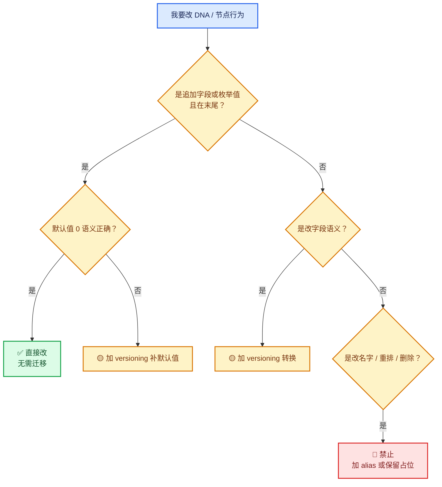

# 03 · 文件兼容不变量

[前置知识总入口](../README.md) · [本章导航](README.md) · [上一篇](02-标识符回填与重发号.md) · [下一章](../07-RNA属性系统/README.md)

> 基准：Blender `5.4.0-alpha`，本地工作树。本篇是 06 章的收束：把"能改什么、不能改什么、为什么"总结成一组可操作的不变量。前两篇讲机制，本篇讲纪律。

## 先回答一个具体问题

我要改 DNA 结构、改节点行为、改枚举。哪些改动会让老文件读不开，哪些安全？

`[讲解]` 这个问题没有统一答案——取决于改动类型。本篇给一张判断表，把改动分成四档：**安全 / 需迁移 / 危险 / 禁止**。

## 四档风险级别

`[讲解]` 先建立总览：

| 级别 | 改动类型 | 老文件 | 需要做什么 |
| --- | --- | --- | --- |
| 🟢 安全 | 末尾追加字段（带默认值） | 自动兼容 | 无需迁移 |
| 🟢 安全 | 末尾追加枚举值 | 自动兼容 | 无需迁移 |
| 🟡 需迁移 | 字段语义变更 | 会读错 | 写 versioning |
| 🟡 需迁移 | 新增稳定标识符 | 缺失 | 写 versioning + 幂等检查 |
| 🟠 危险 | 中间插入字段 | padding 错位 | 一般不要做 |
| 🔴 禁止 | 改字段名 | 匹配失败 | 加 alias 或永不做 |
| 🔴 禁止 | 重排枚举值 | 老值含义变 | 绝不 |
| 🔴 禁止 | 删除仍被引用的结构 | 悬空 | 保留占位 |

`[讲解]` 中间两档最需要说明。

## 🟢 安全：末尾追加字段

`[讲解]` 这是最常见的改动。为什么安全？

因为 SDNA 按**名字**匹配字段。老文件里没有新字段，读的时候跳过——新结构体的该字段保持默认值。

**前提条件（缺一不可）**：

1. 必须在**末尾**追加（不能插中间）；
2. **必须给默认值**（否则垃圾）；
3. 加完要**重新检查 padding**（总大小变了）。

`[讲解]` 第 3 条最容易漏。举例：原本结构体是 28 字节（4 个 int + 1 个指针 = 8+20 = 28），加一个 int 变成 32——刚好对齐。但如果在某个奇怪的情况下加完是 30，就需要补 `_pad[2]`。

**验证方法**：`static_assert(sizeof(T) % 8 == 0)`。

## 🟢 安全：末尾追加枚举值

`[讲解]` 枚举在文件里存整数。末尾追加意味着：

- 新值的编号是"从未出现过"的；
- 老文件里不会有这个值。

**危险的反例**：中间插入。

```c
enum eNodeSocketDatatype {
  SOCK_FLOAT = 0,
  SOCK_VECTOR = 1,
  SOCK_RGBA = 2,
  /* 如果在这里插入 SOCK_NEW = 3，后面的全部 +1 */
  SOCK_SHADER = 3,   // 老文件里 3 表示 SHADER，现在变 NEW → 全错了
};
```

`[讲解]` 这种错误**不会编译报错**，只会在用户打开老文件时表现为"类型全乱了"。是最难排查的一类。

**判据**：任何对枚举的改动，只在**末尾追加**，且显式写数值（不依赖自动递增）。

## 🟡 需迁移：字段语义变更

`[讲解]` 例子：某字段原来存"半径"，现在改存"直径"。

**为什么需要迁移？** 因为数值没变但含义变了：老文件的 `5` 是半径，新代码按直径理解——结果全错。

**迁移方式**：

```cpp
if (!MAIN_VERSION_FILE_ATLEAST(bmain, 500, 0)) {
  /* 老文件：radius → diameter */
  node.diameter = node.radius * 2;
}
```

`[讲解]` 注意典型问题：**字段名也变了时怎么办？**

如果只是改名（不改语义），加 alias 就行（见 05 章的 alias 机制）。如果改了语义，必须迁移——alias 只能改名字，不能改数值。

## 🟡 需迁移：新增稳定标识符

`[讲解]` 这篇已在 02 篇详讲，这里只强调三条纪律：

1. **幂等检查用 `next_identifier > 0`**，不用 `items_num > 0`；
2. **分配用 `next_identifier++`**，不用固定值；
3. **迁移结束 `next_identifier` 必须等于最大 id + 1**。

## 🟠 危险：中间插入字段

`[讲解]` 为什么危险？

`[讲解]` 表面上 SDNA 按名字匹配，中间插入似乎无所谓。但有两个实际问题：

### 问题 1：padding 位置全变

假设原结构：

```c
struct S {
  int a;      /* 偏移 0 */
  int b;      /* 偏移 4 */
  char *c;    /* 偏移 8 */
};            /* 大小 16 */
```

中间插入一个 `char`：

```c
struct S {
  int a;       /* 0 */
  char x;      /* 4 */
  /* 5-7 是 padding */
  int b;       /* 8 */
  char *c;     /* 16 */
};             /* 大小 24 */
```

`[讲解]` 所有后续字段偏移都变了。SDNA 按名字匹配**理论上**能应付，但：

- makesdna 计算出的偏移与实际编译布局可能不一致；
- 某些工具（Python `foreach_get`、RNA 数组访问）依赖字段顺序；
- 老文件里的旧 padding 字节现在被当作 `x` 的初始值。

### 问题 2：老文件的 padding 字节内容未定义

原结构里偏移 5-7 可能是任意字节（未定义的 padding）。插入 `char x` 后在偏移 4，不落在 padding 区——但如果你插入的是 `short` 或 `int`，就会吃到 padding 的垃圾值。

**结论**：中间插入在技术上"可能可行"，但代价高、风险大。**永远在末尾追加**。

## 🔴 禁止：改字段名

`[讲解]` SDNA 按名字匹配。改名后老文件里的字段找不到目标 → 被丢弃。

`[讲解]` 唯一合法的改法是**加别名**（05 章讲过的 `alias` 机制）。但那也有成本：需要维护一张新旧名映射表，且要在合适时机加载。

**实用建议**：除非万不得已，不改字段名。收益（更好的可读性）通常小于成本（兼容负担）。

## 🔴 禁止：重排枚举值

`[讲解]` 已在"安全：末尾追加"里讲过反例。这里补一个真实场景：

Blender 的 `eNodeType` 枚举里，`GEO_NODE_REPEAT_INPUT` 与 `GEO_NODE_REPEAT_OUTPUT` 是稳定标识。**它们的位置不可动**，因为：

- 老文件存的是整数值；
- 重排后同一个整数指向不同节点类型；
- 打开老文件会看到"Repeat 变成别的节点"。

`[讲解]` 正篇 00-03 有一句话：

> "枚举值 `GEO_NODE_REPEAT_INPUT/OUTPUT`（L80-L81）是 DNA 层的稳定标识，不可重排"

这就是这条规则的实例。

## 🔴 禁止：删除仍被引用的结构体

`[讲解]` 如果老文件里某个指针指向类型 X，而你删掉了 X 的定义：

- 读文件时无法解析该指针的目标；
- 重定位失败 → 指针变 nullptr；
- 后续访问可能崩。

**合法做法**：保留结构体定义（即使代码已不用），或写迁移把数据转成新结构。

`[讲解]` 这就是为什么 Blender 的 DNA 头文件里有很多"看起来没用"的结构体——它们是历史兼容的锚。

## 一条元规则：只在末尾动手

`[讲解]` 把上面所有"安全"的改动抽象一下，会发现共同点：

| 改动 | 是不是"末尾" |
| --- | --- |
| 追加字段 | ✅ 结构体末尾 |
| 追加枚举值 | ✅ 枚举末尾 |
| 新增结构体 | ✅ 文件末尾（无冲突） |

`[讲解]` 而所有危险的改动都违反"末尾原则"：

| 危险改动 | 违反点 |
| --- | --- |
| 中间插入 | 不在末尾 |
| 改名字 | 坑位变了 |
| 重排枚举 | 编号变了 |
| 删除结构 | 坑位消失 |

**一句话记忆**：**只往后加，不往前改。**

## 为什么"只往后加"能成立

`[讲解]` 这个规则之所以有效，是因为 SDNA 的两条设计：

1. **按名字匹配**：追加字段不影响老字段的匹配；
2. **缺失字段填默认**：老文件没有新字段，用默认值。

`[讲解]` 但注意：第二条依赖"**默认值必须正确**"。如果新字段的语义默认值不是 0（比如应该是 -1），就必须写迁移。

这是"追加字段安全"的**唯一例外**：

- 默认值 0 语义正确 → 安全，无需迁移；
- 默认值 0 语义错误 → 需要迁移补值。

## 一个完整的判断流程

`[讲解]` 拿到一个改动需求，按这个流程图判断：



## 用小数据走一遍

`[讲解]` 四个改动，逐个判断：

### 改动 1：给 `NodeGeometryRepeatOutput` 加 `filter_index`（默认 0 = 无过滤）

- 追加字段？✅ 末尾
- 默认 0 语义正确？✅（0 = 无过滤）
- **判定：安全，直接改**。但记得检查 `sizeof` 是否还是 8 的倍数。

### 改动 2：给 `NodeRepeatItem` 加 `domain`（默认应该是"点域"= 1，不是 0）

- 追加字段？✅ 末尾
- 默认 0 语义正确？❌（0 可能是"顶点"或"无效"）
- **判定：需迁移**——写 versioning 把老 item 的 `domain` 设为 1。

### 改动 3：把 `NodeGeometryRepeatOutput::inspection_index` 从"第几轮"改为"从 1 开始的第几轮"

- 追加字段？❌
- 改语义？✅
- **判定：需迁移**——`new_value = old_value + 1`（注意老值 0 的处理）。

### 改动 4：把 `NodeRepeatItem::socket_type` 改名为 `type`

- 改名字？✅
- **判定：禁止**——除非加 alias 映射。

## 反例与边界

### 反例 1：以为追加字段一定安全

只在"默认值语义正确 + 大小对齐"时安全。两个前提都要验证。

### 反例 2：以为 SDNA 按名匹配就"顺序随便"

按名匹配，但 padding 与工具依赖顺序。中间插入仍然危险。

### 反例 3：以为枚举只要不改已有值就行

中间插入会让后续所有值 +1——等同于改了所有已有值。

### 反例 4：忘记检查 `sizeof`

加字段后忘了补 `_pad`，跨编译器布局不一致。

### 反例 5：在迁移里改 DNA 布局

DNA 布局是编译期的事，versioning 是运行期的事。两者不能混。

### 反例 6：认为"没人用这个结构了就可以删"

老文件里可能有指针指向它。数据兼容与代码使用是两个维度。

## 对理解 Repeat 的帮助

`[讲解]` Repeat 涉及的三个 DNA 结构，各自的风险点：

| 结构 | 已做的兼容处理 | 若再改要注意 |
| --- | --- | --- |
| `NodeRepeatItem` | `identifier` 从引入即存在 | 加字段必须给正确默认值 |
| `NodeGeometryRepeatInput` | 只有 `output_node_id` | 加字段极安全（纯 POD） |
| `NodeGeometryRepeatOutput` | 有 `next_identifier` + `inspection_index` | 加字段要考虑 `_pad` |

`[讲解]` 一个具体判断：**给 Repeat Output 加 `filter_index` 后，`next_identifier` 仍必须是"最大 id + 1"**。新字段不影响这个不变量，但迁移代码如果同时重建 items 就要注意。

## 本篇小结

六条不变量，按重要性排序：

1. **只往后加，不往前改**（元规则）；
2. **追加字段必须给正确默认值**（否则要迁移）；
3. **枚举只末尾追加**（重排是灾难）；
4. **不改字段名**（除非加 alias）；
5. **不删仍可能被引用的结构**（保留占位）；
6. **改语义必须迁移**（alias 改不了数值）。

记住前两条就能避免 90% 的问题。

## 继续阅读

- [01-versioning机制](01-versioning机制.md) —— 迁移怎么写
- [02-标识符回填与重发号](02-标识符回填与重发号.md) —— identifier 的完整范式
- [05-DNA与序列化/03-DNA结构体编写规则](../05-DNA与序列化/03-DNA结构体编写规则.md) —— 写结构体的十条规则
