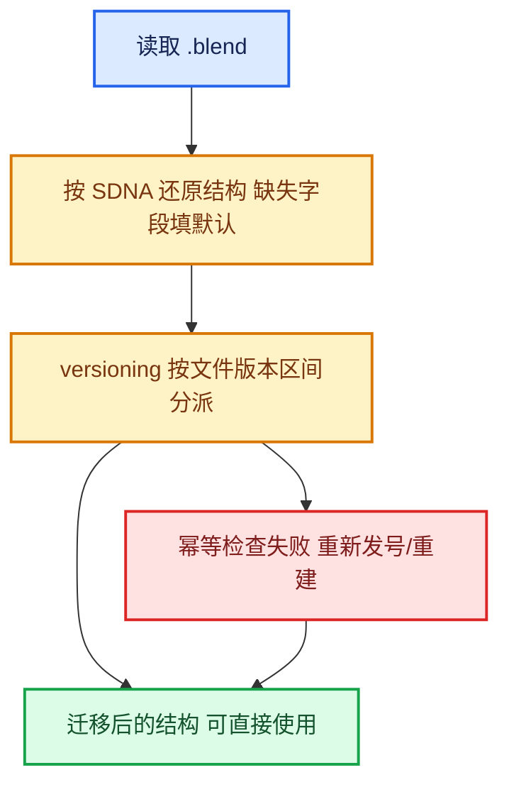

# 06-版本迁移与兼容

[前置知识总入口](../README.md) · [上一章：05-DNA与序列化](../05-DNA与序列化/README.md)

本章回答：老版本 `.blend` 文件怎么升级到新结构？标识符为什么不能复用？新字段加进去后旧文件怎么办？

## 阅读顺序

| # | 篇目 | 源码主线 | 实测路径 |
| --- | --- | --- | --- |
| 1 | [01-versioning机制](01-versioning机制.md) | `versioning_*.cc` 的分派与调用时机 | `source/blender/blenloader/intern/` |
| 2 | [02-标识符回填与重发号](02-标识符回填与重发号.md) | `next_identifier` 的版本化范式 | `versioning_402.cc`、`versioning_500.cc` |
| 3 | [03-文件兼容不变量](03-文件兼容不变量.md) | 能改什么、不能改什么 | 综合 |

## 本章与 Repeat 的关系

正篇 02-02 的"版本兼容"一节引用了三个真实范例（实测行号）：

- `versioning_402.cc` L1243-L1268 —— `next_identifier > 0` 的幂等检查 + 重新发号范式（Capture Attribute 节点，模式与 Repeat 同源）；
- `versioning_500.cc` L2399-L2428 —— 手写重建后显式 `storage->next_identifier = 2;`（Viewer 节点 item 重建）；
- `versioning_500.cc` L4445-L4473 —— Repeat Input/Output 列入 `no_muting_nodes` 清除无效静音标志。

本章把这三类范式的一般形式讲清楚，读者再回看正篇就知其所以然。

## 核心不变量

| 可以改 | 不能改 |
| --- | --- |
| 追加新字段（并给默认值） | 改变已有字段的顺序 |
| 追加新结构体 | 删除仍被旧文件引用的结构体 |
| 通过 versioning 重建数据 | 直接改变字段语义而不迁移 |
| 追加枚举值（末尾） | 重排枚举值顺序 |

第二条对 Repeat 特别重要：`GEO_NODE_REPEAT_INPUT/OUTPUT` 是 DNA 层稳定标识（正篇 00-03 第 822 行有说明），**不可重排**。

