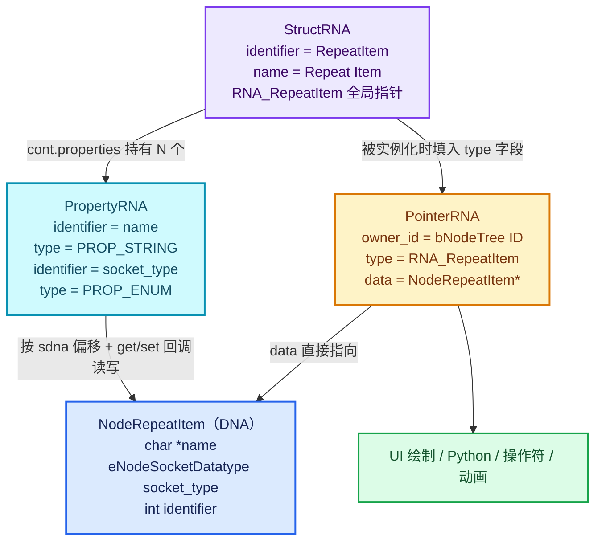
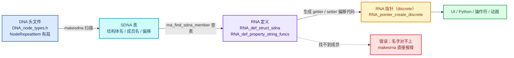
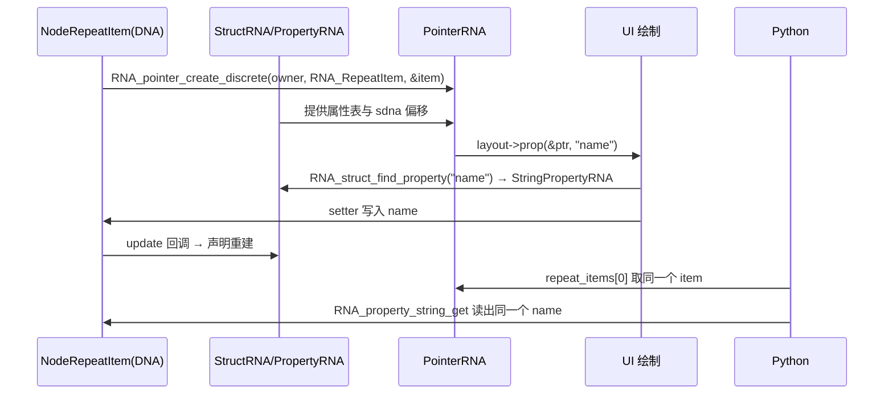

# 01 · RNA 三层结构与职责

[前置知识总入口](../README.md) · [本章导航](README.md) · [下一篇](02-StructRNA与PropertyRNA.md)

> 基准：Blender `5.4.0-alpha`，本地工作树。本篇回答一个主系列从未定义的问题：**RNA 到底是什么**。答案是三个类型的三层结构——`StructRNA`（类型）、`PropertyRNA`（属性）、`PointerRNA`（实例指针）。主要源码：[`RNA_types.hh`](../../../source/blender/makesrna/RNA_types.hh)（总行数 1180）、[`RNA_define.hh`](../../../source/blender/makesrna/RNA_define.hh)（总行数 754）、[`RNA_access.hh`](../../../source/blender/makesrna/RNA_access.hh)（总行数 1159）。

## 先回答一个具体问题

**问题**：`NodeRepeatItem` 只有一个 `char *name`、一个 `enum socket_type`、一个 `int identifier`。为什么 Blender 不直接读这三个字段，而要绕一圈造出 `RNA_RepeatItem`、`RNA_pointer_create_discrete`、`socket_name_ptr` 这一整套东西？

**短答**：因为读这三个字段的"人"不是同一种代码。节点编辑器要点一个可编辑文本框，Python 脚本要写 `node.repeat_items[0].name`，操作符要拿一项数据来删改，动画系统要按字符串路径找到它。这四类消费者彼此不知道对方的 C 类型，而 RNA 就是它们之间唯一能共享的那层"名字 + 类型 + 访问函数"的公共语言。

**展开**：假设没有 RNA，每条路径都得自己知道 `NodeRepeatItem` 的内存布局。UI 代码要手写 `item->name` 的编辑按钮并处理撤销；Python 绑定要为每种 item 类型各写一套 getter/setter；操作符的 `invoke` 要拿到 `bNode*` 再向下转型；动画路径 `repeat_items[0].name` 根本无从解析。更致命的是，一旦某个字段从 `char*` 改成 `char[64]`，这四条路径全部要改。

RNA 把这件事倒过来：**字段的内存位置记录在属性描述里一次，之后所有消费者只认属性名**。`RNA_def_struct_sdna(srna, "NodeRepeatItem")` 声明"这个 RNA 类型包住的是 DNA 里的 `NodeRepeatItem`"，`SDNA` 表格提供 `name` 在结构体内部的偏移，`RNA_def_property_string_funcs(prop, ...)` 按需覆盖个别回调（没覆盖的 getter 由 `makesrna` 按偏移自动生成）。消费者那边只剩一句话：`layout.prop(ptr, "name")`。

所以这个问题真正的答案是：RNA 不是为了"方便访问"而加的糖，而是为了让 **UI、Python、操作符、动画** 这四套互不认识的子系统，能用同一个字符串属性名操作同一份 C 数据。理解这一点，才理解为什么 Repeat 的 socket 标签必须绑到 `item.name` 的 RNA 属性上（正篇 01-02），而不是自己存一份显示名。

## 一句话定义

**RNA 是 Blender 的运行时反射系统**：把任意 C 结构体包装成带类型、带名称、可自动生成 UI、可被 Python 访问、可被动画系统按路径寻址的属性集合。

拆开这句话有四个关键词，四者缺一不可：

- **运行时**：`StructRNA` 不是编译期模板，而是 `RNA_def_*` 在启动时 `RNA_create()` 里构造出来的一棵对象树，存在 `BlenderRNA` 的 `Vector<std::unique_ptr<StructRNA>> structs` 里（[`rna_internal_types.hh` L758-L773](../../../source/blender/makesrna/intern/rna_internal_types.hh#L758)）。Python 能 `bpy.types.X` 反射出它，正是因为它真实存在于内存。
- **反射**：给一个 `PointerRNA` 和一个属性名字符串，能问出"这个属性的类型是什么、范围多少、能不能编辑、图标是什么"（`RNA_property_type` / `RNA_property_int_range` / `RNA_property_editable` / `RNA_property_ui_icon`）。
- **视图而非副本**：RNA 不复制数据，`PointerRNA.data` 就是原始 C 结构体的地址（[`RNA_types.hh` L67](../../../source/blender/makesrna/RNA_types.hh#L67)）。写 RNA 属性等于写 DNA 内存。
- **生成 UI**：因为类型与范围都在描述里，UI 框架不需要为每个属性写绘制代码，`Layout::prop` 按 `PropertyType` 分派即可（[`interface_layout.cc` L683](../../../source/blender/editors/interface/interface_layout.cc#L683)）。

## 三层结构总览

三个类型不是并列的三个东西，而是"类型 / 成员 / 实例"的经典三层，和 C++ 的类 / 成员变量 / `this` 一一对应。

| 层 | 类型 | 类比 | 存在形态 | 数量级 |
| --- | --- | --- | --- | --- |
| 类型层 | `StructRNA` | 类（`class`） | 全局单例，`RNA_RepeatItem` 这样的 `extern StructRNA *` 指针 | 每个 RNA 类型一个 |
| 属性层 | `PropertyRNA` | 成员变量定义（字段声明） | 挂在 `StructRNA::cont.properties` 链表上 | 每个属性一个 |
| 实例层 | `PointerRNA` | `this` 指针 | 栈上值类型，随用随建，不拥有数据 | 每次访问都新建 |

一句口诀：**`StructRNA` 是类，`PropertyRNA` 是成员变量，`PointerRNA` 是 `this` 指针，DNA 结构是被包裹的那个真实对象。**



关于实测行数的口径需要说明：`RNA_types.hh` 文件总共 1180 行，其中非空行 1047 行；本章导航表里的 1047、689、1025 三个数字都是**非空行**计数（对应文件总长分别为 1180、754、1159）。检索行号时以符号名定位，不要以行号为准。

## StructRNA：类型描述

`StructRNA` 的完整定义在 [`rna_internal_types.hh` L671-L751](../../../source/blender/makesrna/intern/rna_internal_types.hh#L671)，注意它**不在** `RNA_types.hh`——`RNA_types.hh` 只有 L1111 的 `struct StructRNA;` 前向声明。这是个常见的找错地方：公开头文件只暴露指针，真实字段藏在 `intern/` 里。

字段逐个讲：

- **`cont`**（L673）：一个 `ContainerRNA`，内部是 `ListBaseT<PropertyRNA> properties` 加一个 `CustomIDVectorSet<PropertyRNA *>` 查表集（[`rna_internal_types.hh` L370-L373](../../../source/blender/makesrna/intern/rna_internal_types.hh#L370)）。前者提供稳定的插入顺序（UI 和 Python 的 `dir()` 都依赖它），后者提供按 identifier 的 O(1) 查找。**这是"成员变量列表"的实体。**
- **`identifier`**（L675）：机器名，`"RepeatItem"`、`"Node"`、`"NodeTree"`。它同时决定两件事：Python 里 `bpy.types.<identifier>` 的名字，以及 C 侧生成的全局指针名——`makesrna` 会为每个类型输出 `extern struct StructRNA *RNA_RepeatItem;`（[`makesrna.cc` L2923](../../../source/blender/makesrna/intern/makesrna.cc#L2923)）。这就是源码里 `&RNA_RepeatItem` 这种写法的来源。
- **`name` / `description` / `translation_context` / `icon`**（L695-L701）：供 UI 与工具提示用的可读文本，由 `RNA_def_struct_ui_text` 与 `RNA_def_struct_ui_icon` 填入。`NodeRepeatItem` 对应的那行是 `RNA_def_struct_ui_text(srna, "Repeat Item", "")`（[`rna_nodetree.cc` L8036](../../../source/blender/makesrna/intern/rna_nodetree.cc#L8036)）。
- **`nameproperty`**（L704）：指向"哪个属性是这个类型的名字"。`RepeatItem` 的 `name` 属性定义后立刻调用了 `RNA_def_struct_name_property(srna, prop)`（[`rna_nodetree.cc` L4977](../../../source/blender/makesrna/intern/rna_nodetree.cc#L4977)）。这个字段不是装饰：集合的字符串查找（`RNA_property_collection_lookup_string`）在没有自定义 lookup 回调时，就靠它去取每项的显示名。
- **`base`**（L710）：单一继承链。`NodeGeometryRepeatOutput` 继承 `GeometryNode` 再继承 `Node`，属性查找会沿 `base` 逐级向上（`RNA_struct_type_find_property` 是例外，它刻意忽略 base，注释在 [`RNA_access.hh` L242-L247](../../../source/blender/makesrna/RNA_access.hh#L242)）。
- **`nested`**（L718）：仅用于"父结构与子结构共享同一个 C 结构体、只为分组属性"的场景。注意它与 `base` 的区别：`base` 是类型继承，`nested` 是同一块内存的另一种属性视图。
- **`refine`**（L721）：一个回调，用来把"泛类型"细化成"具体类型"。`RNA_Node` 注册了 `RNA_def_struct_refine_func(srna, "rna_Node_refine")`（[`rna_nodetree.cc` L9873](../../../source/blender/makesrna/intern/rna_nodetree.cc#L9873)），所以当你说"给我一个 `bNode*` 的 RNA 指针"时，实际拿到的 `type` 可能是 `RNA_GeometryNodeRepeatOutput`。这个机制让 `RNA_pointer_create_discrete(nullptr, RNA_Node, node)` 这类泛调用自动获得具体类型。
- **`path`**（L724）：从 ID 根到这个结构体的路径生成函数（`rna_Node_path`），动画系统的 `RNA_path_from_ID_to_property` 依赖它。
- **`reg` / `unreg` / `instance`**（L727-L741）：给可被 Python 子类化的类型（操作符、面板、UIList）用的注册钩子，普通数据类不用。
- **`flag`**（L687）：`StructFlag`，定义在 [`RNA_types.hh` L1043-L1092](../../../source/blender/makesrna/RNA_types.hh#L1043)。最要紧的两个是 `STRUCT_ID`（L1045，标记这是 ID 类型，会影响 `PointerRNA` 的构造方式，见 `rna_pointer_create_with_ancestors` 的分支）与 `STRUCT_UNDO`（L1058，默认开，控制成员变更是否进撤销栈）。
- **`functions`**（L750）：`Vector<std::unique_ptr<FunctionRNA>>`，即这个类型的"方法"。`repeat_items` 集合上的 `new` / `remove` / `clear` / `move` 四个函数就注册在 `NodeGeometryRepeatOutputItems` 上（[`rna_nodetree.cc` L5023-L5041](../../../source/blender/makesrna/intern/rna_nodetree.cc#L5023)）。

类型的定义入口是 `RNA_def_struct(brna, identifier, from)`（[`RNA_define.hh` L76](../../../source/blender/makesrna/RNA_define.hh#L76)），而"这个类型包住哪个 DNA 结构体"由 `RNA_def_struct_sdna(srna, structname)`（[`RNA_define.hh` L77](../../../source/blender/makesrna/RNA_define.hh#L77)）声明。RepeatItem 的三行定义极简到可以全文背下来：

```cpp
// source/blender/makesrna/intern/rna_nodetree.cc L8033-L8040
static void rna_def_geo_repeat_item(BlenderRNA *brna)
{
  StructRNA *srna = RNA_def_struct(brna, "RepeatItem", nullptr);
  RNA_def_struct_ui_text(srna, "Repeat Item", "");
  RNA_def_struct_sdna(srna, "NodeRepeatItem");

  rna_def_node_item_array_socket_item_common(srna, "RepeatItemsAccessor", true);
}
```

第二参数 `nullptr` 表示没有基类——`RepeatItem` 不从 `Node` 那种东西继承，它就是个纯数据条目。反过来 `def_geo_repeat_output` 里那句 `RNA_def_struct_sdna_from(srna, "NodeGeometryRepeatOutput", "storage")`（[L8061](../../../source/blender/makesrna/intern/rna_nodetree.cc#L8061)）则说明 Output 节点的数据不在 `bNode` 本身，而在 `bNode::storage` 里——`sdna_from` 的第三参数就是一个 RNA 属性名，用来跳转到真正的数据层。

## PropertyRNA：属性描述

`PropertyRNA` 是一个基类，[`rna_internal_types.hh` L398-L493](../../../source/blender/makesrna/intern/rna_internal_types.hh#L398) 定义公共部分，七种子类型各自继承它并补上类型专属的字段（对应七个 `PropertyType` 值，不多不少）：

| 子类型 | 位置 | 补上的关键字段 |
| --- | --- | --- |
| `BoolPropertyRNA` | L502 | `get` / `set` / `getarray` / `setarray` / `defaultvalue` |
| `IntPropertyRNA` | L524 | 同上 + `range`、`softmin` / `softmax`、`hardmin` / `hardmax`、`step`、`ui_scale_type` |
| `FloatPropertyRNA` | L553 | 同上 + `precision` |
| `StringPropertyRNA` | L584 | `get` / `length` / `set`、`search`、`path_filter`、`maxlength` |
| `EnumPropertyRNA` | L621 | `item` / `totitem`（静态枚举项数组）、`item_fn`（动态枚举回调） |
| `PointerPropertyRNA` | L641 | `pointer_type`（指向哪个 `StructRNA`）、`poll` |
| `CollectionPropertyRNA` | L654 | `item_type`、`begin` / `next` / `end` / `lookupint` / `lookupstring` |

公共字段逐个讲：

- **`identifier`**（L405）：属性机器名，`"name"`、`"socket_type"`、`"active_index"`。它是 `UString`（去重字符串），因为全进程有上万份同名属性，这里是明显的内存优化。
- **`name` / `description`**（L427 / L429）：给 UI 的显示名与工具提示。注意 `name` 与 `identifier` 通常不同——`"repeat_items"` 的显示名是 `"Items"`（[`rna_nodetree.cc` L8066](../../../source/blender/makesrna/intern/rna_nodetree.cc#L8066)）。
- **`type`**（L439）：`PropertyType`，只有七种：`PROP_BOOLEAN` / `PROP_INT` / `PROP_FLOAT` / `PROP_STRING` / `PROP_ENUM` / `PROP_POINTER` / `PROP_COLLECTION`（[`RNA_types.hh` L209-L217](../../../source/blender/makesrna/RNA_types.hh#L209)）。**整个 UI 分派与 Python 类型转换都只依赖这七个值**，这是 RNA 能"一套代码画所有属性"的根本原因。
- **`subtype`**（L441）：`PropertySubType`（[`RNA_types.hh` L280-L354](../../../source/blender/makesrna/RNA_types.hh#L280)），是对 `type` 的"语义解释"。同样是 `PROP_FLOAT`，`PROP_COLOR_GAMMA` 会画颜色方块，`PROP_FACTOR` 会画百分比滑块，`PROP_ANGLE` 会按角度显示。子类型常与单位复合，`PROP_ANGLE = 16 | PROP_UNIT_ROTATION`（L309）——高 16 位放单位、低 16 位放语义，用 `RNA_SUBTYPE_UNIT` / `RNA_SUBTYPE_VALUE` 两个宏拆解（L266-L268）。
- **`flag`**（L407）：`PropertyFlag`（[`RNA_types.hh` L370-L555](../../../source/blender/makesrna/RNA_types.hh#L370)），最常用的几个：`PROP_EDITABLE`（L376）、`PROP_ANIMATABLE`（L389）、`PROP_ID_REFCOUNT`（L434）、`PROP_NEVER_NULL`（L447）、`PROP_NO_DEG_UPDATE`（L509）。后两个 flag 的默认值很有讲究：`RNA_def_property` 在收尾处对非 pointer / 非 collection 的类型自动加上 `PROP_EDITABLE`，并对非字符串类型自动加上 `PROP_ANIMATABLE`（[`rna_define.cc` L1315-L1327](../../../source/blender/makesrna/intern/rna_define.cc#L1315)）——所以 `active_index` 要单独 `clear_flag(PROP_ANIMATABLE)` 才能退出动画寻址（[`rna_nodetree.cc` L8072](../../../source/blender/makesrna/intern/rna_nodetree.cc#L8072)）。**注释里写着 `HIGHEST FLAG IN USE: 1u << 31` 与 `FREE FLAGS: NONE`（L368-L369）——32 位已用满。**
- **数组信息**（L443-L448）：`getlength`（动态长度回调）、`arraydimension`、`arraylength[RNA_MAX_ARRAY_DIMENSION]`、`totarraylength`。`RNA_MAX_ARRAY_DIMENSION` 是 3（[`RNA_define.hh` L29](../../../source/blender/makesrna/RNA_define.hh#L29)），所以 RNA 数组最多三维，总长上限 `RNA_MAX_ARRAY_LENGTH = 64`（L26）。
- **`update` / `noteflag`**（L451-L452）：变更通知回调与标签。这条是 Repeat 改名后能触发声明重建的关键一环，详见本章第 05 篇。注释在 `rna_internal_types.hh` L72-L77 明确说：**它不会被自动调用，必须手动 `RNA_property_update`**。
- **`editable` / `itemeditable`**（L459-L461）：动态只读判定。`repeat_items` 本身是集合，但某一项能否删，就靠这类回调给出理由（`editable` 的 `r_info` 参数会显示成"按钮为什么灰"的工具提示）。
- **`rawoffset` / `rawtype`**（L476-L477）：直接字段访问的快路径，标记为 `PROP_INTERN_RAW_ACCESS` 时使用。
- **`srna`**（L486）：指向这个属性"自身的属性集"。这就是 `RNA_def_property_srna(prop, "NodeGeometryRepeatOutputItems")` 的作用：让一个集合属性的 `new` / `remove` 等方法有地方挂。`repeat_items` 属性正是这样挂上的（[`rna_nodetree.cc` L8067](../../../source/blender/makesrna/intern/rna_nodetree.cc#L8067)）。

属性的定义通常"一步到一半"：`RNA_def_property(cont, identifier, type, subtype)` 造出空壳（[`RNA_define.hh` L374-L377](../../../source/blender/makesrna/RNA_define.hh#L374)），但它收尾时会**拿 identifier 当 DNA 成员名自动尝试一次 sdna 绑定**（[`rna_define.cc` L1339-L1378](../../../source/blender/makesrna/intern/rna_define.cc#L1339)）——这便是"属性名与 DNA 字段名相同时可以省掉 `*_sdna` 调用"的原因，`inspection_index`（[`rna_nodetree.cc` L8087](../../../source/blender/makesrna/intern/rna_nodetree.cc#L8087)）正是靠这条隐式绑定自动对上同名字段。当 RNA 名与 DNA 名不同（如 `repeat_items` 对 `items`），才需要显式 `*_sdna` 覆盖。`RepeatItem.name` 的实际定义长这样：

```cpp
// source/blender/makesrna/intern/rna_nodetree.cc L4973-L4978（名字经模板参数注入）
prop = RNA_def_property(srna, "name", PROP_STRING, PROP_NONE);
RNA_def_property_string_funcs(
    prop, nullptr, nullptr, allocator.copy_string(name_set_func).c_str());
RNA_def_property_ui_text(prop, "Name", "");
RNA_def_struct_name_property(srna, prop);
RNA_def_property_update(prop, NC_NODE | NA_EDITED, item_update_func_ptr);
```

注意 getter 是 `nullptr`——没有显式 getter 时，`makesrna` 会按 SDNA 偏移生成默认读取代码（`rna_def_property_get_func`，[`makesrna.cc` L610](../../../source/blender/makesrna/intern/makesrna.cc#L610)）；setter 则被显式换成了 `rna_Node_ItemArray_item_name_set<RepeatItemsAccessor>`，因为改名必须顺便保证同节点内名字唯一。

## PointerRNA：实例指针

`PointerRNA` 是 [`RNA_types.hh` L52-L190](../../../source/blender/makesrna/RNA_types.hh#L52) 的一个**普通值类型**（可平凡复制，栈上传递），三个核心字段：

- **`owner_id`**（L58，`ID *`）：这块数据"属于哪个数据块"。原文注释：*"The ID owning the referenced data. May be null when there is no owner ID."* 它的用途是**归因**——算 RNA 路径要它（`RNA_path_from_ID_to_property`）、触发更新要它（`update` 回调拿到的 `ptr->owner_id`）、祖先链要它。Repeat 里 `RNA_pointer_create_discrete(current_node_ptr->owner_id, RNA_Node, &output_node)` 就是把当前节点的 owner 借用给 Output 节点指针（[`node_geo_repeat.cc` L51-L52](../../../source/blender/nodes/geometry/nodes/node_geo_repeat.cc#L51)）。
- **`type`**（L63，`StructRNA *`）：这块数据"按哪个类型解释"。注释特别提到"typed null"：**`type` 可以在 `data` 为空时仍然有值**，这被用来表达"我知道它是什么类型，但现在没数据"。这就是 `RNA_pointer_create_discrete(nullptr, RNA_Function, nullptr)` 这类 dummy 指针能成立的原因。
- **`data`**（L67，`void *`）：真正的 C 地址。注释规定了一个不变量：`data` 非空时 `type` 必须非空，并写进了断言（`BLI_assert(!this->data || this->type)`，L172）。

除了这三个，还有一个**第四成员**常被忽略：`ancestors`（L90），`Vector<AncestorPointerRNA, 2>`。它记录"我是从哪条访问链上来的"，用于算路径与祖先回溯。注释（L69-L89）明确说：ID 的 `PointerRNA` 永远是 discrete 的（ID 必须是自己的根），而用 `RNA_pointer_create_discrete` 造出来的指针**没有祖先信息**，链条可能为空或只有一部分。

**为什么需要三个而不是一个？** 因为单个 `void *` 无法回答三个独立的问题：

| 问题 | 靠哪个字段 | 缺了会怎样 |
| --- | --- | --- |
| 这块内存该按什么结构解释？偏移多少？ | `type` | `void*` 不知道 `name` 在第 8 字节还是第 16 字节 |
| 改动它要通知谁？路径从哪算起？撤销归属哪个数据块？ | `owner_id` | 无法生成 `objects["Cube"].data...` 这样的路径，`update` 回调也拿不到 `Main` |
| 到底改哪一份？ | `data` | 只剩类型信息，成了"typed null"，只能用于查询定义、不能读写 |

还有一个微妙点：`data` 与 `type` 的组合在 Blender 里是**多态**的来源。同一个 `void *` 可以被不同 `StructRNA` 解释（`RNA_Node` 与 `RNA_GeometryNodeRepeatOutput` 指向同一个 `bNode`），而 `refine` 回调会在构造时自动择优。所以 `type` 不只是"给 C++ 看的类型标签"，它是运行时可以被细化的。

`PointerRNA` 还提供几个语义化方法，读代码时会频繁遇到：`data_as<T>()`（L139，带类型取出，故意是 `const` 方法却返回非 const 指针，因为 constness 不传染给被指向的数据）、`operator bool`（L160）与 `has_data()`（L169）、`has_type()`（L180）、`has_owner_id()`（L186）、`invalidate()`（L125，Python 侧访问失效指针时应抛异常，注释在 L119-L124）。

一个必须记住的边界：**`PointerRNA` 不拥有任何东西**。它没有析构函数里的释放逻辑，只是三个裸指针（加一个 `Vector`）。原作者随时可以把 `data` 释放掉，`PointerRNA` 就变成悬垂指针——`invalidate()` 的存在正是为了在 Python 层把这种情况变成可控的异常而不是崩溃。

## RNA 的四类消费者

三层结构存在的意义，全在这四类消费者身上。每类给一个真实调用点。

**1. UI 绘制**：`Layout::prop(PointerRNA *ptr, StringRefNull propname, ...)`（[`interface_layout.cc` L2449-L2466](../../../source/blender/editors/interface/interface_layout.cc#L2449)）先 `RNA_struct_find_property(ptr, propname)`，找不到就打警告并画一个禁用项；找到则进入真正的绘制分派，第一件事是取类型与子类型：`const PropertyType type = RNA_property_type(prop); const PropertySubType subtype = RNA_property_subtype(prop);`（L683-L684）。这一个模式撑起了整个属性面板、节点侧栏、弹窗——所有按钮都是同一段代码按七个 `PropertyType` 分出来的。

**2. Python API**：`bpy` 的属性读取是 `switch (type)` 之后逐类型调 `RNA_property_*_get`（[`bpy_rna.cc` L1547-L1556](../../../source/blender/python/intern/bpy_rna.cc#L1547)），例如 `PROP_INT` 分支就是 `PyLong_FromLong(RNA_property_int_get(ptr, prop))`。这意味着 `node.repeat_items[0].name` 在 C 侧走的正是 `RNA_property_string_get`——Python 里没有另一套数据通道，只是同一套访问器的语法糖。

**3. 操作符**：`op->ptr` 本身就是一个 `PointerRNA`，指向操作符的属性容器。模态操作符读参数即 `RNA_property_int_get(op->ptr, prop)`（[`wm_gesture_ops.cc` L541](../../../source/blender/windowmanager/intern/wm_gesture_ops.cc#L541)）。Repeat 的 `NODE_OT_repeat_zone_item_add` 等操作符之所以能"操作某一项"，是因为它可以通过 RNA 拿到 item 指针（`active_item` 属性，见下节），而不是靠遍历节点树猜。

**4. 动画系统**：F-Curve 的 `data_path` 是一个字符串，解析它靠 `RNA_path_resolve_property(&id_ptr, path, &ptr, &prop)`（[`animrig/keyframing.cc` L504](../../../source/blender/animrig/intern/keyframing.cc#L504)）。反向的"从属性生成路径"靠 `RNA_path_from_ID_to_property`，[`blenkernel/fcurve.cc` L265](../../../source/blender/blenkernel/intern/fcurve.cc#L265) 处就是先 `RNA_pointer_create_discrete` 再 `RNA_struct_find_property`。这一条对理解 Repeat 尤其重要：**一个属性能不能被 K 帧，本质上取决于它能否在 RNA 路径里被唯一定位**，而 `inspection_index` 特意 `clear_flag(PROP_ANIMATABLE)`（[`rna_nodetree.cc` L8072](../../../source/blender/makesrna/intern/rna_nodetree.cc#L8072)）正是主动退出这套寻址。

四类消费者共用同一套入口，所以新增一个字段的成本很低：定义一次，四处同时获得能力。这也是为什么 Blender 里"把某个字段暴露到 RNA"几乎是所有新功能的必经步骤。

## 与 DNA 的分工

- **DNA 管"怎么存"**：`DNA_node_types.h` 里的 C 结构体布局、字节对齐、`_pad` 手写补齐、可序列化性。`NodeRepeatItem` 的 `char _pad[2]`（[`DNA_node_types.h` L3546](../../../source/blender/makesdna/DNA_node_types.h#L3546)）就是为对齐而存在的，它跟"名字"这件事毫无关系。
- **RNA 管"怎么访问"**：属性名、类型、范围、UI 文本、更新标签、Python 可见性。
- **SDNA 是桥**：`makesdna` 扫描全部 DNA 头文件生成结构体/成员/偏移表；`makesrna` 在启动时按 `RNA_def_*_sdna` 声明去查表，把偏移量写进生成代码。



映射的建立有两个层次，很容易混：

- **结构级**：`RNA_def_struct_sdna(srna, "NodeRepeatItem")` 只声明"这个 RNA 类型对应 DNA 里的 `NodeRepeatItem`"，实现就是往 `StructDefRNA::dnaname` 写一个字符串（[`rna_define.cc` L943-L963](../../../source/blender/makesrna/intern/rna_define.cc#L943)）。它不检查名字是否存在——注释里那段 `#if 0` 就是被放弃的存在性检查。
- **属性级**：`RNA_def_property_int_sdna(prop, nullptr, "active_index")` 才真正触发查表。`rna_def_property_sdna`（[`rna_define.cc` L2305](../../../source/blender/makesrna/intern/rna_define.cc#L2305)）内部调 `rna_find_sdna_member`（[`rna_define.cc` L331-L388](../../../source/blender/makesrna/intern/rna_define.cc#L331)），把成员名、类型名、数组长度、指针层级一并填进 `PropertyDefRNA`。**`structname` 传 `nullptr` 就是"用当前 StructRNA 的 dnaname"**（L2319-L2321），所以绝大多数属性定义里第二参数都是 `nullptr`。
- **隐式属性级**：即使一行 `*_sdna` 都不写，`RNA_def_property` 收尾时也会用 identifier 自动试一次（[`rna_define.cc` L1339-L1378](../../../source/blender/makesrna/intern/rna_define.cc#L1339)），并把 `DefRNA.silent` 临时置真以免找不到成员就报错。这就是"同名属性零声明"能成立的原因，也是阅读时常被忽略的一层。

绑定用的临时结构在 `intern/rna_internal.hh`，且被 `#ifndef RNA_RUNTIME` 包住（L54）——也就是说**它们只在构建期存在，运行时的 Blender 里没有**：

- `StructDefRNA`（[L102-L115](../../../source/blender/makesrna/intern/rna_internal.hh#L102)）：`srna` + `dnaname` + `dnafromname` / `dnafromprop` + `functions`。
- `PropertyDefRNA`（[L71-L100](../../../source/blender/makesrna/intern/rna_internal.hh#L71)）：`dnastructname` / `dnaname` / `dnatype` / `dnaarraylength` / `dnapointerlevel` / `dnalengthstructname` / `dnalengthname` / `dnalengthfixed`，还有 `booleanbit` 与 `booleannegative`——这正是 `RNA_def_property_boolean_sdna(prop, nullptr, "flag", 1 << 3)` 能把一个 int 的某一位暴露成 bool 属性的机制。
- `PropertyDefRNA` 里还带 `dnalengthname`：集合属性需要"数据指针 + 长度字段"两个 DNA 成员，所以 `RNA_def_property_collection_sdna(prop, nullptr, "items", "items_num")`（[`RNA_define.hh` L454](../../../source/blender/makesrna/RNA_define.hh#L454)）有四个参数。`repeat_items` 用的就是这一行（[`rna_nodetree.cc` L8064](../../../source/blender/makesrna/intern/rna_nodetree.cc#L8064)）。

一个直接推论：**RNA 属性名与 DNA 字段名可以不同**。`repeat_items` 对 `items`，`repeat_items` 的长度对 `items_num`，这层改名是常态而非例外；嵌套路径也支持，例如 `RNA_def_property_int_sdna(prop, nullptr, "input_items.active_index")`（[`rna_nodetree.cc` L8296](../../../source/blender/makesrna/intern/rna_nodetree.cc#L8296)）里就带了点号，`rna_find_sdna_member` 的递归分支（L367-L384）负责逐层下钻。

## RNA_pointer_create_discrete

声明在 [`RNA_access.hh` L78-L85](../../../source/blender/makesrna/RNA_access.hh#L78)：

```cpp
/**
 * Create a 'discrete', isolated PointerRNA of some data. It won't have any ancestor information
 * available.
 *
 * \param id: The owner ID, may be null, in which case the PointerRNA won't have any ownership
 *             information at all.
 */
PointerRNA RNA_pointer_create_discrete(ID *id, StructRNA *type, void *data);
```

**为什么叫 "discrete"**：discrete 是"离散的、孤立的"，与它相对的是"带祖先链的连续指针"。三个构造入口构成一条谱系：

| 构造函数 | 祖先信息 | 典型用途 |
| --- | --- | --- |
| `RNA_pointer_create_discrete(id, type, data)` | 无（`ancestors` 为空） | 已经拿到裸 `data` 指针、不关心路径 |
| `RNA_pointer_create_with_parent(parent, type, data)` | 带上 `parent` 及其全部祖先 | 通过 `RNA_property_pointer_get` 逐级访问 |
| `RNA_pointer_create_id_subdata(id, type, data)` | 只有 ID 一个祖先 | 明确知道是 ID 的直接子数据 |

所以 "discrete" 不是"不通过 ID 路径"（它也接受 `id`），而是"**不记录我是怎么走到这里的**"。`id` 参数只提供归属，不提供位置。这一点直接决定了能力差异：discrete 指针**能读写、能触发更新，但算不出完整 RNA 路径**，因为路径需要祖先链。

实现只有 10 行（[`rna_access.cc` L181-L190](../../../source/blender/makesrna/intern/rna_access.cc#L181)）：直接构造 `{id, type, data}`，`data` 非空时调一次 `rna_pointer_refine`。`rna_pointer_refine`（L132-L141）是个 `while` 循环，反复问 `type->refine`，直到类型不再变化——这就是前面说的"泛类型自动细化成具体类型"。

它有多常用？在整个 `source/` 树里实测 **658 处调用、分布在 231 个文件**，密集区包括 `rna_ui.cc`（21）、`compositor_gizmos.cc`（19）、`rna_nodetree.cc`（17）、`graph_buttons.cc`（16）。这不是边缘 API，而是节点/UI 代码里最常用的指针构造方式之一——因为节点代码几乎总是已经拿到了 `bNode *`，缺的只是"把它包成 RNA 指针"这一步。

Repeat 的 `node_layout_ex` 是教科书式用法（[`node_geo_repeat.cc` L34-L66](../../../source/blender/nodes/geometry/nodes/node_geo_repeat.cc#L34)）：

```cpp
// 共享于 Repeat Input / Output 两个节点
static void node_layout_ex(ui::Layout &layout, bContext *C, PointerRNA *current_node_ptr)
{
  bNodeTree &ntree = *reinterpret_cast<bNodeTree *>(current_node_ptr->owner_id);
  bNode *current_node = static_cast<bNode *>(current_node_ptr->data);
  // ... 通过 zone 反查 Output 节点 ...
  bNode &output_node = const_cast<bNode &>(*zone->output_node());
  PointerRNA output_node_ptr = RNA_pointer_create_discrete(
      current_node_ptr->owner_id, RNA_Node, &output_node);

  if (ui::Layout *panel = layout.panel(C, "repeat_items", false, IFACE_("Repeat Items"))) {
    socket_items::ui::draw_items_list_with_operators<RepeatItemsAccessor>(
        C, panel, ntree, output_node);
    // ... 画 active item 的 socket_type ...
  }
  layout.prop(&output_node_ptr, "inspection_index", UI_ITEM_NONE, std::nullopt, ICON_NONE);
}
```

三个参数各自的作用在这里看得非常清楚：

- **`owner_id` 借用 `current_node_ptr->owner_id`**，不新造。Input 与 Output 在同一棵树里，owner 必然相同；借来的 owner 保证 `inspection_index` 的 update 回调能正确归因到那棵 `bNodeTree`。
- **`type` 是 `RNA_Node`**，不是 `RNA_GeometryNodeRepeatOutput`。这不影响结果——`RNA_Node` 的 `refine` 回调会在构造时自动把类型细化成具体的节点类型，这正是 `RNA_def_struct_refine_func` 的用途。写 `RNA_Node` 更省事，也不用管不同节点类型各自的 `RNA_*` 符号。
- **`data` 是 `&output_node`**，与当前节点**不是同一个对象**。这就是"跨节点写数据"的物理基础：你在 Input 节点的侧栏里改 `inspection_index`，改动落在 Output 节点的 storage 上（`NodeGeometryRepeatOutput::inspection_index`，[`DNA_node_types.h` L3569](../../../source/blender/makesdna/DNA_node_types.h#L3569)）。正篇 02-01 把这一点列为"最容易误判的实现细节"，完全正确。

## Repeat 的三个 RNA 落点

Repeat 用到 RNA 的地方只有三处，但三处刚好覆盖三层结构。

**落点一：`item_srna = &RNA_RepeatItem`**。`RepeatItemsAccessor` 里这一行把 C 类型与 RNA 类型钉在一起（[`NOD_geo_repeat.hh` L17-L19](../../../source/blender/nodes/geometry/include/NOD_geo_repeat.hh#L17) 声明，[`node_geo_repeat.cc` L348](../../../source/blender/nodes/geometry/nodes/node_geo_repeat.cc#L348) 赋值）：

```cpp
// source/blender/nodes/geometry/nodes/node_geo_repeat.cc L348
StructRNA **RepeatItemsAccessor::item_srna = &RNA_RepeatItem;
```

为什么是指针的指针？因为泛型框架（`NOD_socket_items.hh` 里的一整套模板）要在编译期不认识 `RepeatItem` 的前提下拿到它的 `StructRNA *`，只能存一个间接引用。取用时是 `*Accessor::item_srna`。这一层间接也让赋值点可以放在 `.cc` 里，头文件保持干净。

`item_srna` 的消费点有几处，最关键的是 `rna_Node_ItemArray_active_get`（[`rna_nodetree.cc` L3894-L3905](../../../source/blender/makesrna/intern/rna_nodetree.cc#L3894)）——`active_item` 这个 `PROP_POINTER` 属性的 getter 就是在那里返回 `RNA_pointer_create_discrete(ptr->owner_id, *Accessor::item_srna, active_item)`。

**落点二：`socket_name_ptr` 的四参数**。Repeat 的 Input/Output 两侧都写了同一句（[`node_geo_repeat.cc` L93-L94 与 L190-L191](../../../source/blender/nodes/geometry/nodes/node_geo_repeat.cc#L190)）：

```cpp
.socket_name_ptr(&tree->id, *RepeatItemsAccessor::item_srna, &item, "name")
```

四参数依次是 `id` / `srna` / `data` / 属性名，正好对应 `PointerRNA` 的三个字段加一个属性 identifier。看它的实现（[`node_declaration.cc` L1005-L1014](../../../source/blender/nodes/intern/node_declaration.cc#L1005)）就明白这不是巧合——它就是 `RNA_pointer_create_discrete(id, srna, data)` 再补一个属性名：

```cpp
BaseSocketDeclarationBuilder &BaseSocketDeclarationBuilder::socket_name_ptr(
    const ID *id, const StructRNA *srna, const void *data, StringRef property_name)
{
  /* Doing const-casts here because this data is generally only available as const when creating
   * the declaration, but it's still valid to modify later. */
  return this->socket_name_ptr(RNA_pointer_create_discrete(const_cast<ID *>(id),
                                                           const_cast<StructRNA *>(srna),
                                                           const_cast<void *>(data)),
                               property_name);
}
```

结果是一个只有两个字段的 `SocketNameRNA { PointerRNA owner; std::string property_name; }`（[`NOD_node_declaration.hh` L138-L141](../../../source/blender/nodes/NOD_node_declaration.hh#L138)）。它是整条"改名即改数据"链路的**唯一状态**——没有缓存、没有副本，就是一份指针加一个属性名。绘制端 [`drawnode.cc` L1162-L1180](../../../source/blender/editors/space_node/drawnode.cc#L1162) 拿到它就直接 `layout->prop(&owner, property_name, ...)`，于是文本框的每一次编辑都走 RNA setter 直写 `NodeRepeatItem.name`。

**落点三：`rna_names` 的 `repeat_items` / `active_index`**。这两个字符串属性名让泛型 UI 代码能驱动具体节点（[`NOD_geo_repeat.hh` L32-L35](../../../source/blender/nodes/geometry/include/NOD_geo_repeat.hh#L32)）：

```cpp
struct rna_names {
  static constexpr StringRefNull items = "repeat_items";
  static constexpr StringRefNull active_index = "active_index";
};
```

消费点是 `draw_items_list_with_operators`（[`NOD_socket_items_ui.hh` L57-L103](../../../source/blender/nodes/NOD_socket_items_ui.hh#L57)）：它先 `RNA_pointer_create_discrete(&tree.id, RNA_Node, &node)` 造一个节点指针，然后把 `Accessor::rna_names::items` 与 `active_index` 传给 `template_uilist` 当作"列表属性"与"活动索引属性"。UIList 模板本身完全不认识 Repeat——它只知道"有一个集合属性 + 一个 int 索引属性"，靠 `RNA_property_collection_length`（[`interface_template_list.cc` L506](../../../source/blender/editors/interface/templates/interface_template_list.cc#L506)）数条目。**这就是 RNA 抽象带来的复用：换一个 Accessor，同一段 UI 代码服务十几种节点。**

对应的 RNA 侧定义在 `def_geo_repeat_output` 里连续出现（[`rna_nodetree.cc` L8063-L8093](../../../source/blender/makesrna/intern/rna_nodetree.cc#L8063)）：`repeat_items` 是 `PROP_COLLECTION` + `RNA_def_property_struct_type(prop, "RepeatItem")`（L8065）+ `RNA_def_property_srna(prop, "NodeGeometryRepeatOutputItems")`（L8067），因为 RNA 名 `repeat_items` 与 DNA 名 `items` 不同，必须显式写 `RNA_def_property_collection_sdna(prop, nullptr, "items", "items_num")`（L8064）；`active_index` 是 `PROP_INT` / `PROP_UNSIGNED`，`clear_flag(PROP_ANIMATABLE)` 并加 `PROP_NO_DEG_UPDATE`（L8069-L8074）；`active_item` 是 `PROP_POINTER`，getter/setter 指向模板函数（L8076-L8085）；最后 `inspection_index` 只有 `ui_range` / `ui_text` / `update` 三行（L8087-L8093）——它没有显式 `*_sdna`，但名字与 `NodeGeometryRepeatOutput::inspection_index`（DNA L3569）完全相同，靠 `RNA_def_property` 的隐式自动绑定就能对上。

这一项值得单独记：**有没有显式 `*_sdna` 调用，不等于有没有 DNA 字段**。`inspection_index` 是本篇最好的例子——省掉了 `_sdna` 却依然读写那块 DNA 内存；反过来说，想确认一个属性到底连没连 DNA，要看的是"identifier 能否在 SDNA 表里找到同名成员"，而不是数源码里出现了几次 `_sdna`。

## 用小数据走一遍

取一个具体场景：Repeat Output 节点上有一个 item，`name = "Geometry"`，`socket_type = SOCK_GEOMETRY`，`identifier = 0`。跟着这块 24 字节（一个指针 + 一个枚举 + 两个填充字节 + 一个 int）走完四层。

**第 0 步（DNA）**：`NodeRepeatItem` 实例存在于 `NodeGeometryRepeatOutput::items` 数组里（[`DNA_node_types.h` L3543-L3552](../../../source/blender/makesdna/DNA_node_types.h#L3543)）。此时它只是一块内存，Blender 的绝大多数子系统根本不知道它存在。

**第 1 步（SDNA 查表，构建期）**：`RNA_def_struct_sdna(srna, "NodeRepeatItem")` 把 `dnaname` 设为 `"NodeRepeatItem"`；`rna_def_node_item_array_socket_item_common` 里定义 `name` 属性时，`rna_find_sdna_member("NodeRepeatItem", "name")` 在 SDNA 表里找到第一个成员，记下 `dnatype = "char"`、`dnapointerlevel = 1`。这些信息被烤进生成的 getter 代码，形如 `data->name`（`makesrna.cc` 的 `rna_def_property_get_func` 负责生成）。

**第 2 步（RNA 包装）**：任何一刻需要"把某个 item 交给 UI/Python"，就构造 `PointerRNA{owner_id = &ntree.id, type = RNA_RepeatItem, data = &item}`。若走节点声明路径，这一步发生在 `socket_name_ptr` 内部；若走 UIList 的 `active_item` 路径，发生在 `rna_Node_ItemArray_active_get`；若走 Python，发生在集合迭代器返回 item 时。

**第 3 步（UI 绘制）**：`drawnode.cc` 的 `draw_node_socket_name_editable` 检测到 `socket_name_rna` 存在，调用 `layout->prop(&owner, "name", ...)`。`Layout::prop` 先 `RNA_struct_find_property` 在 `RNA_RepeatItem` 的属性链表里按 `"name"` 查到那个 `StringPropertyRNA`，再按 `PROP_STRING` 分派出一行文本框。**这一路没有一处在读 `item.name` 的字面值以外的信息**——它不知道 Repeat 是什么，只知道"有个字符串属性"。

**第 4 步（写回）**：用户在文本框里敲入 `"Geo"`。setter 是 `rna_Node_ItemArray_item_name_set<RepeatItemsAccessor>`（[`rna_nodetree.cc` L3949-L3957](../../../source/blender/makesrna/intern/rna_nodetree.cc#L3949)），它做三件事：从 `ptr->owner_id` 反出 `bNodeTree`、从 `ptr->data` 反出 item、调 `set_item_name_and_make_unique` 保证名字在节点内唯一。之后 `RNA_property_update` 用属性描述里的 `update` 回调 + `noteflag` 触发 `rna_Node_ItemArray_item_update`（L3921-L3932），后者找到所属节点并 `BKE_ntree_update_tag_node_property`，节点声明会被重建。

**第 5 步（Python 访问）**：`bpy.context.object.modifiers[...]` 那条路不适用，这里是节点树：`ntree.nodes["Repeat Output"].repeat_items[0].name`。Python 先拿 `repeat_items` 这个 `CollectionPropertyRNA`，用 `RNA_property_collection_lookup_int` 取第 0 项（得到一个已经从 `*item_srna` 造好的 `PointerRNA`），再在它上面取 `name`，落到 `RNA_property_string_get`。**同一条 getter 代码，UI 用过一次，Python 又用一次。** 改了值同样触发 update，同样重建声明。

整条链路收敛成一句：**数据只有一个（DNA），视图处处可造（PointerRNA），描述只有一份（StructRNA + PropertyRNA）。**



## 反例与边界

- **以为 RNA 是"另一份数据"，改 RNA 与改 DNA 是两件事**。错。`PointerRNA.data` 就是 DNA 地址，`RNA_property_int_set` 直接写那块内存。RNA 没有副本、没有缓存、没有同步时机。所以"改完 RNA 还要同步回 DNA"这种担心是多余的，反过来的担心才是真的：DNA 改了但没走 RNA update 回调，UI 就不会刷新。
- **以为 `PointerRNA` 拥有对象，可以随便存下来慢慢用**。错。它没有所有权，也没有生命周期管理。`NodeRepeatItem` 数组扩容（`dna::array::remove_index` 之类）会让旧指针失效；`bNodeTree` 整体重建会让整批指针失效。注释里 `invalidate()` 的存在就是为了在 Python 层把这种情况转成异常，而不是段错误。
- **以为改了 RNA 就一定会刷新 UI**。错。`update` 回调**不会自动触发**，`rna_internal_types.hh` L72-L77 的注释写得很直白：必须在合适时机手动调 `RNA_property_update`。这也是为什么属性定义里要写 `RNA_def_property_update(prop, NC_NODE | NA_EDITED, ...)`——那是"该调哪个回调、带什么标签"的登记，不是自动订阅。
- **以为 RNA 属性名一定等于 DNA 字段名**。错。`repeat_items` 对的是 DNA 的 `items`，长度对的是 `items_num`（`RNA_def_property_collection_sdna(prop, nullptr, "items", "items_num")`，L8064）。反方向的误解同样常见：`inspection_index` 没写 `_sdna` 但其实绑上了，因为 `RNA_def_property` 会用 identifier 自动试一次。`RNA_def_property_*_sdna` 的第三/第四参数存在的唯一理由就是允许改名，而不是"必须声明"。
- **以为 `StructRNA` 是编译期类型，`RNA_RepeatItem` 是 C++ 类**。错。`RNA_RepeatItem` 是一个 `extern StructRNA *` 全局变量，内容是运行时 `RNA_create()` 构造的对象；`StructRNA` 的真实定义在 `intern/rna_internal_types.hh`，`RNA_types.hh` 里只有前向声明。想在公开头文件里读字段是读不到的。
- **以为 `type` 字段一定要精确写具体类型**。错。写 `RNA_Node` 时 `refine` 回调会自动细化。但反过来不成立：写了一个不匹配的精确类型，`refine` 不会救你——它只在 `type->refine` 存在时生效。
- **以为 `data = nullptr` 的 `PointerRNA` 是无意义的**。错。只要 `type` 非空，它就是"typed null"，可以查询类型定义、枚举属性、判断能否动画，只是不能读写数据。源码里成片的 `/* dummy */` 指针就是这个用法。
- **以为 `RNA_pointer_create_discrete` 是冷门内部 API**。错。`source/` 树里 658 处调用、231 个文件。它是"已有裸 C 指针、需要包成 RNA"这一最常见情形的标准动作，节点代码尤其密集。
- **以为 `ancestors` 是可选装饰**。错。没有祖先链就算不出完整 RNA 路径，动画系统的 `data_path` 就断在这里。discrete 指针能做值访问，但把它 K 成动画帧会失败——这是"能不能动画"与"从哪造的指针"耦合在一起的根源。

## 对理解 Repeat 的帮助

本篇是整章的地基，后面三篇都从这三个类型展开。具体对应关系：

- **正篇 01-02 的"socket_name_ptr 绑定 item.name"**（[02-Zone输入输出与bundle迁移语义.md](../../重复区域-dsh/01-Zone系统基础/02-Zone输入输出与bundle迁移语义.md) L104-L130）：那一节说"名字的唯一事实源是 item，socket 只是投影"。本篇给出的解释是——`SocketNameRNA` 里**只存一个 `PointerRNA` 加一个属性名**（`NOD_node_declaration.hh` L138-L141），没有任何数据副本，所以物理上不存在第二个"名字"。只要那个 `data` 指向 `item`，名字就不可能不同步。
- **正篇 02-01 的 `RNA_pointer_create_discrete` 跨节点写 `inspection_index`**（[01-Repeat节点注册与UI.md](../../重复区域-dsh/02-Repeat区域数据模型/01-Repeat节点注册与UI.md) L123-L154、L231-L232）：那篇把它当"实现细节"记录。本篇则说明这是 RNA 的常规能力——`owner_id` 决定归因、`data` 决定目标对象，两者本就可以来自不同节点。Input 的侧栏改 Output 的字段，不需要任何特殊机制，只是传对了 `data`。
- **正篇 02-03 的 `item_srna`**（[03-SocketItems通用条目框架.md](../../重复区域-dsh/02-Repeat区域数据模型/03-SocketItems通用条目框架.md) L309、L329）：那篇讲 Accessor 协议。本篇解释为什么协议里必须有 `item_srna` 与 `rna_names` 这两项——泛型 UI 代码（`draw_items_list_with_operators`）要在不认识 `NodeRepeatItem` 的前提下驱动它，只能靠"一个 `StructRNA *` + 两个属性名"这点信息。
- **正篇 02-02 的 DNA 形状**（[02-DNA存储与NodeRepeatItem.md](../../重复区域-dsh/02-Repeat区域数据模型/02-DNA存储与NodeRepeatItem.md)）：本篇的 `PropertyDefRNA`（`dnalengthname` 字段）解释了为什么 DNA 里必须同时有 `items` 与 `items_num`——集合属性需要"地址 + 长度"两个成员才能被包装。
- **改名为什么触发重建**：`RNA_def_property_update(prop, NC_NODE | NA_EDITED, item_update_func_ptr)`（L4978）登记的正是本章第 05 篇要展开的链路。本篇只要记住：update 是属性描述上的一个字段，不是自动机制。

一句话收束：Repeat 里所有"看起来很绕"的 RNA 代码，都是在做同一件事——**把 `NodeRepeatItem` 这块内存，用三次不同的入口（声明里的 `socket_name_ptr`、UIList 的 `rna_names`、活动项的 `active_item`）挂到同一套描述上**。挂上之后，改名的文本框、Python 的下标访问、删除项的操作符，就都是同一份数据的不同视图。

## 继续阅读

- 下一篇 [02-StructRNA与PropertyRNA](02-StructRNA与PropertyRNA.md)：展开 `RNA_define.hh` 的完整定义宏族——为什么有 `RNA_def_string` 这种紧凑版又有 `RNA_def_property` + `RNA_def_property_*_funcs` 这种手工版，两者在生成代码上有什么区别。
- [03-PointerRNA与属性访问](03-PointerRNA与属性访问.md)：`RNA_access.hh` 的 `RNA_property_*` 全家桶，以及 `RNA_property_pointer_get` 如何通过 `with_parent` 恢复祖先链。
- [04-RNA_def_struct_sdna映射](04-RNA_def_struct_sdna映射.md)：SDNA 查表的完整规则，包括点号与箭头的嵌套下钻、数组长度推导、类型兼容性检查。
- [05-属性变更与更新通知](05-属性变更与更新通知.md)：setter → `RNA_property_update` → `noteflag` → 声明重建的完整链路。
- 上游背景：[05-DNA与序列化](../05-DNA与序列化/README.md) 讲清 DNA/SDNA 本身；本章假设读者已经知道"DNA 是磁盘布局"这件事。
- 回到 [07 章导航](README.md) · [前置知识总入口](../README.md)。
