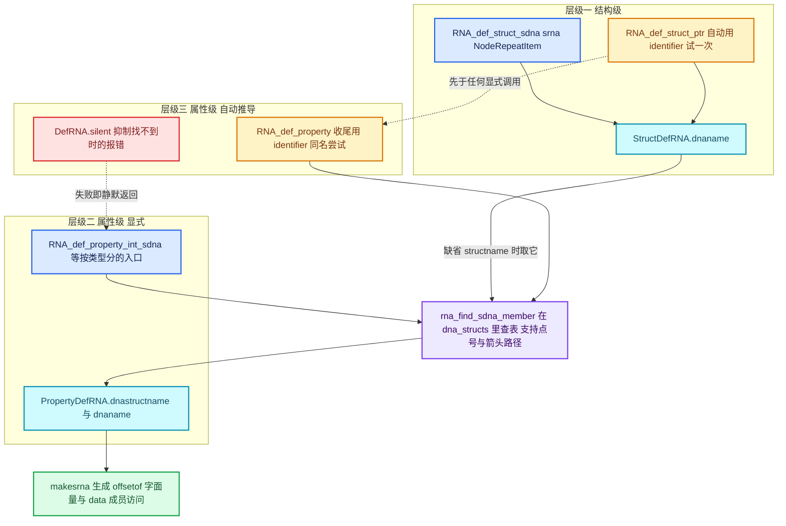

# 04 · RNA_def_struct_sdna 映射

[前置知识总入口](../README.md) · [本章导航](README.md) · [上一篇](03-PointerRNA与属性访问.md) · [下一篇](05-属性变更与更新通知.md)

> 基准：Blender `5.4.0-alpha`，本地工作树。本篇讲 RNA 与 DNA 的绑定——`RNA_def_struct_sdna` 与 `RNA_def_property_sdna` 如何把 C 结构字段映射成 RNA 属性，以及为什么这份映射只活在 makesrna 编译期。主要源码：[RNA_define.hh](../../../source/blender/makesrna/RNA_define.hh)（总行数 754）、[intern/rna_define.cc](../../../source/blender/makesrna/intern/rna_define.cc)（5232）、[intern/rna_internal.hh](../../../source/blender/makesrna/intern/rna_internal.hh)（`PropertyDefRNA` L71、`StructDefRNA` L102，文件总行数 753）。

## 先回答一个具体问题

**问题：`RNA_def_property(srna, "name", PROP_STRING, PROP_NONE)` 之后，运行时的 get/set 怎么知道要读写 C 结构的哪个字节？**

答案是：**它不知道，而且它永远不需要知道。**

这行代码执行时，`RNA_def_property` 顺手用 identifier `"name"` 去查 DNA 里有没有同名字段（[rna_define.cc L1339-L1378](../../../source/blender/makesrna/intern/rna_define.cc#L1339-L1378)）。查到了，就把 `dnastructname = "NodeRepeatItem"`、`dnaname = "name"`、`dnatype = "char"`、`dnapointerlevel = 1` 记进一个 `PropertyDefRNA`。这个名字字符串对最终二进制毫无价值——它只是 makesrna 里的一次临时查表凭据。

真正"知道字节位置"的是 makesrna 生成的那个 `.c/.cc` 文件：它把 `offsetof(NodeRepeatItem, name)` 写成**编译期字面量**塞进 `PropertyRNA` 的静态初始化列表（[makesrna.cc L1960-L1969](../../../source/blender/makesrna/intern/makesrna.cc#L1960-L1969)），同时把 `data->name` 这种**直接成员访问**写进 get/set 函数体。C 编译器再把 `data->name` 折叠成一条 `mov`。

所以完整链条是这样的：

| 阶段 | 存在什么 | 谁负责 |
| --- | --- | --- |
| makesrna 编译期 | 名字字符串（`"NodeRepeatItem"` / `"name"`）在 `PropertyDefRNA` 里 | `RNA_def_property_sdna` 系列 |
| makesrna 生成代码 | `offsetof(...)` 字面量 + `data->name` 表达式，写进 `rna_nodetree_gen.cc` | `rna_set_raw_offset` / `rna_def_property_get_func` |
| 运行期 | 只有编译好的偏移量与函数指针；名字字符串只剩 RNA 侧的 `identifier` | 生成的 `rna_RepeatItem_name_get` |

本篇就是把这三段拆开讲清楚。它有一个非常实用的推论：**DNA 与 RNA 之间的映射不是数据，是代码**。改 DNA 字段名而忘了改 RNA，报错发生在 makesrna 运行时（构建期），报错文本是 `"... (identifier "x") not found. Struct must be in DNA."`；而不是任何运行期异常。

## 三层映射总览

绑定发生在三个层级，优先级从"显式指定"到"自动推导"：



一句话记住三层：**结构级决定"这个 RNA 类型包裹哪个 C 结构"；属性级显式决定"这个属性对应哪个字段"；自动推导决定"identifier 与字段同名时可以什么都不写"。**

三层的关键差别在于 `structname` 参数：属性级的 `RNA_def_property_*_sdna(prop, structname, propname)` 里两个参数都可以传 `nullptr`，`nullptr` 意味着"回落到结构级的 `dnaname`"与"回落到 `prop->identifier`"（[rna_define.cc L2319-L2324](../../../source/blender/makesrna/intern/rna_define.cc#L2319-L2324)）。这就是为什么源码里铺天盖地都是 `RNA_def_property_int_sdna(prop, nullptr, "loc")` 这种写法——只覆盖字段名，结构沿用结构级绑定。

## StructDefRNA / PropertyDefRNA 全字段表

这两个结构是映射的全部载体，定义在 [rna_internal.hh L71-L115](../../../source/blender/makesrna/intern/rna_internal.hh#L71-L115)，整个块被 `#ifndef RNA_RUNTIME` 包住（L54 开、L121 闭）。

### PropertyDefRNA —— 一个属性一条

| 字段 | 类型 | 由谁写 | 用途 |
| --- | --- | --- | --- |
| `cont` / `prop` | `ContainerRNA *` / `PropertyRNA *` | `RNA_def_property` | 反查 RNA 侧对象 |
| `dnastructname` | `StringRefNull` | `rna_def_property_sdna` | 实际生效的 DNA 结构名，生成代码里 cast 的目标类型 |
| `dnastructfromname` | `StringRefNull` | 继承自 `StructDefRNA.dnafromname` | 借数据时用：`((From *)ptr->data)->prop` 里的 `From` |
| `dnastructfromprop` | `StringRefNull` | 继承自 `StructDefRNA.dnafromprop` | 借数据时穿过的那个字段名 |
| `dnaname` | `StringRefNull` | `rna_def_property_sdna` | DNA 字段名，生成代码里全部写成 `data-><dnaname>` |
| `dnatype` | `StringRefNull` | `rna_find_sdna_member` | 字段类型字符串，用于类型兼容检查与默认值解读 |
| `dnaarraylength` | `int` | `rna_find_sdna_member` | 由 `DNA_member_array_num` 从 `name[4][3]` 这类声明算出的元素总数 |
| `dnapointerlevel` | `int` | `rna_find_sdna_member` | 数 `member_name` 前导 `*` 的个数，决定 `char *` 与 `char[]` 的不同代码路径 |
| `dnadefaultdata` | `const void *` | `rna_default_data` | 指向 makesdna 生成的 `DNA_member_default_table`（`dna_defaults.cc`，由 [write_rna_defaults L691-L739](../../../source/blender/makesdna/intern/makesdna.cc#L691-L739) 为每个结构写下 `static const X DNA_DEFAULT_X = {};` 与 `&DNA_DEFAULT_X.member` 数组，makesrna 通过 `bf_dna_defaults` 链接进来），把 C++ 默认成员初始值变成 RNA 默认值 |
| `dnalengthstructname` | `StringRefNull` | `RNA_def_property_collection_sdna` | 只在 L2960 写入，**生成侧从不读取**（见下文反例） |
| `dnalengthname` | `StringRefNull` | `RNA_def_property_collection_sdna` | 长度存在兄弟字段时（如 `items_num`）的字段名 |
| `dnalengthfixed` | `int` | `RNA_def_property_collection_sdna` | `lengthpropname` 传空串时，把 `totarraylength` 冻结成固定长度 |
| `booleanbit` | `int64_t` | `RNA_def_property_boolean_sdna` | 位掩码；非零就走"读 `(data->x & bit) != 0`、写或/与非"这条路 |
| `booleannegative` | `bool` | `RNA_def_property_boolean_negative_sdna` | 语义取反（"隐藏"标志翻成"显示"布尔） |
| `enumbitflags` | `int` | `RNA_def_property_enum_bitflag_sdna` | 枚举按位标志写入：先清自己的掩码再或上新值，不动别人的位 |

`PropertyDefRNA` 用的是 `StringRefNull` 而不是 `std::string`——所有字符串都只是指向 `RNA_define.cc` 源码里字面量的借用视图，makesrna 进程结束即失效，这也侧面印证它不可能被带进运行期。

### StructDefRNA —— 一个类型一条

| 字段 | 用途 |
| --- | --- |
| `cont` | `ContainerDefRNA`，含 `cont`（`ContainerRNA *`）与 `properties`（`ListBaseT<PropertyDefRNA>`），结构级与属性级就是靠它串起来的 |
| `srna` | 反向指针，`rna_find_struct_def` 按它线性查表 |
| `filename` | 归属的 `rna_xxx.cc`，只被 [makesrna.cc L4331-L4333](../../../source/blender/makesrna/intern/makesrna.cc#L4331-L4333) 用来决定这个 struct 写进哪个 `rna_xxx_gen.cc` |
| `dnaname` | 本结构对应的 DNA 类型名——结构级绑定的唯一落点 |
| `dnafromname` | 派生结构借用数据的"从哪个结构出发" |
| `dnafromprop` | 派生结构借用数据的"穿过哪个字段"，典型值是 `"storage"` |
| `functions` | `ListBaseT<FunctionDefRNA>`，函数参数也是 `PropertyDefRNA`，所以同一套 sdna 机制也服务参数 |

查表函数值得注意：[rna_find_struct_def](../../../source/blender/makesrna/intern/rna_define.cc#L184-L196) 与 [rna_find_struct_property_def](../../../source/blender/makesrna/intern/rna_define.cc#L198-L222) 都是**从后往前的线性扫描**，后者还带一个"当前结构没找到就扫全部结构"的兜底循环。`DefRNA.structs` 里累积上千个结构（全仓库有 1036 处 `RNA_def_struct(brna, ...)` 调用），每次属性绑定都要走这条扫描，是纯构建期开销，不影响 Blender 本体性能。这也解释了为什么属性绑定必须发生在 makesrna 里而不是运行期：真要在运行期做同一种查找，代价不可接受。

## #ifndef RNA_RUNTIME：编译期专属

[rna_internal.hh](../../../source/blender/makesrna/intern/rna_internal.hh) 里三处守卫各有分工：

| 位置 | 包住什么 |
| --- | --- |
| L19-L21 | `#include "dna_parse.h"`——运行期不需要 DNA 头解析器 |
| L54-L121 | `ContainerDefRNA`、`FunctionDefRNA`、`PropertyDefRNA`、`StructDefRNA`、`AllocDefRNA` 五个定义期结构 |
| L133-L145 | `BlenderDefRNA` 里的 `dna_structs`、`structs`、`allocs`、`fallback` 四个成员 |

注意 L123 的 `BlenderDefRNA` **本体在两边都存在**：`laststruct`、`error`、`silent`、`verify`、`animate`、`make_overridable` 六个标量成员两边都有，只有 `/* Keep last. */` 注释之后的那批重量级容器被守卫掉了。`extern BlenderDefRNA DefRNA;`（L148）因此链接得进 `bf_rna`。

这个设计的直接后果，按严重程度排：

1. **运行期二进制里根本没有这些结构。** `StructRNA`（[rna_internal_types.hh L671](../../../source/blender/makesrna/intern/rna_internal_types.hh#L671)）里没有 `dna_struct` 字段，`PropertyRNA`（L398）里没有 `dna_prop` 字段——这不是"我们没找到"，而是定义期结构一旦消失，DNA 绑定就物理上无处存放。运行期唯一残留的是 `rawoffset` / `rawtype` 两个整数（[L476-L477](../../../source/blender/makesrna/intern/rna_internal_types.hh#L476-L477)），而它们是 makesrna 算好的编译期字面量，不是"可反查的名字"。
2. **同一份 `rna_define.cc` 被编译两遍。** 它是 [makesrna 可执行文件的 SRC](../../../source/blender/makesrna/intern/CMakeLists.txt#L227-L237)（不带 `RNA_RUNTIME`），同时又是 [bf_rna 的 SRC](../../../source/blender/makesrna/intern/CMakeLists.txt#L437-L441) 并在 L487 显式 `target_compile_definitions(bf_rna PRIVATE RNA_RUNTIME)`。`RNA_def_property` 里那一长串 `#ifndef RNA_RUNTIME` 分支不是历史包袱，是**一份源码两种角色**。
3. **`rna_xxx.cc` 完全不参与运行期链接。** 它们是 makesrna 的输入；`bf_rna` 编译的是 `GENSRC`，即由 `rna_([a-zA-Z0-9_-]*).cc` 正则映射出的 `rna_\1_gen.cc`（[CMakeLists.txt L147-L151](../../../source/blender/makesrna/intern/CMakeLists.txt#L147-L151)）。你打断点打在 `rna_nodetree.cc` 的 `RNA_def_*` 调用上，永远不会命中——那是构建期代码。

为什么这么设计？两条理由都成立。体积上，DNA 侧光 `DNA_*.h` 里就有 999 个 `struct` 顶层声明、上万成员，每成员带类型名/别名/数组维数/默认值指针；这张 `DefRNA.dna_structs` 表在运行期完全无人使用，留着纯属膨胀。解耦上，更本质：**运行期不该有能力"按名字找字段"**。RNA 的属性查找只认 `PropertyRNA::identifier`，字段布局是编译期事实；一旦允许运行期按 DNA 名字解析，`.blend` 兼容逻辑就会漂移到有未定义行为的那一侧。SDNA（磁盘侧的类型表）负责跨版本，RNA 的编译期绑定负责对 C++ 源码——两个方向不混。

## offset 是编译产物

`rawoffset` 的写入路径非常窄，值得完整走一遍。

第一步，判定能不能走 raw。[rna_set_raw_property](../../../source/blender/makesrna/intern/makesrna.cc#L1909-L1958) 开头两道 return 就是全部门槛：

```cpp
static void rna_set_raw_property(PropertyDefRNA *dp, PropertyRNA *prop)
{
  if (dp->dnapointerlevel != 0) { return; }
  if (dp->dnatype.is_empty() || dp->dnaname.is_empty() || dp->dnastructname.is_empty()) { return; }
  /* 之后是 10 个 if-else：char / int8_t / uchar / short / ushort / int / float / double /
   * int64_t / uint64_t，各自把 prop->rawtype 设成对应 PROP_RAW_*，并
   * prop->flag_internal |= PROP_INTERN_RAW_ACCESS; 其余类型不置位。 */
}
```

三个条件很硬：不能有指针级（指针不能当数组用）、三个名字都得非空、`dnatype` 必须落在那 10 个基本类型字符串里。注意 `dnatype` 已被 makesdna 的 `substitute_cpp_types` 归一化过：`eNodeSocketDatatype : short` 会先被换成底层类型 `short`，`int32_t` / `uint32_t` 统一成 `int`，`blender::float3` 展开成 `float` 并给 `member_name` 追加 `[3]`（[dna_parse.cc L762-L830](../../../source/blender/makesdna/intern/dna_parse.cc#L762-L830)）。**DNA 里写 `int32_t`，RNA 侧看到的 `dnatype` 是 `int`**——这是"为什么我的 `float3` 字段能被 RNA 当数组"的原因。

第二步，谁调用它。各类型的生成器只在"没有手写回调"时调用，例如 float 分支（[makesrna.cc L2093-L2106](../../../source/blender/makesrna/intern/makesrna.cc#L2093-L2106)）：标量时 `if (!fprop->get && !fprop->set)` 才 `rna_set_raw_property(dp, prop)`；数组时看 `getarray`/`setarray`。boolean 多一个条件：`if (!bprop->get && !bprop->set && !dp->booleanbit)`——位标志属性的读写要 mask，压根不能用 raw。

第三步，输出字面量。[rna_set_raw_offset](../../../source/blender/makesrna/intern/makesrna.cc#L1960-L1969) 只做一件事：`fprintf(f, "\toffsetof(%s, %s), RawPropertyType(%d)", dp->dnastructname.c_str(), dp->dnaname.c_str(), prop->rawtype);`。它把 makesrna 里的**字符串**拼成一段 **C 源码文本**，交给 C++ 编译器求值。调用点在 [L3647-L3652](../../../source/blender/makesrna/intern/makesrna.cc#L3647-L3652)：属性静态初始化列表里，带 `PROP_INTERN_RAW_ACCESS` 的写 `offsetof(...)`，否则写 `0, PROP_RAW_UNSET`——所以 `rawoffset == 0` 完全可能既是真偏移又是"没有 raw 访问"，判断必须用 flag 或 `rawtype`，不能用数值。

第四步，运行期唯一的消费者。`PROP_INTERN_RAW_ACCESS` 在整个 makesrna 里被读只有两处（[rna_access.cc L5462-L5484](../../../source/blender/makesrna/intern/rna_access.cc#L5462-L5484)，`RNA_property_collection_raw_array`）：

```cpp
  if (!(prop->flag_internal & PROP_INTERN_RAW_ARRAY) ||
      !(itemprop->flag_internal & PROP_INTERN_RAW_ACCESS)) { return 0; }
  /* ... */
  array->array = arrayp + itemprop->rawoffset;
  array->stride = internal->itemsize;
  array->len = (static_cast<char *>(internal->endptr) - arrayp) / internal->itemsize;
  array->type = itemprop->rawtype;
```

`PROP_INTERN_RAW_ARRAY` 由 makesrna 在集合迭代器恰好是标准数组迭代器时打上（[L2211-L2219](../../../source/blender/makesrna/intern/makesrna.cc#L2211-L2219)：`next == "rna_iterator_array_next" && get == "rna_iterator_array_get"`）。也就是说 raw 通路**只服务"整个数组一次性搬运"这一种需求**（如顶点坐标批量读写），单个属性的常规 get/set 从不看 `rawoffset`，走的是生成的函数指针。

结论：运行期查不到"某字段在结构里的位置"。你能问的只有两个问题——"这个属性的 raw 类型是什么"（[RNA_property_raw_type](../../../source/blender/makesrna/intern/rna_access.cc#L5987-L6006)，注意它在 `PROP_RAW_UNSET` 时还会**猜**一个类型返回，纯为方便构造数组）与"这个集合能不能按 raw 数组取"。想问"DNA 里 `loc` 的偏移是多少"？没有这种 API。

## 自动 sdna 绑定

两处自动尝试，一结构一属性，构成"大多数属性不写 `_sdna` 也能工作"的机制。

结构级在 [RNA_def_struct_ptr L866-L867](../../../source/blender/makesrna/intern/rna_define.cc#L866-L867)，注释写得很直白：

```cpp
  /* in preprocess, try to find sdna */
  RNA_def_struct_sdna(srna, srna->identifier.c_str());
```

属性级在 [rna_def_property L1339-L1378](../../../source/blender/makesrna/intern/rna_define.cc#L1339-L1378)，按 `type` 分七路，模式完全一致：

```cpp
    case PROP_STRING: {
      DefRNA.silent = true;
      RNA_def_property_string_sdna(prop, nullptr, identifier.c_str());
      DefRNA.silent = false;
      break;
    }
```

`silent` 的作用点在 [rna_def_property_sdna L2326-L2329](../../../source/blender/makesrna/intern/rna_define.cc#L2326-L2329)：找不到成员时先判 `DefRNA.silent`，为真就直接 `return nullptr`，不报错也不置 `DefRNA.error`。它是**成对手动开闭**的普通布尔，不是 RAII，中途 return 的路径（`rna_def_property_boolean_sdna` 里若干类型错误检查）有留下 `silent = true` 的隐患。这个隐患之所以要紧，是因为 `DefRNA` **在整个 makesrna 进程里只有一份、只初始化一次**：`brna = RNA_create()` 在 [L4319](../../../source/blender/makesrna/intern/makesrna.cc#L4319) 只调用一次，随后 [L4321-L4336](../../../source/blender/makesrna/intern/makesrna.cc#L4321-L4336) 的循环把所有 `PROCESS_ITEMS` 的 `define` 函数依次跑完，`RNA_define_free` 到 [L4440](../../../source/blender/makesrna/intern/makesrna.cc#L4440) 才收尾。`DefRNA.structs` 是跨文件累积的——这正是 `StructDefRNA.filename` 存在的理由（L4331-L4333 给尚未标名的 struct 打上当前文件名，生成阶段再按 `ds->filename == filename` 分拣）。同理 `DefRNA.error` 是粘性的：任何一个 `rna_xxx.cc` 出错，整个 makesrna 退出码就是失败，后面的文件照样跑但产物被 `make_bad_file` 污染。

`inspection_index` 是最干净的实例。[rna_nodetree.cc L8087](../../../source/blender/makesrna/intern/rna_nodetree.cc#L8087)：

```cpp
  prop = RNA_def_property(srna, "inspection_index", PROP_INT, PROP_NONE);
  RNA_def_property_ui_range(prop, 0, INT32_MAX, 1, -1);
  RNA_def_property_ui_text(prop, "Inspection Index", /* ... */);
  RNA_def_property_update(prop, NC_NODE, "rna_Node_update");
```

四行里没有任何 `_sdna`。而 DNA 侧 `NodeGeometryRepeatOutput::inspection_index`（[DNA_node_types.h L3569](../../../source/blender/makesdna/DNA_node_types.h#L3569)）确实存在，结构级又已由 `RNA_def_struct_sdna_from(srna, "NodeGeometryRepeatOutput", "storage")`（[L8061](../../../source/blender/makesrna/intern/rna_nodetree.cc#L8061)）绑好。自动尝试于是命中，`dnatype = "int"` 顺带把 `hardmin/hardmax` 设成 `INT_MIN/INT_MAX`（[L2568-L2573](../../../source/blender/makesrna/intern/rna_define.cc#L2568-L2573)）——这就是"不写 `_sdna` 但范围正确"的原因。

**判据（什么时候可以不写）：**

| 条件 | 可以不写 `_sdna` 吗 |
| --- | --- |
| RNA identifier 与 DNA 字段名逐字符相同，且结构级已绑定，且类型兼容 | 可以 |
| 名字不同（`repeat_items` vs `items`） | 必须写 |
| 布尔来自位掩码字段（`flag` 的某一位） | 必须写 `boolean_sdna` 并带 bit |
| 属性无对应 DNA 字段（运行时算出、或存在别处） | 必须给回调；且自动尝试会静默失败 |
| DNA 类型是 RNA 类型的不兼容包装（float 当 int 用） | 写 `int_sdna` 会在非 silent 路径报错，必须给回调 |
| 结构级未绑定（`RNA_define_verify_sdna(false)` 保护区间内） | 可以不写，但必须自带全部回调 |

`RNA_define_verify_sdna(false)`（[L630-L633](../../../source/blender/makesrna/intern/rna_define.cc#L630-L633)）是第四种逃生门：`verify` 为假时，`rna_def_property_sdna` 走 [L2330-L2337](../../../source/blender/makesrna/intern/rna_define.cc#L2330-L2337) 那条"凑一份基本值"的路——填上 `dnastructname`/`dnaname` 但不填 `dnatype`，`dnaarraylength` 对 boolean 给 1 其余给 0。源码注释原文是 `some basic values to survive even with sdna info`。全仓库有 28 处调用（`rna_render.cc`、`rna_wm_gizmo.cc`、`rna_ui.cc` 等），都是"这个 RNA 结构不在 DNA 里"的场景。

## RNA_def_struct_sdna_from / property_sdna_from

结构级借用写在 [rna_define.cc L965-L988](../../../source/blender/makesrna/intern/rna_define.cc#L965-L988)：

```cpp
void RNA_def_struct_sdna_from(StructRNA *srna, const char *structname, const char *propname)
{
  StructDefRNA *ds = rna_find_def_struct(srna);
  if (ds->dnaname.is_empty()) {
    CLOG_ERROR(&LOG, "%s base struct must know DNA already.", structname);
    return;                     /* 注意：没有 DefRNA.error = true */
  }
  /* ... 再检查 structname 在 parsed dna 里存在，不存在才 silent/报错 ... */
  if (propname) { ds->dnafromprop = propname; }
  ds->dnaname = structname;
}
```

两个细节值得注意。**`propname` 为 `nullptr` 时只换 `dnaname`，不动 `dnafromprop`**——于是先前设定的穿越路径继续沿用。这支撑了一个非常实用的写法：`def_sh_uvmap` 在 [L6516-L6522](../../../source/blender/makesrna/intern/rna_nodetree.cc#L6516-L6522) 先 `sdna_from(srna, "NodeShaderUVMap", "storage")`、定义 `uv_map` 属性、再 `sdna_from(srna, "bNode", nullptr)` 把结构级绑定**切回 `bNode`**。三段合起来的效果是：属性阶段 `dnastructname = "NodeShaderUVMap"` 且穿越路径 `"storage"` 仍生效，生成的 data 行是 `NodeShaderUVMap *data = (NodeShaderUVMap *)(((bNode *)ptr->data)->storage);`；函数阶段因为 `dnaname` 已回到 `bNode`，`_self` 就是 `bNode *`（[L2479-L2483](../../../source/blender/makesrna/intern/makesrna.cc#L2479-L2483) 优先用 `dnafromname`，此处同为 `bNode`），函数签名与真实 C++ 实现匹配。所以同一 struct 定义过程中**多次调用 `sdna_from` 是常规操作**，`rna_nodetree.cc` 里 90 次 `sdna_from` 有相当一部分就是这种"属性用 storage、函数用 bNode"的收尾切换。

继承发生在 [RNA_def_struct_ptr L862-L864](../../../source/blender/makesrna/intern/rna_define.cc#L862-L864)：`if (dsfrom && !dsfrom->dnaname.is_empty()) { ds->dnafromname = dsfrom->dnaname; }`。注意是**基类的 `dnaname` 变成派生类的 `dnafromname`**，方向别搞反。`ShaderNodeUVMap` 的 `dnafromname = "bNode"` 来自基类 `ShaderNode`，而 `ShaderNode` 的 `bNode` 又由 [L9583](../../../source/blender/makesrna/intern/rna_nodetree.cc#L9583) 显式设定（它自己的自动尝试用 identifier `"ShaderNode"`，同样盲写成功、随后被覆盖）。链路只走**一层**：`dnafromname` 取基类的 `dnaname`，不递归取基类的 `dnafromname`。

生效点在生成侧的 [rna_print_data_get](../../../source/blender/makesrna/intern/makesrna.cc#L330-L346)，全 makesrna 只有这一个地方同时消费 `dnastructfromname` 与 `dnastructfromprop`：

```cpp
static void rna_print_data_get(FILE *f, PropertyDefRNA *dp)
{
  if (!dp->dnastructfromname.is_empty() && !dp->dnastructfromprop.is_empty()) {
    fprintf(f, "    %s *data = (%s *)(((%s *)ptr->data)->%s);\n", /* ... */);
  }
  else {
    fprintf(f, "    %s *data = (%s *)(ptr->data);\n", /* ... */);
  }
}
```

拿 Repeat 实例化一遍。`GeometryNodeRepeatOutput` 的基类链最终落到绑 `bNode` 的节点结构，`def_geo_repeat_output` 又设 `sdna_from(..., "NodeGeometryRepeatOutput", "storage")`，于是 `dnastructfromname = "bNode"`、`dnastructfromprop = "storage"`、`dnastructname = "NodeGeometryRepeatOutput"`。生成的每个 get 前缀都是：

```c
NodeGeometryRepeatOutput *data = (NodeGeometryRepeatOutput *)(((bNode *)(ptr->data))->storage);
```

函数生成的 `_self` 也走同一逻辑（[L2396-L2401](../../../source/blender/makesrna/intern/makesrna.cc#L2396-L2401)、[L3137-L3141](../../../source/blender/makesrna/intern/makesrna.cc#L3137-L3141)），优先级都是 `dnafromprop` 优先于 `dnaname`。

典型场景归纳成表：

| 场景 | 写法 | 例子 |
| --- | --- | --- |
| RNA 结构包裹的指针字段是 `void *`，真实类型是另一个 DNA 结构 | `sdna_from(srna, "真实类型", "穿过字段")` | 节点：`"NodeGeometryRepeatOutput", "storage"`（全仓库 194 处调用之一）；约束：`"bChildOfConstraint", "data"`；序列器：`"WipeVars", "effectdata"` |
| RNA 类型与 DNA 类型无字段可穿，仅换名 | `sdna_from(srna, "bNode", nullptr)` | `rna_nodetree.cc` L6522 / L6535 / L6738 等 |
| 属性借用别的结构 | `RNA_def_property_int_sdna(prop, "Scopes", "accuracy")` | [rna_color.cc L1366](../../../source/blender/makesrna/intern/rna_color.cc#L1366)、[rna_constraint.cc L995](../../../source/blender/makesrna/intern/rna_constraint.cc#L995) |
| 属性借用嵌套字段 | propname 用点号/箭头路径 | `RNA_def_property_float_sdna(prop, nullptr, "r.cfra")`（[rna_scene.cc L9339](../../../source/blender/makesrna/intern/rna_scene.cc#L9339)）、`"overlay.flag"`、`"deep_hash.data"` |

注意第三行：属性级 `structname` 传非空是"跳过结构级绑定、直接指定 DNA 结构"，这是 `RNA_def_struct_sdna` 之外的第二套逃生门。`rna_find_sdna_member` 里对路径递归的处理（[L367-L384](../../../source/blender/makesrna/intern/rna_define.cc#L367-L384)）有一句关键注释：`The return value for nested structs is ignored, to allow recursing into runtime structs not covered by DNA`——嵌套进一个非 DNA 类型时**不报错**，这让 `a.b.c` 这种路径能部分解析。

## 数组与指针级

三个字段决定数组/指针属性怎么生成。

**`dnaarraylength`** 由 [rna_find_sdna_member L355-L357](../../../source/blender/makesrna/intern/rna_define.cc#L355-L357) 写入：路径完全匹配时取 `DNA_member_array_num(pm.member_name)`，路径带 `[` 时给 0。`DNA_member_array_num`（[dna_utils.cc L28-L57](../../../source/blender/makesdna/intern/dna_utils.cc#L28-L57)）把字符串里所有方括号数字连乘，`float mat[4][4]` 得 16。绑定成功后 [L2347-L2355](../../../source/blender/makesrna/intern/rna_define.cc#L2347-L2355) 会**反向覆盖 RNA 侧**：`dnaarraylength > 1` 时设 `arraylength[0]`、`totarraylength`、`arraydimension = 1`；否则把 `arraydimension` 归零。也就是说 DNA 声明里的 `[3]` 会自动让 RNA 属性变成三维数组，`RNA_def_property_array` 通常只是重复声明同一件事——`Object.location`（[rna_object.cc L3190-L3195](../../../source/blender/makesrna/intern/rna_object.cc#L3190-L3195)）绑 `loc` 之后完全不写 `_array`，长度全靠 DNA 告知。

但字符串与指针是例外：`RNA_def_property_string_sdna`（[L2864-L2869](../../../source/blender/makesrna/intern/rna_define.cc#L2864-L2869)）把 DNA 数组长度**转成 `maxlength`** 然后把 `arraydimension` 归零（`char name[64]` 是 64 字节的字符串，不是 64 个元素的 char 数组）；`pointer_sdna`（[L2897-L2907](../../../source/blender/makesrna/intern/rna_define.cc#L2897-L2907)）与 `enum_sdna`（L2793-L2802）直接把数组维度清掉并报错 `array not supported`。`collection_sdna` 里 L2929-L2937 同理——集合属性带数组维度会报错，因为数组套数组走不通迭代器。

**`dnapointerlevel`** 由成员名前导 `*` 个数决定（[L358-L361](../../../source/blender/makesrna/intern/rna_define.cc#L358-L361)）。消费点分三类：

| level | 生成什么 | 位置 |
| --- | --- | --- |
| 1 + STRING | `if (data->x == nullptr) { *value = '\0'; return; }` 再 `strcpy`；set 侧 `MEM_delete` 后 `MEM_new_array_uninitialized<char>` | [L716-L722](../../../source/blender/makesrna/intern/makesrna.cc#L716-L722)、[L1132-L1144](../../../source/blender/makesrna/intern/makesrna.cc#L1132-L1144) |
| 1 + LISTBASE 集合 | `rna_iterator_listbase_begin(iter, ptr, data->x, nullptr)`（不取地址） | [L1625-L1629](../../../source/blender/makesrna/intern/makesrna.cc#L1625-L1629) |
| 0 + LISTBASE 集合 | `..._begin(iter, ptr, &data->x, nullptr)`（取地址，因为字段是内嵌 `ListBase`） | [L1620-L1624](../../../source/blender/makesrna/intern/makesrna.cc#L1620-L1624) |
| ≥2 + 数组集合 | 迭代器 get 换成 `rna_iterator_array_dereference_get` | [L2968-L2973](../../../source/blender/makesrna/intern/rna_define.cc#L2968-L2973) |
| 任何非 0 | 直接封死 raw 访问（`rna_set_raw_property` 首行 return） | [L1911-L1913](../../../source/blender/makesrna/intern/makesrna.cc#L1911-L1913) |

`NodeRepeatItem::name` 是 `char *`，所以 level = 1，走"分配/释放"路线而不是 `BLI_strncpy_utf8`（后者是 `char[]` 字段，如 `ID::name`）。这一位差别决定了改名的内存管理归谁，也解释了为什么 `set_item_name_and_make_unique` 这类手写 setter 值得存在——自动生成的版本只会 free+malloc，不会去重。

**`dnalengthname`** 解决"长度不在数组自己身上"的问题。`RNA_def_property_collection_sdna(prop, structname, propname, lengthpropname)` 是四参数版本，第四个就是兄弟字段名：

```cpp
  prop = RNA_def_property(srna, "repeat_items", PROP_COLLECTION, PROP_NONE);
  RNA_def_property_collection_sdna(prop, nullptr, "items", "items_num");
```

（[rna_nodetree.cc L8063-L8064](../../../source/blender/makesrna/intern/rna_nodetree.cc#L8063-L8064)）对应 DNA 的 `NodeRepeatItem *items` + `int items_num`。生成侧在两个函数里消费它：`length` 出 `data->items_num`（[L1545-L1549](../../../source/blender/makesrna/intern/makesrna.cc#L1545-L1549)），`begin` 把它交给 `rna_iterator_array_begin(iter, ptr, data->items, sizeof(data->items[0]), data->items_num, 0, nullptr)`（[L1597-L1604](../../../source/blender/makesrna/intern/makesrna.cc#L1597-L1604)）；另有若干处判断"有没有长度可用"，合起来在 `makesrna.cc` 里共 8 处读取。

`lengthpropname` 传**空串**（不是 `nullptr`）时走固定长度分支：`dnalengthfixed = prop->totarraylength` 并清掉数组维度（[L2954-L2958](../../../source/blender/makesrna/intern/rna_define.cc#L2954-L2958)）。`nullptr` 则完全不管长度。三种取值语义各不同，这是最容易写错的地方之一。另外注意 `items` 字段本身是 `NodeRepeatItem *`（非 `**`），`dnapointerlevel` 为 1，所以迭代器 get 用普通 `rna_iterator_array_get`。

## 完整实例：`rna_def_node_item_array_socket_item_common`

这段是所有 item 类型共用的属性定义器，20 处调用点（`RepeatItemsAccessor`、`GeoViewerItemsAccessor`、`FileOutputItemsAccessor` 等），定义在 [rna_nodetree.cc L4951-L5006](../../../source/blender/makesrna/intern/rna_nodetree.cc#L4951-L5006)。

先看它的宿主结构（`RepeatItem`）怎么绑：

```cpp
static void rna_def_geo_repeat_item(BlenderRNA *brna)
{
  StructRNA *srna = RNA_def_struct(brna, "RepeatItem", nullptr);
  RNA_def_struct_ui_text(srna, "Repeat Item", "");
  RNA_def_struct_sdna(srna, "NodeRepeatItem");

  rna_def_node_item_array_socket_item_common(srna, "RepeatItemsAccessor", true);
}
```

（[L8033-L8040](../../../source/blender/makesrna/intern/rna_nodetree.cc#L8033-L8040)）这里有个容易读错的机制细节：`RNA_def_struct` 内部确实先用 identifier `"RepeatItem"` 自动调过一次 `RNA_def_struct_sdna`（[L866-L867](../../../source/blender/makesrna/intern/rna_define.cc#L866-L867)），而 [RNA_def_struct_sdna 的实现 L943-L963](../../../source/blender/makesrna/intern/rna_define.cc#L943-L963) **根本不检查这个名字在 DNA 里存不存在**——存在性检查那段被 `#  if 0` 整块禁用了，注释解释原因：`There are far too many structs which initialize without valid DNA struct names`。于是 `StructDefRNA.dnaname` 被无条件写成 `"RepeatItem"`，一个不存在的 DNA 结构名。真正否决它的是后面属性级的 `rna_find_sdna_member`：`rna_find_parsed_struct_index("RepeatItem")` 返回 `-1`，直接 `false`，所有属性静默绑定失败。紧接着那句显式 `RNA_def_struct_sdna(srna, "NodeRepeatItem")` 把 `dnaname` 覆盖掉，之后的属性绑定才有落点。**顺序在这里是安全的**（属性级绑定发生在后面的 common 函数里），反过来写则全部属性静默失联，症状是 Python 读该属性恒为默认值而构建一片绿。

DNA 侧（[DNA_node_types.h L3543-L3552](../../../source/blender/makesdna/DNA_node_types.h#L3543-L3552)）只有四个字段：`char *name`、`eNodeSocketDatatype socket_type`、`char _pad[2]`、`int identifier`。

逐属性标注绑定方式：

| RNA 属性 | 类型 | DNA 字段 | 绑定方式 |
| --- | --- | --- | --- |
| `name` | STRING | `name`（`char *`） | **自动**（identifier 同名命中），setter 手写 |
| `socket_type` | ENUM | `socket_type`（`short`） | **自动**，只有 `itemf` 手写 |
| `vector_socket_dimensions` | INT | 宿主 item 才有 | **显式** `int_sdna`，但名字与 identifier 相同，属重复声明 |
| `color` | FLOAT 数组 4 | 无 | **不绑 DNA**，`float_funcs` 给手写 get，自动尝试静默失败 |

注意此函数内**没有任何一处结构级依赖失败**：`color` 找不到 `NodeRepeatItem.color` 时 `DefRNA.silent` 为真，静默返回，之后 `RNA_def_property_float_funcs` 补上 get，`RNA_def_property_clear_flag(prop, PROP_EDITABLE)` 让 set 生成器第一行就 return（[L1097-L1099](../../../source/blender/makesrna/intern/makesrna.cc#L1097-L1099)），于是"既无 DNA 绑定又无 setter"不报错。这是"纯派生属性"的标准配方。

对照一个显式位标志的邻居 `NodeGeometryViewerItem.auto_remove`（[L8106-L8107](../../../source/blender/makesrna/intern/rna_nodetree.cc#L8106-L8107)）：

```cpp
  prop = RNA_def_property(srna, "auto_remove", PROP_BOOLEAN, PROP_NONE);
  RNA_def_property_boolean_sdna(prop, nullptr, "flag", NODE_GEO_VIEWER_ITEM_FLAG_AUTO_REMOVE);
```

RNA 名 `auto_remove`，DNA 字段 `flag`，还带一个 bit——三重不同，必须全写。同一 item 结构上的兄弟字段则演示另一种写法：`NodeCompositorFileOutputItem` 的 `override_node_format` 与 `save_as_render` 是 `char` 标量（[DNA_node_types.h L2395-L2398](../../../source/blender/makesdna/DNA_node_types.h#L2395-L2398)），对应 RNA 里 `RNA_def_property_boolean_sdna(prop, nullptr, "override_node_format", 1)`（[rna_nodetree.cc L7101-L7102](../../../source/blender/makesrna/intern/rna_nodetree.cc#L7101-L7102)）——名字与 identifier 相同，`booleanbit` 给 `1`。这一句其实是**冗余的**（自动绑定同样成立），但显式写出来能让 `booleanbit = 1` 这个意图留在源码里；位掩码布尔（`flag` + 具名常量）与标量布尔（自己的 `char` 字段）两种包装并存，正是 item 结构常见的样子。

<details>
<summary>展开：<code>rna_def_node_item_array_socket_item_common</code> 原文摘录（L4951-L5006）</summary>

```cpp
static void rna_def_node_item_array_socket_item_common(
    StructRNA *srna,
    const char *accessor,
    const bool add_socket_type,
    const bool add_vector_socket_dimensions = false)
{
  static LinearAllocator<> allocator;
  PropertyRNA *prop;

  /* 四段 SNPRINTF 只是把 accessor 拼进回调名，随后各自 allocator.copy_string：
   *   name_set_func      = "rna_Node_ItemArray_item_name_set<%s>"
   *   item_update_func   = "rna_Node_ItemArray_item_update<%s>"
   *   socket_type_itemf  = "rna_Node_ItemArray_socket_type_itemf<%s>"
   *   color_get_func     = "rna_Node_ItemArray_item_color_get<%s>"  */

  prop = RNA_def_property(srna, "name", PROP_STRING, PROP_NONE);
  RNA_def_property_string_funcs(
      prop, nullptr, nullptr, allocator.copy_string(name_set_func).c_str());
  RNA_def_property_ui_text(prop, "Name", "");
  RNA_def_struct_name_property(srna, prop);
  RNA_def_property_update(prop, NC_NODE | NA_EDITED, item_update_func_ptr);

  if (add_socket_type) {
    prop = RNA_def_property(srna, "socket_type", PROP_ENUM, PROP_NONE);
    RNA_def_property_enum_items(prop, rna_enum_node_socket_data_type_items);
    RNA_def_property_enum_funcs(
        prop, nullptr, nullptr, allocator.copy_string(socket_type_itemf).c_str());
    RNA_def_property_ui_text(prop, "Socket Type", "");
    RNA_def_property_clear_flag(prop, PROP_ANIMATABLE);
    RNA_def_property_update(prop, NC_NODE | NA_EDITED, item_update_func_ptr);

    if (add_vector_socket_dimensions) {
      prop = RNA_def_property(srna, "vector_socket_dimensions", PROP_INT, PROP_NONE);
      RNA_def_property_int_sdna(prop, nullptr, "vector_socket_dimensions");
      RNA_def_property_range(prop, 2, 4);
      RNA_def_property_clear_flag(prop, PROP_ANIMATABLE);
      RNA_def_property_ui_text(prop, "Dimensions", "Dimensions of the vector socket");
      RNA_def_property_update(prop, NC_NODE | NA_EDITED, item_update_func_ptr);
    }
  }

  prop = RNA_def_property(srna, "color", PROP_FLOAT, PROP_COLOR_GAMMA);
  RNA_def_property_array(prop, 4);
  RNA_def_property_float_funcs(
      prop, allocator.copy_string(color_get_func).c_str(), nullptr, nullptr);
  RNA_def_property_clear_flag(prop, PROP_EDITABLE);
  RNA_def_property_ui_text(
      prop, "Color", "Color of the corresponding socket type in the node editor");
}
```

其中 `LinearAllocator<>` 的存在值得留意：`RNA_def_property_string_funcs` 只把**字符串指针**存进 `PropertyRNA`，真正使用它的是 makesrna 生成阶段（[L3499-L3506](../../../source/blender/makesrna/intern/rna_define.cc#L3499-L3506)），生命周期跨过整个 define 过程，栈上的 `char name_set_func[128]` 会立刻失效，所以必须 `allocator.copy_string`。`item_update_func` 存成 `const char *` 复用也出于同一理由。

</details>

## 用小数据走一遍：`NodeRepeatItem.name`

三级旅程，每级都给出实际产物。

**第一级 · 编译期（makesrna 进程内）**

`RNA_def_struct(brna, "RepeatItem", nullptr)` → `StructDefRNA.dnaname` 先被盲写成 `"RepeatItem"`（结构级不校验，见上文），随后 `RNA_def_struct_sdna(srna, "NodeRepeatItem")` 覆盖它。

`RNA_def_property(&srna->cont, "name", PROP_STRING, PROP_NONE)` → 建 `PropertyDefRNA`，收尾自动尝试 → `rna_find_sdna_member("NodeRepeatItem", "name", dp)` → 在 `DefRNA.dna_structs` 里找到 `NodeRepeatItem`，其成员 `char *name`，`DNA_member_id_string_ref` 剥掉 `*` 得 `name`，路径完全匹配 → 填 `dnatype = "char"`、`dnaarraylength = 1`（`DNA_member_array_num("*name")` 无方括号返回 1）、`dnapointerlevel = 1`、`dnadefaultdata` 指向 makesdna 生成的默认实例中该成员。

因为 `dnaarraylength` 不大于 1，[L2347-L2355](../../../source/blender/makesrna/intern/rna_define.cc#L2347-L2355) 把 `arraydimension = 0`、`totarraylength = 0`。随后 `RNA_def_property_string_sdna` 里的 `if (prop->arraydimension)` 分支不进入，`maxlength` 保持未设。

`RNA_def_property_string_funcs(prop, nullptr, nullptr, "rna_Node_ItemArray_item_name_set<RepeatItemsAccessor>")` → `sprop->set` = 手写函数名（**字符串**，此刻还不是指针）。

**第二级 · 生成（`rna_nodetree_gen.cc`）**

`RNA_def_property_string_funcs` 在 `#ifndef RNA_RUNTIME` 之内（[L3486-L3517](../../../source/blender/makesrna/intern/rna_define.cc#L3486-L3517)），运行期的 `bf_rna` 里根本没有这个符号——这正是"手写回调用字符串传递"的原因：makesrna 阶段还没有那个函数的地址，只能传名字，生成期再拼进代码。

string 分支生成 get（[L704-L745](../../../source/blender/makesrna/intern/makesrna.cc#L704-L745)），`dnapointerlevel == 1` 走分配字符串路径。length 出 `return (data->name == nullptr) ? 0 : strlen(data->name);`（[L1496-L1501](../../../source/blender/makesrna/intern/makesrna.cc#L1496-L1501)）。set 因为有 `manualfunc` 变成薄包装（[L1124-L1127](../../../source/blender/makesrna/intern/makesrna.cc#L1124-L1127)）。产物大致是：

```c
void rna_RepeatItem_name_get(PointerRNA *ptr, char *value)
{
    NodeRepeatItem *data = (NodeRepeatItem *)(ptr->data);
    if (data->name == nullptr) { *value = '\0'; return; }
    strcpy(value, data->name);
}
void rna_RepeatItem_name_set(PointerRNA *ptr, const char *value)
{
    PropStringSetFunc fn = rna_Node_ItemArray_item_name_set<RepeatItemsAccessor>;
    fn(ptr, value);
}
```

`PROP_INTERN_RAW_ACCESS` 这条路走不通：`rna_set_raw_property` 对 `PROP_STRING` 从不调用，且 `dnapointerlevel != 0` 也会先 return。所以 `rawoffset = 0, rawtype = PROP_RAW_UNSET`（[L3651](../../../source/blender/makesrna/intern/makesrna.cc#L3651)）。

**第三级 · 运行期**

`RNA_property_string_get(ptr, prop)` → `property_string_get`（[rna_access.cc L4165-L4190](../../../source/blender/makesrna/intern/rna_access.cc#L4165-L4190)）：先 `property_string_length_storage` 调 `sprop->length(ptr)` 拿长度，`resize` 一个 `std::string`，再 `sprop->get(ptr, string_ret.data())` 让生成的 get 填进去。全程没有一次"查字段名"，只有两次函数指针调用。

`ptr->data` 指向哪个 `NodeRepeatItem`？来自集合迭代器：`repeat_items` 的 `begin` 用 `rna_iterator_array_begin(..., data->items, sizeof(data->items[0]), data->items_num, ...)`，`get` 把 `internal->ptr` 包成 `PointerRNA{type = &RNA_RepeatItem, data = <数组元素地址>}`。于是 `RNA_RepeatItem` 的 `name` 属性直接对 item 地址做 `data->name`——一个整条链上没有任何字符串参与的机器码级访问。

## 反例与边界

以下每条都对应一次真实的踩坑或一次真实的设计取舍。

**1. 以为改了 DNA 字段顺序或名字不用重跑 makesrna。** `rna_nodetree.cc` 一行都没变，但 `NodeRepeatItem` 字段搬了家。因为绑定关系存在**字符串名字**里、偏移量是编译期求值，结果分两种：改名 → makesrna 报 `not found. Struct must be in DNA.`，构建直接失败；纯调序 → makesrna 输出里 `offsetof` 文本没变，但 `rna_xxx_gen.cc` 依赖 DNA 头文件，仍会被重编译，正确性靠 C 编译器重新求值保证。**没有"只重编 DNA、不动 RNA"这条路**：`DNA_member_default_table`（[makesdna.cc L732](../../../source/blender/makesdna/intern/makesdna.cc#L732)）也是生成物，默认值会跟着漂。

**2. 以为没写 `_sdna` 就是没绑定。** `inspection_index` 是活例子：四行代码零 `_sdna`，绑定完全生效。判断是否绑定的唯一权威手段是看构建有没有报 `not found`、以及属性是否真的能读写——**不是看代码里有没有显式调用**。副作用：如果 DNA 里存在一个同名字段但其实你不想暴露它，自动绑定会静默把它绑上，你反而要改名或给回调来阻止。

**3. 以为运行期能按名字查字段偏移。** 不能。`rawoffset` 有值不代表可反查名字：`PropertyRNA` 里存的是整数偏移，对应的 DNA 字段名**在生成完就被丢弃了**。唯一接近"反射到 DNA"的入口是 `RNA_property_collection_raw_array`，它要求集合有 `PROP_INTERN_RAW_ARRAY`、项属性有 `PROP_INTERN_RAW_ACCESS`，否则 `return 0`。

**4. RNA 属性名与 DNA 名不一致却忘了 `_sdna`。** 典型如 `repeat_items` vs `items`、`auto_remove` vs `flag`。忘写的症状是构建期报错，看起来却像"字段明明存在"——因为报的是 `structname.propname not found` 这一对，人容易去核对 propname 而忽略其实整条路径来自 identifier。

**5. boolean 位域靠 `booleanbit`，不靠新开字段。** `flag` 上挂十几个 `boolean_sdna` 是正常做法（`rna_space.cc` 里 `"overlay.flag"` 出现 35 次）。误判的样子是"给每个开关加一个 `char` 字段"，代价是 DNA 体积、序列化兼容和 padding。反过来的边界是：同一字段上多个 bit 属性**必须**都带正确 mask，否则自动生成的赋值 `data->flag = uint64_t(value)`（无 mask 版本）会整字覆盖——这正是 `enum_bitflag_sdna` 存在的理由，其注释明说"Otherwise, setting one RNA property may affect unrelated bitflags"。

**6. `booleanbit` 必须在 `RNA_def_property_array` 之后才生效。** [L2465-L2468](../../../source/blender/makesrna/intern/rna_define.cc#L2465-L2468) 有原文注释：bitset array 情形下 `RNA_def_property_array` 是在 `dp->booleanbit` 定义**之前**被调用的，于是 `RNA_def_property_array` 里那段"位标志布尔不能包装标量 DNA 成员"的检查（[L1521-L1534](../../../source/blender/makesrna/intern/rna_define.cc#L1521-L1534)）**不会触发**。校验有洞，靠 `rna_def_property_boolean_sdna` 内部自己的范围检查（`bit_index + length > max_length`，[L2440-L2461](../../../source/blender/makesrna/intern/rna_define.cc#L2440-L2461)）兜住。

**7. 有符号类型的最左位不能用。** `is_dnatype_boolean_bitshift_fullrange_compat`（[rna_internal_types.hh L790-L797](../../../source/blender/makesrna/intern/rna_internal_types.hh#L790-L797)）把 `int`、`int64_t`、`uint64_t` 排除在全范围之外，注释解释 C++ 对负数左移是算术移位。后果：`RNA_def_property_boolean_bitset_array_sdna(prop, nullptr, "protectflag", OB_LOCK_LOCX, 3)` 这类写法，容量比 `sizeof(type) * 8` 少 1 位——`int` 只有 31 位可用。

**8. 结构级 `RNA_def_struct_sdna` 不校验结构名是否存在，** 见上文 `#  if 0`。传错 DNA 结构名（比如把 `NodeRepeatItem` 写成 `RepeatItem`）**不会有任何报错**，只表现为该结构下所有属性静默失联。这是本篇认为最隐蔽的一条：错误不发生在结构级绑定那一刻，而是延迟到每个属性绑定时悄悄失败，最终症状是"属性读出来永远是默认值"。诊断办法只有两个——检查 `dnaname` 那一句拼写，或者临时打开那段被禁用的检查重新编译 makesrna。与之对照，`RNA_def_struct_sdna_from` **会**校验（[L976-L982](../../../source/blender/makesrna/intern/rna_define.cc#L976-L982) 检查 `structname` 存在），但它只检查新名字、不检查 `propname` 那个穿越字段是否真的存在，穿越字段写错同样静默。

**9. `dnalengthstructname` 是死字段。** 全 makesrna 里只有 [rna_define.cc L2960](../../../source/blender/makesrna/intern/rna_define.cc#L2960) 一处**写入**，生成侧一次都没读取（对比 `dnalengthname` 在 `makesrna.cc` 里有 8 处读取）。长度查找始终用 `structname` 这个局部变量现算，不读回 `dp`。看到它别以为是"长度字段可以跨结构"——不支持，`rna_def_property_length_func` 生成的永远是 `data-><dnalengthname>`。

**10. 结构级 `sdna_from` 要求基类先知道 DNA。** [L971-L974](../../../source/blender/makesrna/intern/rna_define.cc#L971-L974) 的报错文案是 `base struct must know DNA already.`。在派生链未绑定前调 `sdna_from` 会直接失败且**不置 `DefRNA.error`**（只 `return`），也就是**一个不阻断构建的静默错误**——症状表现为属性访问读到垃圾，而构建是绿的。

**11. `RNA_def_property_array` 对 string/collection 的语义会互相抵消。** `string_sdna` 把 DNA 数组长度转成 `maxlength` 并清 `arraydimension`；随后再调 `RNA_def_property_array` 会把它设回数组，得到"有 maxlength 又声明是数组"的畸形属性。顺序敏感，`_sdna` 一定要在 `_array` 之后（或者根本不写 `_array`，让 DNA 说话）。

## 对理解 Repeat 的帮助

映射这一层看完，Repeat 数据模型里的两处"为什么"就落地了。

**回看 [02-02 DNA存储与NodeRepeatItem](../../重复区域-dsh/02-Repeat区域数据模型/02-DNA存储与NodeRepeatItem.md)。** 那篇讲 `NodeRepeatItem` 有 `char *name` 与 `int identifier`，`identifier` 一次性分配、永不复用，改名与排序都不碰它。本篇补上被忽略的第三点：**`identifier` 在 RNA 层是裸露的**。`rna_def_node_item_array_socket_item_common` 没有为它定义任何属性，Python 与 UI 都看不见它——它是纯 DNA 内部键，专门服务 socket identifier 的构造（`NodeSocket::identifier`）。RNA 只暴露 `name`。这正是"名字是唯一事实源、identifier 是稳定身份"这套双轨设计能安静共存的原因：两轨各归各的消费者，RNA 层不参与身份判定。

**`active_index` 与 `inspection_index` 的绑定方式对照。** 两者同在 `NodeGeometryRepeatOutput`、同为 `int`、同挂 `NC_NODE` 更新，绑定却不同：

| 属性 | 定义处 | 绑定方式 | 值得注意的点 |
| --- | --- | --- | --- |
| `active_index` | [L8069-L8074](../../../source/blender/makesrna/intern/rna_nodetree.cc#L8069-L8074) | 显式 `int_sdna(prop, nullptr, "active_index")` | 名字与 identifier 相同，**这行是冗余的**——自动绑定已经能做同样的事；但显式写一遍不影响结果，读代码时容易误以为"有特殊情况" |
| `inspection_index` | [L8087-L8093](../../../source/blender/makesrna/intern/rna_nodetree.cc#L8087-L8093) | 纯自动，无 `_sdna` | `ui_range(0, INT32_MAX, 1, -1)` 在自动绑定把 `hardmin/hardmax` 设成 `INT_MIN/INT_MAX` **之后**再收窄，顺序不能颠倒 |
| `repeat_items` | [L8063-L8067](../../../source/blender/makesrna/intern/rna_nodetree.cc#L8063-L8067) | 显式 `collection_sdna(prop, nullptr, "items", "items_num")` | RNA 名 ≠ DNA 名，长度在兄弟字段，两个都必须显式 |
| `active_item` | [L8076-L8085](../../../source/blender/makesrna/intern/rna_nodetree.cc#L8076-L8085) | 无 DNA 字段，`pointer_funcs` 手写 | 派生属性：由 `active_index` 索引 `items` 得到，`PROP_EDITABLE \| PROP_NO_DEG_UPDATE` |

**"inspection_index 不触发重编译"这件事的真正含义。** 它是 zone 求值时的迭代选择器，改动只需要节点更新，不需要声明重建，因此带 `"rna_Node_update"` 而非 `item_update` 模板。绑定层面它是全自动最朴素的例子——一个同名 `int` 字段，没有 mask、没有数组、没有借数据。理解"这份映射只活在编译期"之后，你能确定：`inspection_index` 的运行期读写就是一条生成的 `return (int)(data->inspection_index);` 加一条赋值，`RNA_property_int_set` 里没有任何查表。这是它值得被高频写入（每帧拖滑块）而不担心反射开销的根据。

**给 02-03 的伏笔。** `SocketItems` 通用框架那篇会解释为什么 item 增删必须重建 socket。本篇视角看，`rna_Node_ItemArray_item_name_set<Accessor>` 这个模板 setter 之所以必要（而不是用自动生成的 free+malloc 版本），是因为改名要顺带维持同节点内唯一——`set_item_name_and_make_unique`。手写 setter 与 sdna 绑定共存是合法的：get/length 仍走自动生成的 DNA 直读，只有 set 被替换。这种"半自动"属性在节点 item 里是常态。

## 继续阅读

- [05-属性变更与更新通知](05-属性变更与更新通知.md)：绑定解决了"读写落在哪个字节"，下一篇解决"读完之后如何通知世界"——`prop->update` 与 `noteflag` 也在同一份静态初始化列表里（[makesrna.cc L3633-L3645](../../../source/blender/makesrna/intern/makesrna.cc#L3633-L3645)），紧跟 `rawoffset` 之后。
- [03-PointerRNA与属性访问](03-PointerRNA与属性访问.md)：`ptr->data` 从哪来；本篇大量假设它已经就位。
- [02-StructRNA与PropertyRNA](02-StructRNA与PropertyRNA.md)：两篇的分界是"公开类型 vs 定义期影子类型"。
- [本章导航](README.md)：三个必须澄清的事实那张表，本篇把第 1、2 条讲透了。
- [正篇 02-02 DNA存储与NodeRepeatItem](../../重复区域-dsh/02-Repeat区域数据模型/02-DNA存储与NodeRepeatItem.md)：映射另一侧的实际字段与生命周期。
- 生成产物要亲眼确认一次的话：构建后进 `<build>/source/blender/makesrna/intern/`，打开 `rna_nodetree_gen.cc` 搜 `rna_RepeatItem_name_get`——本篇第二级的每一行输出都在那里。

<details>
<summary>附：本篇的实测行数与关键符号定位</summary>

文件总行数（`ReadAllLines().Count` 口径）：`RNA_define.hh` 754、`rna_define.cc` 5232、`rna_internal.hh` 753、`rna_internal_types.hh` 799、`makesrna.cc` 4493、`rna_access.cc` 8234、`rna_nodetree.cc` 11563、`DNA_node_types.h` 4047、`dna_parse.cc` 859、`dna_utils.cc` 286、`makesrna/intern/CMakeLists.txt` 501。

关键定位：`PropertyDefRNA` = rna_internal.hh L71-L100，`StructDefRNA` = L102-L115，三处 `#ifndef RNA_RUNTIME` = L19 / L54 / L133，`BlenderDefRNA` = L123-L146。`rna_find_sdna_member` = rna_define.cc L331，`rna_def_property_sdna` = L2305（整个 SDNA 段 L2303-L3086 被 `#ifndef RNA_RUNTIME` 包住，闭合写作 `#endif /* !RNA_RUNTIME */`），`RNA_def_struct_sdna` = L943，`_from` = L965，自动属性绑定 = L1339-L1378，自动结构绑定 = L866-L867。`rna_print_data_get` = makesrna.cc L330，`rna_set_raw_property` = L1909，`rna_set_raw_offset` = L1960 与调用点 L3647。`RNA_property_collection_raw_array` = rna_access.cc L5453。

</details>
