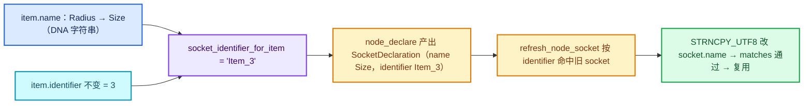

# 05 · 属性变更与更新通知

[前置知识总入口](../README.md) · [本章导航](README.md) · [上一篇](04-RNA_def_struct_sdna映射.md) · [下一章](../08-类型擦除/README.md)

> 基准：Blender `5.4.0-alpha`，本地工作树。本篇讲 RNA setter 之后发生什么——从属性写入到更新标签、到节点声明重建、再到 socket 重排。这是理解"改名为什么不断链接、又为什么会触发重建"的最后一块。主要源码：`intern/rna_nodetree.cc`（总行数 11563；Repeat item 数组 L3921-L3957 的 update 回调、L4951-L5006 的属性模板、L8087/L8321 的 inspection_index）、`BKE_node_tree_update.hh`（110 行，公开打标签 API；标签枚举 `eNodeTreeChangedFlag` 在 `intern/node_tree_update.cc` L74-L91，是文件内私有）、`NOD_node_declaration.hh`。

## 先回答一个具体问题

问题：用户在节点侧栏里把 Repeat Zone Output 的一个 item 从 `Radius` 改成 `Size`，到画布上 socket 的名字真的变成 `Size`，中间经过几个阶段？

答案：**六个阶段，全部在一次按键提交里同步完成**（只有最后的重绘是异步的）。

1. **写 DNA**：`RNA_property_string_set` 调到 `rna_Node_ItemArray_item_name_set<RepeatItemsAccessor>`，后者经 `set_item_name_and_make_unique` 把 `items[1].name` 换成 `"Size"`（必要时加 `.001` 后缀）。此阶段不打任何标签。
2. **打标签**：`RNA_property_update` 触发注册在属性上的 `rna_Node_ItemArray_item_update<RepeatItemsAccessor>`，它反查所属节点后调 `BKE_ntree_update_tag_node_property`，把 `NTREE_CHANGED_NODE_PROPERTY` OR 到 tree 和 node 的 `changed_flag` 上，并把拓扑、zone、socket-usage 三个缓存标脏。
3. **同步分派**：同一个回调里接着调 `BKE_main_ensure_invariants`，它直接进 `BKE_ntree_update` —— 不是排队到下一帧。
4. **重建声明**：`should_update_individual_node` 命中 `NODE_PROPERTY` 分支，对该节点跑 `build_node_declaration`，即重跑 Repeat 的 `node_declare`，产出一批 `SocketDeclaration`。
5. **匹配复用**：`refresh_node_socket` 拿声明按 `identifier`（`Item_1`，与名字无关）找到旧 socket，先把旧 socket 的 `name` 覆写成 `Size`，再用 `matches()` 确认"除了名字什么都没变" → 复用同一个 `bNodeSocket *`。链接持有的是这个指针，所以连线不动。
6. **通知重绘**：`reset_changed_flags` 清标签，`tree_changed_fn` 发 `NC_NODE | NA_EDITED` notifier 和 `DEG_id_tag_update`；主循环排空通知后编辑器重绘，`drawnode.cc` 从 `socket_name_rna` 拿到 item 属性直接画成可编辑输入框。

最容易误解的一点：第 5 阶段看起来"改名字居然没重排 socket"，但第 4 阶段的声明重建**确实完整跑了一遍**——省下来的只是第 5 阶段里的增删动作，而不是整条链。整篇文档就是在拆这六步里每一步的真实符号与代价；文末「用小数据走一遍」会把这六个阶段展开成九步逐步对照。

## 先纠正任务书里的两个前提

在开始之前必须说明：本篇的调研前提和本地工作树的实际代码不一致，有两点不先纠正，后面每一步都会找不到符号。第一，**不存在 `eUpdateTag` 枚举，也不存在任何 `NODE_TREE_TAG_*` 常量**：`grep -r "NODE_TREE_TAG_\|eUpdateTag" source/blender` 在整个仓库返回 0 结果，`git log -S "NODE_TREE_TAG_DECLARATION"` 与 `git log -S "eUpdateTag"` 在 `blenkernel` 目录上也都返回空——它不是被重命名了，而是这个工作树里从来没有过。第二，**头文件名字是 `.hh` 而不是 `.h`**：正确路径是 [../../../source/blender/blenkernel/BKE_node_tree_update.hh](../../../source/blender/blenkernel/BKE_node_tree_update.hh)（总行数 110）。

那真正的"标签系统"是什么？是**三层不同的标志位**叠在一起，各有各的粒度和消费者。本篇就按这个真实的三层结构讲。

| 层 | 类型/名称 | 定义位置 | 谁写入 | 谁消费 |
| --- | --- | --- | --- | --- |
| 内部脏标记 | `enum eNodeTreeChangedFlag`（`NTREE_CHANGED_*`） | [../../../source/blender/blenkernel/intern/node_tree_update.cc#L79-L91](../../../source/blender/blenkernel/intern/node_tree_update.cc#L79-L91) | `BKE_ntree_update_tag_*` 系列 | `NodeTreeMainUpdater::should_update_individual_node` |
| RNA 通知标志 | `int noteflag`（`NC_NODE`、`NA_EDITED`、`ND_*`） | `WM_api` 通知系统 | `RNA_def_property_update` 注册的 `noteflag` | `wm_event_do_notifiers` → 编辑器重绘 |
| 节点求值标记 | `enum eNode_Update : short`（只有 `NODE_UPDATE_ID = 1`） | [../../../source/blender/makesdna/DNA_node_types.h#L248-L252](../../../source/blender/makesdna/DNA_node_types.h#L248-L252) | `BKE_ntree_update_tag_id_changed` | 旧式 `updatefunc` 路径 |

任务书里说的 `LINK_ADDED`、`UI_LISTS`、`EXPRESSION` 这些"标签"，对应的真实符号是 `BKE_ntree_update_tag_link_added`、`update_panel_toggle_names`、`propagate_enum_definitions` 这类**函数**——不是枚举项。这一点很重要，否则你会在源码里找一个不存在的东西。

## 更新标签系统全景（实测版：三层标签）

### 第一层：`eNodeTreeChangedFlag`——真正决定"重算什么"的位掩码

定义在 [../../../source/blender/blenkernel/intern/node_tree_update.cc#L74-L91](../../../source/blender/blenkernel/intern/node_tree_update.cc#L74-L91)，注释明确写着"**This enum is not part of the public API. It should be used through the `BKE_ntree_update_tag_*` API**"。逐条抄录（L79-L91）：

| 位 | 值 | 含义（按消费点反推） | 谁会重算 |
| --- | --- | --- | --- |
| `NTREE_CHANGED_NOTHING` | `0` | 干净 | 什么都不做，`is_tree_changed` 直接跳过整棵树 |
| `NTREE_CHANGED_ANY` | `1 << 1` | 不知道具体改了啥，全量兜底 | 整棵树所有节点 + `interface_changed` + `output_changed` 都置真 |
| `NTREE_CHANGED_NODE_PROPERTY` | `1 << 2` | **节点上某个属性变了**（item 数组、storage、mute、type 都归这一类） | 该节点走 `should_update_individual_node` → 声明重建；配对 zone 的 output 节点也跟着重建 |
| `NTREE_CHANGED_NODE_OUTPUT` | `1 << 3` | 被引用子树的输出值可能变了 | 传播到用了这棵树的 group 节点 |
| `NTREE_CHANGED_LINK` | `1 << 4` | 连线增删改 | **`should_update_individual_node` 里对所有节点返回 true**——注意这条：连一条线，全树节点都重建一遍声明 |
| `NTREE_CHANGED_REMOVED_NODE` | `1 << 5` | 节点从树里消失了 | 全树；拓扑缓存与 zone 缓存失效 |
| `NTREE_CHANGED_REMOVED_SOCKET` | `1 << 6` | socket 从节点上消失了 | 全树；`tree->changed_flag` 级 |
| `NTREE_CHANGED_SOCKET_PROPERTY` | `1 << 7` | 单个 socket 的属性变了 | 打在 socket 自己的 `changed_flag` 上 |
| `NTREE_CHANGED_INTERNAL_LINK` | `1 << 8` | 节点内部 mute 链变了 | 不影响输出（见 L2029 的豁免） |
| `NTREE_CHANGED_PARENT` | `1 << 9` | 父节点/所属 frame、zone 变了 | 不影响输出（见 L2032 的豁免） |
| `NTREE_CHANGED_ALL` | `-1` | 文件加载后 runtime 数据未初始化 | 全量，最贵 |

三个关键读法：

- 这些位存在 `bNodeTree::runtime->changed_flag`、`bNode::runtime->changed_flag`、`bNodeSocket::runtime->changed_flag` 三处。`add_node_tag`（L101-L105）和 `add_socket_tag`（L107-L111）都会**先调 `add_tree_tag` 把位 OR 到整棵树上**，再 OR 到具体节点/socket。也就是说"节点级标签"总是连带一个"树级标签"。
- `add_tree_tag`（L93-L99）在做 OR 的同时**无条件把三个缓存全部标脏**：`topology_cache_mutex`、`tree_zones_cache_mutex`、`inferenced_input_socket_usage_mutex`。这就是任务书里说的"`BKE_node_tree_ensure_zone`"的真实对应物——没有 `ensure_zone` 函数，只有 zone 缓存失效 + 惰性重建（[../../../source/blender/blenkernel/intern/node_tree_zones.cc#L380-L390](../../../source/blender/blenkernel/intern/node_tree_zones.cc#L380-L390) 的 `get_tree_zones`）。
- `reset_changed_flags`（L2218-L2233）在每棵树更新完成后清零，并顺带清 `node->runtime->update`。这是"标签是一次性消费"的机制证据。

### 第二层：`BKE_ntree_update_tag_*` 的映射表（谁打了什么位）

实现全部在 [../../../source/blender/blenkernel/intern/node_tree_update.cc#L2261-L2373](../../../source/blender/blenkernel/intern/node_tree_update.cc#L2261-L2373)。抄录几个最容易搞错的：

| 公开函数 | 行号 | 实际打的位 | 陷阱 |
| --- | --- | --- | --- |
| `..._tag_node_property` | L2266 | `NODE_PROPERTY`（node + tree） | 主力，item 数组全靠它 |
| `..._tag_node_new` | L2271 | **也是 `NODE_PROPERTY`** | 没有"新节点"专用位 |
| `..._tag_node_type` | L2276 | **也是 `NODE_PROPERTY`** | 换节点类型和改属性同权重 |
| `..._tag_node_mute` | L2311 | **也是 `NODE_PROPERTY`** | 静音走属性通道 |
| `..._tag_socket_new` | L2286 | `SOCKET_PROPERTY` | 注意：`refresh_node_socket` 每刷新一个 socket 都会调它（见下） |
| `..._tag_socket_type` | L2296 | **只是 `SOCKET_PROPERTY`** | 类型变更**没有**专用位！ |
| `..._tag_socket_availability` | L2301 | `SOCKET_PROPERTY` | 同上 |
| `..._tag_link_added` / `_removed` / `_changed` / `_mute` | L2321-L2339 | 全部只是 `LINK` | 参数里的 `bNodeLink *` 被显式注释掉未用（`/*link*/`） |
| `..._tag_active_output_changed` | L2341 | `ANY` | 直接降级为全量 |
| `..._tag_missing_runtime_data` | L2346 | `ALL` | 加载期 |
| `..._tag_id_changed` | L2356 | 遍历所有树找 `node->id == id`，打 `NODE_PROPERTY` **并且** `node->runtime->update |= NODE_UPDATE_ID` | 这是唯一同时写两层的 |

**这张表最值得记的一条**：`node_new`、`node_type`、`node_mute`、`node_property` 四个语义完全不同的入口，落到磁盘位上是**同一个** `NTREE_CHANGED_NODE_PROPERTY`。所以"标签"的粒度远比 API 名字暗示的粗——标签只回答"这个节点需要重看一遍"，不回答"看哪一部分"。真正的精细化判断发生在后面的 `matches()` 比较里。

### 第三层：noteflag（`NC_NODE | NA_EDITED`）——管重绘，不管重算

`RNA_def_property_update(prop, noteflag, updatefunc)` 的签名在 [../../../source/blender/makesrna/RNA_define.hh#L542](../../../source/blender/makesrna/RNA_define.hh#L542)：`void RNA_def_property_update(PropertyRNA *prop, int noteflag, const char *updatefunc)`。两个参数**职责完全独立**：

- `noteflag` → 存进 `prop->noteflag`，在 `rna_property_update`（[../../../source/blender/makesrna/intern/rna_access.cc#L2565-L2567](../../../source/blender/makesrna/intern/rna_access.cc#L2565-L2567)）里 `WM_main_add_notifier(prop->noteflag, ptr->owner_id)`。它只触发 UI 重绘。
- `updatefunc` → 字符串名，在 L2557 `prop->update(bmain, scene, ptr)` 被调用。**这一层才负责打 `NTREE_CHANGED_*`**。

`rna_access.cc` 的 `rna_property_update` 还做两件事：`C != nullptr` 时发 message bus（L2572-L2576），以及按 `PROP_NO_DEG_UPDATE` / `PROP_DEG_SYNC_ONLY` 打 depsgraph 标签（L2577-L2587）。这里有一个实测坑：`RNA_property_string_set`（[../../../source/blender/makesrna/intern/rna_access.cc#L4268-L4308](../../../source/blender/makesrna/intern/rna_access.cc#L4268-L4308)）**只调 setter，不调 update**。update 由调用方在设置完成后显式触发——UI 侧在 `interface_handlers.cc` L1200 调 `RNA_property_update(C, &after.rnapoin, after.rnaprop)`，Python 侧在 `bpy_rna.cc` L2290-L2292 调 `if (RNA_property_update_check(prop)) RNA_property_update(...)`。也就是说：**属性写入和更新通知是解耦的两个动作**，这正是"批量改属性只重算一次"成为可能的原因。

## 一次 setter 的下游链

以"用户在 Repeat Zone Output 节点的侧栏里把 item 名字从 `Radius` 改成 `Size`"为例。完整链路如下。

```mermaid
flowchart TD
    UI["UI 提交：RNA_property_update（interface_handlers.cc L1200）"]:::input
    SET["RNA_property_string_set 调 sprop 的 set（rna_access.cc L4293）"]:::data
    SFTER["setter：rna_Node_ItemArray_item_name_set（rna_nodetree.cc L3948）"]:::compute
    UNI["set_item_name_and_make_unique：兜底 + uniquename（NOD_socket_items.hh L148）"]:::compute
    UPD["update 回调：rna_Node_ItemArray_item_update（L3921）"]:::data
    TAG["add_node_tag：NODE_PROPERTY + 三个缓存标脏"]:::abstraction
    INV["BKE_main_ensure_invariants → BKE_ntree_update（main_invariants.cc L80）"]:::abstraction
    DISP["should_update_individual_node == true（L814）"]:::compute
    DECL["build_node_declaration：重跑 node_declare（node_geo_repeat.cc L176）"]:::compute
    MATCH["refresh_node_socket：按 identifier 匹配（node_socket.cc L219）"]:::compute
    KEEP["出口②：STRNCPY 改名后 matches 通过 → 复用同一指针"]:::result
    SOCKTAG["tag_socket_new → SOCKET_PROPERTY（node_socket.cc L282）"]:::abstraction
    RESET["reset_changed_flags 清零（L2218）"]:::data
    NOTIFY["tree_changed_fn：WM notifier + DEG_id_tag_update"]:::result
    REDRAW["节点编辑器重绘，socket 标签显示 Size"]:::result

    UI --> SET --> SFTER --> UNI --> UPD --> TAG --> INV --> DISP --> DECL --> MATCH
    MATCH --> KEEP --> SOCKTAG --> RESET --> NOTIFY --> REDRAW

    classDef input fill:#DBEAFE,stroke:#2563EB,color:#172554,stroke-width:2px
    classDef data fill:#CFFAFE,stroke:#0891B2,color:#164E63,stroke-width:2px
    classDef abstraction fill:#EDE9FE,stroke:#7C3AED,color:#3B0764,stroke-width:2px
    classDef compute fill:#FEF3C7,stroke:#D97706,color:#78350F,stroke-width:2px
    classDef result fill:#DCFCE7,stroke:#16A34A,color:#14532D,stroke-width:2px
    classDef error fill:#FEE2E2,stroke:#DC2626,color:#7F1D1D,stroke-width:2px;
```




链条里有一个**同步点**必须强调：`BKE_main_ensure_invariants` 就是直接调 `BKE_ntree_update`（[../../../source/blender/blenkernel/intern/main_invariants.cc#L80-L86](../../../source/blender/blenkernel/intern/main_invariants.cc#L80-L86)），**不排队、不等帧**。所以声明重建在 update 回调返回前就已经完成了——不是"下一帧再重建"。但 `tree_changed_fn` 里的 `WM_main_add_notifier` 和 `DEG_id_tag_update` 确实是延迟到主循环/求值时消费的。任务书说的"帧更新时按标签分派"要拆成两半理解：**结构修正是同步的，重绘与求值是异步的**。

`BKE_ntree_update`（[../../../source/blender/blenkernel/intern/node_tree_update.cc#L2385-L2404](../../../source/blender/blenkernel/intern/node_tree_update.cc#L2385-L2404)）有递归保护：`if (bmain.is_updating_node_trees) return;`。节点的 `updatefunc` 里再改属性会被**静默丢弃**。

## DECLARATION / STRUCTURE / TOPOLOGY 的粒度与代价

这三个词在源码里不是枚举，而是三个**不同层次的缓存/数据结构**。它们的对应关系如下（实测符号）：

| 概念 | 真实载体 | 何时失效 | 重建代价 | 涉及范围 |
| --- | --- | --- | --- | --- |
| **Topological（拓扑）** | `topology_cache_mutex` + `bNodeTreeTopologyCache` | `add_tree_tag` 里无条件 `tag_dirty()` | **中偏高**：一次全树节点/socket 线性编号 + 邻接表 | 整棵树 |
| **Zone（区域）** | `tree_zones_cache_mutex` + `get_tree_zones`（惰性） | `add_tree_tag` 里无条件 `tag_dirty()` | **低**：只扫 frame/配对节点，但要遍历全部节点 | 整棵树 |
| **Declaration（声明）** | `bNode::runtime->declaration`（`NodeDeclaration *`） | 只在 `should_update_individual_node` 为真时重跑 | **低到中**：只重跑**单个节点**的 `node_declare` + `refresh` | 单个节点 |
| **Structure（结构，即 socket 实例本身）** | `bNode::inputs` / `outputs` 链表 + `bNodeSocket` DNA | `refresh_node_sockets_and_panels` 真的增删链表 | **高**：涉及内存分配、DNA 结构体、链接迁移 | 单节点但影响引用它的链接 |

关键的粒度差异体现在 `should_update_individual_node`（[../../../source/blender/blenkernel/intern/node_tree_update.cc#L809-L836](../../../source/blender/blenkernel/intern/node_tree_update.cc#L809-L836)）的五个返回 true 的分支：

1. `ntree.runtime->changed_flag & NTREE_CHANGED_ANY` → **全树**（L811）
2. `node.runtime->changed_flag & NTREE_CHANGED_NODE_PROPERTY` → **单点**（L814，Repeat 改名的路径）
3. `ntree.runtime->changed_flag & NTREE_CHANGED_LINK` → **全树**，注释原话："*Currently we have no way to tell if a node needs to be updated when a link changed.*"（L817-L819）
4. `tree_interface.requires_dependent_tree_updates()` → 只对 group input/output 节点（L821-L824）
5. 配对 zone 的 output 节点被打了 `NODE_PROPERTY` → 输入节点也重建（L827-L834）——**Repeat Zone Input 靠这条跟着 Output 一起重建**

对比代价：改一个 item 名走分支 2，只有 Output 节点 + 配对的 Input 节点重跑 `node_declare`。而连一条线走分支 3，**整棵树每个有 `declare` 的节点都要重跑**。这解释了为什么节点编辑器里拖线的体感比改名字贵得多。

## item 数组的 update 配置

`RepeatItem` 的 RNA 定义在 [../../../source/blender/makesrna/intern/rna_nodetree.cc#L8033-L8040](../../../source/blender/makesrna/intern/rna_nodetree.cc#L8033-L8040)——它的全部实质就是转发一次 `rna_def_node_item_array_socket_item_common(srna, "RepeatItemsAccessor", true)`。真正的属性定义在那个共享函数里（L4951-L5006）。

关键设计：**函数名是运行时用 `SNPRINTF` 拼字符串生成的模板实例名**（L4960-L4971），因为 `RNA_def_property_*` 只接受 `const char *` 回调名。Repeat 传入的 `accessor` 是 `"RepeatItemsAccessor"`，于是拼出 `"rna_Node_ItemArray_item_name_set<RepeatItemsAccessor>"` 和 `"rna_Node_ItemArray_item_update<RepeatItemsAccessor>"`。字符串生命周期靠文件级 `static LinearAllocator<> allocator`（L4957）持有。

`name` 属性的五行配置（L4973-L4978 原文）：

<details>
<summary>../../../source/blender/makesrna/intern/rna_nodetree.cc L4973-L4978（`name` 属性）</summary>

```cpp
  prop = RNA_def_property(srna, "name", PROP_STRING, PROP_NONE);
  RNA_def_property_string_funcs(
      prop, nullptr, nullptr, allocator.copy_string(name_set_func).c_str());
  RNA_def_property_ui_text(prop, "Name", "");
  RNA_def_struct_name_property(srna, prop);
  RNA_def_property_update(prop, NC_NODE | NA_EDITED, item_update_func_ptr);
```

</details>

逐行读法：`RNA_def_property_string_funcs(prop, nullptr, nullptr, set)` → **没有 getter、没有 length**，只有 setter。为什么？因为 `RepeatItem::name` 是 `char *`，`PROP_STRING` 有默认的 `char *` getter 实现，不用手写。`RNA_def_struct_name_property(srna, prop)` 声明"name 就是这个结构的显示名"，Outliner 和 `repr()` 用它。最后一行才是本篇主角：**`noteflag = NC_NODE | NA_EDITED`，updatefunc = `item_update_func_ptr`**。

`socket_type` 与 `vector_socket_dimensions` 用的是**同一个 `item_update_func_ptr`、同一个 noteflag**（L4987、L4995）：

<details>
<summary>../../../source/blender/makesrna/intern/rna_nodetree.cc L4980-L4996（`socket_type` / 维度）</summary>

```cpp
  if (add_socket_type) {
    prop = RNA_def_property(srna, "socket_type", PROP_ENUM, PROP_NONE);
    RNA_def_property_enum_items(prop, rna_enum_node_socket_data_type_items);
    RNA_def_property_enum_funcs(
        prop, nullptr, nullptr, allocator.copy_string(socket_type_itemf).c_str());
    RNA_def_property_ui_text(prop, "Socket Type", "");
    RNA_def_property_clear_flag(prop, PROP_ANIMATABLE);
    RNA_def_property_update(prop, NC_NODE | NA_EDITED, item_update_func_ptr);

    if (add_vector_socket_dimensions) {
      prop = RNA_def_property(srna, "vector_socket_dimensions", PROP_INT, PROP_NONE);
      RNA_def_property_int_sdna(prop, nullptr, "vector_socket_dimensions");
      RNA_def_property_range(prop, 2, 4);
      RNA_def_property_clear_flag(prop, PROP_ANIMATABLE);
      RNA_def_property_ui_text(prop, "Dimensions", "Dimensions of the vector socket");
      RNA_def_property_update(prop, NC_NODE | NA_EDITED, item_update_func_ptr);
    }
  }
```

</details>

`color` 属性（L4999-L5005）**故意不注册 update**，因为它是派生只读值（`PROP_EDITABLE` 被清掉了）。

三个属性最终汇聚到同一个回调（[../../../source/blender/makesrna/intern/rna_nodetree.cc#L3921-L3932](../../../source/blender/makesrna/intern/rna_nodetree.cc#L3921-L3932)）——**全文只有 12 行，却是整条链的枢纽**：

<details>
<summary>../../../source/blender/makesrna/intern/rna_nodetree.cc L3921-L3932：`rna_Node_ItemArray_item_update`</summary>

```cpp
template<typename Accessor>
static void rna_Node_ItemArray_item_update(Main *bmain, Scene * /*scene*/, PointerRNA *ptr)
{
  using ItemT = typename Accessor::ItemT;
  bNodeTree &ntree = *reinterpret_cast<bNodeTree *>(ptr->owner_id);
  ItemT &item = *static_cast<ItemT *>(ptr->data);
  bNode *node = nodes::socket_items::find_node_by_item<Accessor>(ntree, item);
  BLI_assert(node != nullptr);

  BKE_ntree_update_tag_node_property(&ntree, node);
  BKE_main_ensure_invariants(*bmain, ntree.id);
}
```

</details>

注意它的两行"动作"：`find_node_by_item` + `tag_node_property` + `ensure_invariants`。而 `find_node_by_item`（[../../../source/blender/nodes/NOD_socket_items.hh#L58-L72](../../../source/blender/nodes/NOD_socket_items.hh#L58-L72)）的实现是**先 `ensure_topology_cache()`，再遍历所有该 idname 的节点，用指针区间比较 `&item >= *array.items && &item < *array.items + *array.items_num` 反查所属节点**。因为 DNA 里 `NodeRepeatItem` **不存自己属于哪个节点**，只能靠内存地址落在哪个数组区间来判断。

对比 setter 侧（L3948-L3957），它做完全同样的 `find_node_by_item` 反查——所以**一次改名要做两次"遍历全部同类节点 + 指针区间比较"**。顺序值得记住：`item_update` 里 `find_node_by_item`（L3927）在 `BKE_ntree_update_tag_node_property`（L3930）**之前**，所以这两次反查通常都命中干净的拓扑缓存，代价是遍历本身而不是重建。但如果这次改名之前刚拖过一条线（缓存已被标脏），那么第 3 步的 `ensure_topology_cache()` 就会真的重建一次——这是改名路径上一个偶发但真实的开销来源。

```cpp
template<typename Accessor>
static void rna_Node_ItemArray_item_name_set(PointerRNA *ptr, const char *value)
{
  using ItemT = typename Accessor::ItemT;
  bNodeTree &ntree = *reinterpret_cast<bNodeTree *>(ptr->owner_id);
  ItemT &item = *static_cast<ItemT *>(ptr->data);
  bNode *node = nodes::socket_items::find_node_by_item<Accessor>(ntree, item);
  BLI_assert(node != nullptr);
  nodes::socket_items::set_item_name_and_make_unique<Accessor>(*node, item, value);
}
```

**setter 里不打标签**（没有 `BKE_ntree_update_tag_*` 调用），标签完全交给 update 回调。这不是偶然：`rna_Node_ItemArray_item_name_set` 只负责写 DNA，`rna_Node_ItemArray_item_update` 只负责通知。若 Python 里用低层 API 只调 setter 而不触发 update，改名会写进 DNA 但 socket 不刷新——见反例第 3 条。

`set_item_name_and_make_unique`（[../../../source/blender/nodes/NOD_socket_items.hh#L144-L190](../../../source/blender/nodes/NOD_socket_items.hh#L144-L190)）做四件事：空名兜底（`can_have_empty_name = false`，兜底值取 socket 类型的 label，取不到就 `"Item"`）；`get_validated_name`（`RepeatItemsAccessor::has_name_validation = false`，直通）；`BLI_uniquename_cb` 加后缀（`unique_name_separator = '.'`，即 `Size.001`）；`MEM_SAFE_DELETE` 旧字符串 + `BLI_strdup`。

而 Repeat 的其它 item 数组操作（remove/clear/move/new）**不走 update 回调**，直接在函数体内打完标签再手动发 notifier：`rna_Node_ItemArray_remove`（L3836-L3864）、`_clear`（L3866-L3875）、`_move`（L3877-L3892）、`new_with_socket_and_name`（L3970-L3988）都是三行固定收尾——`BKE_ntree_update_tag_node_property` + `BKE_main_ensure_invariants` + `WM_main_add_notifier(NC_NODE | NA_EDITED, ntree)`。

## inspection_index 的特殊性

Repeat Zone Output 和 For-Each Geometry Element Output 上都有 `inspection_index`，定义分别在 [../../../source/blender/makesrna/intern/rna_nodetree.cc#L8087-L8093](../../../source/blender/makesrna/intern/rna_nodetree.cc#L8087-L8093) 和 [../../../source/blender/makesrna/intern/rna_nodetree.cc#L8321-L8327](../../../source/blender/makesrna/intern/rna_nodetree.cc#L8321-L8327)，两处**逐字相同**：

```cpp
  prop = RNA_def_property(srna, "inspection_index", PROP_INT, PROP_NONE);
  RNA_def_property_ui_range(prop, 0, INT32_MAX, 1, -1);
  RNA_def_property_ui_text(prop,
                           "Inspection Index",
                           "Iteration index that is used by inspection features like the viewer "
                           "node or socket inspection");
  RNA_def_property_update(prop, NC_NODE, "rna_Node_update");
```

和 `name` 的配置做三点差异对比：

| 配置项 | `name`（item 属性） | `inspection_index`（节点属性） |
| --- | --- | --- |
| noteflag | `NC_NODE \| NA_EDITED` | **只有 `NC_NODE`**（没有 `NA_EDITED`） |
| updatefunc | `rna_Node_ItemArray_item_update<RepeatItemsAccessor>` | `rna_Node_update`（通用，L2780-L2786） |
| sdna 绑定 | 无（`char *` 自定义 setter） | `RNA_def_property_int_sdna` **也没写**——见下方注意点 |
| 打的位 | `NTREE_CHANGED_NODE_PROPERTY` | `NTREE_CHANGED_NODE_PROPERTY`（**同一个位**） |

`rna_Node_update` 的实现（L2780-L2786）和 item_update 结构一致，只是不需要 `find_node_by_item` 反查——`ptr->data` 直接就是 `bNode *`：

```cpp
void rna_Node_update(Main *bmain, Scene * /*scene*/, PointerRNA *ptr)
{
  bNodeTree *ntree = reinterpret_cast<bNodeTree *>(ptr->owner_id);
  bNode *node = ptr->data_as<bNode>();
  BKE_ntree_update_tag_node_property(ntree, node);
  BKE_main_ensure_invariants(*bmain, ntree->id);
}
```

**所以严格说：`inspection_index` 的 update 也打了 `NTREE_CHANGED_NODE_PROPERTY`，声明也确实重建了一遍。**"Repeat 特殊"不在于它绕过了标签机制，而在于**声明重建对它是个 no-op**。为什么？看 `node_geo_repeat.cc` 的 `node_declare`（L176-L207）：整个函数只读 `storage.items` / `items_num` / `item.name` / `item.socket_type` / `item.identifier`，从头到尾**没有出现过 `inspection_index` 这个字段**。`refresh_node`（[../../../source/blender/nodes/intern/node_socket.cc#L638-L648](../../../source/blender/nodes/intern/node_socket.cc#L638-L648)）里的守卫 `if (!node_decl.matches(node))` 因此判定"声明和实际 socket 列表完全一致"，`refresh_node_sockets_and_panels` 被整段跳过——**零 socket 变动**。这就是"不触发 socket 重排"的真实机制：**不是打了某个特殊标签，而是重建结果与旧结果逐字段相等，被 `matches()` 短路掉了**。

那 `inspection_index` 真正被谁读？三处，全在观察/身份路径上：

- [../../../source/blender/nodes/intern/geometry_nodes_repeat_zone.cc#L216-L227](../../../source/blender/nodes/intern/geometry_nodes_repeat_zone.cc#L216-L227)：越界时往 `tree_logger->node_warnings` 塞一条 `NodeWarningType::Info` 的 "Inspection index is out of range"（日志通道）
- [../../../source/blender/editors/space_node/space_node.cc#L462-L466](../../../source/blender/editors/space_node/space_node.cc#L462-L466)：`compute_context_for_zone` 把它传进 `for_repeat_zone(...)`，**参与 `ComputeContext` 哈希**——决定 viewer/socket 探测取哪一次迭代
- [../../../source/blender/blenkernel/intern/compositor.cc#L742-L744](../../../source/blender/blenkernel/intern/compositor.cc#L742-L744)：合成器同构路径

一个诚实的注意点：`inspection_index` 定义里**没有 `RNA_def_property_int_sdna(prop, nullptr, "inspection_index")`**——只有 `ui_range`、`ui_text`、`update`。这不影响读写，因为 `RNA_def_property` 在 makesrna 扫描期（`#ifndef RNA_RUNTIME` 分支，L1329 起）就会按属性 identifier **自动绑同名的 DNA 字段**：[../../../source/blender/makesrna/intern/rna_define.cc#L1165-L1350](../../../source/blender/makesrna/intern/rna_define.cc#L1165-L1350) 里 `case PROP_INT: DefRNA.silent = true; RNA_def_property_int_sdna(prop, nullptr, identifier.c_str())`，配合 `RNA_def_struct_sdna_from(srna, "NodeGeometryRepeatOutput", "storage")`（L8061）落到 `storage->inspection_index`。所以同一批属性里，`vector_socket_dimensions`（L4991）显式写了一遍 sdna、`active_index`（L8070）也写了、`inspection_index` 却没写——三者都能正常工作，差别只在写法风格（注意 `vector_socket_dimensions` 在 DNA 里实际是 `char`，见 `DNA_node_types.h:2391`，用 `PROP_INT` 暴露）。结论：在这个文件里**别把"漏了 sdna"当成"这是只读属性"**。

对照 `active_index`（L8069-L8074）的处理，差异在标签之外的两个地方：

| 属性 | `PROP_NO_DEG_UPDATE` | noteflag | 语义 |
| --- | --- | --- | --- |
| `active_index` | **有**（L8073） | `NC_NODE` | 纯 UI 选择态，**完全不触发 depsgraph 重算**，只重绘侧栏高亮 |
| `inspection_index` | **无** | `NC_NODE` | 会走 `DEG_id_tag_update(..., ID_RECALC_SYNC_TO_EVAL \| ID_RECALC_PARAMETERS)`（`rna_access.cc` L2584），需要重新求值才能拿到指定迭代的日志 |
| `item.name` | 无 | `NC_NODE \| NA_EDITED` | 既重算结构又重绘编辑器 |
| `item.socket_type` | 无 | `NC_NODE \| NA_EDITED` | 同上，但重建结果不等 → 真的重排 socket |

`PROP_NO_DEG_UPDATE` 是"这个属性改变不需要重新求值"的声明位，配合 `PROP_DEG_SYNC_ONLY` 使用（`rna_access.cc` L2577-L2587）。Repeat 的 `active_index` 有它，`inspection_index` 没有——这就是"选第几个 item 不用重算，但看第几轮迭代要重算"的实现根据。

## 改名不断链的完整解释

这是本篇要和第 10 章 [../10-节点系统基础/02-bNodeSocket与声明系统.md](../10-节点系统基础/02-bNodeSocket与声明系统.md) 接上的核心结论。"连线不丢"的全部功劳属于下面这一条 identifier 匹配链。

关键前提：Repeat 的 socket identifier **不由名字派生**。看 [../../../source/blender/nodes/geometry/include/NOD_geo_repeat.hh#L83-L86](../../../source/blender/nodes/geometry/include/NOD_geo_repeat.hh#L83-L86)：

```cpp
  static std::string socket_identifier_for_item(const NodeRepeatItem &item)
  {
    return "Item_" + std::to_string(item.identifier);
  }
```

`item.identifier` 是一个单调递增整数，在 `init_with_socket_type_and_name` 里由 `storage->next_identifier++` 发号（L79）。DNA 注释（[../../../source/blender/makesdna/DNA_node_types.h#L3547-L3551](../../../source/blender/makesdna/DNA_node_types.h#L3547-L3551)）把它写成了设计契约："*Generated unique identifier for sockets which stays the same even when the item order or names change.*"

于是完整链条是：




`refresh_node_socket`（[../../../source/blender/nodes/intern/node_socket.cc#L219-L283](../../../source/blender/nodes/intern/node_socket.cc#L219-L283)）先在旧 socket 列表里按 `old_socket.identifier == socket_decl.identifier` 线性查找（L227-L235），命中后从候选列表 `remove_and_reorder` 掉；它只有四种出口：

| 出口 | 条件 | 行为 | 连线命运 |
| --- | --- | --- | --- |
| ① | 找不到同 identifier | `socket_decl.build(ntree, node)` **新建 socket** | 无旧连线可继承（新 socket） |
| ② | 找到 + `socket_decl.matches(old_socket)` 为真 | `STRNCPY_UTF8(old->name, decl.name)` 后**直接复用同一指针** | **连线原地保留**（`bNodeLink::fromsock/tosock` 指针没变） |
| ③ | 找到 + `matches()` 为假，但 `update_or_build` 返回**同一个** socket | 先把 `identifier[0] = '\0'` 防冲突，改完后重新写回 identifier | **连线保留**（指针仍不变） |
| ④ | 找到 + `matches()` 为假，`update_or_build` 返回**新** socket | `identifier[0]='\0'` 后建新的，再**显式遍历 `ntree.links` 把 `fromsock`/`tosock` 迁移到新 socket**，同时迁移 `runtime->internal_links` | **连线靠人工搬运保住** |

**改名走的是出口 ②**——为什么 `matches()` 会通过？看 `matches_common_data`（[../../../source/blender/nodes/intern/node_declaration.cc#L300-L318](../../../source/blender/nodes/intern/node_declaration.cc#L300-L318)）：它比较 `socket.name != this->name`。看着矛盾——名字刚改，怎么会 match？答案在 L243：**匹配前先把旧 socket 的 name 覆写成声明里的新名字**（`STRNCPY_UTF8(old_socket_with_same_identifier->name, socket_decl.name.c_str())`）。所以 `matches()` 检查时 name 已经同步了，剩下要验的是 `identifier`（没变）、`SOCK_HIDE_VALUE` / `SOCK_MULTI_INPUT` / `SOCK_UNAVAIL` 三个 flag、以及类型子类自己的 `socket.type` 与 `default_value` 范围。全部为真 → 复用。

这是一个非常精细的设计：**先改名，再判断"除了名字之外还有没有别的变了"**。"除了名字之外没变"正是"可以原地复用"的定义。

最后一步 `SocketDeclaration::matches_common_data` 的 flag 检查、L278-L279 的用户隐藏态保留（`SET_FLAG_FROM_TEST(new_socket->flag, old->is_user_hidden(), SOCK_HIDDEN)`），以及 `refresh_node_sockets_animation_inout`（L443-L541）用 identifier 把 fcurve 的 `nodes["X"].inputs[i]` 路径里的下标重映射（L458-L474 的 `new_index_by_identifier`）——三者共同构成"改名/换序不丢东西"的完整承诺：**连线靠指针、隐藏态靠复制、动画靠 identifier 换下标**。

## socket_type 变更是个分界

`item.name` 和 `item.socket_type` 用的是**同一个标签**（`NTREE_CHANGED_NODE_PROPERTY`）、**同一个 update 回调**（`rna_Node_ItemArray_item_update<RepeatItemsAccessor>`）、**同一个 noteflag**（`NC_NODE | NA_EDITED`），但结果完全不同。分界点在 `refresh_node_socket` 的 ②/④ 出口上。

- `identifier` **不变**（仍是 `Item_3`，因为 `socket_identifier_for_item` 只看 `item.identifier`），所以匹配阶段一定命中旧 socket。
- `name` 也变吗？只有当用户没手改名时——`socket_type` 变更本身不改 `item.name`。
- 但 `node_declare` 里 `b.add_input(socket_type, name, identifier)` 的**第一个参数变了**，于是产出的 `SocketDeclaration` 是**另一个 C++ 子类**：`decl::Float` 换成了 `decl::Vector`。`Float::matches(socket)`（[../../../source/blender/nodes/intern/node_socket_declarations.cc#L112-L131](../../../source/blender/nodes/intern/node_socket_declarations.cc#L112-L131)）第二道关就是 `if (socket.type != SOCK_FLOAT) return false`——旧 socket 是 Float 时 Vector 的 `matches` 立刻失败。

于是进入出口 ③ 或 ④，取决于 `update_or_build` 的实现（同文件，每个类型一个）：

| 变更 | 走哪个出口 | `update_or_build` 关键分支 | 连线 |
| --- | --- | --- | --- |
| `Float` → `Float`（只改软范围/子类型） | **③** | L144-L159：`socket.type == SOCK_FLOAT` → `modify_subtype_except_for_storage` + 就地改 `value.min/max/subtype` → **返回 `socket` 本身** | 原地保留 |
| `Float` → `Vector` | **④** | L146-L149：`socket.type != SOCK_FLOAT` → `BLI_assert(socket.in_out == this->in_out)` 然后 `return this->build(ntree, node)` **造新 socket** | 靠 L260-L275 的显式迁移 |
| 任意 → 完全不同的 `bNodeSocketValue` 结构 | **④** | `build` 会新分配 `default_value` | 旧 `default_value` **丢失** |

出口 ④ 是"看起来会断链但其实被专门救回来"的情况。看这段（L249-L276）：

```cpp
      /* Clear out identifier to avoid name collisions when a new socket is created. */
      old_socket_with_same_identifier->identifier[0] = '\0';
      new_socket = &socket_decl.update_or_build(ntree, node, *old_socket_with_same_identifier);

      if (new_socket == old_socket_with_same_identifier) {
        /* 出口③：把 identifier 写回来 */
        STRNCPY_UTF8(new_socket->identifier, socket_decl.identifier.c_str());
        new_socket->runtime->identifier_ustr = UString(new_socket->identifier);
      }
      else {
        /* Move links to new socket with same identifier. */
        for (bNodeLink &link : ntree.links) {
          if (link.fromsock == old_socket_with_same_identifier) { link.fromsock = new_socket; }
          else if (link.tosock == old_socket_with_same_identifier) { link.tosock = new_socket; }
        }
        for (bNodeInternalLink &internal_link : node.runtime->internal_links) { /* 同样迁移 */ }
      }
```

三处设计细节：

1. **为什么要先 `identifier[0] = '\0'`？** 因为 `build()` 内部走 `node_add_static_socket` 会做 uniquename；如果旧 socket 还占着 `Item_3`，新 socket 可能被加成 `Item_3.001`，链接语义就错了。先清空占位符再建。
2. **出口 ③ 要"把 identifier 写回来"** 是同一个原因的反向操作。
3. **`bNodeLink` 与 `bNodeInternalLink` 要各自手工迁移**——这是唯一一处"链接靠人搬"的地方，也是为什么改 socket_type 比改名贵一个量级。同时它意味着：如果某个新代码引入了第三种持有 `bNodeSocket *` 的结构（例如 `socket_value_inference` 的缓存），这里漏加就会**真的断链或悬挂**。

代价对比：出口 ② 只做一次 `STRNCPY_UTF8`；出口 ④ 做"新建 socket + 迁移全树链接 + 迁移内部链 + 丢弃 default_value + 重跑 `refresh_node_sockets_animation_inout`"。**同一个标签，两种代价**——再次印证"标签决定要不要重看，`matches()` 决定重看后要做多少事"。

顺带一个真实约束：`RepeatItemsAccessor::supports_socket_type`（[../../../source/blender/nodes/geometry/include/NOD_geo_repeat.hh#L67-L70](../../../source/blender/nodes/geometry/include/NOD_geo_repeat.hh#L67-L70)）转发到 `node_tree_type_supports_socket_type_static`，被 `rna_Node_ItemArray_socket_type_itemf`（L3934-L3946）用来过滤下拉列表；`new_with_socket_and_name` 还会在执行前显式检查并 `BKE_report(... "Unable to create item with this socket type")`（L3976-L3979）。类型层面的合法性检查发生在标签系统之前。

## 用小数据走一遍：`Item_1` 改名

初始状态（新建一个 Repeat Zone 后）：`NodeGeometryRepeatOutput.next_identifier = 2`，`items_num = 2`：

| 下标 | `name` | `socket_type` | `identifier` | `socket_identifier_for_item` |
| --- | --- | --- | --- | --- |
| 0 | `Geometry` | `SOCK_GEOMETRY` | 0 | `Item_0` |
| 1 | `Radius` | `SOCK_FLOAT` | 1 | `Item_1` |

`active_index = 1`（选中第二个）。用户把 `Radius` 改成 `Size`。九步全链路：

| 步 | 谁（文件:行） | 做什么 | 什么数据变了 |
| --- | --- | --- | --- |
| **1 写值** | `rna_access.cc:4293` → `rna_nodetree.cc:3948` setter | `RNA_property_string_set` 调 `sprop->set`，即 `rna_Node_ItemArray_item_name_set<RepeatItemsAccessor>`。先用 `find_node_by_item`（`NOD_socket_items.hh:62`）反查：`ensure_topology_cache()`（此时缓存干净，直接返回）+ 遍历同类 Repeat Output 节点做指针区间比较，找到 Output 节点 | 无（还没落 DNA） |
| **2 落 DNA** | `NOD_socket_items.hh:148` `set_item_name_and_make_unique` | 名字非空 → 不兜底；`has_name_validation = false` → 直通；`BLI_uniquename_cb`（分隔符 `.`）扫其余 item，无 `Size` 冲突 → 不加后缀；`MEM_SAFE_DELETE` 旧串 + `BLI_strdup("Size")` | **`items[1].name`：`Radius` → `Size`**。`identifier`、`socket_type` 一个都没动 |
| **3 触发 update** | `interface_handlers.cc:1200`（UI）／`bpy_rna.cc:2290`（Python）→ `rna_access.cc:2557` | 属性写入与通知是分开的两个动作：值写完后调用方显式调 `RNA_property_update(C, ptr, prop)`，它查 `prop->noteflag` 并调 `prop->update` → `rna_Node_ItemArray_item_update<RepeatItemsAccessor>`（`rna_nodetree.cc:3922`），再做一次 `find_node_by_item` | 无 DNA。副作用：一次额外反查 |
| **4 打标签** | `node_tree_update.cc:2266 → 101 → 93` | `add_node_tag(NODE_PROPERTY)`：`ntree->runtime->changed_flag |= NODE_PROPERTY` 且 `node->runtime->changed_flag |= NODE_PROPERTY`；同时**三个 mutex 无条件 tag_dirty**（topology / tree_zones / inferenced_input_socket_usage） | `changed_flag`（tree + Output node）；三个缓存变脏 |
| **5 同步分派** | `main_invariants.cc:80` → `node_tree_update.cc:2385` | `BKE_main_ensure_invariants(*bmain, ntree.id)` 直接进 `BKE_ntree_update(*bmain, {ntree}, params)`，置 `is_updating_node_trees = true` 防递归，然后 `update_rooted`（L451） | 无 DNA |
| **6 选中该节点** | `update_tree`(L648) → `update_individual_nodes`(L774) → `should_update_individual_node`(L809) | Output 节点命中分支 2（node 级 `NODE_PROPERTY`）→ `ntype.declare` 且 `static_declaration->is_context_dependent` 为真（因为 `node_geo_repeat.cc:180-181` 调过 `node_or_null()`/`tree_or_null()`）→ `update_node_declaration_and_sockets`（L650）。同一轮里 Repeat Zone **Input** 节点也命中分支 5（L827-L834：配对 Output 被打了标签） | 无 DNA，但确定了两节点要重建 |
| **7 重建声明** | `node_geo_repeat.cc:176` `node_declare` → `node_declaration.cc:35` `build_node_declaration` | `reset_declaration` 销毁旧对象 → 按**当前** items 重新产出：`{name:"Size", identifier:"Item_1", type=Float}`、`{name:"Geometry", identifier:"Item_0", type=Geometry}`、`{name:"", identifier:"__extend__"}` 各一入一出；`socket_name_ptr(..., "name")` 把声明上的可编辑名字绑回 `item` | `node->runtime->declaration` 是全新的对象，`inputs`/`outputs` 声明向量全部重建 |
| **8 匹配复用** | `node_socket.cc:644` `refresh_node` → `587-606` → `219-283` `refresh_node_socket` | `node_decl.matches(node)` 先失败（旧 socket `name` 还是 `Radius`）→ 进 `refresh_node_sockets_and_panels`；逐个 socket 按 identifier 命中旧 socket → **L243 先 `STRNCPY_UTF8(old->name, "Size")`** → `matches()` 此时 name 已同步，剩余比较项（identifier、三个 flag、`socket.type`、`default_value` 软范围）全通过 → **出口 ②，复用同一 `bNodeSocket *`**；`socket_decl.update_or_build` 根本没被调用 | **`bNodeSocket::name`：`Radius` → `Size`**。链表顺序未变，无增删；`bNodeLink::fromsock/tosock` 指针不变 → **连线保留**；`refresh_node_sockets_animation_inout`（L610）因 `moved_indices` 为空在 L483 提前 return，fcurve 不动 |
| **9 收摊与重绘** | `node_socket.cc:282`、`node_tree_update.cc:501`、`main_invariants.cc:62-68`、`drawnode.cc:1167` | 每个刷新过的 socket 被 `BKE_ntree_update_tag_socket_new` 打上 `SOCKET_PROPERTY`（同一轮内新打的）→ 输出变化检测（`check_if_output_changed` L1751）据此判定 `output_changed = true` → `reset_changed_flags`（L2218）清空所有脏标记与 `tree_interface` 状态 → `tree_changed_fn` 发 `NC_NODE \| NA_EDITED` + `NC_OBJECT \| ND_MODIFIER` notifier 与 `DEG_id_tag_update(ID_RECALC_SYNC_TO_EVAL)`、`tree_output_changed_fn` 发 `ID_RECALC_NTREE_OUTPUT` → 主循环排空通知后重绘 | socket 的 `changed_flag`（随后清零）；`id->recalc`；通知队列；屏幕 |

**这条实测结论有点反直觉**：改个名字也会让整棵几何树重新求值。原因不是"名字影响计算"，而是第 8 步里 `refresh_node_socket` 无差别地给每个刷新过的 socket 打 `SOCKET_PROPERTY`（L282），进而被 `check_if_socket_outputs_changed_based_on_flags`（L2010-L2104）当作"值可能变了"——L2024 那一句 `if (socket.runtime->changed_flag != NTREE_CHANGED_NOTHING) return true;` 不看语义，只看非零。标签系统无法区分"socket 存在性刷新"和"socket 内容刷新"，这是它换来实现简洁所付的代价。

第二处反直觉：第 6 步里 Repeat Zone **Input** 节点也重建了一遍声明——虽然 Input 节点的 items 存在 **Output** 的 storage 里（`node_geo_repeat.cc:85-86` 跨节点读 `output_node->storage`）。所以一次改名必然重跑两个 `node_declare`，这是 zone 配对语义决定的，不是冗余。

## 反例与边界

**1. 以为改个名字要全树重算。** 不会。`NODE_PROPERTY` 只命中 `should_update_individual_node` 分支 2，范围是"打了标签的那个节点 + 它的配对 zone 节点"。真正的"全树重算"来自 `NTREE_CHANGED_ANY`、`NTREE_CHANGED_LINK`（L817-L819，无差别对所有节点返回 true）和 `NTREE_CHANGED_ALL`。改名字属于最便宜的那一档；只是它仍会带来一次重新求值（见上节末尾），别把"结构不重排"和"不重新求值"混为一谈。

**2. 在 setter 里直接调 `update_node_declaration_and_sockets` 绕过标签。** 技术上能编过（`NOD_socket.hh#L34` 确实导出了它，`node_geo_repeat.cc:285-286` 在链接搜索构树时就直接调了）。但在 RNA setter 里这样写是错的：一，`BKE_ntree_update` 的递归保护（L2391）只在**外层**入口生效，直接调声明重建绕过了 `is_updating_node_trees` 的整套串行化；二，你只重建了**当前一个节点**，但拓扑缓存/zone 缓存/socket-usage 缓存没标脏，`tree_interface` 没重算，`reset_changed_flags` 没跑，depsgraph 也没收到 `ID_RECALC_SYNC_TO_EVAL`——结果是"socket 名字对了，但下游用旧拓扑算了一帧"。`node_geo_repeat.cc:285-286` 的合法场景是"节点刚被 `add_node` 创建、还没进过任何 update 轮次"，构树代码在 L290 立刻补了 `ensure_topology_cache()`。RNA setter 不是构树，别照抄。

**3. 忘记 `RNA_def_property_update` 导致 socket 不刷新。** 这是最实际的坑。`item.name` 的 setter（L3948）**自己不打任何标签**——标签 100% 来自注册在 update 回调上的 `item_update_func_ptr`。如果新写一个 item 数组结构体而忘了 `RNA_def_property_update(prop, NC_NODE | NA_EDITED, item_update_func_ptr)`，那么：DNA 里 `item.name` 改了 → `node_declare` 的输入数据变了 → **但没有任何东西触发 `update_node_declaration_and_sockets`** → socket 继续显示旧名，直到别的操作（拖线、加节点）恰好把 `NODE_PROPERTY` 打上为止。症状是"改名要连点两下才生效"。`color` 属性（L4999-L5005）不注册 update 是**正确的**，因为它只读；但把同样的省略照搬到可写属性上就是 bug。

**4. 以为所有标签都在同一帧内消费。** 结构修正是同步的（`BKE_main_ensure_invariants` 直调 `BKE_ntree_update`），但三类消费是异步的：`WM_main_add_notifier`（L2566）在 `wm_event_do_notifiers` 里排空；`DEG_id_tag_update`（`main_invariants.cc:64,67`）在下次 `BKE_scene_graph_update_tagged` 生效；缺 `PROP_NO_DEG_UPDATE` 的属性还会在 `rna_access.cc:2584` 额外打一次 `ID_RECALC_PARAMETERS`。反过来也不能靠"标签是不是刚打的"推顺序：第 9 步的 `SOCKET_PROPERTY` 就是同一轮里新打的，而 `reset_changed_flags`（L501）在 `update_tree` 之后才跑，所以它必然被同轮的输出检测读到。

**5. 在求值线程里打标签。** `add_tree_tag`（L93-L99）对 `changed_flag` 做的是**裸 OR 赋值**（`|=`）而非原子操作，三个 `CacheMutex` 的 `tag_dirty()` 同样非线程安全；`BKE_ntree_update` 的递归保护用的是普通 bool 字段 `bmain.is_updating_node_trees`（L2391-L2395）而非互斥量。求值路径自己也在调它——`ntree_exec_begin`（[../../../source/blender/nodes/intern/node_exec.cc#L208](../../../source/blender/nodes/intern/node_exec.cc#L208)）里的 `BKE_ntree_update_after_single_tree_change(*G.main, *ntree)` 附带一句源码注释："*Using global main here is likely totally wrong*"。规则：`BKE_ntree_update_tag_*` 只在主线程、只在编辑操作中调；求值线程想反映信息，走 `eval_log::NodeTreeLogger`（`geometry_nodes_repeat_zone.cc:219-225`）。

**6. 以为 `NTREE_CHANGED_SOCKET_PROPERTY` 会精确定位到那个 socket。** 它定位不了下游逻辑。`should_update_individual_node`（L809-L836）**根本不检查 `SOCKET_PROPERTY`**——只看 tree 的 `ANY`/`LINK` 和 node 的 `NODE_PROPERTY`。socket 级标签只在两处被读：`check_if_socket_outputs_changed_based_on_flags`（L2024）和 node 级 `changed_flag` 的整体非零判断（L2027）。含义：改 socket 属性不会让节点重建声明，但会让输出变化检测认为值变了。

**7. 以为能用 `NODE_TREE_TAG_DECLARATION` 这类枚举加新标签。** 它不存在（开头已述）。而 `eNodeTreeChangedFlag` 是**文件内私有枚举**（L76 注释明说 "not part of the public API"），位只到 `1 << 9`，`NTREE_CHANGED_ALL = -1` 占满其余——想扩标签要在 `BKE_node_tree_update.hh` 加公开 `BKE_ntree_update_tag_xxx`、在 node_tree_update.cc 加位、在 `should_update_individual_node` 加判据，三处都得改，漏一处就是"打了标签没人消费"。

**8. 把 `RNA_def_property_update` 的 noteflag 当成"更新类型"参数。** `NC_NODE | NA_EDITED` 是窗口通知类别，和"要不要重建声明"零关系。把 `item.name` 的 noteflag 从 `NC_NODE | NA_EDITED` 改成 `NC_NODE`，声明照样重建（updatefunc 没变），只是某些依赖 `NA_EDITED` 的编辑器（比如依赖 `NC_OBJECT | ND_MODIFIER` 的 UI 刷新）不再响应。反过来，`active_index` 的 `RNA_def_property_update(prop, NC_NODE, nullptr)`（L8074）**updatefunc 是 nullptr** —— 只发通知、不打标签、不重建任何东西。这是"noteflag 非空但 updatefunc 为空"的合法组合，别以为注册了 update 就一定有重算。

**9. 在 update 回调里再次打标签。** 不会死循环（`is_updating_node_trees` 挡住了外层），但会**丢标签**：updatefunc 内部再触发属性写入时，外层 `BKE_ntree_update` 直接 return，那些标签要等下一次别的更新才被消费，而 `reset_changed_flags`（L2218）不做保留——它就是全清。

**10. 以为 `inspection_index` 不触发声明重建。** 严格说是**触发了但结果等价**：它照打 `NODE_PROPERTY`，`is_context_dependent` 为真，`build_node_declaration` 真的跑了一遍，只是 `node_decl.matches(node)` 返回 true 才跳过重排。"便宜"来自 `matches()` 的比较，不来自标签的粒度。这是整篇最容易记反的地方。

## 对理解 Repeat 的帮助

| 正篇位置 | 结论 | 本篇提供的机制 |
| --- | --- | --- |
| [01-Zone系统基础/02-Zone输入输出与bundle迁移语义.md](../../重复区域-dsh/01-Zone系统基础/02-Zone输入输出与bundle迁移语义.md) L606-L618 | "改名不断链" | ①`item.identifier` 单调发号且 DNA 注释承诺"名字/顺序变了它不变"；②`socket_identifier_for_item` 只用 `item.identifier`，不用 name；③`refresh_node_socket` 出口 ② 的"先 `STRNCPY` 改名再 `matches()`" |
| 同上 L113-L130 | "名字的唯一事实源是 item，socket 只是投影" | `socket_name_ptr(&tree->id, *RepeatItemsAccessor::item_srna, &item, "name")`（`node_geo_repeat.cc:190-191`）→ `SocketNameRNA`（`NOD_node_declaration.hh:237`）→ `drawnode.cc:1167-1172` 直接在节点上编辑 item 属性；socket 的 `name` 只是每轮重建时 `STRNCPY_UTF8` 覆写的副本 |
| [02-Repeat区域数据模型/01-Repeat节点注册与UI.md](../../重复区域-dsh/02-Repeat区域数据模型/01-Repeat节点注册与UI.md) | "`inspection_index` 只刷日志" | `node_declare` 从不读 `inspection_index`，故 `matches()` 短路；真实消费者是 `geometry_nodes_repeat_zone.cc:216-227` 的 `node_warnings` 与 `space_node.cc:462-466` 的 `for_repeat_zone(..., inspection_index)` |
| [02-Repeat区域数据模型/02-DNA存储与NodeRepeatItem.md](../../重复区域-dsh/02-Repeat区域数据模型/02-DNA存储与NodeRepeatItem.md) | "`NodeRepeatItem` 不存所属节点" | 所以 `find_node_by_item` 必须靠指针区间比较（`NOD_socket_items.hh:62-72`），一次改名要做两次这个反查 |
| [01-Zone系统基础/01-NodeTreeZone区域表示与配对.md](../../重复区域-dsh/01-Zone系统基础/01-NodeTreeZone区域表示与配对.md) | zone 发现是惰性的 | `add_tree_tag` 无条件 `tree_zones_cache_mutex.tag_dirty()`（L97）+ `get_tree_zones` 的 `ensure(...)`；配对 Input 节点靠 `should_update_individual_node` 分支 5（L827-L834）跟着 Output 重建 |
| [02-Repeat区域数据模型/03-SocketItems通用条目框架.md](../../重复区域-dsh/02-Repeat区域数据模型/03-SocketItems通用条目框架.md) | 通用框架靠 Accessor 参数化 | `SNPRINTF` 拼模板实例名 + `static LinearAllocator<> allocator` 持有字符串（L4957-L4971）——这是 RNA 回调注册机制对 C++ 模板的天然限制 |

## 本篇源码行数与行号实测总表

> **行数口径**：本表所有行数为**文件总行数**（含空行与注释），可用 `[System.IO.File]::ReadAllLines(path).Count` 复核。

| 文件（相对 `source/blender/`） | 总行数 | 本篇引用行号 |
| --- | --- | --- |
| `makesrna/intern/rna_nodetree.cc` | 11563 | L1925, L2780-L2786, L2796, L3836-L3892, L3921-L3932, L3934-L3946, L3948-L3957, L3970-L3988, L4951-L5006, L8033-L8040, L8063-L8094, L8321-L8328 |
| `blenkernel/intern/node_tree_update.cc` | 2429 | L74-L91, L93-L111, L220-L224, L440-L559, L648-L748, L750-L836, L838-L865, L1780-L1809, L2010-L2104, L2218-L2256, L2261-L2373, L2385-L2421 |
| `blenkernel/BKE_node_tree_update.hh` | 110 | L26-L65, L67-L79, L92-L108 |
| `blenkernel/intern/main_invariants.cc` | 93 | L22-L57, L59-L91 |
| `blenkernel/intern/node.cc` | 6308 | L5529-L5585 |
| `blenkernel/intern/node_tree_zones.cc` | 653 | L380-L390 |
| `nodes/intern/node_socket.cc` | 2308 | L219-L283, L285-L319, L443-L541, L543-L648, L650-L661, L696-L719 |
| `nodes/intern/node_declaration.cc` | 1221 | L29-L44, L231-L291, L300-L318, L996-L1014 |
| `nodes/intern/node_socket_declarations.cc` | 1136 | L112-L131, L144-L159, L195-L209 |
| `nodes/intern/geometry_nodes_repeat_zone.cc` | 432 | L216-L227 |
| `nodes/intern/node_exec.cc` | 307 | L192-L219 |
| `nodes/NOD_node_declaration.hh` | 826 | L175-L282, L603-L653, L675-L685 |
| `nodes/NOD_socket_items.hh` | 419 | L40-L46, L52-L72, L144-L190, L320-L382 |
| `nodes/geometry/nodes/node_geo_repeat.cc` | 372 | L68-L111, L176-L224, L247-L297 |
| `nodes/geometry/include/NOD_geo_repeat.hh` | 89 | L57-L87 |
| `makesdna/DNA_node_types.h` | 4047 | L248-L252, L3543-L3575 |
| `makesrna/intern/rna_access.cc` | 8234 | L2536-L2640, L2642-L2657, L4268-L4308 |
| `makesrna/intern/rna_define.cc` | 5232 | L1165, L1329-L1350, L2538 |
| `makesrna/RNA_define.hh` | 754 | L542, L561-L564 |
| `editors/space_node/space_node.cc` | 1904 | L449-L484 |
| `editors/space_node/drawnode.cc` | 2555 | L1167-L1172 |
| `editors/interface/interface_handlers.cc` | 13900 | L1199-L1201 |
| `python/intern/bpy_rna.cc` | 11053 | L2289-L2292 |

## 继续阅读

- [04-RNA_def_struct_sdna映射.md](04-RNA_def_struct_sdna映射.md)：属性是怎么和 DNA 字段绑上的。本篇里 `vector_socket_dimensions` 的显式 `int_sdna` 与 `inspection_index` 的隐式推导，属于那一侧的话题。
- [03-PointerRNA与属性访问.md](03-PointerRNA与属性访问.md)：`ptr->owner_id` / `ptr->data` 的语义——`item_update` 里"owner 是树、data 是 item"这个约定在该篇定义。
- [../10-节点系统基础/02-bNodeSocket与声明系统.md](../10-节点系统基础/02-bNodeSocket与声明系统.md)：`NodeDeclaration` / `SocketDeclaration` / `ItemDeclaration` 的静态结构。
- [../10-节点系统基础/05-拓扑缓存与更新传播.md](../10-节点系统基础/05-拓扑缓存与更新传播.md)：`topology_cache_mutex` 与 `ensure_topology_cache` 的内部；本篇只讲到"被标脏"和"被 ensure"。
- [../11-观察与调度/03-depsgraph求值模型.md](../11-观察与调度/03-depsgraph求值模型.md)：`ID_RECALC_SYNC_TO_EVAL` 和 `ID_RECALC_NTREE_OUTPUT` 到底何时被消费——本篇的下游边界。
- 正篇 [../../重复区域-dsh/01-Zone系统基础/02-Zone输入输出与bundle迁移语义.md](../../重复区域-dsh/01-Zone系统基础/02-Zone输入输出与bundle迁移语义.md)：本篇是它"改名不断链"结论的机制证明；读完本篇，那个结论就不再是断言。
- 下一章 [../08-类型擦除/README.md](../08-类型擦除/README.md)：`socket_type` 变更时 `build()` 重建 `bNodeSocketValue`、旧 default 值丢失这条边界，会在 `SocketValueVariant` 那一章拿到正面处理。
