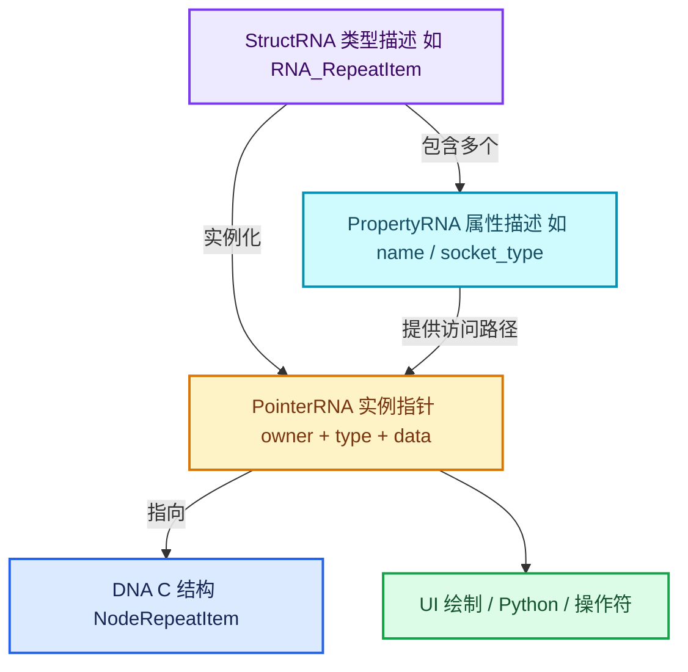
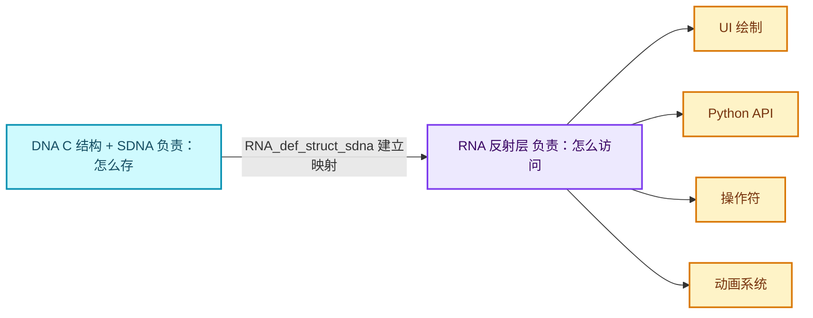

# 07-RNA属性系统

[前置知识总入口](../README.md) · [正篇：01-02 Zone输入输出](../../01-Zone系统基础/02-Zone输入输出与bundle迁移语义.md)

本章回答：**RNA 是什么**。读者在正篇 01-02 第 113 行第一次撞上 `StructRNA` 与 `PointerRNA`，而主系列只在 00-01 里用一行"RNA 基础：`StructRNA`、property 指针绑定"带过。

## 一句话

RNA 是 Blender 的**运行时反射系统**：把任意 C 结构体包装成带类型、带名称、可自动生成 UI、可被 Python 访问、可被保存的属性集合。

- **DNA** 负责"**怎么存**"（磁盘布局，见第 05 章）
- **RNA** 负责"**怎么访问**"（内存视图 + 反射 + 自动 UI）
- **SDNA** 是二者的桥（`RNA_def_struct_sdna` 声明"C 结构字段 X 对应 RNA 属性 Y"）

## 阅读顺序

| # | 篇目 | 源码主线 | 实测行数 |
| --- | --- | --- | --- |
| 1 | [01-RNA三层结构与职责](01-RNA三层结构与职责.md) | `RNA_types.hh` | 1047 |
| 2 | [02-StructRNA与PropertyRNA](02-StructRNA与PropertyRNA.md) | `RNA_define.hh` | 689 |
| 3 | [03-PointerRNA与属性访问](03-PointerRNA与属性访问.md) | `RNA_access.hh` | 1025 |
| 4 | [04-RNA_def_struct_sdna映射](04-RNA_def_struct_sdna映射.md) | C 结构 ↔ RNA 属性的桥 | `rna_nodetree.cc` 摘取 |
| 5 | [05-属性变更与更新通知](05-属性变更与更新通知.md) | setter → update 标签 → 声明重建 | `rna_nodetree.cc` L3921-L3957 |

## 本章与 Repeat 的关系

| RNA 概念 | 在 Repeat 中的落点 | 正篇位置 |
| --- | --- | --- |
| `StructRNA` + `item_srna` | `RepeatItemsAccessor::item_srna = &RNA_RepeatItem` | 02-01 L1012 |
| `PointerRNA` | `RNA_pointer_create_discrete` 构造 Output 节点指针 | 02-01 L100-L241 |
| `socket_name_ptr(owner, srna, data, "name")` | socket 标签绑定到 `item.name` | 01-02 L113-L130 |
| RNA setter + update 回调 | 改名 → 声明重建 → socket 复用 | 01-02 L606-L618 |
| `rna_names` | `repeat_items` / `active_index` 属性名 | 02-03 L362 |
| SDNA 绑定 | `RNA_def_struct_sdna(srna, "NodeRepeatItem")` | 00-01 L290 |

**最关键的一条**：正篇 01-02 的核心结论"名字的唯一事实源是 item，socket 只是投影"，完全建立在 `socket_name_ptr` 把 RNA 属性指向 DNA 字段这一机制上。不理解 RNA，这句话只是口号。

## 实测行数总表

| 文件 | 行数 |
| --- | --- |
| `makesrna/intern/rna_nodetree.cc` | 9908 |
| `makesrna/RNA_types.hh` | 1047 |
| `makesrna/RNA_access.hh` | 1025 |
| `makesrna/RNA_define.hh` | 689 |
| `makesrna/intern/rna_internal.hh` | 长（180 处相关匹配） |
| **本章核心 4 文件合计** | **12,669** |

`rna_nodetree.cc` 近万行——本章只取与 Repeat/节点 item 相关的段（L3921-L3957 的 setter/update 回调、L8087 与 L8321 的 `inspection_index` 属性定义）。

## 三个核心类型的关系

一句记忆口诀：**StructRNA 是类，PropertyRNA 是成员变量，PointerRNA 是 this 指针，DNA 结构是被包裹的那个真实对象。**

## DNA 与 RNA 的分工（全图）

## 实测发现的一个细节

`.markdown/学习节点/` 里的既有短篇**没有** RNA 专题——这是本系列相对既有资料真正补上的空白。读者若只看旧资料，RNA 这层永远是黑箱。
