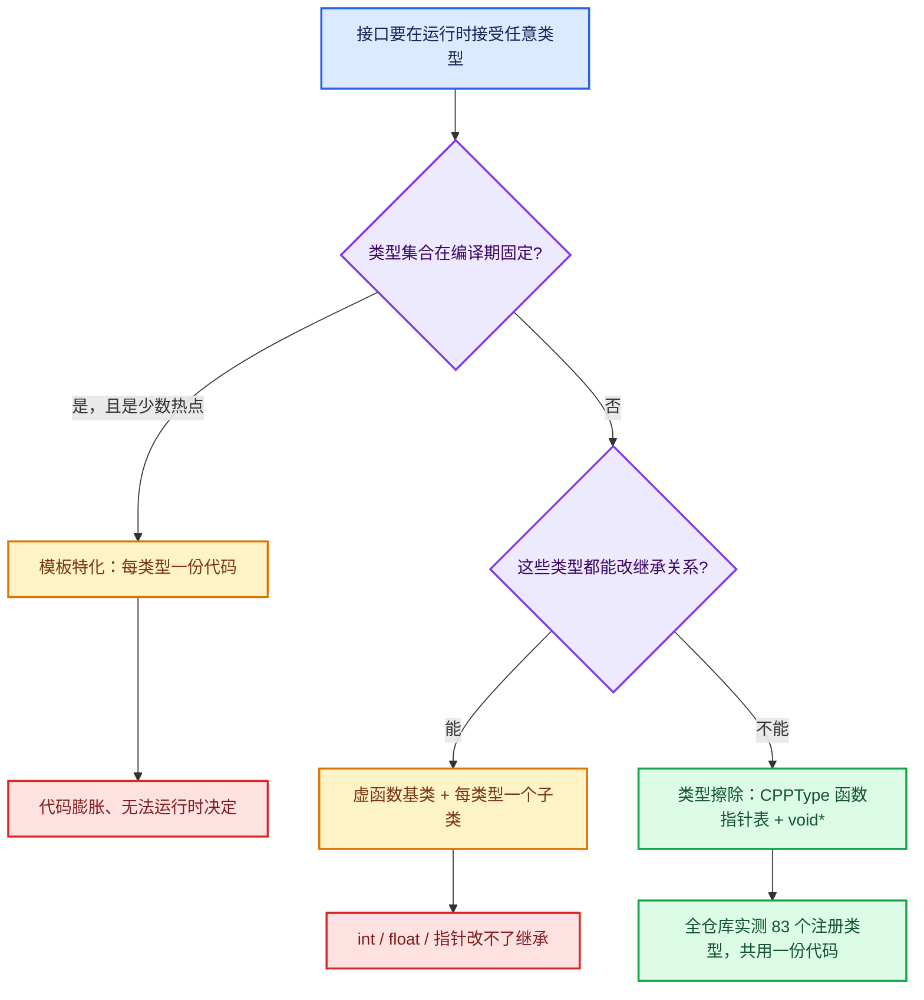

# 01 · CPPType 运行时类型

[前置知识总入口](../README.md) · [本章导航](README.md) · [下一篇](02-SocketValueVariant.md)

> 基准：Blender `5.4.0-alpha`，本地工作树。本篇讲 `CPPType`——把 C++ 类型信息从编译期搬到运行期的机制，它是整个类型擦除体系的地基。主要源码：[`BLI_cpp_type.hh`](../../../source/blender/blenlib/BLI_cpp_type.hh)（实测 823 行）。

## 先回答一个具体问题

一张惰性函数图的接口要在运行时接受任意类型，怎么描述这个类型？

把问题钉死在一个真实的函数签名上。`lf::Graph` 添加接口时接受的是（[`FN_lazy_function_graph.hh`](../../../source/blender/functions/FN_lazy_function_graph.hh) L264—L265）：

```cpp
GraphInputSocket &add_input(const CPPType &type, std::string name = "");
GraphOutputSocket &add_output(const CPPType &type, std::string name = "");
```

注意 `type` 是 `const CPPType &`——一个**运行期的对象引用**，不是一个模板参数。也就是说调用方在图构建那一刻才决定"这个插口装什么"，编译器完全不知道 `CPPType` 背后是 `int`、`std::string` 还是 `bke::GeometrySet`。

那 `CPPType` 里必须装什么？至少三样东西：**占多大**（否则没法在 `void *` 缓冲区里挪它）、**对齐几字节**（否则非法地址上构造就是 UB）、**怎么用**（怎么构造、怎么析构、怎么拷、怎么移、怎么比、怎么哈希）。前两样是两个整数，第三样只能是一组**函数指针**。

这就是全部设计。`CPPType` = 两个尺寸字段 + 若干布尔标记 + 一张 37 个函数指针的表（实测 `BLI_cpp_type.hh` L174—L221 共 37 个成员）。它不含任何值本身，被操作的值永远是别人传进来的 `void *`。

`[讲解]` 文件头注释把这一层的意思写得很直白（L10—L11）："An instance of #CPPType wraps exactly one type like `int` or `std::string`. With #CPPType one can write generic data structures and algorithms. That is similar to what C++ templates allow. The difference is that when using templates, the types have to be known at compile time and the code has to be instantiated multiple times. On the other hand, when using #CPPType, the data type only has to be known at run-time, and the code only has to be compiled once."

一句话：**模板把代码复制 N 份，`CPPType` 只编译一份、运行时查表**。

## 三种方案的对比

想做到"一个容器装任意类型"，历史上只有三条路。文件头注释（L60—L72）本身就在讨论选型，这里补上成本维度：

| 维度 | 模板特化 | 虚函数基类 | 类型擦除（`CPPType` + `void *`） |
| --- | --- | --- | --- |
| 类型决定时机 | 编译期 | 编译期（继承关系得写死） | **运行期** |
| 代码体积 | 每种类型实例化一份，组合爆炸 | 每个类型一个子类，各实例化一次 | **所有类型共用一份算法代码** |
| 能否覆盖 `int` / `float` / `void *` | 能 | **不能**——内置类型改不了继承关系 | 能 |
| 分派开销 | 零（内联后无分派） | 1 次 vtable 间接 | 1 次函数指针间接 |
| 同一容器混装不同类型 | 不能 | 能（`Base *`） | 能（`CPPType *` + `void *`） |
| 类型集合能否运行时扩展 | 不能 | 需要提前写子类 | 能（注册一个即可） |
| Repeat 是否采用 | 部分（`to_static_type` 热点分流） | 否 | **是，主路径** |



`[讲解]` 图里那条"是，且是少数热点 → 模板特化"的分支不是装饰。文件头 L25—L27 明确说可以混用："Sometimes a combination can make sense. Optimized code can be generated at compile-time for some types, while there is a fallback code path using #CPPType for all other types. #CPPType::to_static_type allows dispatching between both versions based on the type." 所以真实工程里不是"三选一"，而是**类型擦除当兜底，模板特化当加速器**。

`[讲解]` 为什么虚函数那条路在这份代码里被否掉？注释给的第三条理由最实在（L71—L72）："If it becomes necessary, we could pass the function pointers to C functions more easily than pointers to virtual member functions." 一个裸函数指针能直接塞进 C 回调；成员虚函数指针不能。次要理由在 L66—L70：每个被包裹的 C++ 类型都要写一个只实例化一次的子类，以及 `default_construct` 这类单值操作"即使这一次函数指针间接都已经增加了很多开销；如果全部方法是虚的，就会有第二层间接"。

## CPPType 的字段

先看类的整体轮廓（L106—L172）。`class CPPType : NonCopyable, NonMovable`——它被刻意禁止拷贝和移动，因为"任何 C++ 类型最多对应一个 `CPPType` 实例"（L39—L40 的不变式，靠 `operator==` 的比较指针实现，L486—L489）。

### `size` 与 `alignment`（L114、L122）

```cpp
int64_t size = 0;       // C++ equivalent: sizeof(T);
int64_t alignment = 0;  // C++ equivalent: alignof(T);
```

`[讲解]` 这两个是全部内存操作的基石。所有 API 都在 `void *` 上工作，而"把 `ptr` 前进一个元素"这件事对 `void *` 是**非法的**（GCC 上面是扩展、标准里是 UB）。所以每个批量方法都得靠 `size` 算字节偏移，或者干脆在包装层转成 `T *` 再算——`cpp_type_util` 里清一色是后者（`static_cast<T *>(ptr) + i`）。

`alignment` 不只用于分配，还被压成了一个掩码用于快速校验（L172、L532—L535）：

```cpp
uintptr_t alignment_mask_ = 0;
inline bool CPPType::pointer_has_valid_alignment(const void *ptr) const
{
  return (uintptr_t(ptr) & alignment_mask_) == 0;
}
```

掩码在构造函数里一次算好（[`BLI_cpp_type_make.hh`](../../../source/blender/blenlib/BLI_cpp_type_make.hh) L464）：`alignment_mask_ = uintptr_t(this->alignment) - uintptr_t(1);`。前提是 alignment 为 2 的幂——对任何真实类型成立。这么做的收益是：**每个函数指针回调的第一行都可以廉价断言地址合法**，`cpp_type_util::pointer_can_point_to_instance<T>` 就是这么实现的（make.hh L27—L30）。

### 类型标记（L131—L158）

| 字段 | 行 | 语义 | C++ 对应 |
| --- | --- | --- | --- |
| `is_trivial` | L131 | 可以整块 `memcpy`，不需要析构 | `std::is_trivial_v<T>` |
| `is_trivially_destructible` | L140 | 析构可以不调，用于优化 | `std::is_trivially_destructible_v<T>` |
| `has_special_member_functions` | L151 | 六个特殊成员函数**全都有** | 无单一对应，是合取 |
| `is_default_constructible` | L153 | `default_construct_ != nullptr` | `std::is_default_constructible_v<T>` |
| `is_copy_constructible` | L154 | `copy_construct_ != nullptr` | 同上 |
| `is_move_constructible` / `is_destructible` / `is_copy_assignable` / `is_move_assignable` | L155—L158 | 各自函数指针是否非空 | 同上 |

`[讲解]` 后六个字段是**从函数指针反推**出来的，不是独立信息来源（make.hh L465—L472）：

```cpp
this->has_special_member_functions = (default_construct_ && copy_construct_ && copy_assign_ &&
                                      move_construct_ && move_assign_ && destruct_);
this->is_default_constructible = default_construct_ != nullptr;
```

所以"函数指针表"和"能力标记"永远不可能打架——只有一个真相来源。

### `base_type`、`generic_type`、`type_index`（L161—L169）

`base_type` 来自 `T::base_type`、`generic_type` 来自 `T::generic_type`（make.hh L474—L479，用 C++20 的 `requires { typename T::base_type; }` 探测）。这两个是**可选的类型层级**：比如 field 类型有 `generic_type` 指向 `GField`，于是 `SocketValueVariant` 可以统一按泛化类型存储再向下转型（下一篇会用到）。

`type_index` 是注册时从全局原子计数器领的号（make.hh L332、L480）：

```cpp
inline std::atomic<int> type_index_counter{0};
// ...
this->type_index = type_index_counter++;
```

`[讲解]` 为什么既要指针又要索引？注释自己解释了（L164—L168）：指针虽然唯一，但"有时用一个相对小的数字更容易"（generally <100）。实际用途只有一个——`to_static_type_try` 拿它当数组下标，用 `Array<Callback>` 取代 `Map`（L798—L800 的注释明说"for faster lookup and less generated code"）。实测全仓库 83 个注册类型，索引确实都在百以内。

### 为什么是函数指针，不是虚函数

这是本节最该讲清的一点。`CPPType` **本身几乎不带虚函数**——整份文件里只有一个 `virtual`（L229）：

```cpp
virtual ~CPPType() = default;
```

`[讲解]` 这个虚析构不参与任何分派，它存在只是为了在退出时能 `std::destroy_at(cpp_type)` 正确结束生命周期（make.hh L493—L499 的 `CPPTypeDestructor`）。**"有一个虚析构"和"用虚函数做分派"是两件完全不同的事**——极容易混淆。

真正被否掉的是另一种设计：`CPPType` 当基类、每个被包裹的 C++ 类型写一个子类、`default_construct` 等方法全虚。理由已经引过，这里把它翻译成成本：

- **类数量**：83 个注册类型 → 83 个子类，每个只 `new` 一次（L66—L67 的原话："a lot of classes that would only be instanced once each"）。为一次性实例写 83 个类，纯负担。
- **间接层数**：函数指针方案里调 `default_construct` 是"解引用一个已知偏移的指针 + 调用"（1 次间接）。虚函数方案里还要先读对象头的 vptr，再读槽位（2 次间接）。热路径上这是实实在在的差别，注释直接点名 `default_construct`（L68—L70）。
- **不能覆盖内置类型**：想给 `int` 写 `class IntType : CPPType`，可以；但 `int` 本身不能变，而"给 `int` 一个统一接口"正是目的。函数指针方案里 `cpp_type_util::default_construct_cb<int>` 只是**一个函数模板实例**，不需要碰 `int`。
- **能交给 C**：裸函数指针可以直接塞进 C 回调（比如 `ResourceScope::add(void *userdata, void (*free)(void *))`，[`BLI_resource_scope.hh`](../../../source/blender/blenlib/BLI_resource_scope.hh) L199）；成员虚函数指针不行。

### 函数指针表与两个私有成员（L174—L224）

37 个函数指针按语义分 12 组（构造 3、值初始化 3、析构 3、拷贝赋值 4、拷贝构造 4、移动赋值 3、移动构造 3、relocate 赋值 3、relocate 构造 3、fill 赋值 2、fill 构造 2、print/相等/哈希/唯一哈希 4，合计 37），全部以 `= nullptr` 初始化，也就是说**"不支持某能力"用空指针表示**，不需要额外的布尔位。同一声明段末尾还有两个私有成员：

```cpp
const void *default_value_ = nullptr;
std::string debug_name_;
```

`[讲解]` `default_value_` 是"默认值也是一个值，得存一份"的产物。头注释 L52—L54 解释：对 trivial 类型构造什么都不做（比如 `int` 的 `default_construct` 不动内存），但图的插口需要一个确定的默认值可拷贝，于是注册时静态存一份（make.hh L355—L362）：

```cpp
if constexpr (bool(Flags & CPPTypeFlags::IdentityDefaultValue)) {
  static const T default_value = T::identity();
  default_value_ = &default_value;
}
else {
  static const T default_value = T();
  default_value_ = &default_value;
}
```

`IdentityDefaultValue` 这个 flag 就是给"默认值是单位元"的类型用的——实测全仓库只有 `math::Quaternion` 用了它（blenlib `cpp_types.cc` L58—L59），因为旋转的单位元是 `identity()` 而不是零构造。这是字段与 flag 之间唯一的一处非平凡联动，值得记住。

`debug_name_` 的类型是 `std::string`（不是 `StringRef`），但 `name()` 返回 `StringRefNull`（L512—L515）。头注释 L37 强调："Every type has a name that is for debugging purposes only. It should not be used as identifier." 下面反例里会专门讲这一点。

## 函数指针表逐个

八组最常用的语义如下。注意实测的成员名都带尾下划线（`default_construct_`），公开方法是去掉下划线的同名包装（如 `default_construct`，L542—L545 是一行转发的 `inline`）。用户文档里常见的 `construct_default_`、`size_`、`alignment_` 这些写法在本文件里**都不存在**——字段就是 `size`、`alignment`、`default_construct_`。

| 函数指针 | 行 | 语义 | C++ 等价 | 何时被调 |
| --- | --- | --- | --- | --- |
| `default_construct_` | L174 | 在未初始化内存上默认构造 | `new (ptr) T;` | 容器扩容、`Array::reinitialize` 后新建元素 |
| `value_initialize_` | L178 | 值初始化（trivial 类型补零） | `new (ptr) T();` | 需要确定初始值的场合；与上者的差别见测试 L142—L176 |
| `destruct_` | L182 | 调析构，**不释放内存** | `ptr->~T();` | 容器析构元素、`ResourceScope` 收尾回调 |
| `copy_assign_` | L186 | 赋值到**已构造**的目标 | `dst = src;` | 已有元素的覆写 |
| `copy_construct_` | L191 | 构造到**未初始化**的目标 | `new (dst) T(src);` | 容器插入、`append` 到未初始化槽 |
| `move_assign_` | L196 | 移动到已构造目标 | `dst = std::move(src);` | 元素搬移、`std::move` 语义的批量版 |
| `move_construct_` | L200 | 移动构造到未初始化目标 | `new (dst) T(std::move(src));` | 容器重分配、`Vector` 扩容搬元素 |
| `relocate_assign_` / `relocate_construct_` | L204、L208 | 移动 + 立刻析构源，源变未初始化 | `dst = std::move(src); src->~T();` | **Blender 容器搬移的标准动作**（见下） |
| `fill_assign_n_` / `fill_construct_n_` | L212、L215 | 把一个值填 n 个位置 | `std::fill_n` / `std::uninitialized_fill_n` | 批量默认值、`index_values` 一类预填充 |
| `print_` / `is_equal_` / `hash_` / `hash_unique_` | L218—L221 | 调试打印 / 相等 / 哈希 / 唯一哈希 | `operator<<` / `==` / `get_default_hash` | 日志、集合去重、缓存键 |

`[讲解]` 三个必须点明的细节：

1. **每一组都有三（或四）个变体**：单值 `_`、批量 `_n`、稀疏 `_indices`（接 `IndexMask`），拷贝组还多一个 `_compressed`。头注释 L42—L50 用 `default_construct` 举例说明了三个变体的分工。这不是冗余——`_indices` 版本是 Blender 几何节点"只算被选中的元素"这一整套优化的入口。
2. **`relocate_*` 是 Blender 特有的**。标准 C++ 没有"移动并析构源"的单一操作，Blender 容器（`Vector`、`Array`）搬元素时要的正是这个，于是 `CPPType` 把它做成了一等公民。对 trivial 类型它直接退化成拷贝（见下节）。
3. **`is_equal_` / `hash_` 可能为空**，调用方必须用带兜底的版本：`is_equal_or_false`（L732）、`hash_or_fallback`（L745）。直接调 `is_equal` / `hash` 在不可哈希/不可比较的类型上是**空指针调用**。注意区分 `hash(const void *value)`（L398，对值算哈希）与 `hash()`（L408，对**这个 `CPPType` 指针**算哈希，实现是 `get_default_hash(this)`，L763—L766）。

`[讲解]` 另外有一个几乎无人使用的接口：`destruct_fn()`（L410、L768）把 `destruct_` 裸暴露出来，供"需要一个 C 风格析构回调"的地方使用。实测全仓库**没有任何调用点**（只有声明与定义），它属于为将来预留的逃生口。

<details><summary>核对原始源码：函数指针表首段 · L174—L190</summary>

```cpp
  void (*default_construct_)(void *ptr) = nullptr;
  void (*default_construct_n_)(void *ptr, int64_t n) = nullptr;
  void (*default_construct_indices_)(void *ptr, const IndexMask &mask) = nullptr;

  void (*value_initialize_)(void *ptr) = nullptr;
  void (*value_initialize_n_)(void *ptr, int64_t n) = nullptr;
  void (*value_initialize_indices_)(void *ptr, const IndexMask &mask) = nullptr;

  void (*destruct_)(void *ptr) = nullptr;
  void (*destruct_n_)(void *ptr, int64_t n) = nullptr;
  void (*destruct_indices_)(void *ptr, const IndexMask &mask) = nullptr;

  void (*copy_assign_)(const void *src, void *dst) = nullptr;
  void (*copy_assign_n_)(const void *src, void *dst, int64_t n) = nullptr;
  void (*copy_assign_indices_)(const void *src, void *dst, const IndexMask &mask) = nullptr;
  void (*copy_assign_compressed_)(const void *src, void *dst, const IndexMask &mask) = nullptr;
```

</details>

## CPPType::get<T>() 的机制

这里必须纠正一个流传很广的说法：**`CPPType::get<T>()` 不是 Meyers singleton，首次调用也不构造任何东西。**

真实机制分三段，缺一不可。

第一段：**每个类型一个静态存储槽**（[`BLI_cpp_type.hh`](../../../source/blender/blenlib/BLI_cpp_type.hh) L460—L467）：

```cpp
namespace detail {
template<typename T> inline TypedBuffer<CPPType> cpp_type_impl{};
template<typename T> inline bool is_cpp_type_registered = false;
}
```

`TypedBuffer<CPPType>` 是"按 `sizeof(CPPType)` 与对齐预留的一块原始字节"（[`BLI_memory_utils.hh`](../../../source/blender/blenlib/BLI_memory_utils.hh) L154—L220），它在静态初始化阶段就存在，但里面**还没有 `CPPType` 对象**。`is_cpp_type_registered<T>` 是可读写的 bool，默认 `false`。

第二段：**注册时才 placement new**（[`BLI_cpp_type_make.hh`](../../../source/blender/blenlib/BLI_cpp_type_make.hh) L484—L500）：

```cpp
template<typename T, CPPTypeFlags FLAGS> inline void register_cpp_type(const StringRef type_name)
{
  BLI_assert(!is_cpp_type_registered<T>);
  is_cpp_type_registered<T> = true;
  static CPPType *cpp_type = new (detail::cpp_type_impl<T>.ptr())
      CPPType(TypeTag<T>(), TypeForValue<CPPTypeFlags, FLAGS>(), type_name);

  struct CPPTypeDestructor {
    ~CPPTypeDestructor() { std::destroy_at(cpp_type); }
  };
  static CPPTypeDestructor cpp_type_destructor;
}
```

宏只是转一手字符串（L504—L505）：`#define BLI_CPP_TYPE_REGISTER(TYPE_NAME, FLAGS) blender::detail::register_cpp_type<TYPE_NAME, FLAGS>(STRINGIFY(TYPE_NAME))`。所以 `name()` 拿到的就是**类型名拼出来的宏参数字面量**，这也解释了它为什么"只适合调试"。

第三段：**`get<T>()` 只是解引用 + 断言**（L496—L505）：

```cpp
template<typename T> inline const CPPType &CPPType::get()
{
  using DecayT = std::decay_t<T>;
  BLI_assert(detail::is_cpp_type_registered<DecayT>);
  const CPPType &type = detail::cpp_type_impl<DecayT>.ref();
  return type;
}
```

`[讲解]` 三个后果，都能在源码里验到：

- **`get<T>()` 是零开销的**：`std::decay_t` 归一化（于是 `get<int>()`、`get<const int &>()`、`get<int &&>()` 拿到同一个对象），一次断言，一次取地址。没有任何构造、没有任何查表、没有任何锁。这也回答了"以为每次调用都重新构造"的反例。
- **未注册就崩**：断言在调试构建打印位置并中止；发布构建下断言被编掉（[`BLI_assert.hh`](../../../source/blender/blenlib/BLI_assert.hh) L63—L64 的 `#define BLI_assert(a) ((void)0)`），于是直接读一块从未构造过的内存——UB。测试代码里的应对写得很明确（L499—L501 的注释）：blenlib 测试先调 `register_cpp_types()`，通用测试调 `BKE_cpp_types_init()`。
- **`get<void>()` 被删除了**（L480）：`template<> const CPPType &CPPType::get<void>() = delete;` 注释说"Give a compile error instead of a link error when type information is missing."——把误用从链接期错误提前成编译期错误。

`[讲解]` 那"谁负责注册"？实测是三处显式启动调用，不是自注册静态对象：

| 触发点 | 位置 | 注册内容 |
| --- | --- | --- |
| 程序启动 | [`creator.cc`](../../../source/creator/creator.cc) L498 调 `BKE_cpp_types_init()` | 全部 |
| BKE 初始化函数本体 | [`blenkernel/intern/cpp_types.cc`](../../../source/blender/blenkernel/intern/cpp_types.cc) L32，先调 `register_cpp_types()` 再注册 60 个 BKE 类型 | 60 处 `BLI_CPP_TYPE_REGISTER` |
| blenlib 基础类型 | [`blenlib/intern/cpp_types.cc`](../../../source/blender/blenlib/intern/cpp_types.cc) L23 | 22 处（`bool`/`float`/`float3`/`int32_t`/`std::string`/`math::Quaternion` 等） |
| 合成器 | [`compositor/intern/init.cc`](../../../source/blender/compositor/intern/init.cc) L14 | 1 处（`ClosurePtr`） |
| 单元测试 | 各 `*_test.cc` 的 `SetUpTestSuite` | 测试自定义类型 |

实测合计 **83 处** `BLI_CPP_TYPE_REGISTER`（blenlib 22 + blenkernel 60 + compositor 1），这就是"全部已知类型"的规模。注意两个 init 函数都是手写 `static bool` 幂等保护（blenlib L25—L29），不是 `std::once_flag`——见后文反例。

`[讲解]` 最后一段是 `get_pre_register<T>()`（L507—L510）：

```cpp
template<typename T> inline const CPPType *CPPType::get_pre_register()
{
  return detail::cpp_type_impl<std::decay_t<T>>.ptr();
}
```

它只返回**存储槽的地址**，不保证对象已构造——注释原话是"The returned CPPType may not be constructed yet, but the pointer is valid already."。这个"半成品"接口存在的唯一理由是**注册顺序会成环**：`base_type` / `generic_type` 要在 `CPPType` 构造函数里填（make.hh L474—L479），而那时目标类型可能还没注册，于是只能先存指针、后补对象。`BKE_node_socket_value.hh` L61 的 `*CPPType::get_pre_register<T>()` 也是同一个用法。

`[讲解]` 还有一个"编译期回升"的逃生口 `to_static_type`（L427、L430、L791—L821）。它把"运行期类型"换回"编译期类型"列表，让热点代码对少数类型走模板。实现很妙：用 `CPPType::type_index` 当数组下标，一个 `Array<Callback>` 取代 `Map`（L798—L800 的注释："for faster lookup and less generated code"），`max_type_index` 用折叠表达式手算（L805 注释说这比 `std::max` + initializer_list 生成的代码少）。这段代码里还有一处 MSVC bug 的规避（L437—L442 的 `call_with_type_impl_`，注释说明用非捕获 lambda 会让 MSVC 生成零次迭代）——真实的工程疤痕。

## trivial 类型的优化

`is_trivially_destructible` 为真时"`destruct` 是空操作"这个说法**方向对、细节要修正**。分三层看。

第一层：**字段是编译期决定、运行期可读的**（make.hh L346—L347）：

```cpp
this->is_trivial = std::is_trivial_v<T>;
this->is_trivially_destructible = std::is_trivially_destructible_v<T>;
```

`[讲解]` 它们与 `std::is_trivially_*` 是**直接对应关系**，头注释 L125—L139 就写着 "C++ equivalent: `std::is_trivial_v<T>;`" / "`std::is_trivially_destructible_v<T>;`"。区别只在于：`std::` 版本是编译期常量、只能给 `if constexpr` 用；这两个字段是**运行期可读的**，于是 `ResourceScope` 能拿着一个 `const CPPType &` 决定"这个对象的析构要不要登记回调"。

第二层：**`destruct_` 指针不为空，但函数体是空的**。回调本体只有两行（make.hh L65—L69）：`destruct_cb<T>(void *ptr)` 先断言地址对齐，再 `(static_cast<T *>(ptr))->~T();`。对 `int`，`ptr->~int()` 是合法的伪析构调用（pseudo-destructor），生成的汇编是**零条指令**。所以 `CPPType::get<int>().destruct(&x)` 是一次真实的函数调用，跳进一个立刻返回的函数。

第三层：**批量路径在编译期就返回**（make.hh L70—L78）。`destruct_indices_cb<T>` 先断言地址，然后 `if (std::is_trivially_destructible_v<T>) { return; }` 早退，否则才 `mask.foreach_index_optimized` 逐个 `~T()`。

`[讲解]` 注意这里是 `if` 而不是 `if constexpr`——对模板实例化来说效果一样（条件恒真时编译器直接裁掉后半段），但写法更朴素。于是 `destruct_n` / `destruct_indices` 对 trivial 类型是"进函数、判断、返回"的一次早退。

`[讲解]` 更有价值的优化在**赋值/搬移组的函数指针复用**，这是 `CPPType` 设计的精华（make.hh L375—L438）：

| 条件 | 复用 |
| --- | --- |
| `std::is_trivially_copy_constructible_v<T>` | `copy_construct_ = copy_assign_`（L377，拷贝构造直接等于拷贝赋值） |
| `std::is_trivially_move_assignable_v<T>` | `move_assign_ = reinterpret_cast<decltype(move_assign_)>(copy_assign_)`（L393，附注释 L391—L392："This casts away the const from the src pointer. This is fine for trivial types as moving them does not change the original value."） |
| `std::is_trivially_move_constructible_v<T>` | `move_construct_ = move_assign_`（L406） |
| `std::is_trivially_move_assignable_v<T> && std::is_trivially_destructible_v<T>` | `relocate_construct_ = relocate_assign_ = move_assign_`（L418—L424，全部退化成拷字节） |

`[讲解]` 结果：对 `int` 来说，`copy_assign_`、`copy_construct_`、`move_assign_`、`move_construct_`、`relocate_assign_`、`relocate_construct_` **六个指针指向同一个函数地址**。这就是"trivial 类型跑得快"的真正原因——不是运行时分支少，而是**表里根本没有多份代码可分派**。

`[讲解]` 这个标记在 Repeat 的上下文里有一处直接用途，就是 04 章讲过的 `ResourceScope`。同一个优化有两个版本：

- **编译期版**（[`BLI_resource_scope.hh`](../../../source/blender/blenlib/BLI_resource_scope.hh) L181—L197）：`add(destruct_ptr<T>)` 里 `if constexpr (std::is_trivially_destructible_v<T>) { return ptr; }`——类型在编译期已知，直接不登记。
- **运行期版**（同文件 L227—L234）：`allocate_owned(const CPPType &type)` 里 `if (!type.is_trivially_destructible) { this->add_destruct_call([&type, buffer]() { type.destruct(buffer); }); }`——类型在运行期才知道，靠**字段**判断。

一句话：`CPPType` 的 `is_trivially_destructible` 就是"把 `std::is_trivially_destructible_v` 从编译期搬到运行期"的桥。没有它，`ResourceScope` 面对 `void *` + `CPPType` 就只能无条件登记回调，白白多一次间接调用和一份 `ResourceData`。

同类用例还有一处值得对照（[`BLI_generic_virtual_array.hh`](../../../source/blender/blenlib/BLI_generic_virtual_array.hh) L636—L642）：`GVArrayImpl_For_Func::get` 在写入前先判断 `if (!type_->is_trivially_destructible) { type_->destruct(r_value); }`——因为目标缓冲区里可能已有旧值，trivial 类型不需要先销毁。

## 在 Repeat 中的三处用法

Repeat 的执行图构建全在 [`geometry_nodes_lazy_function.cc`](../../../source/blender/nodes/intern/geometry_nodes_lazy_function.cc)（实测 4411 行）。实测该文件里 `CPPType::get<` 共 **60 处**，分布如下：

| 类型 | 次数 | 角色 |
| --- | --- | --- |
| `CPPType::get<SocketValueVariant>()` | **27** | 图接口的**统一值类型**——所有主通道 |
| `CPPType::get<bool>()` | **24** | usage 通道、"是否被用"布尔流 |
| `CPPType::get<GeometryNodesReferenceSet>()` | **7** | 匿名属性引用集通道 |
| 其余 2 处 | 2 | `GeoNodesMultiInput<SocketValueVariant>` 等 |

### 一、`CPPType::get<SocketValueVariant>()`——图接口类型

`initialize_zone_wrapper` 是 zone 包装函数接口的总入口（L1704—L1756），Repeat 的 `inputs_` / `outputs_` 就是它填出来的：

```cpp
zone_info.indices.inputs.main.append(r_inputs.append_and_get_index_as(
    socket->name, CPPType::get<SocketValueVariant>(), lf::ValueUsage::Maybe));
```

`[讲解]` 这一行是整个类型擦除体系的**会合点**：zone 输入节点上每个 socket 的具体类型可能是 Float、Vector、Geometry、Bundle……但在 LF 图这一层，它们**全部**被描述成同一个 `CPPType`——`SocketValueVariant` 的那一个。这就是为什么 03-01/03-02 的清单里十几行 `add_input` 类型参数都一样。

而 [`geometry_nodes_repeat_zone.cc`](../../../source/blender/nodes/intern/geometry_nodes_repeat_zone.cc) 里构建展开图时，并不重新写类型，而是**把存下来的 `CPPType` 转发出去**（L238—L245）：

```cpp
for (const int i : inputs_.index_range()) {
  const lf::Input &input = inputs_[i];
  lf_inputs.append(&lf_graph.add_input(*input.type, this->input_name(i)));
}
```

`[讲解]` `lf::Input` 里存的就是 `const CPPType *type`（[`FN_lazy_function.hh`](../../../source/blender/functions/FN_lazy_function.hh) L211、L223—L226）。所以"运行时类型"在整条链上是**指针传递**：注册时构造一次，之后所有接口共享同一个对象。这也是为什么 `operator==` 只比指针（L486—L489）就够——类型相等性判断题在 Blender 里退化成指针比较，零成本。

### 二、`CPPType::get<bool>()`——usage 通道

同一函数里，"这个输出有没有被用到"是独立插口（L1728—L1745）：

```cpp
zone_info.indices.inputs.output_usages.append(
    r_inputs.append_and_get_index_as("Usage", CPPType::get<bool>(), lf::ValueUsage::Maybe));
```

`[讲解]` 为什么不用 `SocketValueVariant` 装 `bool`？因为 usage 信息是**图结构元数据**，不是用户数据：它自己不需要 field、list、grid 形态，永远是一个裸 bool。用 `bool` 的 `CPPType` 意味着 `lf` 框架拿到的是**真类型**（`size == 1`、`alignment == 1`），可以走最短路径搬运，不必进 variant 的 32 字节内联缓冲 + 类型标签。这是"能精确就别泛化"的局部取舍。

### 三、`CPPType::get<GeometryNodesReferenceSet>()`——引用集通道

```cpp
zone_info.indices.inputs.reference_sets.add_new(
    item.key,
    r_inputs.append_and_get_index_as(
        "Reference Set", CPPType::get<GeometryNodesReferenceSet>(), lf::ValueUsage::Maybe));
```

`[讲解]` `GeometryNodesReferenceSet` 本质是一个 `shared_ptr<Set<std::string>>`（见 [`BKE_geometry_nodes_reference_set.hh`](../../../source/blender/blenkernel/BKE_geometry_nodes_reference_set.hh) L21）。它也不进 `SocketValueVariant`——它是**执行期的簿记类型**，只在循环体内外传递"哪些匿名属性还要活着"的信息（03-02 的 L1237 起有详解）。给它一个独立 `CPPType` 意味着它可以是 trivial-ish 的引用计数结构，构造/析构语义由自己的回调决定，不与用户数据类型抢通道。

`[讲解]` 三处用法合起来说明一件事：**`CPPType` 在 Repeat 里同时承担了"用户值的泛化"和"框架元数据的精确"两种角色**。同一个类，两种用法，区别只在传的是哪个 `CPPType` 实例。

## 与 SocketValueVariant 的关系

一句话：**`CPPType` 描述"这是什么类型"，`SocketValueVariant` 提供"存这个值"**（下一篇详讲）。

展开一点：`CPPType` 是一张**行为表**，它从不持有值——每个方法都要求调用方传 `void *`。`SocketValueVariant` 才是那个**持有者**：它内部是 `Any<SocketValueVariantTypeInfo, 32, 16>`（[`BKE_node_socket_value.hh`](../../../source/blender/blenkernel/BKE_node_socket_value.hh) L50），一块 32 字节、16 字节对齐的内联缓冲 + 一个类型信息指针。而它的类型信息里**第一项就是 `const CPPType &`**（L52—L66）：

```cpp
struct SocketValueVariantTypeInfo {
  const CPPType &type;
  bool (*convert_to)(const CPPType &dst_type, SocketValueVariantAny &value);
  bool (*is_interpretable_as)(const CPPType &dst_type, const SocketValueVariantAny &value);
  SocketValueStorageKind storage_kind;
};
```

`[讲解]` 所以两者的分工是干净的双层：`Any` 负责"内联还是堆、拷还是移、要不要析构"（[`BLI_any.hh`](../../../source/blender/blenlib/BLI_any.hh) L30—L37 的 `AnyTypeInfo` 也是函数指针，实现思路同源）；`CPPType` 负责"这个类型到底会什么"（能不能哈希、能不能打印、能不能比较）。前者是存储策略，后者是类型契约。

## 用小数据走一遍

拿两个类型对照：`CPPType::get<int>()` 与 `CPPType::get<std::string>()`。字段差异如下（值都能从注册代码直接推出，实测注册点是 blenlib `cpp_types.cc` L42 与 L61，两者都带 `CPPTypeFlags::BasicType`）。

| 字段 | `int` | `std::string` |
| --- | --- | --- |
| `size` | `sizeof(int)`，即 4 | `sizeof(std::string)`，libstdc++ / MSVC 64 位下为 32 |
| `alignment` | `alignof(int)`，即 4 | `alignof(std::string)`，即 8 |
| `alignment_mask_` | 3 | 7 |
| `is_trivial` | **true** | **false** |
| `is_trivially_destructible` | **true** | **false** |
| `default_construct_` | 非空（`default_construct_cb<int>`，函数体 `new (ptr) int` = 不动内存） | 非空（构造空串） |
| `destruct_` | 非空，但函数体是 `ptr->~int()`，编译后无指令 | 非空，**真析构**，要释放堆缓冲 |
| `copy_assign_` | `copy_assign_cb<int>` | `copy_assign_cb<std::string>`，`operator=` 可能重新分配 |
| `copy_construct_` | **复用 `copy_assign_`**（L377） | `copy_construct_cb<std::string>`，走 `uninitialized_copy_n` 调拷贝构造 |
| `move_assign_` | **复用 `copy_assign_`**（`reinterpret_cast`，L393） | `move_assign_cb<std::string>`，窃取指针 |
| `move_construct_` | **复用 `move_assign_`**（L406） | `move_construct_cb<std::string>` |
| `relocate_assign_` / `relocate_construct_` | **复用 `move_assign_`**（L418—L424） | `relocate_assign_cb` / `relocate_construct_cb`，“移动＋析构源” |
| `is_equal_` | 非空（`BasicType` 含 `EqualityComparable`） | 非空 |
| `hash_` | 非空 | 非空 |
| `print_` | 非空 | 非空 |
| `default_value_` | 指向静态 `const int default_value = T()`，即 0 | 指向静态 `const std::string default_value = T()`，即空串 |
| `type_index` | 注册序号（`bool` 在最前，实测若按 `register_cpp_types` 顺序则 `bool` 拿 0） | 在 blenlib 那批里注册得最晚（`cpp_types.cc` L61 是最后一行），但 BKE 那批更晚 |
| `base_type` / `generic_type` | 均为 `nullptr` | 均为 `nullptr` |

`[讲解]` 这张表要读出的**三个结论**：

1. **trivial 类型的"表"其实是空的**。`int` 的拷贝构造、移动构造、移动赋值、两个 relocate、拷贝赋值全指向同一个地址——不是"优化过"，是"根本没有第二个实现"。这就是 trivial 优化的实质。
2. **`std::string` 的 `is_trivial` 为 false，但 `has_special_member_functions` 为 true**。它对所有六个特殊成员函数都非空，所以可以放进任何需要完整对象语义的容器。而 `int` 的 `has_special_member_functions` 也是 true（因为六个指针都非空），尽管其中四个是同一个地址。
3. **`size` 与 `alignment` 是给外人用的，不是给自己用的**。`CPPType` 的所有回调内部都是 `static_cast<T *>(ptr) + i`，压根不读 `size`；`size` 的唯一消费者是那些只拿到 `void *` + `CPPType` 的容器（`BUFFER_FOR_CPP_TYPE_VALUE` 宏，L475—L477，用 `size`/`alignment` 在栈上开 `DynamicStackBuffer<64, 64>`）。

`[讲解]` 一个容易踩的细节：`int` 的 `default_construct` 注释说"does nothing"（L262），但 `value_initialize` 会补零（L272 "Same as #default_construct, but does zero initialization for trivial types."）。测试文件把这两条都钉住了——`DefaultConstructTrivial` 断言把 `5` 传进去构造后**仍是 5**（[`BLI_cpp_type_test.cc`](../../../source/blender/blenlib/tests/BLI_cpp_type_test.cc) L142—L147），`ValueInitializeTrivial` 断言构造后变 `0`（L171—L176）。这两个测试就是这两个方法的语义定义，比任何注释都可靠。

## 反例与边界

以下九条都是实测能证伪的常见误解。

1. **以为 `CPPType` 能替代 `typeid` / `std::type_info`。** 头注释 L29—L31 明确说"Under some circumstances, #CPPType serves a similar role as #std::type_info. However, #CPPType has much more utility because it contains methods for actually working with instances of the type."它不做名称全等、不做继承查询、不做跨 DLL 的 RTTI 比对。它能做的只有：给尺寸、给对齐、按下标查表、比指针。

2. **以为 `CPPType::get<T>()` 每次调用都重新构造，或者是"首次调用自动注册"的 Meyers singleton。** 实测不是：对象在 `register_cpp_type` 里 placement new（make.hh L489—L490），`get<T>()` 只有 `BLI_assert` + `.ref()`（L500—L504）。**首次调用不会触发注册**——未注册就断言失败，发布构建下读未构造内存。

3. **以为存在 `CPPType::get_by_name(std::string_view)`。** 实测全仓库**没有这个符号**（`BLI_cpp_type.hh` 与 `BLI_cpp_type_make.hh` 里搜 `get_by_name` 零命中，全 `source/blender` 也零命中）。头注释 L37 已经堵死了这条路："Every type has a name that is for debugging purposes only. It should not be used as identifier."名字只是宏字符串（`STRINGIFY(TYPE_NAME)`），没有任何反向索引。想按名字找类型只能自己建 `Map`。

4. **以为 `CPPType` 拥有对象，或者 `destruct()` 会释放内存。** `destruct(ptr)` 只调 `ptr->~T()`（make.hh L65—L69），一个字节都不还。内存归 `LinearAllocator` / `ResourceScope` / 容器；`CPPType` 只管"怎么结束对象的生命"。这正是 04-03 章 `destruct_ptr` 的同一套分权。

5. **以为 `is_trivial` 为真时函数指针为空。** 实测所有指针都非空：`int` 的 `destruct_` 指向一个空函数体，不是 `nullptr`。判空只在**可选能力**（`hash_`、`print_`、`is_equal_`）和**模板条件不满足**（如不可默认构造的类型）时才有意义（make.hh L348—L462 那一串 `if constexpr`）。

6. **以为 `get_pre_register<T>()` 返回的对象可以用。** 它返回的是**存储槽地址**（L509），对象可能还没构造。唯一合法用法是"先存指针、注册后再解引用"，例如 `base_type` / `generic_type`（make.hh L474—L479）与 `SocketValueVariantTypeInfo`（`BKE_node_socket_value.hh` L61）。在注册前调它的任何方法都是 UB。

7. **以为自己 `new` 一个 `CPPType` 也没事。** 构造函数需要 `TypeTag<T>` + `TypeForValue<CPPTypeFlags, Flags>` + 名字（L227—L228），技术上可调；但一旦绕过 `register_cpp_type` 就会破坏两条不变式：`is_cpp_type_registered` 没置位（别人 `get<T>()` 照样断言失败）、`type_index` 重号（`to_static_type_try` 的回调数组会互相覆盖，L801—L810）。**唯一合法入口就是 `BLI_CPP_TYPE_REGISTER`。**

8. **以为注册是线程安全的，可以懒加载。** 两个 `init` 函数都是手写 `static bool` 幂等保护（blenlib `cpp_types.cc` L25—L29、blenkernel `cpp_types.cc` L34—L38），不是 `std::call_once`。`type_index_counter` 虽然是 `std::atomic<int>`（make.hh L332），但"检查 bool + 置位 + placement new"整段没有原子性保证。它靠的约束是**启动时单线程注册**（`creator.cc` L498，在 `BKE_idtype_init` 等之前）。任何在 worker 线程里首次注册新类型的尝试都是竞态。

9. **以为 `size` 可以直接喂给 `memcpy`，或者 `hash()` 是"算这个值的哈希"。** 前者只对 `is_trivial` 为真的类型成立（这也是该字段存在的意义）；后者是 `CPPType` 自己的哈希——`get_default_hash(this)`，即对**指针**算（L763—L766），与 `hash(const void *value)`（L398，对值算）是两回事。`Map<const CPPType *, ...>` 能用前者，`Map<...>` 按类型去重必须用后者。

## 对理解 Repeat 的帮助

读完这篇，正篇里三处以前只能"看懂字面"的地方会变成"知道为什么"。

**03-01 的接口清单**（[`03-01-ZoneBodyFunction与ZoneBuildInfo.md`](../../重复区域-dsh/03-几何节点执行架构/01-ZoneBodyFunction与ZoneBuildInfo.md) L526、L529、L734、L758）：十几个 `add_input` / `add_output` 的类型参数看着重复，其实是三类 `CPPType` 各司其职——`SocketValueVariant` 装用户值、`bool` 装 usage、`GeometryNodesReferenceSet` 装引用集。知道"类型就是运行期对象"之后，`lf::Input` 里那个 `const CPPType *type` 字段（`FN_lazy_function.hh` L211）才不显得多余：它是**唯一能回答"这个插口多大、怎么搬"的东西**。

**03-02 的 reference set 通道**（[`02-Repeat循环体函数构建详解.md`](../../重复区域-dsh/03-几何节点执行架构/02-Repeat循环体函数构建详解.md) L1252、L1304、L1492）：三处 `CPPType::get<GeometryNodesReferenceSet>()` 之所以能作为独立通道存在，前提是 `CPPType` 允许任意类型注册进来——包括 `shared_ptr` 包装这种"框架簿记类型"，不必伪装成用户数据类型。

**03-03 的 `index_values`**（[`03-执行图按迭代展开.md`](../../重复区域-dsh/03-几何节点执行架构/03-执行图按迭代展开.md) L263—L272 / L359—L380）：`Array<SocketValueVariant> index_values` 而不是 `Array<int>`，根因就在本篇——**插口类型是 `SocketValueVariant` 的那一个 `CPPType`，`set_default_value` 只接受指向同类型对象的指针**（`geometry_nodes_repeat_zone.cc` L278—L281 把 `&eval_storage.index_values[iter_i]` 直接塞进去）。如果 `index_values` 是 `Array<int>`，`&int` 就不是 `&SocketValueVariant`，类型不匹配。于是 `emplace<int>(i)` 是唯一写法：**在 variant 内部就地构造一个 int**，外观上仍是 variant。

补一条性能相关的：`index_values.reinitialize(iterations)` 之后每个元素都被 `emplace<int>` 构造，而 `SocketValueVariant` 的析构要经 `Any` 的类型信息 → `CPPType` 契约。这条链上每一步都是本篇讲过的函数指针/类型字段，没有一处是虚函数。

## 继续阅读

- 下一篇 [02-SocketValueVariant](02-SocketValueVariant.md)：`CPPType` 描述的类型怎么被真正**存起来**——32 字节内联缓冲、堆回退、四种存储形态。
- [03-类型转换与访问接口](03-类型转换与访问接口.md)：`ensure_type` / `emplace` / `get` 如何在 `CPPType` 之上做转换。
- [04-移动语义与内存布局](04-移动语义与内存布局.md)：本篇讲的 `move_*` / `relocate_*` 回调在 `GeometrySet` 上的实际代价。
- 回到本章导航：[08-类型擦除](README.md)。
- 生命周期侧对照：[04-02 ResourceScope 资源作用域](../04-生命周期与分配/02-ResourceScope资源作用域.md)、[04-03 destruct_ptr 与所有权](../04-生命周期与分配/03-destruct_ptr与所有权.md)——本篇的 `is_trivially_destructible` 是它们的运行期开关。
- 正篇入口：[03-01 ZoneBodyFunction 与 ZoneBuildInfo](../../重复区域-dsh/03-几何节点执行架构/01-ZoneBodyFunction与ZoneBuildInfo.md)、[03-03 执行图按迭代展开](../../重复区域-dsh/03-几何节点执行架构/03-执行图按迭代展开.md)。
