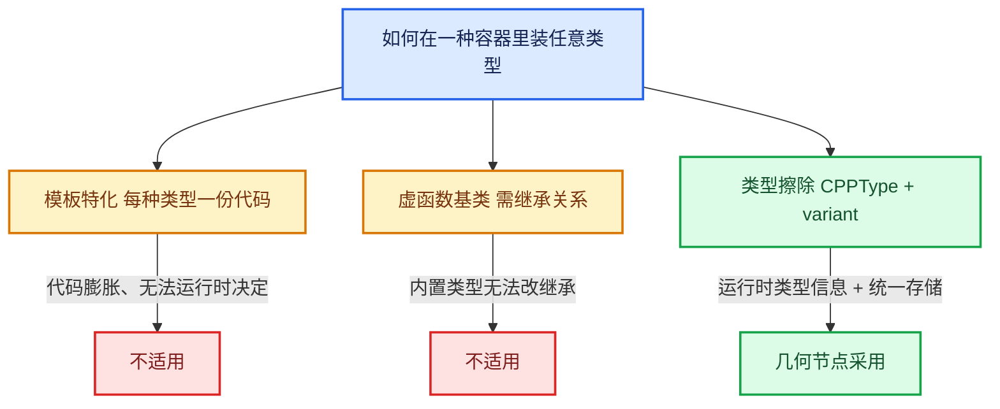

# 08-类型擦除

[前置知识总入口](../README.md) · [正篇：03-01 ZoneBodyFunction](../../重复区域-dsh/03-几何节点执行架构/01-ZoneBodyFunction与ZoneBuildInfo.md)

本章回答：`CPPType` 和 `SocketValueVariant` 如何让**同一种容器装下任意类型**，以及为什么几何节点选择这条路而不是模板特化或虚函数。

## 阅读顺序

| # | 篇目 | 源码主线 | 实测行数 |
| --- | --- | --- | --- |
| 1 | [01-CPPType运行时类型](01-CPPType运行时类型.md) | `BLI_cpp_type.hh` | 823 |
| 2 | [02-SocketValueVariant](02-SocketValueVariant.md) | `BKE_node_socket_value.hh` | 434 |
| 3 | [03-类型转换与访问接口](03-类型转换与访问接口.md) | `get` / `ensure_type` / `emplace` | 同上 |
| 4 | [04-移动语义与内存布局](04-移动语义与内存布局.md) | 与 `GeometrySet` 持有关系 | 同上 |

## 本章与 Repeat 的关系

正篇中对这两个类型的引用达 **96 处**，且都是关键位置：

| 用途 | 代码 | 正篇位置 |
| --- | --- | --- |
| 图接口的统一值类型 | `CPPType::get<SocketValueVariant>()` | 03-01、03-02、03-03 |
| 读迭代数 | `params.get_input<SocketValueVariant>(...)` + `.ensure_type<int>()` | 03-03 L129-L135 |
| 预填充轮次值 | `Array<SocketValueVariant> index_values` + `emplace<int>(i)` | 03-03 L263-L272 |
| 未使用哨兵 | `static const SocketValueVariant static_unused_index{-1}` | 03-03 L275 |
| 性能分析 | 移动语义、预分配复用 | 06-02 L640-L672 |
| 引用集类型 | `CPPType::get<GeometryNodesReferenceSet>()` | 03-02 L1281 |

**最关键的一条**：`index_values` 是 `Array<SocketValueVariant>` 而不是 `Array<int>`——因为图的接口类型必须是 `SocketValueVariant`，类型要匹配。理解这一点才能读懂 03-03 的"为什么是 `emplace<int>(i)`"。

## 实测行数总表

> **行数口径**：本表所有行数为**文件总行数**（含空行与注释），可用 `[System.IO.File]::ReadAllLines(path).Count` 复核。若用 `Get-Content | Measure-Object -Line` 会得到**非空行数**，两者不同，请勿混用。

| 文件 | 行数 |
| --- | --- |
| `BLI_cpp_type.hh` | 823 |
| `BKE_node_socket_value.hh` | 434 |
| **合计** | **1,257** |

篇幅小但极其核心——这两个类支撑了整个惰性函数图的类型系统。

## 三种方案对比

三者分工：**`CPPType` 描述"这是什么类型"**（构造/析构/拷贝/移动/哈希的运行时函数表）， **`SocketValueVariant` 提供"存这份值"的容器**（内联缓冲或堆分配 + 类型指针）。

## 为什么几何节点必须用类型擦除

一句话：**图的接口在编译期不知道节点会传什么类型**。

- 用户可以把任何 socket 类型接进 Repeat 的 item（Geometry、Float、Vector、Bundle……）；
- 展开图要按迭代数动态生成，不可能为每种类型组合生成一份代码；
- `lf::Graph` 的 `add_input(type, name)` 签名接受 `const CPPType&`——它是运行时值。

所以：接口类型统一为 `SocketValueVariant`（它自己是一个确定类型），内部再靠 `CPPType` 分派到具体类型。这是"类型擦除"在工程上的经典取舍。

## 与既有资料的关系

`.markdown/学习节点/几何节点类/08_SocketValueVariant.md`（约 130 行）与 `10_CPPType.md` 已有速查级内容。本章是其**深度版**（10 倍篇幅）：补上了 `CPPType` 的运行时函数表设计、`SocketValueVariant` 的内联/堆双模式、移动语义对性能的实际影响，以及它在 Repeat 的 `index_values` 上的具体应用。

## 源码规模（实测，总行数口径）

| 文件 | 总行数 | 非空行 |
| --- | --- | --- |
| `BLI_cpp_type.hh` | 823 | 699 |
| `BLI_cpp_type_make.hh` | 507 | — |
| `BKE_node_socket_value.hh` | 434 | — |
| `BLI_any.hh` | 408 | 366 |
| `BLI_cpp_type_test.cc` | 432 | — |

## 全仓库使用密度（实测）

| 指标 | 数值 |
| --- | --- |
| `geometry_nodes_lazy_function.cc` 中 `CPPType::get<` | **60 处** |
| 其中 `SocketValueVariant` | 27 处 |
| 其中 `bool` | 24 处 |
| 其中 `GeometryNodesReferenceSet` | 7 处 |
| 全仓库 `BLI_CPP_TYPE_REGISTER` | **83 处**（blenlib 22 + blenkernel 60 + compositor 1） |

`[讲解]` `SocketValueVariant` 在 60 处里占 27 处——接近一半。这说明 lf 图的绝大多数接口都是 variant 类型（main 通道 + border link 通道）。

## 三个容易搞错的细节（由源码实测确认）

| 你可能以为 | 实际 |
| --- | --- |
| 有 `CPPType::get_by_name(std::string_view)` | **不存在**。头注释明说 name 仅供调试，不可作 identifier |
| `get<T>()` 是 Meyers singleton，首次调用自动注册 | **不是**。三段式：静态槽 → 注册期 placement new → `get` 只做 assert + ref |
| `CPPType` 用了虚函数做分派 | **只用了一处** `virtual ~CPPType()`。其余 3 处 `virtual` 全在注释里讨论"为什么不用虚函数" |

`[讲解]` 第二行最值得注意：`get<T>()` 对未注册类型会**断言失败**，不会自动注册。所以任何新类型必须显式写 `BLI_CPP_TYPE_REGISTER(T)`。
