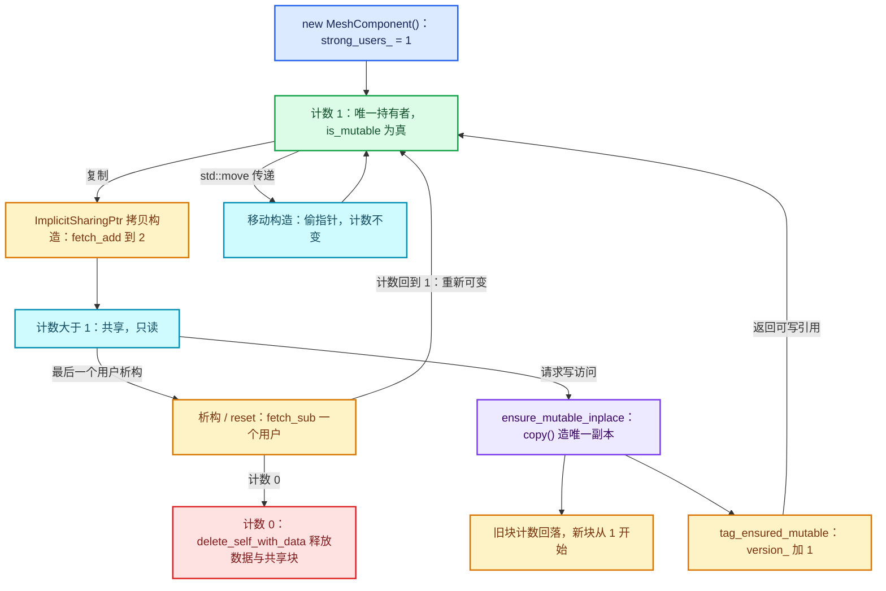

# 02 · ImplicitSharing 引用计数

[前置知识总入口](../README.md) · [本章导航](README.md) · [上一篇](01-GeometrySet组件模型.md) · [下一篇](03-写时复制与组件分离.md)

> 基准：Blender `5.4.0-alpha`，本地工作树。本篇讲 `ImplicitSharingInfo` 与 `ImplicitSharingPtr`——几何数据"复制很便宜"的底层机制。主要源码：[`BLI_implicit_sharing.hh`](../../../source/blender/blenlib/BLI_implicit_sharing.hh)（实测 297 行）、[`BLI_implicit_sharing_ptr.hh`](../../../source/blender/blenlib/BLI_implicit_sharing_ptr.hh)（实测 216 行）。

## 先回答一个具体问题

**复制一个含大网格的 GeometrySet，为什么不会拷贝网格数据？**

因为 `GeometrySet` 根本没持有网格。它持有的是 `std::array<GeometryComponentPtr, 7>`（[BKE_geometry_set.hh · L154](../../../source/blender/blenkernel/BKE_geometry_set.hh#L154)），而 `GeometryComponentPtr` 是 `ImplicitSharingPtr<GeometryComponent>`（同文件 L62）——一个只有一个指针成员的智能指针。复制它等于复制一个 8 字节地址，顺带把那个地址背后对象的强引用计数加 1。

网格本体在哪？在 `MeshComponent::mesh_` 这个裸 `Mesh *` 里，而 `MeshComponent` 是**唯一**持有它的对象。只要引用计数还大于 1，没人敢改 `mesh_` 指向的那份 `Mesh`；等到某个持有者真的要写，它先确认计数是不是 1，不是就 `copy()` 一份出来。这就是写时复制（copy-on-write），整套机制的成本模型是：**传几何 = 一次原子加；改几何 = 一次深拷贝**。

本篇只讲这两句话背后的两个结构体（`ImplicitSharingInfo` 与 `ImplicitSharingPtr`）。`GeometryComponent` 的 `copy()` 实现、`get_component_for_write` 的组件分离路径留给下一篇。

先对齐一个数字口径：本章导航表里写的"297 行"是**非空行**，`BLI_implicit_sharing.hh` 物理行数为 337、非空 297；`BLI_implicit_sharing_ptr.hh` 物理行数 262、非空 216。下文行号一律按物理行号（编辑器里看到的那个）。

## 为什么不用 std::shared_ptr

文件头注释（L23—L43）给了设计意图，但没直接列"为什么不用 `std::shared_ptr`"——它用的是正面陈述："Implicit sharing is a technique that avoids copying data when it is not necessary."。把注释和代码合起来读，理由有六条，其中任何一条单独都足以否决 `std::shared_ptr`。

| # | 理由 | 源码依据 | 如果硬用 `std::shared_ptr` 会怎样 |
| --- | --- | --- | --- |
| 1 | 计数**嵌在数据里**，不额外分配控制块 | `strong_users_` 是 `ImplicitSharingInfo` 的成员（L53）；`ImplicitSharingPtr` 只有一个 `const T *data_`（ptr L25） | 每次 `make_shared` 之外还要单独分配控制块，而 Blender 的几何数据往往已经由 `MEM_*` 或 `LinearAllocator` 分配好了，套不上 `make_shared` |
| 2 | 指针对象**更小** | `ImplicitSharingPtr` = 8 字节；`std::shared_ptr` = 16 字节（对象指针 + 控制块指针） | `GeometrySet` 里 7 个组件指针 + 1 个 bundle 指针，白占 64 字节，而且每个都是热路径上的拷贝对象 |
| 3 | 计数必须是**全局唯一**的"现在有几个人持有这份数据" | 见下文"字段"一节 | `Mesh` 自己已经有一套用户概念，两套计数会不一致；写时复制的正确性完全依赖"计数 > 1 就绝不能原地改" |
| 4 | **禁止** weak → strong 升级 | L101—L104 的注释明确写"Unlike std::shared_ptr a weak user cannot be turned into a strong user" | `std::weak_ptr::lock()` 允许升级，于是"我确认只有我一个用户，原地改"和"另一线程刚把 weak 升成 strong"构成数据竞争 |
| 5 | 析构逻辑必须**由数据自己决定** | L34—L37："the code freeing the data in the end might not know how it was allocated"；虚函数 `delete_self_with_data`（L188）与 `delete_data_only`（L190） | `std::shared_ptr` 的删除器是类型擦除的，能表达"怎么删"，但表达不了"强用户归零只删数据、弱用户还在则保留壳"这种两段式析构 |
| 6 | 需要**版本号**这种 `shared_ptr` 里根本没有的字段 | `version_`（L66）+ `tag_ensured_mutable()`（L115—L122） | 无法 O(1) 判断"这份数组自上次记录后有没有被改过"；`ArrayState::same_as`（[BLI_array_state.hh · L71—L78](../../../source/blender/blenlib/BLI_array_state.hh#L71)）就靠这个常数时间返回 true |

补两条实际的工程理由：

- **能给裸数组套壳**。`info_for_mem_free`（L301—L307）把一个 `MEM_malloc` 出来的裸块包装成可共享对象，实现见 [`implicit_sharing.cc`](../../../source/blender/blenlib/intern/implicit_sharing.cc) 的 `MEMFreeImplicitSharing`（L18—L33）。这是"存量 C 风格数据"接入引用计数的唯一低成本途径，`std::shared_ptr<T[]>` 做不到且会引入数组删除器的类型问题。
- **`ImplicitSharingInfo` 本身不可拷贝不可移动**（`class ImplicitSharingInfo : NonCopyable, NonMovable`，L44）。这个类就是那个"共享块"，它的生命周期由计数驱动，绝不能被值语义搬来搬去。`std::shared_ptr` 的控制块是隐藏的，你想 `NonMovable` 都无处下手。

一句话总结：**`std::shared_ptr` 是"外挂一套计数来管理任意对象"；`ImplicitSharingInfo` 是"让对象自己成为一个可被计数的共享块"。**后者才能做到 8 字节指针 + 零额外分配 + 定制两段式析构 + 版本号。

## ImplicitSharingInfo 的字段

先把一个常见的误认纠正掉：**源码里没有名为 `strong_ownership_` 的成员**。`grep strong_ownership source/` 零命中。"ownership 是强还是弱"不是共享块上的一个标志位，而是**指针侧**的模板参数 `bool IsStrong`（ptr L23）；共享块侧只有两个独立的计数器 `strong_users_` 与 `weak_users_`。你要找的"strong ownership 标志"其实是这两者的组合语义。

三个字段全在私有区，全部 `mutable std::atomic`——`mutable` 是必须的，因为 `add_user()` 是 `const` 成员（一个 `const ImplicitSharingInfo *` 也要能加用户；`ImplicitSharingPtr` 存的就是 `const T *`）。

### `strong_users_`：强引用计数（L46—L53）

```cpp
mutable std::atomic<int> strong_users_ = 1;
```

注释把三态写得很清楚（L46—L52）：

| 值 | 含义 | 数据可写吗 |
| --- | --- | --- |
| `0` | 数据已过期（几乎肯定已释放），不得再访问；但只要有 weak 用户，共享块本身可能还活着 | 不可访问 |
| `1` | 唯一所有者，数据可变 | 可写 |
| `>1` | 数据被共享，因此**不可变** | 只读 |

初值是 `1` 不是 `0`——这个细节很重要：`ImplicitSharingPtr(const T *data)` 这个显式构造函数**不会**调用 `add_user()`（ptr L34），因为它假设调用方交过来的指针"身上已经带着一个用户"。`new MeshComponent()` 之后 `strong_users_` 天然等于 1，正好对上。这条约定是后面"反例"第 5 条的来源。

### `weak_users_`：弱引用计数，初值也是 1（L54—L60）

```cpp
mutable std::atomic<int> weak_users_ = 1;
```

这个 `1` 不是"有一个弱用户"，而是**哨兵**：只要还存在至少一个强用户，就额外记一个"假弱用户"。理由在 `remove_user_and_delete_if_last()` 里（L148—L163）：最后一个强用户消失时，如果 `weak_users_ == 1`，说明没有真实弱用户，可以直接 `delete_self_with_data()` 把壳和数据一起删；如果 `> 1`，则先 `delete_data_only()` 只删数据，再 `remove_weak_user_and_delete_if_last()` 把哨兵减掉——壳留给弱用户。

哨兵的作用是让"最后一个强用户"这个判断变成一次原子读，而不是"先降到 0 再去看有没有弱用户"的两步竞态。

弱用户**不保护数据**，只保护共享块。注释（L81—L88）说得很直白：数据被释放时若仍有弱引用，`is_expired()` 返回 true。这个设计被 `MemoryCounter` 用来做"同一块共享内存不重复计数"，它内部就是一个 `Set<WeakImplicitSharingPtr> handled_shared_data`（[BLI_memory_counter.hh · L29](../../../source/blender/blenlib/BLI_memory_counter.hh#L29)）。

### `version_`：版本号（L61—L66）

```cpp
mutable std::atomic<int64_t> version_ = 0;
```

`tag_ensured_mutable()` 每次被调用就 `fetch_add(1)`。语义是"数据即将被修改"，所以版本号是**写意图**的记录而非写结果的记录。用途：在两时间点之间比较版本号，就能 O(1) 判断数据变没变。测试 [`BLI_implicit_sharing_test.cc`](../../../source/blender/blenlib/tests/BLI_implicit_sharing_test.cc) 的 `Version` 用例（L108—L117）验证的正是"读不涨版本、写涨版本"。

`int64_t` 而非 `int`：版本号只增不减，`int` 溢出是 UB（有符号溢出），`int64_t` 实际不可能撞到。

### 派生类与辅助类型

| 类型 | 行号 | 用途 |
| --- | --- | --- |
| `using ImplicitSharingInfoHandle = ImplicitSharingInfo;` | L20—L21 | **纯别名，不是另一个类**。旧代码/外部接口用 `Handle` 后缀强调"这是个句柄"，两者完全等价 |
| `ImplicitSharingMixin` | L197—L207 | 给"想把计数嵌进自己结构体"的类型用。它只做一件事：`delete_self_with_data()` 转调纯虚 `delete_self()`，注释（L202）专门说明"不能写 `delete this`，因为不知道用了什么分配器" |
| `ImplicitSharedValue<T>` | L213—L238 | 把 `T data` 和共享块合成一个对象，`new ImplicitSharedValue<T>(args)` 即可共享任意值。它的 `delete_data_only()` 在 `T` 可赋值时把 `data` 重置为 `T()`（L230—L237），这样弱用户长期持有壳时数据早已释放 |
| `ImplicitSharingInfoAndData` | L243—L246 | 一个"共享块 + 裸数据指针"的 POD 组合，给需要把数据和计数分开存的场景（如类型擦除的数组视图） |

## 三个核心操作

`ImplicitSharingInfo` 的公开接口（不算构造/析构）一共 9 个函数，其中 3 个是"核心操作"——`add_user`、`remove_user_and_delete_if_last`、`tag_ensured_mutable`，它们改变状态。另外 6 个是查询与弱用户三件套。全部是 `const` 成员，因为它们改的是 `mutable` 计数器而不是对象本身。

### `add_user()`：加一个强用户（L90—L95）

```cpp
void add_user() const
{
  BLI_assert(!this->is_expired());
  strong_users_.fetch_add(1, std::memory_order_relaxed);
}
```

- **语义**：又有一个持有者要这份数据了。计数 +1。
- **调用时机**：拷贝 `ImplicitSharingPtr`、把裸指针交给新持有者（如 `GeometrySet::add`，见下文）。
- **那个 assert 值钱**：它拦的是"给一个已经过期（计数 0）的块复活"。数据都释放了还加用户，UB 会藏在很远的地方；assert 把它钉在原地。
- **`memory_order_relaxed`**：加计数不建立任何跨线程同步关系。这只在"数据是共享只读的"前提下合法——你不能拿 `add_user` 的结果去保证能看见别的线程写的数据。

### `remove_user_and_delete_if_last()`：减一个强用户，归零则删（L138—L165）

这是全文件最长、也是最需要读的一段，因为它要处理四种组合：

| 减完之后 | weak 用户情况 | 动作 |
| --- | --- | --- |
| 还有强用户 | 无所谓 | 什么都不做 |
| 最后一个强用户 | 只有哨兵（`weak_users_ == 1`） | `weak_users_ = 0`（直接赋值，不是原子减）→ `delete_self_with_data()` → 数据与壳一起释放 |
| 最后一个强用户 | 有真实弱用户（`> 1`） | 先 `delete_data_only()`（数据释放，壳留着）→ 再 `remove_weak_user_and_delete_if_last()` 扣掉哨兵 |
| — | 扣掉哨兵后弱用户也归零 | `delete_self_with_data()`（此时数据已删，实现要容忍这种状态，见 L184—L188 注释） |

两个细节值得单独标出来：

- **`std::memory_order_acq_rel`**（L144）。这里用最强的那一档（除 seq_cst），因为减计数是"我可能成为最后一个、我要开始销毁"的决策点，必须看到之前所有持有者对数据的写。
- **`const_cast` 只出现在真正要删的时候**（L154、L159）。整个 API 都是 `const`，只有销毁这个动作需要非 const 的 `this`。

### `tag_ensured_mutable()`：宣告"我要改了"（L110—L122）

```cpp
void tag_ensured_mutable() const
{
  BLI_assert(this->is_mutable());
  version_.fetch_add(1, std::memory_order_acq_rel);
}
```

- **语义**：调用方**已经确认**计数为 1（所以断言 `is_mutable()`），现在开始改数据。把版本号 +1，让任何缓存了旧版本号的代码知道"你那份观察过期了"。
- **调用时机**：**真正动手写之前**。写时复制的两条路径都要调：一是本来就唯一、直接原地改；二是复制出新的唯一副本之后。`ensure_mutable_inplace()` 在最后一行补这一句（ptr L152），`make_trivial_data_mutable_impl` 在确认可写后调（[implicit_sharing.cc · L53—L54](../../../source/blender/blenlib/intern/implicit_sharing.cc#L53)）。
- **`acq_rel` 是保守选择**，注释（L118—L120）自己承认："This might not need an atomic increment … Better be safe and use an atomic for now."

### 另外三个也不是不重要

| 函数 | 行号 | 说明 |
| --- | --- | --- |
| `is_mutable()` | L75—L79 | `strong_users_ == 1`，`relaxed` 读。**这是整个写时复制的判据** |
| `is_expired()` | L84—L88 | `strong_users_ == 0`，`acquire` 读。注意它问的是"数据死没死"，不是"壳死没死" |
| `add_weak_user()` / `remove_weak_user_and_delete_if_last()` | L105—L108、L171—L181 | 弱用户的加减。**注意没有对应的 `upgrade_to_strong()`**，L101—L104 解释了为什么 |
| `version()` / `strong_users()` | L124—L136 | 只读访问器，供调试与外部判断 |

## ImplicitSharingPtr 的四种操作

模板声明（ptr L23）：

```cpp
template<typename T = ImplicitSharingInfo, bool IsStrong = true> class ImplicitSharingPtr {
 private:
  const T *data_ = nullptr;
```

两个模板参数决定的语义：`T` 是**静态类型**（决定 `operator->` 返回什么、`copy()` 能不能调到），`IsStrong` 决定加减的是强计数还是弱计数。默认 `T = ImplicitSharingInfo` 给出"类型擦除的共享块句柄"，`ImplicitSharingPtr<GeometryComponent>` 给出"类型化的组件句柄"。

### 拷贝构造 → 计数 +1（L39—L42）

```cpp
ImplicitSharingPtr(const ImplicitSharingPtr &other) : data_(other.data_)
{
  this->add_user(data_);
}
```

`add_user` 是个私有静态函数（L174—L184），它做两件事：空指针判空、按 `IsStrong` 分派到 `add_user()` 或 `add_weak_user()`。这个分派是 `if constexpr`，编译期就定死，弱指针版本连分支都不生成。

有转换构造（L49—L55）：`ImplicitSharingPtr<Derived>` 可转 `ImplicitSharingPtr<Base>`，条件是 `std::is_base_of_v<T, U>`，同样 +1。这是 `GeometrySet` 能把 `ImplicitSharingPtr<MeshComponent>` 放进 `ImplicitSharingPtr<GeometryComponent>` 槽位的原因（实际代码走的是 `GeometryComponent::create` 直接返回基类指针，但语义上是同一条路）。

### 移动构造 → 计数不变（L44—L47）

```cpp
ImplicitSharingPtr(ImplicitSharingPtr &&other) : data_(other.data_)
{
  other.data_ = nullptr;
}
```

**一次原子操作都没有**。偷指针、源置空。这是全类型最便宜的操作，也是 lazy-function 参数传递大量走移动路径的动机（性能分析见后文）。

移动赋值（L82—L92）比移动构造多一步：先 `remove_user_and_delete_if_last(data_)` 放掉自己原来那份，再偷。拷贝赋值（L70—L80）同理，先放旧的再加新的；两者都做了 `this == &other` 自检。

### 析构 → 计数 -1，归零则删（L65—L68）

```cpp
~ImplicitSharingPtr()
{
  this->remove_user_and_delete_if_last(data_);
}
```

注意析构函数**不检查空指针**——判空在私有静态函数里（L186—L196）。所以空 `ImplicitSharingPtr` 的析构是零成本的。

`reset()`（L123—L127）与析构同义，只是把 `data_` 显式置空；`release()`（L116—L121）反过来——交出指针、置空自己、**不**减计数。`release()` 的语义是"我把这个用户身份转让给你"，接手的代码必须自己负责最终减计数。

### `ensure_mutable_inplace()` → 写时复制的入口（L139—L154）

```cpp
T &ensure_mutable_inplace()
{
  BLI_assert(data_);
  if (!data_->is_mutable()) {
    /* The data is shared and therefore immutable. Make a mutable copy. */
    *this = data_->copy();
  }
  BLI_assert(data_->is_mutable());
  data_->tag_ensured_mutable();
  return const_cast<T &>(*data_);
}
```

逐行读，四步：

1. 判空断言——空指针上没有"可变"可言。
2. `is_mutable()` 为假（计数 > 1）→ 调 `data_->copy()` 造一个唯一副本，`*this = 副本`。这一赋值是**移动赋值**（`copy()` 返回右值 `ImplicitSharingPtr`），所以副本那个刚创建的计数 1 被直接接管，不会出现 +1 再 -1 的浪费。
3. 断言现在确实唯一。这行是给 `copy()` 实现者的契约检查：`copy()` 必须返回"只有单一用户"的对象，`GeometryComponent::copy()` 的注释就是这么写的（[BKE_geometry_set.hh · L106—L109](../../../source/blender/blenkernel/BKE_geometry_set.hh#L106)："The returned component only has a single user and is therefore mutable."）。
4. `tag_ensured_mutable()` 涨版本号，然后 `const_cast` 交出非 const 引用。

**关键点：`copy()` 不是虚函数，而是 `T` 上的成员。** 基类 `ImplicitSharingInfo` 没有 `copy()`，所以 `ImplicitSharingPtr<>`（默认参数版本）**根本调用不了** `ensure_mutable_inplace()`——模板成员函数只有在被使用时才实例化，不调用就不报错。这是一个很好用的编译期约束：类型擦除的句柄不能用于写路径。

一个对比测试能说明四种操作（[`BLI_implicit_sharing_test.cc` · L60—L92](../../../source/blender/blenlib/tests/BLI_implicit_sharing_test.cc#L60)）：`a`、`b`、`c` 三次持有指向同一块数据；`b.get_for_write()` 之后 `b` 的地址变了而 `a`、`c` 没变；再次 `b.get_for_write()` **不再**复制（因为已经唯一）；`std::move(b)` 之后 `d` 拿到同一个地址且仍然可变——"数据在 b 里只有一个 owner，d 成为 owner 之后依然可变"。

## 用 mermaid 画引用计数变化

下面的图把"拷贝 +1 / 析构 -1 / 写时复制分叉"三条路径画在同一张状态图上。`strong_users_` 是状态，"数据的可写性"是状态的函数。



图里有个容易被漏掉的箭头：`计数回到 1 → B`。**引用计数是双向的**，减到 1 时数据重新变成可写的。这意味着"曾经共享过的数据"在别人都走了之后又能原地改，不会再复制一次。循环体场景里这一点很实际——如果某一轮把几何传出去、接收方用完就扔，下一轮往往可以直接写。

## 与 GeometrySet 的配合

三个事实串起来就是"复制 GeometrySet 很便宜"的完整证明。

### 事实一：指针类型就是别名（[BKE_geometry_set.hh · L62](../../../source/blender/blenkernel/BKE_geometry_set.hh#L62)）

```cpp
using GeometryComponentPtr = ImplicitSharingPtr<GeometryComponent>;
```

没有包装类、没有额外字段。`GeometrySet` 里那个数组（L154）是 `std::array<GeometryComponentPtr, 7>`（`GEO_COMPONENT_TYPE_ENUM_SIZE` 定义为 7，L51），加上 `nodes::BundlePtr bundle_`（L155，也是 `ImplicitSharingPtr`，L46）。所以一个 `GeometrySet` 的对象本体是：8 个 8 字节指针 + 一个 `std::string name_`。

### 事实二：`GeometrySet` 的拷贝构造是 `= default`（[geometry_set.cc · L112—L117](../../../source/blender/blenkernel/intern/geometry_set.cc#L112)）

```cpp
GeometrySet::GeometrySet(const GeometrySet &other) = default;
```

默认的成员逐一拷贝 → 每个非空 `GeometryComponentPtr` 走一次拷贝构造 → 每份组件计数 +1。最多 8 次原子加（7 个组件槽 + bundle），实际通常只有 1—3 个槽非空。**没有任何几何数据被复制。**

文件头注释把结论写成了使用建议（L148—L149）："Copying a geometry set is a relatively cheap operation, because it does not copy the referenced geometry components, so #GeometrySet can often be passed or moved by value."

### 事实三：写访问必须过 `get_component_for_write`

[geometry_set.cc · L119—L127](../../../source/blender/blenkernel/intern/geometry_set.cc#L119)：

```cpp
GeometryComponent &GeometrySet::get_component_for_write(GeometryComponent::Type component_type)
{
  GeometryComponentPtr &component_ptr = components_[size_t(component_type)];
  if (!component_ptr) {
    component_ptr = GeometryComponent::create(component_type);
  }
  return component_ptr.ensure_mutable_inplace();
}
```

两种情况下会创建/复制：槽位空 → `create()`（`new MeshComponent()` 之类，计数天然为 1，见 L41—L61）；槽位非空但共享 → `ensure_mutable_inplace()` 触发 `copy()`。`MeshComponent::copy()` 在 [geometry_component_mesh.cc · L36—L44](../../../source/blender/blenkernel/intern/geometry_component_mesh.cc#L36) 里就是一句 `BKE_mesh_copy_for_eval(*mesh_)`——这里才是真正的深拷贝发生地。

### 一个被"构造不加计数"逼出来的写法

`GeometrySet::add`（[geometry_set.cc · L164—L170](../../../source/blender/blenkernel/intern/geometry_set.cc#L164)）里有一行看起来多余的 `component.add_user()`：

```cpp
void GeometrySet::add(const GeometryComponent &component)
{
  BLI_assert(!components_[size_t(component.type())]);
  component.add_user();
  components_[size_t(component.type())] = GeometryComponentPtr(
      const_cast<GeometryComponent *>(&component));
}
```

为什么手动调？因为 `ImplicitSharingPtr(const T *)` 构造函数（ptr L34）**不**加计数——它假设"这个指针已经带着一个用户"。而 `add` 收到的组件由**调用方**持有，`GeometrySet` 是**新增**一个持有者，所以必须显式加一次。这一行就是"构造函数不加计数"这条约定的直接代价。

### 组件销毁的两段式

`GeometryComponent` 覆写了 `delete_self()` 与 `delete_data_only()`（[geometry_set.cc · L96—L104](../../../source/blender/blenkernel/intern/geometry_set.cc#L96)）：

```cpp
void GeometryComponent::delete_self()       { delete this; }
void GeometryComponent::delete_data_only()  { this->clear(); }
```

`delete_self` 走 `ImplicitSharingMixin::delete_self_with_data()` 的转发（L200—L204）。`delete_data_only` 是 `clear()`——`MeshComponent::clear()` 会 `BKE_id_free` 掉 `mesh_` 并把指针置空。于是"最后一个强用户走了但还有弱用户"这个少见场景下，网格立刻释放，只留一个空的 `MeshComponent` 壳。

## 原子操作的成本

`strong_users_` 是 `std::atomic<int>`，所以每次拷贝 `ImplicitSharingPtr` 都是一次原子 `fetch_add`。量级上：

| 操作 | 原子操作数 | 典型成本（x86-64，无竞争） | 对比 |
| --- | --- | --- | --- |
| 移动构造 / 移动赋值 | **0** | ~1 ns（一次读 + 两次写） | — |
| 拷贝构造 | 1 次 `fetch_add(relaxed)` | 数 ns（`lock add`） | 一次 100 万顶点网格的深拷贝 ≈ 数十 MB 内存带宽 |
| 析构 | 1 次 `fetch_sub(acq_rel)` | 数 ns；可能额外一次 `fetch_sub`（有弱用户时） | — |
| `is_mutable()` | 1 次 `load(relaxed)` | ~1 ns（可被缓存） | — |
| `ensure_mutable_inplace()`（共享路径） | 2 次（旧块 `fetch_sub` + 新块起始计数） | 数 ns + **深拷贝** | 深拷贝完全主导 |

**结论：原子操作的成本相比深拷贝可以忽略，但它不是零。** 所以有一条明确的工程纪律：

- **能移动就别拷贝**。`ImplicitSharingPtr` 的移动是零原子操作，拷贝是每次一个；`GeometrySet` 在 lazy-function 参数传递、`Vector::append`、返回值优化里大量走移动。性能分析篇把这条列为显式优化项（[06-02 · L498](../../重复区域-dsh/06-实战与性能/02-性能模型与开销分析.md#L498)）。
- **不要把 `is_mutable()` 当同步原语**。它是 `relaxed` 读，只回答"此刻计数是不是 1"，不建立任何 happens-before 关系。用它的返回值去推断"别人没在写"是错的；正确用法是"我自己是唯一用户，所以没人能写"。
- **`add_user()` 也是 `relaxed`**。这在设计上是自洽的：数据在共享状态下必须只读，所以加用户这个动作本身不需要携带内存屏障。

## 在 Repeat 中的意义

把上面全部套到循环上，结论是两句话：

1. **轮间传 GeometrySet 只是计数 +1**。第 k 轮 body 的输出被第 k+1 轮 body 消费，走的是 `SocketValueVariant` 里 `GeometrySet` 的移动或拷贝——移动则零原子操作，拷贝则每组件一次 `fetch_add`。整个传递链条上没有任何几何数据被搬动。
2. **某轮真的写，才触发 `ensure_mutable_inplace` → `copy()`**。判据是那一句 `is_mutable()`：如果此刻这份组件还被上一轮的输出边或另一个 item 引用着，计数 > 1，就复制；如果计数已经回到 1（其他持有者都死了），就原地改。

这就解释了正篇里"纯读轮近乎免费、写轮深拷贝"的结论为什么成立：**"免费"的部分正是 `add_user` 那几纳秒，"昂贵"的部分正是 `copy()` 那一整份 `BKE_mesh_copy_for_eval`。**

## 用小数据走一遍

构造一个小场景：节点 A 产出一个含 mesh 的 `GeometrySet`，依次传给 B、C、D（三次复制），然后全部释放。假设全程没有移动优化，只走拷贝构造。

| 步 | 动作 | 那份数据块的 `strong_users_` | 谁持有 | 数据可写吗 | 版本号 |
| --- | --- | --- | --- | --- | --- |
| 0 | A 里 `GeometryComponent::create(Mesh)` → `new MeshComponent()` | **1** | A | 可写 | 0 |
| 1 | `GeometrySet g_b = g_a`（拷贝） | **2** | A、B | 只读 | 0 |
| 2 | `g_c = g_b` | **3** | A、B、C | 只读 | 0 |
| 3 | `g_d = g_c` | **4** | A、B、C、D | 只读 | 0 |
| 4 | B 的作用域结束，`~GeometrySet` → `remove_user_and_delete_if_last` | **3** | A、C、D | 只读 | 0 |
| 5 | C 结束 | **2** | A、D | 只读 | 0 |
| 6 | D 结束 | **1** | A | **重新可写** | 0 |
| 7 | A 结束 | **0** → `delete_self_with_data()` → `~MeshComponent` → `clear()` → `BKE_id_free` | 无 | 已释放 | — |

第 6 步值得停一下：**计数回到 1，数据重新变成可写**。如果 A 在第 6 步之后又请求写访问，`is_mutable()` 返回 true，直接原地改，**不再复制**。版本号此时还是 0，`tag_ensured_mutable()` 会把它推到 1。

现在加一个写操作。假设第 2 步之后 C 立刻请求写访问：

| 步 | 动作 | 旧块计数 | 新块计数 | 说明 |
| --- | --- | --- | --- | --- |
| 2 | C 持有，计数 3 | 3 | — | 共享只读 |
| 2a | `C.get_component_for_write()` → `ensure_mutable_inplace()` | 3 | — | `is_mutable()` 为假 |
| 2b | `data_->copy()` → `new MeshComponent` + `BKE_mesh_copy_for_eval` | 3 | **1** | 新的唯一副本诞生 |
| 2c | `*this = 副本`（移动赋值）→ 旧块减 1 | **2** | 1 | C 现在持有新块 |
| 2d | `tag_ensured_mutable()` | 2 | 1 | 新块版本号 → 1 |
| 2e | 返回 `MeshComponent &`，C 原地改**新块** | 2 | 1 | A、B 看不见任何变化 |
| 3 | `g_d = g_c`（从新块拷贝） | 2 | **2** | D 加入新块阵营 |

这张表说明了两件事：**写时复制是"分叉"而不是"改"**——旧块计数只减 1（从 3 到 2），不是清零；以及**分叉发生的那一刻，深拷贝的代价一次性付清**，之后同阵营的复制又回到"一次原子加"。

## 反例与边界

1. **以为拷贝会深拷。** `GeometrySet g2 = g1;` 之后改 `g2` 里的几何，`g1` **不会**变——但这并不是因为 `g2` 拿到了一份独立数据，而是因为改之前触发了一次复制。反过来，如果有人绕过写访问接口直接改（见第 2 条），`g1` 就会跟着变。把"拷贝"理解成"独立"是最常见的误解，实际语义是"写时才独立"。

2. **忘记 `ensure_mutable_inplace()` 就改数据。** `const Mesh *mesh = component->get();` 拿到的是只读视图（`MeshComponent::get()` 的注释，[BKE_geometry_set.hh · L518—L522](../../../source/blender/blenkernel/BKE_geometry_set.hh#L518) 明确说"the returned mesh should not be modified"）。用 `const_cast` 强改，会**同时改掉所有其他持有者看到的数据**，而且版本号不涨，任何依赖 `version_` 的缓存（如 `ArrayState`）都会给出错误结论。这是最危险的一条，因为它不崩、只是静默产出错误结果。

3. **把 `ImplicitSharingPtr` 当 `unique_ptr` 用。** 以为 `ptr.reset()` 就释放了内存。实际可能只是把计数从 4 减到 3，数据一点没动。反过来也成立：以为 `ptr = nullptr` 一定不释放，实际在计数为 1 时立刻 `delete_self_with_data()`。判断标准只有一条：**别的持有者还有几个。**

4. **在多线程下把 `is_mutable()` 读结果当锁。** 它是 `relaxed` 原子读。看到了 1，不代表之后没人加用户（如果这块数据还在被共享传播）；看到 > 1 也不能保证另一个人不会在同一时刻也减到 0。正确用法是"持有者只在确认自己唯一时才写"这一不成文契约，而不是拿返回值做跨线程同步。

5. **给裸指针构造 `ImplicitSharingPtr` 却不加计数。** `ImplicitSharingPtr(const T *data)`（ptr L34）**不**调 `add_user()`。所以 `ImplicitSharingPtr<X> p(some_x)` 的正确前提是 `some_x` 身上"已经带着一个属于你的用户"。如果 `some_x` 是别人的、别人还要继续用它，必须自己先 `add_user()`。`GeometrySet::add` 里那行显式 `component.add_user()` 就是正确的示范；漏了它，计数会少 1，数据可能提前释放。

6. **在 `delete_self_with_data()` 里写 `delete this`。** 注释（L202）专门警告过："Can't use `delete this` here, because we don't know what allocator was used."。`ImplicitSharingMixin` 的派生类必须实现 `delete_self()`，用正确的分配器释放（`MEM_delete`、`MEM_delete_void`，或者干脆什么都不做留给 allocator）。写错了就是堆管理器崩溃。

7. **以为弱用户能升级成强用户。** `std::weak_ptr` 的 `lock()` 思维在这里不成立，源码注释（L101—L104）给了理由：某些代码可能"假设只有我一个强用户"后原地改数据，而另一线程同时把 weak 升成 strong。`ImplicitSharingPtr` 提供了 `WeakImplicitSharingPtr`（ptr L199）但没有提供升级接口——这是刻意的能力缺失，不是遗漏。

8. **对 `ImplicitSharingPtr<>` 调 `ensure_mutable_inplace()`。** 编译失败。默认模板参数 `T = ImplicitSharingInfo`，而基类没有 `copy()` 成员。看到"编译不过"先确认类型擦除的句柄有没有被误用到写路径——这是设计好的护栏。

9. **传参忘了 `std::move`。** `void f(GeometrySet g);` 里 `f(gs)` 会拷贝（每个非空组件一次原子加），`f(std::move(gs))` 才移动。差异很小但不是零，而且在深层循环里会累积成 N 倍的原子操作。

10. **以为 `version_` 是"数据内容的哈希"。** 它是**写意图**的计数器：`tag_ensured_mutable()` 一调就涨，不管后面实际写了几个字节、甚至有没有写。所以只能用来判断"变没变"，不能用来判断"变成什么"。两个版本号不同不代表内容一定不同。

## 对理解 Repeat 的帮助

正篇 [06-02 性能模型与开销分析](../../重复区域-dsh/06-实战与性能/02-性能模型与开销分析.md) 的"T_body：循环体真实工作"一节（L124—L141）把隐式共享列成了 4 条机制链条，其 L130—L133 就是本篇讲的三个事实：`GeometrySet` 是轻容器、`ImplicitSharingPtr` 拷贝 = `add_user`、写访问才触发 `copy()`。它的结论（L135）直接落在本篇的 `ensure_mutable_inplace()` 上：**"只读不写"的循环体传输成本 ≈ 一次引用计数操作，零数据拷贝。**

"内存行为"一节（L491—L531）把同一条链从内存峰值角度重讲了一遍：L497—L499 是三个要点（浅拷贝 / 移动更便宜 / 写才拷贝），L503—L505 是循环上的三条推论。那里的"移动更便宜"对应的正是本篇 ptr L44—L47 那 4 行——**移动构造一行原子操作都没有**。

<details><summary>核对一处行号口径</summary>

本章导航表把这条落点标为"06-02 L183—L198"，但当前工作树里那一段是"每轮执行的时间线"那张 sequenceDiagram（L167—L195），不是隐式共享的正文。隐式共享的正文实测在 L128—L135（机制链条与结论）和 L493—L507（内存行为与循环推论）。引用时用后者更准确。

</details>

再往前推一步，本篇还解释了为什么 Repeat 的两条边界结论成立：

- **"纯读轮是零成本"是错的，但"数据层面近零"是对的。** 引用计数那几次原子操作照付，`SocketValueVariant` 的搬运照付，usage bool 传递照付；省掉的只是深拷贝。
- **"N 轮全写 = N 次深拷贝"要成立，前提是每轮的旧值真的还被别人引用着。** 如果第 k 轮的输出传下去后，第 k 轮自己那份立刻析构，计数会先回到 1，第 k+1 轮可以直接原地改——**不复制**。所以"每轮都写"未必等于"每轮都拷贝"，取决于有多少临时持有者同时活着。这是本篇"计数是双向的"那一段的实际价值。

## 继续阅读

- 上一篇：[01-GeometrySet组件模型](01-GeometrySet组件模型.md)——组件槽位、`GeometryOwnershipType` 三态、为什么最多 7 个组件。
- 下一篇：[03-写时复制与组件分离](03-写时复制与组件分离.md)——`get_component_for_write` 与 `ensure_owns_direct_data` 的完整调用路径。
- 同章：[04-匿名属性与ReferenceSet](04-匿名属性与ReferenceSet.md)——另一族"引用计数式的寿命管理"，但计的是属性名的集合而不是数据块。
- 相关：[04-生命周期与分配/03-destruct_ptr与所有权](../04-生命周期与分配/03-destruct_ptr与所有权.md)——同样是"所有权编码进类型"，对比看 `destruct_ptr` 的单动作析构与本篇的两段式析构。
- 相关：[03-BLI容器与视图/02-Span只读视图](../03-BLI容器与视图/02-Span只读视图.md)——`Span` 是"没有所有权的视图"，与本篇"有所有权但可共享的指针"是同一套数据模型的两端。
- 正篇：[06-02 性能模型与开销分析](../../重复区域-dsh/06-实战与性能/02-性能模型与开销分析.md)——把本篇的成本换成 Repeat 的 T_body 项。
- 源码：[`BLI_implicit_sharing_test.cc`](../../../source/blender/blenlib/tests/BLI_implicit_sharing_test.cc)（119 行）——三个测试用例把拷贝/写时复制/弱用户/版本号全部验了一遍，是最好的可执行文档。
