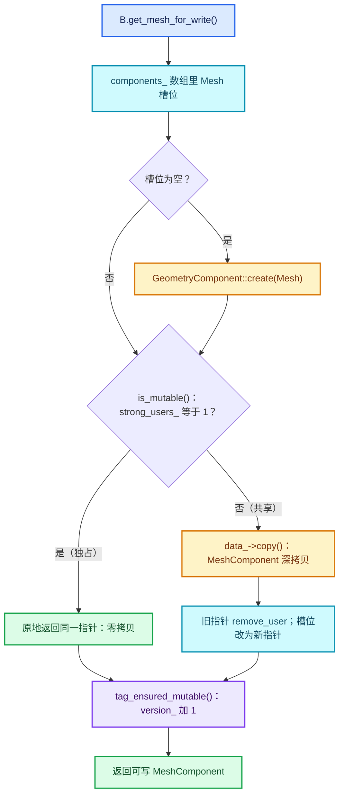
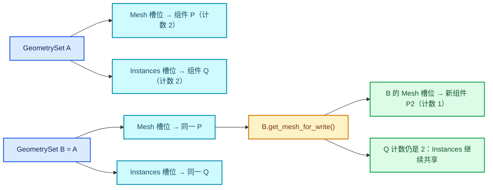

# 03 · 写时复制与组件分离

[前置知识总入口](../README.md) · [本章导航](README.md) · [上一篇](02-ImplicitSharing引用计数.md) · [下一篇](04-匿名属性与ReferenceSet.md)

> 基准：Blender `5.4.0-alpha`，本地工作树。本篇讲写时复制（COW）如何落地——`ensure_mutable_inplace` 什么时候真的复制、`get_component_for_write` 为什么可能触发深拷贝。主要源码：[`BLI_implicit_sharing_ptr.hh`](../../../source/blender/blenlib/BLI_implicit_sharing_ptr.hh)（总行数 262）、[`BKE_geometry_set.hh`](../../../source/blender/blenkernel/BKE_geometry_set.hh)（总行数 852）。

## 先回答一个具体问题

**两个 `GeometrySet` 共享一个 mesh，其中一个要改顶点位置，会发生什么？**

答案是：那个要写的 `GeometrySet` 会把整个 mesh 组件换成一份新的深度拷贝，另一个继续拿着原来那份，双方从此互不相干；而它们共享的**其它**组件（比如 instances）依然共享。

具体到代码。设 `A` 持有 `MeshComponent`，组件里是 `mesh_ = M`，此时 `M` 所在 `MeshComponent` 的 `strong_users_` 是 1。执行 `GeometrySet B = A;` 时走的是默认拷贝构造（[geometry_set.cc · L113](../../../source/blender/blenkernel/intern/geometry_set.cc#L113)），它逐个拷贝 `components_` 数组里的 `GeometryComponentPtr`（[BKE_geometry_set.hh · L154](../../../source/blender/blenkernel/BKE_geometry_set.hh#L154)），每个拷贝构造只做一次 `add_user()`（[BLI_implicit_sharing_ptr.hh · L39—L42](../../../source/blender/blenlib/BLI_implicit_sharing_ptr.hh#L39)）。于是 `MeshComponent` 的计数变成 2，`A` 与 `B` 的槽位里躺的是**同一个指针**，`mesh_` 也还是同一个 `M`，一个字节都没复制。

然后 `B.get_mesh_for_write()`（[BKE_geometry_set.hh · L386](../../../source/blender/blenkernel/BKE_geometry_set.hh#L386)）一路走到 `get_component_for_write_ptr` → `get_component_for_write` → `ensure_mutable_inplace`。在 `ensure_mutable_inplace` 里 `data_->is_mutable()` 返回 false（计数是 2），于是执行 `*this = data_->copy()`；`MeshComponent::copy()`（[geometry_component_mesh.cc · L36—L44](../../../source/blender/blenkernel/intern/geometry_component_mesh.cc#L36)）会 `new` 一个新组件，并调用 `BKE_mesh_copy_for_eval(*mesh_)`——后者就是 `BKE_id_copy_ex(nullptr, &source.id, nullptr, LIB_ID_COPY_LOCALIZE)`（[mesh.cc · L1580—L1584](../../../source/blender/blenkernel/intern/mesh.cc#L1580)），一次真正的 ID 级深拷贝，顶点、边、面、所有属性层全部复制。

结果：`B` 的 `mesh_` 变成新指针 `M'`，`A` 的 `mesh_` 还是 `M`。那一次写访问，代价是整份 mesh。这是"写时复制"这个名字的全部含义，也是 Repeat 循环体里"写轮贵、读轮免费"这条性能结论的物理来源。

## COW 的三个步骤

剥掉所有包装，任何一次写访问都只有三步：**查计数 → 决策 → 改归属**。

第一步查的是 `strong_users_`（[BLI_implicit_sharing.hh · L53](../../../source/blender/blenlib/BLI_implicit_sharing.hh#L53)），通过 `is_mutable()`（同文件 L76—L79）读出来，语义是"强用户数是否恰好等于 1"。这个字段有三个有意义的状态：0 表示数据已经失效（只剩弱用户吊着壳），1 表示独占可改，大于 1 表示共享因此只读。

第二步是唯一的条件分支：计数为 1 就原地返回，计数大于 1 就调 `copy()`。注意 `copy()` 是**组件自己实现的虚函数**（[BKE_geometry_set.hh · L109](../../../source/blender/blenkernel/BKE_geometry_set.hh#L109)），注释明确写了"returned component only has a single user and is therefore mutable"——复制出来的东西必须立刻是独占的，否则调用方的可写假设不成立。

第三步改归属：`*this = data_->copy()` 这一行里藏着两次计数操作——新指针以计数 1 构造，然后 `operator=` 先把旧指针 `remove_user_and_delete_if_last()`（[BLI_implicit_sharing_ptr.hh · L76](../../../source/blender/blenlib/BLI_implicit_sharing_ptr.hh#L76)）再接管新指针。顺序不能反：必须先把新数据造出来，才能减旧数据的用户数，否则旧数据可能在复制过程中被释放。`customdata.cc` 里有一模一样的写法，还专门加了注释说明（[customdata.cc · L2357—L2358](../../../source/blender/blenkernel/intern/customdata.cc#L2357)："Copy the layer before removing the user because otherwise the data might be freed while we're still copying from it here"）。



图里有一条容易看漏的边：**两条路径最后都汇到 `tag_ensured_mutable()`**。也就是说，即使计数是 1、一个字节都没复制，版本号照样加 1。这一点在"`version_` 的作用"一节会展开。

## ensure_mutable_inplace 的两种路径

这是全篇唯一的核心函数，只有 11 行（[BLI_implicit_sharing_ptr.hh · L144—L154](../../../source/blender/blenlib/BLI_implicit_sharing_ptr.hh#L144)）：

```cpp
// BLI_implicit_sharing_ptr.hh · L139—L154
/**
 * If there is only a single user of the data, return a mutable reference to it directly.
 * Otherwise call #copy which is expected to return a new implicitly shared pointer that always
 * has a single user.
 */
T &ensure_mutable_inplace()
{
  BLI_assert(data_);
  if (!data_->is_mutable()) {
    /* The data is shared and therefore immutable. Make a mutable copy. */
    *this = data_->copy();
  }
  BLI_assert(data_->is_mutable());
  data_->tag_ensured_mutable();
  return const_cast<T &>(*data_);
}
```

**路径一：计数等于 1（零成本）。** `is_mutable()` 为真，跳过 `if` 体，直接 `tag_ensured_mutable()` 然后返回。整个函数只做了一次 relaxed 原子读（[L78](../../../source/blender/blenlib/BLI_implicit_sharing.hh#L78)）和一次 acq_rel 原子加（[L121](../../../source/blender/blenlib/BLI_implicit_sharing.hh#L121)），没有内存分配，没有 `memcpy`。这是"纯读轮近乎免费"里唯一剩下的那点原子开销。

**路径二：计数大于 1（复制）。** `data_->copy()` 造一份计数为 1 的新数据，`operator=` 换掉 `data_`，旧指针的用户数减一。复制粒度由具体组件决定：mesh 是整份 `Mesh` ID（`BKE_mesh_copy_for_eval`），point cloud 是整份 `PointCloud`（[geometry_component_pointcloud.cc · L35—L42](../../../source/blender/blenkernel/intern/geometry_component_pointcloud.cc#L35)），而 `customdata.cc` 里的层复制可以只复制一层（[L2345—L2363](../../../source/blender/blenkernel/intern/customdata.cc#L2345)）。所以"COW 一定深拷"这句话要看是哪一层在 COW：几何组件层是整份，属性层可以是一条属性。

三个细节值得单独记住。

第一，`BLI_assert(data_->is_mutable())`（L151）不是重复检查，而是**契约检查**：它验证 `copy()` 的实现是否真的返回了独占数据。如果某个组件的 `copy()` 忘了让新对象计数为 1，这里会立刻崩，而不是让后面一段静默的数据竞争发生。

第二，返回类型是 `T &` 而不是 `const T &`，而 `data_` 是 `const T *`（[L25](../../../source/blender/blenlib/BLI_implicit_sharing_ptr.hh#L25)），所以末尾要 `const_cast`。这个 `const` 不是装饰：它让所有不经过 `ensure_mutable_inplace` 的访问路径在编译期就拿不到写权限。**只读性不是靠自觉，是靠类型系统**。

第三，初始计数是 1 而不是 0（[L53](../../../source/blender/blenlib/BLI_implicit_sharing.hh#L53) `strong_users_ = 1`）。所以刚 `new` 出来的组件天然可变，`GeometrySet::add()` 里那个 `component.add_user()`（[geometry_set.cc · L167](../../../source/blender/blenkernel/intern/geometry_set.cc#L167)）就是给这个约定补账的。

## 组件级分离

`GeometrySet` 不是"一个几何对象"，是**七个独立槽位的数组**，每个槽位一个 `GeometryComponentPtr`（[BKE_geometry_set.hh · L154](../../../source/blender/blenkernel/BKE_geometry_set.hh#L154)，数组大小由 `GEO_COMPONENT_TYPE_ENUM_SIZE` 定义为 7，见 [L51](../../../source/blender/blenkernel/BKE_geometry_set.hh#L51)）。每种类型最多一个组件，槽位由 `Type` 枚举索引（`Mesh`/`PointCloud`/`Curve`/`Instance`/`Volume`/`GreasePencil`/`EditData`）。

`get_component_for_write(type)` 的实现只有 9 行（[geometry_set.cc · L119—L127](../../../source/blender/blenkernel/intern/geometry_set.cc#L119)）：

```cpp
// geometry_set.cc · L119—L127
GeometryComponent &GeometrySet::get_component_for_write(GeometryComponent::Type component_type)
{
  GeometryComponentPtr &component_ptr = components_[size_t(component_type)];
  if (!component_ptr) {
    /* If the component did not exist before, create a new one. */
    component_ptr = GeometryComponent::create(component_type);
  }
  return component_ptr.ensure_mutable_inplace();
}
```

它按下标取出**那一个**槽位，然后只对那一个指针做 COW。数组里其它六个槽位根本没被碰过，它们的引用计数、指针、指向的数据全部原样不动。这就是"组件分离"（component separation）：共享是按组件独立计算的，不是整个 `GeometrySet` 一刀切。



这个设计的实际价值在 Repeat 里非常直白：一个"只位移顶点"的循环体，即使几何里挂着上百万个实例，"写"的只有 mesh 那一槽，instances 槽从头到尾保持计数 2 的共享状态。换句话说，**成本与"你改了几种组件"成正比，而不是与"几何里一共有多少种数据"成正比**。

两个边界要清楚。第一，`bundle_` 是数组外的第八个成员（[L155](../../../source/blender/blenkernel/BKE_geometry_set.hh#L155)），它不参与 `components_` 的分离，走自己的 COW 入口 `bundle_for_write()`（[geometry_set.cc · L779—L785](../../../source/blender/blenkernel/intern/geometry_set.cc#L779)），同样是一句 `bundle_.ensure_mutable_inplace()`。第二，有反过来用的 API：`ensure_no_shared_components()`（[L306—L313](../../../source/blender/blenkernel/intern/geometry_set.cc#L306)）遍历全部七个槽位各调一次 `get_component_for_write`，把**所有**共享组件都强行复制成独占。它的用途写在头文件注释里（[BKE_geometry_set.hh · L255—L260](../../../source/blender/blenkernel/BKE_geometry_set.hh#L255)）：几何一旦暴露给 Python，"只读"这个前提就没法保证了，所以干脆让 `GeometrySet` 成为唯一持有者。这是"组件分离"的反面用法，也顺便证明了分离是真实存在、可被逐个打破的。

## version_ 的作用

`version_` 是一个 `mutable std::atomic<int64_t>`，初值 0（[BLI_implicit_sharing.hh · L66](../../../source/blender/blenlib/BLI_implicit_sharing.hh#L66)）。注释把它的用途说得很克制："The data referenced by an #ImplicitSharingInfo can change over time. This version is incremented whenever the referenced data is about to be changed. This allows checking if the data has been changed between points in time."

递增点只有一个：`tag_ensured_mutable()`（[L115—L122](../../../source/blender/blenlib/BLI_implicit_sharing.hh#L115)）里的 `version_.fetch_add(1, std::memory_order_acq_rel)`。而 `ensure_mutable_inplace` 在**两条路径上都调用它**（[ptr.hh · L152](../../../source/blender/blenlib/BLI_implicit_sharing_ptr.hh#L152)），包括那个零拷贝路径。读取点是 `version()`（[L128—L131](../../../source/blender/blenlib/BLI_implicit_sharing.hh#L128)），用 acquire。

所以语义精确地说不是"数据被改了"，而是"有人申请了写权限"。这两者的差是一个假阳性：申请了写却什么都没改，版本号也会加。而假阳性是安全的——缓存只会多失效一次，不会漏失效。反过来如果只在真正 `memcpy` 之后才加，就得在每个写入点手工记账，漏一处就是脏缓存。这个"宁可多失效"的取舍，是它能做到只在 11 行内闭环的原因。

现成的消费者在序列化层：`BlobWriteSharing::write_implicitly_shared`（[bake_items_serialize.cc · L256—L282](../../../source/blender/blenkernel/intern/bake_items_serialize.cc#L256)）在读缓存里存了 `sharing_info_version`（L268），下次进来先取 `new_version = sharing_info->version()`（L274），断言旧版本不大于新版本（L275），只有 `value->sharing_info_version < new_version` 才重新序列化（L276—L279）。整个缓存判定是两次原子读加一次整数比较，没有遍历、没有哈希。

**为什么不用哈希。** 这个问题的答案有三层，每层单独都够否决哈希。

第一层是复杂度。内容哈希必须把数据整个读一遍，O(n)；而 `version_` 是 O(1)。写时复制这套机制存在的理由就是让"没写"的路径近乎免费，如果判"变没变"要 O(n)，那省下来的深拷贝又用哈希还回去了，等于没优化。

第二层是时机。哈希只能在**事后**算，也就是"我怀疑它变了，我去查一下"；`version_` 是**事前**打的标记，写的人在拿到写权限的瞬间就把信号发出去了，读的人随时能拿到最新的号。缓存失效需要的是后者。

第三层是正确性。浮点 NaN、padding 字节、指针字段、未初始化内存——几何数据里全都有，逐字节哈希会给出"内容没变但哈希变了"的假阳性，而语义哈希（按顶点坐标规范化后再算）既贵又不完备。版本号完全绕开这个问题：它不描述内容，只描述"有人动过"。

需要纠正一个常见的误读：**`ArrayState::same_as` 并不靠 `version_` 做常数时间比较**。它比的是 `sharing_info_` 的**指针身份**（[BLI_array_state.hh · L71—L78](../../../source/blender/blenlib/BLI_array_state.hh#L71)）：两个数组如果还指向同一个 `ImplicitSharingInfo`，就必然还是同一份数据，返回 true；一旦有人写过，指针已经换成新的，走不到那条捷径，退化成逐元素比较（L84—L85）。它靠的是"COW 一定换指针"这个事实，而不是版本号。两者都利用了同一次写访问的副作用，但是两个不同的副作用。

## 在 Repeat 中的意义

这一节把本篇接到正篇上。**[06-02 性能模型与开销分析](../../重复区域-dsh/06-实战与性能/02-性能模型与开销分析.md) L493—L507** 给出的成本模型，机器就是本篇这三节：L497—L499 列了三个要点（浅拷贝 / 移动更便宜 / 写才拷贝），L503—L505 列了三条循环推论。逐条对回源码：

| 正篇结论 | 位置 | 本篇机制 |
| --- | --- | --- |
| 复制 `GeometrySet` 是浅操作 | 06-02 L497 | 默认拷贝构造（`geometry_set.cc` L113）逐个槽位拷指针，`ImplicitSharingPtr` 拷贝构造只 `add_user()`（`ptr.hh` L39—L42） |
| 移动更便宜，零原子操作 | 06-02 L498 | 移动构造只偷 `data_` 并把源置空（`ptr.hh` L44—L47），不增不减计数 |
| 写才拷贝 | 06-02 L499 | `ensure_mutable_inplace` 的 `!is_mutable()` 分支（`ptr.hh` L147—L150） |
| 只读轮 ≈ 一次引用计数 | 06-02 L503 | 同一段代码，`is_mutable()` 为真，走路径一 |
| 写轮 = 首次写访问触发整份深拷贝 | 06-02 L504 | `MeshComponent::copy` → `BKE_mesh_copy_for_eval` → `BKE_id_copy_ex` |
| N 轮全写 → N 次深拷贝 | 06-02 L505 | 每轮新组件计数 1，下一轮接手后变 2，再写再拷 |

把"每轮"这个单位代进去，就得到循环体的成本对照：

| 轮类型 | 循环体对组件做了什么 | 计数变化 | 是否复制数据 | 每轮数据成本 | 备注 |
| --- | --- | --- | --- | --- | --- |
| 纯读轮 | 只调 `get_mesh()` / `attributes()` | 进出各 ±1，回到原值 | 否 | 两次原子操作 | 与几何大小无关 |
| 浅写轮 | 改一个属性层（`customdata.cc` L2345 路径） | 组件 1→1，层 1→1 | 只复制那一层 | O(该属性层) | 组件级 COW 的下层还有一次 COW |
| 组件写轮 | `get_mesh_for_write()` 后改顶点 | 组件 2→1（复制后） | 整份 `Mesh` | O(整份几何) | 本篇主场景 |
| 全写轮 | `ensure_no_shared_components()` 后改多处 | 七个槽位各自 2→1 | 七份 | O(全部组件) | 组件分离被主动放弃 |
| 多持有轮 | 输出被两个下游同时引用后再写 | 2→1 但旧份仍活着 | 是，且新旧并存 | O(2 × 整份几何) | 内存峰值来源 |

第三、五行是正篇"内存峰值"那节的直接解释：复制本身不可怕，**旧份还活着**才让峰值翻倍。这也解释了 06-02 L507 那句优化建议为什么有效——把只读分析挪出循环，旧份就能在下一轮开始前析构、计数归零、被释放。

## 写操作的常见触发点

判断一个节点会不会触发 COW，只有一个判据：**它有没有摸到 `for_write` 系列接口**。以下几类是最常见的，全部实测过。

| 节点 | 触发的 API | 复制粒度 | 源码 |
| --- | --- | --- | --- |
| Set Position | `geometry.get_mesh_for_write()` 等五个并列分支 | 整份 | [node_geo_set_position.cc · L164—L188](../../../source/blender/nodes/geometry/nodes/node_geo_set_position.cc#L164) |
| Set Material | `get_mesh_for_write()` + `mesh->attributes_for_write()` | 整份 | [node_geo_set_material.cc · L103、L111](../../../source/blender/nodes/geometry/nodes/node_geo_set_material.cc#L103) |
| Store Named Attribute | `get_component_for_write(type)` + `get_mesh_for_write()` | 整份 | [node_geo_store_named_attribute.cc · L192、L195](../../../source/blender/nodes/geometry/nodes/node_geo_store_named_attribute.cc#L192) |
| Realize Instances | 输出侧 `replace_mesh()` / `replace_pointcloud()` | 整份（新建） | [realize_instances.cc · L2012、L1402](../../../source/blender/geometry/intern/realize_instances.cc#L2012) |
| Capture Attribute | 在几何上写匿名属性，走属性访问器 | 组件整份或属性层 | 与 Store Named Attribute 同路径 |
| Write / Delete Attribute | `attributes_for_write()` | 组件整份或属性层 | 同类 |
| Bounding Box | **只** `compute_boundbox_without_instances` | 不复制 | [node_geo_bounding_box.cc · L38](../../../source/blender/nodes/geometry/nodes/node_geo_bounding_box.cc#L38) |
| Attribute Statistic | **只** `component->attributes()`（const 版） | 不复制 | [node_geo_attribute_statistic.cc · L235](../../../source/blender/nodes/geometry/nodes/node_geo_attribute_statistic.cc#L235) |

表里最后两行是"对照组"，价值不低于前面几行：Bounding Box 拿的是 `GeometrySet` 的副本然后用只读接口，计数进出各一次、数据零拷贝；Attribute Statistic 拿的是 `component->attributes()` 这不是 `attributes_for_write()` 的那一版。把这两行和 Set Position 并排放，就能一眼看出"哪些节点在循环里是免费的、哪些是收费的"。

还有两个容易忽略的入口。一是 `get_mesh_for_write()` 内部除了 COW 还有第二道复制门槛：`MeshComponent::get_for_write()` 里 `ownership_ == GeometryOwnershipType::ReadOnly` 时会再拷一次（[geometry_component_mesh.cc · L83—L91](../../../source/blender/blenkernel/intern/geometry_component_mesh.cc#L83)），因为那份数据根本不许改（来自被求值的原始对象）。二是 `ensure_owns_direct_data()`（[geometry_set.cc · L272—L284](../../../source/blender/blenkernel/intern/geometry_set.cc#L272)），它在"要把几何存进缓存、必须活得比求值久"时才用，判据是 `owns_direct_data()`——注释明说它**不管** object/collection 实例（[BKE_geometry_set.hh · L244—L249](../../../source/blender/blenkernel/BKE_geometry_set.hh#L244)）。真正的全量版是 `ensure_owns_all_data()`（同文件 L254），它会先把实例实体化。

## 用小数据走一遍

设一个具体的局面：`A` 里一个 `MeshComponent`，里面 `mesh_ = M`（3 个顶点，指针记作 `P`），`A` 的 Instances 槽位里 `Q`。下表用 `c` 表示 `strong_users_`，`v` 表示 `version_`。

| 步 | 动作 | A 的 Mesh 槽 | B 的 Mesh 槽 | `M` 的 `c` | `M` 的 `v` | 数据字节 |
| --- | --- | --- | --- | --- | --- | --- |
| 0 | `A` 建立，`replace_mesh(M, Owned)` | `P` | — | 1 | 0 | 1 份 |
| 1 | `GeometrySet B = A;` | `P` | `P` | 2 | 0 | 1 份，共享 |
| 2 | `B.get_mesh()`（只读） | `P` | `P` | 2 | 0 | 1 份 |
| 3 | `B.get_mesh_for_write()`：判 `c == 1` 为假 | `P` | `P` | 2 | 0 | 1 份，仍在 |
| 4 | `MeshComponent::copy()` → 新组件 `P2`，`mesh_ = M2` | `P` | `P` | 2 | 0 | 2 份，`M2` 已存在 |
| 5 | `operator=`：旧指针 `remove_user` | `P` | `P2` | 1 | 0 | 2 份 |
| 6 | `tag_ensured_mutable()` | `P` | `P2` | 1 | 1 | 2 份 |
| 7 | 改 `M2` 的第 0 号顶点 | `P` | `P2` | 1 | 1 | 2 份，`M` 未受影响 |
| 8 | `B.get_mesh_for_write()` 再来一次 | `P` | `P2` | 1 | 2 | 2 份，**不再复制** |

第 8 步是这个表最值钱的一行。同一份数据被连续请求两次写权限，只复制一次——因为第 6 步之后计数已经是 1，第二次走的是零成本路径。这解释了 Set Position 那种"连续多个写入操作"的节点为什么不会每写一次就拷一次：**拷贝次数取决于持有者数量，不取决于写操作次数**。位图测试里也是这么断言的（[BLI_implicit_sharing_test.cc · L81—L83](../../../source/blender/blenlib/tests/BLI_implicit_sharing_test.cc#L81)："Retrieving the same write access again should *not* make another copy."）。

再补两个变体，都是上表推得出来但容易想错的。

变体一：`GeometrySet C = A;` 在任何一步插进来，`M` 的计数就变 3。此时 `B` 再请求写，`M` 计数从 3 变 2（而不是 1），`B` 拿到的是 `M2`。**"复制完是不是变成 1"没有保证，只保证"复制出来的新份是 1"**。

变体二：把 `B = A` 换成 `GeometrySet D = std::move(A);`，计数在第 1 步完全不变，`A` 的槽位变空（`ptr.hh` L45—L46）。此时 `D.get_mesh_for_write()` 走零成本路径，**一个字节都不拷**。测试 MOVE 那一段就是在验这件事（[BLI_implicit_sharing_test.cc · L87—L91](../../../source/blender/blenlib/tests/BLI_implicit_sharing_test.cc#L87)）。所以"从 A 搬到 B"和"从 A 复制到 B"在 COW 上的后果完全相反，这是 lazy-function 参数传递大量走移动路径的真正收益。

## 反例与边界

**反例 1：用 `get_component()` 拿到只读指针后 `const_cast` 硬改。** `get_component()` 返回 `const GeometryComponent *`（[geometry_set.cc · L137—L140](../../../source/blender/blenkernel/intern/geometry_set.cc#L137)），绕过 COW 强改的后果不是"我这份变了"，而是**所有持有者看到的数据一起变**——因为大家本来就是同一个指针、同一份字节。这会静默污染上游的输入、缓存里的中间结果、甚至别处的对象。`ensure_mutable_inplace` 末尾那个 `const_cast`（`ptr.hh` L153）是**在确认计数为 1 且复制已经发生之后**才敢做的，手工 `const_cast` 没有这个前提。这也是 `ImplicitSharingPtr::operator->` 只返回 `const T *`（`ptr.hh` L94—L98）的原因：让绕路至少写起来别扭。

**反例 2：以为每次复制 `GeometrySet` 都会深拷。** 拷贝构造是 `= default`（[geometry_set.cc · L113](../../../source/blender/blenkernel/intern/geometry_set.cc#L113)），只拷 7 个指针加一个 `bundle_` 指针。一份百万顶点的几何复制一百次，内存里仍只有一份。真正的拷贝只发生在写访问且计数大于 1 的那一次。

**反例 3：忘记 `ensure_mutable` 就直接改。** 典型写法是 `const Mesh *mesh = geometry.get_mesh();` 然后想改 `mesh->vert_positions_for_write()`——编译期就过不去。如果绕过类型系统（`const_cast`），运行时还可能撞上 `BLI_assert(this->is_mutable())`（例如 [geometry_component_mesh.cc · L85](../../../source/blender/blenkernel/intern/geometry_component_mesh.cc#L85)、[L64](../../../source/blender/blenkernel/intern/geometry_component_mesh.cc#L64)）。这些断言不是防御性冗余，它们是"可写"这个契约的运行时兜底——debug 构建里会直接崩，release 构建里则可能改到共享数据。正确写法永远是先 `get_*_for_write()`。

**反例 4：以为 `version_` 是数据的哈希。** 见"`version_` 的作用"一节。它只是"有人申请过写权限"的计数器，不描述内容，不做内容比较，也不保证"版本变了内容一定变了"（假阳性）与"内容变了版本一定变"（如果有人绕过 COW 硬改，版本不会变）。它适合做**缓存失效信号**，不适合做**内容相等判据**。

**反例 5：以为 `get_component_for_write` 一定复制。** 它是"保证可写"，不是"保证复制"。计数为 1 时零成本直通。同样的道理，`ensure_owns_direct_data()` 也不是"复制全部"，它先检查 `owns_direct_data()`，已经独占的组件直接 `continue`（[geometry_set.cc · L278—L280](../../../source/blender/blenkernel/intern/geometry_set.cc#L278)）。

**反例 6：以为"组件分离"意味着"只复制被改的元素"。** 分离的粒度是**组件**，不是元素。改一个顶点也会复制整份 `Mesh`（`BKE_mesh_copy_for_eval` 是 ID 级复制）。想只复制一层属性，得往下走到 `CustomData` 层的 COW（[customdata.cc · L2345](../../../source/blender/blenkernel/intern/customdata.cc#L2345)），而且前提是该层自己也有 `sharing_info`。所以"我只改了一点点"在几何层面从来不成立。

**反例 7：以为写了之后旧持有者不受影响就代表没有代价。** 正确性上确实不受影响（这正是 COW 的意义），但内存上代价翻倍：新旧两份同时活着，直到旧份的计数归零。Repeat 里这是内存峰值的唯一来源，06-02 L517—L530 那节讲的就是它。判断成本时不能只看"我的输出对不对"，要看"同时有几份活着"。

**反例 8：以为 `ensure_owns_direct_data()` 等于"独占整个几何"。** 头文件注释写得很明确：它"does not ensure ownership of object/collection instances"（[BKE_geometry_set.hh · L245—L247](../../../source/blender/blenkernel/BKE_geometry_set.hh#L245)）。实例仍然只是引用。要连实例一起落实体化，用 `ensure_owns_all_data()`（[geometry_set.cc · L286—L292](../../../source/blender/blenkernel/intern/geometry_set.cc#L286)）——而这一调用本身又会 `get_instances_for_write()`，也就是再触发一次写时复制。这是个连环坑：为了"独占"而复制。

**反例 9：以为移动之后两边都还能用。** 移动构造把源置空（`ptr.hh` L45—L46），之后对源的任何 `operator->` 都会撞 `BLI_assert(data_ != nullptr)`（L96）。在 Repeat 的上下文里，这意味着"把值移到下一轮"之后本轮就不能再读了——这是个真实的约束，`SocketValueVariant::extract()` 就是同一套语义。

## 对理解 Repeat 的帮助

现在可以把正篇那句最常被误读的话拆开了。**06-02 L493—L507** 的标题是"GeometrySet 隐式共享：为什么'传几何'很便宜"，三个要点加三条推论，本篇逐条给了机制：

- **L497 "复制 GeometrySet 是浅操作"** 的机制是"七个指针 + 一次原子加"。`components_` 是定长数组，拷贝不涉及任何动态分配，所以"浅"不只是量级小，是**没有分配器调用**。
- **L498 "移动更便宜"** 的机制是 `ImplicitSharingPtr` 移动构造不碰计数（`ptr.hh` L44—L47）。正篇说"lazy-function 参数传递大量走移动路径"，本篇补上了为什么值得走：移动让计数保持 1，于是下游的第一次写访问变成零成本。**移动省的不只是搬运费，还省掉了后续那次深拷贝。**
- **L499 "写才拷贝"** 的入口就是 `ensure_mutable_inplace`，正篇在这里给了 `ptr.hh` L144—L154 的行号，本篇把那 11 行整段抄了出来。
- **L503—L505 三条推论** 分别对应"计数为 1 走直通"、"计数 > 1 走 `copy()`"、"每轮新建后计数回到 1、下一轮接手变 2 再拷"。第三条正是 N 次深拷贝的来源。

还有两处正篇建议，现在能看出它们为什么成立。**06-02 L633** 建议循环体末尾保持 Instances 形态、别每轮 Realize——机制是 Realize 的输出侧走 `replace_mesh()`（`realize_instances.cc` L2012），那是一次新建，把"共享的实例引用"变成"独占的实际几何"，之后再怎么传都得复制。**06-02 L645** 建议把 Capture Attribute 挪到循环外——机制是捕获要写匿名属性，写就要 `get_component_for_write`，共享状态下每轮一次整份拷贝。

`<details><summary>一处行号口径的核对</summary>`

本章导航表把这条落点写作"06-02"，而 06-02 正文里与本篇直接对应的两段实测是 L493—L507（内存行为 / 隐式共享与循环推论）与 L633、L645（两条优化建议）。本篇引用一律用这三处。至于"隐式共享的机制链条与结论"那段总述在 L128—L135，本篇上一篇（02）已经交代过它的口径，这里不重复。

`</details>`

最后一句总结：Repeat 循环体的成本不是"每轮花多少时间"，而是"每轮结束时同时有几份几何活着"。COW 让"没写"的轮次可以把份数压到 1，组件分离让"只写一部分"的轮次把复制范围压到那一部分，`version_` 让下游缓存能 O(1) 知道"这份没动，别重算"。三条机制各自管一个维度：**份数、范围、信号**。

## 继续阅读

- 上一篇：[02-ImplicitSharing引用计数](02-ImplicitSharing引用计数.md)——`strong_users_`/`weak_users_` 两个计数与两段式析构，是本篇"查计数"那一步的前提。
- 下一篇：[04-匿名属性与ReferenceSet](04-匿名属性与ReferenceSet.md)——匿名属性的寿命管理，另一族"按引用决定存亡"的机制，但计的是属性名集合而不是数据块。
- 同章：[01-GeometrySet组件模型](01-GeometrySet组件模型.md)——组件槽位布局与 `GeometryOwnershipType` 三态，本篇的 `get_for_write` 第二道门槛就建立在三态上。
- 同章：[05-Field与属性域](05-Field与属性域.md)——`attributes_for_write()` 背后的访问器体系。
- 相关：[03-BLI容器与视图/02-Span只读视图](../03-BLI容器与视图/02-Span只读视图.md)——`Span` 与 `MutableSpan` 的分界，和本篇 `get()` 与 `get_for_write()` 的分界是同一个设计母题。
- 相关：[04-生命周期与分配/03-destruct_ptr与所有权](../04-生命周期与分配/03-destruct_ptr与所有权.md)——把所有权编码进类型的另一种做法。
- 正篇：[06-02 性能模型与开销分析](../../重复区域-dsh/06-实战与性能/02-性能模型与开销分析.md)——L493—L507 是本篇的性能结论来源，L633、L645 是两条可直接落地的建议。
- 正篇：[03-02 Repeat循环体函数构建详解](../../重复区域-dsh/03-几何节点执行架构/02-Repeat循环体函数构建详解.md)——循环体函数如何接收与传出 `GeometrySet`。
- 源码：[`BLI_implicit_sharing_test.cc`](../../../source/blender/blenlib/tests/BLI_implicit_sharing_test.cc)（119 行）——`CopyOnWriteAccess`（L60）、`WeakUser`（L94）、`Version`（L108）三个用例把本篇的核心断言全部跑了一遍，是可执行文档。
- 源码：[`BLI_array_state.hh`](../../../source/blender/blenlib/BLI_array_state.hh)（89 行）——`same_as` 如何利用"COW 一定换指针"做 O(1) 判定。
