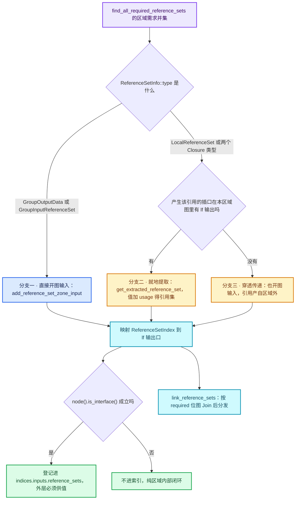

# 04 · 匿名属性与 ReferenceSet

[前置知识总入口](../README.md) · [本章导航](README.md) · [上一篇](03-写时复制与组件分离.md) · [下一篇](05-Field与属性域.md)

> 基准：Blender `5.4.0-alpha`，本地工作树。本篇讲匿名属性与 `GeometryNodesReferenceSet`——为什么循环体需要一条专门的通道传它们。这是正篇 03-02 第 8 节（约 280 行）的全部前置。主要源码：[`BKE_geometry_nodes_reference_set.hh`](../../../source/blender/blenkernel/BKE_geometry_nodes_reference_set.hh)（**总行数仅 31 行**）、[`geometry_nodes_lazy_function.cc`](../../../source/blender/nodes/intern/geometry_nodes_lazy_function.cc)（`build_reference_set_for_zone` 在 L2418-L2461）。

## 先回答一个具体问题

**Capture Attribute 产生的属性没有名字，几何传下去之后谁知道它还要不要？**

答案是没人知道，除非另带一份清单。`Capture Attribute` 把字段求值结果写进几何，属性名是系统哈希出来的（形如 `.a_1f3c...`），用户看不见、也不会存进 `.blend`。下游若要用它，只能通过节点连线连到那个输出插口——这个"必须显式连线"的设计正是关键：因为引用关系在节点树里是**静态可见**的，Blender 就能在求值前把"哪份几何的哪些匿名属性还有人要"算出来，不必等到运行时猜。

算出来的结果就是这个清单：`GeometryNodesReferenceSet`。它不是什么几何组件、不是属性、不是 `GeometrySet` 的成员，它就是**一个字符串集合**，给下游节点看："这些匿名属性名请你保留"。谁不需要，谁就在过滤时把它们跳过（`AttributeFilter::AllowSkip`），内存因此能被自动回收。

一句话：匿名属性没有名字，所以它的寿命不能靠名字查；只能靠"引用它的连线"静态推导，再把推导结果当作一份清单，沿着求值图一路传下去。本篇讲的就是这份清单是什么、怎么产生、在循环体里怎么穿墙。

## 两种属性

几何节点里的属性分两类，差别不在存储格式，而在**命名权与生命周期归属**。

| 维度 | 命名属性 | 匿名属性 |
| --- | --- | --- |
| 名字来源 | 用户输入（如 `Store Named Attribute` 的 `Name` 字段） | 系统哈希生成，前缀 `.a_`（[BKE_anonymous_attribute_id.hh · L24-L27](../../../source/blender/blenkernel/BKE_anonymous_attribute_id.hh#L24)） |
| 名字长相 | 人能读，如 `my_temp` | `.a_` + 128 位 XXH3 的十六进制（[BKE_anonymous_attribute_make.hh · L15-L22](../../../source/blender/blenkernel/BKE_anonymous_attribute_make.hh#L15)） |
| 存进 `.blend` | 是 | 否（写文件前被过滤掉，`ProcessAllAttributeExceptAnonymous`，[同文件 · L29-L38](../../../source/blender/blenkernel/BKE_anonymous_attribute_id.hh#L29)） |
| 谁能引用它 | 任何知道名字的人 | **只有连到产生它的那个输出插口的节点** |
| 寿命由什么决定 | 几何还在就还在 | 由静态分析算出的引用集合决定，可以提前释放 |
| 典型来源 | `Store Named Attribute`、导入的网格数据 | `Capture Attribute`、`Distribute Points on Faces` 的 `Rotation`、`Sample Nearest` 的 `Attribute` 等 |
| 用户可见性 | 属性面板里能看到 | 属性面板里不可见，只能靠 Viewer 或连线间接观察 |

有一处容易被忽略的对称性：`can_contain_reference()` 与 `can_contain_referenced_data()` 是两个不同的判据（[BKE_node_tree_reference_lifetimes.cc · L88-L97](../../../source/blender/blenkernel/intern/node_tree_reference_lifetimes.cc#L88)）。前者是"这个插口能装下对别人的引用"，包括所有字段类型插口（field 里可能内含 `AttributeFieldInput`）加几何/Bundle/Closure；后者是"这个插口装的数据里可能被人引用"，只有几何/Bundle/Closure。匿名属性只可能出现在后者那三类容器里——字段插口只会"指向"属性，不会"承载"属性。

## 匿名属性的问题

把两头都堵死之后，问题空间其实很窄：

- **不能永存**。一个 200 轮循环、每轮捕获一次的节点树，如果每轮的匿名属性都留在几何上，内存会按轮数线性涨。几何节点在老版本里确实这么干过，结果是"循环跑到第 50 轮就 OOM"。
- **不能随便删**。`Capture Attribute` 输出的两个插口（`Geometry` 与 `Attribute`）通常分别连给不同下游：`Geometry` 继续往下流，`Attribute` 进一个 `Set Position` 或 `Store Named Attribute`。如果只看到 `Geometry` 有人在用就把捕获结果删掉，那个读 `Attribute` 的节点就会读到空。
- **不能靠名字查**。名字是哈希，下游不知道自己需要的是哪个哈希值——它只知道"我这条连线连到了 `Capture Attribute` 的 `Attribute` 输出"。

于是需要一个"从连线推清单"的静态分析。这个分析在 [`node_tree_reference_lifetimes.cc`](../../../source/blender/blenkernel/intern/node_tree_reference_lifetimes.cc) 里（1085 行，比本篇主角大 35 倍），而它算出来的东西就是本篇要讲的 31 行。

分析的结果有两份：

| 产物 | 类型 | 含义 |
| --- | --- | --- |
| `reference_sets` | `Vector<ReferenceSetInfo>` | 全树一共有哪些"引用源"（编号即下标） |
| `required_data_by_socket` | `BitGroupVector<>`（[L93-L106](../../../source/blender/blenkernel/BKE_node_tree_reference_lifetimes.hh#L93)） | 每个插口 × 每个引用源一位：这一位为 1 表示"该引用源的数据必须被传播到这个插口" |

`BitGroupVector` 的布局值得记一下：外层按插口（`index_in_tree()`），内层按引用源。所以 `required_data_by_socket[socket][i].test()` 读作"插口 socket 需要第 i 号引用源继续活着"。这个位图就是后面所有 `Map<ReferenceSetIndex, ...>` 的源头。

## GeometryNodesReferenceSet 是什么

整个定义只有 31 行，去掉 SPDX 头、include、namespace 和注释，实质内容是一行：

```cpp
class GeometryNodesReferenceSet {
 public:
  std::shared_ptr<Set<std::string>> names;
};
```

（[BKE_geometry_nodes_reference_set.hh · L21-L29](../../../source/blender/blenkernel/BKE_geometry_nodes_reference_set.hh#L21)）

三个细节：

**一、是 `Set` 不是 `Vector`。** 集合语义——同一属性名加两次没有意义，去重是必须的。合并多份清单（`LazyFunctionForJoinReferenceSets`）时天然是并集。

**二、是 `std::shared_ptr` 不是 `ImplicitSharingPtr`。** 这是本章唯一一处反例：前几篇反复说几何数据用 `ImplicitSharingPtr`（8 字节、计数嵌在数据里），这里却退回 `std::shared_ptr`（16 字节、带控制块）。注释给了理由（L23-L27）："attributes sets are passed around by value during geometry nodes evaluation, and this makes it very small if there is no name. Also it makes copying very cheap."——**没有名字时只占一个空指针**，而且拷贝是纯引用计数。`ImplicitSharingPtr` 需要数据对象自己实现 `ImplicitSharingInfo`，为一个 `Set<string>` 特意套壳不值得。

**三、`names` 可以是 `nullptr`。** 这不是错误状态，而是最常见的状态：绝大多数节点的输出根本不需要传播任何匿名属性。所有地方都用 `if (!set.names)` 判空（例如 [`node_geometry_exec.cc · L235-L237`](../../../source/blender/nodes/intern/node_geometry_exec.cc#L235)）。这也是"31 行能撑住"的原因——空集合零分配。

它的唯一实际消费点在 `NodeAttributeFilter`（[NOD_geometry_exec.hh · L70-L78](../../../source/blender/nodes/NOD_geometry_exec.hh#L70)）：

```cpp
AttributeFilter::Result NodeAttributeFilter::filter(const StringRef attribute_name) const
{
  if (!bke::attribute_name_is_anonymous(attribute_name)) {
    return AttributeFilter::Result::Process;   // 命名属性：一律处理
  }
  if (!set_.names) {
    return AttributeFilter::Result::AllowSkip; // 空集合：所有匿名属性都可跳过
  }
  if (set_.names->contains(attribute_name)) {
    return AttributeFilter::Result::Process;   // 在清单里：必须保留
  }
  return AttributeFilter::Result::AllowSkip;   // 不在清单里：可跳过
}
```

（[node_geometry_exec.cc · L230-L242](../../../source/blender/nodes/intern/node_geometry_exec.cc#L230)）

这个过滤器会被交给几何算法，算法可以选择真的跳过（`AllowSkip` 只是"允许"，不是"命令"——[BKE_attribute_filter.hh · L22-L24](../../../source/blender/blenkernel/BKE_attribute_filter.hh#L22) 的注释明确说了"是否严格遵守取决于具体算法"）。`Capture Attribute` 里的用法是先把字段写进几何，再调 `clean_unused_attributes(..., params.get_attribute_filter("Geometry"), ...)` 把"没人要的刚写进去的属性"再删掉（[node_geo_attribute_capture.cc · L196-L203](../../../source/blender/nodes/geometry/nodes/node_geo_attribute_capture.cc#L196)）。这就是"不创建 / 创建后立刻删"的实际落地。

同时注意 `get_output_anonymous_attribute_id_if_needed()`（[NOD_geometry_exec.hh · L317-L325](../../../source/blender/nodes/NOD_geometry_exec.hh#L317)）：连属性名都可以不算。如果下游根本不需要这个输出，函数返回 `std::nullopt`，节点连 `XXH3` 都不用跑。匿名属性的节省是从"算名字"这一步就开始的，不只是"省内存"。

## 为什么只有 31 行

31 行里还有 14 行是版权头、`#pragma once` 和 include。**真正的类型定义是 1 行成员 + 3 行类壳。** 这不是偷懒，是分层的结果：

| 关注点 | 在哪 | 体量 |
| --- | --- | --- |
| 这个集合长什么样 | `BKE_geometry_nodes_reference_set.hh` | 31 行 |
| 全树有哪些引用源、谁需要谁（静态分析） | [`node_tree_reference_lifetimes.cc`](../../../source/blender/blenkernel/intern/node_tree_reference_lifetimes.cc) | 1085 行 |
| 引用源怎么变成图上的插口、怎么连线 | [`geometry_nodes_lazy_function.cc`](../../../source/blender/nodes/intern/geometry_nodes_lazy_function.cc) | 4411 行 |
| 引用集合怎么当值算出来、怎么合并 | 同上，`LazyFunctionForExtractingReferenceSet` / `LazyFunctionForJoinReferenceSets` | L1395-L1558 |
| 类型擦除注册 | [`cpp_types.cc · L63`](../../../source/blender/blenkernel/intern/cpp_types.cc#L63) | 1 行 |

比值是 1 : 35 : 142。这个比值本身就是知识点：**概念的"中心数据结构"越小，说明复杂度被推到算法侧了。** 读者在正篇 03-02 第 8 节看到的 280 行，绝大部分在讲"图怎么连"，而不是"集合是什么"。如果先建立了"它就是个 `shared_ptr<Set<string>>`"的印象，那 280 行就只剩下"谁生成、谁合并、谁穿墙"三个问题。

顺便修一个数字：本章导航（[README.md](README.md)）的表格里写 `BKE_geometry_nodes_reference_set.hh` 是 **24 行**，实测 `[System.IO.File]::ReadAllLines(...).Count` 为 **31**。24 是"非空行"口径（`Get-Content | Measure-Object -Line`），31 是物理行数。本篇一律用物理行数，与其余篇目一致。

## 三种来源

`build_reference_set_for_zone`（[L2418-L2461](../../../source/blender/nodes/intern/geometry_nodes_lazy_function.cc#L2418)）只做一件事：把"区域内需要的引用源"逐个变成图上的一个 `lf::OutputSocket`，记进 `Map<ReferenceSetIndex, lf::OutputSocket *>`。它先汇总需求，再按 `ReferenceSetType` 分流：

```cpp
const Vector<ReferenceSetIndex> all_required_reference_sets =
    this->find_all_required_reference_sets(graph_params.lf_reference_set_input_by_output,
                                           graph_params.lf_reference_set_inputs);
```

`find_all_required_reference_sets`（[L2629-L2645](../../../source/blender/nodes/intern/geometry_nodes_lazy_function.cc#L2629)）的合并逻辑是两句位运算：

1. 对区域内每个"要往外报告传播需求"的输出插口（`lf_reference_set_input_by_output` 的 key），把它的 `required_data_by_socket[index_in_tree()]` 位图 OR 进一个 `BitVector`；
2. 再对每个"子区域声明的引用集输入"（`lf_reference_set_inputs` 的 key）直接把对应位置 1。

所以"区域内需要哪些引用源"= **区域内节点的静态需求 ∪ 子区域的显式需求**。这两个来源正好对应两种图结构：前者是普通节点，后者是嵌套 zone。

然后是三路分流：



三路的语义差别，用一句话各自概括：

| 来源 | 判定条件 | 处理 | 为什么 |
| --- | --- | --- | --- |
| 直接开图输入 | 类型是 `GroupOutputData` / `GroupInputReferenceSet` | `lf_graph.add_input(GeometryNodesReferenceSet, "Reference Set")` | 这类引用源属于"组接口"，在区域内部根本没有对应插口可提取，只能由外层图供给 |
| 就地提取 | 类型带 `socket`，且 `lf_output_by_bsocket.lookup_default(socket)` 非空 | 插入一个 `LazyFunctionForExtractingReferenceSet` 节点 | 引用是在区域内产生的（如体内的 `Capture Attribute`），值就在本图上，不必穿墙 |
| 穿透传递 | 类型带 `socket`，但查不到 lf 输出 | `add_reference_set_zone_input` | 引用产自区域外（例如外层节点的 `Capture Attribute` 连进来了），区域内部只能看到"结果"，看不到产生者 |

分支二的注释原文是"If the reference was not created in the zone, so it needs to come from the input."（[L2454](../../../source/blender/nodes/intern/geometry_nodes_lazy_function.cc#L2454)）——这句话是整个第三路的存在理由，也是"穿透"这个词的出处。

提取节点本身很小（[L1395-L1465](../../../source/blender/nodes/intern/geometry_nodes_lazy_function.cc#L1395)），两个输入一个输出：

| 插口 | 类型 | 作用 |
| --- | --- | --- |
| `Use`（0） | `bool` | 这个值有人要吗？`false` 时直接输出空集合，连值都不请求 |
| `Value`（1） | `SocketValueVariant`（`ValueUsage::Maybe`） | 待扫描的值：可能是一个 field、一个几何、一个 Bundle |
| `References`（0） | `GeometryNodesReferenceSet` | 扫出来的匿名属性名集合 |

执行时它做的是"在值里找 `AttributeFieldInput`"（`gather_references_from_field`，[L1438-L1464](../../../source/blender/nodes/intern/geometry_nodes_lazy_function.cc#L1438)）：递归遍历 `GField` 的 `field_inputs()`，凡是 `AttributeFieldInput` 且名字以 `.a_` 开头，就 `names->add_as(name)`——注意 `names` 是**懒分配**的（`if (!r_references.names) r_references.names = std::make_shared<Set<std::string>>();`，L1455-L1458），没找到匿名属性就一直是 `nullptr`。这和头文件注释里"very small if there is no name"完全对上。

合并节点 `LazyFunctionForJoinReferenceSets`（[L1471-L1558](../../../source/blender/nodes/intern/geometry_nodes_lazy_function.cc#L1471)）同样朴素：`amount` 个 `(Use, ReferenceSet)` 输入对，逐个 `if (use)` 后收集指针，`sets.is_empty()` → 空集合，`sets.size() == 1` → **直接移动**那个唯一的 `shared_ptr`（零分配），多于一个才新建 `Set` 做并集。另外它对 `amount < 16` 做了静态缓存（`get_cached`，L1539-L1549），因为小规模合并是最热的路径。

## ReferenceSetType 枚举

五个值，分两组（[BKE_node_tree_reference_lifetimes.hh · L41-L59](../../../source/blender/blenkernel/BKE_node_tree_reference_lifetimes.hh#L41)）：

| 枚举值 | 语义 | 编号来自 | 谁产生它（`find_reference_sets`） | 是否穿墙进区域 |
| --- | --- | --- | --- | --- |
| `GroupOutputData` | 组输出的几何里可能含有从组输入传播过来的属性；调用方要告诉组"这些属性请留下" | 组输出接口的下标 | 组接口输出中 `can_contain_referenced_data` 的那些（[L257-L266](../../../source/blender/blenkernel/intern/node_tree_reference_lifetimes.cc#L257)） | 是（永远） |
| `GroupInputReferenceSet` | 字段输入可能要求"从别的几何输入把属性传播过来" | 组输入接口的下标 | 组接口输入中 `can_contain_reference` 的那些（[L248-L256](../../../source/blender/blenkernel/intern/node_tree_reference_lifetimes.cc#L248)） | 是（永远） |
| `LocalReferenceSet` | 区域内自己创建的匿名属性（如 `Capture Attribute` 的产出），要传播给用它的节点，甚至传到组输出 | 一个 `bNodeSocket *`（引用插口） | 节点的 `available_relations` 中，引用插口与数据插口**都已连线**的那些（[L281-L300](../../../source/blender/blenkernel/intern/node_tree_reference_lifetimes.cc#L281)） | 视插口在不在区域内 |
| `ClosureOutputData` | 闭包输出的几何可能要传播属性 | 一个 `bNodeSocket *`（输出节点输入插口） | 闭包 zone 的 `can_contain_referenced_data` 输出插口（[L321-L329](../../../source/blender/blenkernel/intern/node_tree_reference_lifetimes.cc#L321)） | 视插口位置 |
| `ClosureInputReferenceSet` | 闭包的字段输入要求传播属性 | 一个 `bNodeSocket *`（输入节点输出插口） | 闭包 zone 的 `can_contain_reference` 输入插口（[L314-L320](../../../source/blender/blenkernel/intern/node_tree_reference_lifetimes.cc#L314)） | 视插口位置 |

`ReferenceSetInfo`（[L61-L91](../../../source/blender/blenkernel/BKE_node_tree_reference_lifetimes.hh#L61)）用一个 `union` 同时表达两种编号方式，构造函数里的 `BLI_assert` 把这个约束钉死：**组级类型用 `int index`，局部/闭包类型用 `const bNodeSocket * socket`**。想混用会在 debug 构建里立即断言。这也是后文反例 1 的伏笔：`ReferenceSetIndex` 只是个 `int`（[NOD_geometry_nodes_lazy_function.hh · L53](../../../source/blender/nodes/NOD_geometry_nodes_lazy_function.hh#L53) 的 `using ReferenceSetIndex = int;`），它**不是** `bNodeSocket` 下标，也不是图插口下标，而是 `reference_sets` 向量里的全局序号。

还有一条容易看漏的收尾：`disable_unused_group_output_propagation`（[L962-L981](../../../source/blender/blenkernel/intern/node_tree_reference_lifetimes.cc#L962)）。在算出最终传播关系后，某些 `GroupOutputData` 可能发现"我以为会传播到那个输出，实际上没有传播路径"，这时用它对应的位从整个 `required_data_by_socket` 里清掉。**也就是说 `GroupOutputData` 类型的引用源可能被静默禁用**——它仍然出现在 `reference_sets` 里占一个编号，但永远没有插口需要它。

## 在 Repeat 中的三条通道

循环体的图输入之所以要分成三组，是因为有三种性质完全不同的东西要进到体内（[`initialize_zone_wrapper` · L1704-L1756](../../../source/blender/nodes/intern/geometry_nodes_lazy_function.cc#L1704)）：

| 通道 | 索引组 | 类型 | 轮与轮之间的关系 |
| --- | --- | --- | --- |
| 主输入 | `inputs.main` | `SocketValueVariant` | **接力**：第 N 轮的输出喂给第 N+1 轮的输入（[geometry_nodes_repeat_zone.cc · L302-L311](../../../source/blender/nodes/intern/geometry_nodes_repeat_zone.cc#L302)） |
| 穿越连线 | `inputs.border_links` | `SocketValueVariant` | **直通**：每一轮都把区域外那根线的值各连一次（[L282-L287](../../../source/blender/nodes/intern/geometry_nodes_repeat_zone.cc#L282)） |
| 引用集合 | `inputs.reference_sets` | `GeometryNodesReferenceSet` | **直通**：每一轮连的是同一根区域输入（[L289-L294](../../../source/blender/nodes/intern/geometry_nodes_repeat_zone.cc#L289)） |

代码就是三行，值得逐字看：

```cpp
/* Handle reference sets. */
for (const auto &item : body_fn_.indices.inputs.reference_sets.items()) {
  lf_graph.add_link(*lf_inputs[zone_info_.indices.inputs.reference_sets.lookup(item.key)],
                    lf_node.input(item.value));
}
```

（[geometry_nodes_repeat_zone.cc · L289-L294](../../../source/blender/nodes/intern/geometry_nodes_repeat_zone.cc#L289)）

注意内层循环的位置：它在 `for (const int iter_i : lf_body_nodes.index_range())` 里，所以 N 个轮次节点**各自**从同一根区域输入拉一条线。这就是"直通"：不是接力，不累积。

那为什么引用集合不能混进 `border_links` 或 `main`，非要用 `SocketValueVariant` 之外的一条独立通道？四条理由，任何一条独立成立：

1. **它不是值，是元信息。** `SocketValueVariant` 的语义是"一个可以装进插口的值"，会参与 `ensure_type` 转换、默认值填充、`ValueUsage` 判定、日志打印。引用集合若被当成值，`SocketValueVariant::ensure_type<int>()` 这类调用会抛错或被静默丢弃——它根本没有对应的"用户可读值"形态。
2. **它不该接力。** 主输入是"上一轮的结果交给下一轮"，而引用集合在整次求值里是**常量**（静态分析的产物，运行时不会变）。把它放进接力链，等于每轮白拷贝一次并可能引入依赖环。
3. **它的数量由静态分析决定，不由面板决定。** `main` 的数量 = 条目数 + 1，`border_links` 的数量 = 穿越连线数，都能在面板上数出来；`reference_sets` 的数量取决于体内节点产生的匿名属性需求，用户看不见。
4. **它需要独立的 CPP 类型以拿到独立的插口类型。** `GeometryNodesReferenceSet` 在 [`cpp_types.cc · L63`](../../../source/blender/blenkernel/intern/cpp_types.cc#L63) 注册为独立 `CPPType`（flags `None`），所以 `lf::GraphInputSocket` 能以它作为类型并标 `ValueUsage::Maybe`（[L1753](../../../source/blender/nodes/intern/geometry_nodes_lazy_function.cc#L1753)）。塞进 variant 就丢了这个类型身份。

还有一个只有读 wrapper 才会发现的细节：`initialize_zone_wrapper` 的第四个参数 `expose_all_reference_sets`，Repeat 传 `true`（[geometry_nodes_repeat_zone.cc · L134](../../../source/blender/nodes/intern/geometry_nodes_repeat_zone.cc#L134)），Closure 传 `false`（[geometry_nodes_closure_zone.cc · L109](../../../source/blender/nodes/intern/geometry_nodes_closure_zone.cc#L109)）。注释说"Some zone types (e.g. the closure zone) do not expose all reference sets."（[L1747](../../../source/blender/nodes/intern/geometry_nodes_lazy_function.cc#L1747)）——闭包走的是另一套契约（`ClosureFunctionIndices::inputs::output_data_reference_sets`，[NOD_geometry_nodes_closure.hh · L27-L45](../../../source/blender/nodes/NOD_geometry_nodes_closure.hh#L27)），它按"每个输出一个引用集"的方式登记，不是按 `ReferenceSetIndex`。

## body_fn_.indices.inputs.reference_sets

类型是 `Map<ReferenceSetIndex, int>`（[NOD_geometry_nodes_lazy_function.hh · L591-L603](../../../source/blender/nodes/NOD_geometry_nodes_lazy_function.hh#L591)），在 `ZoneFunctionIndices` 里：

```cpp
struct ZoneFunctionIndices {
  struct {
    Vector<int> main;
    Vector<int> border_links;
    Vector<int> output_usages;
    Map<ReferenceSetIndex, int> reference_sets;
  } inputs;
  ...
};
```

**为什么 key 是 `ReferenceSetIndex` 而不是从 0 开始的连续下标？** 因为这个编号是**整棵树**的全局编号，而 `body_fn` 只关心其中一小部分。举例：一棵树里 `reference_sets` 有 5 个元素（编号 0..4），但当前 Repeat 区域内只用到 2 号和 4 号，那就只有两个条目 `{2 → 图输入下标, 4 → 图输入下标}`。如果用 `Vector<int>` 按下标存，要么存 5 个长度、其中 3 个是垃圾，要么就得在构建时做一次编号重映射——而重映射会让"外层要按同一个 key 找同一个引用集"这件事变复杂（外层用的是全局编号）。`Map` 让"稀疏的全局编号"和"局部的图插口下标"这两套编号可以并存。

**为什么只有一部分条目？** 因为主函数在建完 `lf_reference_sets` 后加了一道 `is_interface()` 过滤（[L2365-L2374](../../../source/blender/nodes/intern/geometry_nodes_lazy_function.cc#L2365)）：

```cpp
for (const auto item : lf_reference_sets.items()) {
  lf::OutputSocket &lf_attribute_set_socket = *item.value;
  if (lf_attribute_set_socket.node().is_interface()) {
    body_fn.indices.inputs.reference_sets.add_new(
        item.key, lf_body_inputs.append_and_get_index(&lf_attribute_set_socket));
  }
}
```

`node().is_interface()` 的意思是"这个输出的 owner 是一个 `GraphInputSocket`"，也就是**穿墙来源**（分支一和分支三）。分支二产出的提取节点输出不是 interface，所以不进这个 Map——它本来就是区域内部的闭环，外层不需要供值。这个设计直接决定了"Map 的条目数 = 穿墙的引用集个数"，而不是"区域用到的引用集个数"。

**注意这里用 `add_new` 而不是 `add`。** `Map::add_new` 在 key 已存在时是 UB（[BLI_map.hh · L261-L264](../../../source/blender/blenlib/BLI_map.hh#L261)），而 `Map::add` 会静默不覆盖（同文件 L288-L294）。这里之所以敢用 `add_new`，是因为 `find_all_required_reference_sets` 已经用 `BitVector` 去过重，`lf_reference_sets` 的 key 天然唯一。这也是个提醒：读 Blender 容器代码时 `add` / `add_new` / `add_overwrite` 的差别是**契约级别**的，不是风格级别。

**为什么是 `int` 而不是 `lf::InputSocket *`？** 因为 body graph 在图构建期间会不断追加插口，存指针在构建早期就拿到手是危险的（虽然实际不会重分配）；存索引则要等到最后 `lf_body_inputs.append_and_get_index` 才落定。这与 `main` / `border_links` 存 `int` 的理由完全一致——统一走"先攒下标、后连线"的模式。

**一个死变量**：`build_reference_set_for_zone` 里有一行 `VectorSet<ReferenceSetIndex> input_reference_sets;`（[L2431](../../../source/blender/nodes/intern/geometry_nodes_lazy_function.cc#L2431)），声明之后从未使用。这是重构残留（大概是早期版本想把"穿墙的引用集"单独收集起来再统一开输入，后来被 `add_reference_set_zone_input` 就地处理取代了）。读源码时看到"声明了却没用"的变量不用怀疑自己看漏——grep 全文件确认它只出现 1 次就是结论。

## 用小数据走一遍

**场景**：一个 Repeat 区域，`Iterations = 2`，条目面板里只有 **Geometry** 一个条目。区域外有一个 `Capture Attribute`（把某个字段写进几何，产生一个匿名属性），它的 `Geometry` 输出被一根线穿过区域边界，接到区域内的 `Set Position`；区域内的 `Geometry` 从 Repeat Input 来，经 `Set Position` 接到 Repeat Output 的 `Geometry`。Repeat Output 的 `Geometry` 在区域外连到 Group Output 的 `Geometry`。组接口有一个 Geometry 输入（从场景带进来的）。

静态分析会产出 3 个引用源（编号按 `find_reference_sets` 的追加顺序）：

| 编号 | 类型 | 来源 | `required_data_by_socket` 上的落点 |
| --- | --- | --- | --- |
| 0 | `GroupInputReferenceSet` | 组接口第 0 个输入（Geometry，`can_contain_reference` 为真） | Group Input 节点的该输出插口、以及所有 `potential_data_origins` |
| 1 | `GroupOutputData` | 组接口第 0 个输出（Geometry） | 组输出节点的该输入插口 |
| 2 | `LocalReferenceSet` | 区域外那个 `Capture Attribute` 的 `Attribute` 插口（引用插口与 `Geometry` 数据插口都已连线，满足 [L293-L295](../../../source/blender/blenkernel/intern/node_tree_reference_lifetimes.cc#L293)） | `Capture Attribute` 的 `Geometry` 输出，及沿传播关系能到达的插口 |

`find_all_required_reference_sets` 在 body 图构建时做的第一件事，是把区域内每个"要往外报告传播需求"的输出插口的需求位图 OR 起来。本例里这些插口是 `Set Position` 的输出几何插口与 `Repeat Output` 的几何输入插口，前者的数据来自"穿越连线带进来的捕获几何"和"Repeat Input 的几何"，后者要往组输出走，于是三个引用源都被点亮：0 号跟着组输入几何的传播链过来，1 号来自"要传给组输出"，2 号就来自那个捕获。**这个集合的具体成员取决于接线**——换一种接法，0 号可能完全不出现。真正稳定的只有结构性结论：`LocalReferenceSet` 只有在它的产生者与服务者之间确实存在数据通路时才会被需要，而组级两个类型只要接线涉及组接口就几乎必然出现。

分流结果（三个引用源全部命中，且都因为"产生者不在本区域内"而落到穿墙那两路）：

| 编号 | 类型 | 分支 | 结果 |
| --- | --- | --- | --- |
| 0 | `GroupInputReferenceSet` | 分支一 · 直接开图输入 | body 图新增输入 `Reference Set` |
| 1 | `GroupOutputData` | 分支一 · 直接开图输入 | body 图新增输入 `Reference Set` |
| 2 | `LocalReferenceSet` | 分支三 · 穿透传递（产生者是区域外的 `Capture Attribute`，`lf_output_by_bsocket` 查不到） | body 图新增输入 `Reference Set` |

**三路全是穿墙**——本例刚好没有分支二，因为捕获发生在区域外。于是 body 图的完整输入表（顺序严格是 `main → border_links → output_usages → reference_sets`）：

| body 图输入下标 | 名字 | 类型 | 归属索引组 |
| --- | --- | --- | --- |
| 0 | `Index` | `SocketValueVariant` | `inputs.main[0]` |
| 1 | `Geometry` | `SocketValueVariant` | `inputs.main[1]` |
| 2 | `Link from Capture Attribute` | `SocketValueVariant` | `inputs.border_links[0]` |
| 3 | `Usage: Geometry` | `bool` | `inputs.output_usages[0]` |
| 4 | `Reference Set`（编号 0） | `GeometryNodesReferenceSet` | `inputs.reference_sets[0]` |
| 5 | `Reference Set`（编号 1） | `GeometryNodesReferenceSet` | `inputs.reference_sets[1]` |
| 6 | `Reference Set`（编号 2） | `GeometryNodesReferenceSet` | `inputs.reference_sets[2]` |

`body_fn.indices.inputs.reference_sets` 就是 `{0 → 4, 1 → 5, 2 → 6}` 这三条。顺序由 `all_required_reference_sets` 的升序保证（`bits::foreach_1_index` 从小到大，[L2642-L2643](../../../source/blender/nodes/intern/geometry_nodes_lazy_function.cc#L2642)），所以"编号小的先建"是可依赖的，但**下标值不能猜**：它等于 `main 数 + border_links 数 + output_usages 数` 再加偏移。本例里是 `2 + 1 + 1 = 4` 起跳；一旦多一条穿越连线就是 5 起跳。任何写死 `3` 的代码都会把 `Usage: Geometry` 当成引用集读。

**图输出**只有 4 根，顺序是 `input_usages → border_link_usages → main`：`Usage: Index`（0）、`Usage: Geometry`（1）、`Usage: Link from Capture Attribute`（2）、`Geometry`（3）。注意 main 输出排在最后——这与图形界面上面板的插口顺序完全无关，正是"必须走 `indices`"的原因。

再走一层：包装函数 `LazyFunctionForRepeatZone` 调用 `initialize_zone_wrapper(..., expose_all_reference_sets = true, ...)`，于是**包装函数**（zone 节点自己）也拿到三个 `Reference Set` 输入，下标记在 `zone_info.indices.inputs.reference_sets` 里，同样排在 `main → border_links → output_usages` 之后。执行时 `initialize_execution_graph` 为 2 次迭代建 2 个 body 节点，每个节点从这三根区域输入各拉一条线：

```text
zone 输入[RefSet 0] ──┬──> body#0.input(4)
                      └──> body#1.input(4)
zone 输入[RefSet 1] ──┬──> body#0.input(5)
                      └──> body#1.input(5)
zone 输入[RefSet 2] ──┬──> body#0.input(6)
                      └──> body#1.input(6)
```

三根线各自扇出成 2 份，**没有任何跨轮连线**。对比同一次求值里的 `Geometry` 主输入：它是 `zone 输入[Geometry] → body#0.input(1)`、`body#0.output(3) → body#1.input(1)`、`body#1.output(3) → zone 输出`——一条链。这就是"接力 vs 直通"在拓扑上的样子，也是第一轮之外每一轮的输入都来自上一轮的证明。

如果把捕获挪到**区域内**（放入 `Capture Attribute`），分流就变了：编号 2 的 `LocalReferenceSet` 的 `socket` 指向体内节点，`lf_output_by_bsocket` 能查到，于是走分支二——body 图里多一个 `Extract References` 节点（`debug_name_ = "Extract References"`，[L1403](../../../source/blender/nodes/intern/geometry_nodes_lazy_function.cc#L1403)），它接 `Capture Attribute` 的 `Attribute` 输出（field，经 `SocketValueVariant`）和该插口的 usage，输出引用集。这个输出**不是 interface**，所以不进 `indices.inputs.reference_sets`，body 图输入仍然是 3 根而不是 4 根。**"体内产生的引用留在体内"**——这句话在代码里的落实就是 `is_interface()` 那一行过滤。

## 反例与边界

**反例 1：以为 `ReferenceSetIndex` 是插口下标。** 它是 `int`（[NOD_geometry_nodes_lazy_function.hh · L53](../../../source/blender/nodes/NOD_geometry_nodes_lazy_function.hh#L53) 的 `using`），是 `reference_lifetimes_.reference_sets` 这个向量的全局序号；同一个编号在 body 图、zone 包装图、父图里含义相同，但对应的 `lf` 插口下标各不相同。拿它去索引 `bsocket->index_in_tree()` 或 `lf::Graph::inputs()` 都会静默读错。

**反例 2：以为引用集合是几何的一部分。** 它不在 `GeometrySet` 里、不是 `GeometryComponent`、不随属性写盘、也不随 `.blend` 保存。它只是求值图上的一根插口，和几何数据是**并列**的两条流：几何走 `SocketValueVariant`，引用集合走 `GeometryNodesReferenceSet`。所以"把几何存进缓存然后只从缓存里恢复几何"会**丢掉引用集合**——这正是 `sim_input::PassThrough` 注释里说的"Data that is incompatible with simulations (like anonymous attributes), is removed though."（[NOD_geometry_nodes_lazy_function.hh · L58-L62](../../../source/blender/nodes/NOD_geometry_nodes_lazy_function.hh#L58)）。

**反例 3：以为通道数量固定。** `indices.inputs.reference_sets` 的条目数 = 穿墙的引用集个数，取决于静态分析结果。加一个 `Capture Attribute`、删一个 Viewer、把一根线从"穿过边界"改成"在区域内产生"，都会改变这个数量。正篇 03-02 的反例 4 讲的就是这条。包装函数自己都用 `items()` 迭代而不是下标范围，正因为数量不可预测。

**反例 4：以为 `names == nullptr` 等于"没有匿名属性"。** `nullptr` 的真实含义是"这个插口不需要保留任何匿名属性"。几何里可能确实带着 10 个匿名属性，但清单为空 → `NodeAttributeFilter` 对它们全部返回 `AllowSkip` → 算法可以全部丢掉。反过来，`names` 非空但只含 1 个名字时，另外 10 个照样可丢。**清单是白名单，不是清单本身。**

**反例 5：以为匿名属性会自动清理。** 没有后台线程、没有 GC、没有引用计数。清理发生在每个节点内部：节点拿到 `NodeAttributeFilter` 后，自己决定要不要在拷属性的循环里跳过。所以"某个算法没实现过滤"是完全可能的——`AttributeFilter` 的注释（[BKE_attribute_filter.hh · L22-L24](../../../source/blender/blenkernel/BKE_attribute_filter.hh#L22)）明确说"Whether the output of the filter is followed exactly"取决于算法。内存是否真的省下来，取决于每个节点作者是否认真调了 `get_attribute_filter`。

**反例 6：以为引用集合会跨轮累积。** 每轮连的是**同一根**区域输入（[geometry_nodes_repeat_zone.cc · L289-L294](../../../source/blender/nodes/intern/geometry_nodes_repeat_zone.cc#L289)），不是"上一轮的引用集 + 本轮新产生的"。体内新产生的引用（分支二）根本不进这个 Map，所以既不会传出去也不会累积到下一轮。这也解释了为什么 Repeat 区域内 `Capture Attribute` 的结果不会"漏"到区域外——不是因为被刻意清理，而是因为**引用集通道里从来没有它的名字**，外层自然认为它可丢。

**反例 7：以为 `Map::add` 和 `add_new` 可以互换。** 同文件里既有 `lf_reference_sets.add(reference_set_i, ...)`（[L2428](../../../source/blender/nodes/intern/geometry_nodes_lazy_function.cc#L2428)）又有 `body_fn.indices.inputs.reference_sets.add_new(...)`（[L2370](../../../source/blender/nodes/intern/geometry_nodes_lazy_function.cc#L2370)）。`add` 遇到已存在的 key 静默不覆盖，`add_new` 是 UB（[BLI_map.hh · L261-L263](../../../source/blender/blenlib/BLI_map.hh#L261)）。前者用在"同一编号可能被多个分支命中"的地方，后者用在"已经用位图去过重"的地方。

**反例 8：以为 `GroupOutputData` 一定有用。** `disable_unused_group_output_propagation`（[L962-L981](../../../source/blender/blenkernel/intern/node_tree_reference_lifetimes.cc#L962)）会在最后一步把"看起来会传播、实际没有传播路径"的组输出引用源从位图里清掉。它仍占一个编号，但永远没有插口需要它——于是 `find_all_required_reference_sets` 不会把它算进需求。**编号存在 ≠ 需求存在。**

**反例 9：以为第一章导航的行数是准的。** [README.md](README.md) 里写 `BKE_geometry_nodes_reference_set.hh` = 24 行，实测 31。24 是非空行。这类"行数对不上"的根源永远是口径不同（物理行 vs 非空行），统一用 `[System.IO.File]::ReadAllLines(path).Count` 复核。

## 对理解 Repeat 的帮助

回到正篇：[03-02 Repeat循环体函数构建详解](../../重复区域-dsh/03-几何节点执行架构/02-Repeat循环体函数构建详解.md) 的第 8 节（L1262-L1540，约 280 行）整节都在讲本篇的内容。把本篇的结论带过去，那一节可以这样读：

| 正篇位置 | 讲的是 | 本篇对应 |
| --- | --- | --- |
| 第 8 节开头（L1233-L1250） | `build_reference_set_for_zone` 的整体职责 | 「三种来源」一节 |
| L1256-L1286 原文照录 | 分流 switch 的两个分支 | 「三种来源」表 |
| 8.1 提取节点（L1348-L1400） | `get_extracted_reference_set` 插节点 | 「三种来源」的 `Extract` / `Join` 两个 lazy function |
| 8.2 `is_interface()` 过滤（L1402-L1438） | 只有穿墙来源进 `indices` | 「body_fn_.indices.inputs.reference_sets」 |
| 11.3（L1807-L1823） | `inputs.reference_sets` 是"属性传播的指挥棒" | 「在 Repeat 中的三条通道」 |
| 反例 4（L2031） | 嵌套 Repeat 里不能假设通道数固定 | 「反例 3」 |

三个特别值得对照的点：

1. **正篇说"图输入顺序是 `main → border_links → output_usages → reference_sets`"**（反例 1，L2025）。这个顺序在本篇的「用小数据走一遍」里被具体化成了 `0,1,2` 三个 main/usage 加上 `3,4,5` 三个 reference set。知道 reference set 是**最后追加**的，就能解释"为什么它有下标但永远不在固定位置"。
2. **正篇说包装函数"用 `items()` 迭代而不是按下标范围"**（L2031）。原因就在本篇：`Map` 的 key 是稀疏的全局编号，范围和连续性都不成立。
3. **正篇第 14 节「用小数据走一遍」（L1990-L2021）的第 6 条写着"本例体内无捕获属性 → `indices.inputs.reference_sets` 为空映射"**。本篇的走一遍给了它的补集：一旦有跨边界引用或组级传播需求，这个 Map 就有条目，而且条目数可能是 3。

如果还想再往下一层：引用集合的**源头**（`reference_sets` 与 `required_data_by_socket` 怎么算出来的）在 [`node_tree_reference_lifetimes.cc`](../../../source/blender/blenkernel/intern/node_tree_reference_lifetimes.cc)：`prepare_relations_by_node`（L120-L236）为每个节点准备"use / available / data / reference"四类关系，`pass_left_to_right`（L402 起）反复迭代直到位图稳定，`prepare_required_data_for_outputs`（L682 起）从组输出反向确定真正需要的东西，最后 `required_data_by_socket.all_bits() &= potential_data_by_socket.all_bits()`（L1037）把"需要但不可能有"的位清掉。这 1085 行不在本篇范围，但它是"31 行能工作"的前提。

## 继续阅读

- 上一篇：[02-ImplicitSharing引用计数](02-ImplicitSharing引用计数.md) —— 为什么几何数据的共享用 8 字节的 `ImplicitSharingPtr`，而引用集合反而用 16 字节的 `std::shared_ptr`。
- 本章导航：[09-几何数据与引用](README.md) —— 本章已写与待写篇目的全貌，以及实测行数总表。
- 类型擦除侧：[08-类型擦除/02-SocketValueVariant](../08-类型擦除/02-SocketValueVariant.md) —— 为什么引用集合**不能**装进 `SocketValueVariant`，以及 `CPPType` 注册意味着什么。
- 容器侧：[03-BLI容器与视图/06-Map与MultiValueMap](../03-BLI容器与视图/06-Map与MultiValueMap.md) —— `Map` 的 `add` / `add_new` / `lookup` 语义，以及为什么 key 可以是稀疏编号。
- 节点系统侧：[10-节点系统基础/02-bNodeSocket与声明系统](../10-节点系统基础/02-bNodeSocket与声明系统.md) —— `ReferenceSetInfo::socket` 指向的那个 `bNodeSocket` 是什么，`available_relations` 从节点声明里怎么来。
- 正篇：[03-02 Repeat循环体函数构建详解 · 第 8 节](../../重复区域-dsh/03-几何节点执行架构/02-Repeat循环体函数构建详解.md#L1233) —— 本篇服务的 280 行。
- 源码索引（按阅读顺序）：
  - [`BKE_geometry_nodes_reference_set.hh`](../../../source/blender/blenkernel/BKE_geometry_nodes_reference_set.hh)（31 行）—— 全部定义
  - [`BKE_node_tree_reference_lifetimes.hh`](../../../source/blender/blenkernel/BKE_node_tree_reference_lifetimes.hh)（115 行）—— `ReferenceSetType` / `ReferenceSetInfo` / 位图产物
  - [`geometry_nodes_lazy_function.cc`](../../../source/blender/nodes/intern/geometry_nodes_lazy_function.cc) —— `L1395-L1558`（两个 lazy function）、`L2418-L2461`（分流）、`L2583-L2693`（区域外与分发）、`L2751-L2808`（提取与合并）、`L1704-L1756`（wrapper 插口）
  - [`node_tree_reference_lifetimes.cc`](../../../source/blender/blenkernel/intern/node_tree_reference_lifetimes.cc)（1085 行）—— 静态分析本体
  - [`NOD_geometry_exec.hh`](../../../source/blender/nodes/NOD_geometry_exec.hh) `L70-L78` + [`node_geometry_exec.cc`](../../../source/blender/nodes/intern/node_geometry_exec.cc) `L230-L242` —— 唯一消费点 `NodeAttributeFilter`
  - [`geometry_nodes_repeat_zone.cc`](../../../source/blender/nodes/intern/geometry_nodes_repeat_zone.cc) `L289-L294` —— 每轮各拉一条线的三行代码
