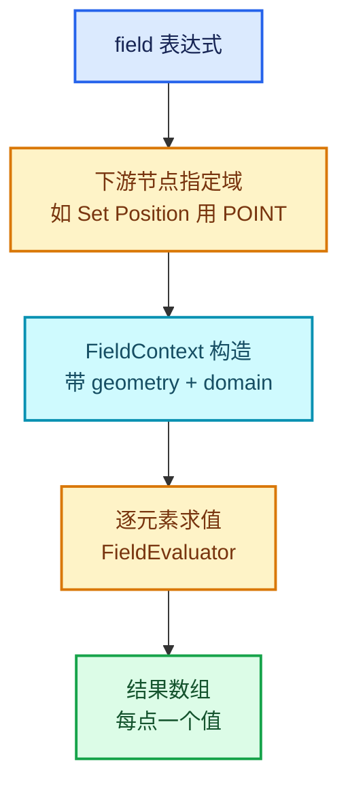

# 05 · Field 与属性域

[前置知识总入口](../README.md) · [本章导航](README.md) · [上一篇](04-匿名属性与ReferenceSet.md) · [下一章](../10-节点系统基础/README.md)

> 基准：Blender `5.4.0-alpha`，本地工作树。本篇讲 `GField`（几何场）——几何节点"延迟求值"的核心抽象。它是 `SocketValueVariant` 能装的一种形态，也是循环体内 field 求值上下文的载体。主要源码：[`FN_field.hh`](../../../source/blender/functions/FN_field.hh)（实测 735 行）。

## 先回答一个具体问题

一个"位置"节点的输出接到 Set Position 的 Offset 输入。这个输出是"一个向量"还是"每个点各一个向量"？

**都不是**。它是一个 **field**——一个"从属性域到值"的函数，等到 Set Position 执行时才对每个点求值。

## 什么是 Field

`[讲解]` 定义：**Field 是"给定域，返回一组值"的延迟表达式**。

`[讲解]` 三类 Field（源码里的抽象层级）：

| 类型 | 定义位置 | 特点 |
| --- | --- | --- |
| `Field<T>` | L203 | 编译期已知类型（`Field<float>`） |
| `GField` | L55 | 类型擦除版（"generic field"） |
| `GFieldRef` | L250 | 对 GField 的非拥有引用 |

`[讲解]` 为什么需要两层？

- **`GField` 是存储形态**——`SocketValueVariant` 里存的是它（因为 variant 不知道类型）；
- **`Field<T>` 是使用形态**——节点写代码时知道类型，用 typed 版本更方便；
- 两者**内存布局相同**，所以可以 `reinterpret_cast` 互转（08-02 讲的 `is_interpretable_as`）。

## Field 的三种来源

`[讲解]` 一个 field 从哪来？源码里的类型（L328-L343 附近）：

| 类型 | 含义 |
| --- | --- |
| `FieldInput` | 输入连接（从某个 socket 来） |
| `FieldOperation` | 运算产生的 field（如 Position + 1） |
| 常量 | 单值也能当 field（每个点都是同一个值） |

`[讲解]` `FieldInputs`（L328）是一个集合——一个 field 可能依赖多个输入。

`[讲解]` 注意它们都继承 `ImplicitSharingMixin`——意味着**引用计数共享**（第 09 章 02 篇）。

## FieldContext：求值的"域"

`[讲解]` 这是本篇第二个关键概念。`FieldContext`（L295）：

```cpp
class FieldContext {
  ...
};
```

`[讲解]` 它回答："这个 field 在哪求值？"

`[讲解]` 三种典型上下文：

| 上下文 | 域 | 例子 |
| --- | --- | --- |
| 点域 | `POINT` | 每个点算一次 |
| 面域 | `FACE` | 每个面算一次 |
| 边域 | `EDGE` | 每条边算一次 |
| 拐角域 | `CORNER` | 每个拐角算一次 |

`[讲解]` **同一个 field 在不同域下结果不同**。比如"位置"：

- 在点域 → 每个点的坐标；
- 在面域 → 每个面中心的坐标（需要从点插值）。

## AttrDomain 枚举

`[讲解]` 域的定义在 `BLI_attributes.hh` 之类：

```cpp
enum class AttrDomain : int8_t {
  Point,
  Edge,
  Face,
  Corner,
  Curve,
  Instance,
};
```

`[讲解]` 六个域。几何节点的大部分节点都有"域"的概念。

`[讲解]` **Repeat 里的关键**：`NodeRepeatItem` 有 `.structure_type(StructureType::Dynamic)`，意味着一个 item 可能是单值也可能是 field。如果某轮 item 传的是 field，它需要**正确的 FieldContext** 才能求值。

## Field 与匿名属性的关系

`[讲解]` 这是 09-04 篇的延续。一个 field 里可能**捕获**匿名属性的引用。

举例：`Capture Attribute` 节点产生一个匿名属性，然后一个 field 表达式引用它。

`[讲解]` 问题：**这个匿名属性什么时候能释放？**

答案：只要还有 field 引用它，就不能释放。这就是 `GeometryNodesReferenceSet` 的作用（09-04）。

`[讲解]` 所以链路是：

```text
field 表达式 → 捕获匿名属性引用 → reference set 记录"还要用" → 生命周期延长
```

## 在 Repeat 中的三处

`[讲解]` Repeat 与 field 的交互：

### 1. item 可以是 field

```cpp
b.add_input(socket_type, name, identifier)
    .structure_type(StructureType::Dynamic)
```

`[讲解]` `Dynamic` 意味着"单值或 field 都可能"。

### 2. 循环体内 field 的上下文

`[讲解]` 循环体内使用 field 时，FieldContext 由**下游节点**决定（不是由 Repeat 决定）。

比如循环体内一个 Set Position：它在点域执行，所以它里面的 field 也在点域求值。

### 3. reference set 穿墙

`[讲解]` 如果 field 捕获了匿名属性，reference set 必须穿过 zone 边界（09-04 三种来源）。

## 为什么延迟求值

`[讲解]` Field 存在的理由，与 01 章的"惰性"是同一套思想但不同层次：

| | LazyFunction | Field |
| --- | --- | --- |
| 层次 | 节点级 | 数据级 |
| 延迟对象 | 整棵子图是否执行 | 一个表达式对多少个元素求值 |
| 决定者 | usage / 需求 | 下游节点的域 |

`[讲解]` 两层延迟叠加：节点可能不执行（LazyFunction），执行了也可能只对部分元素求值（Field）。

## 求值流程

`[讲解]` 一个 field 被求值的完整链路：



`[讲解]` `FieldEvaluator` 是另一个组件（不在本篇范围），它负责实际遍历。

## 单值也能当 field

`[讲解]` 这是最容易被忽略的一点。

一个 `Value` 节点输出常量 5。它接到 Set Position 的 Offset。Set Position 需要 field。

`[讲解]` 转换是**隐式**的：常量被当作"每点都返回 5 的 field"。

`[讲解]` 这也是 `is_single()` 与 `is_field()` 的意义（08-03）：

- `is_single()` → 走快速路径（所有元素同值）；
- `is_field()` → 走逐元素求值。

**性能差异巨大**：单值时不需要遍历。

## 用小数据走一遍

`[讲解]` 场景：Set Position 的 Offset 接不同来源。

### 情况 A：接一个 Vector 常量 (0,0,1)

```text
variant.storage_kind = Single
Set Position 检查 is_single() → true
→ 所有点加同一个 (0,0,1)
→ 一次加法（或一次批量操作）
```

### 情况 B：接 Position 输出（field）

```text
variant.storage_kind = Field
Set Position 检查 is_field() → true
→ 对每个点求值 Position
→ N 次求值
```

### 情况 C：接 Noise Texture（field）

```text
variant.storage_kind = Field
→ 对每个点求值 Noise
→ N 次噪声计算（比情况 B 贵得多）
```

`[讲解]` 三种情况的成本差：

| 情况 | 求值次数 | 相对成本 |
| --- | --- | --- |
| A（常量） | 1 | 1x |
| B（Position） | N | Nx |
| C（Noise） | N | Nx × 噪声成本 |

`[讲解]` 这就是为什么**能把常量保持为常量就尽量保持**——一旦变成 field，成本从 O(1) 变 O(N)。

## 在 Repeat 循环体里的特殊性

`[讲解]` 循环体内 field 求值多了一个维度：**迭代**。

```text
第 0 轮：field 对几何 G0 求值
第 1 轮：field 对几何 G1（G0 的修改结果）求值
...
```

`[讲解]` 关键：**每轮的 FieldContext 都不同**（因为几何变了）。

`[讲解]` 这意味着 field 不能跨轮缓存——除非能证明几何没变。

## 反例与边界

### 反例 1：以为 field 是数组

它是**表达式**，不是数组。求值后才产生数组。

### 反例 2：以为同一 field 在所有域结果相同

"位置"在点域是点坐标，在面域是面中心。域变了结果就变。

### 反例 3：以为常量接到 field 输入会变慢

会走 `is_single()` 快速路径。

### 反例 4：以为 `Field<T>` 与 `GField` 是两个不同的东西

布局相同，只是类型信息不同。

### 反例 5：忽略 field 捕获的匿名属性

如果 field 引用了匿名属性，释放时机要考虑引用的存活。

### 反例 6：在循环体里缓存 field 求值结果

每轮几何不同，缓存会错。

## 对理解 Repeat 的帮助

`[讲解]` 本篇与正篇的对应：

| 正篇位置 | 本篇概念 |
| --- | --- |
| `structure_type(StructureType::Dynamic)` | item 可以是 field |
| `reference_sets` 通道 | field 捕获的匿名属性 |
| 06-01 的 field 求值上下文 | FieldContext |

`[讲解]` **最关键的一条**：Repeat 的 item 用 `StructureType::Dynamic` 意味着"单值或 field 都可能"。这带来两条后果：

1. **性能不确定**——如果用户接了 field，每轮要对整个几何求值；
2. **reference set 必须正确传播**——否则匿名属性会被提前释放。

正篇 06-02 的性能模型里"纯读轮近乎免费"的前提是**单值**；如果接了 field，每轮都要重新求值。

## 继续阅读

- [04-匿名属性与ReferenceSet](04-匿名属性与ReferenceSet.md) —— field 捕获的引用
- [08-02 SocketValueVariant](../08-类型擦除/02-SocketValueVariant.md) —— field 作为 variant 的一种形态
- [正篇 06-01 使用模式](../../重复区域-dsh/06-实战与性能/01-使用模式与迭代设计.md)
