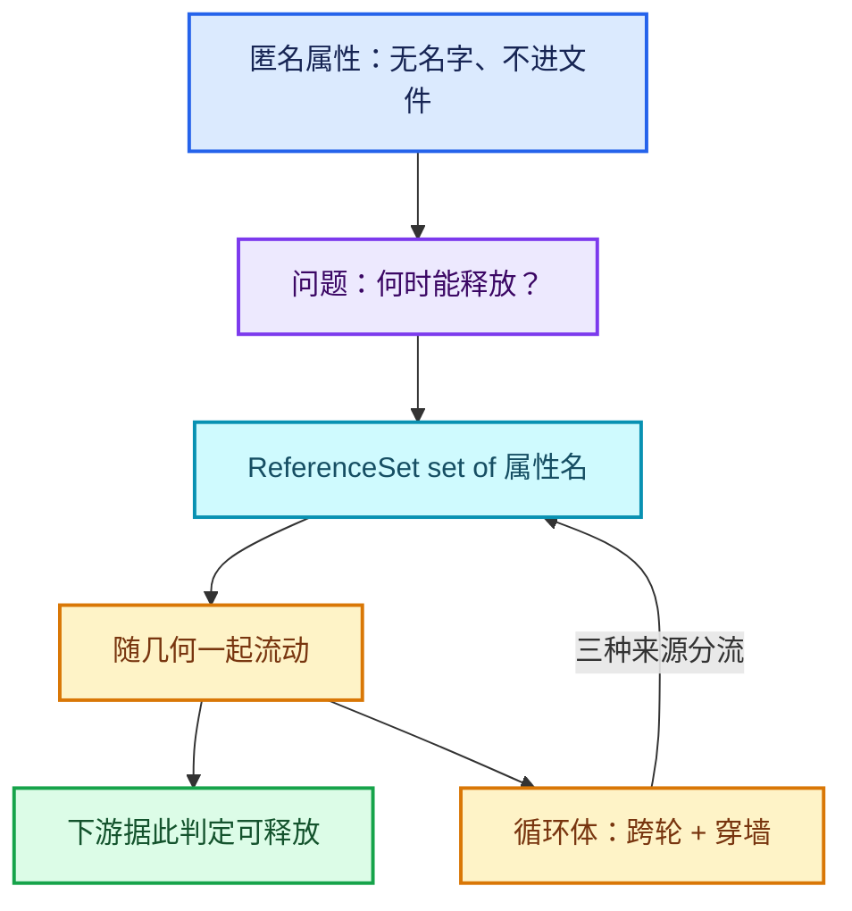

# 09-几何数据与引用

[前置知识总入口](../README.md) · [正篇：03-02 Repeat循环体函数构建](../../03-几何节点执行架构/02-Repeat循环体函数构建详解.md)

本章回答：`GeometrySet` 为什么"复制很便宜"？`ImplicitSharing` 怎么写时复制？ **匿名属性**和 **reference set** 到底是什么、为什么循环体需要一条专门的通道传它们？

## 阅读顺序

| # | 篇目 | 源码主线 | 实测行数 |
| --- | --- | --- | --- |
| 1 | [01-GeometrySet组件模型](01-GeometrySet组件模型.md) | `BKE_geometry_set.hh` | 731 |
| 2 | [02-ImplicitSharing引用计数](02-ImplicitSharing引用计数.md) | `BLI_implicit_sharing.hh` + `_ptr.hh` | 297 + 216 |
| 3 | [03-写时复制与组件分离](03-写时复制与组件分离.md) | `get_component_for_write` 等 | 同上 |
| 4 | [04-匿名属性与ReferenceSet](04-匿名属性与ReferenceSet.md) | `BKE_geometry_nodes_reference_set.hh` | **24** |
| 5 | [05-Field与属性域](05-Field与属性域.md) | `FN_field.hh` | 610 |

> **值得注意**：`BKE_geometry_nodes_reference_set.hh` 只有 **24 行**， > 但它承载的概念（reference set）在正篇 03-02 里占了 280 行讲解。 > 这是"源码体量 ≠ 概念复杂度"的典型例子。

## 本章与 Repeat 的关系

正篇中对这族概念的引用达 **127 处**。核心落点：

| 概念 | 在 Repeat 中的落点 | 正篇位置 |
| --- | --- | --- |
| `GeometrySet` 浅拷贝 | "纯读轮近乎免费"的性能结论 | 06-02 L638-L672 |
| `ImplicitSharingPtr` | 轮间传几何只是引用计数 +1 | 06-02 L183-L198 |
| 写时复制 | "写盘深拷贝"的内存峰值分析 | 06-02 |
| **`GeometryNodesReferenceSet`** | `body_fn_.indices.inputs.reference_sets` | 03-02 第 8 节（L1262-L1540） |
| 匿名属性寿命 | 为什么 reference set 要穿墙传递 | 03-02 |
| Field 与属性域 | 循环体内的 field 求值上下文 | 06-01 |

**最关键的一条**：正篇 03-02 第 8 节（Reference Set 通道，约 280 行）整节都在讲一套读者没有背景的机制。本章第 04 篇就是补这个洞——reference set 是"哪些匿名属性还需要继续传播"的集合，本质是 `shared_ptr<Set<std::string>>`。

## 实测行数总表

| 文件 | 行数 |
| --- | --- |
| `BKE_geometry_set.hh` | 731 |
| `FN_field.hh` | 610 |
| `BLI_implicit_sharing.hh` | 297 |
| `BLI_implicit_sharing_ptr.hh` | 216 |
| `BKE_geometry_nodes_reference_set.hh` | 24 |
| **合计** | **1,878** |

## 引用计数与复制成本

这条链解释了 Repeat 性能模型的核心结论：**传几何不贵，改几何才贵**。一个"只读不写"的循环体，N 轮的总数据搬运成本接近零。

## 匿名属性为什么需要 reference set

这是本章最难、也是 Repeat 正篇最需要的一段前置。

几何节点里，节点产生的属性有两种：

| 类型 | 名字 | 是否进 `.blend` | 寿命 |
| --- | --- | --- | --- |
| 命名属性 | 用户起的名字 | 是 | 随几何持久 |
| **匿名属性** | 系统生成的 UUID | 否 | 由"谁还引用它"决定 |

匿名属性（如 Capture Attribute 的产出、Distribute Points 附带的法线）不能永远留着（内存爆炸），也不能随便删（下游可能还要用）。所以需要一个机制回答： **"这份几何的哪些匿名属性还有下游需要？"**

答案就是 `GeometryNodesReferenceSet`——一个字符串集合，随几何一起流动。节点在输出几何时同时输出"我需要的属性名集合"，下游据此决定何时可以释放。

**循环体的困难**：属性可能在体内产生（每轮都有新的），也可能来自体外。所以 `build_reference_set_for_zone()`（geometry_nodes_lazy_function.cc L2418-L2461）要分三种来源处理：直接开图输入 / 就地提取 / 穿透传递。这就是正篇 03-02 第 8 节那 280 行在讲的事。

