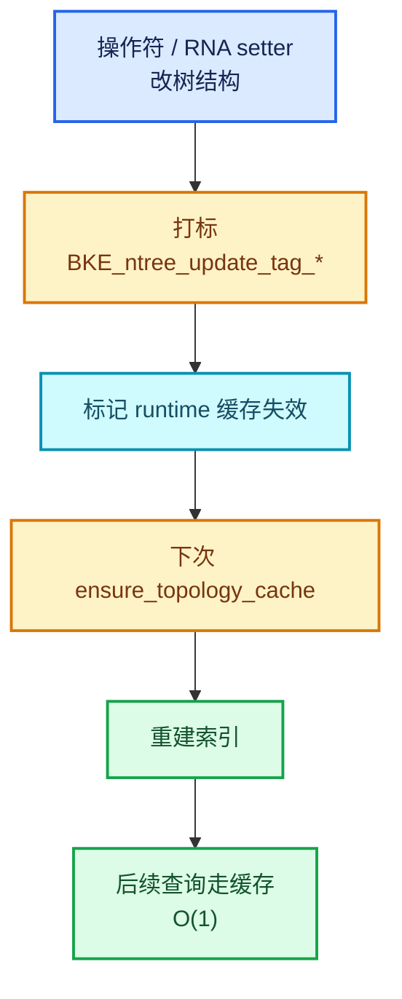

# 05 · 拓扑缓存与更新传播

[前置知识总入口](../README.md) · [本章导航](README.md) · [上一篇](04-bNodeType注册.md) · [下一篇](06-操作符与UI绘制.md)

> 基准：Blender `5.4.0-alpha`，本地工作树。本篇讲拓扑缓存——节点树为"快速回答邻接问题"而建的索引，以及它的失效与重建机制。Repeat 的配对查询（`node_by_id`）就建立在这之上。主要源码：[`BKE_node_runtime.hh`](../../../source/blender/blenkernel/BKE_node_runtime.hh)（实测 990 行）。

## 先回答一个具体问题

Repeat Input 要找到配对的 Output。它存的是 `output_node_id`（一个整数）。怎么从整数快速找到节点？

**答案**：`tree.node_by_id(id)`。但为什么这是 O(1) 而不是 O(N)？

因为背后有一个**预建的索引**：`bNodeTreeRuntime::nodes_by_id`。

## 为什么需要缓存

`[讲解]` 节点树的基本结构是链表：

```cpp
struct bNodeTree {
  ListBaseT<bNode> nodes;   /* 链表 */
  ...
};
```

`[讲解]` 链表上的查询都是 O(N)：

| 需求 | 链表成本 |
| --- | --- |
| 按 id 找节点 | O(N) |
| 按类型找节点 | O(N) |
| 找某 socket 的连线 | O(N) |
| 求拓扑序 | O(N+E) 每次 |

`[讲解]` 这些查询在**求值期是热路径**：

- 每建一个 zone 都要查配对 → 按 id 查；
- 每次 socket 使用推断都要查邻接 → 按 socket 查；
- 图编译要拓扑序。

如果每次都扫链表，几何节点求值会被索引开销淹没。

## 缓存的内容

`[讲解]` `bNodeTreeRuntime`（`BKE_node_runtime.hh`）里的关键缓存字段：

| 字段 | 类型 | 用途 |
| --- | --- | --- |
| `nodes_by_id` | `NodeIDVectorSet` | id → 节点 |
| `nodes_by_type` | `MultiValueMap<const bNodeType*, bNode*>` | 类型 → 节点列表 |
| `toposort_left_to_right` | `Vector<bNode*>` | 从左到右的拓扑序 |
| `toposort_right_to_left` | `Vector<bNode*>` | 反向拓扑序 |

`[讲解]` 逐个看：

### nodes_by_id

```cpp
NodeIDVectorSet nodes_by_id;
```

`[讲解]` 注释（L159-L162 附近）说：

> "Storage of nodes based on their identifier. Also used as a contiguous array of nodes to allow simpler and more cache friendly iteration. Supports lookup by integer or by node."

`[讲解]` 三个用途：

1. **按 id 查**（Repeat 配对！）；
2. **按节点查**（反查 id）；
3. **当连续数组遍历**（比链表缓存友好）。

`[讲解]` 注意它是 `VectorSet` 类型（第 03 章 03-05 讲过）——兼具"有下标"和"能反查"。

**这正好满足"按 id 查"与"按节点查"两个方向**。

### nodes_by_type

```cpp
MultiValueMap<const bNodeType *, bNode *> nodes_by_type;
```

`[讲解]` 一键多值：**一个类型对应多个节点**。

`[讲解]` 用途：`tree.nodes_by_type("GeometryNodeRepeatInput")` 返回所有该类型的节点。

**正篇 02-03 用它**（`find_node_by_item`）：

```cpp
for (bNode *node : ntree.nodes_by_type(UString(Accessor::node_idname))) {
  /* 检查 item 是否在这个节点里 */
}
```

### toposort 两份

`[讲解]` 为什么需要两个方向的拓扑序？

| 方向 | 用途 |
| --- | --- |
| `left_to_right` | 正向求值（从输入到输出） |
| `right_to_left` | 反向遍历（从输出推需求） |

`[讲解]` 正篇的 socket 使用推断就走反向；图构建走正向。

## 访问接口

`[讲解]` 缓存不是直接暴露的，而是通过 `bNodeTree` 的成员函数（`BKE_node_runtime.hh` L505-L551）：

```cpp
inline Span<bNode *> bNodeTree::nodes_by_id()
{
  return this->runtime->nodes_by_id.as_span();
}

inline bNode *bNodeTree::node_by_id(const int32_t identifier)
{
  bNode *const *node = this->runtime->nodes_by_id.lookup_key_ptr_as(identifier);
  return node ? *node : nullptr;
}

inline Span<bNode *> bNodeTree::nodes_by_type(const UString type_idname)
{
  return this->runtime->nodes_by_type.lookup(bke::node_type_find(type_idname));
}

inline Span<const bNode *> bNodeTree::toposort_left_to_right() const
{
  return this->runtime->toposort_left_to_right;
}
```

`[讲解]` 四个关键点：

1. **返回 `Span`**（只读视图，零拷贝）；
2. **`node_by_id` 可能返回 nullptr**（id 不存在）——正篇判空就是这个原因；
3. **`nodes_by_type` 按 `UString` 查，内部转成 `bNodeType*`**——因为类型比较用指针更快；
4. **全部 inline**——热路径无调用开销。

## ensure_topology_cache

`[讲解]` 缓存不是自动的。用之前必须调：

```cpp
ntree.ensure_topology_cache();
```

`[讲解]` 它做什么（推测 + 源码印证）：

```text
1. 如果缓存已有效 → 直接返回
2. 否则重建：
   - 清空所有缓存容器
   - 遍历 nodes 链表，填 nodes_by_id、nodes_by_type
   - 遍历所有连线，建 links_by_socket
   - 计算拓扑序
3. 标记缓存有效
```

`[讲解]` **关键**：重建是 O(N+E)。所以：

- 只在"确实需要"时调；
- 不要在循环里反复调（虽然它内部有"已有效就返回"的判断，但判断本身也有成本）。

## 失效机制

`[讲解]` 缓存什么时候失效？

`[讲解]` 任何**改变树结构**的操作：

| 操作 | 影响 |
| --- | --- |
| 增删节点 | `nodes_by_id`、`nodes_by_type`、拓扑序全部失效 |
| 增删连线 | 拓扑序、`links_by_socket` 失效 |
| 改 socket | 拓扑序可能需要重算 |
| 改节点名 | **不影响**（缓存按 id 不按名） |
| 改节点参数 | **不影响**（拓扑没变） |

`[讲解]` 最后两条很重要：**不是所有修改都会破坏拓扑**。

`[讲解]` 源码里有个 `is_invalid` 之类的标志（在 `bNodeTreeRuntime` 里）。操作符改结构后调 `BKE_ntree_update_tag_*` 打标，下次 `ensure` 时重建。

## 更新标签系统

`[讲解]` `BKE_ntree_update_tag_*` 是一组宏/函数，标记"哪部分变了"：

| 标签 | 含义 |
| --- | --- |
| `BKE_ntree_update_tag_node_property` | 节点属性变了 |
| `BKE_ntree_update_tag_all` | 全部失效 |
| `BKE_ntree_update_tag_link_added` | 新增连线 |
| `BKE_ntree_update_tag_node_removed` | 删除节点 |

`[讲解]` 正篇里出现过：

```cpp
BKE_ntree_update_tag_node_property(&ntree, node);
```

在 Repeat 改 item 名字后调用。因为改名字会触发 socket 声明重建，而 socket 是拓扑的一部分。

## 三阶段更新流程

`[讲解]` 完整的更新链路：



`[讲解]` 注意这是**惰性重建**——打标只是标记，真正重建等下次 `ensure`。

**为什么不立即重建？** 因为一次操作可能连续改多处（比如"建一对 Repeat 节点"要先加两个节点、再连线、再设 storage），立即重建会做 N 次无用功。

## 在 Repeat 中的三处使用

`[讲解]` 正篇里 `ensure_topology_cache` 与缓存查询出现的位置：

### 1. node_by_id（配对）

```cpp
if (const bNode *output_node = tree.node_by_id(storage.output_node_id)) {
  /* 找到配对的 Output */
}
```

`[讲解]` 这是**每次 `node_declare` 都会执行**的查询——因为要读 items。所以必须 O(1)。

### 2. ensure_topology_cache（建对后）

正篇 02-01：

```cpp
/* node_gather_link_searches 里建完一对节点后 */
ntree.ensure_topology_cache();
```

`[讲解]` 因为刚加了节点，要立即用新结构做后续操作（比如设置 storage）。

### 3. nodes_by_type（找 item 所属节点）

正篇 02-03 的 `find_node_by_item`：

```cpp
ntree.ensure_topology_cache();
for (bNode *node : ntree.nodes_by_type(UString(Accessor::node_idname))) {
  SocketItemsRef array = Accessor::get_items_from_node(*node);
  if (&item >= *array.items && &item < *array.items + *array.items_num) {
    return node;
  }
}
```

`[讲解]` 它要遍历"所有该类型的节点"，所以需要 `nodes_by_type` 索引。

## 缓存的代价

`[讲解]` 缓存不是免费的：

| 成本 | 量级 |
| --- | --- |
| 内存 | O(N) 索引 + O(E) 连线表 |
| 重建时间 | O(N+E) |
| 失效判断 | O(1) |

`[讲解]` 在**小树**（10 个节点）里，缓存反而更慢（建索引的时间 > 扫链表）。

但几何节点树通常几十到几百节点，且求值次数多——缓存收益明显。

## 用小数据走一遍

`[讲解]` 一棵含 3 个节点的树：Repeat Input(43)、Repeat Output(42)、Value(44)。

**初始（无缓存）**：

```text
runtime->nodes_by_id = {}       （空）
runtime->nodes_by_type = {}
缓存标记 = 无效
```

**调 `ensure_topology_cache()`**：

| 步 | 动作 | 结果 |
| --- | --- | --- |
| 1 | 检查标记 | 无效 → 重建 |
| 2 | 遍历 nodes 链表 | 得到 3 个节点 |
| 3 | 填 `nodes_by_id` | {42: Output, 43: Input, 44: Value} |
| 4 | 填 `nodes_by_type` | {RepeatOutput: [Output], RepeatInput: [Input], Value: [Value]} |
| 5 | 遍历连线 | 填 `links_by_socket` |
| 6 | 算拓扑序 | [Input, Value, Output]（依赖顺序） |
| 7 | 标记有效 | — |

**查询 `node_by_id(42)`**：

```text
nodes_by_id.lookup_key_ptr_as(42) → &Output 指针
→ 返回 Output
成本：1 次哈希查找
```

**改 Repeat Input 的名字**：

| 步 | 动作 |
| --- | --- |
| 1 | RNA setter 改 `item.name` |
| 2 | `BKE_ntree_update_tag_node_property(&ntree, node)` |
| 3 | 缓存标记 → 无效 |
| 4 | 下次 `ensure` 时重建（因为 socket 声明要变） |

`[讲解]` 注意第 4 步——**改名字导致 socket 重建，socket 是拓扑的一部分**，所以要重建。

## 反例与边界

### 反例 1：以为缓存永远有效

必须 `ensure_topology_cache()`。

### 反例 2：在循环里反复 ensure

虽然内部有"已有效就返回"，但判断本身有成本。应该在循环外调一次。

### 反例 3：拿到 `Span` 后改树

```cpp
Span<bNode *> nodes = tree.nodes_by_id();
tree.nodes.new_node(...);   /* 可能触发重建 → span 悬空 */
```

### 反例 4：以为改参数会让缓存失效

拓扑没变，缓存有效。只有结构变才失效。

### 反例 5：以为 `node_by_id` 一定找到

id 不存在时返回 nullptr。正篇判空就是这个原因。

### 反例 6：忽略更新标签

改了树但没打标 → 缓存仍被认为有效 → 查询返回旧结果。这是最难查的一类 bug。

## 对理解 Repeat 的帮助

`[讲解]` 本篇把正篇里几处"魔法"解释清楚：

| 正篇代码 | 本篇概念 |
| --- | --- |
| `tree.node_by_id(storage.output_node_id)` | `nodes_by_id` 缓存 |
| `ntree.ensure_topology_cache()` | 重建索引 |
| `ntree.nodes_by_type(...)` | `nodes_by_type` 缓存 |
| `BKE_ntree_update_tag_node_property(...)` | 打标失效 |
| `toposort_left_to_right()` | 拓扑序缓存 |

`[讲解]` **最关键的一条**：Repeat 的配对查询之所以是 O(1)，不是因为"存了 id 就快"，而是因为**背后有 `nodes_by_id` 这个哈希索引**。没有 `ensure_topology_cache()`，`node_by_id` 就只能扫链表。

这解释了正篇 02-01 为什么在"建完一对节点后立即调 `ensure_topology_cache()`"——因为接下来马上就要按 id 查。

## 继续阅读

- [01-bNode与bNodeTree](01-bNode与bNodeTree.md) —— `identifier` 与 runtime 结构
- [02-bNodeSocket与声明系统](02-bNodeSocket与声明系统.md) —— socket 重建
- [06-操作符与UI绘制](06-操作符与UI绘制.md) —— 谁触发更新
