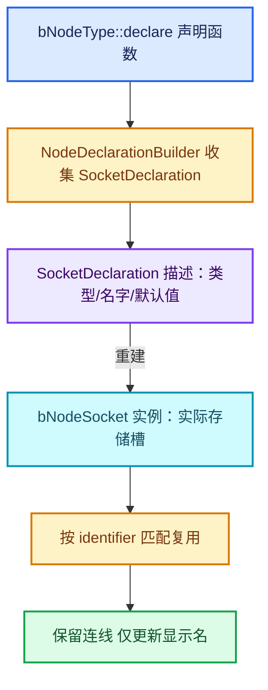

# 10-节点系统基础

[前置知识总入口](../README.md) · [正篇：02-Repeat区域数据模型](../../02-Repeat区域数据模型/README.md)

本章回答：`bNode`/`bNodeTree`/`bNodeSocket`/`bNodeType` 各是什么？ **声明系统**（`SocketDeclaration`/`NodeDeclarationBuilder`）为什么存在？拓扑缓存与更新传播怎么工作？

## 阅读顺序

| # | 篇目 | 源码主线 | 实测行数 |
| --- | --- | --- | --- |
| 1 | [01-bNode与bNodeTree](01-bNode与bNodeTree.md) | `DNA_node_types.h` 节点段 | 4047（整体） |
| 2 | [02-bNodeSocket与声明系统](02-bNodeSocket与声明系统.md) | socket 与 declaration 分离 | `node_socket.cc` |
| 3 | [03-NodeDeclarationBuilder](03-NodeDeclarationBuilder.md) | `NOD_node_declaration.hh` | 665 |
| 4 | [04-bNodeType注册](04-bNodeType注册.md) | `BKE_node.hh` + `node_register.cc` | 1141 |
| 5 | [05-拓扑缓存与更新传播](05-拓扑缓存与更新传播.md) | `ensure_topology_cache` 等 | `BKE_node_runtime.hh` 990 |
| 6 | [06-操作符与UI绘制](06-操作符与UI绘制.md) | `node_layout_ex` 的上下文 | `node_geo_repeat.cc` |

## 本章与 Repeat 的关系

Repeat 的**编辑期**全部建在本章之上：

| 概念 | 在 Repeat 中的落点 | 正篇位置 |
| --- | --- | --- |
| `bNodeTree::node_by_id` | Input 找到配对的 Output | 01-01、02-01 |
| `bNodeType` 注册 | `node_register` 绑定全部回调 | 02-01 |
| `SocketDeclaration` | `node_declare` 动态生成 socket | 01-02、02-01 |
| `NodeDeclarationBuilder` | `use_custom_socket_order` 等 | 01-02 |
| `ensure_topology_cache` | `node_gather_link_searches` 建对后 | 02-01 |
| `update_node_declaration_and_sockets` | extend socket 新增 item 后 | 02-03 |
| 更新标签 | `BKE_ntree_update_tag_node_property` | 01-02 L608 |
| UI 绘制回调 | `draw_buttons_ex` = `node_layout_ex` | 02-01 |

**最关键的一条**：Repeat 的动态 socket 机制 = "声明系统 + 每次重建"。 `node_declare` 不是一个静态函数表，而是**每次节点更新时重新执行**、按当前 items 数组生成 socket。理解声明系统的重建模型，才能理解 `Item_<n>` 标识符为什么能稳定——重建时按 identifier 复用旧 socket。

## 实测行数总表

| 文件 | 行数 |
| --- | --- |
| `makesdna/DNA_node_types.h` | 4047 |
| `blenkernel/BKE_node.hh` | 1141 |
| `blenkernel/BKE_node_runtime.hh` | 990 |
| `nodes/NOD_node_declaration.hh` | 665 |
| **本章核心 4 文件合计** | **6,843** |

另涉及（未计入）： `nodes/intern/node_socket.cc`（`refresh_node_socket` 在 L219）、 `nodes/intern/node_declaration.cc`、`nodes/intern/node_register.cc`、 `editors/space_node/drawnode.cc`。

## 声明与 socket 的分离

这是整个节点系统最反直觉、也最值得先理解的一点：

**为什么分两层？**

- `SocketDeclaration` 是"意图"：这个节点想要一个 float 输入叫 X；
- `bNodeSocket` 是"事实"：当前内存里真的有这个槽，可能还连着线。

分开之后，节点可以**重新声明自己**（比如 Repeat 增加了 item），而 `refresh_node_socket`（node_socket.cc L219）会按 identifier 匹配新旧 socket，把旧 socket 的连线与数据迁移过去。这就是"改名不断链接"的实现基础。

## 两种 socket 标识

| 标识 | 来源 | 稳定性 | 用途 |
| --- | --- | --- | --- |
| `name`（显示名） | `node_declare` 传入的字符串 | 可变 | UI 显示 |
| `identifier` | 声明时指定，如 `"Item_3"` | **稳定** | 连线、查找、复用 |

Repeat 的 item socket 用 `Item_<identifier>` 作为 socket identifier（`RepeatItemsAccessor::socket_identifier_for_item`），而 name 可以是任意用户标签——这两个字段的分离是本章最重要的结论。
