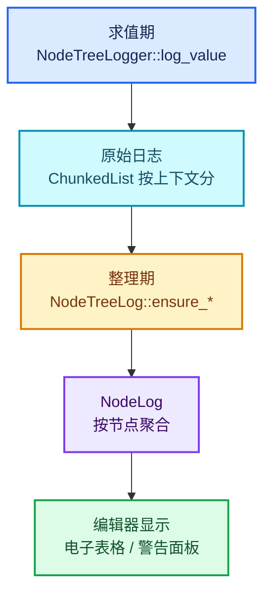

# 01 · 日志与 NodeTreeLogger

[前置知识总入口](../README.md) · [本章导航](README.md) · [下一篇](02-Viewer与ViewerPath.md)

> 基准：Blender `5.4.0-alpha`，本地工作树。本篇讲 `NodeTreeLogger`——几何节点求值时的日志收集器。它是"按上下文分组记值"的实现载体，Repeat 的 inspection_index 依赖它。主要源码：[`NOD_eval_log.hh`](../../../source/blender/nodes/NOD_eval_log.hh)（`NodeTreeLogger` 在 L296-L370、`NodeLog` 在 L372 起）、[`intern/eval_log.cc`](../../../source/blender/nodes/intern/eval_log.cc)。

## 先回答一个具体问题

用户挂了一个 Viewer 在 Repeat 循环体内。3 轮循环后，blender 需要记住 3 个不同的值。存在哪？

答案是 `NodeTreeLogger`。而且不是"一个 logger 记 3 个值"，而是**每个上下文一个 logger**。

## 核心设计：每个实例一个 logger

`[讲解]` 类注释（L291-L294）说得非常直接：

> "Logs all data for a specific geometry node tree in a specific context. When the same node group is used in multiple times each instantiation will have a separate logger."

`[讲解]` 两个关键词：

1. **"in a specific context"** —— logger 属于**一个上下文**，不是一个类型；
2. **"each instantiation will have a separate logger"** —— 同一个节点组被用两次，就有两个 logger。

`[讲解]` **这正是 Repeat 需要的**：3 轮循环 = 3 个上下文 = 3 个 logger（或至少 3 份按上下文分区的日志）。

## 关键字段

`[讲解]` `NodeTreeLogger` 的字段（L296-L370），分两组：

### 第一组：身份信息

```cpp
std::optional<ComputeContextHash> parent_hash;
std::optional<int32_t> parent_node_id;
Vector<ComputeContextHash> children_hashes;
std::optional<uint32_t> tree_orig_session_uid;
std::chrono::nanoseconds execution_time{};
LinearAllocator<> *allocator = nullptr;
```

`[讲解]` 逐个：

| 字段 | 用途 |
| --- | --- |
| `parent_hash` | 父上下文的哈希（用于建立树形结构） |
| `parent_node_id` | 父上下文的节点 id |
| `children_hashes` | 所有子上下文的哈希 |
| `tree_orig_session_uid` | 所属节点树的 ID（可选） |
| `execution_time` | 在**这个上下文**里花的总时间 |
| `allocator` | 分配日志数据的内存池 |

`[讲解]` `parent_hash` + `children_hashes` 构成了**上下文的树形索引**——可以查询"这个 logger 的子实例有哪些"。

`[讲解]` `tree_orig_session_uid` 的注释值得读：

> "It's an optional value because under some circumstances it's not possible to know this exactly currently (e.g. for closures)."

**可选是因为某些场景（如 closure）无法确定**。这是诚实的设计。

### 第二组：八类日志数据

```cpp
linear_allocator::ChunkedList<WarningWithNode> node_warnings;
linear_allocator::ChunkedList<SocketValueLog, 16> input_socket_values;
linear_allocator::ChunkedList<SocketValueLog, 16> output_socket_values;
linear_allocator::ChunkedList<NodeExecutionTime, 16> node_execution_times;
linear_allocator::ChunkedList<NodeImagePreview, 16> node_image_previews;
linear_allocator::ChunkedList<ViewerNodeLogWithNode> viewer_node_logs;
linear_allocator::ChunkedList<AttributeUsageWithNode> used_named_attributes;
linear_allocator::ChunkedList<DebugMessage> debug_messages;
linear_allocator::ChunkedList<EvaluatedGizmoNode> evaluated_gizmo_nodes;
```

`[讲解]` 八类（实际是九行）日志，每类一个 `ChunkedList`：

| 日志 | 内容 |
| --- | --- |
| `node_warnings` | 节点警告（含 `NodeWarningType`） |
| `input_socket_values` | 输入 socket 的值 |
| `output_socket_values` | 输出 socket 的值 |
| `node_execution_times` | 每个节点的执行时间 |
| `node_image_previews` | 图像预览 |
| `viewer_node_logs` | Viewer 数据 |
| `used_named_attributes` | 命名属性的使用情况 |
| `debug_messages` | 调试消息 |
| `evaluated_gizmo_nodes` | Gizmo 节点 |

`[讲解]` **为什么用 `ChunkedList` 而不是 `Vector`？**

`ChunkedList` 从 `LinearAllocator` 分配，特点：

- 地址稳定（不 realloc）；
- 整块回收（不会逐个析构）。

日志是典型的"大量小对象、同生共死"场景——正是 `LinearAllocator` 的目标（见 04 章）。

`[讲解]` 注意模板参数 `16`（`ChunkedList<SocketValueLog, 16>`）——每个 chunk 装 16 个元素。这是"分批追加"的粒度。

## 日志条目的双重身份

`[讲解]` 看 `WarningWithNode` 这个结构：

```cpp
struct WarningWithNode {
  int32_t node_id;
  NodeWarning warning;
};
```

`[讲解]` 每个日志条目都带 **`node_id`**。

`[讲解]` **这不是冗余**——因为同一个 logger 对应一个上下文，其中可能有多个节点。所以需要 `node_id` 区分。

`[讲解]` 同理 `SocketValueLog`：

```cpp
struct SocketValueLog {
  int32_t node_id;
  int socket_index;
  destruct_ptr<ValueLog> value;
};
```

三项定位：(节点 id, socket 索引, 值)。

`[讲解]` `destruct_ptr<ValueLog>` 说明值是**堆分配且由 logger 管理析构**（见 04-03）。

## 与 ComputeContext 的关系

`[讲解]` 这是本篇最需要澄清的一点。三个概念的关系：

```text
ComputeContext（上下文链）
  ↓ 产生
ComputeContextHash（定长哈希）
  ↓ 用作
NodeTreeLogger 的身份（parent_hash / children_hashes）
  ↓ 存
日志条目（按 node_id + hash 定位）
```

`[讲解]` 具体说：

- **`ComputeContext`** 描述"在哪求值"（树、节点、轮次）；
- **`NodeTreeLogger`** 是"那个位置的日志册"；
- **日志条目** 是册子里的记录，用 `node_id` + 所属 logger 定位。

`[讲解]` 所以"第 1 轮的 Viewer 值" = `RepeatZoneComputeContext(node=42, iter=1)` 对应的那个 logger 里的 `viewer_node_logs`。

## log_value：写日志的入口

`[讲解]` `NodeTreeLogger` 只有一个公开方法（L361）：

```cpp
void log_value(const bNode &node, const bNodeSocket &socket, GPointer value);
```

`[讲解]` 三个参数：

1. **`node`** —— 哪个节点（取 id）；
2. **`socket`** —— 哪个端口（取 index 与方向）；
3. **`value`** —— 值（`GPointer` = 类型擦除的只读指针）。

`[讲解]` 内部逻辑（推测 + 源码印证）：

```text
1. 判断 socket 是输入还是输出 → 选 input_socket_values 或 output_socket_values
2. 构造 SocketValueLog{node.identifier, socket.index(), 拷贝值}
3. 追加到对应 ChunkedList
```

`[讲解]` 关键：**值必须被拷贝或"接管"**。因为原值很快会被销毁，日志要长期保留。

## 读取侧：NodeLog

`[讲解]` 写入是 logger 的事，读取是 `NodeLog` 的事（L372 起）：

```cpp
class NodeLog {
 public:
  /** Warnings generated for that node. */
  VectorSet<NodeWarning> warnings;
  /** Time spent in this node. */
  std::chrono::nanoseconds execution_time{0};
  /** Maps from socket indices to their values. */
  ...
};
```

`[讲解]` 注释（L366-L371）说明：

> "Contains data that has been logged for a specific node in a context. So when the node is in a node group that is used multiple times, there will be a different #NodeLog for every instance.
> By default, not all of the info below is valid. A #NodeTreeLog::ensure_* method has to be called first."

`[讲解]` 两个关键：

1. **`NodeLog` 是"某节点在某上下文的日志"**——粒度比 logger 细；
2. **默认不一定有效**——要调 `ensure_*` 方法才填充。

`[讲解]` 第 2 点是性能设计：不是所有日志都默认收集。只有编辑器需要显示时才 `ensure`。

## 三阶段：原始 → 处理 → 显示

`[讲解]` 完整链路：



`[讲解]` 三个阶段的意义：

- **求值期**：尽可能轻（只是追加到 list）；
- **整理期**：可以重（做聚合、索引）；
- **显示**：按需（用户点开才做）。

## Repeat 的 inspection_index 如何工作

`[讲解]` 现在能回答正篇反复强调的问题。

**inspection_index 的语义**（正篇 02-02）：Repeat Output 的 `inspection_index` 字段指定"显示第几轮的值"。

`[讲解]` 完整链路：

```text
1. 用户在节点面板设 inspection_index = 1
2. 执行期：Repeat 3 轮，每轮生成不同 ComputeContext
   → 每轮写入不同的 NodeTreeLogger（或同一 logger 的不同分区）
3. 编辑器查询：用 inspection_index 构造"第 1 轮"的上下文哈希
4. 找到对应的日志条目
5. 显示
```

`[讲解]` **关键**：第 3 步的哈希必须与第 2 步写入时的一致。

这就是正篇 04-02 讲的"inspection_index 不是查询参数而是身份成分"——它必须参与哈希计算，否则查不到。

## 警告的处理

`[讲解]` 警告是一类特殊日志。看正篇里的用法：

```cpp
if (eval_log::NodeTreeLogger *tree_logger = local_user_data.try_get_tree_logger(user_data)) {
  tree_logger->node_warnings.append(
      *tree_logger->allocator,
      {repeat_output_bnode_.identifier,
       {NodeWarningType::Info, N_("Inspection index is out of range")}});
}
```

`[讲解]` 三个细节：

1. **`try_get_tree_logger`** —— 可能返回 null（没启用日志）；
2. **`*tree_logger->allocator`** —— 显式传 allocator（因为 ChunkedList 需要）；
3. **`NodeWarningType::Info`** —— 警告级别枚举。

`[讲解]` **为什么传 allocator 而不是内部持有？**

因为 `ChunkedList::append` 需要分配内存。logger 持有 `allocator` 指针，但 append 要求显式传——这是接口设计选择（避免隐式依赖）。

## 用小数据走一遍

`[讲解]` 一个 Repeat 区域 2 轮，体内一个 Value 节点挂 Viewer。

**执行期**：

| 轮次 | 上下文 | logger | 写入 |
| --- | --- | --- | --- |
| 0 | `RepeatZone(node=42, iter=0)` | logger_A | `viewer_node_logs += {value_node_id, log0}` |
| 1 | `RepeatZone(node=42, iter=1)` | logger_B | `viewer_node_logs += {value_node_id, log1}` |

`[讲解]` 注意是**两个 logger**（如果实现按上下文分），或一个 logger 里两批条目（如果实现按 hash 分）。

`[讲解]` 无论哪种，**数据都是分开的**——这就是"3 轮 3 个值"的物理实现。

**显示期**：

| 用户操作 | 查询 |
| --- | --- |
| inspection_index = 0 | 查 `RepeatZone(42, 0)` → logger_A → log0 |
| inspection_index = 1 | 查 `RepeatZone(42, 1)` → logger_B → log1 |

## 反例与边界

### 反例 1：以为一个 logger 记所有实例

注释明确说每个实例一个 logger。

### 反例 2：以为日志总是收集

`try_get_tree_logger` 可能返回 null。日志只在需要时启用。

### 反例 3：以为 `NodeLog` 一直有效

注释说"By default, not all of the info below is valid"，要 `ensure_*`。

### 反例 4：在 logger 里存原值指针

值会被销毁。必须拷贝或接管所有权。

### 反例 5：忽略 `allocator` 参数

`ChunkedList::append` 需要它。不传编译不过。

### 反例 6：以为警告会自动显示

警告要经过整理才进 UI。原始 `node_warnings` 只是链。

## 对理解 Repeat 的帮助

`[讲解]` 本篇与正篇的对应：

| 正篇位置 | 本篇概念 |
| --- | --- |
| 04-01 L217-L227 inpsection_index 警告 | `tree_logger->node_warnings.append(...)` |
| 04-02 日志按上下文分组 | 每上下文一个 NodeTreeLogger |
| 04-02 `should_log_verbose_in_context` | 决定是否写详细日志 |
| 02-02 `inspection_index` 字段 | 决定读哪个上下文的日志 |

`[讲解]` **最关键的一条**：Repeat 能"记住每一轮的值"，靠的不是一个能存 N 个值的容器，而是**N 个按上下文分区的日志册**。

理解了这一点，正篇 04-02 那句"上下文身份是日志分组的基础"就有了具体含义。

## 继续阅读

- [02-Viewer与ViewerPath](02-Viewer与ViewerPath.md) —— Viewer 的定位机制
- [04-02 ComputeContext与迭代身份](../../重复区域-dsh/04-运行时机制/02-ComputeContext与迭代身份.md) —— 上下文哈希
- [03-depsgraph求值模型](03-depsgraph求值模型.md) —— 什么时候触发求值
