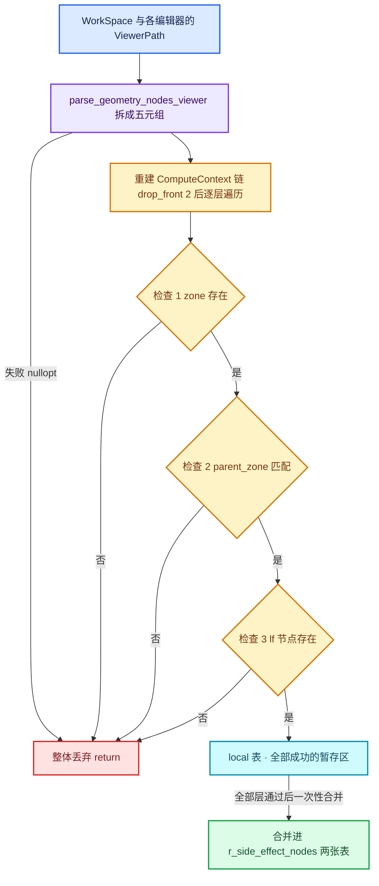

# 02 · Viewer 与 ViewerPath

[前置知识总入口](../README.md) · [本章导航](README.md) · [上一篇](01-日志与NodeTreeLogger.md) · [下一篇](03-depsgraph求值模型.md)

> 基准：Blender `5.4.0-alpha`，本地工作树。本篇讲 Viewer 的定位机制——用户挂在循环体内的 Viewer，系统怎么知道它是"第几轮的"？主要源码：[`DNA_viewer_path_types.h`](../../../source/blender/makesdna/DNA_viewer_path_types.h)、[`MOD_nodes.cc`](../../../source/blender/modifiers/intern/MOD_nodes.cc)（总行数 2210，viewer path 解析在 L429-L656）。

## 先回答一个具体问题

用户把 Viewer 拖进 Repeat 循环体，把 Repeat Output 上的 `inspection_index` 改成 2，界面就显示第 2 轮的值。系统怎么知道要算第 2 轮？

一个常见但不完整的答案："因为 `inspection_index` 进了 ComputeContext。"只说对一半——那份上下文是**编辑器侧**造的，它的唯一产物是一条 **`ViewerPath`**。求值侧（`MOD_nodes.cc`）拿到的是 path，不是编辑器那个上下文对象。path 里带着 `iteration = 2` 这个整数，求值侧再拿它重建一条自己的上下文链，顺手在两张副作用表里写下"第 2 轮请执行"。

完整链条四步：

1. 编辑器读 `inspection_index`，造上下文链，转成 `ViewerPath` 存进 `WorkSpace.viewer_path`（同步到 3D 视图与电子表格）；
2. 求值前，`find_side_effect_nodes` 扫所有 path，逐层解析；
3. 解析成功就把结果写进 `GeoNodesSideEffectNodes` 的两张表（Repeat 写的是**迭代号集合**）；
4. 执行期 `SideEffectProvider` 按当前上下文哈希查表，把"迭代号"翻回"本轮的 body lf 节点"，强制调度。

**path 是意图，表是契约，provider 是兑现。** 三者串起来，第 2 轮才会真的跑。

## ViewerPath 是什么

定义短得几乎不像个数据结构（`DNA_viewer_path_types.h` L96-L98，文件共 100 行）：

```cpp
struct ViewerPath {
  ListBaseT<ViewerPathElem> path = {nullptr, nullptr};
};
```

`[讲解]` 就是一个双向链表。链元素 `ViewerPathElem`（L31-L36）四个字段：

| 字段 | 作用 |
| --- | --- |
| `next` / `prev` | 链表指针，可按顺序遍历 |
| `type` | 判别式（discriminant），决定后面 `reinterpret_cast` 成哪个派生结构 |
| `_pad[4]` | 手工对齐填充：`ViewerPathElemType` 是 4 字节 `int`，后跟 8 字节指针，DNA 要求显式补齐，否则不同编译配置下结构体大小会漂 |
| `ui_name` | **给人看的**名字，不参与身份判定 |

`[讲解]` 这是 DNA 结构，意味着 path 会被**写进 .blend**。两条约束随之而来：第一，path 里不能存裸指针当身份（除两处显式声明为弱链接的 ID 指针），必须存 `modifier_uid`、`node_id` 这类持久标识符；第二，path 必须能表达"用户在哪个编辑器的哪个节点上开了 Viewer"，而不只是"哪个节点组里的哪个 Viewer"。

`[讲解]` 为什么存整条路径，`BKE_viewer_path.hh` L11-L27 说得很清楚：

> The entire path is necessary (instead of just the combination of node group and viewer name), because the same node group may be used in many different places.

同一个节点组可能被用在很多地方——被两个修改器引用、被 group 节点嵌套两次、被不同对象各自引用。只记"节点组 + Viewer 节点 id"会歧义：到底是哪一次实例化？从根开始写才有唯一解。

`[讲解]` 骨架固定，`BKE_viewer_path.hh` L15-L20 直接给了答案：`[0]` 是 `ID`（对象，必须 `ID_OB`）、`[1]` 是 `MODIFIER`（按 `persistent_uid`）、`[2..n-1]` 是结构元素（`GROUP_NODE` / 各类 zone / `EVALUATE_CLOSURE`，可 0 个或多个）、`[n]` 是 `VIEWER_NODE`（终点）。


`[讲解]` 最该注意的是倒数第二个元素：`REPEAT_ZONE` 带 `iteration`，**"第几轮"就藏在这个整数里**。它不在 ComputeContext 里，也不在副作用表里——它是 path 的一部分，是用户意图的字面记录。

## ViewerPathElem 的类型

八种类型，枚举在 `DNA_viewer_path_types.h` L20-L29。`ViewerPathElemType` 显式写 `int` 基类型、每个枚举值写显式数字——这是 DNA 兼容性要求，值一旦发布就不能改。

| 枚举 | 值 | 派生结构 | 携带的身份信息 | 在 `node_path` 里 |
| --- | --- | --- | --- | --- |
| `VIEWER_PATH_ELEM_TYPE_ID` | 0 | `IDViewerPathElem` | `ID *id` | 否（第 0 位） |
| `VIEWER_PATH_ELEM_TYPE_MODIFIER` | 1 | `ModifierViewerPathElem` | `int modifier_uid` | 否（第 1 位） |
| `VIEWER_PATH_ELEM_TYPE_GROUP_NODE` | 2 | `GroupNodeViewerPathElem` | `int32_t node_id` | 是 |
| `VIEWER_PATH_ELEM_TYPE_SIMULATION_ZONE` | 3 | `SimulationZoneViewerPathElem` | `int32_t sim_output_node_id` | 是 |
| `VIEWER_PATH_ELEM_TYPE_VIEWER_NODE` | 4 | `ViewerNodeViewerPathElem` | `int32_t node_id` | 否（末位） |
| `VIEWER_PATH_ELEM_TYPE_REPEAT_ZONE` | 5 | `RepeatZoneViewerPathElem` | `int repeat_output_node_id` + `int iteration` | 是 |
| `VIEWER_PATH_ELEM_TYPE_FOREACH_GEOMETRY_ELEMENT_ZONE` | 6 | `ForeachGeometryElementZoneViewerPathElem` | `int zone_output_node_id` + `int index` | 是 |
| `VIEWER_PATH_ELEM_TYPE_EVALUATE_CLOSURE` | 7 | `EvaluateClosureNodeViewerPathElem` | `evaluate_node_id` + `source_output_node_id` + `bNodeTree *source_node_tree` | 是 |

`[讲解]` 三种类型最值得看：

**MODIFIER（L43-L48）** 存 `modifier_uid`，注释明写"`#ModifierData.persistent_uid`"。为什么不用名字或索引？索引随上下移动变、名字随重命名变，而 `persistent_uid` 在修改器重排、复制、撤销重做之后依然稳定——这是"跨会话可存"的最低要求。

**REPEAT_ZONE（L64-L69）** 存 `repeat_output_node_id` **和** `iteration`，两个都不可少：前者定位是哪个 Repeat zone（同一棵树可能有多个），后者定位第几轮。注意 `iteration` 是 `int` 而非 `int32_t`，与邻居风格不一致，纯历史原因。

**FOREACH_GEOMETRY_ELEMENT_ZONE（L71-L76）** 存 `zone_output_node_id` 和 `index`。注意全名——它**不叫** `..._GEOMETRY`，语义是"对每个几何元素"，`index` 是元素序号而非迭代号。两者共用同一张表，含义不同。

`[讲解]` 剩下几种：`ID`（L38-L41）只存 `ID *id`，是 path 的锚，在 `BKE_viewer_path_foreach_id`（`viewer_path.cc` L146-L171）里登记为 `IDWALK_CB_DIRECT_WEAK_LINK`——**弱链接**，path 不会让对象保活；对象删了 path 还在，只是解析时第一步就返回空。`GROUP_NODE`（L50-L55）存组节点在**父树**里的 identifier，不带"指向哪个节点组"的信息——那要靠解析时现场查 `node->id`，于是 group 换了指向会解析到另一棵树上去，这是"路径跟随节点"的自然语义。`SIMULATION_ZONE`（L57-L62）**只存输出节点 id，没有 iteration 也没有 index**，因为一次求值里仿真只有一个实例。`EVALUATE_CLOSURE`（L85-L94）三字段，注释 "The node tree that contains the closure zone that is evaluated" 提示：closure 的**定义位置**和**求值位置**常常不在同一棵树，必须额外记定义树；它是唯一带裸 `bNodeTree *` 的元素，同样登记为弱链接（L155-L159）。

`[讲解]` 八种元素可以分成两类：**值语义**（只带标识符，表示"在哪个节点"）与**计数语义**（标识符 + 计数，表示"在哪个节点的第几个实例"）。path 解析的全部难度都集中在后两种——它们是唯一需要和运行时对账的类型。

## 解析流程：从 path 到副作用表

解析分两段，第一段在编辑器侧，第二段在求值侧。

**第一段：把 path 拆成结构化五元组**（`ed_viewer_path.cc` L227-L281），返回 `std::optional<ViewerPathForGeometryNodesViewer>`（[`ED_viewer_path.hh`](../../../source/blender/editors/include/ED_viewer_path.hh) L49-L56）：

```cpp
struct ViewerPathForGeometryNodesViewer {
  Object *object;
  /** #ModifierData.persistent_uid. */
  int modifier_uid;
  /** Contains only group node and simulation zone elements. */
  Vector<const ViewerPathElem *> node_path;
  int32_t viewer_node_id;
};
```

`[讲解]` 注意 `node_path` 的注释——"只包含 group node 和 simulation zone 元素"。这条注释是**过期的**：`parse_geometry_nodes_viewer` 现在在 L262-L273 显式放行五种类型（`GROUP_NODE`、`SIMULATION_ZONE`、`REPEAT_ZONE`、`FOREACH_GEOMETRY_ELEMENT_ZONE`、`EVALUATE_CLOSURE`），其他类型直接 `nullopt`。这类"注释落后于代码"要当常态：**以 `ELEM(...)` 列表为准**。

`[讲解]` 前置检查也很硬（L235-L256）：元素总数 `< 3` 就失败（注释："Need at least the object, modifier and viewer node name"）；`[0]` 必须是 `ID` 且非空且 `GS(name) == ID_OB`；`[1]` 必须是 `MODIFIER`；末位必须是 `VIEWER_NODE`。

**第二段：把结构化 path 转成副作用表**（`MOD_nodes.cc` L658-L690 调用 L434-L656）。入口先把 `node_path` 逐层灌回上下文：

```cpp
bke::ComputeContextCache compute_context_cache;
const ComputeContext *object_context = &compute_context_cache.for_data_block(
    nullptr, parsed_path->object->id);
const ComputeContext *current = &compute_context_cache.for_geometry_nodes_modifier(
    object_context, nmd);
for (const ViewerPathElem *elem : parsed_path->node_path) {
  current = ed::viewer_path::compute_context_for_viewer_path_elem(
      *elem, compute_context_cache, current);
  if (!current) {
    return;
  }
}
try_add_side_effect_node(ctx, *current, parsed_path->viewer_node_id, nmd, r_side_effect_nodes);
```

`[讲解]` 这里有件容易被忽略的事：**求值侧先重建了一条 ComputeContext 链**。Repeat 元素那一条（`ed_viewer_path.cc` L552-L556）就是 `for_repeat_zone(parent, repeat_output_node_id, iteration)`——**path 里的 `iteration` 整数在这一步被灌回上下文**。

`[讲解]` 编辑器造上下文 → 压平成 path → 求值侧读 path → 重建上下文。绕这一圈不是浪费：path 可以写进 .blend、跨进程、跨 depsgraph 复制，而上下文对象只能活在一次会话的内存里。

`try_add_side_effect_node` 先把上下文链展开成向量并**反序**（L444-L448），让下标从根往上数：

```cpp
Vector<const ComputeContext *> compute_context_vec;
for (const ComputeContext *c = &final_compute_context; c; c = c->parent()) {
  compute_context_vec.append(c);
}
std::reverse(compute_context_vec.begin(), compute_context_vec.end());
```

`[讲解]` 于是 `[0]` 是对象、`[1]` 是修改器、`[2]` 起是结构元素。L450-L457 立刻校验 `[1]` 的 `modifier_uid` 是否等于 `nmd.modifier.persistent_uid`——这是第一道身份对账。前面入口已按 `modifier_uid` 过滤过一次，这里再做一次，因为 `try_add_side_effect_node` 是**三个调用者共用**的函数（viewer path、bake、gizmo），每个调用者自己保证不了。

主循环只有一行关键（L466）：`drop_front(2)`——跳过对象和修改器，只遍历结构元素。循环开头准备三个共享物（L468-L478）：当前树的 `zones()`、lf 图映射 `ensure_geometry_nodes_lazy_function_graph(*current_tree)`、以及 `compute_context_generic->parent()->hash()`。两个游标 `current_tree` / `current_zone`（L459-L460）初始为 `nmd.node_group` 和 `nullptr`，每处理一层就跟着往里走：group 元素换树并把 zone 归零，zone 元素换 zone、树不变。

以 Repeat 分支为例（L509-L530），**三个检查**依次是：

```cpp
const bke::bNodeTreeZone *repeat_zone = current_zones->get_zone_by_node(
    compute_context->output_node_id());
if (repeat_zone == nullptr) {                       // 检查 1：zone 还存在吗
  return;
}
if (repeat_zone->parent_zone != current_zone) {     // 检查 2：嵌套关系对得上吗
  return;
}
const lf::FunctionNode *lf_zone_node = lf_graph_info->mapping.zone_node_map.lookup_default(
    *repeat_zone->output_node_id, nullptr);
if (lf_zone_node == nullptr) {                      // 检查 3：lf 图里有对应节点吗
  return;
}
```

| 检查 | 问什么 | 失败含义 |
| --- | --- | --- |
| 1 · zone 存在 | `get_zone_by_node(output_node_id)` 非空 | path 里的 Repeat Output 已被删，或 identifier 改了 |
| 2 · parent_zone 匹配 | `zone->parent_zone == current_zone` | 嵌套关系变了：zone 被拖出/拖进另一层，path 层级与现状不符 |
| 3 · lf 节点存在 | `zone_node_map` 有该 output 节点 | lf 图没为这个 zone 建包装节点（被静音、图未构建、类型不支持） |

`[讲解]` 检查 2 最容易被低估。[`BKE_node_tree_zones.hh`](../../../source/blender/blenkernel/BKE_node_tree_zones.hh) L57-L111 的 `bNodeTreeZones` 维护 zone 树形结构，`bNodeTreeZone::parent_zone` 指向直接父 zone（顶层为 `nullptr`）。游标 `current_zone` 记录"按 path 走到这一层时我应该处在哪个 zone 内"。两者相等，才说明 path 的**每一层嵌套**都和当前文件状态吻合。只查"zone 存在"的话，把 Repeat zone 从 group 内部拖到外部后 path 依然能解析成功——只是解析到错误位置，副作用登记到错误上下文里。检查 2 就是防这个。

`[讲解]` 三检查全过才登记，Repeat 登记**两处**（L525-L528）：

```cpp
local_side_effect_nodes.nodes_by_context.add(parent_compute_context_hash, lf_zone_node);
local_side_effect_nodes.iterations_by_iteration_zone.add(
    {parent_compute_context_hash, compute_context->output_node_id()},
    compute_context->iteration());
```

`[讲解]` 第一处是"zone 包装节点本身要执行"，Key 是 **`parent_compute_context_hash`**（zone 外面那一层），因为包装节点在父上下文里被调度。第二处才是"第 `iteration` 轮的循环体要执行"，Key 是 `{父哈希, output_node_id}`。

`[讲解]` 其余四个分支同形：Simulation（L479-L508）登记 zone 节点 + 仿真输出节点（后者用**自己**的哈希）；Foreach（L531-L553）与 Repeat 几乎一样，只把 `iteration()` 换成 `index()`；Group（L554-L578）多两个检查（`group_node->id` 非空、未静音）并切换 `current_tree`；EvaluateClosure（L579-L621）最重，还要跨树做 `DEG_get_evaluated_id` 拿求值版节点组。

循环结束后处理终点（L626-L647）：`node_by_id(final_node_id)` 命中、`get_zone_by_node(final_node_id) == current_zone`、`possible_side_effect_node_map` 命中，然后：

```cpp
local_side_effect_nodes.nodes_by_context.add(final_compute_context.hash(), lf_node);
```

`[讲解]` 终点用 `possible_side_effect_node_map` 而不是 `zone_node_map`——Viewer / Bake / Gizmo 这类"可能带副作用的普通节点"登记在那张表。最后一行是全篇最精妙处之一：**Viewer 登记在 `final_compute_context.hash()` 下**，即第 `iteration` 轮那条哈希。执行期只有当真的进入这一轮、`GeoNodesUserData.compute_context` 换成该哈希时，这次查表才命中。

<details> <summary>核对原始源码：MOD_nodes.cc · L462-L470、L509-L530、L649-L656</summary>

```cpp
  /* Write side effect nodes to a new map and only if everything succeeds, move the nodes to the
   * caller. This is easier than changing r_side_effect_nodes directly and then undoing changes in
   * case of errors. */
  nodes::GeoNodesSideEffectNodes local_side_effect_nodes;
  for (const ComputeContext *compute_context_generic : compute_context_vec.as_span().drop_front(2))
  {
    /* ... */
    else if (const auto *compute_context = dynamic_cast<const bke::RepeatZoneComputeContext *>(
                 compute_context_generic))
    {
      const bke::bNodeTreeZone *repeat_zone = current_zones->get_zone_by_node(
          compute_context->output_node_id());
      if (repeat_zone == nullptr) {
        return;
      }
      if (repeat_zone->parent_zone != current_zone) {
        return;
      }
      const lf::FunctionNode *lf_zone_node = lf_graph_info->mapping.zone_node_map.lookup_default(
          *repeat_zone->output_node_id, nullptr);
      if (lf_zone_node == nullptr) {
        return;
      }
      local_side_effect_nodes.nodes_by_context.add(parent_compute_context_hash, lf_zone_node);
      local_side_effect_nodes.iterations_by_iteration_zone.add(
          {parent_compute_context_hash, compute_context->output_node_id()},
          compute_context->iteration());
      current_zone = repeat_zone;
    }
    /* ... */
  }

  /* Successfully found all side effect nodes for the viewer path. */
  for (const auto item : local_side_effect_nodes.nodes_by_context.items()) {
    r_side_effect_nodes.nodes_by_context.add_multiple(item.key, item.value);
  }
  for (const auto item : local_side_effect_nodes.iterations_by_iteration_zone.items()) {
    r_side_effect_nodes.iterations_by_iteration_zone.add_multiple(item.key, item.value);
  }
```

</details>

`[讲解]` 调用点只有一个（L1801-L1803），就在 `modifyGeometry` 里、真正跑惰性图之前：`find_side_effect_nodes(*nmd, *ctx, side_effect_nodes, verbose_log_contexts);` 然后 `call_data.side_effect_nodes = &side_effect_nodes;`。而 `find_side_effect_nodes`（L795-L829）遍历**窗口管理器里的所有 path**：工作区的 `workspace->viewer_path`，加每个区域里 `SpaceSpreadsheet` 与 `View3D` 的（L805-L824）。这解释了一个日常现象：3D 视图和电子表格看同一条 path 不冲突；但两者 pin 在不同迭代上时，各自贡献一条 path，表里就各有各的迭代号。



## all-or-nothing 语义

`try_add_side_effect_node` 每个失败分支都是裸 `return;`，一个字节都不写进 `r_side_effect_nodes`。语义靠 `local_side_effect_nodes` 实现，源码注释（L462-L464）把动机写得很坦白：

> Write side effect nodes to a new map and only if everything succeeds, move the nodes to the caller. This is easier than changing r_side_effect_nodes directly and then undoing changes in case of errors.

`[讲解]` 为什么必须这样？三个理由，从浅到深。

**撤销比重做贵。** `MultiValueMap::add_multiple` 是追加语义（[`BLI_multi_value_map.hh`](../../../source/blender/blenlib/BLI_multi_value_map.hh) L73-L85：`vector.extend(values)`），写进去就分不清哪条是"这次失败之前写的"。要撤销得自己记账——不如一开始就写副本。

**半条路径本身就是错的。** 设 path 是 `组A → Repeat → 组B → Viewer`，解析到 Repeat 成功、到组B 时发现组B已被删。此时 local 表里已有"组A 要执行"和"Repeat 第 k 轮要执行"。直接合并的话，执行器会**真的去跑组A 和 Repeat 第 k 轮**——全量求值一遍而结果没人用。更糟的是，若这个 Viewer 是用户唯一的求值动机，"跑了一堆但什么也没显示"比"什么都没跑"更难排查。

**路径是不可分割的断言。** 一条 viewer path 的语义是"从对象到 Viewer 这条链**完整**存在"。任一层断了，断言为假，而不是"部分真"。逻辑上它是合取（AND）不是析取（OR），结果只能全有或全无。

`[讲解]` 代价也要说清：每次求值都重新解析（`find_side_effect_nodes` 在 `modifyGeometry` 里被无条件调用，所有窗口所有 path 都解析一遍，没有缓存也没有短路）；两条 `add_multiple` 循环（L650-L655）会把整份键值对**深拷贝**进 `r_side_effect_nodes`，是复制而非转移。在 path 深 3~5 层、表里几个条目的量级下不值一提，但要知道它在。

`[讲解]` 一个易误读点：`nodes_by_context` 用 `MultiValueMap`，同一 `ComputeContextHash` 下可以有多个 `lf::FunctionNode *`。不是为了存多个 Viewer，而是因为一次解析可能在**同一层**写下两个节点——Simulation 分支就同时写 zone 节点（父哈希下）和仿真输出节点（自身哈希下）。

## 为什么需要 SideEffectProvider

副作用表只是数据，得有人消费。消费点是一个纯虚接口（[`FN_lazy_function_graph_executor.hh`](../../../source/blender/functions/FN_lazy_function_graph_executor.hh) L67-L70，文件 155 行）：

```cpp
class GraphExecutorSideEffectProvider {
 public:
  virtual ~GraphExecutorSideEffectProvider() = default;
  virtual Vector<const FunctionNode *> get_nodes_with_side_effects(const Context &context) const;
};
```

`[讲解]` 为什么不能在**建图时**定死"哪些节点有副作用"？因为 lf 图是按节点树缓存的（`ensure_geometry_nodes_lazy_function_graph(*current_tree)`，L472-L473），一棵树只建一次；而"哪个 Viewer 现在被激活"随用户点击变化、每次求值都可能不同。图是静态的（缓存的），意图是动态的（每次求值重算），两者只能通过 `GeoNodesCallData::side_effect_nodes` 这个指针在求值时接头（`NOD_geometry_nodes_lazy_function.hh` L233-L236）。

`[讲解]` 消费点的形状值得注意：provider 拿到的不是"表"，而是 `lf::Context`。表是全局的（一次求值一份），`Context` 才是"我现在在哪"。所以 provider 的标准动作永远是三步：取当前上下文哈希 → 查表 → 返回本层该强制的节点。

最干净的例子是 Viewer 自己的 usage 判定（[`geometry_nodes_lazy_function.cc`](../../../source/blender/nodes/intern/geometry_nodes_lazy_function.cc) L903-L917）：

```cpp
const ComputeContextHash &context_hash = user_data->compute_context->hash();
const Span<const lf::FunctionNode *> nodes_with_side_effects =
    user_data->call_data->side_effect_nodes->nodes_by_context.lookup(context_hash);

const bool viewer_is_used = nodes_with_side_effects.contains(&lf_viewer_node_);
params.set_output(0, viewer_is_used);
```

`[讲解]` 这个 `LazyFunctionForViewerInputUsage` 产出一个布尔，语义是"我这个 Viewer 现在有人要吗"。true 则 Viewer 输入变 `Used`，上游整条链被拉起来算值。它查的是 `context_hash`——**当前执行位置的哈希**。这一行就是"第 3 轮的值"能被找到的最后一道关：只有执行流真在那条哈希下，`contains` 才为真。

`[讲解]` 而 Repeat 有自己的一层 provider（[`geometry_nodes_repeat_zone.cc`](../../../source/blender/nodes/intern/geometry_nodes_repeat_zone.cc) L70-L96，文件 432 行），因为它面对的问题不同：Viewer 是"我这个节点要不要跑"，Repeat 是"我这 N 个 body 实例里哪几个要跑"。

## Repeat 的特殊之处

Repeat 需要第二张表，是因为**一个 zone 对应图上 N 个 body 节点实例**。lf 图里 body 函数被 `add_function` 了 `iterations` 次（`geometry_nodes_repeat_zone.cc` L247-L252），执行期用 `lf_body_nodes` 这个 `VectorSet` 保序记录。于是"第 3 轮的 Viewer 有副作用"没法用节点指针表达——写 `nodes_by_context[hash] += body_fn` 等于声明**所有轮**都有副作用。

所以这里存**迭代号整数**，由 zone 自己执行期翻译（L75-L95）：

```cpp
const ComputeContextHash &context_hash = user_data.compute_context->hash();
const Span<int> iterations_with_side_effects =
    call_data.side_effect_nodes->iterations_by_iteration_zone.lookup(
        {context_hash, repeat_output_bnode_->identifier});

Vector<const lf::FunctionNode *> lf_nodes;
for (const int i : iterations_with_side_effects) {
  if (i >= 0 && i < lf_body_nodes_.size()) {
    lf_nodes.append(lf_body_nodes_[i]);
  }
}
return lf_nodes;
```

`[讲解]` 三行藏三件事：

- **Key 的构成**：`{context_hash, repeat_output_bnode_->identifier}`。哈希取 `user_data.compute_context->hash()`——provider 在执行 Repeat 包装节点时被调用，此时 `compute_context` 是 **zone 外面那一层**，因为包装节点属于父层。这正好对上 MOD_nodes 的 `parent_compute_context_hash`。
- **值是集合**：`lookup` 返回 `Span<int>`（`BLI_multi_value_map.hh` L90-L101），可以是 `{1, 3, 7}`——三处 Viewer 各看一轮，或多个编辑器各贡献一条 path。
- **边界检查**：`i >= 0 && i < lf_body_nodes_.size()`。path 里的迭代号可能陈旧（用户后来把 `Iterations` 从 10 改成 2），越界值在这里静默跳过，不会崩。

现在回答本节标题：**为什么键不是 ViewerPath 本身？**

`[讲解]` 一是 path 是**链表**不是值类型，没法做哈希键（`BKE_viewer_path_hash` L66-L74 确实能算哈希，但那是判断"两个 path 相不相同"用的，不是索引运行时表的）。二是同一个 zone 可能被多条 path 指向（3D 视图一条、电子表格一条、bake 一条），用 path 做键会让"第 1 轮"和"第 1 轮"变成两个键。三是最关键的：**这张表是执行期要查的，执行期手里只有 ComputeContextHash，从来没有 path**。表结构必须服从消费者接口，而不是生产者输入形态。

`[讲解]` 用 `(父哈希, output_node_id)` 做键恰好满足三个要求：

| 要求 | 为什么满足 |
| --- | --- |
| 同一 zone 的所有轮次共用一个键 | 父哈希对 N 轮是同一个值，迭代号只出现在**值**里 |
| 区分同一棵树的两个 Repeat zone | `output_node_id` 不同 |
| 区分同一棵树被嵌套在两处 | 父哈希不同（哈希已含整条祖先链，见 `BLI_compute_context.hh` L11-L35） |

`[讲解]` 补充一句：`output_node_id` 是 `bNode::identifier`（`int32_t`），不是节点指针也不是数组下标。identifier 同树内唯一、跨会话稳定、永不复用；节点指针会被 lf 图重建和求值版替换，做不了持久键；数组下标会被增删节点打乱。

## 与其他 zone 的对比

三种 zone 处理方式不同，根源是**"一个 zone 对应多少个执行实例"**：

| zone 类型 | 写 `nodes_by_context` | 写 `iterations_by_iteration_zone` | 计数 | 为什么 |
| --- | --- | --- | --- | --- |
| Simulation | 两处：zone 节点（父哈希）、仿真输出节点（自身哈希） | **不写** | 无 | 一次求值只有一个实例（跨帧状态在别处管），"哪一轮"不存在 |
| Repeat | 一处：zone 节点（父哈希） | 写，值 = `iteration()` | 迭代号 | N 个 body 实例图上展开，必须逐轮选 |
| Foreach Geometry Element | 一处：zone 节点（父哈希） | 写，值 = `index()` | 元素序号 | 同上，但计数语义是"第几个元素" |

`[讲解]` 三者共用同一张表（`NOD_geometry_nodes_lazy_function.hh` L149-L156）：

```cpp
struct GeoNodesSideEffectNodes {
  MultiValueMap<ComputeContextHash, const lf::FunctionNode *> nodes_by_context;
  /**
   * The repeat/foreach zone is identified by the compute context of the parent and the identifier
   * of the repeat output node.
   */
  MultiValueMap<std::pair<ComputeContextHash, int32_t>, int> iterations_by_iteration_zone;
};
```

`[讲解]` 注释只说 repeat/foreach，字段名也只提 iteration——但 Foreach 存的是 `index`（`MOD_nodes.cc` L549-L551），它的 provider 也用同样方式查（[`geometry_nodes_foreach_geometry_element_zone.cc`](../../../source/blender/nodes/intern/geometry_nodes_foreach_geometry_element_zone.cc) L192-L203）。这是"字段名比语义窄"的典型：表名叫 `iterations_...`，实际是"循环实例号"的通用表。只信名字会以为 Foreach 走了另一条路。

`[讲解]` 对比 Simulation 的第二处登记，它揭示了另一种思路（L501-L505）：先 `nodes_by_context.add(parent_compute_context_hash, lf_zone_node)`，再 `nodes_by_context.add(compute_context_generic->hash(), lf_simulation_output_node)`，注释是"By making the simulation output node a side-effect-node, we can ensure that the simulation runs when it contains an active viewer"。Simulation 没有"选第几轮"的需求，把"保证仿真真跑一轮"直接表达成"把仿真输出标成副作用节点"就够了。这个更简单的机制能成立，恰恰因为实例数是 1；一旦实例数是 N 且 N 在运行时才知道（Repeat 的 `Iterations` 从数据口进来），就没法建表时逐个列出——只剩两个选择：列出 0..N-1（要先知道 N，做不到），或存计数让执行期翻译（现在的做法）。

## 用小数据走一遍

**场景**：对象 `Cube` 挂修改器 `GeometryNodes`（`persistent_uid = 7`），节点组 `GN_Main` 里有一个 Group 节点 `Sub`（`identifier = 42`，指向 `GN_Sub`）。`GN_Sub` 里有一个 Repeat 区域，Repeat Output 节点 `identifier = 88`、`inspection_index = 1`。循环体内有 Viewer 节点 `identifier = 123`，用户在节点编辑器里激活了它。

**第 1 步：编辑器造 path。** `activate_geometry_node`（`ed_viewer_path.cc` L143-L206）调 `viewer_path_for_geometry_node`（L111-L141），后者从 `compute_context_for_edittree_node` 拿到节点上下文，沿 `parent()` 向上，对每层调 `viewer_path_elem_for_compute_context` 造元素、`BLI_addhead` 头插（所以最终顺序从根到叶），最后 `BLI_addtail` 补 `VIEWER_NODE`。Repeat 那层（L78-L84）就是这样把 `iteration` 写进去的：

```cpp
RepeatZoneViewerPathElem *elem = BKE_viewer_path_elem_new_repeat_zone();
elem->repeat_output_node_id = context->output_node_id();
elem->iteration = context->iteration();
```

`[讲解]` 而 `context->iteration()` 的来源是 `space_node.cc` L462-L466：`for_repeat_zone(parent_compute_context, output_node, storage.inspection_index)`。**这就是"改 `inspection_index` 就换轮次"的全部机制**：`inspection_index` 被当成构造 Repeat 上下文的 `iteration` 参数 → 上下文哈希变了 → path 的 `iteration` 字段变了 → 表里的整数变了 → provider 选中另一个 body 节点。没有任何"查询"动作，只有"身份不同"。

**第 2 步：得到 5 个元素**（满足 `>= 3`）：`[0]` `ID`(Cube)、`[1]` `MODIFIER`(7)、`[2]` `GROUP_NODE`(42)、`[3]` `REPEAT_ZONE`(88, 1)、`[4]` `VIEWER_NODE`(123)。

**第 3 步：`parse_geometry_nodes_viewer` 拆解**——总数 5 > 3；`[0]` 是 `ID` 且指向 `OB`；`[1]` 是 `MODIFIER`，`modifier_uid = 7`；`drop_back(1)` 得下标 2..3，两个都是允许类型，`node_path = [GROUP_NODE(42), REPEAT_ZONE(88, 1)]`；末位 `VIEWER_NODE`，`viewer_node_id = 123`。

**第 4 步：重建上下文链**（哈希记符号名）：

| 位置 | 上下文类型 | 哈希 |
| --- | --- | --- |
| 0 | `DataBlockComputeContext`（Cube） | H_db |
| 1 | `GeometryNodesModifierComputeContext`（uid 7） | H_mod |
| 2 | `GroupNodeComputeContext`（node 42） | H_grp |
| 3 | `RepeatZoneComputeContext`（output 88, iteration 1） | H_rep1 |

`[讲解]` 哈希本身是链式的（`BLI_compute_context.hh` L144-L151）：`H_grp = hash(H_mod, "NODE", 42)`，`H_rep1 = hash(H_grp, "REPEAT_ZONE", 88, 1)`。祖先任一层变了 `H_rep1` 就自动不同——不需要额外版本号。

**第 5~8 步：`try_add_side_effect_node` 逐层。** 反序后 `compute_context_vec = [H_db, H_mod, H_grp, H_rep1]`，`[1]` 的 uid 是 7 通过。`drop_front(2)` 后遍历 `[H_grp, H_rep1]`，游标初始 `current_tree = GN_Main`、`current_zone = nullptr`。

- 处理 `H_grp`（Group 分支）：`GN_Main` 里 `node_by_id(42)` 命中；`id` 非空（指向 `GN_Sub`）；未静音；`current_zone(nullptr) == GN_Main.zones()->get_zone_by_node(42)`（顶层 group 不在任何 zone 内，返回 `nullptr`）→ 通过；`group_node_map[42]` 命中 `lf_group_sub`。登记 `nodes_by_context[H_mod] += lf_group_sub`。游标推进：`current_tree = GN_Sub`、`current_zone = nullptr`。
- 处理 `H_rep1`（Repeat 分支）：`GN_Sub` 里 `get_zone_by_node(88)` 命中；`parent_zone(nullptr) == current_zone(nullptr)` 通过；`zone_node_map[88]` 命中 `lf_repeat_zone`。登记 `nodes_by_context[H_grp] += lf_repeat_zone`，`iterations_by_iteration_zone[{H_grp, 88}] += 1`。游标：`current_zone = repeat_zone`，树仍是 `GN_Sub`。
- 终点：`node_by_id(123)` 命中 Viewer；`get_zone_by_node(123)` 返回 repeat zone，等于 `current_zone` → 通过；`possible_side_effect_node_map[123]` 命中 `lf_viewer_123`。登记 `nodes_by_context[H_rep1] += lf_viewer_123`。

**第 9 步：合并后的最终表**：

| 表 | 键 | 值 |
| --- | --- | --- |
| `nodes_by_context` | `H_mod` | `[lf_group_sub]` |
| `nodes_by_context` | `H_grp` | `[lf_repeat_zone]` |
| `nodes_by_context` | `H_rep1` | `[lf_viewer_123]` |
| `iterations_by_iteration_zone` | `{H_grp, 88}` | `[1]` |

**第 10 步：执行期怎么用。** (1) 在 `GN_Main` 图里哈希是 `H_mod`，查得 `lf_group_sub`，group 节点被强制调度，即使输出没人要。(2) 进 `GN_Sub` 哈希是 `H_grp`，查得 `lf_repeat_zone`，Repeat 包装节点被强制调度。(3) Repeat provider 执行时 `compute_context->hash()` 是 `H_grp`，查 `iterations_by_iteration_zone[{H_grp, 88}]` 得 `[1]`，取 `lf_body_nodes[1]`，第 1 轮 body 被强制调度。(4) body 执行时 `RepeatBodyNodeExecuteWrapper`（L40-L64）为这一轮构造 `RepeatZoneComputeContext{父, *repeat_output_bnode_, 1}`，哈希正是 `H_rep1`；Viewer 的 `LazyFunctionForViewerInputUsage` 查 `nodes_by_context[H_rep1]` 命中 → 输出 true → 输入变 `Used` → 值被算出并记进日志。

`[讲解]` 注意第 3 步与第 4 步之间"哈希恰好接上"不是巧合：`RepeatBodyNodeExecuteWrapper` 的 `iteration` 取自 `lf_body_nodes_->index_of_try(...)`（L45），MOD_nodes 写表的 `iteration` 取自上下文、上下文又取自 path、path 又取自 `inspection_index`。**四方共用一个整数**，才能保证 `H_rep1` 两边算出同值。这是 04-02 反复强调"同一套哈希算法"的物质基础。

## 反例与边界

**1. 以为 Viewer 路径等于上下文。** path 是**用户意图**（能写进 .blend、跨会话、带 `ui_name` 给人看、缺 `iteration` 就歧义），上下文是**执行身份**（只在一次求值里活、带哈希、每 body 实例一份、从不落盘）。两者可互相换算（`compute_context_for_viewer_path_elem` L522-L577 正向，`viewer_path_elem_for_compute_context` L42-L109 反向），但换算**不是恒等**：`GroupNodeComputeContext` 可带 `tree_` 指针而 `GroupNodeViewerPathElem` 没这字段；`EvaluateClosureComputeContext` 的 `closure_source_location` 可选，path 对应字段也可能为空。方向转换会丢信息，这是设计使然。

**2. zone 被删后 path 仍存在。** path 存在 `WorkSpace.viewer_path` 里，是 .blend 的一部分；删掉 Repeat zone 不会去清 path。于是检查 1（`get_zone_by_node` 返回 `nullptr`，L512-L516）就 `return`——整条 path 的副作用登记全部丢弃，Viewer 静默失效，**没有任何报错**。要让它可见得靠别的机制：电子表格在 pinned 时调 `exists_geometry_nodes_viewer`（`ed_viewer_path.cc` L283-L412），失败就**清掉 pinning** 回到"显示活动对象"（`space_spreadsheet.cc` L260-L277）。同一个失效场景，电子表格里表现为"pin 掉了"，3D 视图里表现为"什么都不显示"。

**3. 以为"多 Viewer 挂不同轮"会互相覆盖。** 不会，两张表都是 `MultiValueMap`。挂着迭代 1 和 3 两个 Viewer，`iterations_by_iteration_zone[{H_grp, 88}]` 的值是 `[1, 3]`，provider 的循环（L88-L93）返回两个 body 节点，两轮都跑。要小心的是**同一层**两条 path 在合并时是追加（`add_multiple`），不是替换。

**4. 以为 path 解析失败时会登记部分结果。** 恰恰相反，这是 all-or-nothing 的全部意义。任何 `return` 都发生在写 `r_side_effect_nodes` 之前，真正的写入只在 L650-L655。可以放心在任意层失败，不会残留脏条目。

**5. 以为 `iteration` 只影响日志。** 它同时影响（a）上下文哈希、（b）path 相等性（`viewer_path.cc` L383-L389，要置 `VIEWER_PATH_EQUAL_FLAG_IGNORE_ITERATION` 才忽略）、（c）副作用表条目、（d）电子表格树显示的序号（`spreadsheet_dataset_draw.cc` L1062-L1078，`draw_row_suffix(*this, std::to_string(repeat_zone_.iteration))`）。改一个数字，四处联动。

**6. 以为 `ui_name` 参与身份判定。** 不参与。`BKE_viewer_path_elem_equal`（`viewer_path.cc` L345-L406）只在 `VIEWER_PATH_EQUAL_FLAG_CONSIDER_UI_NAME` 置位时才比 `ui_name`（L352-L356）。它是纯显示字段——让 3D 视图路径栏显示"Repeat 3"而不是"Repeat 节点 88"，改 `ui_name` 不会让 path 失效；反过来 `ui_name` 陈旧了也不影响解析，只影响显示。

**7. 以为越界迭代号会报错。** 不会。表里可以存着 `7` 而实际只迭代 2 轮，Repeat provider 用 `i >= 0 && i < lf_body_nodes_.size()` 静默跳过（L89-L92）。唯一提示在另一条路上：Repeat zone 建执行图时（L216-L227）若 `inspection_index >= iterations`，会往 `NodeTreeLogger` 塞一条 `NodeWarningType::Info`，文本 "Inspection index is out of range"——**是 Info 不是 Error**，因为这不是错误状态，只是"你看不到东西"的原因说明。

**8. 以为 path 里的 ID 指针会保活对象。** 不会。`BKE_viewer_path_foreach_id`（`viewer_path.cc` L146-L171）用 `IDWALK_CB_DIRECT_WEAK_LINK` 登记，意思是"我引用了它，但别因为我而保留它"。所以对象可被删、path 变悬空引用；`parse_geometry_nodes_viewer` 对 `root_id` 的判空（L244-L247）和 `id_remap`（L173-L193）就是兜底。

**9. 以为副作用表只在求值开始时读一次。** 表内容确实求值前一次性填好（L1801-L1803），但**读**分散在全过程：每个 group 层读一次、Repeat provider 读一次、每个 Viewer 节点读一次、每个 gizmo 读一次（`geometry_nodes_lazy_function.cc` L921-L931）。所以表必须**稳定、只读**——开跑后不能再改，否则不同层会看到不同世界。

## 对理解 Repeat 的帮助

本篇是正篇 04-02、04-03（合计约 2000 行）的**前置底座**：

| 本篇内容 | 正篇落点 | 具体作用 |
| --- | --- | --- |
| `RepeatZoneViewerPathElem.iteration` | 04-02 ComputeContext与迭代身份 | 正篇说"iteration 是身份成分不是查询参数"，本篇给出**载体**：迭代号先落在 path（`DNA_viewer_path_types.h` L68），再灌进上下文（`ed_viewer_path.cc` L552-L556），最后成为 `REPEAT_ZONE` 哈希的输入（`compute_contexts.cc` L168-L171） |
| `iterations_by_iteration_zone` 的键 `{父哈希, output_node_id}` | 04-03 副作用迭代与按需执行 | 正篇展示这张表，本篇解释**键为什么长这样**：父哈希让 N 轮共享一键，迭代号只出现在值里；`output_node_id` 定位 zone 实例 |
| 三检查 + all-or-nothing | 04-03 的清表时机 | 正篇说"第 6..9 轮可以不跑"依赖"表里只有你选的轮次"。本篇说明表**精确**：只有通过全部检查的 path 才写一条，没写的轮次不会被强制 |
| Repeat provider 的查表 | 04-03 provider 的执行期角色 | L70-L96 的完整实现就是"迭代号 → body 节点"的翻译器，正篇只管引用 |
| `inspection_index` → path 的链路 | 04-01 RepeatEvalStorage与一次求值 / 04-02 | 本篇讲透"改 UI 数字如何变成求值差异"，正篇接着讲这个身份如何影响日志桶与缓存 |
| `LazyFunctionForViewerInputUsage` | 04-03 需求传播 | L903-L917 那 15 行是"Viewer 让上游变 Used"的唯一实现，正篇讲它怎么和串行依赖链配合 |
| `possible_side_effect_node_map` / `zone_node_map` | 03-03 执行图按迭代展开 | 本篇说明这两张映射的存在理由；正篇 03-03 说明 `lf_body_nodes` 怎么填进去 |

`[讲解]` 只能记住一句的话：**"看第 3 轮"在系统里不是一次查询，而是三次写入加一次查表**。三次写入分别发生在 UI→path（`iteration` 字段）、path→上下文（`for_repeat_zone`）、上下文→副作用表（`iterations_by_iteration_zone.add`）；一次查表发生在 provider 里（`lookup({hash, zone_id})`）。中间任何一环把迭代号弄丢，Viewer 就会"看不见"或"看错轮"——这正是 04-02 第 5 个不变量的实际含义。

`[讲解]` 另一条值得带走的判断：**能落盘的东西必须用标识符，能比较的东西必须能哈希**。path 落盘，所以存 `modifier_uid`、`node_id`、`identifier`；上下文参与比较，所以由一个不可变哈希代表。两者的桥就是 `compute_context_for_viewer_path_elem` / `viewer_path_elem_for_compute_context` 这对正反函数——各 60 行上下，却是整个观察体系能闭环的关键接头。

## 实测行数

本篇涉及文件的总行数（口径 `[System.IO.File]::ReadAllLines(path).Count`，含空行与注释）：

| 文件 | 行数 |
| --- | --- |
| `makesdna/DNA_viewer_path_types.h` | 100 |
| `modifiers/intern/MOD_nodes.cc` | 2210 |
| `blenkernel/intern/viewer_path.cc` | 474 |
| `blenkernel/BKE_viewer_path.hh` | 75 |
| `blenkernel/BKE_node_tree_zones.hh` | 122 |
| `blenkernel/intern/compute_contexts.cc` | 444 |
| `blenkernel/BKE_compute_context_cache.hh` | 114 |
| `blenlib/BLI_compute_context.hh` | 174 |
| `blenlib/BLI_multi_value_map.hh` | 189 |
| `editors/util/ed_viewer_path.cc` | 579 |
| `editors/include/ED_viewer_path.hh` | 112 |
| `nodes/NOD_geometry_nodes_lazy_function.hh` | 691 |
| `nodes/intern/geometry_nodes_repeat_zone.cc` | 432 |
| `nodes/intern/geometry_nodes_foreach_geometry_element_zone.cc` | 1274 |
| `functions/FN_lazy_function_graph_executor.hh` | 155 |

`[讲解]` 一个说明：本章 README 把 `MOD_nodes.cc` 记作 2018 行，那是早期快照；当前工作树是 **2210** 行（viewer path 解析段 L429-L656 位置与当时一致，只是文件尾部又长了几段）。行号对不上时按符号名检索——`try_add_side_effect_node`、`iterations_by_iteration_zone`、`parse_geometry_nodes_viewer` 三个名字都没改过。

## 继续阅读

- 上一篇 [01-日志与NodeTreeLogger](01-日志与NodeTreeLogger.md)：Logger 按上下文哈希分桶，"哪一轮的值存在哪"的存储侧答案。
- 下一篇 [03-depsgraph求值模型](03-depsgraph求值模型.md)：path 里 `ID *id` 为什么要 `DEG_get_original`、`DEG_get_evaluated_id` 两个方向都走，depsgraph 的原始/求值二分是前提。
- 本章 [05-lazy_threading调度提示](05-lazy_threading调度提示.md)：Repeat 图建好后首个执行交接里的协作式调度，与 provider 的调度顺序相邻。
- 正篇 [04-02 ComputeContext与迭代身份](../../重复区域-dsh/04-运行时机制/02-ComputeContext与迭代身份.md)：本篇的"身份"部分在那里展开成完整的不变量清单。
- 正篇 [04-03 副作用迭代与按需执行](../../重复区域-dsh/04-运行时机制/03-副作用迭代与按需执行.md)：本篇的"表"部分在那里接上 usage inference 与串行依赖链。
- 正篇 [03-03 执行图按迭代展开](../../重复区域-dsh/03-几何节点执行架构/03-执行图按迭代展开.md)：`lf_body_nodes` 怎么被填出来，本篇的 `index_of_try` 依赖它。
- 工具篇 [12-02 图导出与dot调试](../12-工具与调试/02-图导出与dot调试.md)：`logged_zone_graphs` 让你看到 Repeat 展开后的图，验证 provider 选中的到底是哪个 body 节点。
