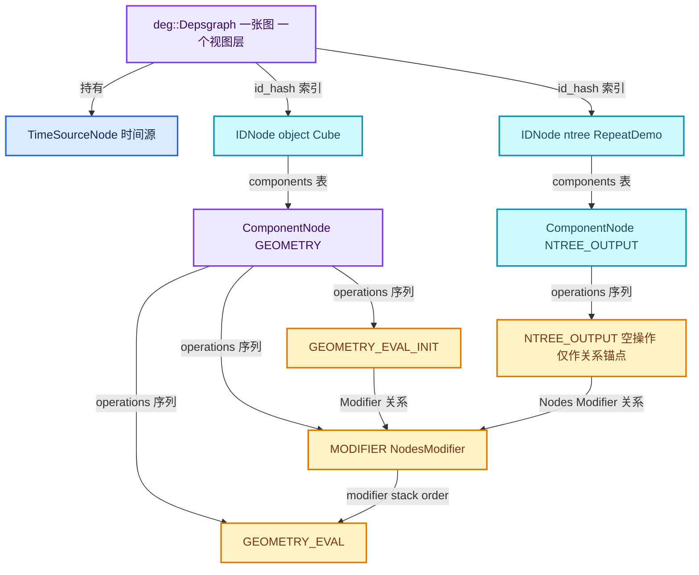
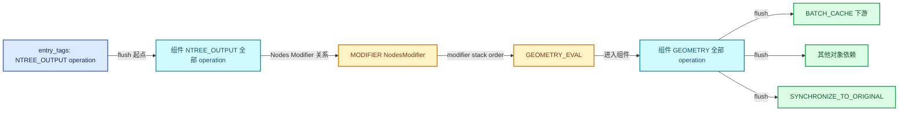
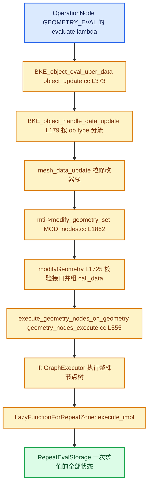
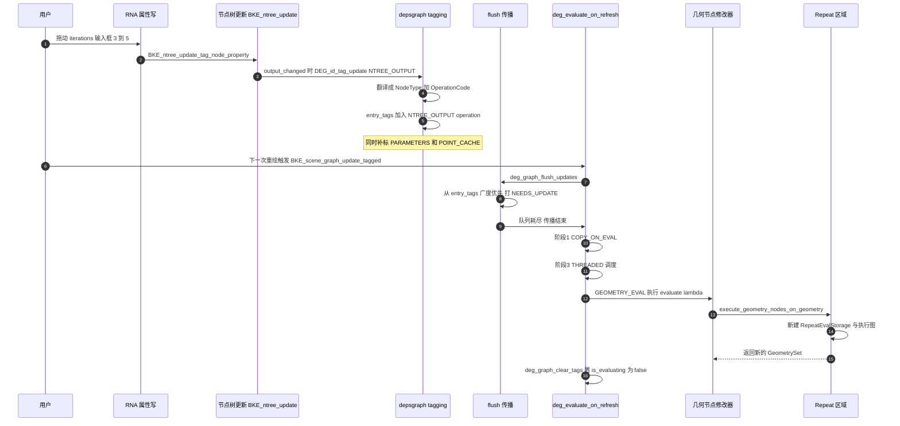

# 03 · depsgraph 求值模型

[前置知识总入口](../README.md) · [本章导航](README.md) · [上一篇](02-Viewer与ViewerPath.md) · [下一篇](04-线程池与parallel_for.md)

> 基准：Blender `5.4.0-alpha`，本地工作树。本篇讲依赖图（depsgraph）——几何节点求值的上层调度者。Repeat 的"一次求值"就是在 depsgraph 的一次更新里发生的。主要源码：`source/blender/depsgraph/`、[`MOD_nodes.cc`](../../../source/blender/modifiers/intern/MOD_nodes.cc)。

## 先回答一个具体问题

我在 Geometry Nodes 修改器的节点组里改了一个参数（比如 Repeat 区域的 iterations 从 3 改成 5）。Blender 怎么知道要重算哪些东西、哪些可以跳过？

完整答案是一条四段式的链条，本篇就是把这条链条的四段拆开讲清：

1. **标记**：参数改动最终变成某个 ID 上的 `ID_RECALC_*` 位，再被翻译成"某个 ID 的某个组件的某个 operation 需要重算"，记进 `graph->entry_tags`。
2. **传播**：从这些 entry 出发，沿 relation 向外做一次广度优先遍历（flush），凡是能到达的 operation 都打上 `DEPSOP_FLAG_NEEDS_UPDATE`。到达不了的就保持"已是最新"。
3. **调度**：求值时只扫描打了 `NEEDS_UPDATE` 的 operation，按入度计数（`num_links_pending`）等到依赖齐了才丢进任务池。
4. **执行**：`OperationNode::evaluate` 这个 `std::function<void(Depsgraph*)>` 回调被调用——几何节点修改器就挂在 `GEOMETRY_EVAL` 这个 operation 上。

关键结论先说：**Blender 既不是"每次全量重算"，也不是"精确知道改了哪个节点"**。精确度只到"组件 + operation"这一级，Repeat 内部改一个参数，重算范围是"整个对象几何 + 它的下游"，Repeat 里那点拓扑差异靠几何节点自己的惰性图去省。

## 文件地图

`source/blender/depsgraph/` 的结构非常规整，三个目录对应三种职责：

| 路径 | 职责 | 代表文件（实测行数） |
| --- | --- | --- |
| `DEG_depsgraph*.hh` | 对外 API，其他模块只能碰这些 | `DEG_depsgraph.hh`（297）、`DEG_depsgraph_query.hh`（479） |
| `intern/node/` | 图的**静态结构**：ID → 组件 → operation | `deg_node.hh`（231）、`deg_node_id.hh`（140）、`deg_node_component.hh`（264）、`deg_node_operation.hh`（310） |
| `intern/builder/` | 建图与改图：把 DNA 里的关系翻译成节点和连边 | `deg_builder_nodes.cc`（2520）、`deg_builder_relations.cc`（3829） |
| `intern/eval/` | 求值：flush、copy-on-eval、分阶段调度 | `deg_eval.cc`（518）、`deg_eval_flush.cc`（362）、`deg_eval_copy_on_write.cc`（1056） |
| `intern/`（顶层） | 门面与粘合：tagging、query、build、eval 入口 | `depsgraph_tag.cc`（1013）、`depsgraph_query.cc`（436）、`depsgraph_build.cc`（358）、`depsgraph_eval.cc`（92） |

行数口径：`[System.IO.File]::ReadAllLines(path).Count`，含空行与注释。真正需要读懂的是四个文件：`depsgraph_tag.cc`（标记与翻译）、`deg_eval_flush.cc`（传播）、`deg_eval.cc`（调度与执行）、`depsgraph_query.cc`（original/evaluated 的取用）。其余多数是建图细节。

## 三层结构

depsgraph 不是"一个节点 = 一个数据块"的平图，而是**三层嵌套**。这个分层由 `NodeClass` 明确写死（[`deg_node.hh` · L34-L45](../../../source/blender/depsgraph/intern/node/deg_node.hh#L34-L45)）：

```cpp
enum class NodeClass {
  GENERIC = 0,
  COMPONENT = 1,
  OPERATION = 2,
};
```

三层各自的含义：

| 层 | 类型 | 粒度 | 数量级 | 作用 |
| --- | --- | --- | --- | --- |
| 图 | `deg::Depsgraph` | 整个场景视图层 | 1 | 持有所有 ID 节点、entry_tags、时间源 |
| ID 节点 | `IDNode` | 一个数据块 | 数千 | `id_orig` 与 `id_cow` 的配对，组件表的索引 |
| 组件 | `ComponentNode` | 一个数据块的某个"方面" | 每 ID 数个到十几个 | `GEOMETRY`、`TRANSFORM`、`PARAMETERS`、`NTREE_OUTPUT` 等 |
| 操作 | `OperationNode` | 一次具体计算 | 每组件数个 | 真正带 `evaluate` 回调的叶子 |

`Depsgraph` 的两个关键字段（[`depsgraph.hh` · L92-L135](../../../source/blender/depsgraph/intern/depsgraph.hh#L92-L135)）：

```cpp
Map<const ID *, IDNode *> id_hash;   /* 原始 ID 指针 → IDNode */
IDDepsNodes id_nodes;                /* 有序列表，顺序同 ID 分配顺序 */
TimeSourceNode *time_source;         /* 顶层时间源节点 */
Set<OperationNode *> entry_tags;     /* 被直接修改的 operation，flush 的起点 */
OperationNodes operations;           /* 所有 operation，已排成单线程遍历序 */
```

`entry_tags` 这个名字值得注意：它存的不是"被修改的 ID"，而是**被修改的 operation**。这是 depsgraph 增量更新的第一性事实——标记粒度从一开始就是 operation。

`ComponentNode` 是"容器 + 序列"两面派（[`deg_node_component.hh` · L119-L130](../../../source/blender/depsgraph/intern/node/deg_node_component.hh#L119-L130)）：建图期用 `operations_map` 做哈希查找（`add_operation` 按 `(opcode, name, name_tag)` 去重），建图完成后释放 map，只留 `Vector<OperationNode *> operations` 这个有序序列以及 `entry_operation` / `exit_operation` 两个哨兵。entry/exit 的意义是：**从外部看，一个组件就是一个两端有端口的盒子**，外部只连 entry 和 exit，不需要知道内部有几个 operation。

`OperationNode` 是唯一可执行的层（[`deg_node_operation.hh` · L257-L305](../../../source/blender/depsgraph/intern/node/deg_node_operation.hh#L257-L305)）：

```cpp
struct OperationNode : public Node {
  ComponentNode *owner;
  DepsEvalOperationCb evaluate;   /* std::function<void(Depsgraph *)> */
  uint32_t num_links_pending;     /* 还差几个上游没算完 */
  bool scheduled;
  OperationCode opcode;
  int name_tag;
  int flag;                       /* OperationFlag 位掩码 */
};
```

`evaluate` 是 `std::function`，意味着**建图期就把 lambda 连同捕获的 `object_cow`、`scene_cow` 一起塞进去了**。看 `build_object_data_geometry`（[`deg_builder_nodes.cc` · L1775-L1781](../../../source/blender/depsgraph/intern/builder/deg_builder_nodes.cc#L1775-L1781)）：

```cpp
op_node = add_operation_node(&object->id,
                             NodeType::GEOMETRY,
                             OperationCode::GEOMETRY_EVAL,
                             [scene_cow, object_cow](blender::Depsgraph *depsgraph) {
                               BKE_object_eval_uber_data(depsgraph, scene_cow, object_cow);
                             });
```

这就是"几何求值"这个 operation 的全部内容——一个捕获了两个 evaluated 指针的闭包。几何节点的所有复杂性，都发生在 `BKE_object_eval_uber_data` 里面。



注意最下面两条边：`NTREE_OUTPUT → MODIFIER` 和 `GEOMETRY_EVAL_INIT → MODIFIER`。这两条边就是"改节点树"和"改对象"两条改动路线汇入几何求值的入口。

## 标记与传播

这一节是整个模型的核心，分两个阶段：**tagging**（谁被改了）和 **flush**（还牵连到谁）。

### 阶段一：ID_RECALC_* 与翻译表

`IDRecalcFlag` 定义在 [`DNA_ID.h` · L1049-L1196](../../../source/blender/makesdna/DNA_ID.h#L1049-L1196)，是一组位标志，每个位表示"这一类东西变了"：

| 标志 | 语义 | 翻译到的组件 |
| --- | --- | --- |
| `ID_RECALC_TRANSFORM` | 变换改了 | `TRANSFORM` |
| `ID_RECALC_GEOMETRY` | 几何改了（按 ID 类型分流） | `GEOMETRY` / `EVAL_POSE` |
| `ID_RECALC_ANIMATION` | 动画或时间改了 | `ANIMATION` |
| `ID_RECALC_PARAMETERS` | 参数改了（会触发 copy-on-eval） | `PARAMETERS` |
| `ID_RECALC_SHADING` | 着色/材质改了 | `SHADING` |
| `ID_RECALC_NTREE_OUTPUT` | 节点树的输出变了 | `NTREE_OUTPUT` |
| `ID_RECALC_SYNC_TO_EVAL` | 要刷新 evaluated 副本 | `COPY_ON_EVAL` |
| `ID_RECALC_POINT_CACHE` | 点缓存失效 | `POINT_CACHE` |
| `ID_RECALC_COMPOSITOR` | 合成器结果要重算 | `COMPOSITOR` |

翻译发生在 `depsgraph_tag_to_component_opcode`（[`depsgraph_tag.cc` · L129-L235](../../../source/blender/depsgraph/intern/depsgraph_tag.cc#L129-L235)）。它有两个输出参数：`NodeType *component_type` 与 `OperationCode *operation_code`。

有意思的是，**同一个 `ID_RECALC_GEOMETRY` 对不同类型的 ID 翻译结果不同**。`geometry_tag_to_component`（L603-L662）里：Object 是 Mesh/Curves/PointCloud 等 → `GEOMETRY`；Object 是 Armature → `EVAL_POSE`；Mesh/Curve/Lattice/GreasePencil 数据块 → `GEOMETRY`；Empty 且带修改器 → `GEOMETRY`；Empty 不带修改器 → `UNDEFINED`（什么都不用做）。这就是"数据块改了，所有用它的对象都要更新"这一语义的实现位置。

### 阶段二：tag_update 与 entry_tags

拿到 `(component_type, operation_code)` 之后，`depsgraph_tag_component`（L270-L303）做三件事：

1. `id_node->find_component(component_type)` 找组件；找不到就返回（比如 Animation 组件在还没有关键帧时不存在，此时只标 copy-on-eval）。
2. `operation_code == OPERATION` 时标整个组件，否则只标指定的那一个 operation。
3. 如果组件"需要先刷新 evaluated 副本"（`need_tag_cow_before_update`），顺带标 `COPY_ON_EVAL`。

被标中的 operation 走 `OperationNode::tag_update`（[`deg_node_operation.cc` · L232-L264](../../../source/blender/depsgraph/intern/node/deg_node_operation.cc#L232-L264)）：

```cpp
void OperationNode::tag_update(Depsgraph *graph, eUpdateSource source)
{
  graph->add_entry_tag(this);                /* 记入 flush 起点集合 */
  if (opcode == OperationCode::VISIBILITY) {
    graph->need_update_nodes_visibility = true;
  }
  flag |= (DEPSOP_FLAG_NEEDS_UPDATE | DEPSOP_FLAG_DIRECTLY_MODIFIED);
  switch (source) {
    case DEG_UPDATE_SOURCE_USER_EDIT:
      flag |= DEPSOP_FLAG_USER_MODIFIED;     /* 只有用户编辑会置这一位 */
      break;
    default:
      break;
  }
}
```

三个标志的含义必须分清：

| 标志 | 含义 | 何时清除 |
| --- | --- | --- |
| `DEPSOP_FLAG_NEEDS_UPDATE` | 这个 operation 需要重算 | 求值完成时 |
| `DEPSOP_FLAG_DIRECTLY_MODIFIED` | 它是**改动源头**，不是被牵连的 | 求值完成时 |
| `DEPSOP_FLAG_USER_MODIFIED` | 改动来自用户操作（会沿 `DEPSOP_FLAG_FLUSH` 随风传播） | 求值完成时 |

`DEPSOP_FLAG_FLUSH` 只是 `USER_MODIFIED` 的别名（[`deg_node_operation.hh` · L248-L249](../../../source/blender/depsgraph/intern/node/deg_node_operation.hh#L248-L249)），它的用途是让"这是用户改的"这一事实沿着链传下去，让下游能区分"用户真的改了"和"时间轴推着走"。

### 阶段三：flush——广度优先传播

`deg_graph_flush_updates`（[`deg_eval_flush.cc` · L308-L352](../../../source/blender/depsgraph/intern/eval/deg_eval_flush.cc#L308-L352)）是传播的全部实现：

```cpp
graph->time_source->flush_update_tag(graph);        /* 时间源先标它的下游 */
if (graph->entry_tags.is_empty()) { return; }       /* 没事发生，早退 */
flush_prepare(graph);                               /* 清 scheduled，清 ID/组件状态 */
FlushQueue queue;
flush_schedule_entrypoints(graph, &queue);          /* entry_tags 入队 */
while (!queue.empty()) {
  OperationNode *op_node = queue.front(); queue.pop_front();
  while (op_node != nullptr) {
    op_node->flag |= DEPSOP_FLAG_NEEDS_UPDATE;
    flush_handle_id_node(id_node);                  /* 这个 ID 被改了 */
    flush_handle_component_node(id_node, comp_node, &queue);
    op_node = flush_schedule_children(op_node, &queue);  /* 优化：一个孩子直通，其余入队 */
  }
}
flush_editors_id_update(graph, &update_ctx);        /* 通知编辑器 */
```

`flush_handle_component_node`（L116-L155）是"组件级粗化"的体现：一旦某个组件被波及，**它里面的所有 operation 一律标 `NEEDS_UPDATE`**，不管它们是否真的受影响。唯一的例外是几何组件的 `VISIBILITY` operation（L139-L141）——它的注释说明：从时间依赖或驱动冲进来的更新不需要重跑可见性检查，跳过能省掉遍历修改器的时间。

`flush_schedule_children`（L163-L201）处理三条关系级规则：

| 关系标志 | 效果 |
| --- | --- |
| `RELATION_FLAG_NO_FLUSH` | flush **完全**不穿过这条边 |
| `RELATION_FLAG_FLUSH_USER_EDIT_ONLY` | 只有源头是 `USER_MODIFIED` 才穿 |
| `RELATION_FLAG_CYCLIC` | 穿过时不减入度（`dec_parents=false`），避免环形依赖死锁 |

`RELATION_FLAG_NO_FLUSH` 不是性能优化，是**语义声明**。几何节点的节点树里就有一条：`NTREE_GEOMETRY_PREPROCESS → NTREE_OUTPUT` 带 `NO_FLUSH`（[`deg_builder_relations.cc` · L3090-L3093](../../../source/blender/depsgraph/intern/builder/deg_builder_relations.cc#L3090-L3093)）。意思是"预处理必须在输出之前算完，但预处理自己改了不该反过来要求输出重算"。



## 求值的触发

求值入口只有两个公开函数（[`DEG_depsgraph.hh` · L192-L203](../../../source/blender/depsgraph/DEG_depsgraph.hh#L192-L203)），都在 `depsgraph_eval.cc`（92 行）里实现：

```cpp
void DEG_evaluate_on_framechange(Depsgraph *graph, float frame, ...);  /* 帧变了 */
void DEG_evaluate_on_refresh(Depsgraph *graph, ...);                   /* 数据变了 */
```

`DEG_evaluate_on_refresh`（[`depsgraph_eval.cc` · L55-L77](../../../source/blender/depsgraph/intern/depsgraph_eval.cc#L55-L77)）做的事很少：

```cpp
if (deg_graph->frame != frame || ctime != deg_graph->ctime) {
  deg_graph->tag_time_source();     /* 帧号变了 → 标时间源 */
  deg_graph->frame = frame;
  deg_graph->ctime = ctime;
}
else if (scene->id.recalc & ID_RECALC_FRAME_CHANGE) {
  deg_graph->tag_time_source();     /* undo 后的补丁，见注释 #66913 */
}
deg_flush_updates_and_refresh(deg_graph, sync_writeback);
```

然后是 `deg_flush_updates_and_refresh`（L30-L53）的固定四步：`graph_tag_ids_for_visible_update`（可见性变化时补标）→ `deg_graph_flush_updates`（传播）→ `deg_evaluate_on_refresh`（真正的求值）→ 如果允许写回，执行 `sync_writeback_callbacks`。

谁在调它？实测的调用点分三类：

| 触发场景 | 调用点 | 频率 |
| --- | --- | --- |
| 帧切换 | `BKE_scene_graph_update_for_newframe_ex`（[`scene.cc` · L2917](../../../source/blender/blenkernel/intern/scene.cc#L2917)） | 每次播放/拖时间轴 |
| 参数或数据改动后的刷新 | `BKE_scene_graph_update_tagged`（[`scene.cc` · L2830](../../../source/blender/blenkernel/intern/scene.cc#L2830)） | 每次 UI 交互后 |
| 某个操作强制求值 | `BKE_scene_graph_evaluated_ensure`（`rna_nodetree.cc` L1767 调试导出 zone 图时用） | 按需 |

`BKE_scene_graph_update_tagged` 还有一个细节值得知道：它是个 `for (int pass = 0; pass < 2; pass++)` 的两趟循环（`scene.cc` L2821-L2864）。第一趟求值后跑 Python 回调（`BKE_CB_EVT_DEPSGRAPH_UPDATE_POST`），如果回调又标了东西，第二趟再求一次，避免"用户改的东西没生效"。所以**一次 UI 交互不一定只求值一次**。

真正的求值函数 `deg_evaluate_on_refresh`（[`deg_eval.cc` · L420-L516](../../../source/blender/depsgraph/intern/eval/deg_eval.cc#L420-L516)）第一件事就是早退判断：

```cpp
if (graph->entry_tags.is_empty()) { return; }   /* 没有任何东西被标，直接回去 */
```

然后分四个阶段（`EvaluationStage`，L61-L78）：

| 阶段 | 做什么 | 为什么单独成阶段 |
| --- | --- | --- |
| `COPY_ON_EVAL` | 只跑 `COPY_ON_EVAL` 组件的 operation | 先保证所有 evaluated 副本已展开，避免环形依赖里读到未展开的 ID |
| `DYNAMIC_VISIBILITY` | 只跑带 `DEPSOP_FLAG_AFFECTS_VISIBILITY` 的 operation | 有驱动/动画控制可见性时，先算清谁可见，后面就能跳过不可见的重活 |
| `THREADED_EVALUATION` | 多线程跑剩下所有能跑的 | 主体 |
| `SINGLE_THREADED_WORKAROUND` | 单线程补跑被排除的 | Metaball、带子帧的流体/动态笔刷等线程不安全者 |

调度器 `schedule_node`（L276-L322）的判据一共四道，任何一道不过就不调度：

```cpp
if (!check_operation_node_visible(state, node)) return;          /* 不可见 */
if ((node->flag & DEPSOP_FLAG_NEEDS_UPDATE) == 0) return;         /* 已经是最新的 */
if (dec_parents) atomic_sub_and_fetch_uint32(&node->num_links_pending, 1);
if (node->num_links_pending != 0) return;                         /* 上游还没算完 */
if (!need_evaluate_operation_at_stage(state, node)) return;        /* 不属于本阶段 */
```

第二道判断是"跳过"的全部来源：**没被 flush 到的 operation 一个字节都不算**。第三道是顺序保证：`num_links_pending` 在 `calculate_pending_parents_for_node`（L144-L174）里统计，只数那些"自己也要更新"的上游——上游不用更新，就不必等它。

求值完一个 operation，`evaluate_node`（L88-L109）立刻清标志：

```cpp
operation_node->evaluate(depsgraph);
operation_node->flag &= ~DEPSOP_FLAG_CLEAR_ON_EVAL;   /* 允许后续局部更新 */
```

最后 `deg_graph_clear_tags(graph)`（L508）清掉未被消费的 entry_tags，`is_evaluating = false`。

## original 与 evaluated

Blender 的求值结果是**写进另一份数据块**的，不是原地改。`IDNode` 同时持有两个指针（[`deg_node_id.hh` · L74-L85](../../../source/blender/depsgraph/intern/node/deg_node_id.hh#L74-L85)）：

```cpp
ID *id_orig;   /* 原始数据块，UI 和操作符读写的就是它 */
ID *id_cow;    /* copy-on-evaluation 副本，求值结果写这里 */
```

副本的创建与标记在 `deg_eval_copy_on_write.cc` 里，`ID_TAG_COPIED_ON_EVAL` 这个 tag 是"我是副本"的唯一凭据（L1031-L1033）：

```cpp
BLI_assert(id_cow != id_orig);
BLI_assert((id_orig->tag & ID_TAG_COPIED_ON_EVAL) == 0);
id_cow->tag |= ID_TAG_COPIED_ON_EVAL;
```

两个方向的转换函数都很短，值得逐行读（[`depsgraph_query.cc` · L40-L77](../../../source/blender/depsgraph/intern/depsgraph_query.cc#L40-L77)）：

```cpp
static const ID *get_original_id(const ID *id)
{
  if (id->orig_id == nullptr) { return id; }          /* 本来就是 original */
  BLI_assert((id->tag & ID_TAG_COPIED_ON_EVAL) != 0);
  return id_cast<ID *>(id->orig_id);                  /* 走 orig_id 反向指针 */
}

static const ID *get_evaluated_id(const Depsgraph *deg_graph, const ID *id)
{
  const IDNode *id_node = deg_graph->find_id_node(id); /* 用 original 指针查表 */
  if (id_node == nullptr) { return id; }               /* 不在图里，原样返回 */
  return id_node->id_cow;
}
```

注意两个函数的不对称：**往 original 走靠 `orig_id` 反向指针，不需要 depsgraph**；**往 evaluated 走必须提供 depsgraph**，因为映射表在图层里。所以 `DEG_get_original` 是"免费"的（一次指针跳转），`DEG_get_evaluated` 需要手上有图。

为什么必须有两份？三个理由，按重要性排：

1. **可回滚**：求值失败或参数又改回去时，original 完好无损。UI 里的数值永远是用户输入的值，不会因为求值被覆盖。
2. **可多图并存**：预览渲染、合成器、序列器、动画编辑各建各的图，各自有各自的一份 evaluated。如果原地改，多图就会互相污染。
3. **可跳过**：evaluated 副本是"惰性展开"的（`deg_eval_copy_is_expanded`）。一个不可见的对象，副本可能压根没展开，连内存都没分配。

反向的代价是必须遵守一条纪律：**在 `evaluate` 回调里写数据，写的是 evaluated；要改 original 必须走写回（writeback）机制**。`DEG_eval` 里有硬性拦截（[`depsgraph_tag.cc` · L709-L714](../../../source/blender/depsgraph/intern/depsgraph_tag.cc#L709-L714)）：

```cpp
if (graph != nullptr && graph->is_evaluating) {
  if (debug_flags & G_DEBUG_DEPSGRAPH_TAG) {
    printf("ID tagged for update during dependency graph evaluation.\n");
  }
  return;
}
```

求值期打 tag 直接被丢弃——因为此刻 flush 已经结束，新 tag 不会被传播，只会造成不一致。想触发下一轮重算，得用 `DEG_id_tag_update_for_side_effect_request`（L858-L865），它的 `DEG_UPDATE_SOURCE_SIDE_EFFECT_REQUEST` 源就是为"求值期间发现需要再算一次"准备的。

## 几何节点在 depsgraph 中的位置

把镜头对准几何节点修改器，看它在这张图里落在哪几个 operation 上。

建图期，`build_object_modifiers`（[`deg_builder_relations.cc` · L932-L987](../../../source/blender/depsgraph/intern/builder/deg_builder_relations.cc#L932-L987)）为一个修改器栈建链：

```cpp
OperationKey previous_key = eval_init_key;              /* GEOMETRY_EVAL_INIT 起头 */
for (ModifierData &modifier : object->modifiers) {
  const OperationKey modifier_key(
      &object->id, NodeType::GEOMETRY, OperationCode::MODIFIER, modifier.name);
  add_relation(previous_key, modifier_key, "Modifier");        /* 栈内顺序 */
  if (mti->update_depsgraph) {
    mti->update_depsgraph(&modifier, &ctx);                    /* 修改器自己声明的外部依赖 */
  }
  if (BKE_modifier_depends_ontime(scene_, &modifier)) {
    add_relation(time_src_key, modifier_key, "Time Source -> Modifier");
  }
  previous_key = modifier_key;
}
add_relation(previous_key, eval_key, "modifier stack order");  /* 栈尾 → GEOMETRY_EVAL */
```

所以一个 Geometry Nodes 修改器对应图中**一个 `MODIFIER` operation**，它的 `name_tag`/`name` 就是修改器名，从而能和栈里其他修改器区分开。它自己不算几何，只负责"声明依赖"；真正算几何的是对象级唯一的 `GEOMETRY_EVAL`。

而这个修改器需要的外部依赖，由 `MOD_nodes.cc` 的 `update_depsgraph`（L171-L240）声明。最关键的一行是 L181：

```cpp
DEG_add_node_tree_output_relation(ctx->node, nmd->node_group, "Nodes Modifier");
```

它在"节点树的 `NTREE_OUTPUT` operation"和"这个 `MODIFIER` operation"之间建边。`DEG_add_node_tree_output_relation`（[`depsgraph_build.cc` · L162-L176](../../../source/blender/depsgraph/intern/depsgraph_build.cc#L162-L176)）实际上建了**两条**边：output 那条可 flush，preprocess 那条带 `NO_FLUSH`。这个细节很妙：改节点树要能传导到修改器（可 flush），但预处理结果变了不能自己要求重算（`NO_FLUSH`）。

节点树本身也有自己的 ID 节点（[`deg_builder_nodes.cc` · L2050-L2069](../../../source/blender/depsgraph/intern/builder/deg_builder_nodes.cc#L2050-L2069)）：

```cpp
add_id_node(&ntree->id);
add_operation_node(&ntree->id, NodeType::NTREE_OUTPUT, OperationCode::NTREE_OUTPUT);
if (ntree->type == NTREE_GEOMETRY) {
  ID *id_cow = get_cow_id(&ntree->id);
  add_operation_node(&ntree->id,
                     NodeType::NTREE_GEOMETRY_PREPROCESS,
                     OperationCode::NTREE_GEOMETRY_PREPROCESS,
                     [id_cow](blender::Depsgraph * /*depsgraph*/) {
                       bke::node_tree_runtime::preprocess_geometry_node_tree_for_evaluation(
                           *ntree_cow);
                     });
}
```

`NTREE_OUTPUT` 是一个 **no-op operation**（没有 evaluate 回调），它存在只是为了当"关系锚点"——因为 `OperationFlag` 里有 `DEPSOP_FLAG_PINNED` 这个标志，专门用来钉住这种"纯关系节点，不许被清理"的 operation（[`deg_node_operation.hh` · L237-L240](../../../source/blender/depsgraph/intern/node/deg_node_operation.hh#L237-L240)）。而 `NTREE_GEOMETRY_PREPROCESS` 有实际工作：把节点树预处理成可求值的状态（拓扑缓存、zone 配对等）。

执行期的调用栈，从 `GEOMETRY_EVAL` 的 lambda 开始：



`modifyGeometry`（[`MOD_nodes.cc` · L1725-L1762](../../../source/blender/modifiers/intern/MOD_nodes.cc#L1725-L1762)）里这段是"两套系统交界处"的证据：

```cpp
NodesModifierData *nmd_orig = reinterpret_cast<NodesModifierData *>(
    BKE_modifier_get_original(ctx->object, &nmd->modifier));   /* 求 original 的修改器 */
if (ID_MISSING(nmd_orig->node_group)) { return; }              /* 用 original 判断有效性 */
const bNodeTree &tree = *nmd->node_group;                       /* 用 evaluated 的节点树求值 */
```

**判定有效性看 original，实际求值看 evaluated**。这不是随手写的：求值期的 evaluated 树可能还没展开最新改动，而"节点组是否缺失"这种结构性问题只有 original 说了算。

最后 `execute_geometry_nodes_on_geometry`（[`geometry_nodes_execute.cc` · L555](../../../source/blender/nodes/intern/geometry_nodes_execute.cc#L555)）建起 `GeoNodesUserData`，把 `compute_context` 指向根部上下文：

```cpp
GeoNodesUserData user_data;
user_data.call_data = &call_data;
call_data.root_ntree = &btree;
user_data.compute_context = &base_compute_context;   /* 上下文链的根，在这里确定 */
```

**这一行就是正篇 04-02 反复讲的"上下文链的根"的物理位置。** 再往下，每一层 zone、group、iteration 都是在这个根上派生新的 `ComputeContext`。

## 与 Repeat 的关系

把 depsgraph 和 Repeat 对齐，只有三句话，但每句都影响读代码的方式。

### 一、一次 depsgraph 更新 = Repeat 的一次"调用"

`RepeatEvalStorage` 的生命周期完全绑在 `lf::Context::storage` 上：`init_storage` 里 `allocator.construct<RepeatEvalStorage>()`（[`geometry_nodes_repeat_zone.cc` · L139-L142](../../../source/blender/nodes/intern/geometry_nodes_repeat_zone.cc#L139-L142)），`destruct_storage` 里 `std::destroy_at(s)`（L144-L151）。而 `lf::Context` 的 storage 是 `lf::GraphExecutor` 在一次 `execute` 期间管理的。

`GraphExecutor::execute` 的上游是 `execute_geometry_nodes_on_geometry`，再上游是 `modifyGeometry`，再上游是 `GEOMETRY_EVAL` 的 lambda。所以链条是：

```
depsgraph 一次 GEOMETRY_EVAL 执行 → 修改器栈 → 几何节点执行 → Repeat 的一次 storage 生命周期
```

**Repeat 没有跨帧的"常驻"状态。** 帧变了、参数变了、甚至只是另一个不相关的对象改了触发 flush 波及过来，都会让这个 storage 重建。任何需要跨帧保留的东西（缓存、仿真状态、烘焙数据）都不能塞在 `RepeatEvalStorage` 里，得走修改器的 `runtime` 或仿真的 `bake` 路径——正篇 04-01 讲的正是这个边界。

### 二、上下文链的根在 depsgraph 求值入口确定

`user_data.compute_context = &base_compute_context` 这行（`geometry_nodes_execute.cc` L587）拿到的 `base_compute_context` 来自 `modifyGeometry` 里的构造（[`MOD_nodes.cc` · L1805-L1807](../../../source/blender/modifiers/intern/MOD_nodes.cc#L1805-L1807)）：

```cpp
bke::DataBlockComputeContext data_block_compute_context{nullptr, ctx->object->id};
bke::GeometryNodesModifierComputeContext modifier_compute_context{&data_block_compute_context, *nmd};
```

注意第一个参数是 `nullptr` ——**父上下文为空，这就是链的根**。根的内容是"对象 ID + 修改器"，所以同一个节点组挂在两个不同的修改器上，哈希不同、日志桶不同、Viewer 数据不同。

如果几何节点不是由修改器求值（比如工具节点组、资产预览），这个根会换成别的东西。这意味着**上下文哈希依赖于"从哪里求值"**，而不只是"求值什么"——正篇 04-02 的第 5 个不变量讲的就是这个。

### 三、Repeat 内的参数改动，粒度到不了节点

修改器参数改了，`MOD_nodes_update_interface`（[`MOD_nodes.cc` · L405-L412](../../../source/blender/modifiers/intern/MOD_nodes.cc#L405-L412)）只做一件事：

```cpp
DEG_id_tag_update(&object->id, ID_RECALC_GEOMETRY);
```

**没有"第 42 号 Repeat 节点变了"这种粒度的标记。** depsgraph 只知道"这个对象的几何要重算"，于是整个对象几何重算，然后几何节点执行器内部的惰性图再靠 `ValueUsage` 去省掉不需要算的分支。这就是为什么正篇 06-02 分析性能时，结论总是落在"lazy function 图内部的输出需求"而不是"depsgraph 的重算范围"上。

## 用 mermaid 画求值时序

把"改一个 Repeat 内参数"从点击到出结果的完整时序画出来：



注意图中第 8 步的注释：`PARAMETERS` 与 `POINT_CACHE` 是**额外补标**的，不在用户改动的那一位里。补标逻辑在 `graph_id_tag_update` 末尾（[`depsgraph_tag.cc` · L744-L762](../../../source/blender/depsgraph/intern/depsgraph_tag.cc#L744-L762)）：

```cpp
if (update_source == DEG_UPDATE_SOURCE_USER_EDIT) {
  id->recalc |= deg_recalc_flags_effective(graph, flags);   /* original 也记一份，供 undo 重放 */
}
...
if (update_source == DEG_UPDATE_SOURCE_USER_EDIT && flags != ID_RECALC_SHADING) {
  graph_id_tag_update_single_flag(..., ID_RECALC_POINT_CACHE, update_source);  /* 缓存失效 */
}
deg_graph_tag_parameters_if_needed(bmain, graph, id, id_node, flags, update_source);
```

`deg_graph_tag_parameters_if_needed`（L489-L521）的注释写得很好：即使 C 代码只明确标了 geometry，也要顺带标 `PARAMETERS`，**给驱动器（driver）一个机会用新值重算**。所以一次"改几何参数"实际上是三个组件被标。

## 用小数据走一遍

场景：`Cube` 对象，网格数据 `Cube`，上面挂一个名为 `GeometryNodes` 的修改器，节点组 `RepeatDemo` 里有一个 Repeat 区域，`RepeatOutput` 的 `items_num = 3`。现在把 iterations 从 3 改成 5。

请在纸上假设下面这个图（节点数是示意，真实场景数千）：

| 层 | 对象 | 数量 |
| --- | --- | --- |
| ID 节点 | Cube、Cube mesh、RepeatDemo ntree、Scene | 4 |
| 组件 | Cube: TRANSFORM / GEOMETRY / BATCH_CACHE / SYNCHRONIZE；mesh: GEOMETRY；ntree: NTREE_OUTPUT / NTREE_GEOMETRY_PREPROCESS；Scene: LAYER_COLLECTIONS | 8 |
| operation | 合计约 20 个（含 5 个 no-op 哨兵） | 20 |

标记传播路径（逐步）：

| 步 | 动作 | 结果 |
| --- | --- | --- |
| 1 | RNA 写入 socket 值 | `BKE_ntree_update_tag_node_property(ntree, node)`，node 的 runtime 标记 `NTREE_CHANGED_NODE_PROPERTY` |
| 2 | `BKE_main_ensure_invariants` 跑 `BKE_ntree_update` | 检测到 `result.output_changed` |
| 3 | `tree_output_changed_fn` 回调 | `DEG_id_tag_update(&ntree->id, ID_RECALC_NTREE_OUTPUT)` |
| 4 | `id_tag_update` 遍历所有注册图层 | 每个图各调一次 `graph_id_tag_update` |
| 5 | 翻译 | `ID_RECALC_NTREE_OUTPUT → (NodeType::NTREE_OUTPUT, OperationCode::NTREE_OUTPUT)` |
| 6 | `depsgraph_tag_component` | 该 operation 进 `entry_tags`，置 `NEEDS_UPDATE / DIRECTLY_MODIFIED / USER_MODIFIED` |
| 7 | 补标 | `PARAMETERS`（给 driver）、`POINT_CACHE`（失效缓存）也各进一个 entry |
| 8 | flush 开始 | `graph_tag_ids_for_visible_update` 无可见性变化，跳过 |
| 9 | flush 传播 | NTREE_OUTPUT → MODIFIER（`Nodes Modifier` 关系）→ GEOMETRY 组件 → GEOMETRY_EVAL_INIT / MODIFIER / GEOMETRY_EVAL / VISIBILITY 全标 |
| 10 | 继续传播 | GEOMETRY_EVAL → BATCH_CACHE、SYNCHRONIZE_TO_ORIGINAL、以及任何依赖 Cube 几何的对象 |
| 11 | 传播停止处 | 无动画、无驱动 → 时间源不参与；其他 ID（如 Scene 的 LAYER_COLLECTIONS）不在路径上，保持"最新" |
| 12 | 求值阶段 1 | `COPY_ON_EVAL`：ntree 的 copy-on-eval 组件展开（若未展开） |
| 13 | 求值阶段 2 | 无 `has_animated_visibility`，跳过 |
| 14 | 求值阶段 3 | 按入度调度；`GEOMETRY_EVAL` 等到 `MODIFIER` 完成才跑 |
| 15 | 执行 | `BKE_object_eval_uber_data` → `mesh_data_update` → `modify_geometry_set` → `modifyGeometry` → Repeat 区域 |
| 16 | Repeat 内部 | `execute_impl` 发现 `eval_storage.graph_executor` 为空（storage 是新的），调 `initialize_execution_graph` 按 5 轮展开执行图 |
| 17 | 收尾 | `deg_graph_clear_tags`，`is_evaluating = false` |

最终重算范围：**Cube 的几何链 + 它的下游**。没重算的：Scene 的层级集合、其他对象（除非它们依赖 Cube 的几何）、所有 `SHADING` 组件（因为 `ID_RECALC_SHADING` 未被标，而 `ID_RECALC_NTREE_OUTPUT` 的 clean_flags 不含它）。

一个值得注意的数字对比：**depsgraph 层面标记的是"一个对象的几何"，Repeat 层面实际改变的是"执行图从 3 轮变 5 轮"**。前者粗糙，后者精确，两者不是一回事。第 16 步里 `initialize_execution_graph`（[`geometry_nodes_repeat_zone.cc` · L195-L410](../../../source/blender/nodes/intern/geometry_nodes_repeat_zone.cc#L195-L410)）会重建整张 zone 执行图——注释（L187-L194）解释了为什么不缓存：**图太便宜，执行太贵**，缓存按迭代数分版本的图不划算。

## 反例与边界

九个常见误解，每个都附实测依据。

**反例 1：以为每次改参数都全量重算。** 不对。`deg_evaluate_on_refresh` 第一行就是 `if (graph->entry_tags.is_empty()) return;`（`deg_eval.cc` L423），而 `schedule_node` 会跳过所有没 `NEEDS_UPDATE` 的 operation（L287-L289）。改一个节点树的参数，重算范围只到"被 flush 波及"的那部分。真正会全量重算的场合是图重建（`DEG_graph_relations_update` 真的重建了整图）或 `ID_RECALC_ALL`。

**反例 2：以为"改一个节点"只标一个 operation。** 不对。`flush_handle_component_node` 一旦被波及，会把**组件内所有 operation** 都标 `NEEDS_UPDATE`（`deg_eval_flush.cc` L131-L143）。所以改一个参数，`GEOMETRY_EVAL_INIT`、`VISIBILITY`、`MODIFIER` 全都会被标上，粒度是组件不是 operation。

**反例 3：以为 evaluated 与 original 是同一份。** 不对，而且这是最危险的一种。`get_original_id` 一旦发现 `orig_id` 非空就断言 `ID_TAG_COPIED_ON_EVAL`（`depsgraph_query.cc` L45-L49）。如果代码里拿一个 evaluated 指针当 original 用（比如直接改 `Object.object_to_world`），改的是副本，下一帧就被覆盖，且不会有任何报错。

**反例 4：忘记 tag 导致不更新。** 改了数据却没调 `DEG_id_tag_update`，depsgraph 完全不知道，`entry_tags` 为空，求值直接早退。这类 bug 的典型症状是"改了数据但界面不变，转一下视角才变"（因为视角变动触发了别的 tag）。注意 `id_tag_update` 里那句注释（`depsgraph_tag.cc` L748-L751）：flags 是**逐位**遍历翻译的，所以 `ID_RECALC_GEOMETRY | ID_RECALC_TRANSFORM` 会被拆成两次翻译，两个组件各标一次。

**反例 5：在求值中修改 original。** `graph_id_tag_update` 开头就有拦截（L709-L714）：`graph->is_evaluating` 为真时直接 `return`，只打一条 debug 输出。这意味着求值回调里发现"数据不对，要重算"时，普通 tag 是无效的，必须用 `DEG_id_tag_update_for_side_effect_request`（L858）——它的 source 是 `SIDE_EFFECT_REQUEST`，`depsgraph_type.hh` L42-L47 的注释明确说明了这就是为"烘焙中间几何"这类副作用准备的。

**反例 6：以为 `DEG_id_tag_update` 只影响当前 depsgraph。** 不对。`id_tag_update`（L664-L678）里 `for (deg::Depsgraph *depsgraph : deg::get_all_registered_graphs(bmain))` 会遍历**所有已注册的图**：视图层图、预览渲染图、合成器图、序列器图都会收到。所以 tag 是全局广播，不是单图操作。

**反例 7：以为 `RELATION_FLAG_NO_FLUSH` 只是性能优化。** 不对，它是语义声明。`NTREE_GEOMETRY_PREPROCESS → NTREE_OUTPUT` 这条边带 `NO_FLUSH`（`deg_builder_relations.cc` L3090-L3093），意思是"预处理必须早于输出，但预处理自己变了不构成输出要重算的理由"。如果它可 flush，每次预处理都会引发一轮无意义的重算。

**反例 8：以为 `RepeatEvalStorage` 会跨求值复用。** 不会。它是 `lf::Context::storage`，由 `init_storage` 构造（L139-L142）、`destruct_storage` 析构（L144-L151），生命周期严格夹在一次 `GraphExecutor::execute` 之内。把跨帧状态放进 `RepeatEvalStorage` 一定丢数据。

**反例 9：以为 `entry_tags` 里的节点一定会被求值。** 不一定，有两道过滤。第一道 `check_operation_node_visible`（`deg_eval.cc` L126-L142）：不可见 ID 的 operation 直接不调度（`COPY_ON_EVAL` 组件例外，它必须跑以保证副本一致）。第二道 `need_evaluate_operation_at_stage`（L243-L270）：不属于当前阶段的也跳过。所以"被标了"和"被算了"是两件事。

## 对理解 Repeat 的帮助

- **正篇 04-01（[RepeatEvalStorage 与一次求值](../../重复区域-dsh/04-运行时机制/01-RepeatEvalStorage与一次求值.md)）**：那篇讲 storage 生命周期，本篇给了它上界的来源——storage 活在 `lf::Context` 里，`lf::Context` 活在 `GraphExecutor::execute` 里，后者活在 `execute_geometry_nodes_on_geometry` 里，再上面就是 `GEOMETRY_EVAL` 的一个 lambda。**"一次求值"的边界不是几何节点自己划的，是 depsgraph 划的。**
- **正篇 04-02（[ComputeContext 与迭代身份](../../重复区域-dsh/04-运行时机制/02-ComputeContext与迭代身份.md)）**：上下文链的根在 `geometry_nodes_execute.cc` L587 的 `user_data.compute_context = &base_compute_context`，而 `base_compute_context` 的父指针是 `nullptr`（`MOD_nodes.cc` L1805）。这个 `nullptr` 就是"根"的物理含义。理解它才能理解为什么"同一个节点组挂两个修改器 → 两套日志桶"。
- **正篇 03-03（[执行图按迭代展开](../../重复区域-dsh/03-几何节点执行架构/03-执行图按迭代展开.md)）**：那篇会讲到导出 zone 执行图做调试（`logged_zone_graphs`）。它的实现里有一行 `const bNodeTree &btree_orig = *DEG_get_original(&btree_);`（[`geometry_nodes_repeat_zone.cc` · L404](../../../source/blender/nodes/intern/geometry_nodes_repeat_zone.cc#L404)）——因为 `runtime->logged_zone_graphs` 这个"请求导出"的标志是编辑器写在 **original** 上的，而求值看到的是 evaluated 副本。**不转回 original 就读不到这个请求**，这是原文档第 4 节那个不对称性的直接后果。
- **正篇 06-02（性能模型）**：那篇谈"改 iterations 变慢"时，要分清两个层次的开销——depsgraph 的 flush 与调度（与本篇相关，量级是"组件数×operation 数"），以及几何节点执行图内部的实际计算（与 `ValueUsage` 相关）。混在一起算会得出错误结论。

## 继续阅读

- 本章下一篇 [04-线程池与parallel_for](04-线程池与parallel_for.md)：`deg_eval.cc` 里 `BLI_task_pool_push` 那个 `TaskPool` 就是它管的东西，本篇只当黑盒用。
- 本章 [01-日志与NodeTreeLogger](01-日志与NodeTreeLogger.md)：本篇提到的"每个上下文一个 logger"的落地实现。
- 前置 [04-生命周期与分配](../04-生命周期与分配/README.md)：`LinearAllocator` 与 `ResourceScope`，`RepeatEvalStorage` 的 allocator 来自这里。
- 前置 [01-惰性执行框架](../01-惰性执行框架/README.md)：`lf::GraphExecutor`、`ValueUsage`，即"几何节点内部怎么省"的那一层。
- 源码入口按这个顺序读最省力：`depsgraph_tag.cc` 的 L129-L235（翻译表）→ L664-L763（tagging 主流程）→ `deg_eval_flush.cc` L308-L352（传播）→ `deg_eval.cc` L243-L330（调度）→ L420-L516（阶段）→ `depsgraph_query.cc` L40-L77（original/evaluated）。
- 想直接看"图长什么样"，用 [02-图导出与dot调试](../12-工具与调试/02-图导出与dot调试.md) 里的方法导出 depsgraph 的 GraphViz 描述，能直观看到本篇画的那些连边。
