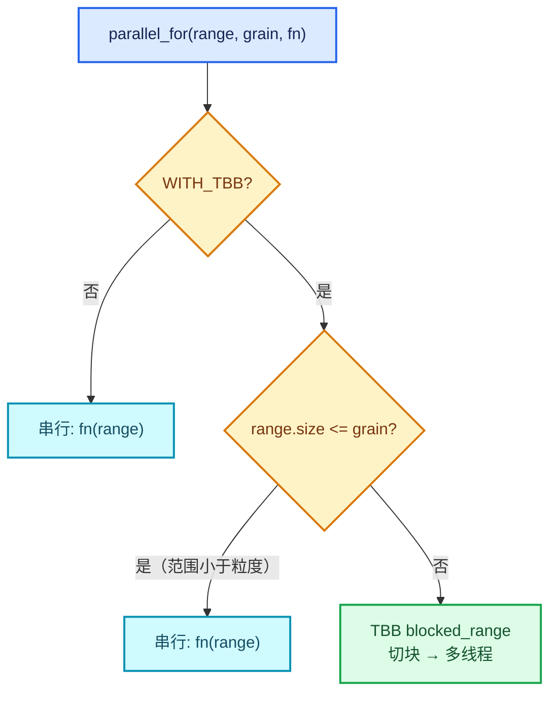

# 04 · 线程池与 parallel_for

[前置知识总入口](../README.md) · [本章导航](README.md) · [上一篇](03-depsgraph求值模型.md) · [下一篇](05-lazy_threading调度提示.md)

> 基准：Blender `5.4.0-alpha`，本地工作树。本篇讲 `threading::parallel_for`——Blender 里最常用的并行原语。Repeat 的 `index_values` 并行填充就靠它。主要源码：[`BLI_task.hh`](../../../source/blender/blenlib/BLI_task.hh)（实测 267 行）、[`intern/task_range.cc`](../../../source/blender/blenlib/intern/task_range.cc)。

## 先回答一个具体问题

Repeat 的 `initialize_execution_graph` 里有一行：

```cpp
threading::parallel_for(IndexRange(iterations), 1024, [&](const IndexRange range) {
  for (const int i : range) {
    eval_storage.index_values[i].emplace<int>(i);
  }
});
```

`[讲解]` 三个疑问：

1. 为什么需要并行填 1024 个 int？
2. `1024` 是什么？
3. 如果 iterations 只有 3，会不会反而更慢？

本篇逐个回答。

## 三层 API

`[讲解]` `BLI_task.hh` 提供三种并行模式：

| API | 语义 | 底层 |
| --- | --- | --- |
| `parallel_for_each(range, fn)` | 对每个元素调 fn | `tbb::parallel_for_each` |
| `parallel_for(range, grain, fn)` | 按 grain 切块调 fn | `tbb::parallel_for` + `blocked_range` |
| `parallel_invoke(fn1, fn2, ...)` | 并发执行几个函数 | `tbb::parallel_invoke` |

`[讲解]` Repeat 用的是第二种。为什么不是第一种？

**因为第一种的粒度是"每个元素一个任务"**。1024 个元素 = 1024 个任务，任务调度开销远大于"填一个 int"的实际工作。

## grain_size 的意义

`[讲解]` 源码注释（L56-L63）说得最清楚：

> "\param grain_size: The approximate amount of work that should be scheduled at once. For example of the range is [0 - 1000] and the grain size is 200, then the function will be called with [0-200], [200-400], [400-600], [600-800] and [800-1000]."

`[讲解]` 翻译：`grain_size` 是"一次调度大约处理多少个元素"。

举例：`IndexRange(1000)`，`grain_size = 200` → 5 个任务，每个处理 200 个。

`[讲解]` 注释接着说（L62-L63）：

> "The grain size may be smaller or larger than this, depending on the range and the number of threads. If all tasks have approximately the same size, this can be ignored. Otherwise, one can..."

`[讲解]` 关键：**grain_size 是"建议值"，不保证**。TBB 可能按实际线程数调整。

**"如果所有任务大小相近，可以忽略这个"**——因为此时失衡无所谓。

## 为什么 Repeat 用 1024

`[讲解]` 回到开头的问题。

**为什么需要并行？** `iterations` 可能很大（几千上万）。逐元素 `emplace<int>` 虽然单次很便宜（一次 4 字节写），但累计可观。

**1024 这个数字的来源**：这是个经验值。考虑：

- 太小（如 1）→ 任务数 = iterations，调度开销爆炸；
- 太大（如 iterations）→ 只有一个任务，不并行；
- 1024 → 假设 iterations = 10000，得 10 个任务，能分给多核，且每个任务的工作量足够抵消调度成本。

`[讲解]` **1024 的合理性**：

| iterations | 任务数 | 是否并行 |
| --- | --- | --- |
| 3 | 1 | ❌ 单线程（grain_size > 总数） |
| 100 | 1 | ❌ 单线程 |
| 1024 | 1 | ❌ 单线程 |
| 4096 | 4 | ✅ 可并行 |
| 10000 | 10 | ✅ 并行 |

`[讲解]` **回答第三个疑问**：iterations = 3 时，`parallel_for` 会**退化为单线程直接调用**（因为范围小于 grain_size）。所以不会更慢。

`[讲解]` 这就是 grain_size 的核心作用：**小任务自动退化为串行**，避免调度开销。

## TBB 与非 TBB 的双路径

`[讲解]` 源码里有大量 `#ifdef WITH_TBB`。看 L11-L18：

```cpp
#ifdef WITH_TBB
#  include <tbb/blocked_range.h>
#  include <tbb/parallel_for.h>
#  include <tbb/parallel_for_each.h>
#  include <tbb/parallel_invoke.h>
#  include <tbb/parallel_reduce.h>
#  include <tbb/task_arena.h>
#endif
```

`[讲解]` 这意味着：**Blender 可以在没有 TBB 的情况下编译**。

`[讲解]` 无 TBB 时怎么办？`parallel_for` 直接串行执行：

```cpp
#ifndef WITH_TBB
inline void parallel_for_impl(IndexRange range, int64_t, FunctionRef<void(IndexRange)> fn)
{
  fn(range);   /* 直接一次调用 */
}
#endif
```

`[讲解]` 这是**优雅降级**的设计：

- 有 TBB → 真并行；
- 没 TBB → 串行，但代码不用改。

## parallel_for_impl 的结构

`[讲解]` 源码（L43-L44）：

```cpp
void parallel_for_impl(IndexRange range,
                       int64_t grain_size,
                       FunctionRef<void(IndexRange)> fn);
```

`[讲解]` 三个参数：

1. **`range`** —— 要遍历的范围；
2. **`grain_size`** —— 建议的任务大小；
3. **`fn`** —— 每个块调一次的函数，参数是该块的 `IndexRange`。

`[讲解]` 注意 `fn` 的类型是 `FunctionRef`（**非拥有**的回调视图，见第 03 章）。这意味着：

- 传 lambda 时要注意生命周期；
- 但 `parallel_for` 是同步的（调用返回时所有块都执行完了），所以临时 lambda 安全。

## 为什么回调收 IndexRange 而不是单个下标

`[讲解]` 这是关键设计。对比两种接口：

| 接口 | 回调收到 | 任务数 |
| --- | --- | --- |
| `for_each` 风格 | 单个元素 | N |
| **`parallel_for` 风格** | **一个范围** | **N/grain** |

`[讲解]` 后者更好的原因：

1. **任务少**——调度开销低；
2. **块内可优化**——函数自己知道是连续范围，可以做 SIMD；
3. **缓存友好**——连续访问。

`[讲解]` 所以 Repeat 的回调是：

```cpp
[&](const IndexRange range) {
  for (const int i : range) {        /* 块内自己再循环 */
    eval_storage.index_values[i].emplace<int>(i);
  }
}
```

**外层是块，内层是元素**。这个双层结构是 `parallel_for` 的标准用法。

## sum/reduce 变体

`[讲解]` 除了 `parallel_for`，还有 `parallel_reduce`（求和等归约）：

```cpp
template<typename T, typename Range, typename Function, typename Reduction>
T parallel_reduce(const Range &range, int64_t grain_size, T init, Function &&fn, Reduction &&reduction);
```

`[讲解]` 归约模式：每个块算出局部结果，再合并。适用：

- 求和、求最大值；
- 统计（计数）。

`[讲解]` 与 `parallel_for` 的区别：后者是"就地修改"，前者是"各块产生值再合并"。

## 线程池与 TBB

`[讲解]` Blender 用 TBB 的全局线程池，由 `tbb::task_arena` 管理（L18 有 include）。

`[讲解]` 关键事实：

- **线程数是进程级的**（不是每次 `parallel_for` 创建）；
- 默认按 CPU 核数；
- 可以用 `BLI_task_scheduler_init` 调整。

`[讲解]` 这意味着 `parallel_for` 的**启动成本很低**——不需要创建线程，只是把任务送进现有池子。

## 在 Repeat 中的三处并行

`[讲解]` 正篇涉及三层并行，逐层对照：

| 层 | 并行机制 | 是否真并行 |
| --- | --- | --- |
| `index_values` 填充 | `parallel_for(..., 1024, ...)` | ✅ 取决于 iterations |
| 循环体之间 | 无（数据依赖） | ❌ 串行 |
| 循环体内节点 | 各节点自己的 `parallel_for` | ✅ 视节点实现 |

`[讲解]` 第 1 层是 Repeat 唯一主动发起的并行。第 2 层不可能并行（串行依赖）。第 3 层由用户图里的节点决定。

## 用 mermaid 画并行决策

`[讲解]` `parallel_for` 内部如何决定是否并行：



`[讲解]` 三条路径：

1. 无 TBB → 串行；
2. 范围小于 grain → 串行；
3. 否则 → 真并行。

**后两条是"自动优化"**——不需要调用方判断。

## 用小数据走一遍

`[讲解]` 三个 iterations 值，看 `parallel_for(IndexRange(n), 1024, fn)` 的行为：

### n = 3

```text
range.size = 3 < grain_size = 1024
→ 串行
→ fn 被调用一次，参数是 [0, 3)
→ 内层 for 循环 3 次
总耗时：3 次 emplace（微秒级）
```

### n = 1024

```text
range.size = 1024 == grain_size
→ 边界情况，取决于 TBB 实现（通常是串行或单块的并行）
→ 实际不会有并行收益
```

### n = 5000

```text
range.size = 5000 > grain_size = 1024
→ TBB 切成约 5 块（5000/1024 ≈ 4.88）
→ 5 个任务并行
→ 假设 4 核：约 2 轮完成
理论加速：5000 / (2 * 1024) ≈ 2.4 倍
```

`[讲解]` 第三个场景是唯一有收益的。这也回答了"为什么 Repeat 在 iterations 大时才值得并行"。

## 反例与边界

### 反例 1：回调里修改共享状态

```cpp
/* 危险 */
int total = 0;
parallel_for(range, 1024, [&](IndexRange r) {
  for (int i : r) { total += i; }   /* 竞态！ */
});
```

应该用 `parallel_reduce`。

### 反例 2：grain_size 设成 1

```cpp
parallel_for(IndexRange(10000), 1, fn);   /* 10000 个任务 */
```

调度开销 > 收益。

### 反例 3：以为 parallel_for 一定并行

小范围时自动串行。

### 反例 4：在回调里做重分配

```cpp
/* 危险 */
parallel_for(range, 1024, [&](IndexRange r) {
  vec.push_back(...);   /* Vector 不是线程安全的 */
});
```

### 反例 5：以为回调按顺序执行

块的执行顺序不保证。

### 反例 6：依赖 `WITH_TBB` 一定开启

可以编译成无 TBB 版本，此时全串行。

## 对理解 Repeat 的帮助

`[讲解]` 正篇的两处直接对应：

### 1. index_values 填充（03-03 L263-L272）

```cpp
eval_storage.index_values.reinitialize(iterations);
threading::parallel_for(IndexRange(iterations), 1024, [&](const IndexRange range) {
  for (const int i : range) {
    eval_storage.index_values[i].emplace<int>(i);
  }
});
```

`[讲解]` 三个要点：

- `reinitialize` 先分配（**必须**在并行前，因为分配不线程安全）；
- `emplace` 是就地写（每元素独立，无竞态）；
- grain 1024 让大 iterations 才有并行。

### 2. `multi_threading_enabled = false`（04-01 L590-L606）

`[讲解]` 内层图**不开**新并行域。为什么？

- 循环体串行依赖，内层并行收益小；
- 嵌套 Repeat 时任务数会乘积爆炸。

但注意：**这不影响 `index_values` 的并行**——那发生在建图期，不属于内层执行。

## 继续阅读

- [05-lazy_threading调度提示](05-lazy_threading调度提示.md) —— 另一种"并行协调"机制
- [03-depsgraph求值模型](03-depsgraph求值模型.md) —— 上层调度
- [正篇 06-02 性能模型](../../重复区域-dsh/06-实战与性能/02-性能模型与开销分析.md) —— 三层并行边界
