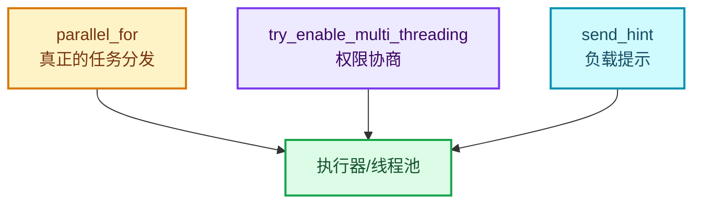

# 05 · lazy_threading 调度提示

[前置知识总入口](../README.md) · [本章导航](README.md) · [上一篇](04-线程池与parallel_for.md) · [下一章](../12-工具与调试/README.md)

> 基准：Blender `5.4.0-alpha`，本地工作树。本篇讲 `send_hint`——一个被广泛误解的机制。它的名字让人以为是"开启并行"，实际语义是"我要忙一阵，你去别处找活干"。主要源码：[`BLI_lazy_threading.hh`](../../../source/blender/blenlib/BLI_lazy_threading.hh)（实测 88 行，含极完整的文件头说明）、[`intern/lazy_threading.cc`](../../../source/blender/blenlib/intern/lazy_threading.cc)。

## 先回答一个具体问题

正篇 04-01 有这么一段：

```cpp
if (iterations >= 10) {
  /* Constructing and running the repeat zone has some overhead so that it's probably worth
   * trying to do something else in the meantime already. */
  lazy_threading::send_hint();
}
```

`[讲解]` 这行在做什么？**它不是"开始并行"**。

`[讲解]` 三个可能的误解：

| 误解 | 真相 |
| --- | --- |
| "启动多线程" | ❌ 不创建任何线程 |
| "让循环体并行" | ❌ 循环体是串行依赖 |
| "提高当前任务优先级" | ❌ 与优先级无关 |

正确理解：**"我接下来要占用这个线程一阵子，调度器可以把原本排队等我的其他任务挪到别的线程去。"**

## 文件头注释：完整的设计说明

`[讲解]` 这个文件的注释（L6-L66）是本系列见过最完整的之一。逐段读：

### 第一段：目标

> "The goal of 'lazy threading' is to avoid using threads unless one can reasonably assume that it is worth distributing work over multiple threads. Using threads can lead to worse overall performance by introducing inter-thread communication overhead. Keeping all work on a single thread reduces this overhead to zero and also makes better use of the CPU cache."

`[讲解]` 核心立场：**多线程不是免费的**。线程间通信有开销、缓存会失效。所以默认单线程。

### 第二段：grain size 的局限

> "Functions like #parallel_for also solve this to some degree by using a 'grain size'. When the number of individual tasks is too small, no multi-threading is used. This works very well when there are many homogeneous tasks that can be expected to take approximately the same time."

`[讲解]` `parallel_for` 的解法：**固定粒度**（比如每 1024 个元素一个任务）。任务数少于阈值就不开线程。

**适用条件**：任务同质（耗时相近）。

### 第三段：两种困难场景

> "The situation becomes more difficult when:
> - The individual tasks are not homogeneous, i.e. they take different amounts of time to compute.
> - It is practically impossible to guess how long each task will take in advance."

`[讲解]` 两个失效场景：

1. **异构任务**——有的 1ms 有的 1s，固定粒度会失衡；
2. **无法预知耗时**——依赖运行时数据。

**Repeat 正是第二种**：循环体执行多久取决于几何复杂度，建图前不知道。

### 第四段：为什么 TBB 的默认策略不够

> "While TBB will keep all tasks on a single thread if the other threads are busy, if they are idle they will start stealing the work even if that's not beneficial for overall performance."

`[讲解]` **这是关键洞察**。TBB 的 work-stealing 是这样：

- 其他线程空闲 → 会来"偷"任务；
- 即使偷了没好处（任务太小、拆分开销 > 收益）。

`[讲解]` 所以问题不是"要不要并行"，而是"**空闲线程会不会来捣乱**"。

### 第五段：解法（核心思想）

> "The key idea is this:
> > By default, all work stays on a single thread. If an individual task notices that it is about to start a computation that will take a while, it notifies the task scheduler further up on the stack. The scheduler then allows other threads to take over other tasks that were originally meant for the current thread."

`[讲解]` 用引号框起来的这段是**全文最重要的一段**。拆解：

1. **默认单线程**——不主动并行；
2. **任务自己判断**——"我要开始一段耗时计算了"；
3. **向栈上通知**——通知调度器；
4. **调度器放行**——允许其他线程接手"原本属于当前线程的其他任务"。

`[讲解]` 注意第 4 点：**被挪走的是"其他任务"，不是"当前任务"**。当前任务继续在原线程跑，只是不再独占其他待办任务。

### 第六段：收益结构

> "This way, when all tasks are small, no threading overhead has to be paid for. Whenever there is a task that keeps the current thread busy for a while, the other tasks are moved to a separate thread so that they can be executed without waiting for the long computation to finish."

`[讲解]` **两全其美**：

- 全是小任务 → 零并行开销；
- 有一个大任务 → 其他任务挪走，不干等。

### 第七段：越早越好

> "Consequently, the earlier a task knows during it execution that it will take a while, the better. That's because if it is blocking anyway, it's more efficient to move the other tasks to another thread earlier."

`[讲解]` **提示要尽早发**。如果等到算完了才提示，什么都没省。

`[讲解]` 这也解释了为什么 Repeat 在 `iterations >= 10` 时就在**建图前**发提示——它知道马上要复制 N 个 body 节点。

### 第八段：三件事

> "To make this work, three things have to be solved:
> 1. The task scheduler has to be able to start single-threaded and become multi-threaded after tasks have started executing.
> 2. There has to be a way for the currently running task to tell the task scheduler that it is about to perform a computation that will take a while.
> 3. Individual tasks have to decide when a computation is long enough to justify talking to the scheduler."

`[讲解]` 三件事的分工：

| # | 谁解决 | 本文件负责吗 |
| --- | --- | --- |
| 1 | 任务调度器（TBB 接入层） | ❌ |
| 2 | **本文件（`send_hint`）** | ✅ |
| 3 | 各任务的启发式（如 grain size） | ❌ |

`[讲解]` **本文件只解决第 2 件**——提供一个"通知调度器"的 API。第 1 件在执行器里，第 3 件在各调用点。

### 第九段：启发式不必重写

> "One could assume that this means adding new work-size checks to many parts in Blender, but that's actually not necessary, because these checks exist already in the form of grain sizes passed to e.g. #parallel_for. The assumption here is that when the task thinks the current work load is big enough to justify using threads, it's also big enough to justify using another thread for waiting tasks on the current thread."

`[讲解]` **复用已有判据**：`parallel_for` 的 grain size 本身就是"工作量够不够"的判断。所以：

- 不需要新增"这个任务大不大"的检查；
- 直接复用 grain size 的结论。

`[讲解]` 这是优雅的工程取舍——**不引入第二套阈值**。

## API 三个类型

`[讲解]` 头文件只有三个符号：

### send_hint

```cpp
/**
 * Tell task schedulers on the current thread that it is about to start a long computation
 * and that other waiting tasks should better be moved to another thread if possible.
 */
void send_hint();
```

`[讲解]` 一个无参函数。语义：通知当前线程上的所有调度器。

**"on the current thread"** —— 只影响当前线程，不跨线程。

### HintReceiver

```cpp
/**
 * Used by the task scheduler to receive hints from current tasks that they will take a while.
 * This should only be allocated on the stack.
 */
class HintReceiver {
 public:
  /**
   * The passed in function is called when a task signals that it will take a while.
   * \note The function has to stay alive after the call to the constructor. So one must not pass a
   * lambda directly into this constructor but store it in a separate variable on the stack first.
   */
  HintReceiver(FunctionRef<void()> fn);
  ~HintReceiver();
};
```

`[讲解]` 三个要点：

1. **只在栈上分配**——构造/析构隐式注册/注销；
2. **接受一个回调**——收到 hint 时调用；
3. **`\note` 警告**——lambda 必须先存到局部变量，不能直接传临时对象。

`[讲解]` 第 3 点为什么？因为 `FunctionRef` 是**非拥有**的引用（见第 03 章）。临时 lambda 的生命周期到语句结束，而 `HintReceiver` 可能活得更久——回调就是悬空。

**正确写法**：

```cpp
auto callback = [this]() { /* ... */ };   /* 先存局部变量 */
HintReceiver receiver{callback};
```

**错误写法**：

```cpp
HintReceiver receiver{[]() { /* ... */ }};   /* 临时 lambda，悬空 */
```

### ReceiverIsolation

```cpp
/**
 * Used to make sure that lazy-threading hints don't propagate through task isolation. This is
 * necessary to avoid deadlocks when isolated regions are used together with e.g. task pools.
 * For more info see the comment on #BLI_task_isolate.
 */
class ReceiverIsolation {
 public:
  ReceiverIsolation();
  ~ReceiverIsolation();
};
```

`[讲解]` 用途：**阻断 hint 传播**。

**为什么需要？** 注释说"避免死锁"：任务隔离区（task isolate）内如果收到 hint 并试图把任务挪走，可能造成互相等待。

`[讲解]` 用法：在隔离区入口构造、出口析构。区间内的 `send_hint` 被忽略。

## 接收端：谁在监听

`[讲解]` `HintReceiver` 的实现在执行器里。查源可知大概：

```text
GenericGraphExecutor 在 execute 开始时构造 HintReceiver
  → 回调内容：让 task pool 把待处理任务移到别的线程
```

`[讲解]` 具体回调做什么？取决于执行器实现。常见做法：

- 通知 TBB：当前线程即将阻塞，把队列里的任务分给别人；
- 或者立即把当前已排队但未执行的任务提交到线程池。

## 发送端：什么时候该发

`[讲解]` 本系列涉及的三个场景：

| 场景 | 阈值 | 位置 |
| --- | --- | --- |
| Repeat 建图 | `iterations >= 10` | 正篇 04-01 L210-L214 |
| `parallel_for` 大任务 | grain size | 各调用点 |
| 其他几何节点 | 视情况 | 各节点实现 |

`[讲解]` **为什么 Repeat 是 10？**

注释说得直白："Constructing and running the repeat zone has some overhead so that it's probably worth trying to do something else in the meantime already."

`[讲解]` 10 是个启发式阈值：

- 少于 10 轮：建图开销小，不值得折腾；
- 10 轮以上：复制 10 个 body 节点 + 建边，耗时可见。

**这个数字是经验值**，没有理论推导。

## 与其他并行机制的对比

`[讲解]` 三个容易混淆的机制：

| 机制 | 语义 | 创建线程吗 |
| --- | --- | --- |
| `threading::parallel_for` | 把 N 个任务分给多线程 | ✅ 是 |
| `Params::try_enable_multi_threading` | 申请"允许跨线程调我的方法" | ❌ 否（只是许可） |
| **`lazy_threading::send_hint`** | **"我要忙，你去别处找活"** | ❌ 否（只是提示） |

`[讲解]` 三者关系：



`[讲解]` 只有 `parallel_for` 真正创建任务。另两个都是**与调度器协商**。

## 用小数据走一遍

`[讲解]` 场景：主线程有 3 个任务排队（T1、T2、T3），当前执行 T1，T1 中途调 `send_hint`。

**发送前**：

```text
主线程队列: [T1(执行中), T2(等待), T3(等待)]
其他线程: 空闲（但可能来偷 T2/T3）
```

**send_hint 后**：

```text
主线程队列: [T1(执行中)]
其他线程: [T2, T3] ← 被挪走
```

`[讲解]` T1 继续在主线程跑完。结果：T2、T3 不用等 T1。

**如果不发 hint**：

```text
T1 跑 100ms → T2、T3 等 100ms → 总共 100ms+（串行）
```

**发了 hint**：

```text
T1 跑 100ms（主线程） ∥ T2+T3 跑 30ms（其他线程） → 总共 max(100, 30) = 100ms
```

`[讲解]` 收益只在"T1 明显长于其他任务之和"时体现。

## Repeat 的实际效果

`[讲解]` 正篇场景：Repeat 100 轮。

**不调 send_hint**：

```text
主线程：建图（复制 100 个 body 节点）→ 执行 100 轮
如果建图占 5ms、执行占 500ms
其他线程全程空闲
```

**调 send_hint（iterations >= 10 时）**：

```text
主线程：通知调度器 → 建图 → 执行
调度器：把原本等待这个任务的其他待办工作挪到别的线程
```

`[讲解]` **注意**：Repeat 的循环体本身**仍然串行**（有数据依赖）。`send_hint` 只是让"别的工作"能并行，不是让"这 100 轮"并行。

## 反例与边界

### 反例 1：以为 send_hint 会开启并行

它不创建任何线程。只是通知。

### 反例 2：在 `HintReceiver` 构造时传临时 lambda

`FunctionRef` 非拥有，临时对象销毁后回调悬空。必须先存局部变量。

### 反例 3：在隔离区里期待 hint 生效

`ReceiverIsolation` 会阻断。这是故意的（防死锁）。

### 反例 4：以为 hint 会传播到其他线程

只影响当前线程。

### 反例 5：在任务快结束时才发 hint

没收益。注释明确说"越早越好"。

### 反例 6：以为 Repeat 会因此并行执行循环体

循环体串行依赖不变。

## 对理解 Repeat 的帮助

`[讲解]` 本篇澄清了正篇里最容易误解的一行：

```cpp
if (iterations >= 10) {
  lazy_threading::send_hint();
}
```

`[讲解]` 三个层面的正确理解：

1. **时机**：建图**之前**发（因为建图是即将到来的耗时操作）；
2. **对象**：通知调度器，不是启动线程；
3. **效果**：让"其他任务"能并行，循环体仍串行。

`[讲解]` 这也呼应了正篇 06-02 的"三层并行边界"：

| 层 | 是否并行 | 机制 |
| --- | --- | --- |
| 图构建 | 内部 `index_values` 用 `parallel_for` | 真正的并行 |
| 循环体间 | ❌ 串行 | 数据依赖 |
| 循环体内 | 部分可并行 | 各节点自己的 `parallel_for` |

`send_hint` 属于**第 1 层的前奏**——它让建图期间其他任务能跑。

## 继续阅读

- [04-线程池与parallel_for](04-线程池与parallel_for.md) —— 真正的并行原语
- [04-01 RepeatEvalStorage与一次求值](../../重复区域-dsh/04-运行时机制/01-RepeatEvalStorage与一次求值.md) —— `send_hint` 的实际调用
- [06-02 性能模型与开销分析](../../重复区域-dsh/06-实战与性能/02-性能模型与开销分析.md) —— 三层并行边界
