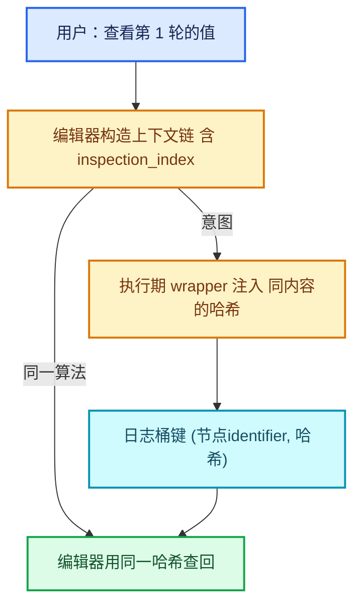

# 11-观察与调度

[前置知识总入口](../README.md) · [正篇：04-02 ComputeContext与迭代身份](../../重复区域-dsh/04-运行时机制/02-ComputeContext与迭代身份.md)

本章回答：日志与 Viewer 怎么定位到"第几轮"？depsgraph 如何驱动求值？线程池与 `parallel_for` 怎么用？`lazy_threading` 的提示机制是什么？

## 阅读顺序

| # | 篇目 | 源码主线 | 实测行数 |
| --- | --- | --- | --- |
| 1 | [01-日志与NodeTreeLogger](01-日志与NodeTreeLogger.md) | 节点警告/值日志的收集与分组 | 见下 |
| 2 | [02-Viewer与ViewerPath](02-Viewer与ViewerPath.md) | `DNA_viewer_path_types.h` + `MOD_nodes.cc` | 2018 |
| 3 | [03-depsgraph求值模型](03-depsgraph求值模型.md) | 依赖图、增量更新、求值调度 | 概要级 |
| 4 | [04-线程池与parallel_for](04-线程池与parallel_for.md) | 任务调度原语 | 概要级 |
| 5 | [05-lazy_threading调度提示](05-lazy_threading调度提示.md) | `BLI_lazy_threading.hh` | **88** |

## 本章与 Repeat 的关系

正篇 04-02、04-03 两篇（约 2000 行）建立在观察机制之上：

| 概念 | 在 Repeat 中的落点 | 正篇位置 |
| --- | --- | --- |
| `ComputeContextHash` | 日志/Viewer 的分组键 | 04-02 全篇 |
| `NodeTreeLogger` | inspection_index 越界 Info 警告 | 04-01 L217-L227 |
| Viewer path 解析 | `iterations_by_iteration_zone` 的填充 | 04-03 |
| depsgraph 求值 | 上下文链的根、增量重算 | 04-02 |
| `parallel_for` | `index_values` 并行填充（块 1024） | 03-03 L267-L271 |
| `send_hint` | iterations≥10 时的调度提示 | 04-01 L210-L214 |

**最关键的一条**：正篇反复强调"inspection_index 不是查询参数而是身份成分"。这句话的真正含义是：**日志系统按 (节点, 上下文哈希) 二元组落盘**，所以"看第几轮"必须体现为上下文哈希的一部分。本章第 01 篇把这个机制讲透。

## 实测行数总表

> **行数口径**：本表所有行数为**文件总行数**（含空行与注释），可用 `[System.IO.File]::ReadAllLines(path).Count` 复核。若用 `Get-Content | Measure-Object -Line` 会得到**非空行数**，两者不同，请勿混用。

| 文件 | 行数 |
| --- | --- |
| `modifiers/intern/MOD_nodes.cc` | 2018 |
| `blenkernel/BKE_compute_contexts.hh` | 222 |
| `blenlib/BLI_compute_context.hh` | 150 |
| `blenkernel/BKE_compute_context_cache.hh` | 95 |
| `blenlib/BLI_lazy_threading.hh` | 88 |
| **本章核心 5 文件合计** | **2,573** |

另涉及 `blenlib/intern/lazy_threading.cc`（约 60 行，未计入）、depsgraph 相关文件（本章概要级，不计入精确统计）。

## 观察链路

闭环成立的关键：**编辑期与执行期用同一套哈希算法**。任何一边改了输入格式，闭环就断——这是正篇 04-02 第 5 个不变量的由来。

## send_hint 的一个常见误解（提前说）

`lazy_threading::send_hint()` **不是**"开始并行"，而是"我这边要忙一阵，调度器可以先去别处找活干"。它是协作式调度提示，不是并行开关。正篇 04-01 里 `iterations >= 10` 时才调用它，正是这个语义。

第 05 篇会用 88 行源码把这件事彻底讲清。
