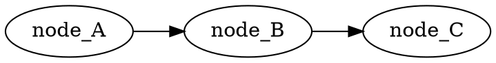

# 02 · 图导出与 dot 调试

[前置知识总入口](../README.md) · [本章导航](README.md) · [上一篇](01-源码导航与检索.md) · [下一篇](03-构建与运行验证.md)

> 基准：Blender `5.4.0-alpha`，本地工作树。本篇讲怎么把一张 `lf::Graph` 变成可视图——这是理解 Repeat 展开图最直观的手段。主要源码：[`FN_lazy_function_graph.hh`](../../../source/blender/functions/FN_lazy_function_graph.hh) L301-L313（`ToDotOptions` 与 `to_dot`）、[`intern/lazy_function_graph.cc`](../../../source/blender/functions/intern/lazy_function_graph.cc) L196 起（实现）、[`BLI_dot_export.hh`](../../../source/blender/blenlib/BLI_dot_export.hh)（导出框架）、[`BKE_node_runtime.hh`](../../../source/blender/blenkernel/BKE_node_runtime.hh) L111-L157（`logged_zone_graphs`）。

## 先回答一个具体问题

正篇 03-03 用 1271 行讲 `initialize_execution_graph` 怎么拼图。但这些图长什么样？

理论推演终究隔一层。Blender 提供了把图**导出成 Graphviz dot 文件**的能力——你可以在编辑器里打开 Repeat 区域，拿到它的展开图，用 Graphviz 渲染成图片，与文档里的示意图逐条比对。

这条路走通了，你就能自己验证任何关于"图结构"的结论。

## 三个导出入口

`[讲解]` Blender 里能拿到图的路径有三条：

| 入口 | 代码位置 | 拿到什么 |
| --- | --- | --- |
| `lf::Graph::to_dot()` | `FN_lazy_function_graph.hh` L313 | 任意 `lf::Graph` 的 dot 字符串 |
| `logged_zone_graphs` | `BKE_node_runtime.hh` L157 | 编辑器里 zone 内部图的 dot 快照 |
| `debug_zone_body_graphs` | `GeometryNodesLazyFunctionGraphInfo` | 每个 zone body 的图 |

`[讲解]` 三者关系：`to_dot()` 是底层能力，另两个是"什么时候自动调用它并保存"。

## to_dot 的接口与选项

```cpp
class ToDotOptions {
 public:
  virtual std::string socket_name(const Socket &socket) const;
  virtual std::optional<std::string> socket_font_color(const Socket &socket) const;
  virtual void add_edge_attributes(const OutputSocket &from,
                                   const InputSocket &to,
                                   dot_export::DirectedEdge &dot_edge) const;
};

std::string to_dot(const ToDotOptions &options = {}) const;
```

`[讲解]` 三个可定制的钩子：

| 钩子 | 默认行为 | 定制用途 |
| --- | --- | --- |
| `socket_name` | 用 socket 的 debug_name | 加行号、加类型标注 |
| `socket_font_color` | 无色 | 区分 Use/Usage 通道 |
| `add_edge_attributes` | 无额外属性 | 给边加颜色/样式，区分数据流与 usage 流 |

**为什么用虚函数而不是配置结构体？** 因为定制逻辑可能很复杂（比如根据 socket 名做正则匹配）。虚函数给了完全自由。

## 实现内部：借助 BLI_dot_export

`[讲解]` `to_dot` 本身不拼字符串，而是用 `BLI_dot_export.hh` 的框架：

```cpp
std::string Graph::to_dot(const ToDotOptions &options) const
{
  dot_export::DirectedGraph digraph;
  digraph.set_rankdir(dot_export::Attr_rankdir::LeftToRight);
  Map<const Node *, dot_export::NodeWithSocketsRef> dot_nodes;
  ...
}
```

`[讲解]` 三个要点：

1. **`DirectedGraph`**：有向图模型，支持节点、边、rankdir 等 Graphviz 属性。
2. **`set_rankdir(LeftToRight)`**：强制从左到右布局。这对数据流图很重要——Graphviz 默认是从上到下，但数据流从左到右更易读。
3. **`NodeWithSocketsRef`**：把"节点 + 它的多个 socket"映射成一个 dot 节点。这样 dot 里一个节点可以画多个端口。

`[讲解]` 为什么用 `BLI_dot_export` 而不是手写 dot 字符串？

- 转义处理（名字里的引号、特殊字符）；
- 属性合并（同名属性只写一次）；
- 一致性（Blender 里所有 dot 导出都用它）。

## Graphviz 是什么

`[讲解]` 如果没接触过：Graphviz 是一个用文本描述图、自动布局的工具。它的输入格式是 `.dot`：



`[讲解]` 三个特征：

1. **布局是自动的**——你只描述"谁连谁"，不描述坐标；
2. **适合看拓扑**——节点几十上百个时，自动布局比手画更省力；
3. **不适合看精确数值**——只关心结构，不支持运行时值。

**这正是 lf 图调试需要的东西**：我们关心的是"body 节点怎么串、usage 怎么连"，不是每个值是多少。

## 渲染 dot 的方法

`[讲解]` 拿到 `.dot` 文件后，两条路：

### 本地安装 Graphviz

```bash
dot -Tpng graph.dot -o graph.png
dot -Tsvg graph.dot -o graph.svg
```

`[讲解]` `dot` 命令是 Graphviz 的默认布局引擎（有向图）。其他引擎：`neato`（力图）、`fdp`（力导向）、`circo`（环形）。

对 lf 图，`dot` 最合适——它识别层次结构，能把串行链排成一行。

### 在线查看

`[讲解]` 把 dot 文本粘进任何 Graphviz 在线渲染器即可。适合快速查看，不适合处理敏感数据。

## logged_zone_graphs：编辑器里的自动导出

`[讲解]` 这是最实用的入口。看源码（`BKE_node_runtime.hh` L111-L157）：

```cpp
struct LoggedZoneGraphs {
  Mutex mutex;
  /**
   * Technically there can be more than one graph per zone because the zone can be invoked in
   * different contexts. However, for the purpose of logging here, we only need one at a time
   */
  Map<int, std::string> graph_by_zone_id;
};

struct bNodeTreeRuntime {
  ...
  /** Allows logging zone graphs purely for debugging purposes. */
  std::unique_ptr<LoggedZoneGraphs> logged_zone_graphs;
};
```

`[讲解]` 逐层解读：

1. **`unique_ptr`**：默认不启用（nullptr），必须显式打开——因为导出有开销。
2. **`Mutex`**：求值可能多线程，导出必须加锁。
3. **`Map<int, std::string>`**：键是 zone 的输出节点 identifier，值是 dot 字符串。
4. **注释里的取舍**："同一个 zone 可以因为不同上下文产生多张图，但这里只需要一张"——**先到先得**。

### Repeat 里的写入点

`[讲解]` 正篇 03-03 的 L403-L409 是实际的写入代码：

```cpp
const bNodeTree &btree_orig = *DEG_get_original(&btree_);
if (btree_orig.runtime->logged_zone_graphs) {
  std::lock_guard lock{btree_orig.runtime->logged_zone_graphs->mutex};
  btree_orig.runtime->logged_zone_graphs->graph_by_zone_id.lookup_or_add_cb(
      repeat_output_bnode_.identifier, [&]() { return lf_graph.to_dot(); });
}
```

`[讲解]` 四个细节：

1. **用 `DEG_get_original`**：写到**原始**树的 runtime，不是求值副本——因为编辑器读的是原始树。
2. **`if (... logged_zone_graphs)`**：没启用就完全跳过，零开销。
3. **`lookup_or_add_cb`**：已存在就不覆盖（**先到先得**）。
4. **`std::lock_guard`**：多线程安全。

**注意位置**：这段在 `initialize_execution_graph` 的**末尾**——图已经拼完、`update_node_indices` 已调用之后。所以导出的 dot 反映的是最终形态。

### 怎么启用

`[讲解]` 源码里 `logged_zone_graphs` 默认是 null。启用方式（不同版本可能不同，以实际代码为准）：

- 调试构建里可能有环境变量或命令行开关；
- 或者在 `bNodeTreeRuntime` 初始化处打断点、手动赋值；
- 也可以临时改代码：在 `btree.runtime->logged_zone_graphs` 首次访问前构造一个 `LoggedZoneGraphs`。

**实操建议**：如果你只是想看一张图，直接在你的代码里插一句 `std::cout << lf_graph.to_dot()` 更快——正篇源码里就有被注释掉的一行：

```cpp
// std::cout << "\n\n" << lf_graph.to_dot() << "\n\n";
```

`[讲解]` 这行注释在 `initialize_execution_graph` 里（正篇 L365），作者调试时就用的这个办法。取消注释、重新构建、跑一次带 Repeat 的场景，dot 就打印到终端了。

## debug_zone_body_graphs：看 body 内部

`[讲解]` 除了 zone 的展开图，还有 body 内部图：

```cpp
lf_graph_info_->debug_zone_body_graphs.add(zone.output_node()->identifier, &lf_body_graph);
```

`[讲解]` 这在 `build_zone_body_function` 的末尾（正篇 03-02 讲过）。它保存的是**循环体内部的图**——不是展开后的 N 份，而是那**一份**被复制的模板。

**用途**：想理解"循环体内部有哪些节点、怎么连"时看这个；想理解"它们怎么被复制成 N 份"时看展开图。

## 一张 3 轮展开图的形态

`[讲解]` 把正篇 03-03 的推演转成 dot 后会看到什么。场景：3 轮迭代、1 个 Geometry item、1 条 border link：

```text
digraph {
  rankdir=LR;

  /* 图输入（来自 zone 外部） */
  in_Geometry [label="Geometry"];
  in_LinkFromX [label="Link from X"];

  /* 3 个 body 节点，串成链 */
  body0 [label="Repeat Body #0"];
  body1 [label="Repeat Body #1"];
  body2 [label="Repeat Body #2"];

  /* border link 的 usage 合并（LogicalOr） */
  or0 [label="LogicalOr"];

  /* 图输出 */
  out_Geometry [label="Geometry"];

  /* 主值链 */
  in_Geometry -> body0;
  body0 -> body1;
  body1 -> body2;
  body2 -> out_Geometry;

  /* border link 值：扇出到所有 body */
  in_LinkFromX -> body0;
  in_LinkFromX -> body1;
  in_LinkFromX -> body2;

  /* border link usage：每个 body 贡献一路，or 节点合并 */
  body0 -> or0;
  body1 -> or0;
  body2 -> or0;
  or0 -> out_BorderLinkUsage;
}
```

`[讲解]` 三个可验证的特征：

1. **`in_LinkFromX` 扇出到 3 个 body**——border link 值算一次、各轮共享（正篇 03-03 L1250 的结论）。
2. **主值链是一条直线**——串行依赖。
3. **`or0` 有 3 个输入**——因为 `LazyFunctionForLogicalOr(iterations)` 的输入数 = 迭代数。

**关键**：如果你导出的图与上面形态不符，说明你对代码的理解有偏差——这才是 dot 导出的价值。

## 用 dot 验证三个常见误解

`[讲解]` 三个可以用图一眼看穿的误解：

| 误解 | dot 里的真相 |
| --- | --- |
| "border link 每轮重新求值" | `in_LinkFromX` 只有一个，扇出三条边 |
| "Usage 通道只有一条" | 每个 main 输入/输出都配一条 `Usage:` 边 |
| "0 轮迭代什么都不连" | 0 轮时 `in_Geometry` 直连 `out_Geometry` |

第三个特别值得亲手验：把 Iterations 设成 0，导出图，你会看到**没有任何 body 节点**，只有输入直连输出——正篇说的"直通分支"就是这个形态。

## 反例与边界

### 反例 1：以为 dot 里能看到运行时值

dot 只有结构。值要看日志或 Viewer。

### 反例 2：以为 `logged_zone_graphs` 会持续更新

`lookup_or_add_cb` 只写一次。第二次求值（图变了）不会覆盖——这就是注释说的"先到先得"。

### 反例 3：忘记 `update_node_indices` 就导出

如果在那之前调 `to_dot`，节点索引可能是未初始化的，边会错乱。正篇源码把导出放在 `update_node_indices()` 之后是有意的。

### 反例 4：以为 dot 能处理超大图

几百节点还行，几千节点时 Graphviz 布局会非常慢。此时用 `-Tplain` 拿文本结构，或用 `gvpr` 过滤。

### 反例 5：用错布局引擎

`neato`/`fdp` 会把串行链摆成散点。lf 图必须用 `dot`（层次布局）。

### 反例 6：以为 `debug_zone_body_graphs` 和 `logged_zone_graphs` 一样

前者存 body **模板**（1 份），后者存 zone **展开图**（N 份合并后的那张）。

## 对理解 Repeat 的帮助

`[讲解]` 三个"必须导一次图"的场景：

| 场景 | 看什么 | 对应正篇 |
| --- | --- | --- |
| 不理解 N 份 body 怎么串 | 展开图的主值链 | 03-03 第 6 节 |
| 不理解 border link 的 OR 合并 | `or` 节点的入度 | 03-03 第 4 节 |
| 不理解索引映射为什么"跳一格" | 图输入/输出的数量对比 | 03-03 第 12 节 |

**最后一个特别有说服力**：数一数 dot 里 `label="Geometry"` 这类图输入有几个、`Usage:` 有几个，与 `input_index_map` 的长度对比，就能验证"整体右移 / 挖洞"的正确性。

## 继续阅读

- [01-源码导航与检索](01-源码导航与检索.md) —— 定位源码
- [03-构建与运行验证](03-构建与运行验证.md) —— 验证改动
- 正篇：[03-03 执行图按迭代展开](../../重复区域-dsh/03-几何节点执行架构/03-执行图按迭代展开.md)
