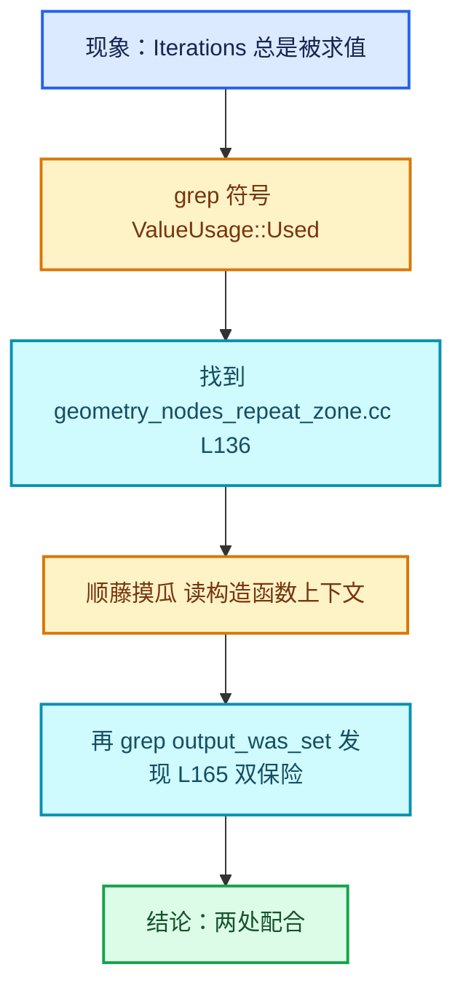

# 12-工具与调试

[前置知识总入口](../README.md)

本章回答：怎么在约 300 万行的 Blender 源码里高效找到想要的东西？怎么把一张执行图导出成可视图？怎么验证改动没有破坏语义？

## 阅读顺序

| # | 篇目 | 内容 |
| --- | --- | --- |
| 1 | [01-源码导航与检索](01-源码导航与检索.md) | 目录结构、符号定位、git 历史检索 |
| 2 | [02-图导出与dot调试](02-图导出与dot调试.md) | `to_dot()`、`logged_zone_graphs`、可视化 |
| 3 | [03-构建与运行验证](03-构建与运行验证.md) | 构建配置、最小复现、回归检查 |

## 本章与 Repeat 的关系

正篇多处用到本章的工具：

| 工具 | 用途 | 源码位置 / 正篇位置 |
| --- | --- | --- |
| `lf::Graph::to_dot()` | 对照手画图与引擎建图 | `FN_lazy_function_graph.hh` L313（声明） `intern/lazy_function_graph.cc` L196（实现） |
| `logged_zone_graphs` | 编辑器里导出 zone 内部图 | `BKE_node_runtime.hh`（`std::unique_ptr<LoggedZoneGraphs>`） 正篇 03-03 L403-L409 |
| `ScopedNodeTimer` | Profile 里的 "Repeat Zone" 耗时条 | `NOD_geometry_nodes_lazy_function.hh` L550 正篇 04-01 L155 |
| `ComputeContext::print_stack` | 打印完整执行位置链 | `BLI_compute_context.hh` 正篇 04-02 |
| `grep -n "符号名"` | 行号漂移时重新定位 | 全篇基准说明 |
| `git log -L` | 追踪某个函数的演化 | 各篇"历史背景" |

## 实测确认的三处工具位置

| 工具 | 文件 | 行 |
| --- | --- | --- |
| `Graph::to_dot` 声明 | `source/blender/functions/FN_lazy_function_graph.hh` | 313 |
| `Graph::to_dot` 实现 | `source/blender/functions/intern/lazy_function_graph.cc` | 196 |
| `ScopedNodeTimer` | `source/blender/nodes/NOD_geometry_nodes_lazy_function.hh` | 550 |
| `logged_zone_graphs` 字段 | `source/blender/blenkernel/BKE_node_runtime.hh` | 见下 |

`to_dot` 内部用 `BLI_dot_export.hh`，方向固定为 LeftToRight（`graph.cc` L199），节点/边通过 `dot_export::NodeWithSocketsRef` 建模。

## 一个实用的检索套路

以"Repeat 的 Iterations 为什么永不被裁剪"为例：



这个套路可以套用到任何"某条语义在哪实现"的问题上： **现象 → 关键符号 → 定义点 → 反向查调用方 → 交叉验证**。

## 本系列撰写时用到的两个实用技巧

**技巧 1：无 shell 环境下探测文件行数**

本系列有一段时间 PowerShell 因沙箱故障不可用，改用 `read` 工具探测：

```
read(file_path, offset=99999, limit=2)
→ Error: offset 99999 is out of range for "..." (N lines)
```

返回的 `N` 就是总行数。对任何只能读文件的环境都适用。

**技巧 2：用 grep 的 `-List` 模式定位定义**

要找某个类的定义位置时，`grep -l "class Foo"` 比全文搜更快；本系列的 `why_check` / `why_file` 工具还能查"这个文件在历史会话里被谁改过、为什么改"，对理解设计演化特别有用。

## 本章的特殊地位

本章与前 11 章不同：它是**方法论的元章节**，不针对某个知识族，而是教你怎么自己找答案。读完本章，你应该具备"脱离本系列自学任意 Blender 子系统"的能力——这才是前置知识体系真正的终点。


