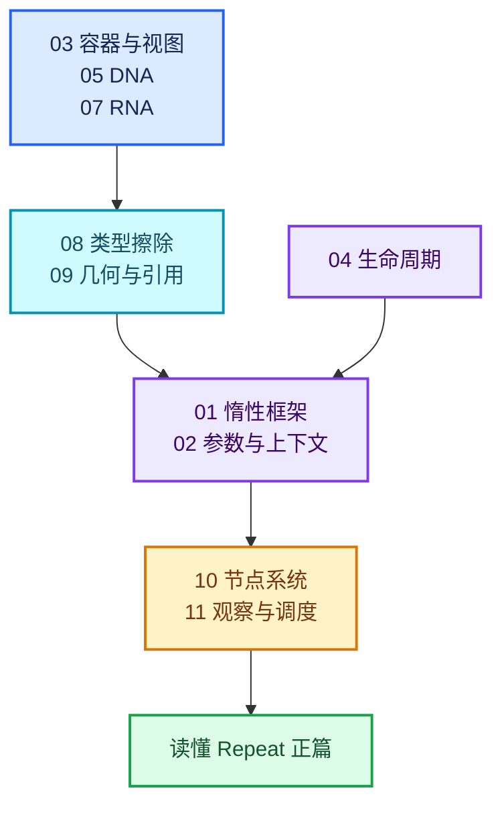

# 00-前置知识

[总入口](../README.md) · [课程指南](../00-课程指南/README.md) · [正篇第一章](../01-Zone系统基础/README.md)

本专题是《重复区域（Repeat Zone）全面学习》的**前置知识体系**。

## 为什么需要这一整套

主系列 18 篇正文大量"使用"底层概念却从不系统定义它们。实测统计（正文匹配行数）：

| 概念族 | 引用次数 | 读者第一次撞上 |
| --- | --- | --- |
| LazyFunction 执行框架 | 407 | 01-01 末尾、03-01 全篇 |
| BLI 容器与视图 | 203 | 01-01（`Span`/`VectorSet`） |
| DNA / SDNA | 136 | 01-01 第 78 行 |
| GeometrySet / 匿名属性 / reference set | 127 | 03-02 第 1262 行 |
| SocketValueVariant / CPPType | 96 | 03-01 第 124 行 |
| RNA / StructRNA / PointerRNA | 35 | 01-02 第 113 行 |

这 6 个知识族背后的源码体量约 **2.1 万行**：

- LazyFunction 框架 ≈ 3,542 行（`FN_lazy_function.hh` 479、`lazy_function_graph_executor_generic.hh` 1503、`FN_lazy_function_graph.hh` 554 等）
- BLI 容器与视图 ≈ 5,165 行（`BLI_vector_set.hh` 1168、`BLI_map.hh` 1383、`BLI_cpp_type.hh` 823、`BLI_span.hh` 763 等）
- RNA 属性系统 ≈ 3,000 行以上（`RNA_types.hh` 1180、`RNA_access.hh` 1159 等）
- DNA 与序列化 ≈ 1,500 行以上
- 节点系统 ≈ 6,000 行以上（`DNA_node_types.h` 4047、`NOD_node_declaration.hh` 826 等）
- 几何与引用 ≈ 2,400 行以上（`BKE_geometry_set.hh` 852、`FN_field.hh` 735 等）

任何一族都撑得起 5–7 篇千行文档。因此本专题按知识族分成 **12 个子文件夹、58 篇**。

## 目录结构

| 子文件夹 | 篇数 | 回答什么问题 |
| --- | --- | --- |
| [01-惰性执行框架](01-惰性执行框架/README.md) | 7 | 什么叫"惰性函数"？图怎么组、执行器怎么调度、需求怎么传播？ |
| [02-参数转发与上下文](02-参数转发与上下文/README.md) | 4 | 参数怎么存、怎么转发、`RemappedParams` 解决什么、线程许可怎么管？ |
| [03-BLI容器与视图](03-BLI容器与视图/README.md) | 7 | `Span` 与 `MutableSpan` 有何区别？为什么 `VectorSet` 能兼任索引？ |
| [04-生命周期与分配](04-生命周期与分配/README.md) | 4 | 谁拥有谁？`LinearAllocator` 与 `ResourceScope` 为何是两套？ |
| [05-DNA与序列化](05-DNA与序列化/README.md) | 5 | DNA 是什么？`makesdna` 干什么？`_pad` 为什么手写？ |
| [06-版本迁移与兼容](06-版本迁移与兼容/README.md) | 3 | 老文件怎么升级？标识符为什么不能复用？ |
| [07-RNA属性系统](07-RNA属性系统/README.md) | 5 | `StructRNA`/`PropertyRNA`/`PointerRNA` 是什么关系？ |
| [08-类型擦除](08-类型擦除/README.md) | 4 | `CPPType` 与 `SocketValueVariant` 如何让一种容器装所有类型？ |
| [09-几何数据与引用](09-几何数据与引用/README.md) | 5 | `GeometrySet` 为何复制很便宜？匿名属性与 reference set 是什么？ |
| [10-节点系统基础](10-节点系统基础/README.md) | 6 | `bNode`/`bNodeSocket`/声明系统/拓扑缓存如何协作？ |
| [11-观察与调度](11-观察与调度/README.md) | 5 | 日志与 Viewer 如何定位？depsgraph 与线程池怎样驱动求值？ |
| [12-工具与调试](12-工具与调试/README.md) | 3 | 怎么高效检索源码、导出执行图、验证改动？ |

共 **58 篇正文 + 13 个 README**。

## 推荐阅读路径

### 路径 A：只求读懂 Repeat 正篇（最短）

```
03-03 Span与MutableSpan → 03-04 Vector与Array → 03-05 VectorSet
→ 04-01 LinearAllocator → 05-03 DNA结构体编写规则
→ 08-02 SocketValueVariant → 01-01 惰性求值模型 → 01-04 ValueUsage
```

约 8 篇即可扫清正篇的主要阻塞点。

### 路径 B：想改 Repeat 的代码（完整硬前置）

`01` 全部 → `02` 全部 → `03` 全部 → `04` 全部 → `05` 全部 → `07-04` → `08` 全部 → `09` 全部

### 路径 C：想成为 Blender 节点开发者（全读）

按 `01` → `12` 顺序。

## 与主系列的关系

- 每篇前置文档都以"**这对理解 Repeat 的哪一段有直接帮助**"收尾，指向具体正篇。
- 反过来，正篇遇到尚未展开的概念时会指向本专题对应篇。
- 本专题不重复正篇内容；正篇也不重复本专题。

## 既有短篇的处理

`.markdown/学习节点/几何节点类/` 下已有 `04_LazyFunction.md`、`08_SocketValueVariant.md`、`10_CPPType.md`、`12_GeometrySet.md` 等短篇（约 100–400 行/篇）。它们保留为**速查**定位；本专题作为**深度版**，会引用但完整重写，不复制原文。

同理，`.vscode/杂/markdown/全面学习-codex/01-基础容器与现代CPP/` 的 20 篇容器专题面向通用 C++ 库读者，本专题的 `03`、`04` 两章会与之互为参照，但补充"为什么 Repeat Zone 需要它"的语境。

## 统一约定

- **源码基准**：本地工作树 `D:\Repository\blender-git\blender`（Blender 5.4.0-alpha）。所有行号实测，若漂移请以符号名检索。
- **链接前缀**：从 `00-前置知识/<子文件夹>/` 出发，源码链接用 `../../../source/...`（三层回仓库根）；系列内链接用 `../`（同专题）或 `../../`（回主系列）。
- **图表配色**：六色 classDef，与主系列一致：
  - input `#DBEAFE` / `#2563EB` / `#172554`
  - data `#CFFAFE` / `#0891B2` / `#164E63`
  - abstraction `#EDE9FE` / `#7C3AED` / `#3B0764`
  - compute `#FEF3C7` / `#D97706` / `#78350F`
  - result `#DCFCE7` / `#16A34A` / `#14532D`
  - error `#FEE2E2` / `#DC2626` / `#7F1D1D`
  - 均带 `stroke-width:2px`
- **固定栏目**：先回答一个具体问题 → 相关类型与职责 → 教学注释代码（配原始源码折叠）→ 用小数据走一遍 → 反例与边界 → 对理解 Repeat 的帮助 → 继续阅读。


