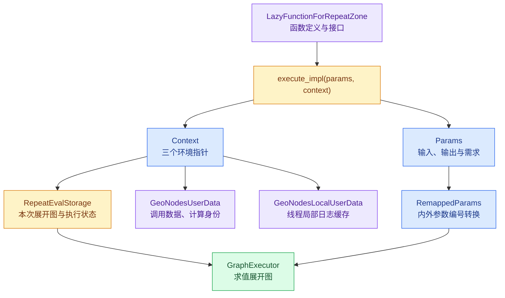
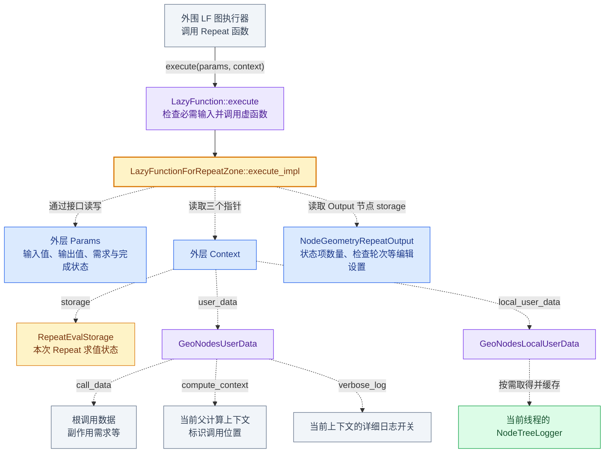
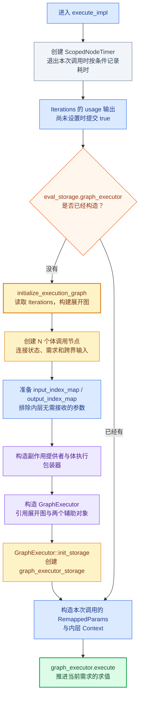
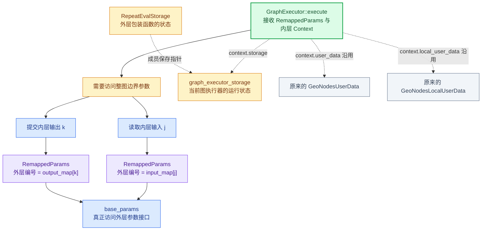
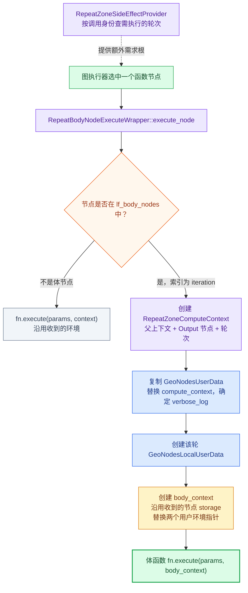

# 01 · 执行入口与相关类

从 [阅读路径](重复区域-源码阅读路径.md) 的第一站开始。源码打开 [geometry_nodes_repeat_zone.cc](../../source/blender/nodes/intern/geometry_nodes_repeat_zone.cc)，定位 `execute_impl`。本文行号对应当前本地源码；换行构成的同一条语句放在一起解释。

## 先分清三个对象

| 对象 | 这里的实例 | 负责什么 |
| --- | --- | --- |
| 节点编辑数据 | `repeat_output_bnode_`、`node_storage` | 保存 Repeat Items、检查轮次等设置 |
| 函数定义 | `LazyFunctionForRepeatZone`、`body_fn_` | 描述如何调用 Repeat，以及一轮做什么 |
| 本次求值的数据 | `RepeatEvalStorage` | 持有这次展开的图、执行器和执行状态 |

不要把 Output 节点里的 `storage` 与 `context.storage` 混为一谈：前者是节点设置，后者是函数求值存储。

## 读到的类，就在这里查

`lf` 是 lazy-function 相关命名空间的别名。这里的“函数”是执行系统中的对象，有输入输出描述和执行方法。

| 类 / 结构 | 本处用途 | 定义入口 |
| --- | --- | --- |
| `LazyFunction` | 按需函数基类；Repeat 通过重写 `execute_impl` 提供行为 | [FN_lazy_function.hh](../../source/blender/functions/FN_lazy_function.hh) |
| `lf::Params` | 读取输入、写输出、查询输出是否已设置；也是需求传播的接口 | 同上，`Params` |
| `lf::Context` | 携带 `storage`、`user_data`、`local_user_data` 指针 | 同上，`Context` |
| `GeoNodesUserData` | 几何节点的调用环境，含计算上下文、调用数据、日志开关 | [NOD_geometry_nodes_lazy_function.hh](../../source/blender/nodes/NOD_geometry_nodes_lazy_function.hh)，`GeoNodesUserData` |
| `GeoNodesLocalUserData` | 提供局部求值辅助数据和日志访问 | 同上，`GeoNodesLocalUserData` |
| `NodeGeometryRepeatOutput` | Output 节点的持久化设置，如 `items_num` 和 `inspection_index` | [DNA_node_types.h](../../source/blender/makesdna/DNA_node_types.h) |
| `ScopedNodeTimer` | 构造时记开始时间，析构时按条件记录耗时 | `NOD_geometry_nodes_lazy_function.hh` |
| `lf::RemappedParams` | 把内层执行器的参数编号映射到外层 Repeat 参数编号 | [FN_lazy_function_execute.hh](../../source/blender/functions/FN_lazy_function_execute.hh) |
| `lf::GraphExecutor` | 执行 lazy-function 图，本身也属于 `LazyFunction` | [FN_lazy_function_graph_executor.hh](../../source/blender/functions/FN_lazy_function_graph_executor.hh) |

### 1. LazyFunction：一个能分次完成的计算对象

#### 先读源码注释：FN_lazy_function.hh 第 10—41 行

原文位置：[FN_lazy_function.hh](../../source/blender/functions/FN_lazy_function.hh)。下面按注释段落翻译，再解释其在源码中的含义。后续阅读类时也按这个顺序：先读作者注释，再看成员与方法，最后代入 Repeat 的实际调用。

**第 10—13 行：什么是 LazyFunction。**

翻译：`LazyFunction` 封装了一项计算，这项计算有输入、输出，也可能有副作用。最关键的是，它支持输入与输出的惰性处理：只需要计算实际被使用的输出；可以根据哪些输出被使用，或者函数具有什么副作用，按需请求输入。

解释：“封装计算”指把接口与执行行为组织成一个函数对象。“惰性”在这里是根据需求决定工作范围和时机。例如一个函数有两个输出，而调用者只需要第一个，就不一定要计算第二个；如果第一个输出只依赖部分输入，也不一定要把全部输入都算出来。

“副作用”表示执行需求不完全来自普通输出值。例如 Viewer 的观察需求可能要求执行某些节点。不能仅凭最终状态输出没有被使用，就推断区域内部所有工作都能跳过。Repeat 后面的副作用提供者正是在参与这件事。

**第 15—18 行：为什么一个函数可能被执行多次。**

翻译：使用惰性机制的函数，可能执行不止一次。最常见的例子是几何节点 Switch：它根据条件输入，决定其他输入中究竟使用哪一个。从 Switch 节点的角度，它的执行过程如下。

解释：第一次进入时，函数未必已经拿到所有需要的数据。它可以先提出输入需求并返回，把控制权交还调用者；输入准备好之后，调用者再进入同一个函数，继续完成计算。这里说的多次执行，是为了完成同一次求值，不是 Repeat 的多轮迭代。

**第 19—20 行：Switch 第一次调用。**

翻译：Switch 首次执行。它发现输出被使用，于是向调用者请求条件输入，然后退出。

解释：此时尚不知道该走 true 还是 false 分支，所以先请求条件。对应 `Params` 的接口思路是：尝试取得条件；尚未就绪就登记请求并返回。函数自己不必沿着所有上游节点递归计算，调度工作交给调用者或执行器。

**第 21—23 行：Switch 第二次调用。**

翻译：调用者能够提供条件输入后，Switch 再次执行。这一次它读取条件，请求另外两个输入中的一个，然后再次退出，将控制权交还调用者。

解释：例如条件为 true，就只请求 true 分支的值。另一个分支如果没有其他需求，就可以不计算。第二次调用中条件已经就绪，但被选分支的值还可能没有就绪，因此仍可能先返回。

**第 24—25 行：Switch 第三次调用。**

翻译：当调用者算出了第二次请求的输入后，Switch 最后再执行一次。这一次它读取新输入，并将其传递到输出。

解释：至此，这次求值要求的输出已经完成。三次调用是注释展示的典型过程，不是固定次数要求；如果某些输入已经准备好，实际过程可以更短。

| 调用 | 已知信息 | 本次推进的工作 | 返回时的状态 |
| --- | --- | --- | --- |
| 第一次 | 输出被需要 | 请求条件 | 等待条件 |
| 第二次 | 条件已就绪 | 选择分支，请求该分支值 | 等待分支值 |
| 第三次 | 分支值已就绪 | 提交输出 | 所需输出完成 |

**第 27—29 行：可以把它看作状态机。**

翻译：从某种意义上说，惰性函数可以被看成一个状态机。每次执行，它都会推进自身状态，直到所有必需输出都已准备好。

解释：这里的“状态机”是一种理解方式，不要求每个子类都定义一个 `enum State`。状态可以体现在输入是否可用、输出是否已经设置，以及 `context.storage` 保存的中间进度中。这也解释了为什么 Repeat 要检查 `output_was_set()`，以及为什么已经初始化的 `graph_executor` 要保存在求值存储中。

**第 31—34 行：组合成更大的函数后，惰性仍要有效。**

翻译：惰性函数接口被设计为能够把许多这样的函数组合成新的惰性函数，同时保持惰性机制有效。例如，在几何节点中，节点组内部的 Switch 仍应能够决定父节点组中的某个节点是否执行。这对避免不必要的工作至关重要。

解释：假设外部节点为节点组提供两个分支输入，而组内 Switch 只选择其中一个。即使跨过了节点组边界，这个选择仍应影响外部输入的求值需求；否则进入节点组前就把两个分支全部计算，按需执行的收益就丢失了。

Repeat 也有内外两层函数。包装函数调用展开图，展开图调用体函数，需要在这些层之间传递值与需求。`RemappedParams` 负责接口编号适配，usage 辅助插槽负责部分显式需求传播；不过 Repeat 当前跨轮传播还存在保守处理，不能由这段总体设计注释推断所有 Repeat 需求都已精确裁剪。

**第 36—41 行：系统的三个核心组成部分。**

翻译：惰性函数系统包含多个核心组件：惰性函数自身的接口及调用约定；用于连接多个惰性函数输入输出、将它们组合起来的图数据结构；支持这类图多线程执行的执行器。

解释：这里正好给出了继续读代码的三层入口：

| 注释中的组件 | 对应源码对象 | 阅读时关注什么 |
| --- | --- | --- |
| 函数接口与调用约定 | `LazyFunction`、`Params`、`Context` | 怎样请求输入、提交输出、保存进度 |
| 图数据结构 | `lf::Graph`、`lf::FunctionNode`、插槽和连线 | 多个函数的依赖如何表示 |
| 图执行器 | `lf::GraphExecutor` | 如何根据需求与依赖推进求值 |

“支持多线程”描述执行系统的能力，不表示有数据依赖的循环轮次能够随意同时执行。Repeat 的上一轮输出连到下一轮输入时，该依赖仍然必须满足。

#### 再看类成员和方法

定义入口是上表的 `FN_lazy_function.hh`。先看三个成员，再看三个方法：

```cpp
const char *debug_name_;
Vector<Input> inputs_;
Vector<Output> outputs_;

void execute(Params &params, const Context &context) const;
virtual void execute_impl(Params &params, const Context &context) const = 0;
virtual void *init_storage(LinearAllocator<> &allocator) const;
```

逐项解释：

- `debug_name_` 是调试名称，Repeat 把它设为 `Repeat Zone`。
- `inputs_` 是输入接口描述数组。`Input` 包含调试名称、`CPPType` 类型指针、静态需求 `usage`。它不保存当前输入的整数或几何数据。
- `outputs_` 是输出接口描述数组。`Output` 包含调试名称和类型指针，也不保存当前输出结果。
- `execute()` 是公开调用入口。源码中先建立 profiling 作用域、检查始终使用的输入已经可用，然后调用虚函数 `execute_impl()`。
- `execute_impl()` 是子类真正实现行为的地方；`= 0` 表示纯虚函数，因此不能直接创建一个普通 `LazyFunction` 对象来计算。
- `init_storage()` 为某次求值创建可跨多次调用保留的状态；对应的 `destruct_storage()` 负责析构。

为什么允许分次完成？例如 Switch 第一次只知道输出被需要，于是请求条件输入后返回；条件就绪后再决定请求哪一侧输入；该输入就绪后才输出结果。这里的“返回”不一定意味着整次计算完成，调用者会在条件满足后继续调用。Repeat 的执行器同样需要保留运行状态，避免再次进入时丢失已经完成的工作。

函数定义和运行状态因此分开放置：`LazyFunctionForRepeatZone` 保存区域、接口和体函数引用，`RepeatEvalStorage` 保存这次求值的展开图与执行器状态。一个函数对象不能简单把所有求值状态都放进自己的成员里。

### 2. Params：读取值、请求值、提交结果的接口

`Params` 是抽象接口，包含 `const LazyFunction &fn_`，说明这套参数是为哪个函数准备的。实际值存放在哪里、如何触发上游计算，由具体子类实现；不要把它理解成单纯的 `vector<数值>`。

| 方法 | 准确作用 | 在这里怎样理解 |
| --- | --- | --- |
| `try_get_input_data_ptr(i)` | 输入已经就绪则返回地址，否则返回空 | 查询不等于请求上游计算 |
| `try_get_input_data_ptr_or_request(i)` | 已就绪则返回地址，否则提出需求并返回空 | 可以返回调用者，等待以后再执行 |
| `get_input<T>(i)` | 对已存在输入提供带类型访问 | Repeat 用它取 Iterations；前提是输入已经就绪 |
| `get_output_data_ptr(i)` | 取得输出位置，初始内存尚未构造值 | 写非平凡 C++ 对象需要正确构造 |
| `output_set(i)` | 通知调用者输出已最终完成 | 通知后不可再访问或改写该值，调用者可能立即移动或析构它 |
| `set_output(i, value)` | 带类型的辅助方法，构造输出并标记已设置 | Repeat 用它提交 Iterations 的需求信号 true |
| `output_was_set(i)` | 查询是否已经提交该输出 | 防止分次调用重复提交同一输出 |
| `get_output_usage(i)` | 查询输出当前的需求状态 | 决定哪些结果需要计算 |
| `set_input_unused(i)` | 告诉调用者某个输入确定不会使用 | 不能把已经是 Used 的输入重新声明为不用 |

`ValueUsage` 有三种：`Used` 是确定需要，`Maybe` 是还不确定，`Unused` 是确定不用。`Maybe` 不是 false，也不代表输入必然缺失；它说的是需求状态。

再分清两个容易混淆的概念：`Params` 自身能传递输入输出需求；Repeat 的 LF 接口还把某些需求显式做成布尔辅助插槽。`params.set_output(iterations_usage_index, true)` 写的是这种辅助输出，而不是直接调用一个“执行全部 Iterations”的命令。

### 3. Context：三个指针组成的求值环境

源码的核心定义可以直接完整读完：

```cpp
struct Context {
  void *storage;
  UserData *user_data;
  LocalUserData *local_user_data;
};
```

这是成员摘录，省略构造函数。三个成员都是指针，构造 `Context` 不会自动创建它们指向的对象，也不拥有或自动销毁这些对象。

| 成员 | 类型为什么这样写 | Repeat 中具体指向什么 |
| --- | --- | --- |
| `storage` | 通用执行系统不规定子类状态布局，所以使用 `void *` | 在 Repeat 入口指向 `RepeatEvalStorage` |
| `user_data` | 通过通用 `UserData` 基类承载应用环境 | 指向 `GeoNodesUserData` |
| `local_user_data` | 每个执行线程使用自己的局部环境 | 指向 `GeoNodesLocalUserData` |

`static_cast<RepeatEvalStorage *>(context.storage)` 不分配内存，也不转换数据内容，只恢复约定的类型解释。该指针必须来自对应函数的 `init_storage()`；类型约定不匹配就会导致错误访问。

外层到内层的关键变化如下：

```text
Repeat 的 context.storage       → RepeatEvalStorage
执行器的 eval_graph_context.storage → graph_executor_storage
```

两个环境沿用相同的用户环境指针，但运行状态指针不同，因为当前被执行的函数不同。`Context` 与 `ComputeContext` 也不同：前者是执行调用参数的一部分，后者表达“节点组/区域/哪一轮”这类调用身份。

### 4. GeoNodesUserData：当前几何节点调用处于什么环境

它继承 `fn::UserData`，当前关键成员如下：

```cpp
const GeoNodesCallData *call_data = nullptr;
const ComputeContext *compute_context = nullptr;
bool verbose_log = true;
```

`call_data` 指向根调用者提供的数据。Repeat 的副作用提供者会通过它找 `side_effect_nodes`，据此确认哪些轮次有副作用需求。它不是循环状态项数组。

`compute_context` 指向当前调用身份。相同节点放在不同节点组调用或不同 Repeat 轮次中，执行的是同一份定义，但日志需要区分这些调用。体包装器会创建 `RepeatZoneComputeContext`，复制一份用户环境，并让复制品的这个指针指向当前轮身份。

`verbose_log` 控制当前上下文是否记录更多检查信息，例如插槽值。false 不代表完全禁止警告；子上下文也可能重新启用详细日志。

`get_local(allocator)` 提供创建线程局部用户数据的接口；`is_stack_limit_reached()` 用计算上下文的父层数与调用深度限制比较。先认识它们的职责，不需要为了理解 Repeat 立即追整个调用深度机制。

这些指针指向的调用数据与计算上下文由外部构造和管理；取得 `GeoNodesUserData &` 不等于复制它们。Repeat 入口的 `static_cast` 依赖几何节点执行系统提供正确子类型。

### 5. GeoNodesLocalUserData：每个线程自己的日志缓存

它继承 `fn::LocalUserData`。关键成员是：

```cpp
mutable std::optional<eval_log::NodeTreeLogger *> tree_logger_;
```

这里有两层状态，不能只按指针是否为空理解：

1. optional 没值：还没有尝试初始化缓存。
2. optional 有值：已经初始化，里面保存的日志器指针仍可能为空。

`try_get_tree_logger(user_data)` 先检查 `has_value()`；尚未初始化时调用 `ensure_tree_logger()`，然后返回缓存指针。调用者仍须判空。`mutable` 允许 const 方法更新缓存，不意味着它是线程安全的。

源码明确要求每个线程拥有独立日志器。因此 `user_data` 与 `local_user_data` 分成两个接口：调用环境描述可以沿用，而局部缓存不能随意让所有线程共同修改。Repeat 的越界检查提示和 `ScopedNodeTimer` 都会通过局部环境尝试取得日志器。

### 6. NodeGeometryRepeatOutput：编辑设置，不是执行结果

DNA 定义包含以下字段：

| 字段 | 保存内容 | 和例子的关系 |
| --- | --- | --- |
| `NodeRepeatItem *items` | 状态项描述数组 | 记录有一个整数状态项 x，而非保存 x=0、1、2、3 |
| `items_num` | 状态项数量 | 为 1，不是迭代次数 3 |
| `active_index` | 编辑界面当前活动项目索引 | 用于编辑状态项列表 |
| `next_identifier` | 新项目将使用的标识计数 | 支持插槽项目身份稳定 |
| `inspection_index` | 用于检查的轮次设置 | 建图时用于越界提示 |

`items_span()` 的 const / 非 const 重载提供数组视图。真正的 Iterations 来自 `Params` 输入，而非这份结构中的字段；每轮状态值也由执行图传递。因此保存节点设置不等于保存本次求值中的每个临时结果。

### 7. ScopedNodeTimer：借助析构完成计时

它持有执行环境、节点引用和起始时间。创建局部 `node_timer` 时记录开始，离开作用域时析构并计算时间差。这种“构造开始、析构收尾”的方式称为 RAII，能够覆盖正常返回等离开作用域的路径。

析构逻辑先取结束时间和两个几何节点用户环境；然后判断 `verbose_log` 或耗时是否超过 `node_timer_log_threshold`；满足条件后尝试取日志器，有日志器才追加节点执行时间。不是每次调用都会产生一条可见日志。

这里统计的是本次 `execute_impl()` 调用覆盖的工作，既可能含初始化，也包含委托执行器的求值工作。不能把这个对象理解成“单轮计时器”或“让循环运行”的对象。

### 8. RemappedParams：把内层编号翻译成外层编号

它继承 `Params`，所以执行器仍然通过相同接口访问输入输出。内部保存：

```cpp
Params &base_params_;
Span<int> input_map_;
Span<int> output_map_;
bool &multi_threading_enabled_;
```

`base_params_` 是外层参数接口的引用；两个 Span 是映射表视图，不拥有表元素；bool 引用共享启用多线程的状态。因此外层参数与映射数组必须在适配器使用期间存在。

读取输入的真实实现很短：

```cpp
return base_params_.try_get_input_data_ptr(input_map_[index]);
```

先用内层编号 `index` 查表得到外层编号，再转发给外层接口。请求输入也这样转发；获取输出地址、提交输出、查询输出完成状态与需求，则使用 `output_map_`。

例如外层输入按 `[Iterations, x初值, 跨界输入]` 排列，内层不接收 Iterations，输入映射就是 `[1,2]`。内层读输入 0，适配器读外层输入 1，得到 x 初值。此例仅展示编号，不包含真实函数的全部辅助插槽。

输出也需要单独映射，因为包装层自行提交了 Iterations 的使用信号。输入映射和输出映射不能互换。这个类做编号适配，不执行 `x+1`，也不靠深拷贝所有值来传参。实现可查 [lazy_function_execute.cc](../../source/blender/functions/intern/lazy_function_execute.cc) 中 `RemappedParams` 的方法。

### 9. GraphExecutor：将一张图封装成可调用函数

声明是 `class GraphExecutor : public LazyFunction`。它也是一个 LF 函数，因此可以作为 Repeat 内层函数，通过同样的 `Params` / `Context` 约定执行。

它保存 `const Graph &graph_`，引用待执行的图；保存 `graph_inputs_` / `graph_outputs_`，定义整图对外暴露哪些边界插槽；还保存插槽编号映射、图预处理数据，以及可选的日志器、副作用提供者、节点执行包装器指针。

三件事要分开：

- `Graph` 描述有哪些节点与依赖连线。
- `GraphExecutor` 知道怎样根据需求调度这张图，并保存可复用的图预处理信息。
- `graph_executor_storage` 保存某次求值的运行状态，由执行器自己的 `init_storage()` 创建。

Repeat 向它提供的副作用提供者回答“即使普通输出没要求，哪些轮次仍需执行”；体包装器负责“执行这一轮时设置正确的计算上下文”。GraphExecutor 引用这些对象，所以 Repeat 将它们保存在 `RepeatEvalStorage` 中，保证使用期间仍存活。

执行器支持图求值中的并行调度，并不表示串联状态的各轮可以无条件同时计算。在 `x下一轮 = x上一轮 + 1` 的例子里，连线本身要求后一轮等待前一轮产生所需数据。

### 把这些类放回同一次调用



这张图表达职责与访问关系，不是严格的 C++ 所有权关系。接下来再逐句读入口，就能辨认每条语句是在拿设置、访问参数、切换环境，还是推进执行。

### 更详细版本：沿一次调用把对象、参数与存储接起来

上图用于快速认对象。下面把一次 Repeat 求值分成“进入包装函数 → 准备执行器 → 调用内层图 → 进入某轮循环体”四段。箭头上的文字说明关系；虚线表示访问、引用或环境复用，不表示执行先后。

#### 图一：进入 Repeat 时，参数与三个环境指针分别通向哪里



对着源码读这张图：`params` 回答“这次调用有哪些值与需求”；`context` 回答“用哪份运行状态、在哪个调用环境中执行”；Output 节点设置回答“有几个状态项、检查哪一轮”。这三类信息来源不同，不能只因为都参与执行就合并成一份“输入数据”。

#### 图二：第一次调用如何准备图，后续调用如何复用



这里的“已经有”限定在同一份 `RepeatEvalStorage` 的生命周期内。后续进入时重新创建的是栈上的参数适配器和内层 Context，不会因此重新创建全部体节点。执行器自己的运行状态仍由 `graph_executor_storage` 保留。

`ScopedNodeTimer` 覆盖本次入口调用，包括首次可能发生的建图和后面的委托求值。图中的流程不表示一次 `execute()` 返回就必然完成所有需求；按需执行可能需要以后继续推进。

#### 图三：调用执行器时，参数编号被转换，运行存储被替换



注意这里的输入 j 指执行器的整图输入，不是任意一个体节点的局部输入。图内部的节点参数还要由图执行系统根据连线提供，不能用 Repeat 的 `input_index_map` 直接索引每个体节点。

对应源码只有两条主要语句：构造 `RemappedParams` 将内外接口接起来；构造 `eval_graph_context` 将 storage 换成执行器的存储。两者解决不同问题：前者处理“参数编号”，后者处理“当前函数的运行状态”。

#### 图四：执行某一轮时，再设置该轮的计算身份



此处“收到的节点 storage”由执行器为当前函数节点提供，不能直接等同于整图的 `graph_executor_storage`。体包装器保留该指针，只调整调用身份和局部用户环境。

对三个循环体调用节点来说，`body_fn_.function` 可以是同一份函数定义，但调用节点不同，轮次身份不同，执行状态也按调用管理。日志因此能区分“同一个体内节点在第 0 轮和第 1 轮的求值”。

#### 用 x=0、重复三次，核对整条链

1. 外围调用 Repeat，通过外层 `Params` 提供 Iterations=3 和初始状态 x=0；`Context.storage` 指向本次 `RepeatEvalStorage`。
2. 首次进入时建立三个体节点，连接 `初值 → 第0轮 → 第1轮 → 第2轮 → 最终输出`，并构造执行器及其存储。
3. `RemappedParams` 把内层整图接口接到外层参数；Iterations 已由包装层读取，内层实际输入列表跳过它。
4. 执行器根据需求和依赖推进体节点。每次进入体函数，包装器提供对应的轮次计算上下文；状态数据按连线传递，得到 1、2、3。
5. 最后一轮结果经图输出与适配接口提交给外层。求值是否继续调用取决于仍有何种需求，已有执行状态保存在对应 storage 中。

这里的加一例子说明状态数据路径；日志、副作用和 usage 信号各有独立职责，不是额外的状态项。

## execute_impl：按源码顺序解释

### 153：函数签名

```cpp
void execute_impl(lf::Params &params, const lf::Context &context) const override
```

`params` 是本次调用的参数接口；`context` 是求值环境。`override` 表示重写基类虚函数。末尾 `const` 约束函数定义对象，不代表不能修改 `context.storage` 指向的求值数据。

### 155：作用域计时

```cpp
const ScopedNodeTimer node_timer{context, repeat_output_bnode_};
```

局部对象在退出函数时析构，记录本次调用的时间。Repeat 的计时关联到 Output 节点。它不负责循环调度。

### 157—158：恢复具体求值环境类型

```cpp
auto &user_data = *static_cast<GeoNodesUserData *>(context.user_data);
auto &local_user_data = *static_cast<GeoNodesLocalUserData *>(context.local_user_data);
```

通用 LF 接口使用基类指针；几何节点实现知道实际对象类型，于是向下转换。`*` 解引用，`auto &` 取得原对象的引用，没有复制。这里依赖调用者提供正确的对象类型。

### 160—162：分别取节点设置与求值存储

```cpp
const NodeGeometryRepeatOutput &node_storage = *static_cast<const NodeGeometryRepeatOutput *>(
    repeat_output_bnode_.storage);
RepeatEvalStorage &eval_storage = *static_cast<RepeatEvalStorage *>(context.storage);
```

第一条取得 Repeat Output 的设置。第二条取得这次求值的可变状态。后面用前者决定状态项数量，用后者保存展开图。

### 164—168：声明 Iterations 输入被使用

```cpp
const int iterations_usage_index = zone_info_.indices.outputs.input_usages[0];
if (!params.output_was_set(iterations_usage_index)) {
  params.set_output(iterations_usage_index, true);
}
```

`input_usages[0]` 是“第一个输入是否被使用”对应的 LF 输出编号。因此虽然名字含 input，这里查询的是 `outputs`。第一个主输入是 Iterations；必须知道次数才能建图，所以它始终被使用。判断是否设置过，避免重复写同一个输出。

这个 `true` 是需求信号，不是循环计算的数值结果。

### 170—174：只在尚未建图时初始化

```cpp
if (!eval_storage.graph_executor) {
  this->initialize_execution_graph(
      params, eval_storage, node_storage, user_data, local_user_data);
}
```

`graph_executor` 是 `std::optional`，为空表示本求值存储中尚未创建执行器。按需执行中，同一函数可能被再次调用以完成其他需求；这里复用同一份求值存储中的执行器。不能由此推出跨帧、跨修改永久缓存同一张图。

### 177—181：接上参数转换器

```cpp
lf::RemappedParams eval_graph_params{*eval_storage.graph_executor,
                                   params,
                                   eval_storage.input_index_map,
                                   eval_storage.output_index_map,
                                   eval_storage.multi_threading_enabled};
```

逐个参数看：内层执行器、外层参数接口、输入编号映射、输出编号映射、多线程启用状态的引用。这个适配器转发参数操作，无需把所有状态值另复制一份。

为什么要映射？Iterations 已在包装层读取；内层执行器不再把它列入实际参数接口。输出中的 Iterations 使用信号也由包装层负责。内外编号因此不同，下一篇会具体算一次。

### 182—184：切换存储，执行内层图

```cpp
lf::Context eval_graph_context{
    eval_storage.graph_executor_storage, context.user_data, context.local_user_data};
eval_storage.graph_executor->execute(eval_graph_params, eval_graph_context);
```

第一条创建内层环境：`storage` 换成执行器自己的存储，两个用户数据指针沿用外层。第二条调用执行器，按当前需求求值。这里没有直接写 `for` 执行三遍，因为循环已经表示为图中的多个体调用节点。

## RepeatEvalStorage：每个成员保存什么

定义在同一文件第 98 行附近。按声明顺序读：

| 成员 | 解释 |
| --- | --- |
| `allocator` | 线性分配器，为执行器求值存储提供内存 |
| `lf_body_nodes` | 按轮次顺序保存体调用节点指针；`VectorSet` 同时支持顺序与唯一性 |
| `graph` | 展开后的 LF 图，保存节点、插槽和连线 |
| `or_function` | 跨界输入需求的逻辑 OR 函数定义 |
| `side_effect_provider` | 告诉执行器哪些轮次有副作用需求 |
| `body_execute_wrapper` | 在执行循环体时设置该轮的计算上下文 |
| `graph_executor` | 求值这张图的执行器；optional 允许延后构造 |
| `index_values` | 各轮 Iteration 的数值载体，必须活得比默认值指针使用时间长 |
| `graph_executor_storage` | 执行器自己的运行状态，类型由执行器内部解释 |
| `multi_threading_enabled` | 参数转发所需的多线程启用状态，初始为 false |
| `input_index_map`、`output_index_map` | 内层参数位置到外层位置的映射 |

`init_storage()` 用分配器构造它；`destruct_storage()` 先销毁执行器的运行状态，再调用 `std::destroy_at` 析构整个结构。成员引用的图和辅助对象因此在执行器运行期间仍然存在。

继续：[02 · 循环展开逐行阅读](02-循环展开逐行阅读.md)。
