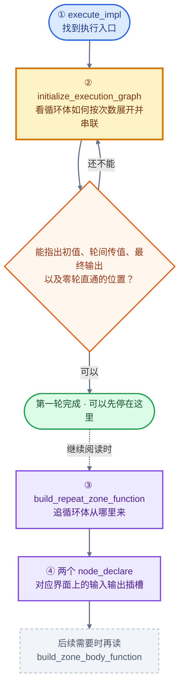
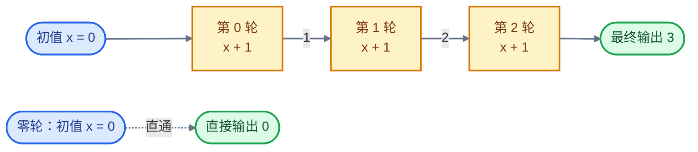
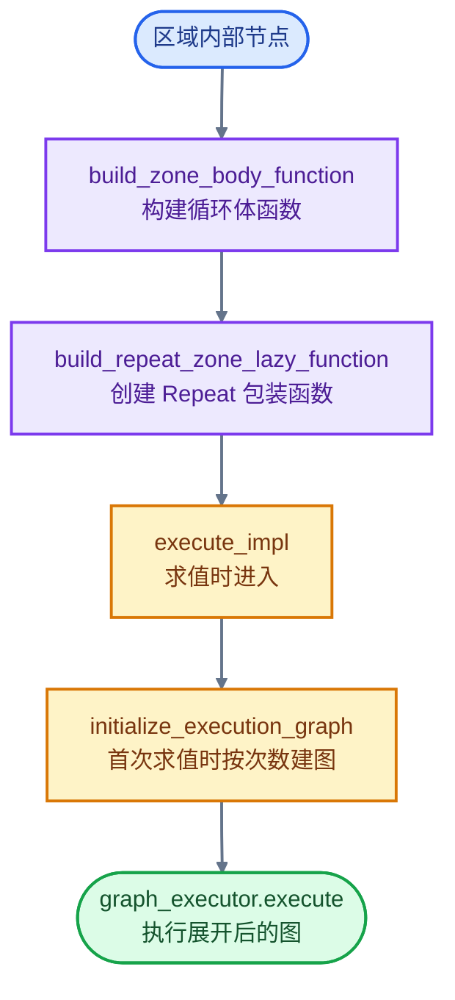

# 重复区域：直接读代码的路径

目标：先看懂几何节点 Repeat Zone 怎样执行循环。第一轮只读前两站。

始终带着这个例子：初值 `x = 0`，循环体 `x + 1`，重复 `3` 次，结果为 `3`。

## 阅读路线

下面是推荐阅读顺序，不是函数调用顺序。

## ① 找到执行入口

文件：[geometry_nodes_repeat_zone.cc](../../source/blender/nodes/intern/geometry_nodes_repeat_zone.cc)

定位：`LazyFunctionForRepeatZone::execute_impl()`，当前第 **153** 行。

只抓住三个动作：

1. 取得 `RepeatEvalStorage`，保存本次求值使用的执行图和执行器等数据。
2. 如果尚未创建执行器，调用 `initialize_execution_graph()` 建图。
3. 调用 `graph_executor->execute()` 执行图。

暂时把 `Params` 理解为输入输出接口，把 `GraphExecutor` 理解为节点图执行器，不必跳到它们的实现。

读完应能回答：**Repeat 在哪里建图，又在哪里执行图？**

## ② 看轮间传值——核心部分

还是同一个文件，定位 `initialize_execution_graph()`，当前第 **195** 行。

先找到 `iterations`，再按以下顺序读。可直接搜索表中的原文注释。

| 顺序 | 搜索文字 / 当前行号 | 看懂什么 |
| --- | --- | --- |
| 1 | `Create body nodes` / 247 | 按迭代次数创建循环体调用节点，每个节点调用同一个体函数 |
| 2 | `Handle body nodes pair-wise` / 298 | 当前轮的 `main` 输出连到下一轮的 `main` 输入 |
| 3 | `if (iterations > 0)` / 319 | 外部初值接第一轮，最后一轮接最终输出 |
| 4 | `There are no iterations` / 345 | 零轮时，初值直接接到输出 |

先只追 `main` 数据连线。遇到 `usage`、`reference_sets`、`border_links`，这一遍先略过。

把下面的图与 `add_function()`、`add_link()` 一一对应：

关键认识：这里把循环体按次数展开为调用节点，并通过连线把各轮串起来；创建节点的 `for` 循环负责建图，执行图由执行器求值。

**第一轮读到这里就可以停下。** 能找到“创建各轮、轮间传值、接入初值、取出结果、零轮直通”这五处即可。

## ③ 追循环体从哪里来

文件：[geometry_nodes_lazy_function.cc](../../source/blender/nodes/intern/geometry_nodes_lazy_function.cc)

定位：`build_repeat_zone_function()`，当前第 **2243** 行。

这个短函数主要做两件事：

1. `build_zone_body_function()`：把区域内部节点构建为循环体函数。
2. `build_repeat_zone_lazy_function()`：给循环体套上 Repeat 行为，也就是前两站读到的实现。

先看懂这个关系，不必立即进入长函数：

读完应能回答：**循环体函数和负责重复的包装函数，分别在哪里构建？**

## ④ 把界面插槽对应回来

文件：[node_geo_repeat.cc](../../source/blender/nodes/geometry/nodes/node_geo_repeat.cc)

只看两处 `node_declare()`：

- 当前第 **72** 行：Repeat Input 的插槽声明；留意通过 `output_node_id` 找到对应 Output 的代码。
- 当前第 **176** 行：Repeat Output 的插槽声明；对应界面上的 Repeat Items。

读完应能回答：**界面上的 Iterations 和循环状态插槽，在哪里声明？Input 如何找到配对的 Output？**

## 读完主线之后

下一步只选一个问题继续追：如果想知道“区域里的节点如何变成体函数”，就读 `geometry_nodes_lazy_function.cc` 中第 **2280** 行的 `build_zone_body_function()`。

其他机制等遇到实际疑问时再查原有两套文档，无需先通读。上面的行号以生成本文时的本地源码为准；代码变动后优先搜索函数名和注释。

## 配套源码讲解

按顺序阅读：[01 执行入口与相关类](01-执行入口与相关类.md) → [02 循环展开逐行阅读](02-循环展开逐行阅读.md) → [03 循环体来源与节点声明](03-循环体来源与节点声明.md)。

